# SAA-C03 Current Scope Deep Dive — 2026

> 🧠 **ภาพจำก่อนอ่าน:** 🧠 Concept → 🗺️ Flow → 🔎 Check → ✅ Explain  
> 🎨 [Visual Guide ของวิชานี้](../VISUAL-MEMORY-GUIDE-TH.md) — ดูภาพช่วยจำ แล้วอ่านรายละเอียด/คำสั่งในบทนี้

[Back to SAA Hub](./README.md) · [Exam Guide Map](./EXAM-GUIDE-MAP.md) · [QA Matrix](./QA-MATRIX.md) · [Study Path](./STUDY-PATH.md)

> **Verified against the current AWS web-based SAA-C03 Exam Guide:** 2026-10-06  
> This supplement exists because the versioned Architecting on AWS course is a strong foundation, but the current certification blueprint contains services and decision points that should not be forced back into an older course package.

## How to use this file

The SAA exam is primarily an **architecture decision exam**. For each pattern, learn this sequence:

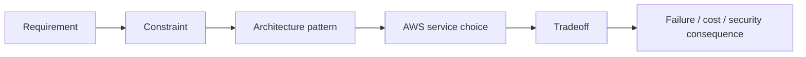

Do not memorize a service name without knowing why it wins against the nearest alternative.

---

# Domain 1 — Design Secure Architectures

## 1.1 Multi-account identity and authorization

### Organizations, IAM Identity Center, Control Tower and IAM do different jobs

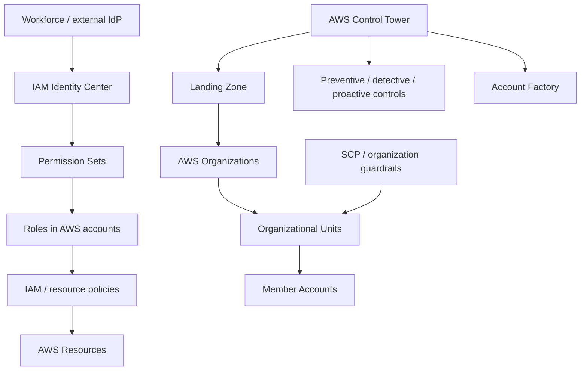

Think in layers:

- **AWS Organizations** organizes accounts and applies organization-level policy boundaries.
- **IAM Identity Center** is the normal workforce-access layer for centrally managed multi-account access and temporary credentials.
- **AWS Control Tower** orchestrates a prescriptive multi-account landing zone and governance controls on top of services such as Organizations and IAM Identity Center.
- **IAM** still decides resource-level authorization through identity and resource policies.
- **AWS STS** issues temporary credentials when roles are assumed.

### When Control Tower matters in an exam scenario

Choose Control Tower when the requirement is closer to:

- provision many accounts consistently,
- establish a governed landing zone,
- apply standardized controls across OUs,
- reduce manual multi-account setup and drift.

Do not choose it merely because “there are two accounts.” Organizations + IAM may already satisfy a simpler requirement.

### SCP mental model

An SCP is a **maximum-permission boundary for accounts/OUs**, not a permission grant.

```text
Effective permission requires:
organization boundary allows it
AND identity/resource authorization allows it
AND no applicable explicit deny blocks it
```

### RBAC, cross-account access and federation

For cross-account access, prefer role assumption over copying long-lived user credentials between accounts.

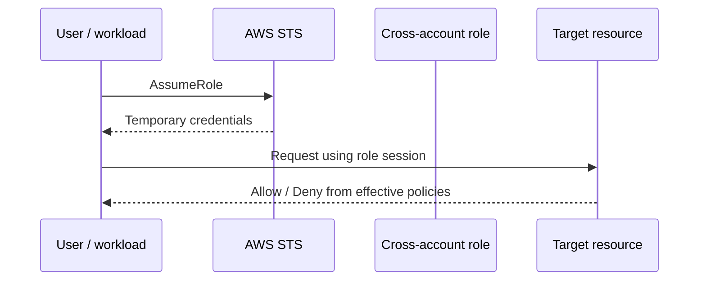

Key exam questions:

1. Who is the principal?
2. Where is the trust policy?
3. What grants the action?
4. Is an SCP/boundary/session policy reducing the effective permission?
5. Is a resource policy the cleaner design for this service?

## 1.2 Workforce identity vs application identity

Do not confuse **IAM Identity Center** with **Amazon Cognito**.

| Requirement | Better starting point |
|---|---|
| Employees need access to AWS accounts | IAM Identity Center / workforce federation |
| Web/mobile application users need sign-up/sign-in | Amazon Cognito |
| AWS workload needs permissions | IAM role / workload identity pattern |
| External workload needs temporary AWS access | Federation / STS-based role pattern |

A common distractor is choosing Cognito to manage engineers logging into AWS accounts. Cognito is for application end users, not the default workforce account-access layer.

## 1.3 Credentials and secrets

Separate **identity credentials** from **application secrets**.

- IAM roles + temporary credentials: AWS API access for workloads.
- AWS Secrets Manager: secrets that require controlled retrieval and commonly rotation workflows, such as database credentials/API secrets.
- Systems Manager Parameter Store: configuration and parameter storage; can hold encrypted values but has different feature/cost/rotation semantics.
- Do not bake credentials into AMIs, container images, Lambda code or repositories.

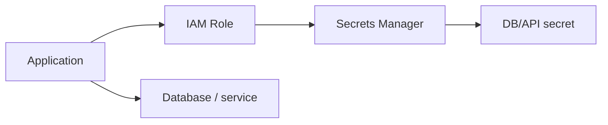

If the application can use a role directly instead of a password/key, that is generally better than storing another secret.

## 1.4 Network security architecture

Security Group and Network ACL solve different layers:

| Control | Scope | State |
|---|---|---|
| Security Group | ENI/resource | Stateful |
| Network ACL | Subnet boundary | Stateless |

A secure workload design starts with placement and flow, not with random deny rules:

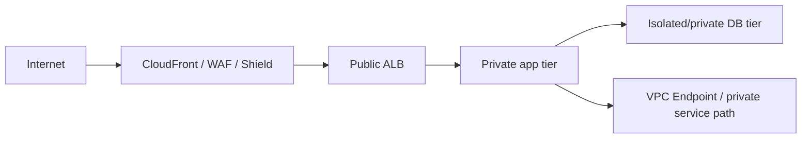

Decision questions:

- Must the workload have a public IP at all?
- Can an AWS service be reached through a VPC endpoint instead of NAT/internet?
- Which ports must cross each tier?
- Is the connection hybrid? Then compare Site-to-Site VPN vs Direct Connect based on bandwidth, consistency, lead time and redundancy requirements.

## 1.5 Security services: choose by signal

| Service | Architecture question it answers |
|---|---|
| Amazon GuardDuty | “Is there suspicious/threat activity in AWS telemetry?” |
| Amazon Macie | “Where is sensitive data in S3 and what data-risk findings exist?” |
| AWS WAF | “Should this HTTP(S) web request be allowed?” |
| AWS Shield | “How do I improve DDoS protection for supported internet-facing resources?” |
| AWS Secrets Manager | “How should this application secret be stored/retrieved/rotated?” |
| Amazon Cognito | “How should app users authenticate?” |

GuardDuty is not a WAF. Macie is not an encryption service. WAF does not replace IAM.

## 1.6 Data security: KMS, TLS and lifecycle

### At rest vs in transit

- **AWS KMS** manages cryptographic keys and authorization around key use for integrated services.
- **AWS Certificate Manager (ACM)** manages TLS certificates for supported AWS-integrated endpoints.

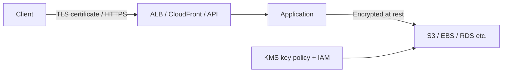

### Key policy trap

An IAM Allow alone is not always enough if the KMS key policy/grant design does not allow the principal/service path. When KMS access fails, inspect both:

1. caller identity permissions,
2. key policy / grant,
3. Region/key/resource match,
4. service integration context.

### Data governance decisions

For a data-security scenario identify:

- classification/sensitivity,
- who may read/write,
- retention period,
- immutability or deletion protection needs,
- replication/backup requirements,
- encryption and key ownership,
- audit trail.

Security is not “turn on encryption” and stop thinking.

---

# Domain 2 — Design Resilient Architectures

## 2.1 Loose coupling and independent scaling

A tightly coupled chain lets one slow component become everybody's outage.

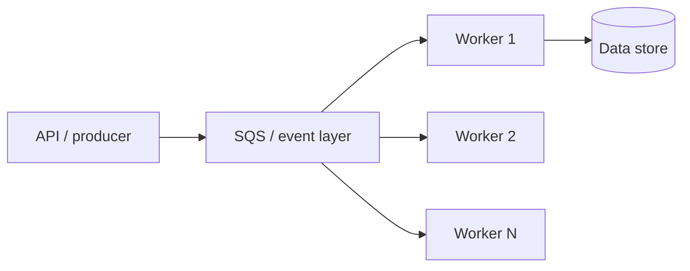

Use messaging/queues when you need buffering, retry and independent scaling. Use publish/subscribe when one event must fan out to independent consumers. Use orchestration when a business workflow needs explicit state/branch/retry coordination.

### SQS vs SNS vs EventBridge vs Step Functions

| Need | Start with |
|---|---|
| Durable work queue / buffering | SQS |
| Push one message to many subscribers | SNS |
| Route events by event pattern across producers/consumers | EventBridge |
| Explicit multi-step workflow/state/retry | Step Functions |

These services can be combined; the exam often asks for the simplest architecture that satisfies the requirement.

## 2.2 Stateless vs stateful tiers

Horizontal scaling works best when application instances are replaceable.

Move shared state out of individual application servers:

- session/cache → ElastiCache or another appropriate shared store,
- relational data → RDS/Aurora,
- objects → S3,
- shared files → EFS/FSx where file semantics are actually needed.

Do not put irreplaceable application state on one EC2 instance and then call the tier “Auto Scaling.”

## 2.3 Containers vs serverless

### Containers

Choose ECS/EKS when you need a container-oriented deployment and scheduling model. Fargate can remove server management for supported ECS/EKS workloads.

### Lambda

Choose Lambda for event-driven functions where its execution/runtime model fits. Do not choose it merely because “serverless is always cheaper.” Consider duration, concurrency, startup behavior, payload/runtime limits and downstream capacity.

### Migration into containers

Containerizing an application does not automatically make it stateless, resilient or microservice-based. First identify:

- local filesystem dependency,
- process/session state,
- configuration/secrets,
- network dependencies,
- health checks,
- startup/shutdown behavior.

## 2.4 API Gateway and edge acceleration

API Gateway is a managed API front door/control plane. CloudFront is an edge cache/content-delivery layer. They solve different problems and can be used together.

Use a CDN when content can benefit from edge caching and reduced origin load/latency. Do not assume dynamic or personalized traffic gets the same benefit without an appropriate cache policy.

## 2.5 Read scaling is not HA

A read replica is primarily a read-scaling/replication tool. Multi-AZ database deployment is primarily an availability/failover design.

```text
Read-heavy requirement → read replica / cache / read architecture
Availability requirement → Multi-AZ / multi-node design according to engine
Disaster-recovery requirement → backup/replication/cross-Region strategy based on RPO/RTO
```

Do not answer “read replica” simply because the question says “database must not go down.”

## 2.6 RDS Proxy and connection storms

RDS Proxy pools and manages database connections for supported RDS/Aurora engines. It is especially useful when many application instances/functions can create connection spikes.

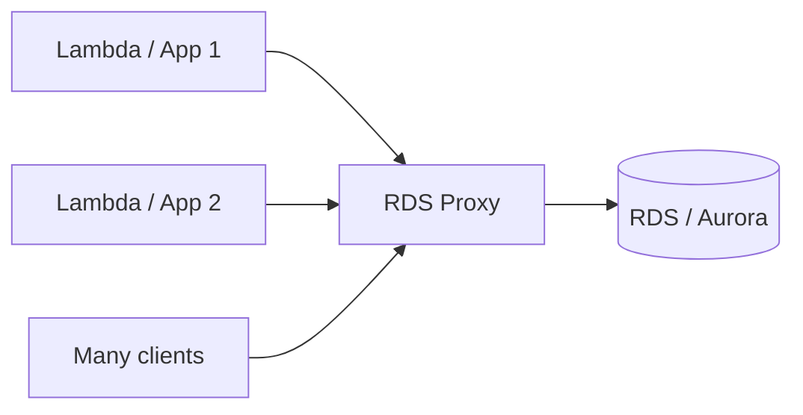

It does not replace read replicas, database indexes or query tuning. It solves a connection-management problem.

The repository's full-architecture project already reinforces this pattern when discussing database connection exhaustion.

## 2.7 Highly available vs fault tolerant vs disaster recovery

Use RPO/RTO to drive the recovery pattern rather than memorizing “multi-Region = best.”

| Pattern | Cost/readiness | Typical idea |
|---|---|---|
| Backup & restore | Lowest steady-state / slowest recovery | rebuild from backups |
| Pilot light | Small critical core remains | scale supporting tiers after disaster |
| Warm standby | Reduced-capacity environment runs | scale up on failover |
| Active-active / multi-site | Highest readiness/cost | multiple live sites serve traffic |

Design all dependencies, not only compute. DNS, secrets, keys, quotas, data replication and deployment artifacts can all become DR blockers.

## 2.8 Immutable infrastructure

Immutable design replaces infrastructure with a new known version rather than repeatedly modifying long-lived servers.

Useful mechanisms include:

- versioned AMIs/images,
- launch templates,
- infrastructure as code,
- blue/green or rolling replacement strategies.

This reduces configuration drift and makes rollback/recovery more deterministic.

## 2.9 Quotas and throttling are architecture limits

A standby Region with zero required quota is not a complete DR plan.

Before disaster or large scaling events, validate:

- EC2/accelerator limits,
- service concurrency,
- API rate limits,
- NAT/network capacity,
- load balancer/backend limits,
- database connection/capacity constraints.

Throttling should trigger backoff/retry or buffering according to service semantics; blind immediate retry can amplify failure.

## 2.10 Workload visibility and AWS X-Ray

CloudWatch answers metrics/log questions. AWS X-Ray/distributed tracing helps answer “which hop in this request path is slow/failing?”

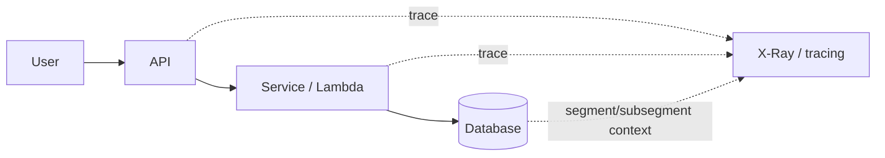

Use business-impact metrics as well as infrastructure metrics. “CPU is fine” does not prove the service is healthy.

---

# Domain 3 — Design High-Performing Architectures

## 3.1 Storage: match semantics before performance

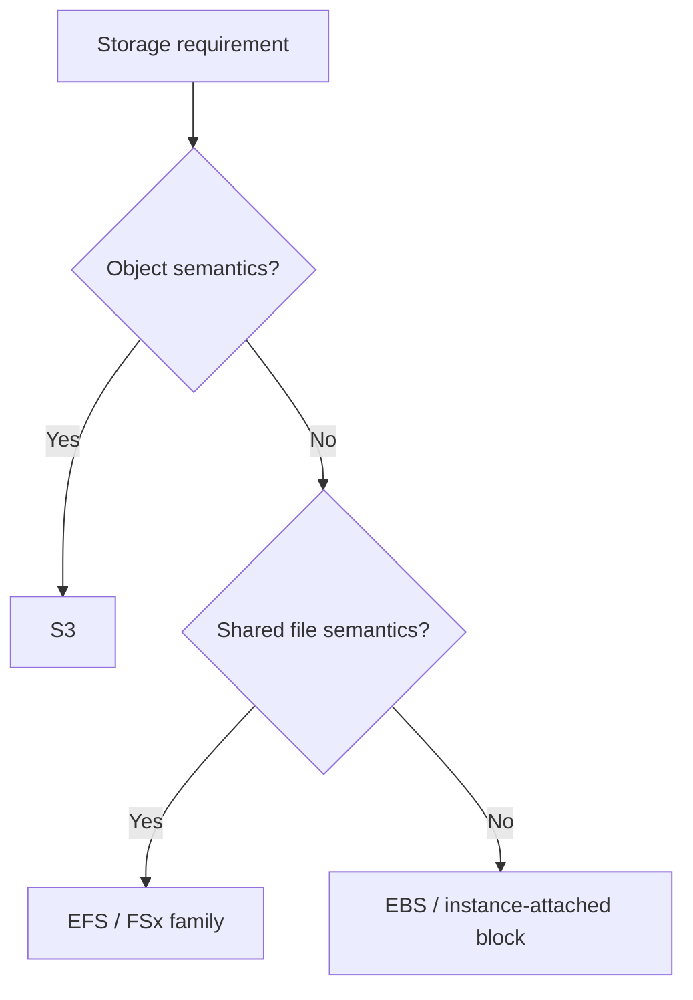

After semantics, compare:

- throughput,
- IOPS/latency,
- access pattern,
- concurrency,
- scale,
- durability/availability,
- cost.

Hybrid requirements can bring in DataSync, Storage Gateway or Transfer Family depending on protocol and migration/access pattern.

## 3.2 Compute: service first, size second

Current SAA scope expects more than EC2 vs Lambda.

| Workload | Candidate |
|---|---|
| Long-running VM / OS control | EC2 |
| Containerized app | ECS/EKS, with EC2 or Fargate capacity |
| Event-driven function | Lambda |
| Batch jobs / job queues | AWS Batch |
| Large distributed data processing | Amazon EMR |

Then choose resource size/family from workload behavior, not habit.

### Scaling signals

Good scaling signals correlate with actual saturation/work demand, for example:

- request count / target response time,
- queue depth,
- CPU or memory where meaningful,
- custom business/workload metric.

Scaling compute while a database/network dependency is capped simply moves the bottleneck.

## 3.3 Database performance decision tree

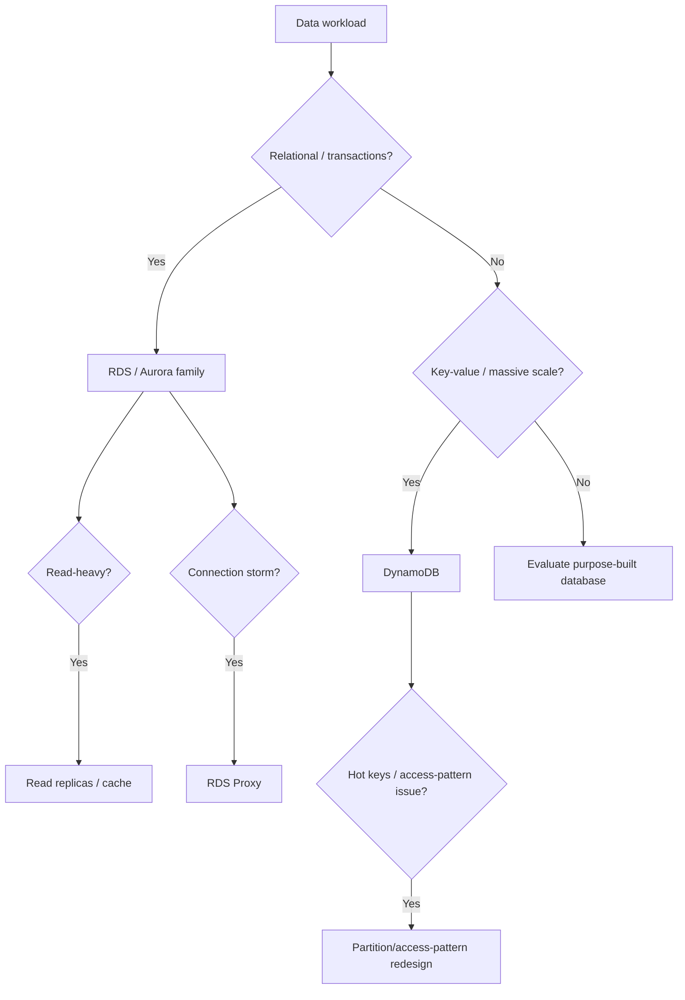

Performance is about access patterns and bottlenecks, not only engine branding.

Know the distinctions among:

- read replica,
- Multi-AZ,
- cache,
- connection proxy,
- storage/IOPS configuration,
- capacity mode / partition design.

## 3.4 Network performance

### CloudFront vs Global Accelerator

- **CloudFront**: content/application delivery through edge caching/proxy behavior for supported protocols/use cases.
- **Global Accelerator**: improves global path/availability for supported TCP/UDP applications through AWS's global network and static anycast IPs; it is not a content cache.

### PrivateLink / VPC endpoints

Use private service connectivity when you want to reach supported services without traversing a public internet/NAT path. This can improve security architecture and sometimes reduce NAT/data-processing cost, but endpoints have their own pricing and topology considerations.

### Hybrid connectivity

Choose among VPN and Direct Connect from requirements for:

- setup time,
- bandwidth,
- consistency,
- encryption requirement,
- redundancy,
- cost.

A single Direct Connect or single VPN is still a single failure path unless redundancy is designed.

## 3.5 Data ingestion and transformation — current-scope gap area

This is one of the most important additions beyond a traditional infrastructure-only SAA study plan.

### End-to-end mental model

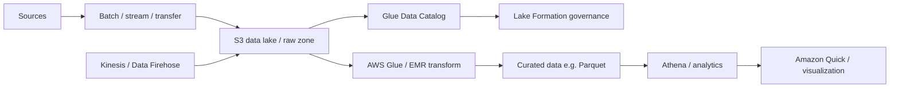

### Batch transfer

- **AWS DataSync**: managed high-speed data movement between supported storage systems/AWS storage for migration/recurring transfer use cases.
- **AWS Storage Gateway**: hybrid storage interface/pattern where on-premises applications need AWS-backed storage integration.
- **AWS Transfer Family**: managed file-transfer endpoints/protocols such as SFTP/FTPS/FTP/AS2 depending on service support and requirement.

Choose based on the interface and ongoing access model, not just “moves files.”

### Streaming

- **Amazon Kinesis Data Streams**: stream ingestion where consumers process records from shards/stream capacity.
- **Amazon Data Firehose**: managed delivery of streaming data to supported destinations, with buffering/transformation capabilities according to configuration.

If the consumer needs direct stream processing/control, Kinesis Data Streams may fit. If the requirement is primarily managed delivery to a destination, Data Firehose is often simpler.

### Glue, Athena and Lake Formation

- **AWS Glue Data Catalog**: shared metadata catalog.
- **AWS Glue**: managed data integration/ETL capabilities.
- **Amazon Athena**: serverless SQL query over supported data sources/formats, commonly S3-based analytics.
- **AWS Lake Formation**: governance and fine-grained permissions around registered data lake data/catalog resources.

Lake Formation is not “another S3 bucket.” It is a governance/access layer that integrates with services such as Athena, Glue and EMR.

### Format transformation

Converting row-oriented text such as CSV to a columnar format such as Parquet can reduce scanned data and improve analytics efficiency for suitable query patterns. But format choice also depends on update/write/access behavior; there is no universal best file format.

### Visualization

The current guide names Amazon Quick for analytics visualization. Treat visualization as the presentation layer after the data is queryable and governed; it does not replace the ingestion/catalog/transformation layers.

---

# Domain 4 — Design Cost-Optimized Architectures

## 4.0 Cost optimization starts with measurement

Before “optimizing,” know where cost comes from.

| Tool/feature | Best mental model |
|---|---|
| Cost allocation tags | attribute cost to owners/apps/environments |
| AWS Cost Explorer | interactive cost/usage analysis |
| AWS Budgets | threshold/forecast alerts and supported budget actions |
| Cost and Usage Report / data exports | detailed billing dataset for deeper analysis |
| Multi-account consolidated billing | aggregate billing/usage across organization accounts |

The repository FinOps projects already implement CUR → S3 → Glue/Athena-style analysis and Cost Explorer/Budget concepts; the certification hub now makes those patterns explicit.

## 4.1 Cost-optimized storage

### Access frequency drives tiering

Do not pick the cheapest storage-class price in isolation. Consider:

- access frequency,
- retrieval charges,
- minimum storage duration,
- request cost,
- retrieval latency,
- lifecycle/retention requirement.

### Lifecycle

S3 Lifecycle can transition or expire objects according to policy. Versioning and lifecycle interact: retaining many noncurrent versions can create hidden cost if cleanup is not designed.

### Requester Pays

Use S3 Requester Pays when the architecture requirement is for the **requester** to pay request/data-transfer charges for access to a bucket, subject to the feature's rules. It is not a generic cost-saving switch for every bucket.

### Block storage

Choose EBS type and provisioned performance from workload IOPS/throughput/latency requirements. Oversizing performance “just in case” is a direct cost smell.

### Migration/transfer

For very large datasets, compare transfer duration, link bandwidth, online/offline method, egress/ingress charges and operational effort. The cheapest architecture is not always the lowest per-GB sticker price if the transfer cannot meet the deadline.

## 4.2 Cost-optimized compute

### Purchase model

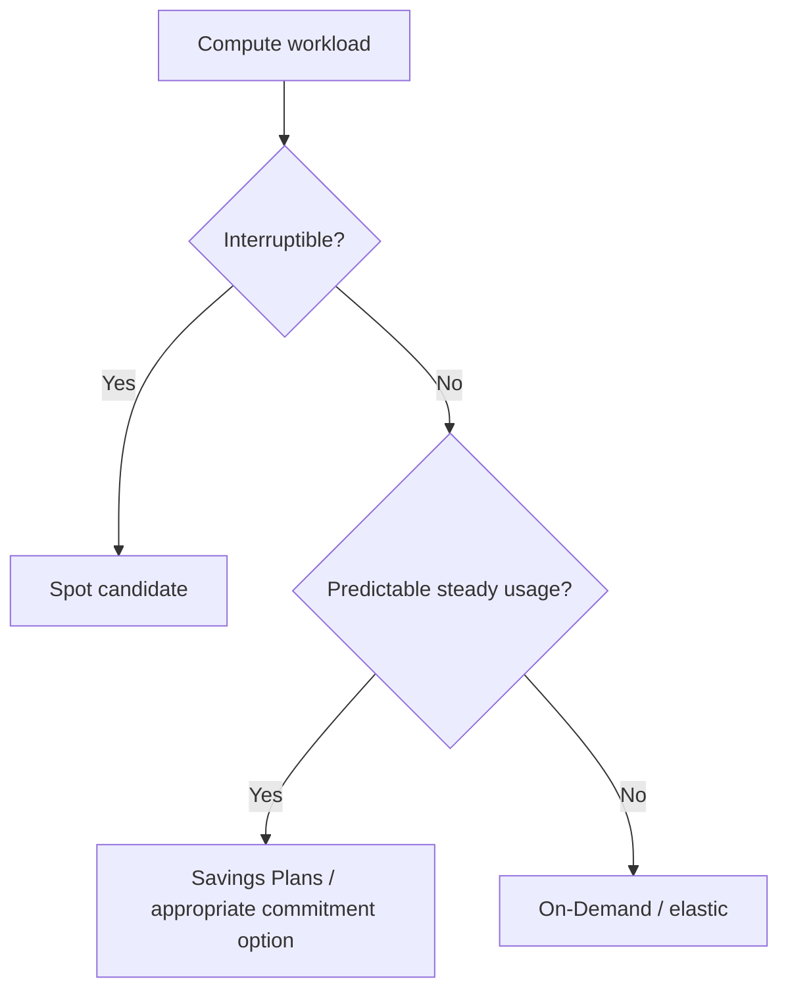

Do not choose Spot for a workload that cannot tolerate interruption without a recovery design.

### Rightsizing

Correct sequence:

1. measure workload,
2. choose service model,
3. choose family,
4. choose size,
5. add scaling,
6. review utilization and cost again.

Containers/serverless can improve utilization and operational efficiency, but they are not automatically cheaper under every traffic profile.

### Availability has a price

A dev/test environment may not need the same Multi-AZ/multi-Region architecture as a revenue-critical production service. Cost optimization means meeting the required SLO/RTO/RPO at minimum appropriate cost — not deleting resilience blindly.

## 4.3 Cost-optimized databases

Cost levers include:

- database type/engine,
- serverless/provisioned model where supported,
- instance/capacity size,
- read replicas,
- storage/IOPS,
- retention/snapshot policy,
- cache,
- connection efficiency/proxy,
- data model/access pattern.

A cheaper instance that is permanently overloaded and forces retries is not truly cheaper.

### Purpose-built data types

The exam can test whether a relational database is unnecessarily expensive/complex for a key-value or other purpose-built workload. Start from workload semantics and access pattern, then compare cost.

## 4.4 Cost-optimized networking

Network cost is often architectural, not cosmetic.

### NAT architecture

A NAT gateway has hourly/data-processing cost and traffic-path implications. Evaluate:

- one shared NAT vs per-AZ NAT,
- cross-AZ transfer if workloads traverse AZs to reach NAT,
- whether AWS-service traffic can use a VPC endpoint,
- required availability.

Do not optimize away redundant NAT paths if the workload's availability requirement needs them; calculate the tradeoff.

### Keep traffic on the right path

Check:

- cross-AZ traffic,
- cross-Region traffic,
- internet egress,
- NAT processing,
- VPC endpoint cost vs NAT path,
- CloudFront edge caching for cacheable internet content,
- Direct Connect/VPN economics for sustained hybrid traffic.

### Bandwidth and throttling

Buying more bandwidth is useful only if bandwidth is the bottleneck. For bursty systems, throttling/backpressure/queueing can sometimes meet requirements more cheaply than permanently provisioning peak capacity.

---

# Cross-domain exam method

When a question gives multiple plausible AWS designs, evaluate in this order:

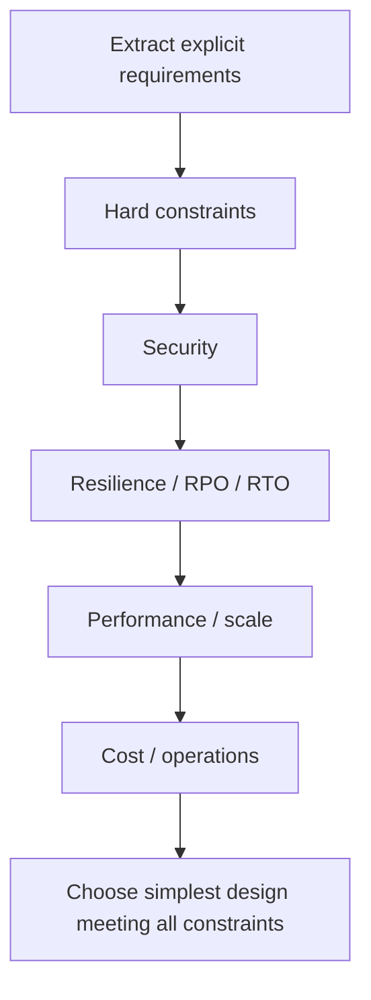

## Common traps

- choosing a service because its name appears in the question instead of matching the requirement,
- treating Multi-AZ, read replicas and backups as interchangeable,
- treating encryption as equivalent to authorization,
- using public internet/NAT when a private endpoint is the actual requirement,
- scaling app servers without checking downstream limits,
- choosing the lowest unit price while ignoring transfer/retrieval/request costs,
- confusing workforce identity with application-user identity,
- using a complex multi-Region design when the RPO/RTO does not require it,
- assuming a managed service removes the need to design IAM, quotas and failure handling.

## Self-check

You are ready for objective-level QA when you can explain without notes:

1. Organizations vs Control Tower vs IAM Identity Center.
2. Identity Center vs Cognito.
3. GuardDuty vs Macie vs WAF vs Shield.
4. KMS vs ACM and where key policies matter.
5. SQS vs SNS vs EventBridge vs Step Functions.
6. Read replica vs Multi-AZ vs backup/DR.
7. Why RDS Proxy helps connection storms.
8. CloudFront vs Global Accelerator vs PrivateLink.
9. DataSync vs Storage Gateway vs Transfer Family.
10. Kinesis Data Streams vs Data Firehose.
11. Glue Catalog/ETL vs Athena vs Lake Formation.
12. Cost Explorer vs Budgets vs billing exports/CUR.
13. Spot vs commitment vs On-Demand.
14. Why NAT topology can create both cost and availability tradeoffs.
15. How to choose an architecture across security → resilience → performance → cost instead of optimizing one dimension in isolation.
