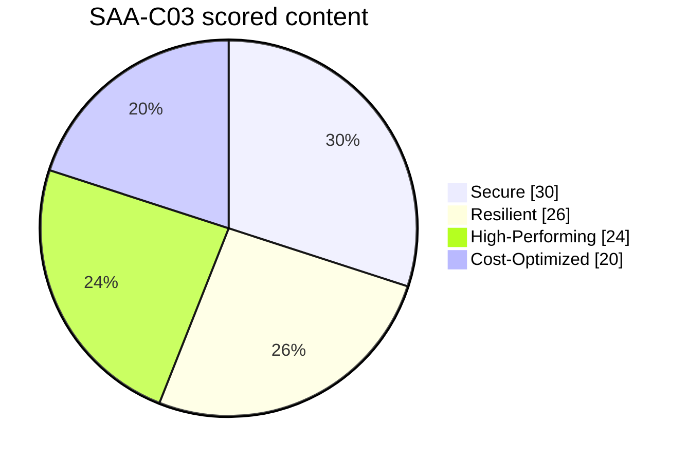
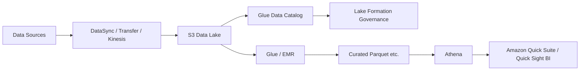

# SAA-C03 Current Exam Guide Map

[Back to SAA Hub](./README.md) · [Objective QA Matrix](./QA-MATRIX.md) · [Current Scope Deep Dive](./CURRENT-SCOPE-DEEP-DIVE.md) · [Sources](./SOURCES.md)

> **Official source:** current web-based AWS Certified Solutions Architect – Associate (SAA-C03) Exam Guide  
> **Checked:** 2026-10-06  
> **Coverage result:** **14/14 task statements and 189/189 published Knowledge/Skill bullets accounted for**

## Exam blueprint

| Domain | Weight | Tasks | Published Knowledge/Skill bullets | QA |
|---|---:|---:|---:|---:|
| Design Secure Architectures | 30% | 3 | 32 | **32/32 PASS** |
| Design Resilient Architectures | 26% | 2 | 43 | **43/43 PASS** |
| Design High-Performing Architectures | 24% | 5 | 50 | **50/50 PASS** |
| Design Cost-Optimized Architectures | 20% | 4 | 64 | **64/64 PASS** |
| **Total** | **100%** | **14** | **189** | **189/189 PASS** |

The task names below are the stable navigation layer; detailed Knowledge/Skill evidence lives in [`QA-MATRIX.md`](./QA-MATRIX.md).

---

# Domain 1 — Design Secure Architectures (30%)

## Task 1.1 — Secure access to AWS resources

Primary learning path:

- Architecting Module 01 — shared responsibility/global infrastructure
- Architecting Module 02 — IAM, roles, policies, STS, Organizations/SCP
- Architecting `CURRENTNESS-2026.md` — federation/IAM Identity Center and modern root-account guidance
- SAA Current Scope Deep Dive §1.1–1.2 — Control Tower, Identity Center, cross-account/federation decisions

Hands-on reinforcement:

- Project 21 — Security Compliance
- Project 25 — Zero Trust
- Project 34 — Full Architecture

Current additions beyond older course emphasis:

- AWS IAM Identity Center as workforce access layer,
- AWS Control Tower landing-zone/governance use cases,
- clearer workforce identity vs application-user identity decisions.

## Task 1.2 — Secure workloads and applications

Primary learning path:

- Architecting Modules 02, 03, 10, 12
- Current Scope Deep Dive §1.2–1.5

Current-scope additions:

- Amazon Cognito,
- Amazon GuardDuty,
- Amazon Macie,
- AWS Secrets Manager,
- private service-endpoint thinking,
- WAF/Shield vs identity/threat/data-discovery boundaries.

Hands-on:

- Projects 02, 17, 21, 25, 30, 34.

## Task 1.3 — Data security controls

Primary learning path:

- Architecting Modules 02, 05, 06, 13
- Current Scope Deep Dive §1.6

Key decisions:

- KMS/key policy vs IAM permissions,
- ACM/TLS vs at-rest encryption,
- classification/access/retention/recovery as one data-governance system,
- backup/replication/lifecycle/protection policies.

Hands-on:

- Projects 15, 17, 21, 30.

**Domain 1 evidence:** [`QA-MATRIX.md#domain-1--design-secure-architectures-30`](./QA-MATRIX.md#domain-1--design-secure-architectures-30)

---

# Domain 2 — Design Resilient Architectures (26%)

## Task 2.1 — Scalable and loosely coupled architectures

Primary theory:

- Architecting Modules 07, 09, 11, 12
- Current Scope Deep Dive §2.1–2.5

Decision families:

- SQS vs SNS vs EventBridge vs Step Functions,
- stateless vs stateful application tiers,
- containers vs Lambda/serverless,
- API Gateway vs CDN concerns,
- read replicas as read-scaling rather than generic HA,
- purpose-built compute/storage/network/database selections.

Hands-on:

- Project 06 — 3-Tier
- Project 08 — Serverless
- Project 12 — EKS
- Project 24 — Event-Driven
- Project 34 — Full Architecture

## Task 2.2 — Highly available and/or fault-tolerant architectures

Primary theory:

- Architecting Modules 07, 08, 12, 13
- Current Scope Deep Dive §2.6–2.10

Current-scope additions:

- RDS Proxy connection-pooling pattern,
- Service Quotas and throttling as recovery/scaling dependencies,
- AWS X-Ray / distributed tracing,
- immutable infrastructure,
- DR design driven by RPO/RTO rather than “multi-Region is always best.”

Hands-on:

- Project 08 — X-Ray instrumentation
- Project 15 — Disaster Recovery
- Project 20 — Multi-Region
- Project 34 — RDS Proxy/tracing/failure analysis

**Domain 2 evidence:** [`QA-MATRIX.md#domain-2--design-resilient-architectures-26`](./QA-MATRIX.md#domain-2--design-resilient-architectures-26)

---

# Domain 3 — Design High-Performing Architectures (24%)

## Task 3.1 — High-performing/scalable storage

Primary theory:

- Architecting Module 05
- Current Scope Deep Dive §3.1

Mental model: choose object/file/block/hybrid semantics first, then tune throughput/IOPS/latency/scale.

## Task 3.2 — High-performing elastic compute

Primary theory:

- Architecting Modules 04, 07, 09, 11
- Current Scope Deep Dive §3.2

Current scope adds explicit service-choice reasoning for:

- AWS Batch,
- Amazon EMR,
- AWS Fargate,
- independent scaling and meaningful scaling metrics,
- EC2 family/size and Lambda resource sizing.

## Task 3.3 — High-performing databases

Primary theory:

- Architecting Module 06
- Current Scope Deep Dive §2.6/3.3

Decision families:

- read/write access patterns,
- replication/read replicas,
- caching,
- connection proxy,
- IOPS/capacity,
- relational/non-relational/in-memory/serverless choices.

## Task 3.4 — High-performing/scalable networks

Primary theory:

- Architecting Modules 03, 07, 10, 12
- Current Scope Deep Dive §3.4

Key comparisons:

- CloudFront vs Global Accelerator,
- VPN vs Direct Connect,
- VPC endpoint/PrivateLink paths,
- placement/topology/load-balancing strategy.

## Task 3.5 — Data ingestion and transformation

This was the biggest gap in the old certification map.

Current learning layer now covers:

Hands-on reinforcement:

- Project 18 — CUR → S3 → Glue → Athena FinOps pipeline
- Project 24 — event/streaming architecture concepts
- Project 30 — Security Lake/data-lake governance context

**Domain 3 evidence:** [`QA-MATRIX.md#domain-3--design-high-performing-architectures-24`](./QA-MATRIX.md#domain-3--design-high-performing-architectures-24)

---

# Domain 4 — Design Cost-Optimized Architectures (20%)

## Task 4.1 — Cost-optimized storage

Primary theory:

- Architecting Modules 05 and 13
- Current Scope Deep Dive §4.0–4.1

Current additions:

- Requester Pays,
- Cost Explorer/Budgets/detailed billing exports,
- lifecycle + retrieval/minimum-duration tradeoffs,
- transfer/migration cost decisions,
- performance-provisioning vs storage cost.

## Task 4.2 — Cost-optimized compute

Primary theory:

- Architecting Modules 04, 07, 09, 11, 12
- Current Scope Deep Dive §4.2

Decision families:

- Spot vs commitment/Savings Plans vs On-Demand,
- family/size rightsizing,
- availability class vs cost,
- Lambda/EC2/Fargate fit,
- horizontal/vertical scaling/hibernation,
- ALB/NLB/GWLB selection.

## Task 4.3 — Cost-optimized databases

Primary theory:

- Architecting Module 06
- Current Scope Deep Dive §4.3

Key cost drivers:

- correct database model before instance sizing,
- caching,
- capacity/provisioning,
- read replicas,
- connection efficiency,
- retention/backups,
- migration/engine choice,
- purpose-built data models.

## Task 4.4 — Cost-optimized networks

Primary theory:

- Architecting Modules 10/12
- Current Scope Deep Dive §4.4

Current additions:

- NAT topology vs cross-AZ/data-processing cost,
- endpoint vs NAT path,
- transfer-cost-aware routing,
- CDN/edge caching economics,
- Direct Connect/VPN/bandwidth decisions,
- throttling/backpressure as a capacity/cost design tool.

Hands-on:

- Project 10 — Cost Optimizer
- Project 18 — FinOps Dashboard
- Project 29 — FinOps Maturity
- Project 32 — Savings Plans/Cost Optimization
- Project 34 — architecture tradeoff review

**Domain 4 evidence:** [`QA-MATRIX.md#domain-4--design-cost-optimized-architectures-20`](./QA-MATRIX.md#domain-4--design-cost-optimized-architectures-20)

---

# Practice sequence

Use the repository-owned current scenarios first:

- [`CURRENT-SCOPE-SCENARIOS.md`](./CURRENT-SCOPE-SCENARIOS.md) — 20 original architecture scenarios, five/four-ish across all four domains.

Then use the six legacy walkthroughs for additional reasoning practice, with the provenance caution stated in the hub README.

---

# What this map proves

As of 2026-10-06:

- all 14 current task statements have a direct study path,
- all 189 published Knowledge/Skill bullets have evidence in the objective QA matrix,
- current-scope gaps that the older course does not explain deeply enough are taught in the certification deep dive,
- hands-on/project links reinforce the major architecture patterns,
- original current-scope scenarios exist independently of the legacy practice sets.

This is therefore **Verified Current Objective Scope**, not a claim that the AWS service list is permanent or exhaustive. Revalidate against the live AWS web guide before a later exam-prep cycle.
