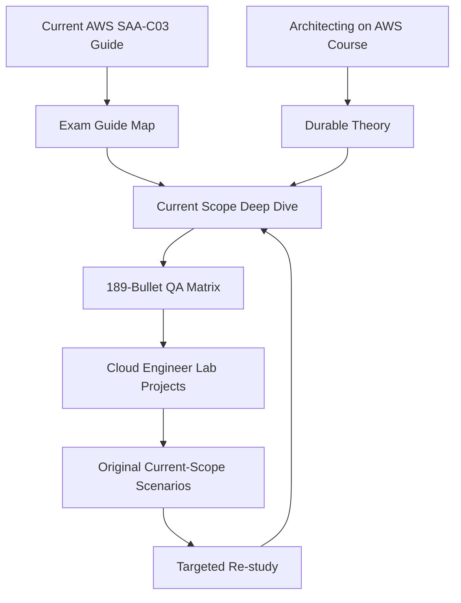

# AWS Certified Solutions Architect – Associate (SAA-C03) — Study Hub 🌩️

> **AWS-SAA-C03 layer 01/03 — Certification Core:** current exam scope, gap study, scenarios and objective QA.

> **Status:** **Verified Current Objective Scope**  
> **Objective scope verified:** 2026-10-06  
> **Practice provenance reviewed:** 2026-10-07  
> **Source of truth:** current web-based AWS SAA-C03 Exam Guide  
> **Objective QA:** **14/14 tasks · 189/189 published Knowledge/Skill bullets PASS**  
> **Exam weights:** Secure 30% · Resilient 26% · High-Performing 24% · Cost-Optimized 20%  
> **Important:** the AWS service list is non-exhaustive and can change; this verification is date-scoped, not permanent

[← AWS-SAA-C03 Learning System](../README.md)

## Start here

Use this order rather than jumping directly into random practice questions:

1. [Integrated Study Path](./STUDY-PATH.md) — theory → current gaps → hands-on → practice.
2. [Current Exam Guide Map](./EXAM-GUIDE-MAP.md) — 4 domains / 14 tasks and where each is taught.
3. [Current Scope Deep Dive](./CURRENT-SCOPE-DEEP-DIVE.md) — modern SAA topics not sufficiently explained by the versioned course alone.
4. [Objective QA Matrix](./QA-MATRIX.md) — proof that all 189 current published Knowledge/Skill bullets are accounted for.
5. [Original Current-Scope Scenarios](./CURRENT-SCOPE-SCENARIOS.md) — 20 repository-authored practice scenarios.
6. [Source Manifest](./SOURCE-MANIFEST.md) + [Sources & Freshness Policy](./SOURCES.md) — source roles and revalidation rules.
7. [Practice & Provenance Policy](./PRACTICE-PROVENANCE.md) — what practice content may enter the repository.
8. [Architecting on AWS 7.12.4](../02-Architecture-Foundation/) — long-form architecture foundation.
9. [Cloud Engineer Lab](../03-Hands-On-Projects/) — hands-on architecture and failure practice.

## Learning architecture

The design deliberately keeps **course provenance** and **current certification scope** separate while presenting them as one learner journey.

---

## Current blueprint

| Domain | Weight | Tasks | Published objective bullets | Repository QA |
|---|---:|---:|---:|---:|
| Design Secure Architectures | 30% | 3 | 32 | **32/32 PASS** |
| Design Resilient Architectures | 26% | 2 | 43 | **43/43 PASS** |
| Design High-Performing Architectures | 24% | 5 | 50 | **50/50 PASS** |
| Design Cost-Optimized Architectures | 20% | 4 | 64 | **64/64 PASS** |
| **Total** | **100%** | **14** | **189** | **189/189 PASS** |

The detailed evidence is in [`QA-MATRIX.md`](./QA-MATRIX.md).

## What the current-scope layer adds

The Architecting course already provides strong core theory. This certification layer fills or modernizes areas such as:

### Security

- IAM Identity Center and workforce federation,
- AWS Control Tower and governed multi-account landing zones,
- Cognito vs workforce identity,
- GuardDuty vs Macie vs WAF vs Shield,
- Secrets Manager,
- KMS/ACM security decisions.

### Resilience

- SQS/SNS/EventBridge/Step Functions decision boundaries,
- RDS Proxy connection storms,
- quotas/throttling as architecture dependencies,
- AWS X-Ray / distributed tracing,
- immutable infrastructure,
- RPO/RTO-driven DR.

### Performance / data

- AWS Batch and Amazon EMR,
- CloudFront vs Global Accelerator,
- DataSync / Storage Gateway / Transfer Family,
- Kinesis Data Streams vs Amazon Data Firehose,
- Glue / Lake Formation / Athena / Amazon Quick Suite analytics path,
- CSV→Parquet-style transformation reasoning.

### Cost

- Cost Explorer / Budgets / detailed billing exports,
- S3 Requester Pays,
- storage lifecycle/retrieval economics,
- Spot / Savings Plans / On-Demand decision patterns,
- NAT/cross-AZ/VPC-endpoint transfer-cost architecture,
- cost-aware database-model selection.

Read [`CURRENT-SCOPE-DEEP-DIVE.md`](./CURRENT-SCOPE-DEEP-DIVE.md) for the actual teaching content, not just this list.

---

## Hands-on reinforcement

Selected high-value projects from [`../03-Hands-On-Projects/`](../03-Hands-On-Projects/):

| Area | Projects |
|---|---|
| Secure | 17 Secrets Management, 21 Security Compliance, 25 Zero Trust, 30 Cloud Native SecOps |
| Resilient | 06 3-Tier, 08 Serverless, 15 DR, 20 Multi-Region, 24 Event-Driven, 34 Full Architecture |
| Performance | 01 S3+CloudFront, 12 EKS, 16 Advanced Network, 18 FinOps data pipeline, 31 Hybrid Network |
| Cost | 10 Cost Optimizer, 18 FinOps Dashboard, 29 FinOps Maturity, 32 Cost Optimization/Savings Plans, 34 Full Architecture |

The project track is deliberately broader than the exam. Use the mapping as reinforcement, not as a claim that every project is exam-required.

---

## Practice strategy

### Layer 1 — current repository-owned scenarios

Start with [`CURRENT-SCOPE-SCENARIOS.md`](./CURRENT-SCOPE-SCENARIOS.md).

These 20 scenarios were written from the current public objective families. For every answer, explain **why the closest alternative loses**.

### Layer 2 — create new variations, not copied banks

After completing the repository-owned scenarios, create variations by changing constraints such as RTO/RPO, latency, compliance, traffic shape, write/read ratio or cost priority. Then explain why the winner changes.

The six historical walkthrough files that previously lived under `practice-exam/` were removed from the current tree on 2026-10-07 because their source/license could not be established from repository evidence. See [PRACTICE-PROVENANCE.md](./PRACTICE-PROVENANCE.md).

---

## Why the course and certification remain separate packages

They have different maintenance rules:

- **Architecting on AWS 7.12.4** = versioned source-ingestion package; preserve what the course teaches and add a clearly separated currentness overlay.
- **SAA-C03** = Internet-first certification package; current AWS web exam guide controls scope and can change over time.

Physically merging them would make future certification changes silently rewrite course provenance. The hub links them instead.

---

## What “100%” means here

The repository may say **100% current objective coverage** only in this bounded sense:

> Every Knowledge/Skill bullet published under the current SAA-C03 task statements was mapped to teachable repository content and passed QA on 2026-10-06.

It does **not** mean:

- every AWS service is documented,
- the AWS in-scope service list is permanent,
- real exam questions are known,
- exam success is guaranteed,
- removed historical files are necessarily erased from old Git history.

AWS itself describes the service list as non-exhaustive and subject to change. Always check the live guide before a later exam cycle.

---

## Maintenance trigger

Re-run [`QA-MATRIX.md`](./QA-MATRIX.md) whenever:

- the exam series changes,
- AWS modifies task/Knowledge/Skill wording,
- the in-scope service list changes materially,
- a core service is renamed/replaced,
- the verification date is no longer fresh enough for a serious exam-prep cycle.

See [`SOURCE-MANIFEST.md`](./SOURCE-MANIFEST.md), [`SOURCES.md`](./SOURCES.md) and [`PRACTICE-PROVENANCE.md`](./PRACTICE-PROVENANCE.md) for source/provenance rules.
