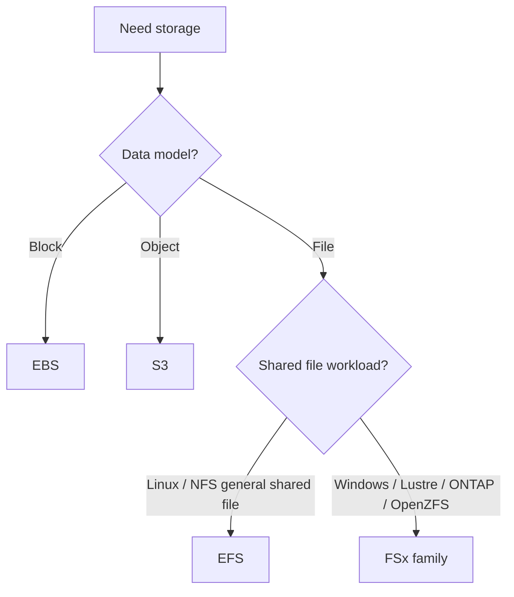
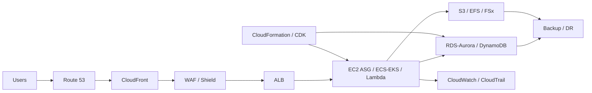

# Architecting on AWS 7.12.4 — Cheat Sheet

> 🧠 **ภาพจำก่อนอ่าน:** 🧠 Concept → 🗺️ Flow → 🔎 Check → ✅ Explain  
> 🎨 [Visual Guide ของวิชานี้](../VISUAL-MEMORY-GUIDE-TH.md) — ดูภาพช่วยจำ แล้วอ่านรายละเอียด/คำสั่งในบทนี้

> สำหรับทบทวนเร็วจาก Note Module 1–13  
> Source basis: **Architecting on AWS 7.12.4 Student Guide + 26 module notes**  
> ใช้ไฟล์นี้เพื่อจำ mental model และเลือก service ให้ถูก ไม่ใช่แทน Note ฉบับเต็มทั้งหมด

---

# 1. Architecture mindset

## เริ่มจาก requirement ไม่ใช่เริ่มจาก service

```text
Business requirement
      ↓
Constraints / risk / scale / latency / compliance / cost
      ↓
Architecture decision
      ↓
AWS services
```

Solutions Architect ต้องคิดจาก **business needs และ requirements** ก่อน แล้วค่อยเลือกบริการที่เหมาะ

## AWS Global Infrastructure

```text
Region
 └─ Availability Zones
     └─ Data Centers
```

- **Region** = geographic area
- **Availability Zone (AZ)** = fault-isolated location ภายใน Region
- Multi-AZ design ใช้เพิ่ม High Availability
- เลือก Region โดยพิจารณา governance/legal, latency, service availability และ cost
- **Local Zone** = เอา compute/storage บางส่วนไปใกล้ผู้ใช้
- **Edge Location** = จุดให้บริการ edge/CDN/DNS-related services ใกล้ผู้ใช้

## AWS Well-Architected Framework — 6 Pillars

1. Operational Excellence
2. Security
3. Reliability
4. Performance Efficiency
5. Cost Optimization
6. Sustainability

สิ่งที่ควรจำ: **Least Privilege อยู่ใน Security pillar** และ Well-Architected Review เป็นกระบวนการประเมิน/ปรับปรุงต่อเนื่อง

---

# 2. Identity and Account Security

## IAM mental model

```text
Principal
  ↓
Authentication
  ↓
Policy evaluation
  ↓
Allow / Deny
  ↓
AWS resource
```

Principal อาจเป็น IAM User, IAM Role, AWS service หรือ federated identity

## IAM User / Group / Role

| Object | ใช้เมื่อ |
|---|---|
| IAM User | identity ระยะยาวสำหรับบุคคล/ระบบที่จำเป็นต้องมี user โดยตรง |
| IAM Group | รวม users เพื่อจัด permission |
| IAM Role | temporary credentials / delegation / service-to-service / cross-account |

**Role + STS/AssumeRole** = pattern สำคัญสำหรับ temporary credentials

## Policy evaluation — จำกฎนี้

```text
Explicit Deny  >  Allow
```

ถ้ามี Explicit Deny ที่ applicable → request ถูก deny แม้ policy อื่นมี Allow

## Permissions Boundary vs SCP

| Control | หน้าที่ |
|---|---|
| Identity-based policy | grant permissions ให้ user/group/role |
| Resource-based policy | grant permissions ที่ resource |
| Permissions Boundary | กำหนด maximum permissions ของ identity |
| SCP | กำหนด permission guardrail สำหรับ accounts/OUs ใน AWS Organizations |

**SCP ไม่ได้ grant permission** — มันกำหนดเพดาน/ข้อจำกัดของสิทธิ์

---

# 3. Networking 1 — VPC fundamentals

## Public vs Private subnet

### Public subnet

Route table มีเส้นทางไป **Internet Gateway (IGW)**

### Private subnet

ไม่มี direct route ไป IGW สำหรับ workload ทั่วไป

ถ้า private instance ต้องออก Internet:

```text
Private EC2
   ↓
Private subnet route table
   ↓
NAT Gateway (อยู่ public subnet)
   ↓
Internet Gateway
   ↓
Internet
```

## CIDR

CIDR ใช้กำหนด address range ของ VPC/Subnet

ควรวาง IP plan ให้มีพื้นที่สำหรับ growth และหลีกเลี่ยง overlap โดยเฉพาะถ้าจะเชื่อม VPC หรือ hybrid network ภายหลัง

## Security Group vs Network ACL

| Security Group | Network ACL |
|---|---|
| ระดับ ENI/instance | ระดับ subnet |
| **Stateful** | **Stateless** |
| Allow rules | Allow + Deny rules |
| return traffic ถูกอนุญาตตาม state | ต้องพิจารณา traffic ทั้งขาเข้าและขาออก |

จำง่าย:

```text
SG = stateful firewall รอบ workload
NACL = stateless filter รอบ subnet
```

---

# 4. Compute

## EC2 launch decisions

คิดอย่างน้อยเรื่อง:

- AMI
- Instance type/family
- Network/Subnet/Security Group
- Storage
- Key pair / access method
- IAM Role
- User Data
- Placement / tenancy requirement

## User Data vs Instance Metadata

| User Data | Instance Metadata |
|---|---|
| ส่งข้อมูล/script เข้า instance ตอน launch | instance อ่านข้อมูลเกี่ยวกับตัวเอง |
| ใช้ bootstrap/configuration | ใช้ดู instance identity/config/network/IAM-related metadata |

IMDS รุ่นใหม่ใช้ token flow เพื่อเพิ่ม protection ก่อนดึง metadata

## EBS vs Instance Store

| EBS | Instance Store |
|---|---|
| persistent/durable block storage | temporary/ephemeral local storage |
| แยก lifecycle จาก EC2 ได้มากกว่า | ผูกกับ host/instance lifecycle |
| ใช้กับข้อมูลที่ต้องเก็บ | ใช้ scratch/cache/temp data ที่หายได้ |

## EC2 purchasing mental model

- **On-Demand** = flexibility สูง ไม่มี commitment
- **Savings Plans** = commitment เพื่อประหยัดเมื่อ usage มีความสม่ำเสมอ
- **Spot** = ราคาประหยัดมาก แต่ workload ต้องรับ interruption ได้

ใน architecture จริงสามารถผสมหลาย purchasing model ได้

## Lambda

```text
Event
  ↓
Lambda function
  ↓
AWS services / application logic
```

Serverless ช่วยลดภาระ provisioning, scaling และ server management แต่ function ยังต้องมี IAM permissions เมื่อต้อง access resources

---

# 5. Storage service selection



## S3 essentials

- Object storage
- Bucket → objects
- Storage classes สำหรับ access/cost patterns ต่างกัน
- **Versioning** = เก็บ object versions
- **Lifecycle** = transition/delete objects ตามอายุ
- **CRR** = Cross-Region Replication
- Multipart Upload = large-object upload
- Transfer Acceleration = ช่วย long-distance transfer ผ่าน edge network
- Event Notifications = ทำให้ S3 เป็น event source

## EFS vs FSx

- **EFS** = managed shared NFS file system สำหรับ Linux workloads
- **FSx** = managed file systems สำหรับ workload เฉพาะ เช่น Windows File Server, Lustre, NetApp ONTAP, OpenZFS

## Hybrid / Migration

| Need | Service |
|---|---|
| Online data movement | AWS DataSync |
| Hybrid NFS/SMB/iSCSI/Tape interface | AWS Storage Gateway |
| Dataset ใหญ่มาก / network ไม่เหมาะ | AWS Snowball Edge |

---

# 6. Databases

## Relational vs Nonrelational

```text
Need tables + relationships + relational model?
    Yes -> RDS / Aurora
    No / key-value / massive scale -> DynamoDB / purpose-built database
```

## RDS: Multi-AZ vs Read Replica

| Feature | Purpose |
|---|---|
| **Multi-AZ** | High Availability / failover |
| **Read Replica** | Read scaling |

อย่าสลับกัน: **Multi-AZ ไม่ได้มีไว้แก้ read scaling เป็นหลัก**

## Aurora

- MySQL/PostgreSQL compatible
- cluster architecture
- compute instances + shared cluster storage
- Aurora Serverless v2 เหมาะเมื่อ demand เปลี่ยนและต้อง scale capacity อัตโนมัติ

## DynamoDB

```text
DynamoDB
= fully managed NoSQL
+ key-value/document style
+ horizontal scale
```

หัวข้อที่ต้องจำ:

- Partition key / composite primary key
- Capacity modes
- Eventually consistent vs strongly consistent reads
- Global Tables สำหรับ multi-Region use case
- **DAX** = cache ที่ออกแบบมาสำหรับ DynamoDB

## ElastiCache vs DAX

- **ElastiCache** = managed in-memory cache ทั่วไป
- **DAX** = DynamoDB-focused cache

Caching patterns ในบท:

- Lazy Loading
- Write-through
- TTL / eviction

## Database migration

- **AWS DMS** = migrate/replicate database data
- **AWS Schema Conversion Tool (SCT)** = ช่วย convert schema/code เมื่อ source/target engine ต่างกัน

---

# 7. Monitoring, Events and Scaling

## CloudWatch vs CloudTrail vs VPC Flow Logs

| Service | ตอบคำถามอะไร |
|---|---|
| **CloudWatch** | ระบบทำงานเป็นอย่างไร? metrics/logs/alarm |
| **CloudTrail** | ใคร/อะไรเรียก AWS API อะไร เมื่อไหร่? |
| **VPC Flow Logs** | network flow ถูก accept/reject อย่างไร? |

Incident mental model:

```text
Performance issue -> CloudWatch
Unexpected API change -> CloudTrail
Network connectivity issue -> VPC Flow Logs
```

## CloudWatch Alarm

Alarm ใช้ metric + threshold + evaluation periods / datapoints เพื่อเข้าสู่ state:

- OK
- ALARM
- INSUFFICIENT_DATA

จากนั้น trigger notification/automation ได้

## EventBridge

ใช้ event routing และ event-driven automation

## Load Balancer

| Type | จุดเด่น |
|---|---|
| ALB | Layer 7, HTTP/HTTPS |
| NLB | Layer 4, TCP/UDP, performance สูง |
| GWLB | third-party virtual network appliances |

## EC2 Auto Scaling

```text
Launch Template
    +
Auto Scaling Group
    +
Min / Desired / Max capacity
    +
Scaling policy
```

มักทำงานร่วมกับ ELB + CloudWatch

---

# 8. Automation / Infrastructure as Code

## CloudFormation mental model

```text
Architecture definition
      ↓
JSON / YAML Template
      ↓
CloudFormation
      ↓
Stack
      ↓
AWS Resources
```

จำคำสำคัญ:

- Template = desired infrastructure definition
- Stack = resources ที่ CloudFormation manage เป็น unit
- Change Set = preview changes ก่อน apply
- Cross-stack reference = share outputs ระหว่าง stacks
- Layered stacks = แยก lifecycle/ownership ของ architecture

## AWS CDK

ใช้ programming language define infrastructure แล้ว synthesize ไปสู่ CloudFormation model

## Systems Manager

ใช้ centralized operations/management สำหรับ resources ที่รองรับ

## Elastic Beanstalk

higher-level application deployment service ที่ลดภาระการประกอบ infrastructure หลายส่วนเอง

---

# 9. Containers

## Microservices vs Containers

- **Microservices** = architecture pattern
- **Containers** = packaging/runtime mechanism

```text
Monolith
  ↓
Microservices
  ↓
Container images
  ↓
Orchestration
  ↓
Independent deploy / scale
```

## ECR / ECS / EKS / Fargate

| Service | Role |
|---|---|
| ECR | Container image registry |
| ECS | AWS-native container orchestration |
| EKS | Managed Kubernetes |
| Fargate | Serverless compute engine for containers |

Decision mental model:

```text
Need Kubernetes API/ecosystem -> EKS
Need AWS-native orchestration -> ECS
Don't want to manage container hosts -> Fargate
Need host-level control -> EC2-backed containers
```

---

# 10. Networking 2

## VPC Endpoint

ใช้ให้ workload ใน VPC เข้าถึง supported AWS services แบบ private โดยลด dependency ต่อ Internet Gateway/NAT/Public IP สำหรับ traffic ที่รองรับ

Interface Endpoint ใช้ ENI + private IP + AWS PrivateLink

## VPC Peering

- VPC-to-VPC แบบ **one-to-one**
- CIDR ต้องไม่ overlap
- ต้อง configure route tables
- รองรับ cross-account / inter-Region ตาม use case
- **ไม่ transitive**

```text
A peers B
B peers C
ไม่ได้หมายความว่า A route ผ่าน B ไป C ได้
```

## Hybrid Networking

### Site-to-Site VPN

- encrypted tunnels
- ใช้ Internet-based connectivity
- เหมาะกับเร็วต่อการเริ่มต้นและ encrypted hybrid connectivity

### Direct Connect

- dedicated/private connectivity
- เหมาะกับ requirement ด้าน predictable capacity/connectivity มากขึ้น

## Transit Gateway

```text
        VPC A
          |
VPC B -- TGW -- VPN / DX-related connectivity
          |
        VPC C
```

- hub-and-spoke
- attachments
- Transit Gateway route tables
- ทำ full connectivity, partial connectivity, isolation patterns ได้

จำเร็ว:

```text
VPC -> AWS Service private = VPC Endpoint
VPC <-> VPC simple = VPC Peering
On-prem <-> AWS encrypted = Site-to-Site VPN
On-prem <-> AWS dedicated = Direct Connect
Many VPCs / central routing = Transit Gateway
```

---

# 11. Serverless and Messaging

## API Gateway / SQS / SNS / Kinesis / Step Functions

| Requirement | Service |
|---|---|
| Managed API front door | API Gateway |
| Async queue / buffering / decoupling | SQS |
| Publish-subscribe / fan-out | SNS |
| Continuous streaming data | Kinesis |
| Multi-step workflow orchestration | Step Functions |

## SQS

- Standard = at-least-once, best-effort ordering
- FIFO = ใช้เมื่อ ordering สำคัญ
- Visibility Timeout = message ถูกซ่อนชั่วคราวระหว่าง consumer ประมวลผล
- Long Polling = ลด empty responses/polling requests

## SNS + SQS pattern

```text
Publisher
   ↓
  SNS
 ↙   ↘
SQS A SQS B
 ↓      ↓
Consumer Consumer
```

ได้ทั้ง fan-out และ durable asynchronous processing

## Kinesis

- Kinesis Data Streams = streaming ingestion/processing
- Data Firehose = managed delivery stream ไป destination

## Step Functions

State machine ใช้ orchestrate steps, branching และ error handling ของ distributed workflow

---

# 12. Edge Services

## Route 53

Route 53 = DNS + traffic steering

### Hosted zones

- Public Hosted Zone = internet DNS
- Private Hosted Zone = DNS ภายใน associated VPCs

### Routing policies

| Policy | ใช้เมื่อ |
|---|---|
| Simple | single/simple destination |
| Failover | active/passive |
| Geolocation | route ตาม location ของ user |
| Geoproximity | route ตาม geography ของ user/resource + bias |
| Latency-based | route ไป Region ที่ latency ต่ำกว่า |
| Multivalue Answer | return multiple healthy records |
| Weighted | แบ่ง traffic ตามสัดส่วน/weight |

## CloudFront

CloudFront = CDN + edge cache

```text
Viewer
  ↓
Edge Location
  ├─ Cache hit -> response
  └─ Cache miss -> Origin -> cache -> response
```

จำต่างกัน:

- Route 53 = ตัดสินใจ DNS/traffic ไปไหน
- CloudFront = ทำ content delivery/caching ใกล้ user

## Shield / WAF / Firewall Manager

| Service | Role |
|---|---|
| Shield | DDoS protection |
| WAF | inspect/filter HTTP(S) requests ตาม rules |
| Firewall Manager | centralize security policies across accounts/resources |

## Outposts

AWS infrastructure/services on premises สำหรับ requirement เช่น low latency, local processing หรือ data residency/locality

---

# 13. Backup and Disaster Recovery

## HA vs Fault Tolerance vs Backup vs DR

- **High Availability** = ลด downtime และ recover/failover ได้เร็ว
- **Fault Tolerance** = ระบบทน failure และทำงานต่อได้โดย interruption ต่ำมาก
- **Backup** = สำเนาข้อมูลเพื่อ restore
- **Disaster Recovery** = recovery plan สำหรับเหตุการณ์ใหญ่ที่กระทบ workload/site/Region

## RPO vs RTO

```text
RPO = ยอมเสียข้อมูลย้อนหลังได้เท่าไร
RTO = ยอมให้บริการหยุดได้นานเท่าไร
```

ตัวอย่าง:

- RPO 15 นาที = ยอมเสียข้อมูลล่าสุดได้สูงสุดประมาณ 15 นาที
- RTO 1 ชั่วโมง = ต้องกู้บริการกลับภายในประมาณ 1 ชั่วโมง

## DR strategies

เรียงจาก cost ต่ำ / recovery ช้า → cost สูง / recovery เร็ว

```text
Backup & Restore
      ↓
Pilot Light
      ↓
Warm Standby
      ↓
Multi-site Active/Active
```

| Strategy | ภาพจำ |
|---|---|
| Backup & Restore | เก็บ backup แล้วสร้างระบบเมื่อเกิดเหตุ |
| Pilot Light | core components พร้อม แต่ application capacity ส่วนใหญ่สร้าง/scale ตอน failover |
| Warm Standby | application ทำงานอยู่แบบ scale ต่ำ |
| Active/Active | หลาย site/Region ให้บริการพร้อมกัน |

สิ่งที่ต้องจำ:

- Multi-AZ = HA pattern สำคัญ แต่ **ไม่เท่ากับ cross-Region DR**
- IaC + AMI + automation ลด recovery time
- DR plan ต้อง **test จริง** และอัปเดตต่อเนื่อง
- AWS Backup ช่วย centralize/automate backup policies สำหรับ supported services

---

# 14. Common exam / design traps

## Trap 1 — Multi-AZ vs Read Replica

```text
HA / failover -> Multi-AZ
Read scaling -> Read Replica
```

## Trap 2 — SG vs NACL

```text
Security Group -> Stateful
NACL -> Stateless
```

## Trap 3 — Route 53 vs CloudFront

```text
DNS / traffic steering -> Route 53
CDN / edge caching -> CloudFront
```

## Trap 4 — CloudWatch vs CloudTrail

```text
Metrics / logs / alarm -> CloudWatch
API activity / audit history -> CloudTrail
```

## Trap 5 — SQS vs SNS

```text
Queue / decouple -> SQS
Publish / fan-out -> SNS
```

## Trap 6 — VPC Peering vs Transit Gateway

```text
Simple one-to-one -> Peering
Many VPCs / central routing -> Transit Gateway
```

## Trap 7 — NAT Gateway vs VPC Endpoint

```text
Private subnet general Internet egress -> NAT Gateway
Private access to supported AWS service -> VPC Endpoint
```

## Trap 8 — SCP

```text
SCP = guardrail / maximum permission scope
SCP != permission grant
```

## Trap 9 — Backup vs Multi-AZ

```text
Multi-AZ = availability/failover
Backup = restore point
DR = broader recovery strategy
```

---

# 15. End-to-end architecture mental model



เวลามอง architecture ให้ถามตามลำดับ:

1. User เข้ามาทางไหน?
2. DNS/edge/security อยู่ตรงไหน?
3. Network boundaries เป็นอย่างไร?
4. Compute แบบไหนเหมาะ?
5. State/data อยู่ที่ไหน?
6. Scale และ failover อย่างไร?
7. Observe/audit อย่างไร?
8. Deploy/rebuild ด้วย automation ได้หรือไม่?
9. Backup/DR ตอบ RPO/RTO ได้หรือไม่?
10. Architecture สอดคล้องกับ Well-Architected pillars หรือยัง?

---

# 16. 15-minute final review

ถ้ามีเวลาแค่ 15 นาที ให้จำชุดนี้:

```text
6 Well-Architected Pillars
Explicit Deny > Allow
SCP does not grant permission
SG stateful / NACL stateless
Public subnet -> IGW
Private subnet Internet egress -> NAT GW
EBS persistent / Instance Store temporary
S3 object / EFS shared NFS / EBS block
RDS Multi-AZ = HA / Read Replica = scale reads
CloudWatch = observe / CloudTrail = audit / Flow Logs = network
ALB L7 / NLB L4
CloudFormation = IaC stack
ECS AWS-native / EKS Kubernetes / Fargate no host management
Peering not transitive / TGW central hub
SQS queue / SNS fan-out / Kinesis stream / Step Functions workflow
Route 53 DNS / CloudFront CDN / WAF HTTP filter / Shield DDoS
RPO data loss / RTO downtime
DR: Backup -> Pilot Light -> Warm Standby -> Active/Active
```

---

## Where to go deeper

กลับไปที่ [`README.md`](./README.md) แล้วเปิด Module ที่เกี่ยวข้อง หากข้อไหนใน Cheat Sheet ยังตอบว่า “ทำไม?” หรือ “ทำงานอย่างไร?” ไม่ได้ ควรกลับไปอ่าน Note Module นั้นก่อนทำ Knowledge Check

---

## Source note

Cheat Sheet นี้ตั้งใจสรุป **เฉพาะสิ่งที่รองรับโดย Student Guide/Notes ชุดนี้** และรักษ terminology/framing ตามหลักสูตร Architecting on AWS 7.12.4 จึงไม่ควรตีความว่าเป็นเอกสารอัปเดตฟีเจอร์ AWS ล่าสุดนอกหลักสูตร
