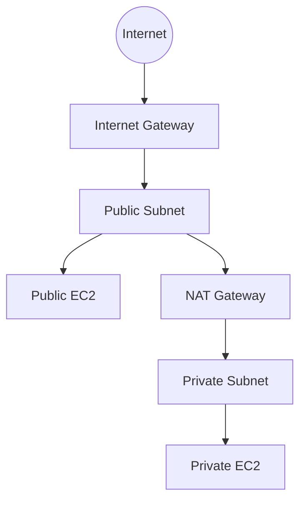

# Lab 2 — Building your Amazon VPC Infrastructure

> 🧠 **ภาพจำก่อนอ่าน:** 🧪 Lab → 🌐 Client → 🛣️ Network → 🛡️ Rules → 🖥️ Backend → 🧹 Cleanup  
> 🎨 [Visual Guide ของวิชานี้](../../VISUAL-MEMORY-GUIDE-TH.md) — ดูภาพช่วยจำ แล้วอ่านรายละเอียด/คำสั่งในบทนี้

## 🗺️ Lab architecture



### ภาพ Diagram


> Diagram นี้เป็นภาพสรุปเพื่อช่วยทำความเข้าใจโครงสร้างของบท/แล็บ โดยยึดแนวคิดจากคู่มือต้นฉบับ
> คู่มือภาษาไทยสำหรับทำ Lab 2 จาก *Architecting on AWS 7.12.4 Lab Guide*  
> ช่วงต้นฉบับ: หน้า 19–52  
> ชื่อเมนู ปุ่ม field ค่า config และคำสั่งคงเป็น English ตาม AWS Console

## เป้าหมาย

Lab นี้จะสร้าง VPC แบบพื้นฐานตั้งแต่ต้น: VPC → Public/Private Subnet → Internet Gateway → Route Table → Security Group → Public EC2 → NAT Gateway → Private EC2 → Session Manager

---

## Start Lab

1. กด `Start Lab`
2. รอ resource พร้อม
3. กด `Open Console`
4. ตรวจ Region ให้ตรงกับค่าที่ Lab กำหนด และ **อย่าเปลี่ยน Region** หากไม่ได้สั่ง

---

# Task 1 — Create an Amazon VPC in a Region

1. `Search` → พิมพ์ `VPC`
2. เลือก `Your VPCs`
3. กด `Create VPC`
4. ตั้งค่า:
   - `Resources to create`: `VPC only`
   - `Name tag - optional`: `Lab VPC`
   - `IPv4 CIDR`: `10.0.0.0/16`
5. กด `Create VPC`
6. ตรวจ `State` ต้องเป็น `Available`
7. กด `Actions` → `Edit VPC settings`
8. ใน `DNS settings` เปิด `Enable DNS hostnames`
9. กด `Save`

---

# Task 2 — Create public and private subnets

## Task 2.1 — Create your public subnet

1. เลือก `Subnets` → `Create subnet`
2. ตั้งค่า:
   - `VPC ID`: `Lab VPC`
   - `Subnet name`: `Public Subnet`
   - `Availability Zone`: เลือก AZ แรกในรายการ
   - `IPv4 subnet CIDR block`: `10.0.0.0/24`
3. กด `Create subnet`
4. เลือก `Public Subnet`
5. `Actions` → `Edit subnet settings`
6. เปิด `Enable auto-assign public IPv4 address`
7. กด `Save`

> ตอนนี้ subnet ยังไม่เป็น public จริงจนกว่าจะมี Internet Gateway และ route ไป IGW

## Task 2.2 — Create your private subnet

1. กด `Create subnet`
2. ตั้งค่า:
   - `VPC ID`: `Lab VPC`
   - `Subnet name`: `Private Subnet`
   - `Availability Zone`: AZ เดียวกับ Public Subnet
   - `IPv4 subnet CIDR block`: `10.0.2.0/23`
3. กด `Create subnet`
4. ตรวจ `State`: `Available`

---

# Task 3 — Create an internet gateway

1. เลือก `Internet gateways`
2. กด `Create internet gateway`
3. `Name tag`: `Lab IGW`
4. กด `Create internet gateway`
5. `Actions` → `Attach to VPC`
6. `Available VPCs`: `Lab VPC`
7. กด `Attach internet gateway`
8. ตรวจ `State`: `Attached`

---

# Task 4 — Route internet traffic in the public subnet to the internet gateway

1. เลือก `Route tables`
2. กด `Create route table`
3. ตั้งค่า:
   - `Name - optional`: `Public Route Table`
   - `VPC`: `Lab VPC`
4. กด `Create route table`
5. เปิด tab `Routes`
6. กด `Edit routes` → `Add route`
7. ตั้งค่า:
   - `Destination`: `0.0.0.0/0`
   - `Target`: `Internet Gateway` → เลือก `Lab IGW`
8. กด `Save changes`
9. เปิด tab `Subnet associations`
10. กด `Edit subnet associations`
11. เลือก `Public Subnet`
12. กด `Save associations`

ตอนนี้ `Public Subnet` มี default route ออก Internet ผ่าน `Lab IGW`

---

# Task 5 — Create a public security group

1. เลือก `Security groups`
2. กด `Create security group`
3. ตั้งค่า:
   - `Security group name`: `Public SG`
   - `Description`: `Allows incoming traffic to public instance.`
   - `VPC`: `Lab VPC`
4. ใน `Inbound rules` กด `Add rule`
   - `Type`: `HTTP`
   - `Source`: `Anywhere-IPv4`
5. ใน `Tags - optional` → `Add new tag`
   - `Key`: `Name`
   - `Value`: `Public SG`
6. กด `Create security group`

---

# Task 6 — Launch an Amazon EC2 instance into a public subnet

1. `Search` → `EC2`
2. `Dashboard` → `Launch instance`
3. `Name`: `Public Instance`
4. ใน `Application and OS Images (Amazon Machine Image)`:
   - OS: `Amazon Linux`
   - AMI: `Amazon Linux 2023 AMI`
5. `Instance type`: `t3.micro`
6. `Key pair (login)`: `Proceed without a key pair (Not recommended)`
7. `Network settings` → `Edit`
   - `VPC`: `Lab VPC`
   - `Subnet`: `Public Subnet`
   - `Auto-assign public IP`: `Enable`
8. `Firewall (security groups)` → `Select existing security group`
   - เลือก `Public SG`
9. `Configure storage`: ใช้ default
10. เปิด `Advanced details`
11. `IAM instance profile`: เลือก role ชื่อประมาณ `EC2InstProfile`
12. ที่ `User data - optional` วาง script นี้:

```bash
#!/bin/bash
# To connect to your EC2 instance and install the Apache web server with PHP
yum update -y
yum install -y httpd php8.1
systemctl enable httpd.service
systemctl start httpd
cd /var/www/html
wget https://us-west-2-tcprod.s3.amazonaws.com/courses/ILT-TF-200-ARCHIT/v7.12.4.prod-bc5d5446/lab-2-VPC/scripts/instanceData.zip
unzip instanceData.zip
```

13. ตรวจ `Summary`
14. กด `Launch instance`
15. กด `View all instances`
16. รอ `Public Instance` เป็น `Running` และ `Status check` ผ่าน `3/3 checks passed`

---

# Task 7 — Connect to a public instance through HTTP

1. `Instances` → เลือก `Public Instance`
2. เปิด tab `Networking`
3. หา `Public IPv4 DNS`
4. Copy DNS แล้วเปิดใน browser โดยใช้ `http://...`
5. ควรเห็นหน้า Apache/application ของ Lab

---

# Task 8 — Connect to the public EC2 instance through Session Manager

1. `Instances` → เลือก `Public Instance`
2. กด `Connect`
3. เลือก tab `Session Manager`
4. กด `Connect`
5. ใน terminal ทดสอบ:

```bash
curl -I https://www.amazon.com/testing
```

ควรได้ HTTP response กลับมา แสดงว่า instance ออก Internet ได้

---

# Task 9 — Create a NAT gateway and configure routing in the private subnet

1. กลับไป `VPC`
2. เลือก `NAT gateways`
3. กด `Create NAT gateway`
4. ตั้งค่า:
   - `Name - optional`: `Lab NGW`
   - `Availability mode`: `Zonal`
   - `Subnet`: `Public Subnet`
5. ที่ `Elastic IP allocation ID` กด `Allocate Elastic IP`
6. กด `Create NAT gateway`
7. ไป `Route tables` → `Create route table`
8. ตั้งค่า:
   - `Name - optional`: `Private Route Table`
   - `VPC`: `Lab VPC`
9. กด `Create route table`
10. `Routes` → `Edit routes` → `Add route`
11. ตั้งค่า:
    - `Destination`: `0.0.0.0/0`
    - `Target`: `NAT Gateway` → เลือก NAT Gateway ที่สร้าง
12. `Save changes`
13. `Subnet associations` → `Edit subnet associations`
14. เลือก `Private Subnet`
15. `Save associations`

---

# Task 10 — Create a security group for private resources

1. `Security groups` → `Create security group`
2. ตั้งค่า:
   - `Security group name`: `Private SG`
   - `Description`: `Allows incoming traffic to private instance from public security group.`
   - `VPC`: `Lab VPC`
3. `Inbound rules` → `Add rule`
   - `Type`: `HTTP`
   - `Source`: `Custom`
   - ในช่อง source พิมพ์ `sg` แล้วเลือก `Public SG`
4. `Tags - optional` → `Add new tag`
   - `Key`: `Name`
   - `Value`: `Private SG`
5. กด `Create security group`

---

# Task 11 — Launch an Amazon EC2 instance into a private subnet

ตั้งค่าเหมือน Public Instance แต่ต่างที่ Network/Security Group:

1. `EC2` → `Launch instance`
2. `Name`: `Private Instance`
3. AMI: `Amazon Linux 2023 AMI`
4. `Instance type`: `t3.micro`
5. `Key pair`: `Proceed without a key pair (Not recommended)`
6. `Network settings`:
   - `VPC`: `Lab VPC`
   - `Subnet`: `Private Subnet`
   - `Auto-assign public IP`: `Disable`
7. `Firewall (security groups)`: `Select existing security group`
   - เลือก `Private SG`
8. Storage ใช้ default
9. `Advanced details`
   - `IAM instance profile`: role ชื่อประมาณ `EC2InstProfile`
10. `User data`: ใช้ script เดียวกับ Public Instance
11. กด `Launch instance`
12. รอ `Private Instance` เป็น `Running` และผ่าน `3/3 checks passed`

---

# Task 12 — Connect to the EC2 instance in the private subnet

1. `Instances` → เลือก `Private Instance`
2. กด `Connect`
3. tab `Session Manager`
4. กด `Connect`
5. ใน terminal:

```bash
cd ~
curl -I https://www.amazon.com/testing
```

ถ้าได้ HTTP response แสดงว่า Private Instance ออก Internet ผ่าน NAT Gateway ได้

---

# Optional Task 1 — Troubleshooting connectivity between private and public instance

แนวคิดของ Optional Task นี้คือใช้ `Public Instance` ทดสอบเข้าหา private IP ของ `Private Instance` และตรวจว่า Security Group อนุญาตหรือไม่

หาก ping ไม่ผ่าน ให้เพิ่ม inbound rule ที่ `Private SG`:

- `Type`: `Custom ICMP - IPv4`
- `Source`: `Custom`
- เลือก `Public SG` เป็น source

แล้วทดสอบ ping private IP อีกครั้ง

---

# Optional Task 2 — Retrieving instance metadata (IMDSv2)

1. `Instances` → `Public Instance` → `Connect`
2. เลือก `Session Manager` → `Connect`
3. ขอ token สำหรับ IMDSv2:

```bash
TOKEN=`curl -X PUT "http://169.254.169.254/latest/api/token" -H "X-aws-ec2-metadata-token-ttl-seconds: 21600"`
```

4. ดูรายการ metadata:

```bash
curl -H "X-aws-ec2-metadata-token: $TOKEN" -v http://169.254.169.254/latest/meta-data/
```

5. ดู `public-hostname`:

```bash
curl http://169.254.169.254/latest/meta-data/public-hostname -H "X-aws-ec2-metadata-token: $TOKEN"
```

`169.254.169.254` เป็น link-local address ที่เข้าถึงได้จาก instance เท่านั้น

---

# End Lab

1. กลับ `AWS Management Console`
2. เลือก `AWSLabsUser` → `Sign out`
3. กลับหน้า Lab → `End Lab`
4. ยืนยันการจบ Lab
