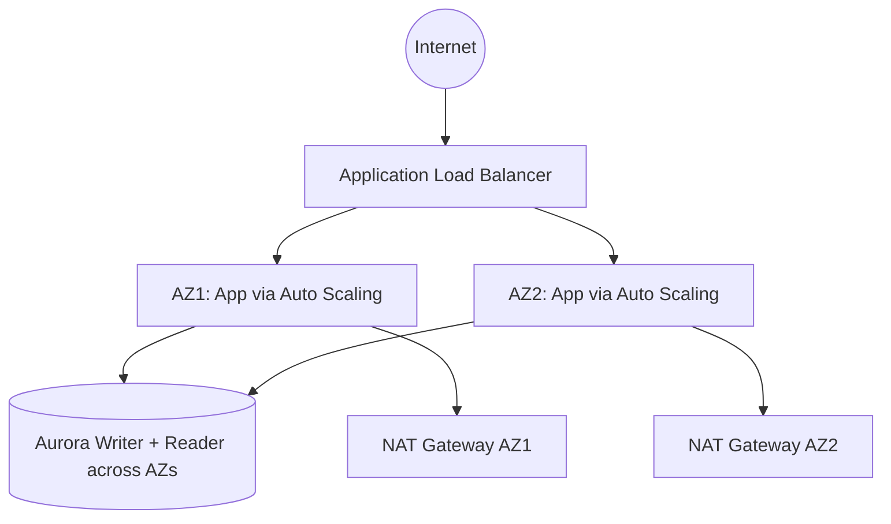

# Lab 4 — Configure High Availability in Your Amazon VPC

> 🧠 **ภาพจำก่อนอ่าน:** 🧪 Lab → 🧠 Concept → 🗺️ Flow → 🔎 Check → ✅ Explain → 🧹 Cleanup  
> 🎨 [Visual Guide ของวิชานี้](../../VISUAL-MEMORY-GUIDE-TH.md) — ดูภาพช่วยจำ แล้วอ่านรายละเอียด/คำสั่งในบทนี้

## 🗺️ Lab architecture



### ภาพ Diagram


> Diagram นี้เป็นภาพสรุปเพื่อช่วยทำความเข้าใจโครงสร้างของบท/แล็บ โดยยึดแนวคิดจากคู่มือต้นฉบับ
> คู่มือภาษาไทยสำหรับทำ Lab 4 จาก *Architecting on AWS 7.12.4 Lab Guide*  
> ช่วงต้นฉบับ: หน้า 69–93  
> คงชื่อ AWS Console menu / button / field / resource เป็น English ตาม Lab

## เป้าหมาย

ปรับสถาปัตยกรรม Web Application เดิมให้ High Availability มากขึ้น โดยทำดังนี้:

- ใช้ Launch Template + EC2 Auto Scaling
- รัน Application Tier ข้าม 2 Availability Zones
- เชื่อม Auto Scaling Group เข้ากับ Application Load Balancer
- เพิ่ม Aurora Reader คนละ Availability Zone
- เพิ่ม NAT Gateway ตัวที่สอง
- ทดสอบ Instance failure และ Aurora failover

---

## Start Lab

1. กด `Start Lab`
2. รอ resource พร้อม
3. กด `Open Console`
4. ใช้ Region ที่ Lab กำหนด

---

# Task 1 — Inspect your existing lab environment

Lab เตรียม resource หลักไว้แล้ว ได้แก่ VPC, Public/Private Subnets 2 AZs, Internet Gateway, NAT Gateway, Application Load Balancer, `AppServer` และ Aurora cluster

## Task 1.1 — Examine the network infrastructure

1. `Search` → `VPC`
2. `Your VPCs` → ตรวจ `Lab VPC`
3. `Subnets` → เลือก `Public Subnet 1`
4. เปิด tab `Route table`
   - ตรวจ route local ของ VPC
   - ตรวจ `0.0.0.0/0` ชี้ไป Internet Gateway
5. เปิด tab `Network ACL` เพื่อดู rule ที่ associate กับ subnet
6. เลือก `Internet gateways`
   - ตรวจว่ามี Internet Gateway ชื่อ `Lab IG` attach กับ `Lab VPC`
7. เลือก `Security groups` แล้วตรวจ:
   - `Inventory-ALB` → Inbound HTTP/80 จาก `0.0.0.0/0`
   - `Inventory-App` → Inbound HTTP/80 จาก security group `Inventory-ALB`
   - `Inventory-DB` → Inbound MySQL/Aurora TCP/3306 จาก `Inventory-App`

## Task 1.2 — Examine the EC2 instance

1. `Search` → `EC2`
2. `Instances` → เลือก `AppServer`
3. `Actions` → `Instance settings` → `Edit user data`
4. กด `Copy user data`
5. เก็บ User Data ไว้ใน text editor — จะใช้ตอนสร้าง Launch Template

## Task 1.3 — Examine the load balancer configuration

1. `Target Groups` → เลือก `Inventory-App`
2. tab `Targets` → ตรวจว่า `AppServer` เป็น registered target
3. `Load Balancers` → เลือก `Inventory-LB`

## Task 1.4 — Open the PHP inventory application

1. Copy ค่า `InventoryAppSettingsPageURL` จากหน้าคำสั่ง Lab
2. เปิด URL ใน browser tab ใหม่
3. หน้า Settings จะมีค่า Database เดิมกรอกไว้แล้ว
4. คงค่าทั้งหมดตาม default
5. กด `Save`
6. **อย่าปิด tab Inventory Application** เพราะจะใช้ทดสอบ Task ต่อไป

---

# Task 2 — Create a launch template

1. `Search` → `EC2`
2. Navigation pane → `Launch Templates`
3. กด `Create launch template`
4. ตั้งค่า:
   - `Launch template name - required`: `Lab-Launch-template`
   - `Template version description`: `version 1`
5. `Application and OS Images (Amazon Machine Image)` → `Quick Start`
6. เลือก `Amazon Linux`
7. AMI: `Amazon Linux 2023 AMI`
8. `Instance type`: `t3.micro`
9. ใน `Network Settings`:
   - `Security groups`: `Inventory-App`
10. เปิด `Advanced details`
11. `IAM instance profile`: `Inventory-App-Role`
12. ใน `User data` วาง User Data ที่ copy จาก `AppServer` ใน Task 1.2
13. กด `Create launch template`
14. กด `View launch templates`

---

# Task 3 — Create an Auto Scaling group

1. Navigation pane → `Auto Scaling Groups`
2. กด `Create Auto Scaling group`
3. ตั้งค่า:
   - `Auto Scaling group name`: `Inventory-ASG`
   - `Launch template`: เลือก `Lab-Launch-template`
4. กด `Next`
5. ใน `Network`:
   - `VPC`: `Lab VPC`
   - `Availability Zones and subnets`: เลือก `Private Subnet 1` และ `Private Subnet 2`
6. กด `Next`
7. หน้า `Integrate with other services - optional`:
   - เลือก `Attach to an existing load balancer`
   - เลือก `Choose from your load balancer target groups`
   - `Existing load balancer target groups`: `Inventory-App | HTTP`
   - `Health check grace period`: `300`
8. กด `Next`
9. หน้า `Configure group size and scaling - optional`:
   - `Desired capacity`: `2`
   - `Min desired capacity`: `2`
   - `Max desired capacity`: `2`
10. ที่ `Additional settings` เปิด `Enable group metrics collection within CloudWatch`
11. กด `Next` จนถึง `Add tags - optional`
12. `Add tag`:
   - `Key`: `Name`
   - `Value - optional`: `Inventory-App`
13. กด `Next`
14. ตรวจ Summary แล้วกด `Create Auto Scaling group`
15. เลือก `Inventory-ASG` แล้วดู:
   - tab `Activity`
   - tab `Instance management`
16. รอให้ instance ใหม่ 2 ตัวเข้าสถานะ `InService`

---

# Task 4 — Test the application

1. `Target Groups` → เลือก `Inventory-App`
2. tab `Targets`
3. ตอนนี้ควรเห็น 3 targets:
   - `AppServer` เดิม
   - `Inventory-App` จาก Auto Scaling 2 instances
4. เลือก target `AppServer`
5. กด `Deregister`
6. ใน popup กด `Deregister`
7. รอจนเหลือเฉพาะ `Inventory-App` สองตัว และทั้งคู่เป็น `healthy`
8. กลับ browser tab ของ Inventory Application
9. หากปิดไปแล้ว:
   - `Load Balancers` → `Inventory-LB`
   - Copy `DNS name`
   - เปิดใน browser
10. Refresh หน้าเว็บหลายครั้ง
11. ดู Instance ID และ Availability Zone ด้านล่างของหน้า — ควรสลับไปมาระหว่างสอง EC2 instances / สอง AZs

---

# Task 5 — Test high availability of the application tier

จำลอง EC2 failure:

1. กลับ `EC2` → `Instances`
2. เลือก `Inventory-App` ตัวใดตัวหนึ่ง
3. `Instance State` → `Terminate (delete) instance`
4. ยืนยัน `Terminate (delete)`
5. กลับไป Inventory Application และ Refresh หลายครั้ง
6. Application ควรยังเปิดได้ เพราะ ALB ส่ง traffic ไป instance ที่เหลือ
7. กลับหน้า `Instances`
8. Refresh ทุกประมาณ 30 วินาทีจน Auto Scaling สร้าง `Inventory-App` ตัวใหม่ขึ้นมา
9. รอ Status Check ของ instance ใหม่ผ่าน
10. กลับ Inventory Application และ Refresh หลายครั้งอีกครั้ง
11. ควรเห็น Instance ID / Availability Zone กลับมาสลับระหว่าง 2 instances

---

# Task 6 — Configure high availability of the database tier

## Task 6.1 — Configure the database across multiple Availability Zones

1. `Search` → `Aurora and RDS`
2. Navigation pane → `Databases`
3. หา `inventory-primary`
4. ดู column `Region & AZ` แล้วจด AZ ของ primary ไว้
5. เลือก cluster `inventory-cluster`
6. `Actions` → `Add reader`
7. ใน `Settings`:
   - `DB instance identifier`: `inventory-replica`
8. ใน `Connectivity`:
   - `Availability Zone`: เลือก AZ ที่ **ต่างจาก** `inventory-primary`
9. ใน `Monitoring`:
   - เอาเครื่องหมายออกจาก `Enable Enhanced monitoring`
10. กด `Add reader`
11. `inventory-replica` จะขึ้น `Creating` — สามารถไป Task 7 ต่อได้โดยไม่ต้องรอ

---

# Task 7 — Make the NAT gateway highly available

## Task 7.1 — Create a second NAT gateway

1. `Search` → `VPC`
2. Navigation pane → `NAT gateways`
3. กด `Create NAT gateway`
4. ตั้งค่า:
   - `Name - optional`: `my-nat-gateway`
   - `Availability mode`: `Zonal`
   - `Subnet`: `Public Subnet 2`
5. กด `Allocate Elastic IP`
6. กด `Create NAT gateway`

## Task 7.2 — Create and configure a new route table

1. Navigation pane → `Route tables`
2. กด `Create route table`
3. ตั้งค่า:
   - `Name - optional`: `Private Route Table 2`
   - `VPC`: `Lab VPC`
4. กด `Create route table`
5. `Routes` → `Edit routes`
6. `Add route`:
   - `Destination`: `0.0.0.0/0`
   - `Target`: `NAT Gateway` → `my-nat-gateway`
7. กด `Save changes`

## Task 7.3 — Configure routing for Private Subnet 2

1. tab `Subnet associations`
2. กด `Edit subnet associations`
3. เลือก `Private Subnet 2`
4. กด `Save associations`

ตอนนี้ `Private Subnet 2` ออก Internet ผ่าน NAT Gateway ใน AZ เดียวกัน ไม่ต้องพึ่ง NAT Gateway ของ AZ แรก

---

# Task 8 — Force a failover of the Aurora database

1. `Search` → `Aurora and RDS`
2. `Databases`
3. **รอจน `inventory-replica` เป็น `Available`**
4. เลือก `inventory-primary`
5. ตรวจ column `Role` ว่า primary เป็น `Writer`
6. `Actions` → `Failover`
7. หน้า `Failover DB Cluster` → กด `Failover`
8. `inventory-cluster` จะเข้าสถานะ `Failing over`
9. Navigation pane → `Events`
10. ดู event ระหว่าง failover
11. Aurora จะ promote Reader ให้เป็น Writer ใหม่ และ reboot instance ตามลำดับ
12. ทดสอบ Inventory Application — ระบบควรยังใช้งานได้หลัง failover

---

# End Lab

1. กลับ `AWS Management Console`
2. `AWSLabsUser` → `Sign out`
3. กลับหน้า Lab → `End Lab`
4. ยืนยัน

---

## Architecture หลังจบ Lab

```text
                    Internet
                       ↓
             Application Load Balancer
                 /               \
          Private Subnet 1   Private Subnet 2
          Inventory-App      Inventory-App
                 \               /
                  Aurora Cluster
              Writer + Reader (2 AZs)

Public Subnet 1                 Public Subnet 2
NAT Gateway                     my-nat-gateway
      ↑                              ↑
Private Subnet 1                Private Subnet 2
```

ผลที่ต้องได้คือ Application Tier, Database Tier และ outbound path ของ private subnets มี redundancy ข้าม Availability Zones
