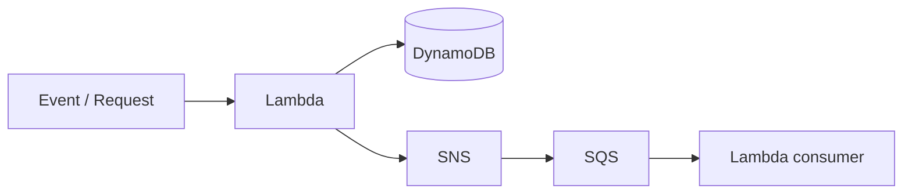

# Lab 5 — Build a Serverless Architecture

## 🗺️ Lab architecture



### ภาพ Diagram


> Diagram นี้เป็นภาพสรุปเพื่อช่วยทำความเข้าใจโครงสร้างของแล็บ โดยยึดแนวคิดจากคู่มือต้นฉบับ
> คู่มือภาษาไทยสำหรับทำ Lab 5 จาก *Architecting on AWS 7.12.4 Lab Guide*  
> ช่วงต้นฉบับ: หน้า 94–117  
> คงชื่อ AWS Console menu / button / field / resource / JSON placeholder เป็น English ตาม Lab

## เป้าหมาย

สร้าง image-processing workflow แบบ event-driven/serverless:

```text
Upload .jpg → S3 ingest/
              ↓
      S3 Event Notification
              ↓
             SNS
          ↙       ↘
thumbnail-queue  mobile-queue
      ↓              ↓
CreateThumbnail  CreateMobileImage
      ↓              ↓
S3 thumbnail/     S3 mobile/
```

---

## Start Lab

1. กด `Start Lab`
2. รอ resource พร้อม
3. กด `Open Console`
4. ใช้ Region ที่ Lab กำหนด

---

# Task 1 — Create a standard Amazon SNS topic

1. `Search` → `Simple Notification Service`
2. Navigation menu → `Topics`
3. กด `Create topic`
4. ใน `Details`:
   - `Type`: `Standard`
   - `Name`: ตั้งชื่อขึ้นต้นด้วย `resize-image-topic` เช่น `resize-image-topic-1234`
5. กด `Create topic`
6. Copy ค่าต่อไปนี้ไว้ใน notepad:
   - `ARN`
   - `Topic owner` (AWS Account ID 12 หลัก)

> **สำคัญ:** ต้องเลือก `Standard` ไม่ใช่ FIFO

---

# Task 2 — Create two Amazon SQS queues

## Task 2.1 — Create `thumbnail-queue`

1. `Search` → `Simple Queue Service`
2. กด `Create queue`
3. ใน `Details`:
   - `Type`: `Standard`
   - `Name`: `thumbnail-queue`
4. ค่าอื่นใช้ default
5. กด `Create queue`
6. เปิด tab `SNS subscriptions`
7. กด `Subscribe to Amazon SNS topic`
8. เลือก `resize-image-topic-XXXX` ที่สร้างไว้
   - ถ้าไม่แสดง ให้เลือก `Enter Amazon SNS topic ARN` แล้ววาง ARN ที่ copy ไว้
9. กด `Save`

## Task 2.2 — Create `mobile-queue`

ทำเหมือน queue แรก:

1. `Queues` → `Create queue`
2. `Type`: `Standard`
3. `Name`: `mobile-queue`
4. กด `Create queue`
5. tab `SNS subscriptions`
6. `Subscribe to Amazon SNS topic`
7. เลือก `resize-image-topic-XXXX`
8. กด `Save`

## Task 2.3 — Verify SNS subscriptions

1. `Search` → `Simple Notification Service`
2. `Topics` → เลือก `resize-image-topic-XXXX`
3. กด `Publish message`
4. `Subject - optional`: `Hello world`
5. ใน `Message body`:
   - `Message structure`: `Identical payload for all delivery protocols`
   - Message body: `Testing Hello world`
6. ใน `Message attributes`:
   - `Type`: `String`
   - `Name`: `message`
   - `Value`: `Hello world`
7. กด `Publish message`
8. `Search` → `Simple Queue Service`
9. เลือก queue ใด queue หนึ่ง
10. กด `Send and receive messages`
11. ใน `Receive messages` กด `Poll for messages`
12. เปิด Message ID เพื่อดู `Details`, `Body`, `Attributes`
13. กด `Done`

---

# Task 3 — Create an Amazon S3 event notification

## Task 3.1 — Allow S3 to publish to the SNS topic

1. `Search` → `Simple Notification Service`
2. `Topics` → `resize-image-topic-XXXX`
3. กด `Edit`
4. เปิด `Access policy - optional`
5. ลบ policy เดิมใน JSON editor
6. วาง policy ต่อไปนี้:

```json
{
  "Version": "2008-10-17",
  "Id": "__default_policy_ID",
  "Statement": [
    {
      "Sid": "__default_statement_ID",
      "Effect": "Allow",
      "Principal": {
        "AWS": "*"
      },
      "Action": [
        "SNS:GetTopicAttributes",
        "SNS:SetTopicAttributes",
        "SNS:AddPermission",
        "SNS:RemovePermission",
        "SNS:DeleteTopic",
        "SNS:Subscribe",
        "SNS:ListSubscriptionsByTopic",
        "SNS:Publish"
      ],
      "Resource": "SNS_TOPIC_ARN",
      "Condition": {
        "StringEquals": {
          "AWS:SourceAccount": "SNS_TOPIC_OWNER"
        }
      }
    },
    {
      "Effect": "Allow",
      "Principal": {
        "Service": "s3.amazonaws.com"
      },
      "Action": "SNS:Publish",
      "Resource": "SNS_TOPIC_ARN",
      "Condition": {
        "StringEquals": {
          "AWS:SourceAccount": "SNS_TOPIC_OWNER"
        }
      }
    }
  ]
}
```

7. แทน `SNS_TOPIC_OWNER` ทั้ง 2 จุดด้วย `Topic owner` ที่ copy ไว้
8. แทน `SNS_TOPIC_ARN` ทั้ง 2 จุดด้วย SNS Topic ARN ที่ copy ไว้
9. กด `Save changes`

## Task 3.2 — Create S3 Event Notification

1. `Search` → `S3`
2. เลือก bucket ชื่อประมาณ `xxxxx-labbucket-xxxxx`
3. เปิด tab `Properties`
4. ไปส่วน `Event notifications`
5. กด `Create event notification`
6. ใน `General configuration`:
   - `Event name`: `resize-image-event`
   - `Prefix - optional`: `ingest/`
   - `Suffix - optional`: `.jpg`
7. ใน `Event types`:
   - เลือก `All object create events`
8. ใน `Destination`:
   - `Destination`: `SNS topic`
   - `Specify SNS topic`: `Choose from your SNS topics`
   - `SNS topic`: `resize-image-topic-XXXX`
9. กด `Save changes`

ตอนนี้ไฟล์ `.jpg` ที่ถูกสร้างใต้ `ingest/` จะส่ง event ไป SNS topic

---

# Task 4 — Create and configure two AWS Lambda functions

## Task 4.1 — Create `CreateThumbnail`

1. `Search` → `Lambda`
2. กด `Create function`
3. เลือก `Author from scratch`
4. ใน `Basic information`:
   - `Function name`: `CreateThumbnail`
   - `Runtime`: `Python 3.12`
5. เปิด `Additional settings`
6. เปิด toggle `Custom execution role`
7. ใน `Configure custom execution role`:
   - `Execution role`: เลือก role ชื่อประมาณ `XXXXX-LabExecutionRole-XXXXX`
8. กด `Save`
9. กด `Create function`
10. หากมี `Getting started` popup ให้กด `Dismiss`

## Task 4.2 — Add SQS trigger and deployment package to `CreateThumbnail`

1. กด `+ Add trigger`
2. ตั้งค่า:
   - `Select a source`: `SQS`
   - `SQS Queue`: `thumbnail-queue`
   - `Batch size - optional`: `1`
3. กด `Add`
4. เปิด tab `Code`
5. Copy ค่า `CreateThumbnailZIPLocation` จากหน้าคำสั่ง Lab
6. `Update` → `Update from a file in Amazon S3`
7. วางค่าใน `Amazon S3 link`
8. กด `Update`
9. ใน `Runtime settings` กด `Edit`
10. `Handler`: `CreateThumbnail.handler`
11. กด `Save`
12. tab `Configuration` → `General configuration` → `Edit`
13. `Description - optional`: `Create a thumbnail-sized image.`
14. กด `Save`

> Source package จะ resize รูปเป็น thumbnail และ upload ผลลัพธ์ไป folder `thumbnail/` ด้วยชื่อขึ้นต้น `Thumbnail-`

## Task 4.3 — Create `CreateMobileImage`

1. `Lambda` → `Create function`
2. `Author from scratch`
3. ตั้งค่า:
   - `Function name`: `CreateMobileImage`
   - `Runtime`: `Python 3.12`
4. `Additional settings` → เปิด `Custom execution role`
5. เลือก `XXXXX-LabExecutionRole-XXXXX`
6. กด `Save`
7. กด `Create function`
8. หากมี popup ให้กด `Dismiss`

## Task 4.4 — Add SQS trigger and deployment package to `CreateMobileImage`

1. `+ Add trigger`
2. ตั้งค่า:
   - `Select a source`: `SQS`
   - `SQS Queue`: `mobile-queue`
   - `Batch size - optional`: `1`
3. กด `Add`
4. tab `Code`
5. Copy ค่า `CreateMobileImageZIPLocation` จากหน้าคำสั่ง Lab
6. `Update` → `Update from a file in Amazon S3`
7. วาง URL ใน `Amazon S3 link`
8. กด `Update`
9. `Runtime settings` → `Edit`
10. `Handler`: `CreateMobileImage.handler`
11. กด `Save`
12. `Configuration` → `General configuration` → `Edit`
13. `Description - optional`: `Create a mobile friendly image.`
14. กด `Save`

> Source package จะ resize รูปสำหรับ mobile และ upload ไป folder `mobile/` ด้วยชื่อขึ้นต้น `MobileImage-`

---

# Task 5 — Upload an object to Amazon S3

## Task 5.1 — Upload image for processing

1. ดาวน์โหลดรูปใดรูปหนึ่งจาก Lab เช่น:
   - `AWS.jpg`
   - `MonaLisa.jpg`
   - `HappyFace.jpg`
2. `Search` → `S3`
3. เลือก bucket `xxxxx-labbucket-xxxxx`
4. เปิด folder `ingest/`
5. กด `Upload`
6. กด `Add files`
7. เลือกรูป `.jpg` ที่ดาวน์โหลด
8. กด `Upload`
9. รอ `Upload succeeded`

เมื่อไฟล์ถูกสร้างใน `ingest/` flow จะเป็น:

```text
S3 → SNS → SQS 2 queues → Lambda 2 functions
```

---

# Task 6 — Validate the processed file

## Task 6.1 — Review CloudWatch Logs

1. `Search` → `Lambda`
2. เลือก `CreateThumbnail` หรือ `CreateMobileImage`
3. เปิด tab `Monitor`
4. กด `View CloudWatch logs`
5. เปิด `Log stream` ล่าสุด
6. ขยายแต่ละ log message เพื่อตรวจ execution
7. ตรวจ `REPORT` line เช่น Duration, Billed Duration, Memory Size, Max Memory Used

> อาจเห็น function ถูก invoke มากกว่าหนึ่งครั้งจาก test SNS message, S3 notification setup และ upload จริง

## Task 6.2 — Validate resized files in S3

1. `Search` → `S3`
2. เลือก bucket `xxxxx-labbucket-xxxxx`
3. ตรวจ folders:
   - `thumbnail/`
   - `mobile/`
4. ควรพบไฟล์ลักษณะ:
   - `Thumbnail-AWS.jpg`
   - `MobileImage-MonaLisa.jpg`

หากมีไฟล์ resized แสดงว่า pipeline ทำงานสำเร็จ

---

# Optional Task 1 — Delete files in `ingest/` after 30 days

1. `S3` → เลือก lab bucket
2. tab `Management`
3. `Lifecycle rules` → `Create lifecycle rule`
4. ตั้งค่า:
   - `Lifecycle rule name`: `cleanup`
   - `Choose a rule scope`: `Limit the scope of this rule using one or more filters`
5. `Filter type`:
   - `Prefix`: `ingest/`
6. `Lifecycle rule actions` เลือก:
   - `Expire current versions of objects`
   - `Permanently delete noncurrent versions of objects`
7. ตั้งค่า:
   - `Days after object creation`: `30`
   - `Days after objects become noncurrent`: `1`
8. กด `Create rule`

# Optional Task 2 — Add an SNS email subscription

1. `Search` → `Simple Notification Service`
2. `Subscriptions`
3. กด `Create subscription`
4. ตั้งค่า:
   - `Topic ARN`: Topic ที่สร้างใน Task 1
   - `Protocol`: `Email`
   - `Endpoint`: email address ที่ใช้งานได้
5. กด `Create subscription`
6. เปิด email แล้วกด `Confirm subscription`

---

# End Lab

1. กลับ `AWS Management Console`
2. `AWSLabsUser` → `Sign out`
3. กลับหน้า Lab → `End Lab`
4. ยืนยัน
