# Module 3 — Networking 1

## 🧭 Visual architecture

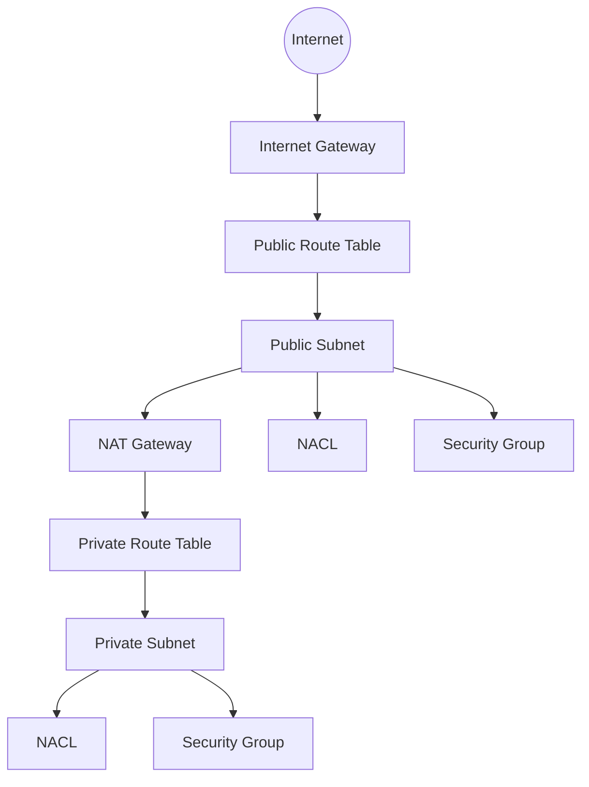

### ภาพ Diagram


> Diagram นี้เป็นภาพสรุปเพื่อช่วยทำความเข้าใจโครงสร้างของบท/แล็บ โดยยึดแนวคิดจากคู่มือต้นฉบับ
> Mobile reader copy combined from Part 1 + Part 2. Full source screenshots remain in Google Drive master.

# Architecting on AWS 7.12.4 - Module 3: Networking 1 (Part 1)

> **Source:** *Architecting on AWS 7.12.4 (EN) - Student Guide*  
> **Covered pages:** 114-137  
> **Focus:** IP addressing, CIDR, Amazon VPC fundamentals, subnets, internet gateway, route tables, NAT gateway, elastic network interfaces, Elastic IP addresses, Multi-AZ VPC design, network ACLs, and security groups

---

## เป้าหมายของ Module 3 ช่วงนี้

Module 3 เริ่มจากโจทย์ของ network engineer 3 เรื่องหลัก:

1. จะวาง IP address ให้เพียงพอกับ workload ได้อย่างไร?
2. จะสร้าง network infrastructure บน AWS ให้ dynamic และ secure ได้อย่างไร?
3. จะ filter inbound/outbound traffic เพื่อป้องกัน resources ได้อย่างไร?

Part 1 นี้ครอบคลุมตั้งแต่พื้นฐาน IP จนถึง security controls สองตัวสำคัญคือ **Network ACL** และ **Security Group**

---

# 1. Mental Model ก่อนเริ่ม

ถ้าเธอเคยทำ network on-prem มาก่อน ให้มอง VPC ประมาณนี้:

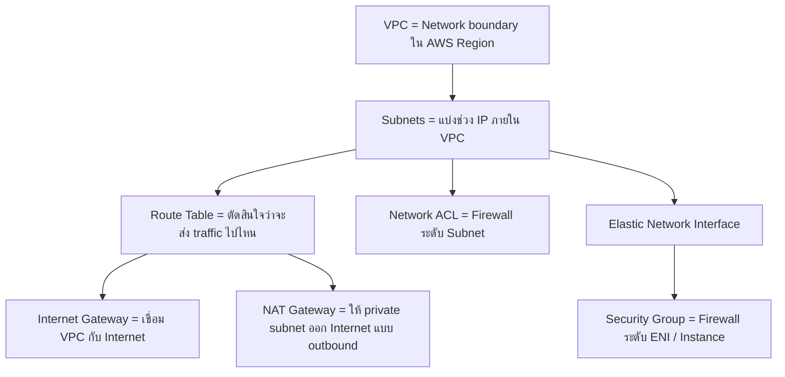

นี่คือภาพรวมของบทนี้ทั้งหมด

---

# 2. IP Address คืออะไร?

Student Guide หน้า 119 อธิบายว่า IP address ใช้ระบุตำแหน่งของ resource ภายใน network

ตัวอย่าง IPv4:

```text
172.31.2.15
```

IPv4 address มี 4 octets แต่ละ octet มีค่าตั้งแต่ 0-255

ตัวอย่าง:

```text
172 . 31 . 2 . 15
 |    |    |    |
 +----+----+----+----> แต่ละส่วน = 1 octet
```

IP address มีส่วนที่ใช้ identify network และส่วนที่ใช้ identify host

---

# 3. IPv4 vs IPv6

Student Guide กล่าวถึง IP address สองประเภทหลัก:

## IPv4

- ใช้ 32-bit address
- เขียนเป็น decimal notation 4 ชุด
- เป็นรูปแบบที่ใช้กันแพร่หลายมาก

ตัวอย่าง:

```text
172.31.2.15
```

## IPv6

- ใช้ 128-bit address
- ถูกออกแบบมาเพื่อแก้ข้อจำกัดจำนวน address ของ IPv4
- เขียนเป็น hexadecimal หลายกลุ่ม

ใน course นี้ VPC รองรับทั้ง IPv4 และ IPv6

---

# 4. CIDR คืออะไร?

**Classless Inter-Domain Routing (CIDR)** ใช้ระบุ range ของ IP addresses สำหรับ network หรือ subnet

ตัวอย่าง:

```text
10.22.0.0/16
```

> 🖼️ *Source figure — Student Guide p.120; full screenshot is kept in the Google Drive master copy.*

ส่วน `/16` คือ prefix length ที่บอกว่ากี่ bit ใช้เป็น network portion

ภาพจำ:

```text
10.22.0.0/16
--------- --
Network   Prefix
```

เมื่อ prefix เล็กลง เช่น `/16` จะมี address มากกว่า `/24`

เมื่อ prefix ใหญ่ขึ้น เช่น `/28` จะมี address น้อยลง

---

# 5. CIDR Planning สำคัญยังไง?

ก่อนสร้าง VPC ต้องคิดล่วงหน้าว่า workload จะโตแค่ไหน

ถ้าจัด CIDR เล็กเกินไป:

```text
วันนี้มี 20 servers
ปีหน้าเพิ่ม autoscaling / databases / containers
→ IP address ไม่พอ
```

ถ้าจัดใหญ่เกินไปโดยไม่มีแผน ก็อาจทำให้จัด address space ยากเมื่อเชื่อมหลาย VPC หรือ on-prem networks

Student Guide เน้นว่า CIDR blocks ของ VPC ที่เพิ่มเข้ามาไม่ควร overlap กัน

---

# 6. CIDR ของ VPC และ Subnet

Amazon VPC ใช้ CIDR blocks เพื่อกำหนด address space

ตัวอย่างจาก Student Guide:

```text
VPC: 172.31.0.0/16
```

จากนั้นแบ่งออกเป็น subnet ย่อย เช่น:

```text
Public Subnet 1 : 172.31.0.0/20
Public Subnet 2 : 172.31.16.0/20
Private Subnet 1: 172.31.32.0/20
Private Subnet 2: 172.31.48.0/20
```

แนวคิดคือ:

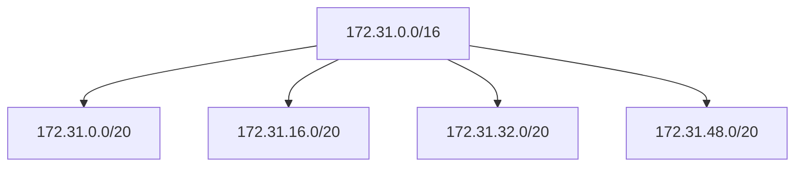

---

# 7. Amazon VPC คืออะไร?

**Amazon Virtual Private Cloud (Amazon VPC)** คือ network environment ของเราใน AWS

VPC ถูกสร้างภายใน AWS Region และ resource ต่าง ๆ สามารถ launch เข้า subnet ภายใน VPC ได้

Student Guide หน้า 123 อธิบายว่า VPC ช่วยกำหนด:

- IP address range
- Subnets
- Route tables
- Network connectivity

และสร้าง logical isolation ให้ resources

ภาพจำ:

```text
AWS Region
└── VPC
    ├── Availability Zone A
    │   ├── Public Subnet
    │   └── Private Subnet
    │
    └── Availability Zone B
        ├── Public Subnet
        └── Private Subnet
```

---

# 8. Subnet คืออะไร?

**Subnet** คือช่วง IP address ภายใน VPC ที่เราแบ่งออกมาเพื่อวาง resources

> 🖼️ *Source figure — Student Guide p.124; full screenshot is kept in the Google Drive master copy.*

จุดสำคัญ:

- Subnet CIDR ต้องอยู่ภายใน VPC CIDR
- Subnet CIDRs ห้าม overlap กัน
- หนึ่ง subnet อยู่ใน **หนึ่ง Availability Zone เท่านั้น**

ดังนั้น subnet ไม่ได้ span ข้ามหลาย AZ

---

# 9. AWS Reserved IP Addresses ใน Subnet

Student Guide หน้า 124 ระบุว่าใน IPv4 subnet AWS จะ reserve IP addresses บางตัว

ตัวอย่าง subnet:

```text
10.0.0.0/24
```

address ที่ไม่สามารถ assign ให้ resource ได้รวมถึง:

```text
10.0.0.0   Network address
10.0.0.1   Reserved by AWS for VPC router
10.0.0.2   Reserved for DNS
10.0.0.3   Reserved by AWS for future use
10.0.0.255 Network broadcast address (AWS ไม่รองรับ broadcast ใน VPC)
```

ดังนั้นจำนวน IP ที่ใช้ได้จริงจะน้อยกว่าจำนวน address ทั้งหมดของ CIDR block

---

# 10. Public Subnet คืออะไร?

Student Guide หน้า 125 อธิบาย public subnet ว่าเป็น subnet ที่รองรับ resources ซึ่งต้องสื่อสาร inbound/outbound กับ Internet

การทำให้ subnet ใช้งาน Internet ได้ต้องมีองค์ประกอบสำคัญ:

1. **Internet Gateway** attach กับ VPC
2. **Route Table** มี route ไป Internet Gateway
3. Resource ต้องมี public IP address ที่เหมาะสมสำหรับการสื่อสารผ่าน Internet

Mental model:

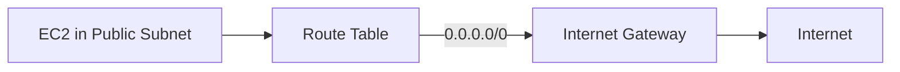

การมีชื่อว่า "Public Subnet" ไม่ได้เกิดจากชื่อ subnet แต่เกิดจาก **routing configuration**

---

# 11. Internet Gateway (IGW)

**Internet Gateway** เป็น VPC component ที่ให้ communication ระหว่าง resource ใน VPC และ Internet

Student Guide ระบุว่า internet gateway มีลักษณะ:

- Horizontally scaled
- Redundant
- Highly available

Internet Gateway ต้อง attach กับ VPC

และ route table ต้องชี้ Internet-bound traffic ไปที่ Internet Gateway

ตัวอย่าง:

```text
Destination     Target
0.0.0.0/0       igw-xxxx
```

---

# 12. Public IPv4 และ NAT ที่ Internet Gateway

Student Guide หน้า 126 อธิบายว่า resource ที่ใช้ public IPv4 address มี private IPv4 อยู่ภายใน VPC และ Internet Gateway ทำ address translation ระหว่าง private/public IPv4 ที่ผูกกัน

ภาพจำ:

```text
Inside VPC
Private IP: 172.31.1.15
      |
      | Internet Gateway translation
      v
Public IP: 203.x.x.x
      |
      v
Internet
```

---

# 13. Route Table คืออะไร?

**Route Table** คือชุดของ routing rules ที่ใช้ตัดสินใจว่าจะส่ง network traffic ไปที่ไหน

ทุก VPC จะมี main route table

ตัวอย่าง route table:

```text
Destination      Target
172.31.0.0/16    local
0.0.0.0/0        igw-xxxx
```

ความหมาย:

```text
172.31.0.0/16 -> traffic ภายใน VPC ส่ง local
0.0.0.0/0     -> traffic อื่น ๆ ส่งออก Internet Gateway
```

---

# 14. Subnet Association กับ Route Table

Subnet ต้อง associate กับ route table

ถ้าเราไม่ได้ explicit associate subnet กับ custom route table ระบบจะใช้ main route table ของ VPC

แนวทางทั่วไปจึงเป็น:

```text
Public Subnet
   ↓
Public Route Table
   ↓
Internet Gateway
```

และ

```text
Private Subnet
   ↓
Private Route Table
   ↓
NAT Gateway
```

---

# 15. Private Subnet คืออะไร?

Private subnet ใช้สำหรับ resources ที่ไม่ควรถูกเข้าถึงโดยตรงจาก Internet

ตัวอย่าง workload:

- Application servers ภายใน
- Database servers
- Backend services

Private subnet ยังสามารถออก Internet ได้แบบ indirect ผ่าน NAT Gateway

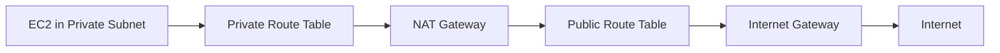

---

# 16. NAT Gateway คืออะไร?

**NAT Gateway** ใช้ให้ resources ใน private subnet initiate outbound connections ไป Internet โดยไม่ต้อง expose ให้ Internet initiate inbound connection กลับเข้ามาโดยตรง

> 🖼️ *Source figure — Student Guide p.129; full screenshot is kept in the Google Drive master copy.*

Student Guide ระบุว่า NAT Gateway:

- ใช้ทำ network address translation
- เป็น managed service
- Horizontally scaled
- Redundant
- Highly available by design

---

# 17. NAT Gateway ต้องอยู่ตรงไหน?

สำหรับการออก Internet ของ private subnet ตาม architecture ใน Student Guide:

```text
Internet
   |
Internet Gateway
   |
Public Subnet
   |
NAT Gateway
   |
Private Route Table
   |
Private Subnet
```

NAT Gateway อยู่ใน **public subnet**

และต้องสามารถ route ต่อไปยัง Internet Gateway ได้

---

# 18. NAT Gateway Traffic Flow

ตัวอย่างจากหนังสือ:

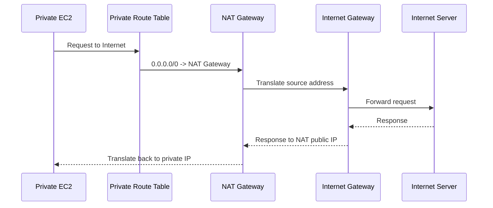

สิ่งสำคัญคือ private instance ไม่จำเป็นต้องมี public IP เพื่อออก Internet ผ่าน NAT Gateway

---

# 19. Connecting Private Subnets to the Internet

Student Guide หน้า 131 สรุป architecture ที่ต้องมีดังนี้:

```text
Private Subnet Route Table
0.0.0.0/0 -> NAT Gateway

Public Subnet Route Table
0.0.0.0/0 -> Internet Gateway
```

ดังนั้น private route table ไม่ชี้ตรงไป IGW แต่ชี้ไป NAT Gateway ก่อน

---

# 20. Elastic Network Interface (ENI)

**Elastic Network Interface** คือ logical network interface ภายใน VPC

มองง่าย ๆ เหมือน virtual NIC ของ EC2

ENI มีข้อมูล network เช่น:

- Private IPv4 address
- Elastic IP association ถ้ามี
- Security groups
- Network attributes อื่น ๆ

Student Guide อธิบายว่า ENI สามารถ detach จาก instance หนึ่งและ attach ไปอีก instance หนึ่งได้ภายใต้ข้อจำกัดที่เกี่ยวข้องกับ Availability Zone

---

# 21. ENI Use Cases

Student Guide ยกแนวคิดที่ ENI ช่วยได้ เช่น:

- Management network
- Network / security appliance architecture
- Low-budget high-availability solution บางรูปแบบ

ภาพจำ:

```text
EC2-A
  |
 ENI
  |
(detach)
  |
EC2-B
```

เมื่อย้าย ENI network attributes ที่ผูกกับ interface สามารถย้ายไปด้วย

---

# 22. Elastic IP Address (EIP)

**Elastic IP address** คือ static public IPv4 address สำหรับ dynamic cloud computing

จุดสำคัญจาก Student Guide:

- สามารถ associate กับ instance หรือ network interface
- สามารถ remap ไป instance อื่นใน VPC ได้
- ใช้ช่วยให้ public address คงที่เมื่อ backend instance เปลี่ยน

ตัวอย่าง failover concept:

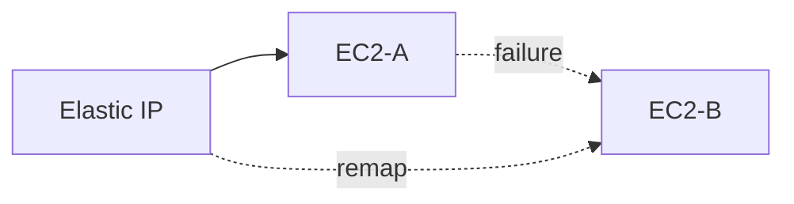

---

# 23. VPC Across Multiple Availability Zones

Student Guide แนะนำให้ deploy VPC workloads ข้ามหลาย Availability Zones เพื่อเพิ่ม high availability

> 🖼️ *Source figure — Student Guide p.134; full screenshot is kept in the Google Drive master copy.*

ตัวอย่าง:

```text
VPC
├── AZ-A
│   ├── Public Subnet
│   └── Private Subnet
│
└── AZ-B
    ├── Public Subnet
    └── Private Subnet
```

แนวคิดหลัก:

- สร้าง subnet ในแต่ละ AZ
- กระจาย application resources ข้าม AZ
- ใช้ Elastic Load Balancing เพื่อกระจาย traffic
- ให้แต่ละ AZ มีเส้นทาง outbound ที่เหมาะสม

ถ้า AZ หนึ่งมี outage ระบบยังมี resources ในอีก AZ

---

# 24. Multi-AZ Networking Mental Model

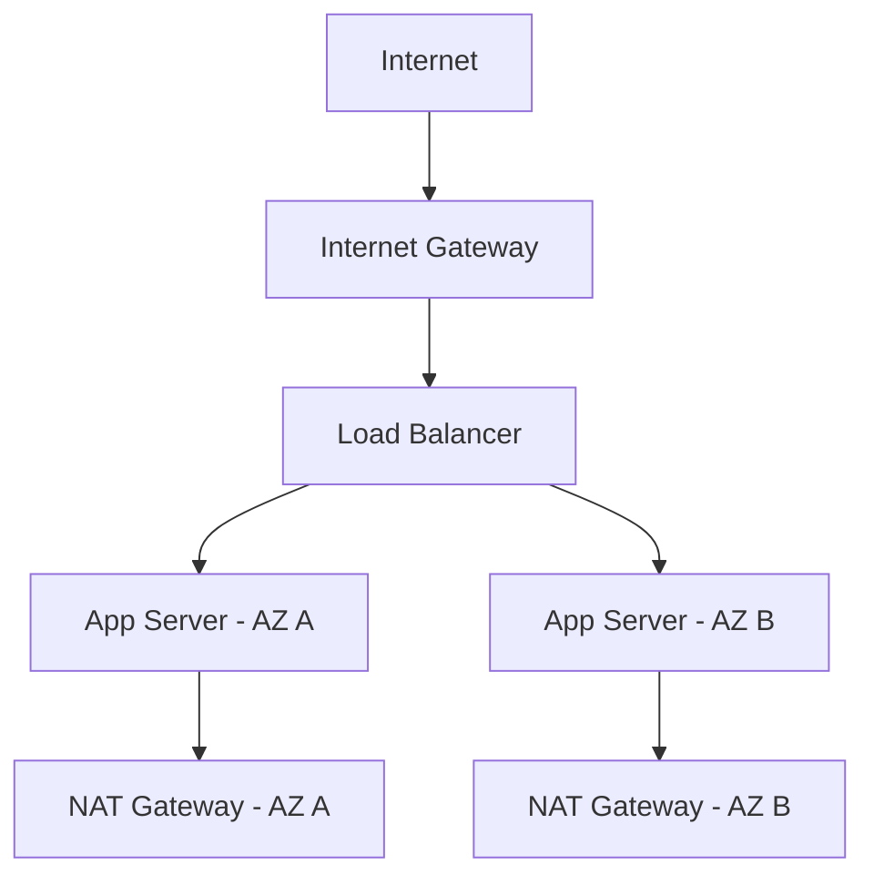

เป้าหมายคือไม่สร้าง dependency ที่ทำให้ AZ เดียวกลายเป็น single point of failure

---

# 25. เริ่มเรื่อง VPC Traffic Security

หลังจากสร้าง VPC, subnets และ routing แล้ว คำถามต่อไปคือ:

> Traffic ไหนควรอนุญาตเข้า/ออก network?

Student Guide เริ่ม security section ด้วย controls สองตัว:

1. **Network ACL (NACL)**
2. **Security Group (SG)**

---

# 26. Network ACL (NACL)

**Network Access Control List** เป็น optional security layer ระดับ subnet

> 🖼️ *Source figure — Student Guide p.136; full screenshot is kept in the Google Drive master copy.*

Student Guide ระบุว่า NACL ทำหน้าที่เป็น firewall ที่ควบคุม inbound และ outbound traffic ของ subnet

คุณสมบัติสำคัญ:

- ทำงานระดับ subnet
- มี inbound rules
- มี outbound rules
- รองรับทั้ง **Allow** และ **Deny**
- rules มีหมายเลขและประเมินตามลำดับ
- เป็น **stateless**

---

# 27. NACL Rule Evaluation

Rules จะถูก evaluate เริ่มจาก rule number ต่ำไปสูง

ตัวอย่าง:

```text
100 ALLOW TCP 443 from 0.0.0.0/0
200 DENY  ALL from 0.0.0.0/0
```

ถ้า packet match rule 100 แล้ว ก็ไม่ต้องไล่ต่อไปถึง rule 200

ดังนั้นลำดับ rule สำคัญมาก

---

# 28. NACL เป็น Stateless

คำว่า **stateless** หมายถึง inbound และ outbound traffic ถูก evaluate แยกกัน

ถ้าอนุญาต request เข้า:

```text
Inbound ALLOW
```

ไม่ได้แปลว่า response จะถูกอนุญาตออกโดยอัตโนมัติ

ต้องมี outbound rule ที่ allow response ด้วย

ภาพจำ:

```text
Inbound Request
    ↓
NACL Inbound Rules

Outbound Response
    ↓
NACL Outbound Rules
```

สองทิศทางต้องพิจารณาแยกกัน

---

# 29. Security Group

**Security Group** เป็น virtual firewall สำหรับ instance / network interface

> 🖼️ *Source figure — Student Guide p.137; full screenshot is kept in the Google Drive master copy.*

คุณสมบัติสำคัญจาก Student Guide:

- ทำงานระดับ network interface / instance
- ควบคุม inbound และ outbound traffic
- รองรับ **Allow rules**
- เป็น **stateful**

---

# 30. Security Group เป็น Stateful

ถ้า inbound traffic ได้รับอนุญาตผ่าน SG และ connection ถูก established แล้ว response traffic จะถูก allow กลับออกมาโดยอัตโนมัติ

ตัวอย่าง:

```text
Client ---> TCP 443 ---> EC2
          Allowed by SG

EC2 ------ Response ----> Client
          Automatically allowed as return traffic
```

นี่คือความต่างสำคัญจาก NACL

---

# 31. Network ACL vs Security Group

| หัวข้อ | Network ACL | Security Group |
|---|---|---|
| ระดับ | Subnet | ENI / Instance |
| Stateful | ไม่ใช่ (Stateless) | ใช่ (Stateful) |
| Allow rules | ได้ | ได้ |
| Deny rules | ได้ | ไม่ใช้ explicit deny rules แบบ NACL |
| Inbound/Outbound | ประเมินแยกกัน | Return traffic ของ established connection ถูกติดตาม |
| Use case | Guardrail ระดับ subnet | ควบคุม access ของ workload |

### ประโยคจำง่าย

```text
NACL = ด่านหน้าของ Subnet
SG   = รปภ.หน้าตัว Server / ENI
```

---

# 32. Packet Walkthrough: Public Web Server

สมมติมี EC2 web server ใน public subnet

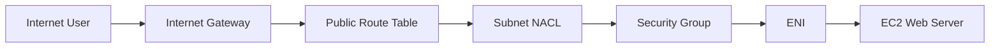

แนวคิดคือ traffic ต้องผ่านหลาย configuration ที่เกี่ยวข้องก่อนถึง workload

---

# 33. Packet Walkthrough: Private Server ออก Internet

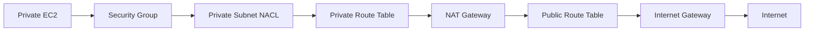

การออก Internet ของ private server จึงต่างจาก public server เพราะใช้ NAT Gateway เป็นตัวกลาง

---

# 34. Checklist สำหรับออกแบบ VPC เบื้องต้น

จากเนื้อหา Part 1 เราสามารถวาง checklist ได้ดังนี้:

## Addressing

- กำหนด VPC CIDR
- คิด growth ของ workload
- หลีกเลี่ยง CIDR overlap
- แบ่ง subnet CIDRs

## Availability

- ใช้หลาย Availability Zones
- สร้าง subnets แยกตาม AZ
- กระจาย workload

## Routing

- Public route table -> Internet Gateway
- Private route table -> NAT Gateway

## Security

- Network ACL ระดับ subnet
- Security Group ระดับ ENI/workload

---

# 35. ตัวอย่าง Architecture รวม Part 1

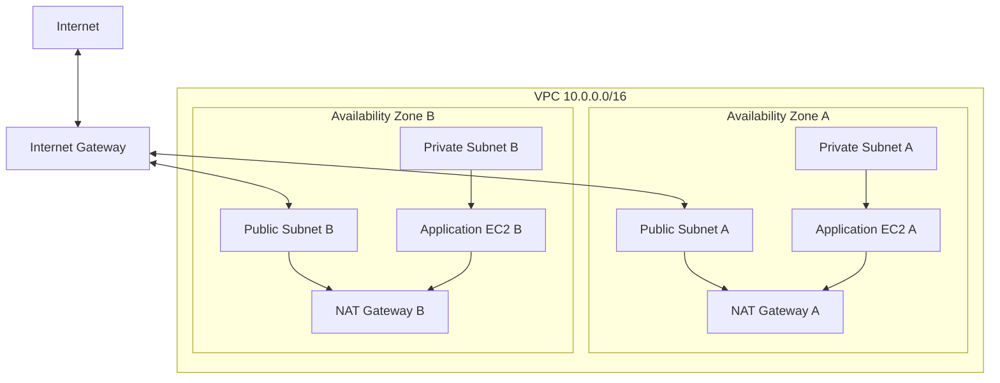

ภาพนี้รวมแนวคิดจากหน้า 123-134 ของ Student Guide เข้าด้วยกัน

---

# 36. สิ่งที่ควรจำจาก Module 3 Part 1

- VPC คือ logical network environment ใน AWS Region
- CIDR ใช้กำหนด IP address range
- Subnet CIDR ต้องอยู่ภายใน VPC CIDR และไม่ overlap
- หนึ่ง subnet อยู่ได้เพียงหนึ่ง Availability Zone
- Public subnet ต้องมี routing ไป Internet Gateway
- Private subnet ออก Internet ได้ผ่าน NAT Gateway
- Route table ตัดสินใจว่าจะส่ง traffic ไป target ใด
- ENI คือ virtual network interface
- Elastic IP คือ static public IPv4 address ที่ remap ได้
- Multi-AZ design เพิ่ม availability
- NACL ทำงานระดับ subnet และเป็น stateless
- Security Group ทำงานระดับ instance/ENI และเป็น stateful

---

## Quick Memory Map

```text
IP/CIDR
   ↓
VPC
   ↓
Subnet
   ↓
Route Table
   ├── Public  -> Internet Gateway
   └── Private -> NAT Gateway -> Internet Gateway
   ↓
NACL (Subnet / Stateless)
   ↓
Security Group (ENI / Stateful)
   ↓
EC2 / Workload
```

---

## จบ Module 3: Networking 1 - Part 1

Part ถัดไปจะต่อจาก **VPC Traffic Security** หลังหน้า 137 ไปจนถึงการ review/knowledge check ของ Module 3 ก่อนเริ่ม Module 4: Compute


---

# Architecting on AWS 7.12.4 — Module 3: Networking 1 (Part 2)

> **Source:** VitalSource Bookshelf — *Architecting on AWS 7.12.4 (EN), Student Guide*  
> **PDF pages:** 138–159  
> **Focus:** Security groups, layered network defense, Network ACL comparison, capstone review, and Knowledge Check

---

## 1. ต่อจาก Part 1: VPC traffic security

Part 1 พาเราสร้างเส้นทางของ network ตั้งแต่ VPC, subnet, route table, internet gateway, NAT gateway ไปจนถึง Network ACL และ Security Group แล้ว

Part 2 จะโฟกัสคำถามว่า **เมื่อ network เชื่อมต่อได้แล้ว เราจะควบคุมว่า traffic อะไรควรผ่าน และอะไรไม่ควรผ่านอย่างไร**

AWS ใช้แนวคิด **multiple layers of defense** โดย Module นี้เน้น 2 ตัวหลัก:

- **Security Group (SG)** — ควบคุม traffic ที่ระดับ resource / network interface
- **Network ACL (NACL)** — ควบคุม traffic ที่ระดับ subnet

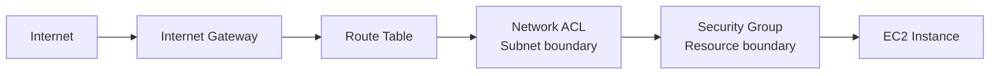

สิ่งสำคัญคือ **route table ไม่ใช่ firewall** — route table บอกว่า traffic จะไปทางไหน ส่วน SG/NACL เป็นตัวควบคุมว่า traffic ได้รับอนุญาตหรือไม่

---

## 2. Default และ New Security Groups

เมื่อสร้าง Security Group ใหม่ จุดที่ควรจำคือ:

- **ไม่มี inbound rule** → inbound traffic ไม่ได้รับอนุญาต
- **มี outbound rule ที่อนุญาตทั้งหมด** → outbound traffic ออกได้ทั้งหมด

นี่เป็นประเด็นที่ Student Guide นำไปถามใน Knowledge Check โดยตรง

จากนั้น administrator ค่อยเพิ่ม inbound rule เฉพาะสิ่งที่ต้องใช้ เช่น:

- Web server: TCP 80 / 443
- Administrator access: SSH 22 หรือ protocol ที่ต้องใช้
- Database: เปิดเฉพาะจาก application tier ไม่ใช่เปิดกว้างจากทุก source

> **จำ:** เปิดเฉพาะสิ่งที่ workload ต้องใช้จริง

---

## 3. Custom Security Group Rules

Security Group สามารถกรอง traffic โดยดูจาก:

- Direction: inbound / outbound
- Protocol
- Port
- Source หรือ Destination

ตัวอย่าง web server:

```text
Inbound
TCP 80   <- approved source
TCP 443  <- approved source

Outbound
ตาม requirement ของ application
```

Security Group เป็น **stateful**

หมายความว่า ถ้า request ได้รับอนุญาต response traffic ของ connection นั้นจะถูกติดตามและอนุญาตให้ไหลกลับได้

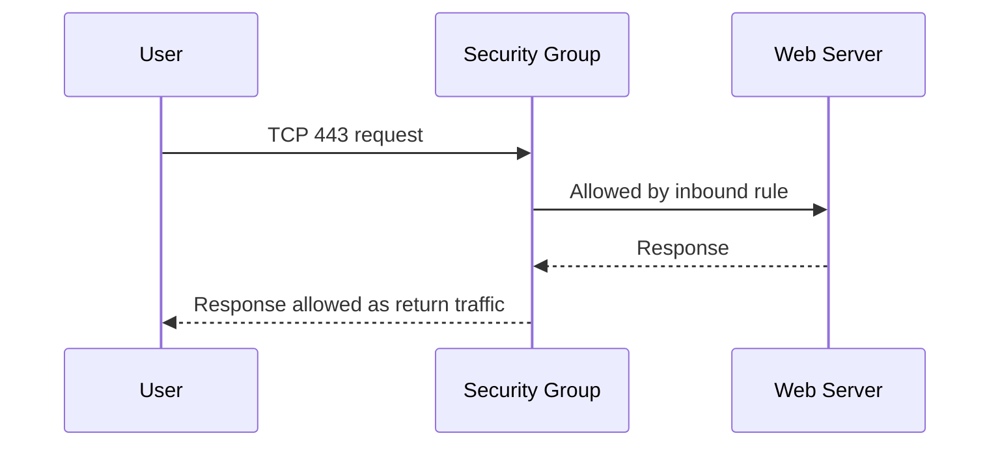

จุดนี้ต่างจาก Network ACL ซึ่งเป็น **stateless**

---

## 4. Security Group Chaining

Student Guide แสดงตัวอย่างการใช้ Security Group เป็น source ของ Security Group อื่น เพื่อบังคับ traffic flow ตาม tier

> 🖼️ *Source figure — Student Guide p.140; full screenshot is kept in the Google Drive master copy.*

แนวคิด 3-tier:

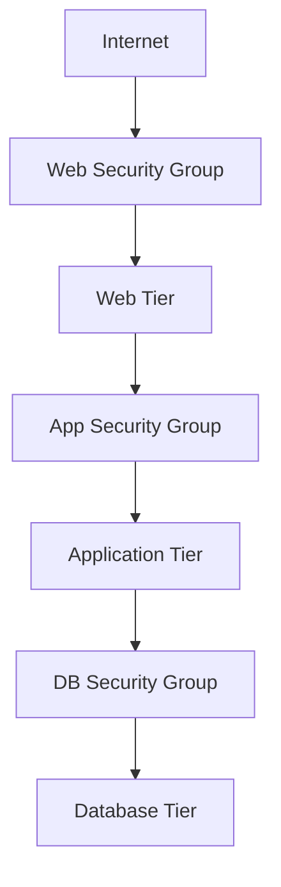

ตัวอย่าง rule ตามแนวคิดในภาพ:

```text
Web SG
  allow HTTPS from approved source

App SG
  allow application traffic from Web SG

DB SG
  allow database traffic from App SG
```

ข้อดีคือ policy ผูกกับ **role ของ resource** มากกว่าต้อง hard-code IP ของทุก instance

---

## 5. Multiple Layers of Defense

Student Guide แนะนำให้ป้องกัน infrastructure หลายชั้น

> 🖼️ *Source figure — Student Guide p.141; full screenshot is kept in the Google Drive master copy.*

flow โดยย่อ:

```text
Internet
   |
Internet Gateway
   |
Route Table
   |
Network ACL
   |
Subnet
   |
Security Group
   |
Instance
```

แต่ละชั้นทำหน้าที่ต่างกัน:

- **Route table** — กำหนดเส้นทาง
- **Network ACL** — subnet-level filtering
- **Security Group** — resource-level filtering

แนวคิดคือถ้าการตั้งค่าชั้นหนึ่งผิด อีกชั้นยังช่วยลด exposure ได้

---

# 6. Security Group vs Network ACL

นี่คือหัวข้อสำคัญที่สุดของ Part 2

> 🖼️ *Source figure — Student Guide p.142; full screenshot is kept in the Google Drive master copy.*

| หัวข้อ | Security Group | Network ACL |
|---|---|---|
| ระดับที่ผูก | Network interface / resource | Subnet |
| State | **Stateful** | **Stateless** |
| Rule | Allow rules | Allow และ Deny rules |
| การประเมิน | ใช้ rules ที่เกี่ยวข้อง | ประเมินตามหมายเลข rule จากต่ำไปสูง |
| ขอบเขต | Resource ที่ผูก SG | Resources ใน subnet ที่ใช้ NACL |
| Default ที่บทนี้เน้น | New SG: inbound none, outbound all | Default NACL allow inbound/outbound; custom NACL deny จนเพิ่ม rule |

### วิธีจำง่าย

```text
Security Group = Guard หน้าห้อง
Network ACL    = Guard หน้าชั้น/โซน
```

หรือ

```text
SG   -> Resource level
NACL -> Subnet level
```

---

## 7. Stateful vs Stateless

### Security Group — Stateful

ถ้า inbound request ถูกอนุญาต response traffic ของ connection นั้นสามารถไหลกลับได้

```text
Client ---> TCP 443 ---> EC2
Client <--- Response --- EC2
```

### Network ACL — Stateless

NACL ประเมิน inbound และ outbound แยกกัน

```text
Inbound  -> ต้อง match rule ที่อนุญาต
Outbound -> ต้อง match rule ที่อนุญาตด้วย
```

ดังนั้นถ้าใช้ NACL แบบ restrictive ต้องคิดทั้งสองทิศทาง

---

# 8. Default vs Custom Network ACL

จาก Student Guide:

### Default Network ACL

อนุญาต inbound และ outbound IPv4 traffic

### Custom Network ACL

เริ่มต้นโดยไม่อนุญาต traffic จนกว่าจะเพิ่ม rule

NACL ใช้ **rule number** และประเมินจากเลขต่ำขึ้นสูง เมื่อเจอ rule ที่ match แล้วจะใช้ผลของ rule นั้น

ตัวอย่าง conceptual rules:

```text
100 ALLOW TCP 443 0.0.0.0/0
200 DENY  ALL     0.0.0.0/0
```

traffic TCP 443 ที่ match rule 100 จะใช้ผลของ rule 100

---

# 9. Capstone Architecture Check-in

หน้า 146–147 นำ networking ทั้ง Module มารวมใน architecture เดียว

> 🖼️ *Source figure — Student Guide p.146; full screenshot is kept in the Google Drive master copy.*

ภาพนี้ใช้ทบทวนการออกแบบ network หลัก ๆ เช่น:

- VPC เดียวใน Region
- หลาย Availability Zones
- แยก public / application / database subnet
- Internet Gateway
- NAT Gateway
- Route tables
- Security controls

Student Guide ระบุด้วยว่าภาพมี service บางตัวที่ยังไม่ได้อธิบายใน Module นี้ เช่น Elastic Load Balancing, Amazon EFS, Amazon Aurora และ Amazon ElastiCache ดังนั้น Note นี้ไม่ขยาย service เหล่านั้นเกินจากที่ source ให้มา

---

## 10. Design Decisions จาก Capstone

### 10.1 High Availability

วาง subnet ในหลาย Availability Zones เพื่อไม่ผูก workload ทั้งระบบไว้กับ AZ เดียว

```text
AZ 1: Public + Application + Database
AZ 2: Public + Application + Database
```

### 10.2 Internet-facing resources

Internet Gateway เชื่อม VPC กับ Internet และ public subnet มี route ที่เหมาะสมไปยัง IGW

### 10.3 Private resources

application/database tiers สามารถอยู่ใน private subnet เพื่อไม่รับ unsolicited inbound traffic จาก Internet โดยตรง

### 10.4 Outbound Internet จาก Private Subnet

ใช้ NAT Gateway ใน public subnet

```text
Private instance
      |
Private route table
      |
NAT Gateway
      |
Internet Gateway
      |
Internet
```

private resource สามารถ initiate connection ออกไปได้ แต่ NAT Gateway ไม่ได้ใช้รับ unsolicited inbound connection จาก Internet ไปหา private instance

### 10.5 Traffic filtering

ใช้ทั้ง:

```text
NACL -> subnet boundary
SG   -> resource boundary
```

เป็น layered defense

---

# 11. Module 3 Review

Student Guide สรุป Module 3 เป็น 3 หัวข้อหลัก:

1. **IP addresses**
2. **VPC fundamentals**
3. **VPC traffic security**

ถ้าจะจำ Module นี้เป็นภาพเดียว:

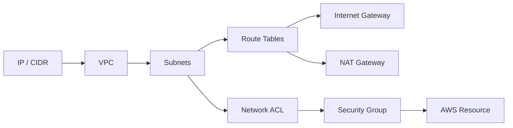

---

# 12. Knowledge Check

## Question 1

**True or False: A single Amazon Virtual Private Cloud (Amazon VPC) can span multiple Regions.**

**Answer: False**

Student Guide อธิบายว่า Amazon VPC span Availability Zones ภายใน **หนึ่ง Region** ไม่ได้ span หลาย Regions

---

## Question 2

**Which action must be taken to make a subnet public?**

**Answer:** Route outbound traffic to the internet gateway.

ใน public subnet route table ต้องมี route สำหรับ traffic ที่ต้องไป Internet เช่น:

```text
0.0.0.0/0 -> Internet Gateway
```

---

## Question 3

**Which function does the NAT gateway serve?**

**Answer:** Allows internet traffic initiated by private subnet instances.

ประโยคสำคัญคือ **initiated by private subnet instances**

---

## Question 4

**What should be used to create traffic filtering rules for a subnet?**

**Answer:** Network access control list (Network ACL)

เพราะ NACL ทำงานในระดับ subnet

---

## Question 5

**Which ports are open by default when a new security group is created? (Select TWO.)**

คำตอบใน Student Guide:

- **Nothing is allowed inbound**
- **Anything is allowed outbound**

> 🖼️ *Source figure — Student Guide p.158; full screenshot is kept in the Google Drive master copy.*

---

# 13. Cheat Sheet — Networking 1

```text
VPC
= Virtual network in one AWS Region

Subnet
= IP range inside VPC
= Belongs to one Availability Zone

Public Subnet
= Has routing to Internet Gateway

Private Subnet
= No direct Internet route through IGW

Internet Gateway
= Connects VPC with Internet

NAT Gateway
= Allows private subnet resources to initiate outbound connections

Route Table
= Decides where traffic goes

Security Group
= Stateful
= Resource / network-interface level
= Allow rules

Network ACL
= Stateless
= Subnet level
= Allow + Deny rules
= Evaluated by rule number
```

---

# 14. Mental Model สำหรับวิเคราะห์ AWS Network

เวลาเจอ architecture ให้ไล่ถามตามนี้:

```text
1. Resource อยู่ VPC ไหน?
2. อยู่ subnet อะไร?
3. Subnet อยู่ Availability Zone ไหน?
4. Route table ส่ง traffic ไป target ไหน?
5. ถ้าต้องออก Internet ใช้ IGW หรือ NAT Gateway?
6. NACL อนุญาต traffic นี้หรือไม่?
7. Security Group อนุญาต traffic นี้หรือไม่?
```

ถ้าไล่ลำดับนี้ได้ จะเห็น packet flow เป็นระบบกว่าการจำชื่อ service แยก ๆ

---

## End of Module 3 — Networking 1

**Module 3 covered PDF pages:** 114–159
