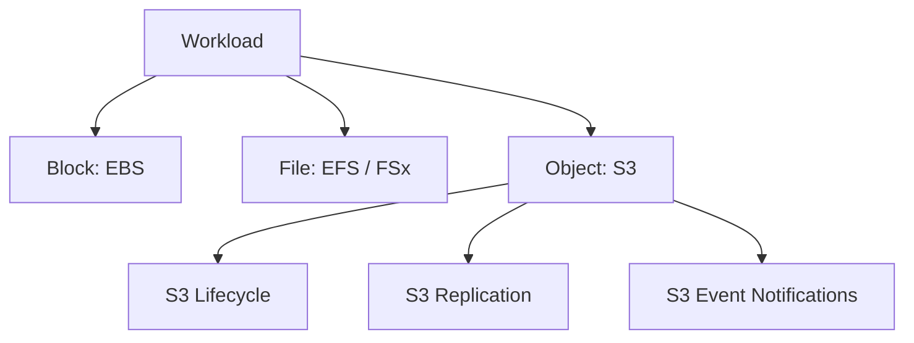
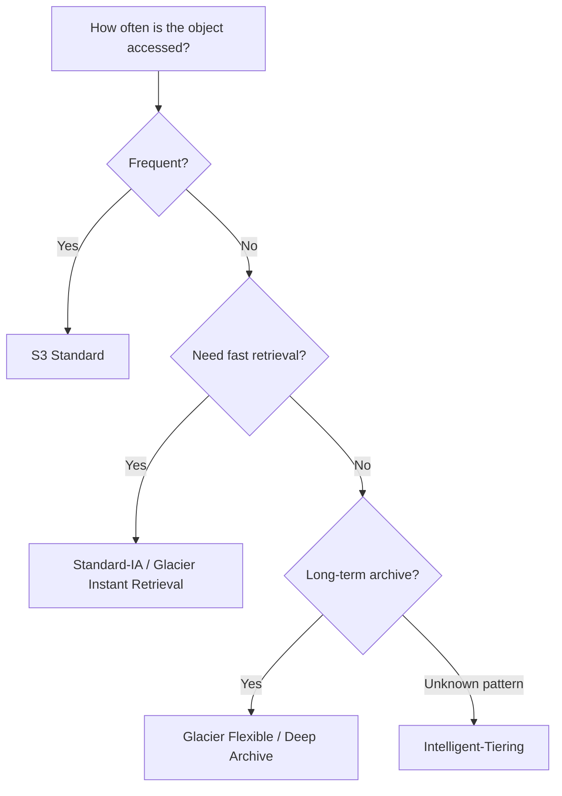
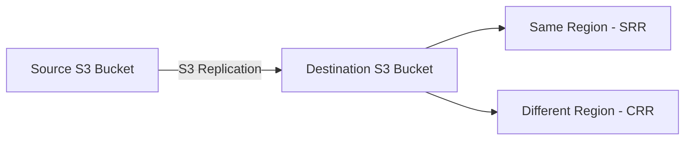
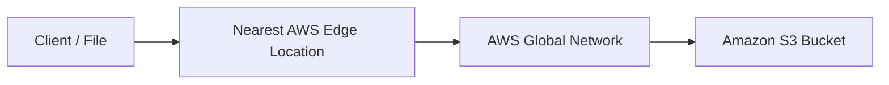
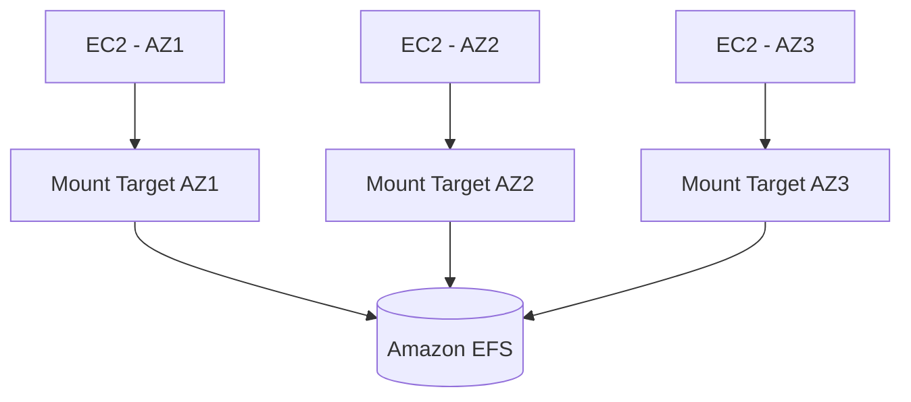
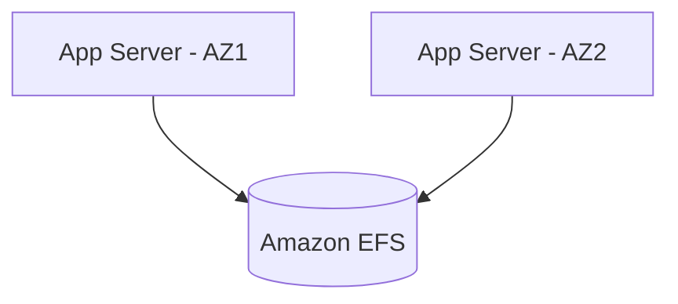
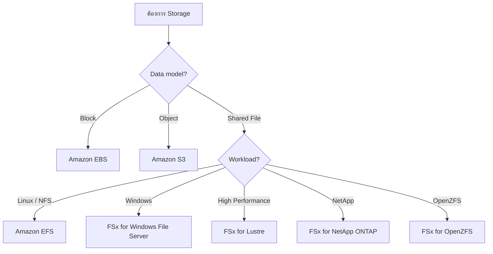
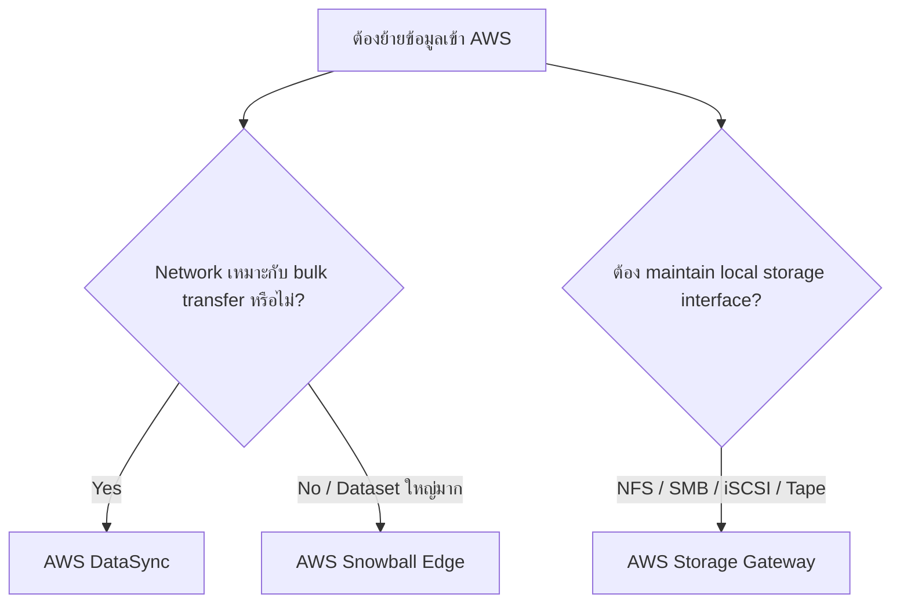

# Module 5 — Storage

> 🧠 **ภาพจำก่อนอ่าน:** 🗄️ Data → ⚙️ Process → 🔐 Protection → 🩺 Health  
> 🎨 [Visual Guide ของวิชานี้](../VISUAL-MEMORY-GUIDE-TH.md) — ภาพช่วยจำ ไม่แทนคำอธิบายและคำสั่งจริง

## 🧭 Visual architecture



### ภาพ Diagram


> Diagram นี้เป็นภาพสรุปเพื่อช่วยทำความเข้าใจโครงสร้างของบท/แล็บ โดยยึดแนวคิดจากคู่มือต้นฉบับ
> Mobile reader copy combined from Part 1 + Part 2. Full source screenshots remain in Google Drive master.

# Architecting on AWS 7.12.4 — Module 5: Storage (Part 1)

> **Source:** VitalSource Bookshelf — *Architecting on AWS 7.12.4 (EN) Student Guide*  
> **PDF pages covered:** 218–240  
> **Scope:** Storage services overview, Amazon S3, buckets/objects, access control, S3 Block Public Access, S3 Access Points, encryption, storage classes, Intelligent-Tiering, Versioning, and Lifecycle policies.

---

## 0. ภาพรวมของ Module 5

Module 5 เริ่มจากคำถามง่าย ๆ แต่สำคัญมากว่า:

> workload ของเราต้องการ storage แบบ **block, file หรือ object**?

จากนั้น Student Guide ค่อยพาไปดูบริการหลักที่ AWS มีให้ในแต่ละแบบ และลงลึกเรื่อง Amazon S3 ใน Part นี้

ภาพรวมของ Module 5 ตามหน้า Module overview:

- Business request
- Storage services
- Amazon Simple Storage Service (Amazon S3)
- Shared file systems
- Data migration tools
- Present solutions
- Capstone check-in
- Knowledge check

Part 1 นี้จะหยุดหลังเรื่อง S3 Versioning และ Lifecycle policies ก่อนเข้าส่วน shared file systems ต่อไป

---

# 1. Cloud storage overview

> 🖼️ *Source figure — Student Guide p.223; full screenshot is kept in the Google Drive master copy.*

Student Guide แบ่ง cloud storage ออกเป็น 3 แบบหลัก:

1. **Block storage**
2. **File storage**
3. **Object storage**

แต่ละแบบมี data model และ use case ต่างกัน

---

## 1.1 Block storage

Block storage แบ่งข้อมูลออกเป็น block ที่สามารถอ่าน/เขียนแบบ random access ได้

เหมาะกับ workload ที่มอง storage คล้าย disk เช่น:

- Operating system disk
- Database storage
- Transaction-heavy workloads

ตัวอย่างบริการ AWS ที่บทเรียนเชื่อมโยงไว้คือ:

- Amazon EBS
- EC2 Instance Store

ซึ่งเราเรียนไปแล้วใน Module 4

---

## 1.2 File storage

File storage จัดข้อมูลแบบ directory + file hierarchy และมักใช้กับ workload ที่ต้องการ filesystem semantics

ลักษณะทั่วไป:

```text
/shared
├── team-a/
├── team-b/
└── application-data/
```

เหมาะกับ workload ที่หลายเครื่องต้องเข้าถึง file เดียวกัน หรือ application ถูกออกแบบมาบน filesystem เดิม

Student Guide ยกตัวอย่างบริการอย่าง:

- Amazon EFS
- Amazon FSx

รายละเอียดจะอยู่ในช่วงถัดไปของ Module 5

---

## 1.3 Object storage

Object storage เก็บข้อมูลเป็น **object** แทน block หรือ traditional filesystem

แต่ละ object มีองค์ประกอบอย่าง:

- Data
- Metadata
- Unique identifier / key

เหมาะกับข้อมูลที่ต้องการ scale สูง เช่น:

- Backup
- Data lake
- Static content
- Media
- Archive

บริการหลักของ AWS คือ **Amazon S3**

---

# 2. AWS data building blocks

> 🖼️ *Source figure — Student Guide p.224; full screenshot is kept in the Google Drive master copy.*

Student Guide สรุป AWS storage building blocks ไว้ประมาณนี้:

| Storage model | AWS services ที่ยกตัวอย่าง |
|---|---|
| Block | Amazon EBS, Instance Store |
| File | Amazon EFS, Amazon FSx |
| Object | Amazon S3, Amazon S3 Glacier |

จุดสำคัญคืออย่าเริ่มจากคำถามว่า “service ไหนดีที่สุด” แต่เริ่มจาก:

> application ต้องการ storage model แบบไหน?

เพราะ block, file, object แก้ปัญหาคนละประเภท

---

# 3. Amazon S3 overview

> 🖼️ *Source figure — Student Guide p.226; full screenshot is kept in the Google Drive master copy.*

Amazon S3 คือ **durable object storage service**

Student Guide เน้นประโยชน์หลักหลายด้าน เช่น:

- Accelerate innovation
- Increase agility
- Reduce cost
- Strengthen security

S3 ถูกออกแบบให้เก็บข้อมูลจำนวนมากได้โดยไม่ต้องให้ผู้ใช้จัดการ storage infrastructure เอง

---

## 3.1 Durability ของ Amazon S3

Student Guide ระบุว่า Amazon S3 ออกแบบมาสำหรับ durability ระดับ:

**99.999999999% (eleven 9s)**

แนวคิดนี้หมายถึง AWS ออกแบบระบบเพื่อให้ object มีโอกาสสูญหายน้อยมาก

S3 เก็บข้อมูลแบบ redundant ภายใน AWS infrastructure แทนการผูกข้อมูลไว้กับ disk เดียวหรือเครื่องเดียว

> **จำ:** durability ไม่ใช่ availability  
> durability เน้น “ข้อมูลไม่หาย” ส่วน availability เน้น “เข้าถึงบริการได้เมื่อไหร่”

---

# 4. Amazon S3 use cases

Student Guide ยก use cases หลักของ S3 เช่น:

- Backup and restore
- Data lakes for analytics
- Media storage and streaming
- Static website
- Archiving and compliance

แนวคิดคือ S3 เหมาะกับข้อมูลที่:

- ไม่จำเป็นต้อง mount เป็น block device
- ไม่จำเป็นต้องใช้ traditional file lock/filesystem semantics แบบ file storage
- ต้องการ scale สูง
- ต้องการ durability สูง

---

# 5. S3 buckets and objects

> 🖼️ *Source figure — Student Guide p.228; full screenshot is kept in the Google Drive master copy.*

Amazon S3 เก็บ object ภายใน **bucket**

โครงสร้างพื้นฐาน:

```text
Amazon S3
└── Bucket
    ├── Object A
    ├── Object B
    └── Prefix/
        ├── Object C
        └── Object D
```

---

## 5.1 Bucket

Bucket เป็น logical container สำหรับเก็บ objects

การกำหนดสิทธิ์หลายอย่างของ S3 สามารถทำในระดับ bucket ได้ เช่น:

- Bucket policy
- Block Public Access
- Lifecycle policy
- Versioning configuration

---

## 5.2 Object

Object ประกอบด้วย:

- File/data
- Metadata
- Object key

Object key ทำหน้าที่เป็น unique identifier ของ object ภายใน bucket

ตัวอย่างเชิงแนวคิด:

```text
Bucket: my-company-data
Object key: reports/2026/september/report.csv
```

---

## 5.3 Prefix

แม้ S3 จะเป็น object storage ไม่ใช่ filesystem แต่ key สามารถใช้ prefix เพื่อจัดกลุ่ม object ให้ดูเหมือน folder ได้

ตัวอย่าง:

```text
finance/2026/report.csv
finance/2026/invoice.pdf
hr/employee-list.csv
```

`finance/` และ `hr/` เป็น prefix ที่ช่วยจัด organization ของ object

---

# 6. Securing objects in Amazon S3

หลังจากเก็บ object แล้ว ประเด็นต่อไปคือ:

> ใครสามารถอ่าน เขียน ลบ หรือ list object ได้บ้าง?

Student Guide เน้นว่าการป้องกัน object มีหลาย layer เช่น:

- IAM permissions
- Bucket policies
- Access Points
- Block Public Access
- Encryption

---

# 7. Amazon S3 access control

> 🖼️ *Source figure — Student Guide p.230; full screenshot is kept in the Google Drive master copy.*

โดย default S3 resources จะถูกสร้างมาแบบ **private**

หลักสำคัญคือ owner ต้อง explicitly grant access ก่อนที่ principal อื่นจะเข้าถึงข้อมูลได้

access สามารถควบคุมผ่านหลายกลไก เช่น:

- IAM policies
- Bucket policies
- Access point policies
- ACL-related controls ตาม configuration

---

## 7.1 Private by default

แนวคิดที่ควรจำ:

```text
Create bucket/object
        ↓
Private by default
        ↓
Grant only required permissions
```

นี่สอดคล้องกับ least privilege ที่เรียนใน Module 2

---

# 8. Bucket policies

Bucket policy คือ **resource-based policy** ที่ attach กับ S3 bucket

policy สามารถใช้ควบคุม:

- Principal ใดเข้าถึงได้
- Action ใดทำได้
- Resource ใดได้รับผล
- Condition ใดต้องเป็นจริง

โครงสร้างเชิงแนวคิด:

```json
{
  "Statement": [
    {
      "Effect": "Allow",
      "Principal": "...",
      "Action": "s3:GetObject",
      "Resource": "arn:aws:s3:::example-bucket/*"
    }
  ]
}
```

> ตัวอย่างด้านบนใช้เพื่ออธิบายโครงสร้าง policy เท่านั้น ไม่ใช่ข้อความที่คัดตรงจาก Student Guide

สิ่งสำคัญคือ bucket policy เป็น resource-based policy ต่างจาก identity-based IAM policy ที่ attach กับ user/group/role

---

# 9. Amazon S3 Block Public Access

Student Guide เน้น Block Public Access เพราะช่วยลดความเสี่ยงจากการเปิด bucket หรือ object ต่อ public โดยไม่ตั้งใจ

แนวคิดคือ:

```text
IAM / Bucket policy / ACL / Access Point
              ↓
      Public access possible?
              ↓
       Block Public Access
              ↓
      Prevent public exposure
```

สามารถกำหนด Block Public Access ในระดับ account หรือ bucket ได้ตาม configuration

จุดสำคัญคือแม้ policy อื่นพยายามเปิด public access การตั้งค่า Block Public Access สามารถช่วยป้องกัน exposure ได้

---

# 10. Amazon S3 Access Points

S3 Access Points ช่วยจัดการ access สำหรับ shared datasets ที่มีหลาย application หรือหลาย team

แต่ละ Access Point มี:

- Unique DNS name
- ARN
- Access point policy
- Network controls

แทนที่จะเขียน bucket policy ขนาดใหญ่มากเพื่อรองรับทุก application สามารถแยก policy ตาม access point ได้

ตัวอย่าง concept:

```text
                S3 Bucket
               /    |    \
              /     |     \
      Finance AP   HR AP   App AP
         │           │       │
    Finance app    HR app   Service
```

แต่ละ access point สามารถกำหนด permission ที่เหมาะกับ consumer ของมันได้

---

# 11. Server-side encryption key types

> 🖼️ *Source figure — Student Guide p.234; full screenshot is kept in the Google Drive master copy.*

Student Guide แสดง server-side encryption options หลัก 4 แบบ:

1. **SSE-S3**
2. **SSE-KMS**
3. **DSSE-KMS**
4. **SSE-C**

---

## 11.1 SSE-S3

SSE-S3 ใช้ key ที่ Amazon S3 จัดการให้

S3 รับผิดชอบทั้ง encryption process และ key management ในรูปแบบของ service

เหมาะกับกรณีที่ต้องการ encryption at rest โดยไม่ต้องจัดการ key เอง

---

## 11.2 SSE-KMS

SSE-KMS ใช้ AWS KMS keys

ข้อดีคือมี control และ integration กับ KMS มากขึ้น เช่นการบริหาร key และ permission ที่สัมพันธ์กับ key

ภาพจำ:

```text
Object
  ↓
Amazon S3
  ↓
AWS KMS key
  ↓
Encrypted object at rest
```

---

## 11.3 DSSE-KMS

DSSE-KMS คือ dual-layer server-side encryption with AWS KMS keys

แนวคิดคือใช้ encryption สอง layer กับ object เพื่อเพิ่มระดับการป้องกันสำหรับ requirement ที่เข้มงวดขึ้น

---

## 11.4 SSE-C

SSE-C คือ Server-Side Encryption with Customer-Provided Keys

customer เป็นผู้จัดการ key ที่ส่งมาให้ S3 ใช้ตอน encryption/decryption

ต่างจาก SSE-S3 และ SSE-KMS ที่ key management อยู่ใน AWS service มากกว่า

---

# 12. Amazon S3 storage classes

> 🖼️ *Source figure — Student Guide p.236; full screenshot is kept in the Google Drive master copy.*

ไม่ใช่ข้อมูลทุก object จะถูก access บ่อยเท่ากัน

Student Guide จึงแนะนำให้เลือก storage class ตาม access pattern

storage classes ที่เน้นในหน้าเรียนนี้ ได้แก่:

- S3 Standard
- S3 Standard-Infrequent Access (Standard-IA)
- S3 Glacier Instant Retrieval
- S3 Glacier Flexible Retrieval
- S3 Glacier Deep Archive
- S3 Intelligent-Tiering

---

# 13. S3 Standard

เหมาะกับข้อมูลที่ถูก access บ่อย

ลักษณะ concept:

- Frequent access
- General-purpose object storage
- Low-latency access

ตัวอย่างเช่น application content หรือ data ที่ถูกใช้งานเป็นประจำ

---

# 14. S3 Standard-IA

Standard-IA เหมาะกับข้อมูลที่:

- ต้องการ availability/durability แบบ production
- access ไม่บ่อย
- แต่เมื่อจำเป็นต้องใช้ ต้อง retrieve ได้เร็ว

คำว่า IA = **Infrequent Access**

---

# 15. S3 Glacier Instant Retrieval

เหมาะกับ archive data ที่ access ไม่บ่อย แต่ยังต้องการ retrieval แบบ milliseconds

ตัวอย่าง mindset:

```text
ข้อมูลเป็น archive
แต่บางครั้งต้องดึงกลับเร็ว
        ↓
Glacier Instant Retrieval
```

---

# 16. S3 Glacier Flexible Retrieval

เหมาะกับ archive ที่ไม่ต้อง retrieve ทันที

Student Guide อธิบาย retrieval options หลายระดับ เช่น:

- Expedited retrieval: ระดับนาที
- Standard retrieval: ระดับชั่วโมง
- Bulk retrieval: ระดับหลายชั่วโมง

จึงแลก retrieval time เพื่อ cost optimization ได้

---

# 17. S3 Glacier Deep Archive

ใช้กับ long-term archive และ digital preservation

เหมาะกับข้อมูลที่เก็บไว้นานและแทบไม่ต้องเรียกใช้

retrieval ใช้เวลานานกว่า Glacier classes อื่น แต่ให้ cost ต่ำสำหรับ long-term storage

---

# 18. S3 Intelligent-Tiering

S3 Intelligent-Tiering เหมาะกับข้อมูลที่ access pattern ไม่แน่นอนหรือเปลี่ยนไปตามเวลา

service สามารถ move object ระหว่าง access tiers ตามการใช้งาน

Student Guide ยก flow โดยประมาณดังนี้:

```text
Frequent Access
      ↓
Infrequent Access
      ↓
Archive Instant Access
      ↓
Optional Archive Access
      ↓
Optional Deep Archive Access
```

จุดประสงค์คือช่วย optimize storage cost โดยไม่ต้องให้ผู้ใช้เดา access pattern ล่วงหน้ามากเกินไป

---

# 19. Amazon S3 Versioning

> 🖼️ *Source figure — Student Guide p.239; full screenshot is kept in the Google Drive master copy.*

Versioning ช่วยเก็บหลาย version ของ object เดียวกัน

เมื่อ update object:

```text
object.txt
├── Version 1
├── Version 2
└── Version 3 (current)
```

ถ้า object ถูก overwrite หรือ delete โดยไม่ตั้งใจ สามารถ recover version ก่อนหน้าได้ตาม configuration

---

## 19.1 Delete marker

เมื่อ versioning เปิดอยู่ การ delete object ไม่จำเป็นต้องลบทุก version ทันที

S3 สามารถสร้าง **delete marker** เพื่อทำให้ object ดูเหมือนถูกลบจาก current view แต่ previous versions ยังอยู่

นี่ช่วยเรื่อง recovery จาก accidental deletion

---

## 19.2 S3 Object Lock

Student Guide เชื่อม Versioning กับ Object Lock สำหรับ retention/protection

แนวคิดสำคัญคือ **write once, read many (WORM)**

ใช้เพื่อป้องกันการ overwrite/delete ตาม retention requirement หรือ legal hold ตาม configuration

---

# 20. Lifecycle policies

> 🖼️ *Source figure — Student Guide p.240; full screenshot is kept in the Google Drive master copy.*

Lifecycle policy ใช้ automate การเปลี่ยน storage class หรือ expire object ตามอายุของข้อมูล

ตัวอย่างใน Student Guide:

```text
Day 0
S3 Standard
   ↓ 30 days
S3 Standard-IA
   ↓ 365 days
S3 Glacier Deep Archive
```

นี่คือวิธีลดค่า storage ตาม lifecycle ของข้อมูล โดยไม่ต้องย้าย object เองทีละไฟล์

---

## 20.1 Transition actions

Lifecycle rule สามารถย้าย object ไป storage class ที่เหมาะกับข้อมูลที่เก่าลงและถูก access น้อยลง

แนวคิด:

```text
Hot data → Warm data → Cold data → Archive
```

---

## 20.2 Expiration actions

Lifecycle policy ยังสามารถใช้ expire/delete object เมื่อหมด retention period ได้

เหมาะกับข้อมูลอย่าง:

- Logs ที่ต้องเก็บ 90 วัน
- Temporary exports
- Backup generations เก่า

---

# 21. Storage class selection mindset

วิธีคิดจากเนื้อหาใน Part นี้:



จุดสำคัญคือ storage class ไม่ได้เปลี่ยน durability concept ของ S3 ให้กลายเป็น “ข้อมูลเสี่ยงหายเพราะถูกกว่า” แต่เปลี่ยน cost/access characteristics ตาม class

---

# 22. สรุป Part 1

ใน Part นี้ควรจำแก่นต่อไปนี้:

- Cloud storage มี 3 model หลัก: **block, file, object**
- Amazon S3 คือ object storage service
- S3 เก็บ object ใน bucket
- Object มี key + metadata + data
- S3 resources private by default
- Bucket policy เป็น resource-based policy
- Block Public Access ช่วยป้องกัน public exposure
- Access Points ช่วยแยก access policy สำหรับหลาย application/team
- Server-side encryption มี SSE-S3, SSE-KMS, DSSE-KMS, SSE-C
- Storage class ต้องเลือกตาม access pattern
- Intelligent-Tiering เหมาะกับ pattern ที่ไม่แน่นอน
- Versioning ช่วย recover จาก overwrite/delete
- Lifecycle policies ช่วย automate transition และ expiration

---

# 23. ต่อไปใน Module 5

Part ถัดไปจะต่อจากหลังหน้า 240 และเข้าสู่หัวข้ออย่าง:

- Shared file systems
- Amazon EFS / FSx concepts
- Data migration tools
- Solution selection
- Module review / capstone / knowledge check


---

# Architecting on AWS 7.12.4 — Module 5: Storage — Part 2

> ช่วงเนื้อหา: PDF หน้า 241–275  
> ต่อจาก Part 1 ซึ่งจบที่ S3 Versioning และ Lifecycle policies

---

## ภาพรวมของ Part 2

Part นี้ต่อยอดจากการใช้งาน Amazon S3 ไปสู่การออกแบบ storage ที่ซับซ้อนขึ้น โดยครอบคลุม 4 กลุ่มใหญ่:

1. **ความสามารถเพิ่มเติมของ Amazon S3**
   - S3 Replication
   - Multipart Upload
   - Transfer Acceleration
   - Event Notifications
   - ปัจจัยด้านต้นทุน
   - S3 Express One Zone
2. **Shared file systems**
   - Amazon EFS
   - Amazon FSx
3. **Data migration tools**
   - AWS Storage Gateway
   - AWS DataSync
   - AWS Snowball Edge
4. **Review / Capstone / Knowledge Check**

แนวคิดสำคัญของช่วงนี้คือ **เลือก storage ให้เหมาะกับรูปแบบการเข้าถึงข้อมูลและวิธีที่ข้อมูลต้องเคลื่อนย้าย** ไม่ใช่มองเพียงว่า “ต้องเก็บไฟล์ที่ไหน”

---

# 1. Replicating S3 objects

Amazon S3 มีความทนทานและความพร้อมใช้งานสูงอยู่แล้ว แต่บาง workload ต้องการ **สำเนาของ object เพิ่มใน bucket อื่น** ด้วยเหตุผลด้าน compliance, latency, isolation หรือ business continuity

> 🖼️ *Source figure — Student Guide p.241; full screenshot is kept in the Google Drive master copy.*

S3 Replication สามารถทำสำเนา object แบบ asynchronous จาก source bucket ไปยัง destination bucket ได้

มีรูปแบบหลัก 2 แบบ:

- **Same-Region Replication (SRR)** — replicate ภายใน AWS Region เดียวกัน
- **Cross-Region Replication (CRR)** — replicate ไปคนละ Region

จากเนื้อหาใน Student Guide เหตุผลที่ใช้ replication ได้แก่:

- ทำสำเนา object พร้อม metadata เพื่อให้ replica เหมือนต้นฉบับมากที่สุด
- replicate object ไปยัง storage class อื่น
- รักษา object copy ภายใต้ ownership ที่ต่างกัน
- เก็บข้อมูลข้าม AWS Regions เพื่อรองรับ compliance
- ลด latency โดยมีสำเนาอยู่ใกล้ผู้ใช้งานในอีกภูมิภาคหนึ่ง
- เพิ่ม operational efficiency เมื่อหลาย Region ต้องใช้ชุดข้อมูลเดียวกัน

### Flow แบบง่าย



### สิ่งที่ต้องจำ

> **Replication = สร้างสำเนา object ไปยัง bucket อื่นโดยอัตโนมัติ**

และจาก Knowledge Check ของ Module นี้ หากต้องการ copy object ไปยัง bucket ใน **อีก AWS Region** ให้ใช้ **Cross-Region Replication (CRR)**

---

# 2. Additional features of Amazon S3

หลังจาก storage class, versioning และ lifecycle แล้ว AWS ยังมีความสามารถเพิ่มเติมที่ช่วยเรื่อง performance, transfer และ automation

หัวข้อหลักของส่วนนี้คือ:

- Multipart Upload
- Transfer Acceleration
- Event Notifications
- Cost factors
- S3 Express One Zone

---

# 3. Amazon S3 Multipart Upload

Multipart Upload ใช้สำหรับ upload object ขนาดใหญ่โดย **แบ่ง object เป็นหลาย part** แล้ว upload แต่ละ part แยกกัน

> 🖼️ *Source figure — Student Guide p.244; full screenshot is kept in the Google Drive master copy.*

กระบวนการหลักมี 3 ขั้น:

1. Initiate multipart upload
2. Upload object parts
3. Complete multipart upload

เมื่อ complete แล้ว S3 จะประกอบแต่ละ part กลับเป็น object เดียว

## ทำไมต้องแบ่งเป็น part?

Student Guide ระบุข้อดีไว้หลายอย่าง:

- **Improved throughput** — upload หลาย parts พร้อมกันได้
- **Quick recovery from network issues** — หาก part ใด fail ไม่ต้องเริ่ม object ทั้งหมดใหม่
- **Pause and resume object uploads** — process สามารถทยอย upload parts ได้
- **Begin uploading before object size is known** — สามารถเริ่มได้ก่อนทราบ final object size
- **Uploading large objects** — รองรับ object ขนาดใหญ่มาก

### ภาพจำ

```text
Large Object
   │
   ├── Part 1 ──┐
   ├── Part 2 ──┤
   ├── Part 3 ──┼──> Amazon S3
   └── Part 4 ──┘
          │
          └── Complete → Final Object
```

### จุดสำคัญ

> Multipart Upload ช่วยให้การส่งไฟล์ใหญ่มีความทนทานต่อ network failure มากกว่าการส่งทั้งไฟล์เป็นก้อนเดียว

---

# 4. Amazon S3 Transfer Acceleration

S3 Transfer Acceleration ถูกออกแบบมาเพื่อช่วย **ส่งข้อมูลระยะไกลเข้า S3 ได้เร็วขึ้น**

> 🖼️ *Source figure — Student Guide p.245; full screenshot is kept in the Google Drive master copy.*

แทนที่จะส่งข้อมูลผ่าน internet ไปถึง S3 endpoint โดยตรงตลอดเส้นทาง ข้อมูลสามารถเข้าสู่ **AWS edge location ที่ใกล้ผู้ใช้งาน** ก่อน แล้ววิ่งผ่านเครือข่ายของ AWS ไปยัง bucket

Student Guide เสนอ use cases เช่น:

- ผู้ใช้งานทั่วโลก upload ไปยัง centralized bucket
- ส่งข้อมูลขนาดใหญ่ในระยะทางไกลเป็นประจำ
- network path ปกติมี bandwidth utilization ต่ำหรือมีความแปรปรวน

### Flow



### จำง่าย

> **Transfer Acceleration = ใช้ AWS edge locations ช่วยเร่ง upload/download ระยะไกลกับ S3**

---

# 5. Amazon S3 Event Notifications

S3 สามารถสร้าง event เมื่อมีเหตุการณ์บางอย่างเกิดขึ้นกับ object ใน bucket

> 🖼️ *Source figure — Student Guide p.246; full screenshot is kept in the Google Drive master copy.*

ตัวอย่างใน Student Guide:

```text
JPEG uploaded
     ↓
S3 Images Bucket
     ↓ Event Notification
AWS Lambda
     ↓
Create thumbnail
     ↓
S3 Thumbnails Bucket
```

Destination ที่ S3 Event Notifications สามารถส่ง event ไปได้ตามเนื้อหาในบทนี้ ได้แก่:

- Amazon SNS topic
- Amazon SQS queue
- AWS Lambda function

### Use case

เว็บไซต์รับรูปภาพต้นฉบับ → เมื่อมี object ใหม่ → S3 event เรียก Lambda → Lambda สร้าง thumbnail → เก็บใน bucket อีกใบ

จุดสำคัญคือระบบไม่ต้องมี process คอย polling bucket ตลอดเวลา

> **Event-driven architecture ช่วยให้ระบบทำงานเมื่อมีเหตุการณ์จริงเกิดขึ้น**

### Knowledge Check

คำถามของ Module ระบุว่า feature ที่ใช้ force action หลังมี event ใน bucket คือ:

**Amazon S3 Event Notifications**

---

# 6. Amazon S3 cost factors

ค่าใช้จ่าย S3 ไม่ได้ขึ้นกับ capacity อย่างเดียว

> 🖼️ *Source figure — Student Guide p.247; full screenshot is kept in the Google Drive master copy.*

Student Guide แบ่งปัจจัยต้นทุนเป็น:

- Storage type
- Requests and retrievals
- Data transfer
- Management and analytics
- Replication
- Versioning

## 6.1 Storage

ราคาขึ้นกับ:

- ปริมาณ object
- storage class
- ระยะเวลาที่เก็บ

## 6.2 Requests and retrievals

API calls เช่น:

- PUT
- GET
- LIST
- lifecycle transitions

อาจมีค่าใช้จ่ายแตกต่างตาม storage class และ operation

## 6.3 Data transfer

ต้นทุนสามารถเกิดเมื่อข้อมูล:

- ออกจาก AWS Region
- ถูกย้ายไป location อื่น
- replicate ข้าม Region

## 6.4 Management and analytics

feature สำหรับ management / analytics บางประเภทมีค่าใช้จ่ายเพิ่มเติม

## 6.5 Replication และ Versioning

ทั้งสองอย่างสามารถทำให้เกิด object copy เพิ่มขึ้น จึงส่งผลต่อ storage และ request cost

### หลักคิด

> เวลาออกแบบ S3 cost ต้องดูทั้ง **เก็บเท่าไร + เรียกใช้บ่อยแค่ไหน + ย้ายข้อมูลอย่างไร + ทำสำเนากี่ชุด**

---

# 7. S3 Express One Zone

> 🖼️ *Source figure — Student Guide p.248; full screenshot is kept in the Google Drive master copy.*

S3 Express One Zone เป็น high-performance storage class ที่เน้น **single-digit millisecond latency**

Student Guide ระบุลักษณะสำคัญ:

- ใช้ **directory buckets** แทน general purpose bucket
- เก็บข้อมูลภายใน **single Availability Zone**
- รองรับ request rate สูงมาก
- เหมาะกับ performance-critical application ที่สามารถ re-create data ได้หากจำเป็น
- ไม่มี multi-AZ redundancy เพราะข้อมูลอยู่เพียง AZ เดียว

### Trade-off

```text
Higher Performance / Lower Latency
              ↑
      S3 Express One Zone
              ↓
Single-AZ storage — ไม่มี multi-AZ redundancy
```

ดังนั้นหาก workload ต้องการ durability จากหลาย AZ เป็นหลัก ต้องพิจารณา storage class อื่น

---

# 8. Overview of shared file systems

เมื่อหลาย EC2 instances ต้องอ่าน/เขียนไฟล์ชุดเดียวกัน การใช้ storage ที่ผูกกับ instance เดียวอาจไม่ตอบโจทย์

> 🖼️ *Source figure — Student Guide p.250; full screenshot is kept in the Google Drive master copy.*

Student Guide เปรียบเทียบแนวทางว่า:

- EBS เป็น block storage ซึ่งโดยทั่วไป attach กับ instance
- S3 เป็น object storage ไม่ใช่ traditional file system
- **Amazon EFS และ Amazon FSx** เป็น managed file storage ที่เหมาะกับ shared file system

ตัวอย่าง workload:

```text
EC2 Instance A ─┐
EC2 Instance B ─┼──> Shared File System
EC2 Instance C ─┘
```

---

# 9. Amazon Elastic File System (Amazon EFS)

Amazon EFS เป็น managed elastic file system สำหรับ workload แบบ Linux

> 🖼️ *Source figure — Student Guide p.251; full screenshot is kept in the Google Drive master copy.*

คุณสมบัติใน Student Guide:

- scalable shared file system
- ใช้ NFSv4
- หลาย EC2 instances สามารถ mount file system เดียวกัน
- file system สามารถ scale ตามความต้องการ
- รองรับการ access จากหลาย Availability Zones

## Mount targets

ใน VPC สามารถสร้าง **mount target** ใน Availability Zones เพื่อให้ instances ในแต่ละ AZ เชื่อมต่อเข้า EFS

ตัวอย่าง:



## EFS Standard vs EFS One Zone

Student Guide อธิบายแนวคิดว่า:

- **EFS Standard** — data + metadata redundant ข้ามหลาย AZ
- **EFS One Zone** — เก็บภายใน AZ เดียว เหมาะเมื่อต้องการ cost optimization และยอมรับ single-AZ design ได้

---

# 10. Amazon EFS benefits

> 🖼️ *Source figure — Student Guide p.252; full screenshot is kept in the Google Drive master copy.*

ประโยชน์หลักตาม Student Guide:

### 10.1 Burst throughput

EFS สามารถรองรับ throughput ตามลักษณะการใช้งานและ storage size

### 10.2 Automatically grows and shrinks

ไม่จำเป็นต้อง provision capacity ล่วงหน้าแบบ fixed volume

### 10.3 Shared managed file system

เหมาะกับ workload เช่น:

- DevOps
- web serving
- content management
- media processing
- machine learning
- analytics
- search index
- stateful microservices

Student Guide ยังระบุว่าลูกค้าหลายประเภทสามารถ access EFS เช่น EC2 และ container workloads

### ภาพจำ

> **EFS = Linux-style shared NFS storage ที่หลาย compute nodes ใช้ร่วมกันได้**

---

# 11. Amazon FSx

> 🖼️ *Source figure — Student Guide p.253; full screenshot is kept in the Google Drive master copy.*

Amazon FSx เป็น managed file system family ที่ให้เลือก engine ตาม workload

Student Guide แสดง 4 กลุ่มหลัก:

### 11.1 Amazon FSx for Windows File Server

- managed Microsoft Windows file server
- รองรับ Windows Server ecosystem
- เหมาะกับ application ที่ต้องการ Windows-native file system behavior

### 11.2 Amazon FSx for Lustre

- high-performance file system
- เหมาะกับ workload ที่ต้องการ throughput สูง
- ใช้กับ Linux-based workloads

### 11.3 Amazon FSx for NetApp ONTAP

- managed shared storage ที่ใช้ NetApp ONTAP
- รองรับ data access และ management capabilities ของ ONTAP

### 11.4 Amazon FSx for OpenZFS

- managed file storage ที่สร้างบน OpenZFS
- รองรับ NFS protocols

### การเลือก EFS vs FSx

```text
Linux shared NFS แบบทั่วไป           → Amazon EFS
Windows-native file sharing           → FSx for Windows File Server
High-performance / Lustre workloads   → FSx for Lustre
NetApp ONTAP capabilities             → FSx for NetApp ONTAP
OpenZFS-based shared file system      → FSx for OpenZFS
```

---

# 12. Data migration tools

เมื่อระบบเดิมอยู่ on-premises และต้องย้ายข้อมูลจำนวนมากขึ้น AWS มีเครื่องมือหลายแบบสำหรับทั้ง online และ offline migration

> 🖼️ *Source figure — Student Guide p.255; full screenshot is kept in the Google Drive master copy.*

Student Guide แบ่งภาพรวมเป็น:

## Online

- AWS Storage Gateway
- AWS DataSync
- AWS Transfer Family

## Offline

- AWS Snowball Edge

แนวคิดสำคัญก่อนเลือก tool:

- ข้อมูลอยู่ที่ไหน
- ข้อมูลชนิดไหน
- ปริมาณเท่าไร
- network bandwidth มีเพียงพอหรือไม่
- ต้องย้ายแบบ online หรือ offline

---

# 13. AWS Storage Gateway

> 🖼️ *Source figure — Student Guide p.256; full screenshot is kept in the Google Drive master copy.*

AWS Storage Gateway ใช้เชื่อม **on-premises application** กับ AWS cloud storage

เป้าหมายคือให้องค์กรยังสามารถใช้ interface ที่คุ้นเคยจาก local environment แต่ backend เชื่อมไปยัง AWS storage

Student Guide ยกประเด็นว่า Storage Gateway สามารถช่วย:

- hybrid storage
- backup
- archive
- disaster recovery
- cloud-based storage integration

---

# 14. Storage Gateway types

> 🖼️ *Source figure — Student Guide p.257; full screenshot is kept in the Google Drive master copy.*

Student Guide แสดง 3 mode หลัก:

## 14.1 Amazon S3 File Gateway

ให้ file interface เพื่อเข้าถึง object ใน Amazon S3

รองรับ:

- NFS
- SMB

มองจาก on-premises เหมือน file share แต่ข้อมูลถูกจัดเก็บใน S3

## 14.2 Tape Gateway

จำลอง virtual tape library สำหรับระบบ backup เดิม

ใช้เพื่อแทน physical tape workflow โดยเก็บข้อมูลบน AWS

## 14.3 Volume Gateway

ให้ block storage ผ่าน iSCSI

เหมาะกับ workload ที่ต้องการ block volume และ snapshot integration

### จำง่าย

| Gateway | Interface / Concept | Backend use case |
|---|---|---|
| S3 File Gateway | NFS / SMB | File → S3 |
| Tape Gateway | Virtual Tape | Backup / archive |
| Volume Gateway | iSCSI block volume | Block storage / snapshots |

---

# 15. Storage Gateway architecture

> 🖼️ *Source figure — Student Guide p.258; full screenshot is kept in the Google Drive master copy.*

Storage Gateway appliance อยู่ฝั่ง on-premises แล้วเชื่อมกับ AWS managed service

Protocol ที่ Student Guide ระบุ:

- NFS / SMB สำหรับ files
- iSCSI สำหรับ volumes
- iSCSI VTL สำหรับ tapes

Destination ใน AWS แตกต่างตาม Gateway type:

```text
S3 File Gateway  → Amazon S3
Tape Gateway     → Amazon S3 / archive-related storage
Volume Gateway   → Amazon EBS snapshots
```

แนวคิดคือ **รักษา local protocol ที่ application ใช้อยู่ แต่ย้าย storage backend ไป AWS**

---

# 16. AWS DataSync

> 🖼️ *Source figure — Student Guide p.259; full screenshot is kept in the Google Drive master copy.*

AWS DataSync ใช้ automate และ accelerate การย้ายข้อมูลผ่าน network

Student Guide อธิบาย flow โดยประมาณ:

1. Deploy DataSync agent on-premises
2. อ่านข้อมูลจาก shared file system
3. ส่งผ่าน secure network connection
4. เขียนข้อมูลไปยัง AWS storage

Destination ที่แสดงใน Student Guide เช่น:

- Amazon EFS
- Amazon FSx
- Amazon S3

### ลักษณะเด่น

- ลด manual migration tasks
- รองรับ scheduling / automation
- agent สามารถเชื่อมหลาย shared file systems
- DataSync จัดการ infrastructure ของ service ฝั่ง AWS ให้

### ใช้เมื่อ

> network มีความเร็วเพียงพอ และต้องการย้ายข้อมูลแบบ online อย่างเป็นระบบ

---

# 17. AWS Snowball Edge

> 🖼️ *Source figure — Student Guide p.260; full screenshot is kept in the Google Drive master copy.*

AWS Snowball Edge เป็น physical device สำหรับ data transfer และ edge computing

Student Guide อธิบายว่าเหมาะเมื่อ:

- ข้อมูลมีขนาดใหญ่มาก
- network ไม่เหมาะกับการส่งข้อมูลจำนวนมาก
- ต้องประมวลผลใกล้แหล่งข้อมูล
- environment มีข้อจำกัดด้าน connectivity

แนวทางการใช้งานโดยย่อ:

```text
AWS ส่ง Snowball Edge device
        ↓
องค์กร copy data ลง device
        ↓
ส่ง device กลับ AWS
        ↓
AWS import data เข้า Cloud
```

ดังนั้น Snowball Edge แตกต่างจาก DataSync ตรงที่ **ไม่ต้องพึ่ง network สำหรับการ transfer ข้อมูลหลักทั้งหมด**

---

# 18. DataSync vs Snowball Edge

| ประเด็น | AWS DataSync | AWS Snowball Edge |
|---|---|---|
| วิธีส่งข้อมูล | Online network transfer | Physical device |
| ต้องมี bandwidth | ใช่ | ไม่จำเป็นสำหรับ bulk transfer |
| Automation | สูง | เป็น job-based physical transfer |
| เหมาะกับ | network migration | dataset ใหญ่มาก / network จำกัด |
| Edge computing | ไม่ใช่จุดหลัก | รองรับ |

### หลักคิด

> ถ้า network พร้อม → DataSync  
> ถ้า network เป็น bottleneck และข้อมูลใหญ่มาก → Snowball Edge

---

# 19. Module 5 Review

Student Guide สรุปว่า Module 5 ครอบคลุม:

- Storage services
- Amazon S3
- Shared file systems
- Data migration tools

แนวทางตอบโจทย์ storage team ในบทนี้:

### Block / file / object storage

- Amazon EBS → block storage
- Amazon S3 → object storage
- Amazon EFS / Amazon FSx → file storage

### เลือก S3 storage class

พิจารณาจาก:

- access frequency
- recovery requirement
- availability requirement
- cost

### Shared file storage

- Amazon EFS → scalable NFS-style shared file system
- Amazon FSx → specialized managed file systems

### Data migration

- Online → DataSync / Storage Gateway / Transfer Family
- Offline → Snowball family

---

# 20. Capstone architecture check-in

> 🖼️ *Source figure — Student Guide p.265; full screenshot is kept in the Google Drive master copy.*

ใน capstone ของ Module นี้ architecture ถูกเพิ่ม **Amazon EFS** เพื่อให้ application servers ในหลาย Availability Zones ใช้ shared files ร่วมกัน

Student Guide ใช้ตัวอย่าง WordPress

แนวคิดคือ:



มี mount target ในแต่ละ Availability Zone เพื่อให้ application servers สามารถเข้าถึง shared content ได้

ข้อดีเชิง architecture:

- shared files ไม่ผูกกับ EC2 instance ตัวใดตัวหนึ่ง
- instance fail หรือถูก replace แล้ว data ยังอยู่
- รองรับ multi-AZ application architecture

Student Guide ระบุว่า database layer จะถูกเพิ่มใน Module ถัดไป

---

# 21. Knowledge Check

## Question 1

**Which Amazon S3 feature would be used to automatically copy new objects to a bucket in a different AWS Region?**

คำตอบ:

**D. Cross-Region Replication (CRR)**

เหตุผลจาก Student Guide:

- CRR copy object ข้าม S3 buckets ที่อยู่คนละ AWS Region
- ใช้เพื่อ compliance
- ลด latency
- เพิ่ม operational efficiency

---

## Question 2

**Which Amazon S3 feature can force an action to occur after an event takes place within a bucket?**

คำตอบ:

**B. Event Notifications**

S3 Event Notifications สามารถ trigger action ใน services อื่น เช่น AWS Lambda เมื่อ object event เกิดขึ้น

---

## Question 3

**A developer has two Linux applications in different Availability Zones that must share a common file system. Which solution is best?**

คำตอบ:

**D. Amazon Elastic File System (Amazon EFS)**

เพราะ EFS:

- เป็น shared file system
- ใช้ NFS
- Linux EC2 หลาย instances สามารถ mount ได้
- รองรับ architecture ข้าม Availability Zones

---

## Question 4

**Which modes are available in the AWS Storage Gateway appliance? (Select THREE.)**

คำตอบ:

- **B. Tape Gateway**
- **C. Volume Gateway**
- **E. Amazon S3 File Gateway**

สาม mode นี้เป็นรูปแบบหลักของ Storage Gateway ที่กล่าวถึงใน Student Guide

---

# 22. สรุปเปรียบเทียบ Storage Services ใน Module 5

| Service | Storage model | Shared? | Typical access / use |
|---|---|---:|---|
| Amazon EBS | Block | จำกัด | EC2 block volume |
| Amazon S3 | Object | ผ่าน object APIs | General object storage |
| Amazon EFS | File | ✅ | Linux shared NFS |
| FSx for Windows File Server | File | ✅ | Windows file workloads |
| FSx for Lustre | File | ✅ | High-performance workloads |
| FSx for NetApp ONTAP | File | ✅ | ONTAP workloads |
| FSx for OpenZFS | File | ✅ | OpenZFS / NFS workloads |
| Storage Gateway | Hybrid interface | ✅ | On-prem ↔ AWS storage |

---

# 23. Decision Flow — เลือก Storage แบบเร็ว



---

# 24. Decision Flow — เลือก Data Migration Tool



---

# 25. สิ่งที่ควรจำจาก Module 5

1. **EBS = Block Storage** สำหรับ EC2
2. **S3 = Object Storage** และมี storage classes หลายระดับ
3. Versioning เก็บหลาย versions ของ object
4. Lifecycle policy ช่วยย้าย/ลบ object ตามอายุ
5. **CRR = replicate ข้าม Region**
6. Multipart Upload ช่วยจัดการ large object upload
7. Transfer Acceleration ใช้ edge locations ช่วยเร่ง long-distance transfers
8. Event Notifications ทำให้ S3 เป็น event source ได้
9. **EFS = shared NFS file system สำหรับ Linux workloads**
10. **FSx = managed file system family สำหรับ workload เฉพาะทาง**
11. **Storage Gateway = hybrid bridge ระหว่าง on-premises กับ AWS storage**
12. **DataSync = online data migration**
13. **Snowball Edge = physical device สำหรับ offline bulk migration / edge computing**
14. Shared application files ไม่ควรผูกอยู่กับ application server instance เพียงเครื่องเดียว

---

# 26. สรุป Module 5 ในภาพเดียว

```text
                           STORAGE
                              │
          ┌───────────────────┼────────────────────┐
          │                   │                    │
        Block               Object               File
          │                   │                    │
         EBS                  S3          ┌────────┴─────────┐
                               │           │                  │
                       Replication        EFS                FSx
                       Versioning         NFS       Windows / Lustre /
                       Lifecycle                    ONTAP / OpenZFS
                       Multipart
                       Events

                              │
                        DATA MIGRATION
                              │
              ┌───────────────┼───────────────┐
              │               │               │
        Storage Gateway    DataSync      Snowball Edge
           Hybrid           Online          Offline
```

---

## End of Module 5 — Storage

หน้าถัดไปของ Student Guide คือ **Module 6: Database Services**
