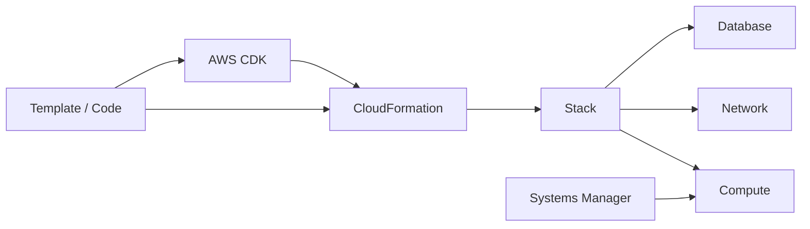
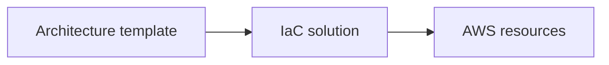
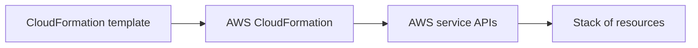
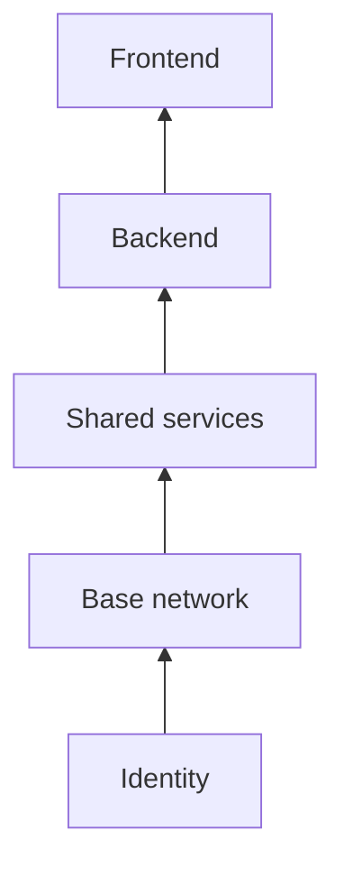
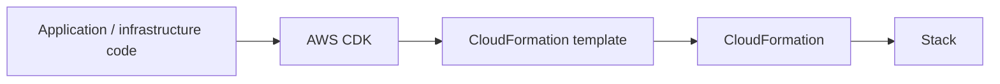
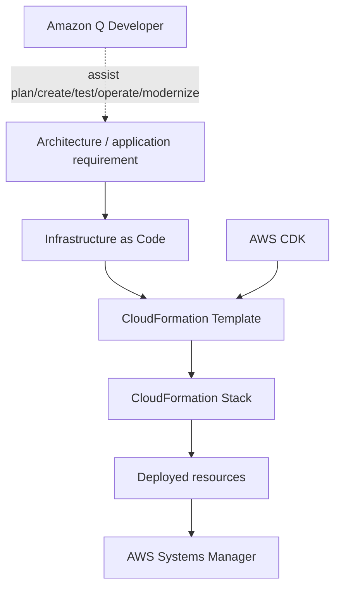

# Module 8 — Automation

## 🧭 Visual architecture



### ภาพ Diagram


> Diagram นี้เป็นภาพสรุปเพื่อช่วยทำความเข้าใจโครงสร้างของบท/แล็บ โดยยึดแนวคิดจากคู่มือต้นฉบับ
> Mobile reader copy combined from Part 1 + Part 2. Full source screenshots remain in Google Drive master.

# Module 8: Automation — Part 1

> Source: **Architecting on AWS 7.12.4 (EN) — Student Guide**  
> PDF pages: **395–406**  
> Scope: **Business request → Infrastructure as Code (IaC) → AWS CloudFormation → Templates → Stacks → Layered architecture**

---

## เป้าหมายของ Part นี้

Module 8 เริ่มจาก business request ของ Chief Technology Officer ที่ต้องการรู้ว่า

- จะทำให้การ build cloud infrastructure ง่ายขึ้นได้อย่างไร
- จะ deploy, maintain และ scale application ใน cloud ได้อย่างไร

ช่วง Part 1 ตอบคำถามแรกด้วยแนวคิด **Infrastructure as Code (IaC)** และ **AWS CloudFormation**

---

# 1. Infrastructure as Code (IaC)

Student Guide อธิบาย IaC ว่าเป็นการใช้ code เพื่อ define, deploy, configure, update และ remove infrastructure

> 🖼️ *Source figure — Student Guide p.400; full screenshot is kept in the Google Drive master copy.*

แนวคิดหลักคือแทนที่จะสร้าง resource ด้วยการคลิก console ทีละอย่าง เราเขียน **template** ที่อธิบาย resource และ configuration ที่ต้องการ แล้วใช้ automation สร้าง infrastructure จาก template นั้น



## 1.1 สิ่งที่ IaC ช่วยให้ทำได้

ตาม Student Guide:

- replicate, redeploy และ repurpose infrastructure
- ทำ version control กับ infrastructure/application definition
- detect drift
- roll back configuration ไป state ก่อนหน้า

template สามารถเขียนเป็น **JSON หรือ YAML** และใช้ define application stack ทั้งชุด รวมถึง resource และ parameter ที่ต้องใช้

## 1.2 Benefits of IaC

Student Guide เน้นประโยชน์หลายด้าน

### Speed and safety

infrastructure ถูกสร้างแบบ programmatically จึงเร็วกว่า manual deployment และลด human error

### Reusability

template เดิมสามารถ reuse เพื่อสร้าง environment หลายชุดได้

### Documentation and version control

template ทำหน้าที่เป็นเอกสารของ infrastructure และสามารถเก็บ history ใน version control เพื่อดูความเปลี่ยนแปลงหรือย้อนกลับเวอร์ชันได้

### Validation

สามารถ review template/code ก่อน deployment เพื่อลดโอกาสผิดพลาด

---

# 2. IaC — Reusability

> 🖼️ *Source figure — Student Guide p.401; full screenshot is kept in the Google Drive master copy.*

Student Guide ยกตัวอย่างการใช้ template เดียวกันสร้าง architecture ที่เหมือนกันใน environment ต่างกัน เช่น Development และ Production หรืออยู่คนละ AWS Region

แนวคิดสำคัญคือ architecture pattern สามารถถูกทำให้ repeatable ได้

ในกรณีที่ environment ต่างกันบางส่วน สามารถใช้ condition/parameter เพื่อเลือกค่าที่เหมาะกับ environment นั้น เช่น AMI ที่ต่างกันใน Development และ Production

---

# 3. IaC — Updates

> 🖼️ *Source figure — Student Guide p.402; full screenshot is kept in the Google Drive master copy.*

ตัวอย่างใน Student Guide คือการเพิ่ม security group ใหม่เข้า application stack โดยแก้ template แล้วใช้ template ที่แก้แล้ว update infrastructure

ข้อดีคือ environment ที่สร้างจาก template เดียวกันสามารถได้รับ change แบบ consistent ลด effort ในการทำ change ซ้ำด้วยมือ

---

# 4. AWS CloudFormation

AWS CloudFormation เป็น service ที่ช่วย provision และ manage AWS resources จาก template

> 🖼️ *Source figure — Student Guide p.403; full screenshot is kept in the Google Drive master copy.*

Student Guide อธิบาย CloudFormation ในเชิงแนวคิดว่าเป็น **API wrapper**: เมื่อ template define resource แล้ว CloudFormation จะเรียก AWS service APIs เพื่อสร้างและจัดการ resource ตาม dependencies/relationships



เราสามารถ author template ด้วย code editor และเก็บ template ใน version control system เช่น GitHub ได้

CloudFormation มีให้ใช้ใน AWS Regions และตัว CloudFormation service เองไม่ได้คิดค่าใช้จ่ายแยกจาก resources ที่ provision

---

# 5. Understanding CloudFormation templates

> 🖼️ *Source figure — Student Guide p.404; full screenshot is kept in the Google Drive master copy.*

CloudFormation template สามารถเขียนเป็น

- JSON
- YAML

Student Guide เน้นว่า template เป็น source code ที่อธิบาย resources ที่ต้องการ create/modify และสามารถ review + version control ได้

## 5.1 สิ่งที่ template ทำได้

- define application stack ทั้งชุด
- define runtime parameters เช่น EC2 instance size, AMI และค่าอื่น ๆ
- import existing AWS resources เข้ามาอยู่ภายใต้ CloudFormation management ผ่าน resource import
- เก็บใน version control เช่น Git/SVN

แนวคิดสำคัญคือ template คือ **desired definition** ของ infrastructure

---

# 6. CloudFormation stacks

> 🖼️ *Source figure — Student Guide p.405; full screenshot is kept in the Google Drive master copy.*

**Stack** คือ collection ของ AWS resources ที่ CloudFormation template สร้างและจัดการเป็น single unit

ตัวอย่าง resource ภายใน stack อาจมี

- Amazon VPC
- Amazon DynamoDB
- Amazon RDS
- Amazon EFS
- Amazon EC2
- AWS Lambda

## 6.1 Stack lifecycle

CloudFormation สามารถ

- create stack
- update stack
- delete stack

resource ทั้งหมดใน stack ถูก manage ตาม template

Student Guide อธิบายว่า หาก resource creation ล้มเหลว CloudFormation สามารถ rollback และลบ resources ที่สร้างไปแล้วเพื่อให้ stack กลับสู่ state ที่ consistent

## 6.2 Updates and change sets

เมื่อต้องเปลี่ยน resource ใน stack โดยทั่วไปให้ update stack แทนการลบ stack แล้วสร้างใหม่

**Change set** ใช้ preview ความเปลี่ยนแปลงก่อน apply โดยเปรียบเทียบ current stack กับ updated template

## 6.3 Cross-stack references

สามารถ share output จาก stack หนึ่งไปใช้อีก stack ผ่าน cross-stack references ได้

---

# 7. Using multiple templates

> 🖼️ *Source figure — Student Guide p.406; full screenshot is kept in the Google Drive master copy.*

Student Guide แสดง layered architecture ที่แยก stacks ตาม layer เช่น

- Identity
- Base network
- Shared services
- Backend
- Frontend

แต่ละ layer สามารถมี lifecycle และ ownership แยกกัน และ layer ด้านบนอาจ depend on resource/output จาก layer ด้านล่าง



แนวทางนี้ช่วยไม่ต้องเอาทุก resource ในองค์กรไปกองใน CloudFormation stack เดียว

---

# 8. Mental model ของ Part 1

```text
Architecture idea
      ↓
JSON / YAML template
      ↓
CloudFormation
      ↓
Stack
      ↓
AWS resources
```

เวลาจะเปลี่ยน infrastructure:

```text
Edit template
   ↓
Version control / review
   ↓
Preview changes
   ↓
Update stack
```

---

# 9. สิ่งที่ควรจำ

| Topic | Key idea |
|---|---|
| IaC | ใช้ code define และ deploy infrastructure |
| Template | desired infrastructure definition |
| JSON/YAML | รูปแบบที่ CloudFormation template รองรับ |
| Reusability | template เดิมสร้าง environment หลายชุดได้ |
| Version control | track/change/rollback infrastructure definition |
| CloudFormation | provision/manage AWS resources จาก template |
| Stack | resources ที่ CloudFormation manage เป็น single unit |
| Change set | preview stack changes ก่อน apply |
| Cross-stack reference | share outputs ระหว่าง stacks |
| Layered stacks | แยก lifecycle/ownership ของ architecture แต่ละ layer |

---

## จบ Part 1

หน้า **407** เริ่มหัวข้อ **Infrastructure management** ซึ่งจะไปต่อใน Part 2

---

# Module 8: Automation — Part 2

> Source: **Architecting on AWS 7.12.4 (EN) — Student Guide**  
> PDF pages: **407–426**  
> Scope: **Infrastructure management → Elastic Beanstalk → AWS Solutions Library → AWS CDK → Systems Manager → Amazon Q → Review → Knowledge Check**

---

## เป้าหมายของ Part นี้

Part 2 ตอบ business request ข้อที่สองของ Module 8:

> จะ deploy, maintain และ scale applications ใน cloud ได้อย่างไร?

Student Guide แนะนำ infrastructure/development tools หลายระดับ ตั้งแต่ convenience สูงไปจนถึง control สูง

---

# 1. Infrastructure management tools

> 🖼️ *Source figure — Student Guide p.408; full screenshot is kept in the Google Drive master copy.*

Student Guide แสดง tools หลักดังนี้

- AWS Elastic Beanstalk
- AWS Solutions Library
- AWS Cloud Development Kit (AWS CDK)
- AWS CloudFormation
- AWS Systems Manager

ภาพรวมคือเราต้อง balance ระหว่าง **convenience** กับ **control**

service ที่ abstract มากจะใช้ง่ายและ maintenance น้อย แต่ customize ต่ำกว่า ส่วน service ที่ให้ control สูงต้องมี expertise และการจัดการมากขึ้น

---

# 2. AWS Elastic Beanstalk

> 🖼️ *Source figure — Student Guide p.409; full screenshot is kept in the Google Drive master copy.*

Elastic Beanstalk ช่วย deploy และ maintain scalable web applications โดยเรา focus ที่ application code มากกว่าการ provision underlying infrastructure ด้วยตัวเอง

Student Guide ระบุว่า Elastic Beanstalk

- provisions and operates infrastructure
- manages application stack
- แสดง resources ที่ถูกสร้าง
- automatically scales application up and down

เหมาะกับ web applications และ web services ที่ต้องการ platform ช่วย manage infrastructure

---

# 3. AWS Solutions Library

> 🖼️ *Source figure — Student Guide p.410; full screenshot is kept in the Google Drive master copy.*

AWS Solutions Library ช่วยแก้ common architecture problems ด้วย solutions ที่ AWS architects จัดทำไว้

Student Guide ระบุว่ามีองค์ประกอบ เช่น

- CloudFormation templates
- scripts
- diagrams / architectural guidance

จุดประสงค์คือใช้ prebuilt architecture patterns และ deployment accelerators เพื่อลดเวลาการเริ่มจากศูนย์

---

# 4. AWS Cloud Development Kit (AWS CDK)

> 🖼️ *Source figure — Student Guide p.411; full screenshot is kept in the Google Drive master copy.*

AWS CDK เป็น software development framework สำหรับ define cloud application resources ด้วย programming languages ที่คุ้นเคย

Student Guide ยกตัวอย่างภาษา เช่น

- Python
- JavaScript
- TypeScript
- Java
- C#

CDK มี library ของ reusable **constructs** แล้ว generate CloudFormation templates เพื่อ deploy infrastructure



CDK ช่วยให้ใช้ features ของ programming language เช่น abstraction/reuse เพื่อสร้าง infrastructure definitions ที่ซับซ้อนได้ง่ายขึ้น

---

# 5. AWS Systems Manager

> 🖼️ *Source figure — Student Guide p.412; full screenshot is kept in the Google Drive master copy.*

Systems Manager เป็น central place สำหรับ view/manage AWS resources และรองรับทั้ง cloud และ on-premises resources

Student Guide จัดความสามารถเป็นกลุ่ม เช่น

- provisioning and entitlement
- configuration management
- operations and compliance management
- monitoring

ตัวอย่างงานที่ Student Guide กล่าวถึง

- สร้าง logical groups ของ resources
- ดู operational data ผ่าน dashboard
- inventory / patch / compliance related operations
- automation งาน maintenance/deployment
- centrally view/control resources

แนวคิดคือหลัง provision infrastructure แล้ว เรายังต้องมีเครื่องมือช่วย operate และ maintain resources ต่อเนื่อง

---

# 6. Amazon Q

หน้า 413 เริ่ม section Amazon Q โดยวางแนวคิดว่าเป็น AI coding companion / generative AI-powered assistant

> 🖼️ *Source figure — Student Guide p.414; full screenshot is kept in the Google Drive master copy.*

Student Guide แบ่งตัวอย่าง use cases เป็นสองกลุ่มใหญ่

### Amazon Q Developer

ออกแบบสำหรับ developers และ IT professionals ใช้ช่วย understand, build, extend และ operate AWS applications

### Amazon Q Business

ออกแบบสำหรับ business analysts และ employees ช่วยตอบคำถาม, generate/summarize content และงาน non-coding

Student Guide ยังระบุว่า Amazon Q ถูกออกแบบให้ secure/private by design และสามารถ customize ด้วยข้อมูลขององค์กรตาม use case ได้

---

# 7. Amazon Q Developer across SDLC

> 🖼️ *Source figure — Student Guide p.415; full screenshot is kept in the Google Drive master copy.*

Student Guide แสดงว่า Amazon Q Developer ช่วยได้ตลอด software development lifecycle

## Plan

ช่วยตอบ architecture questions และ provide recommendations

## Create

ช่วย generate code / inline recommendations และ assist development

## Test and secure

ช่วยเรื่อง tests และ security-related analysis

## Operate

ช่วย troubleshoot errors และ operational issues

## Maintain and modernize

ช่วย code transformation และ modernization

ภาพรวมคือไม่ได้จำกัดอยู่แค่ autocomplete แต่ครอบคลุม workflow ตั้งแต่ plan ไปจน maintain

---

# 8. Amazon Q Developer — Code recommendations

> 🖼️ *Source figure — Student Guide p.416; full screenshot is kept in the Google Drive master copy.*

Amazon Q Developer สามารถ generate code recommendations จาก

- plain English comments
- code/context ก่อนหน้า

developer สามารถ accept หรือ reject suggestion ได้

Student Guide ยกตัวอย่างการใช้เพื่อเริ่ม task เช่น data preparation และ iterate ผ่าน recommendations เพื่อเลือก code ที่เหมาะสม

---

# 9. Plan and implement across files

> 🖼️ *Source figure — Student Guide p.417; full screenshot is kept in the Google Drive master copy.*

Student Guide แสดง use case ที่ Amazon Q Developer ช่วยวางแผนงานจาก task description และช่วย implement functionality ที่กระทบหลาย files ใน workspace

แนวคิดคือ AI assistant สามารถใช้ context ของ project เพื่อช่วยแตกงานและเสนอ implementation steps

---

# 10. Present solutions — สรุปคำตอบให้ CTO

หน้า 419 สรุป solution ของ Module 8 ไว้ว่า

- ใช้ **AWS CloudFormation** เพื่อ simplify infrastructure ด้วย IaC
- ใช้ **AWS CDK**, AWS Solutions Library และ AWS Elastic Beanstalk เพื่อช่วย deployment/application infrastructure
- ใช้ **AWS Systems Manager** เพื่อ automate/manage infrastructure management หลัง deployment

---

# 11. Knowledge Check

## Question 1

**What is an AWS CloudFormation stack?**

คำตอบ: **All of the provisioned resources that are defined in a CloudFormation template**

Student Guide อธิบายว่า stack คือ collection ของ AWS resources ที่ CloudFormation template generate และ manage เป็น single unit

## Question 2

**Which statements are benefits of using AWS CDK with AWS CloudFormation? (Select TWO.)**

คำตอบตาม Student Guide:

- **Developers can use common programming languages.**
- **Developers can call preconfigured resources with proven defaults.**

เหตุผลคือ AWS CDK ใช้ familiar programming languages และมี constructs/reusable classes ที่ encapsulate configuration defaults/patterns

---

# 12. Mental model ของ Module 8



---

# 13. เลือกเครื่องมือแบบจำง่าย

| Need | Tool จาก Student Guide |
|---|---|
| Define infrastructure declaratively | CloudFormation |
| Define infrastructure ด้วย programming language | AWS CDK |
| Managed application platform | Elastic Beanstalk |
| Reuse prebuilt AWS architecture solutions | AWS Solutions Library |
| Operate/configure/manage resources | AWS Systems Manager |
| AI assistance สำหรับ developer/IT workflow | Amazon Q Developer |

---

# 14. สรุป Module 8

แก่นของ Module 8 คือเปลี่ยนจากการทำ infrastructure แบบ manual ไปสู่ automation ที่ repeatable และ maintainable

```text
Manual infrastructure
        ↓
Infrastructure as Code
        ↓
CloudFormation / CDK
        ↓
Automated deployment
        ↓
Systems Manager operations
        ↓
Amazon Q-assisted development and operations
```

จบ Module 8 ที่หน้า **426** และหน้า **427** เริ่ม **Module 9: Containers**
