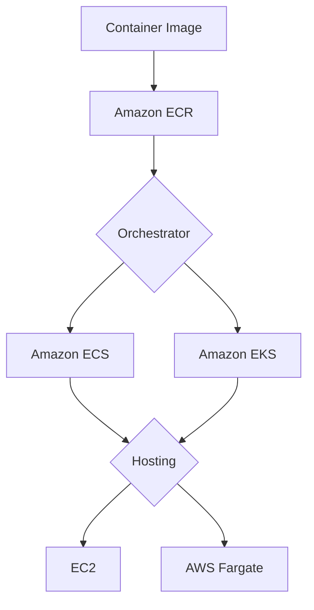
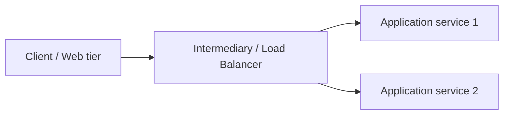
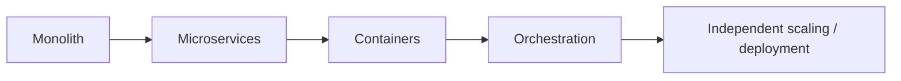
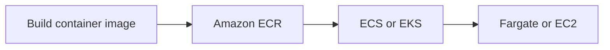
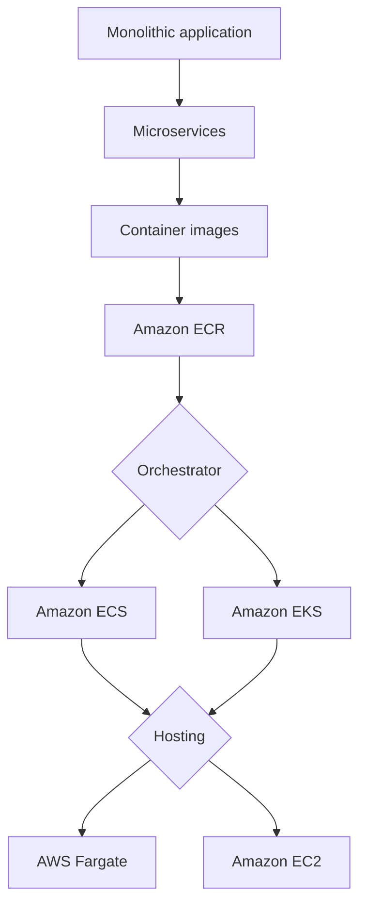

# Module 9 — Containers

## 🧭 Visual architecture



### ภาพ Diagram


> Diagram นี้เป็นภาพสรุปเพื่อช่วยทำความเข้าใจโครงสร้างของบท/แล็บ โดยยึดแนวคิดจากคู่มือต้นฉบับ
> Mobile reader copy combined from Part 1 + Part 2. Full source screenshots remain in Google Drive master.

# Module 9: Containers — Part 1

> Source: **Architecting on AWS 7.12.4 (EN) — Student Guide**  
> PDF pages: **427–438**  
> Scope: **Business request → Microservices → Loose coupling → Containers → Containers and microservices → Levels of abstraction → Containers on AWS**

---

# 1. Business request

Module 9 เริ่มจากคำถามของ compute operations manager 3 ข้อ

- จะทำให้ components ของ application independent มากขึ้นได้อย่างไร เพื่อให้ change ใน service หนึ่งไม่กระทบ service อื่น
- containers มีประโยชน์อย่างไรกับ compute needs
- มีทางเลือกอะไรบ้างสำหรับการ manage containerized applications ใน cloud

Part 1 ตอบสองคำถามแรก โดยเริ่มจาก microservices และ container fundamentals

---

# 2. Microservices overview

Student Guide เปรียบเทียบกับ legacy monolithic applications ที่มี components เชื่อมกันแน่น ทำให้แก้ component หนึ่งแล้วอาจกระทบอีก component และ isolate errors ได้ยาก

microservices ใช้แนวคิดแบ่ง application ออกเป็น services ขนาดเล็กที่รับผิดชอบงานเฉพาะ และสื่อสารกันผ่าน well-defined APIs

---

# 3. Loose coupling

> 🖼️ *Source figure — Student Guide p.432; full screenshot is kept in the Google Drive master copy.*

Student Guide แสดงภาพ anti-pattern แบบ tightly coupled กับ best practice แบบ decoupled

ใน tightly coupled architecture server/application components ผูก dependency กันโดยตรง การเพิ่ม/ลด server หรือ failure จุดหนึ่งอาจกระทบระบบอื่น

แนวคิด **loose coupling** คือมี intermediary ระหว่าง components เช่น managed service, load balancer หรือ messaging mechanism เพื่อให้ components ลด direct dependency ต่อกัน

ตัวอย่างใน Student Guide ใช้ Elastic Load Balancing คั่น web servers กับ application servers หาก server หนึ่ง fail load balancer สามารถ route traffic ไป healthy servers ที่เหลือ



ประโยชน์คือ failure และ scaling ของ component หนึ่งไม่จำเป็นต้องผูกกับ component อื่นโดยตรง

---

# 4. Microservices

> 🖼️ *Source figure — Student Guide p.433; full screenshot is kept in the Google Drive master copy.*

Student Guide อธิบาย microservices ว่าเป็นทั้ง architectural และ organizational approach สำหรับ software development

application ถูกออกแบบเป็น collection ของ small services แต่ละ service

- deploy independently
- communicate ผ่าน well-defined APIs
- focus capability เฉพาะด้าน

## 4.1 Autonomous

components ใน microservices architecture ถูก isolate จากกันและสื่อสารผ่าน API ดังนั้นสามารถ develop, update, deploy, operate และ scale service หนึ่งโดยไม่ต้องเปลี่ยนทุก service พร้อมกัน

## 4.2 Specialized

แต่ละ service ถูกออกแบบเพื่อ solve capability/problem ที่ชัดเจน และแต่ละ team สามารถเลือก programming language/tool ที่เหมาะกับ service นั้นได้

Student Guide ยกตัวอย่าง application ที่แยกเป็น user service, topic service และ message service และ deploy ด้วย compute/container choices ต่างกัน

---

# 5. Containers overview

Student Guide อธิบายว่า containers package application code, configurations และ dependencies ไว้ใน object/environment เดียวเพื่อให้ deployment consistent

> 🖼️ *Source figure — Student Guide p.435; full screenshot is kept in the Google Drive master copy.*

characteristics ที่ slide เน้น:

- Repeatable
- Self-contained environments
- Faster to spin up and down than virtual machines
- Portable
- Scalable

container share operating system ที่ติดตั้งอยู่บน server และ run เป็น resource-isolated process จึง lightweight กว่า VM

---

# 6. Containers and microservices

> 🖼️ *Source figure — Student Guide p.436; full screenshot is kept in the Google Drive master copy.*

containers เหมาะกับ microservices เพราะ service แต่ละตัวสามารถ package เป็น container แยกกัน

หาก service หนึ่งมี traffic สูง ก็ scale เฉพาะ container/service นั้นโดยไม่ต้อง scale application ทั้งก้อน

Student Guide เน้น benefits เช่น

- scalable
- portable
- continuously deployable
- service isolation

เมื่อจำนวน containers เยอะขึ้นจะต้องมี container orchestration เพื่อ automate deployment, scaling และ management

---

# 7. Levels of abstraction and virtualization

> 🖼️ *Source figure — Student Guide p.437; full screenshot is kept in the Google Drive master copy.*

Student Guide เปรียบเทียบ 3 ระดับ

## Bare metal

application ทำงานบน OS ของ physical server โดยตรง

## Virtual machines

แต่ละ VM มี guest OS ของตัวเองผ่าน hypervisor ทำให้ isolate application ได้ดี แต่มี overhead จาก OS หลายชุดและต้อง patch/manage แต่ละ VM

## Containers

containers share host OS/kernel และ package application + dependencies แยกกัน จึง lightweight และใช้ resource ได้มีประสิทธิภาพกว่า VM

container ไม่จำเป็นต้อง boot guest OS เต็มชุดเหมือน VM จึง start ได้เร็วกว่า

---

# 8. Containers on AWS

> 🖼️ *Source figure — Student Guide p.438; full screenshot is kept in the Google Drive master copy.*

Student Guide อธิบายว่าการ run containers บน AWS มีหลายทาง

### Run containers directly on Amazon EC2

เราควบคุม compute instances เอง และใช้ container runtime บน EC2

### Use a container orchestration tool

เมื่อมี containers จำนวนมาก orchestration tool จะช่วยจัดการ

- placement
- scaling
- networking
- maintenance
- launching/stopping containers ตาม demand
- deployments/updates

ภาพหลักคือ orchestration ทำหน้าที่จัดการ pool ของ compute resources และ containers แทนการ manage ทุก container ด้วยมือ

---

# 9. Mental model



microservices เป็น architecture pattern ส่วน containers เป็น packaging/runtime mechanism ที่เหมาะกับการแยก services ให้ deploy และ scale independently

---

# 10. สิ่งที่ควรจำ

| Topic | Key idea |
|---|---|
| Loose coupling | ลด direct dependency ระหว่าง components |
| Microservices | small autonomous specialized services |
| Well-defined API | contract สำหรับ communication ระหว่าง services |
| Container | package code + config + dependencies |
| Repeatable | run behavior เหมือนกันใน environment ที่รองรับ |
| Portable | ย้าย environment ได้ง่ายกว่า tightly-bound deployment |
| VM | มี guest OS ต่อ VM |
| Container | share host OS/kernel |
| Orchestration | automate placement, scaling, networking, maintenance |

---

## จบ Part 1

หน้า **439** เริ่มหัวข้อ **Container services** ซึ่งจะไปต่อใน Part 2

---

# Module 9: Containers — Part 2

> Source: **Architecting on AWS 7.12.4 (EN) — Student Guide**  
> PDF pages: **439–461**  
> Scope: **Container services → ECR → ECS → EKS → Fargate → Choosing services → Review → Knowledge Check**

---

# 1. Running containers on AWS

Student Guide แบ่งการตัดสินใจสำหรับ managed container solutions เป็น 3 ส่วนหลัก

> 🖼️ *Source figure — Student Guide p.440; full screenshot is kept in the Google Drive master copy.*

1. **Registry** — เก็บ container images
2. **Orchestration tool** — manage deployment/scaling/networking/maintenance
3. **Container hosting** — compute resource ที่ใช้ run containers

ตัวอย่าง AWS services ที่ slide แสดง:

- Registry: Amazon ECR
- Orchestration: Amazon ECS / Amazon EKS
- Hosting: AWS Fargate / Amazon EC2



---

# 2. Amazon Elastic Container Registry (Amazon ECR)

> 🖼️ *Source figure — Student Guide p.441; full screenshot is kept in the Google Drive master copy.*

Amazon ECR เป็น managed container image registry

Student Guide แสดงว่าเราสามารถ push container images เข้า repositories และ pull images ออกมาเพื่อ launch containers ได้

ประโยชน์หลัก:

- เก็บ image ของ service แต่ละตัวแยก repository
- version/tag images
- control access
- integrate กับ AWS container services

ในตัวอย่าง monolithic forum app ถูก refactor เป็น user/topic/message services แต่ละ service มี container image ของตัวเองใน ECR

---

# 3. Amazon ECS orchestration

> 🖼️ *Source figure — Student Guide p.442; full screenshot is kept in the Google Drive master copy.*

Amazon Elastic Container Service (Amazon ECS) เป็น managed container orchestration service

Student Guide เน้น concepts:

### Task definition

definition/configuration สำหรับ container workload

### Task

running instance ของ task definition

### Service

รักษาจำนวน tasks ที่ต้องการให้ทำงานต่อเนื่อง

### Cluster

logical grouping ของ tasks/services และ infrastructure ที่ register อยู่กับ cluster

ECS สามารถ run workload บน

- AWS Fargate
- Amazon EC2

---

# 4. Amazon ECS features

> 🖼️ *Source figure — Student Guide p.443; full screenshot is kept in the Google Drive master copy.*

Student Guide สรุป features ของ ECS ได้แก่

- fully managed
- service discovery
- AWS integrations
- works with common development workflows
- flexible hosting options

service discovery ช่วยให้ services ติดต่อกันโดยไม่ต้อง hard-code endpoint แบบ static

ECS ยัง integrate กับ services อื่น เช่น Amazon ECR, IAM, CloudWatch และ load balancing เพื่อประกอบเป็น production architecture

---

# 5. Monolithic to container-based microservices

> 🖼️ *Source figure — Student Guide p.444; full screenshot is kept in the Google Drive master copy.*

Student Guide แสดง architecture ที่ใช้ Application Load Balancer route request ตาม path เช่น

- `/api/users`
- `/api/topics`
- `/api/messages`

ไปยัง ECS services/target groups ที่เหมาะสม

เมื่อ ECS start task/container ของ service ระบบ register container+port กับ target group แล้ว ALB route traffic ไปยัง container นั้น

แนวคิดนี้เชื่อม **Layer 7 routing + microservices + ECS orchestration** เข้าด้วยกัน

---

# 6. Amazon EKS

> 🖼️ *Source figure — Student Guide p.445; full screenshot is kept in the Google Drive master copy.*

Kubernetes เป็น open-source software สำหรับ deploy/manage containerized applications at scale

Amazon Elastic Kubernetes Service (Amazon EKS) เป็น managed Kubernetes service บน AWS

Student Guide เน้น benefits เช่น

- run applications at scale
- seamlessly move applications
- run anywhere
- add new functionality ผ่าน Kubernetes ecosystem

EKS เหมาะกับองค์กรที่ต้องการ Kubernetes API/ecosystem และ portability ของ Kubernetes workloads

---

# 7. AWS Fargate

> 🖼️ *Source figure — Student Guide p.447; full screenshot is kept in the Google Drive master copy.*

AWS Fargate เป็น technology สำหรับ Amazon ECS และ Amazon EKS ที่ให้ run containers โดยไม่ต้อง manage servers หรือ clusters ของ EC2 instances

เมื่อใช้ Fargate ไม่ต้อง

- provision EC2 instances สำหรับ container hosts
- manage cluster servers
- patch underlying hosts ด้วยตัวเอง
- เลือก/scale host VMs เองในแบบเดียวกับ EC2 hosting

จุดประสงค์คือให้ focus ที่ application/container มากกว่าการ manage infrastructure ที่อยู่ข้างใต้

---

# 8. Choosing AWS container services

> 🖼️ *Source figure — Student Guide p.448; full screenshot is kept in the Google Drive master copy.*

Student Guide แยก decision ออกเป็น 2 แกน

## Orchestration

### Amazon ECS

managed solution ที่ต้อง configuration/integration น้อยกว่า เหมาะเมื่อไม่จำเป็นต้องใช้ Kubernetes

### Amazon EKS

ให้ flexibility ของ Kubernetes เหมาะกับทีมที่มี Kubernetes expertise หรือมี requirement ด้าน Kubernetes ecosystem/portability

## Hosting

### AWS Fargate

serverless container hosting ลด operational work เช่น provisioning, configuration, patching และ infrastructure management

### Amazon EC2

ต้อง configuration มากกว่า แต่ให้ control เหนือ underlying compute มากกว่า

---

# 9. Present solutions

หน้า 450 สรุป solution ของ Module 9:

- ใช้ microservices เพื่อแยก application เป็น components/services ที่ independent มากขึ้น
- ใช้ containers เพื่อ package code/configuration/dependencies ให้ portable และ repeatable
- ใช้ Amazon ECR สำหรับ container images
- ใช้ Amazon ECS หรือ Amazon EKS สำหรับ orchestration
- ใช้ Amazon EC2 หรือ AWS Fargate สำหรับ container hosting

---

# 10. Knowledge Check

## Question 1

characteristics ของ microservices (เลือก 2)

คำตอบ:

- **Loosely coupled**
- **Autonomous and independent**

## Question 2

characteristics ของ containers (เลือก 2)

คำตอบ:

- **Portable and scalable**
- **Repeatable**

## Question 3

Amazon ECS containers logically organized อย่างไร?

คำตอบ: **In a cluster**

Student Guide อธิบายว่า ECS cluster เป็น logical grouping ของ tasks/services และ infrastructure ที่ register อยู่กับ cluster

## Question 4

ทำไม developer อาจเลือก AWS Fargate แทน Amazon EC2 สำหรับ deploy containers?

คำตอบ: **To avoid manual infrastructure updates**

เพราะ Fargate ลดภาระการ provision/configure/scale clusters และ infrastructure hosts

---

# 11. Mental model ของ Module 9



---

# 12. จำง่ายก่อนจบบท

| Question | Answer family |
|---|---|
| เก็บ container image ที่ไหน | Amazon ECR |
| AWS-native managed orchestration | Amazon ECS |
| Managed Kubernetes | Amazon EKS |
| Serverless container compute | AWS Fargate |
| ต้องการ control host มากขึ้น | Amazon EC2 hosting |
| ต้องการ independent services | Microservices + loose coupling |

---

# 13. สรุป Module 9

Module 9 เชื่อม architecture กับ runtime model ดังนี้

```text
Loose coupling
   ↓
Microservices
   ↓
Containers
   ↓
Registry (ECR)
   ↓
Orchestration (ECS/EKS)
   ↓
Hosting (Fargate/EC2)
```

จบ Module 9 ที่หน้า **461** และหน้า **462** เริ่ม **Module 10: Networking 2**
