# Module 13 — Backup and Recovery

## 🧭 Visual architecture

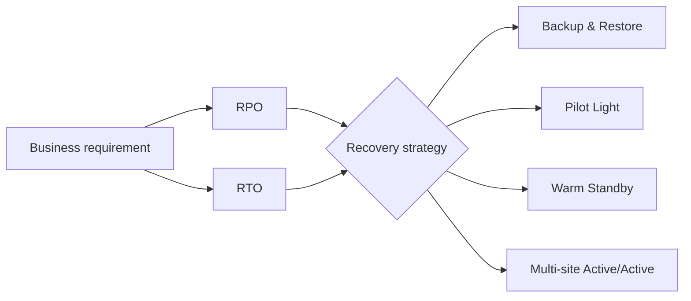

### ภาพ Diagram


> Diagram นี้เป็นภาพสรุปเพื่อช่วยทำความเข้าใจโครงสร้างของบท/แล็บ โดยยึดแนวคิดจากคู่มือต้นฉบับ
> Mobile reader copy combined from Part 1 + Part 2. Full source screenshots remain in Google Drive master.

# Module 13: Backup and Recovery — Part 1

> Source: **Architecting on AWS 7.12.4 (EN) — Student Guide**  
> PDF pages: **603–621**  
> Scope: **Disaster planning → Availability concepts → RPO/RTO → DR building blocks → AWS Backup**

---

## เป้าหมายของ Part นี้

Module 13 เริ่มจากโจทย์ของ Chief Technology Officer ที่ต้องการสร้าง backup และ disaster recovery (DR) plan ที่ตอบ 3 คำถาม:

1. เราจะปกป้องระบบจาก disaster ได้อย่างไร
2. เราจะ centralize และ automate backup อย่างไร
3. DR strategy แบบไหนลด downtime ได้มากที่สุดโดยยังคุม cost ได้

Part 1 ปูพื้นฐานและเครื่องมือก่อนเข้าสู่ recovery strategies ใน Part 2

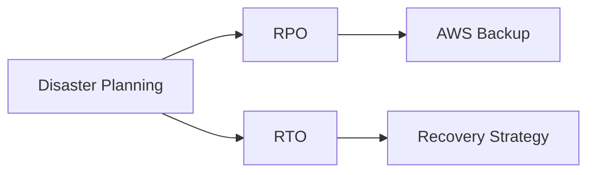

---

# 1. Disaster planning

## 1.1 ทำไม DR plan ถึงล้มเหลวได้

> 🖼️ *Source figure — Student Guide p.608; full screenshot is kept in the Google Drive master copy.*

Student Guide เน้น 3 ปัจจัย:

- **Testing** — ไม่มีการทดสอบจริงหรือทดสอบไม่เพียงพอ
- **Resources** — recovery path ซับซ้อน หรือทรัพยากรไม่พอ
- **Planning** — plan ล้าสมัยและไม่ตามการเปลี่ยนแปลงของ production

หลักคิด:

> DR plan ที่ไม่เคยทดสอบ ไม่ควรถูกถือว่าเป็น DR plan ที่พร้อมใช้งาน

ต้อง validate ทั้ง:

- failover process
- resource capacity
- configuration parity
- runbook / dependencies

---

# 2. Availability concepts

> 🖼️ *Source figure — Student Guide p.609; full screenshot is kept in the Google Drive master copy.*

Student Guide แยกคำสำคัญ 4 คำ:

## High availability

ลด downtime ของ application เมื่อเกิด failure

## Fault tolerance

ระบบมี redundancy เพื่อให้ component failure ไม่ทำให้ service หยุด

## Backup

เก็บสำเนาข้อมูลเพื่อใช้ restore

## Disaster recovery

ทำให้ application/data กลับมาใช้งานหลัง major disaster

### เปรียบเทียบแบบสั้น

```text
HA              = ลด downtime
Fault tolerance = เดินต่อได้แม้ component fail
Backup          = มีสำเนาข้อมูล
DR              = กู้ระบบกลับหลังเหตุร้ายแรง
```

---

# 3. Failover and AWS Regions

> 🖼️ *Source figure — Student Guide p.610; full screenshot is kept in the Google Drive master copy.*

AWS มีหลาย Regions จึงสามารถออกแบบ DR ข้าม Region ได้

Student Guide เน้นว่า Region เป็น isolation boundary ที่สำคัญ และ DR plan ควรพิจารณา:

- instance failover
- Availability Zone failover
- Regional failover

Architecture ที่ critical มากอาจต้องมี resources ใน second Region และมีวิธี route traffic ไปยัง Region นั้นเมื่อ primary unavailable

---

# 4. RPO and RTO

> 🖼️ *Source figure — Student Guide p.611; full screenshot is kept in the Google Drive master copy.*

## Recovery Point Objective (RPO)

RPO = ปริมาณ data loss ที่ยอมรับได้ วัดย้อนจากเวลาที่เกิด disaster

คำถามที่ RPO ตอบ:

> **“ข้อมูลย้อนหลังได้มากที่สุดกี่นาที/ชั่วโมง?”**

ตัวอย่าง Student Guide: ถ้า RPO = 12 hours ข้อมูลที่ recover ได้ต้องใหม่พอที่จะไม่เกิน 12 ชั่วโมงก่อนเกิด incident

## Recovery Time Objective (RTO)

RTO = เวลาสูงสุดที่ business process/application ยอม unavailable หลัง disruption

คำถามที่ RTO ตอบ:

> **“หลังระบบล่ม ต้องกลับมาใช้งานภายในกี่นาที/ชั่วโมง?”**

### Timeline mental model

```text
last valid recovery point ───── disaster ───── service restored
            |<-- RPO -->|          |<-- RTO -->|
```

### สิ่งสำคัญ

RPO/RTO มีผลโดยตรงต่อ cost

- RPO/RTO เข้มมาก → replication/standby resources มากขึ้น → cost สูงขึ้น
- RPO/RTO ผ่อนคลาย → backup/restore approach อาจพอ → cost ต่ำกว่า

---

# 5. Essential AWS services/features for DR

Student Guide จัด building blocks ของ DR ไว้ประมาณนี้:

- Storage
- Compute
- Networking
- Database
- Deployment orchestration
- Regions

DR ที่ดีจึงไม่ใช่ “backup database อย่างเดียว” แต่ต้องคิดทั้ง application stack

---

# 6. Duplicate your storage

> 🖼️ *Source figure — Student Guide p.613; full screenshot is kept in the Google Drive master copy.*

Student Guide ยก options สำคัญ:

## Amazon S3

ใช้ replication options เช่น:

- Cross-Region Replication
- Same-Region Replication
- bidirectional replication patterns ตาม use case

## Amazon EFS

รองรับ replication pattern สำหรับ file systems ตามความสามารถของ service

## Amazon EBS

ใช้ snapshots เพื่อสร้าง point-in-time copies และ copy snapshots ไปอีก Region/account ได้ตาม requirement

## AWS Snow Family

ใช้สำหรับย้ายข้อมูลจำนวนมาก โดยเฉพาะเมื่อ network transfer ไม่เหมาะ

## AWS DataSync

ใช้ automate/accelerate data transfer ระหว่าง supported storage systems

### Decision concept

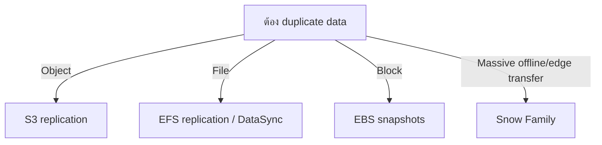

---

# 7. Configuring AMIs for recovery

> 🖼️ *Source figure — Student Guide p.614; full screenshot is kept in the Google Drive master copy.*

AMI ช่วยให้เราสร้าง EC2 replacement instance ได้เร็วขึ้นใน recovery environment

แนวคิด:

- เตรียม AMI ของ application layer
- replicate/copy AMI ตาม DR design
- ใช้ Auto Scaling / launch process เพื่อ provision instances ใหม่
- externalize state ออกจาก instance ให้มากที่สุด

ถ้าต้อง rebuild server ตอน disaster แบบ manual ทั้งหมด RTO จะยาวมาก

---

# 8. Failover network design

> 🖼️ *Source figure — Student Guide p.615; full screenshot is kept in the Google Drive master copy.*

Student Guide ยก services สำคัญ:

- **Amazon Route 53** — DNS failover / traffic distribution
- **Elastic Load Balancing** — distribute traffic และ health checks
- **Amazon VPC** — network topology ใน recovery environment
- **AWS Direct Connect** — resilient hybrid connectivity ตาม architecture

### Flow

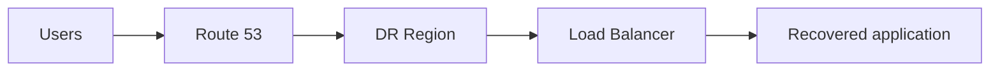

Networking ต้องเตรียมไว้ล่วงหน้า เพราะ DR ที่ compute/data พร้อมแต่ DNS/routes/security rules ไม่พร้อมก็ failover ไม่ได้

---

# 9. Database backup and replicas

> 🖼️ *Source figure — Student Guide p.616; full screenshot is kept in the Google Drive master copy.*

## Amazon RDS

Student Guide กล่าวถึงแนวทางเช่น:

- Multi-AZ สำหรับ high availability
- snapshots / copies ไปอีก Region ตาม DR plan
- read replica / cross-Region replication ตาม engine และ architecture

## Amazon DynamoDB

- point-in-time recovery
- on-demand backup
- global tables สำหรับ multi-Region active replication

### ระวัง

**Multi-AZ ≠ DR ข้าม Region**

Multi-AZ แก้ AZ-level failure เป็นหลัก ส่วน Regional DR ต้องออกแบบเพิ่ม

---

# 10. Templates and scripts

> 🖼️ *Source figure — Student Guide p.617; full screenshot is kept in the Google Drive master copy.*

เวลา disaster ทุกนาทีมีค่า จึงควร automate provisioning

Student Guide ยก:

- **AWS CloudFormation** สำหรับ infrastructure templates
- scripts / AWS CLI / SDK สำหรับ automation

หลักคิด:

```text
Manual rebuild = ช้า + error-prone
IaC + automation = repeatable + faster recovery
```

และควรเก็บ template/version ที่ใช้ใน DR ให้สอดคล้องกับ production

---

# 11. AWS Backup

> 🖼️ *Source figure — Student Guide p.619; full screenshot is kept in the Google Drive master copy.*

AWS Backup เป็น fully managed backup service ที่ช่วย centralize และ automate backup across supported AWS services/resources

Student Guide แสดง resource examples เช่น:

- EC2
- EBS
- EFS
- DynamoDB
- RDS / Aurora
- Storage Gateway
- FSx
- DocumentDB / Neptune ตาม support ของ service

**รายการ support เปลี่ยนได้ตาม service/version; Note นี้ยึดรายการใน Student Guide**

---

# 12. AWS Backup benefits

> 🖼️ *Source figure — Student Guide p.620; full screenshot is kept in the Google Drive master copy.*

Student Guide แบ่ง benefits เป็น 3 กลุ่ม:

## Simplicity

- policy-based backup
- automated scheduling
- centralized management

## Compliance

- monitoring / logs
- backup access policy
- encrypted backups
- controls สำหรับ retention/protection ตาม feature ที่รองรับ

## Cost control

- automation ลด manual work
- lifecycle / retention management
- ลด operational overhead ของ backup administration

---

# 13. How AWS Backup works

> 🖼️ *Source figure — Student Guide p.621; full screenshot is kept in the Google Drive master copy.*

Flow หลัก:

1. **Create AWS Backup plan**
   - schedule
   - lifecycle
   - backup vault
   - tags
2. **Assign resources**
   - by tags หรือ resource IDs ตาม configuration
   - ใช้ IAM role ให้ AWS Backup เข้าถึง resources
3. **Manage and monitor backups**
   - run backup jobs
   - monitor activity
   - integrate กับ services อย่าง CloudWatch/EventBridge/SNS ตาม use case

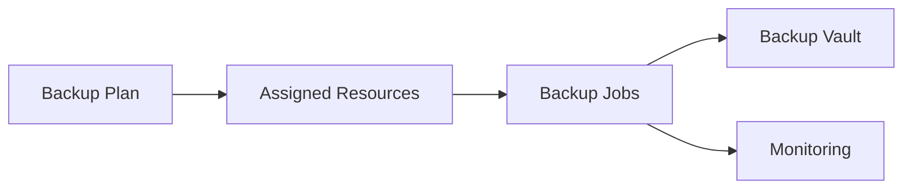

---

# 14. สิ่งที่ควรจำจาก Part 1

- DR ต้อง test จริง ไม่ใช่มี document อย่างเดียว
- HA, Fault Tolerance, Backup และ DR เป็นคนละ concept
- **RPO = ยอมเสียข้อมูลได้แค่ไหน**
- **RTO = ยอมหยุดบริการได้นานแค่ไหน**
- DR ต้องคิด storage + compute + network + database + deployment automation
- S3/EBS/EFS/DataSync/Snow Family ช่วยคนละ data movement/replication use case
- AMI + Auto Scaling / IaC ช่วยลด rebuild time
- Multi-AZ ช่วย HA แต่ไม่แทน cross-Region DR
- AWS Backup ช่วย centralize/automate backup policies across supported resources

---

## End of Part 1

Part 2 จะต่อด้วย **Recovery strategies: Backup & Restore → Pilot Light → Warm Standby → Multi-site Active/Active → Knowledge Check → Capstone Lab**

---

# Module 13: Backup and Recovery — Part 2

> Source: **Architecting on AWS 7.12.4 (EN) — Student Guide**  
> PDF pages: **622–650**  
> Scope: **DR recovery strategies → Review → Knowledge Check → Capstone Lab → Course Summary**

---

## เป้าหมายของ Part นี้

Part 2 เปรียบเทียบ DR strategies ตาม trade-off ระหว่าง **RPO, RTO และ cost**

Student Guide ใช้ 4 strategy หลัก:

1. Backup and restore
2. Pilot light
3. Warm standby
4. Multi-site active/active

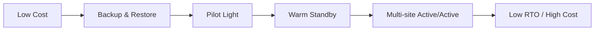

หลักสำคัญ: ไม่มี strategy ที่ดีที่สุดสำหรับทุกระบบ ต้องเลือกตาม business requirement

---

# 1. Recovery strategies overview

> 🖼️ *Source figure — Student Guide p.623; full screenshot is kept in the Google Drive master copy.*

แนวคิดทั่วไป:

| Strategy | Cost | Recovery speed | Environment running before disaster? |
|---|---:|---:|---|
| Backup & Restore | ต่ำสุด | ช้าที่สุด | ส่วนใหญ่ไม่ |
| Pilot Light | ต่ำ | เร็วขึ้น | Core components บางส่วน |
| Warm Standby | กลาง-สูง | เร็วมาก | ใช่ แต่ scale ต่ำ |
| Multi-site Active/Active | สูงสุด | เร็วที่สุด | ใช่ เต็มระบบหลาย site |

---

# 2. Backup and Restore

> 🖼️ *Source figure — Student Guide p.624; full screenshot is kept in the Google Drive master copy.*

แนวทางนี้เก็บ data/configuration ไว้ก่อน แล้วเมื่อเกิด disaster จึง provision resources และ restore

Flow:

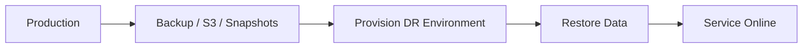

### จุดเด่น

- cost ต่ำ
- infrastructure standby น้อย
- เหมาะกับ workload ที่ยอม RTO สูงได้

### ข้อแลกเปลี่ยน

- ต้องใช้เวลาสร้าง infrastructure
- restore data
- validate configuration
- switch DNS/network

จึงเป็น strategy ที่ RTO สูงที่สุดใน 4 แบบ

---

# 3. Pilot Light

> 🖼️ *Source figure — Student Guide p.625; full screenshot is kept in the Google Drive master copy.*

> 🖼️ *Source figure — Student Guide p.626; full screenshot is kept in the Google Drive master copy.*

Pilot light เก็บ **core infrastructure/data** ที่จำเป็นให้พร้อมตลอดเวลา แต่ application tier ส่วนใหญ่ยังไม่ run เต็ม capacity

ตัวอย่าง:

- database replication ทำงานอยู่
- core data available
- application servers ยัง stopped / minimal
- เมื่อ failover จึงเปิด/scale application tier

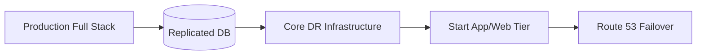

### ข้อดี

- cheaper than warm standby
- RTO ดีกว่า backup/restore

### ข้อแลกเปลี่ยน

ยังต้อง boot/start/scale components หลัง disaster

---

# 4. Warm Standby

> 🖼️ *Source figure — Student Guide p.627; full screenshot is kept in the Google Drive master copy.*

> 🖼️ *Source figure — Student Guide p.628; full screenshot is kept in the Google Drive master copy.*

Warm standby มี **functional copy ของ production อยู่ใน recovery environment** แต่รันที่ capacity ต่ำกว่า

เมื่อ disaster:

1. traffic ถูกเปลี่ยนไป DR environment
2. Auto Scaling scale ระบบขึ้น
3. DR environment รับ full production load

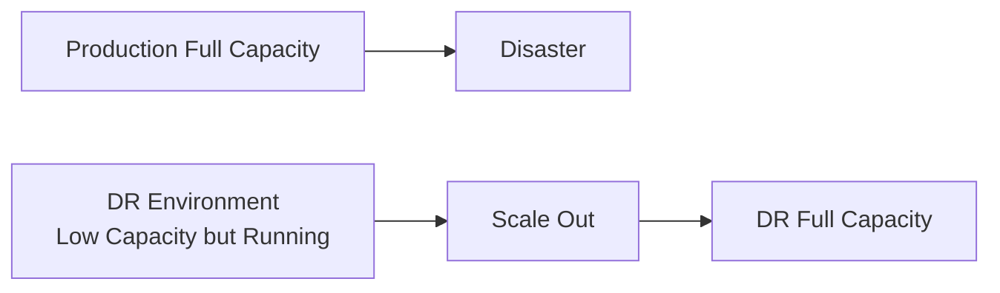

### จุดเด่น

- RTO ต่ำกว่า pilot light
- environment พร้อมใช้งานจริงอยู่แล้ว
- สามารถ test DR site ได้ต่อเนื่องง่ายขึ้น

### ข้อแลกเปลี่ยน

cost สูงขึ้นเพราะมี application stack ทำงานตลอด

---

# 5. Multi-site Active/Active

> 🖼️ *Source figure — Student Guide p.629; full screenshot is kept in the Google Drive master copy.*

> 🖼️ *Source figure — Student Guide p.630; full screenshot is kept in the Google Drive master copy.*

ทั้ง production sites ทำงานจริงพร้อมกันและรับ traffic อยู่แล้ว

เมื่อ site หนึ่ง fail:

- traffic ถูก shift ไปอีก site
- capacity ของ surviving site scale เพิ่มถ้าจำเป็น
- ไม่ต้อง “เปิดระบบ DR จากศูนย์”

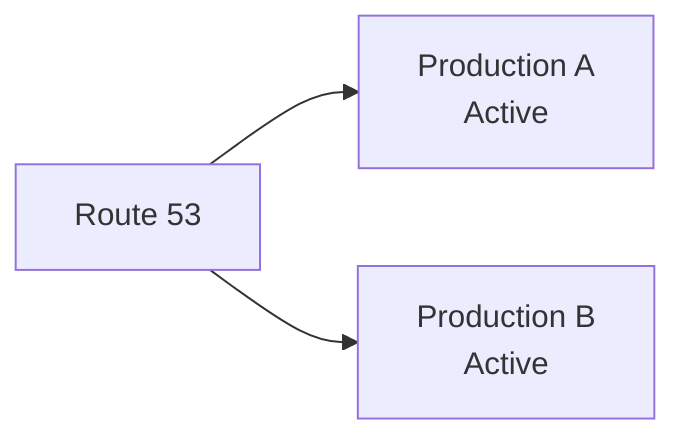

### จุดเด่น

- downtime ต่ำสุด
- RTO ใกล้ real-time ที่สุดเมื่อ architecture ถูกออกแบบเหมาะสม

### ข้อแลกเปลี่ยน

- cost สูงสุด
- data consistency/replication complexity สูง
- application ต้องรองรับ multi-site behavior
- operational complexity สูง

---

# 6. Comparing common DR practices

> 🖼️ *Source figure — Student Guide p.631; full screenshot is kept in the Google Drive master copy.*

Student Guide แสดง spectrum จาก low cost / high RTO ไปยัง high cost / low RTO

```text
Backup & Restore
    ↓ faster / more expensive
Pilot Light
    ↓
Warm Standby
    ↓
Multi-site Active/Active
```

### Architecture decision principle

อย่าเริ่มจากคำถามว่า:

> “แบบไหนดีที่สุด?”

ให้เริ่มจาก:

- Business ยอม downtime ได้เท่าไร → RTO
- Business ยอมเสียข้อมูลได้เท่าไร → RPO
- Workload critical แค่ไหน
- Budget เท่าไร
- Operational complexity ที่ทีมรับไหวแค่ไหน

---

# 7. DR strategy quick decision flow

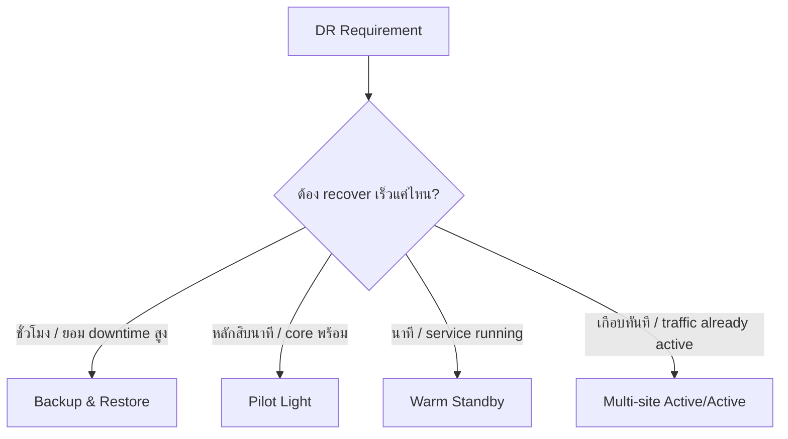

นี่เป็น mental model จากเนื้อหาใน Student Guide ไม่ใช่ SLA ตัวเลขตายตัว; ค่า RPO/RTO จริงต้องออกแบบจาก business requirement

---

# 8. Present solutions to the CTO

> 🖼️ *Source figure — Student Guide p.633; full screenshot is kept in the Google Drive master copy.*

Student Guide สรุป solution กลับไปยัง business request:

## Protect against disaster

- duplicate data โดยใช้ AWS storage services
- create AMIs / launch compute resources
- design network failover mechanisms
- use snapshots / backups

## Centralize and automate backup

- **AWS Backup**

## Choose cost-effective DR strategy

เลือกระหว่าง:

- Backup and restore
- Pilot light
- Warm standby
- Multi-site active/active

ตาม RPO/RTO/cost

---

# 9. Module 13 Knowledge Check

## Question 1 — RTO in minutes at the lowest cost

Student Guide เฉลย:

- **B. Pilot light**

เหตุผลคือ core infrastructure พร้อมอยู่แล้ว แต่ไม่ต้องจ่ายเต็มแบบ warm standby/active-active

## Question 2 — Metric that defines how often data must be backed up

Student Guide เฉลย:

- **B. Recovery Point Objective (RPO)**

RPO กำหนด maximum acceptable data loss window

## Question 3 — AWS Backup features (Select THREE)

Student Guide เฉลย:

- **A. Encrypted backups**
- **C. Ability to work across multiple services**
- **E. Incremental backups**

## Question 4 — Existing RDS instance: highly available + minimize RTO

Student Guide เฉลย:

- **B. Run a Multi-AZ DB instance in the same Region**

เหตุผลคือ Multi-AZ มี standby replica และ automatic failover สำหรับ infrastructure-level failure ใน Region

---

# 10. Capstone Lab — Build an AWS Multi-Tier Architecture

> 🖼️ *Source figure — Student Guide p.647; full screenshot is kept in the Google Drive master copy.*

Capstone เป็น final project ของ course ให้ใช้สิ่งที่เรียนทั้งหมดออกแบบ multi-tier architecture

Student Guide แสดง architecture ที่ประกอบด้วย:

- VPC
- 2 Availability Zones
- public subnets
- application subnets
- database subnets
- Internet Gateway
- NAT Gateways
- Application Load Balancer
- Auto Scaling Group
- EFS mount targets
- Aurora primary DB + Aurora replica

### Architecture flow

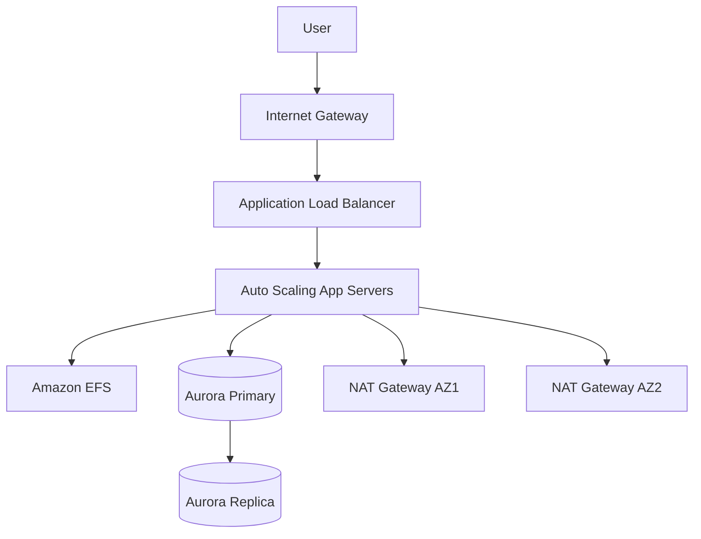

---

# 11. Capstone lab tasks

> 🖼️ *Source figure — Student Guide p.648; full screenshot is kept in the Google Drive master copy.*

Student Guide แสดง 6 tasks หลัก:

1. Review and run a preconfigured CloudFormation template
2. Create an Amazon RDS database
3. Create an Amazon EFS file system
4. Create an Application Load Balancer
5. Create a launch template using CloudFormation
6. Create application servers by configuring an Auto Scaling group and a scaling policy

สิ่งสำคัญคือ capstone บังคับให้เชื่อม concept หลายบทเข้าด้วยกัน ไม่ใช่ lab ของ service เดียว

---

# 12. สิ่งที่ Capstone ต้องการให้เราคิดต่อแบบ Architect

## Networking

- public/private subnet separation
- Multi-AZ layout
- IGW / NAT Gateway
- security boundaries

## Compute

- launch template
- Auto Scaling
- load balancing

## Storage

- EFS shared file system

## Database

- Aurora primary + replica

## Automation

- CloudFormation

## Availability

- services กระจายหลาย AZ
- stateless-ish application tier + shared data layer

นี่คือ pattern ที่สะท้อน core lesson ของ Architecting on AWS ทั้งเล่ม

---

# 13. Final mental model — Architecting on AWS

เมื่อออกแบบระบบบน AWS ให้ถามตามลำดับนี้:

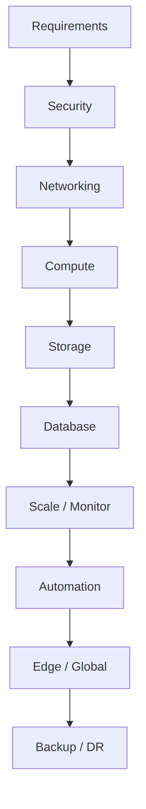

แต่ในโลกจริงทุก layer เชื่อมโยงกัน เช่น:

- RTO มีผลต่อ database replication และ compute standby
- latency มีผลต่อ Region / Route 53 / CloudFront choice
- security มีผลตั้งแต่ IAM ถึง network และ WAF
- cost มีผลต่อ instance choice, storage tier, scaling และ DR strategy

---

# 14. สิ่งที่ควรจำจาก Module 13

- DR plan ต้อง **test** และ update อย่างต่อเนื่อง
- RPO = acceptable data loss
- RTO = acceptable downtime
- DR strategy เป็น trade-off ระหว่าง cost และ recovery speed
- Backup & Restore = ถูกสุด / ช้าสุด
- Pilot Light = core พร้อม / scale app ตอน failover
- Warm Standby = application running แบบ scale ต่ำ
- Multi-site Active/Active = เร็วสุด / แพงและซับซ้อนสุด
- AWS Backup ช่วย centralize และ automate backup
- Multi-AZ RDS เป็น HA pattern สำคัญ แต่ไม่เท่ากับ cross-Region DR
- IaC, AMIs และ automation ช่วยลด recovery time
- Capstone รวม networking, compute, storage, database, scaling และ automation เป็น architecture เดียว

---

# 15. End of Course

หน้า 649 คือ **End of Module 13** และหน้า 650 เป็น **Architecting on AWS — Course Summary**

ดังนั้น Note ชุดนี้ปิด Student Guide ครบถึงท้ายเล่มแล้ว ✅
