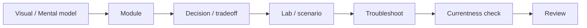

# Architecting on AWS 7.12.4 — Study Notes 📘

> **Status:** **Verified Course Scope** — 13/13 module families and 7/7 companion lab guides mapped; currentness overlay present  
> **Last course/currentness review:** 2026-10-07  
> **Historical course source:** *Architecting on AWS 7.12.4 (EN) — Student Guide* + corresponding Lab Guide  
> **Current scope cross-check:** AWS Classroom Training catalog + current Architecting on AWS course outline  
> **Current-tree provenance:** **CLEAN for known source-image blocker** — licensed source diagrams were removed; Git history has not been rewritten

[← AWS-SAA-C03 Learning System](../README.md)

## Start here

Choose the path that matches your goal:

1. **Learn the course:** [Module 01](./Module-01-Architecting-Fundamentals.md) → Module 13.
2. **See the official-scope evidence:** [Course QA Matrix](./COURSE-QA-MATRIX.md).
3. **Avoid stale AWS assumptions:** read [Currentness Overlay — 2026](./CURRENTNESS-2026.md).
4. **Practice:** use the [Thai Lab Guide](./Lab-Guide-TH/), then the [Mock Exam](./MOCK-EXAM-65.md).
5. **Fast review:** [Cheat Sheet](./Architecting-on-AWS_Cheat-Sheet.md) + [Exam Mode](./EXAM-MODE.md).
6. **Audit the evidence:** [Source Manifest](./SOURCE-MANIFEST.md), [Sources](./SOURCES.md) and [Provenance](./PROVENANCE.md).



## What “Verified Course Scope” means

AWS still lists **Architecting on AWS** as an intermediate 3-day classroom course, and the current course outline linked from the AWS Training catalog uses the same 13-module family represented here.

The repository has a direct note for every module family:

- Architecting Fundamentals
- Account Security
- Networking 1
- Compute
- Storage
- Database Services
- Monitoring and Scaling
- Automation
- Containers
- Networking 2
- Serverless
- Edge Services
- Backup and Recovery

See [COURSE-QA-MATRIX.md](./COURSE-QA-MATRIX.md) for the evidence table.

**It does not mean:** “every AWS feature launched after 7.12.4 is covered” or “all pricing/quotas/UI are frozen forever.” For modern service behavior, use the currentness overlay and current AWS documentation.

---

## Course vs current AWS

The course version is intentionally preserved because it provides a coherent learning sequence. Fast-changing AWS recommendations are maintained separately so historical course fidelity is not mixed with current production guidance.

High-impact current notes include:

- human workforce access now defaults toward **federation / IAM Identity Center + temporary credentials** rather than routine long-term IAM-user credentials,
- AWS Organizations supports **centralized root access** for member accounts,
- new CloudFront + S3 designs should prefer **Origin Access Control (OAC)** over legacy OAI,
- the current product name is **Amazon Data Firehose** (formerly Amazon Kinesis Data Firehose),
- new learning workflows should use **AWS CLI v2** as the default baseline.

Read: [CURRENTNESS-2026.md](./CURRENTNESS-2026.md).

---

## Modules

| # | Module | Student Guide pages |
|---:|---|---:|
| 01 | [Architecting Fundamentals](./Module-01-Architecting-Fundamentals.md) | 26–66 |
| 02 | [Account Security](./Module-02-Account-Security.md) | 67–113 |
| 03 | [Networking 1](./Module-03-Networking-1.md) | 114–159 |
| 04 | [Compute](./Module-04-Compute.md) | 160–217 |
| 05 | [Storage](./Module-05-Storage.md) | 218–275 |
| 06 | [Database Services](./Module-06-Database-Services.md) | 276–330 |
| 07 | [Monitoring and Scaling](./Module-07-Monitoring-and-Scaling.md) | 331–394 |
| 08 | [Automation](./Module-08-Automation.md) | 395–426 |
| 09 | [Containers](./Module-09-Containers.md) | 427–461 |
| 10 | [Networking 2](./Module-10-Networking-2.md) | 462–499 |
| 11 | [Serverless](./Module-11-Serverless.md) | 500–546 |
| 12 | [Edge Services](./Module-12-Edge-Services.md) | 547–602 |
| 13 | [Backup and Recovery](./Module-13-Backup-and-Recovery.md) | 603–650 |

Each module combines the original Part 1/Part 2 reader material into one GitHub-friendly file and includes durable Mermaid/original SVG visuals.

---

## Thai Lab Guide

| Lab | Focus |
|---:|---|
| 01 | Console / AWS CLI / Amazon S3 |
| 02 | VPC / public-private subnets / IGW / NAT / EC2 |
| 03 | Aurora / Application Load Balancer / Target Group |
| 04 | Auto Scaling / Multi-AZ / Aurora failover / redundant NAT |
| 05 | S3 → SNS → SQS → Lambda serverless workflow |
| 06 | CloudFront + S3 origin — modern designs should prefer OAC |
| 07 | Capstone — CloudFormation + Aurora + EFS + ALB + Auto Scaling + WordPress |

[Open Thai Lab Guide →](./Lab-Guide-TH/)

These files are learning companions. AWS-hosted classroom lab environments and instructor-provided resources remain authoritative for the official hands-on experience.

---

## Recommended study paths

### Full course

```text
01 → 02 → 03 → 04 → 05 → 06 → 07 → 08 → 09 → 10 → 11 → 12 → 13
```

After each module, answer three questions before moving on:

1. **Why does this service/pattern exist?**
2. **When would I choose it instead of the nearest alternative?**
3. **If it fails, which layer would I inspect first?**

### Architecture-first review

```text
Fundamentals
    ↓
Security + Networking
    ↓
Compute + Storage + Database
    ↓
Monitoring + Automation
    ↓
Containers + Networking 2 + Serverless
    ↓
Edge + Backup / DR
```

### Pre-test review

1. Read [Currentness Overlay](./CURRENTNESS-2026.md) first so you do not memorize a legacy recommendation as today's default.
2. Do [MOCK-EXAM-65.md](./MOCK-EXAM-65.md) under time pressure.
3. Review [MOCK-EXAM-65-ANSWER-KEY.md](./MOCK-EXAM-65-ANSWER-KEY.md).
4. Use [EXAM-MODE.md](./EXAM-MODE.md) to connect keywords → architecture/service family.
5. Use the [Cheat Sheet](./Architecting-on-AWS_Cheat-Sheet.md).
6. Return to modules where you cannot explain the reasoning without looking.

---

## High-value mental models

- AWS Well-Architected Framework — six pillars
- IAM policy evaluation, explicit deny, permissions boundaries and SCPs
- Federation / temporary credentials vs long-term credentials
- Security Group vs Network ACL
- Public/private subnet, IGW, NAT and routing
- EC2 user data vs instance metadata / IMDSv2
- EBS vs instance store; object vs block vs shared file storage
- S3 lifecycle/versioning and storage-class decisions
- RDS Multi-AZ vs read scaling vs backup/recovery
- DynamoDB capacity/consistency/caching
- CloudWatch vs CloudTrail vs VPC Flow Logs
- ALB/NLB/GWLB and Auto Scaling
- CloudFormation / Systems Manager automation
- ECS vs EKS; EC2 vs Fargate
- VPC endpoint/PrivateLink vs peering vs VPN vs Direct Connect vs Transit Gateway
- SQS vs SNS vs streaming vs orchestration
- Route 53 vs CloudFront vs Global Accelerator
- CloudFront OAC for modern private S3 origins
- RPO/RTO and Backup & Restore / Pilot Light / Warm Standby / Multi-Site patterns

---

## Reader vs private master

### GitHub reader

Designed for portable learning:

- one Markdown file per module,
- Thai explanations with official English service terminology,
- Mermaid/original architecture summaries,
- lab companions and review tools,
- currentness/source/QA metadata.

### Private master/reference material

Licensed course material and source screenshots should remain in the private reference location when redistribution rights are not clear.

Historical `assets/source/` images have been removed from the current tree. Do not add proprietary source screenshots back; keep licensed reference material outside the publishable learning tree. See [PROVENANCE.md](./PROVENANCE.md) for the Git-history caveat.

---

## Source and maintenance policy

Use [SOURCES.md](./SOURCES.md) for source priority and documentation families.

Before using a fact in production, recheck current AWS documentation when it depends on:

- pricing,
- quotas/limits,
- Region or AZ availability,
- instance families,
- exact supported integrations,
- service lifecycle/deprecation,
- security defaults,
- console navigation.

The durable value of this package is the architecture reasoning. Volatile operational facts must stay tied to current AWS documentation.
