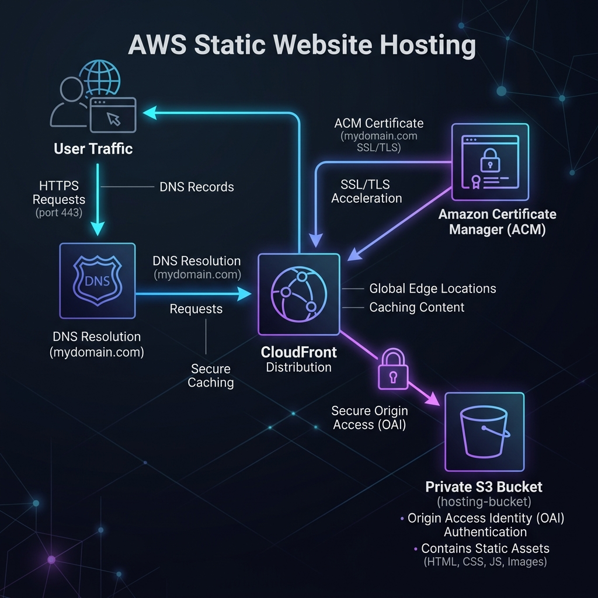

# Project 01: S3 + CloudFront (Global Static Website) Workbook

## 1. Scenario (สถานการณ์จำลอง)

### The Situation
บ่ายวันพฤหัสบดี เวลา 16:00 น. ในขณะที่คุณกำลังจะเคลียร์งานเสร็จเพื่อเตรียมตัวเลิกงาน จู่ๆ มีข้อความ Slack แจ้งเตือนเด้งขึ้นมาจาก สมชาย CTO ของบริษัท

---
**Somchai [CTO]** 16:02 น.
สวัสดี! ผมเพิ่งวางสายจากผู้ลงทุน พวกเขาต้องการดูเดโมสดของระบบ frontend ตัวใหม่เช้าวันพรุ่งนี้ตอน 9:00 น.

เราจำเป็นต้องปล่อยเว็บให้ใช้งานได้จริงที่ `app.thaidemo.co` พร้อมตั้งค่า HTTPS ให้เรียบร้อย

**ความต้องการของงานนี้:**
1. **Budget**: เรายังอยู่ในช่วงเริ่มต้น ให้พยายามใช้ AWS Free Tier ให้ได้มากที่สุด
2. **No ClickOps**: ผมไม่อยากเห็นใครเข้าไปกดตั้งค่าผ่าน AWS Console ด้วยมือ ทุกอย่างต้องจัดการผ่าน Terraform ทั้งหมด
3. **Automation**: เมื่อเราทำการแก้ไขโค้ด ระบบต้อง Deploy ให้โดยอัตโนมัติ
4. **Security**: S3 bucket ต้องตั้งค่าเป็น private เท่านั้น เพื่อป้องกันไม่ให้มีข้อมูลหลุดออกไปสู่สาธารณะ

ตอนนี้ผมกำลังจะไปงานเลี้ยงดินเนอร์ จะตื่นมาเช็ค URL นี้ตอนเช้าเป็นอย่างแรก ฝากด้วยนะ
---

### Constraints (ข้อจำกัด)
- **Strict Deadline**: พรุ่งนี้เช้าเวลา 9:00 น.
- **Tools**: ใช้ Terraform สำหรับ IaC และใช้ GitHub Actions สำหรับ CI/CD
- **Cost**: ต้องอยู่ภายใต้เงื่อนไขของ Free Tier ให้ได้มากที่สุด

### Definition of Done (นิยามความสำเร็จ)
1. เว็บไซต์ต้องสามารถเข้าใช้งานได้จริงผ่าน `https://app.thaidemo.co`
2. ลิงก์ `http://app.thaidemo.co` ต้องทำ Redirect ไปยัง `https`
3. S3 bucket ต้องไม่เปิดเป็น Public โดยต้องขึ้น Access Denied หากพยายามเข้าตรงผ่าน URL ของ S3
4. Infrastructure ทั้งหมดต้องได้รับการจัดการผ่าน Terraform แบบ 100%
5. GitHub Actions pipeline ทำงานผ่าน และต้องทำการ Deploy ทุกครั้งเมื่อมีการ push โค้ดไปยัง branch `main`
6. Domain `www.thaidemo.co` ต้องใช้งานได้และชี้ไปยังเว็บไซต์เดียวกัน

---

## 2. Topology Diagram (แผนผังระบบ)



---

## 3. Prerequisites & Estimated Time (สิ่งที่ต้องเตรียมและเวลาที่ใช้)

### สิ่งที่ต้องเตรียมความพร้อม
- AWS Account ที่เปิดใช้ระบบเรียกเก็บเงินแล้ว (ใช้งาน Free Tier ได้)
- AWS CLI v2 ที่ติดตั้งและกำหนดสิทธิ์การเข้าถึงเรียบร้อยแล้ว
- Terraform 1.7+ ติดตั้งพร้อมใช้งาน
- Domain Name ที่จดทะเบียนผ่าน Route53 (หรือชี้ Name Servers มายัง Route53)
- GitHub Repository สำหรับใช้จัดการโปรเจกต์นี้

### เวลาที่คาดว่าจะใช้
- **15 ชั่วโมง** (ครอบคลุมการติดตั้ง การแก้ปัญหา และการทำแบบฝึกหัด)

---

## 4. Tasks (ขั้นตอนการปฏิบัติ)

### Task 1: การตั้งค่า AWS Account และ CLI
ตรวจสอบให้แน่ใจว่าคุณได้ตั้งค่า AWS CLI ด้วย Named Profile หลีกเลี่ยงการใช้โปรไฟล์ default เพื่อป้องกันการเผลอติดตั้งทรัพยากรผิดบัญชี
```bash
# สร้างโปรไฟล์ใหม่
aws configure --profile thaidemo-dev

# ตรวจสอบความถูกต้อง
aws sts get-caller-identity --profile thaidemo-dev
```
ผลลัพธ์ที่คาดหวัง:
```json
{
    "UserId": "AIDAXOXO...",
    "Account": "123456789012",
    "Arn": "arn:aws:iam::123456789012:user/your-user"
}
```
> **[IRL]** ในสภาพแวดล้อมระดับมืออาชีพ คุณมักจะมีบัญชี AWS หลายสิบบัญชี (Dev, Staging, Prod, Security) การใช้ Named Profiles เป็นมาตรฐานขั้นต่ำที่ควรทำ เครื่องมืออย่าง `aws-vault` หรือ `granted` จะช่วยจัดการ Credentials ชั่วคราวได้ดียิ่งขึ้น

### Task 2: การตั้งค่า Terraform Backend
Terraform จำเป็นต้องมีที่เก็บไฟล์สถานะ (State file) ที่ปลอดภัย เราจะใช้ S3 สำหรับเก็บข้อมูล และ DynamoDB สำหรับการล็อกสถานะ (State Locking) เพื่อป้องกันไม่ให้คนรัน terraform apply พร้อมกัน
```bash
# รันสคริปต์เซ็ตอัพที่เตรียมไว้
chmod +x src/scripts/setup.sh
./src/scripts/setup.sh
```
สคริปต์นี้จะสร้าง:
- S3 Bucket: `thaidemo-tfstate-123456789012` (เปิดใช้งาน Versioning)
- DynamoDB Table: `thaidemo-tf-lock` (Partition key: `LockID`)

### Task 3: ใบรับรอง ACM (SSL/TLS Certificate)
เพื่อให้ CloudFront สามารถใช้งานโดเมนส่วนตัวพร้อม HTTPS ได้ คุณต้องสร้างใบรับรอง ACM ในภูมิภาค `us-east-1` (N. Virginia) เท่านั้น
```bash
cd src/terraform
terraform init
terraform apply -target=aws_acm_certificate.main
```
ตรวจสอบสถานะของใบรับรอง:
```bash
aws acm describe-certificate \
    --certificate-arn arn:aws:acm:us-east-1:123456789012:certificate/XXXX \
    --region us-east-1
```
> **[IRL]** CloudFront เป็นบริการระดับโลก (Global Service) แต่โครงสร้างพื้นฐานสำหรับใบรับรอง SSL/TLS ถูกรวมศูนย์ไว้ที่ us-east-1 เท่านั้น ดังนั้นแม้ว่าผู้ใช้ของคุณจะอยู่ในไทย ใบรับรองก็ต้องถูกสร้างที่ us-east-1

### Task 4: การตั้งค่า S3 Bucket
สร้าง S3 bucket สำหรับเก็บไฟล์เว็บไซต์ โดยบล็อกการเข้าถึงสาธารณะทั้งหมด (Block Public Access) และเปิดใช้งาน Versioning
```hcl
resource "aws_s3_bucket" "website" {
  bucket = "app.thaidemo.co"
}

resource "aws_s3_bucket_public_access_block" "website" {
  bucket = aws_s3_bucket.website.id

  block_public_acls       = true
  block_public_policy     = true
  ignore_public_acls      = true
  restrict_public_buckets = true
}
```
> **[IRL]** ปัจจุบันเราใช้ Origin Access Control (OAC) ซึ่งบัคเก็ตจะยังคงเป็นส่วนตัว และอนุญาตให้เฉพาะ CloudFront เท่านั้นที่อ่านข้อมูลได้ วิธีนี้ช่วยป้องกันไม่ให้คนเข้าถึง S3 โดยตรงและข้ามระบบ CDN/WAF ของคุณ

### Task 5: การตั้งค่า CloudFront Distribution
ตั้งค่า CloudFront Distribution เพื่อทำหน้าที่เป็น CDN และใช้ OAC ในการสื่อสารกับ S3 bucket
- **Origin**: ชี้ไปยัง Regional Domain Name ของ S3 bucket
- **OAC**: เชื่อมต่อ `aws_cloudfront_origin_access_control` เพื่ออนุญาตให้ CloudFront เข้าถึง S3
- **Price Class**: ใช้ `PriceClass_200` เพื่อครอบคลุม Edge Locations ในเอเชียและไทย

### Task 6: การตั้งค่า Route53
สร้าง Alias record (ไม่ใช่ CNAME) สำหรับ Apex Domain ชี้ไปยัง CloudFront Distribution
- **Record Type**: A
- **Alias**: Yes
- **Target**: ชื่อโดเมนของ CloudFront Distribution (`dxxxxx.cloudfront.net`)
> **[IRL]** คุณไม่สามารถสร้าง CNAME สำหรับ Apex Domain (เช่น `thaidemo.co`) ได้ AWS Route53 จึงใช้ Alias records ซึ่งไม่มีค่าใช้จ่ายและช่วยแก้ปัญหานี้ได้โดยตรง

### Task 7: การสร้าง GitHub Actions Pipeline
ใช้ OpenID Connect (OIDC) เพื่อยืนยันตัวตนกับ AWS โดยไม่ต้องเก็บ Access Keys แบบถาวร
ขั้นตอนการทำงานของ Workflow:
1. **Checkout Code**: ดึงโค้ดล่าสุด
2. **Configure AWS Credentials**: ยืนยันตัวตนผ่าน OIDC
3. **Build**: ทำการ build ไฟล์ static
4. **S3 Sync**: อัปโหลดไฟล์ไปยัง S3 ด้วยคำสั่ง `aws s3 sync ./dist s3://my-bucket --delete`
5. **Invalidate Cache**: เคลียร์แคชเฉพาะไฟล์ที่แก้ไขผ่านคำสั่ง `aws cloudfront create-invalidation`

---

## 5. Verification (การตรวจสอบผลการทำงาน)

ช่องทางตรวจสอบความสำเร็จตามเป้าหมายหลัก:
- [ ] **การเข้าถึงผ่าน HTTPS**: เข้าใช้งานหน้าเว็บผ่าน `https://app.thaidemo.co` แล้วโหลดได้สำเร็จ
- [ ] **การทำ HTTP Redirect**: ลองเข้า `http://app.thaidemo.co` แล้วระบบต้องเปลี่ยนเส้นทางไป `https://` โดยอัตโนมัติ
- [ ] **ความปลอดภัยของ S3**: ลองเข้า URL ของ S3 bucket โดยตรง ระบบต้องตอบกลับด้วยรหัส "403 Access Denied"
- [ ] **การแคชของ CloudFront**: ตรวจสอบ response header ของเว็บ ต้องพบคีย์ `X-Cache` แสดงผลเป็น `Hit from cloudfront` หรือ `Miss from cloudfront`
- [ ] **ระบบ Pipeline**: เมื่อทำการ push โค้ดใหม่ขึ้น branch `main` GitHub Actions pipeline ต้องรันผ่านทั้งหมดและอัปเดตหน้าเว็บจริงภายในเวลาไม่กี่นาที

---

## 6. Troubleshooting (การแก้ไขปัญหาที่พบบ่อย)

### ปัญหา 1: ไม่พบใบรับรอง ACM ในระบบ CloudFront (Ghost Certificate)
- **สาเหตุ**: คุณสร้างใบรับรอง ACM ในภูมิภาคอื่นที่ไม่ใช่ `us-east-1`
- **วิธีแก้ไข**: ลบใบรับรองเดิม ย้ายโฟกัสไปยังภูมิภาค `us-east-1` แล้วสร้างใบรับรองใหม่ผ่าน Terraform

### ปัญหา 2: เกิดข้อผิดพลาด 403 Access Denied บนหน้าเว็บ
- **สาเหตุ**: S3 bucket policy ไม่ได้เปิดสิทธิ์ให้ CloudFront OAC เข้าถึง หรือตั้งค่า S3 origin ใน CloudFront เป็น website endpoint แทน REST endpoint
- **วิธีแก้ไข**: ตรวจสอบสิทธิ์ใน S3 bucket policy ให้ผูกกับ CloudFront OAC และเปลี่ยนชื่อโดเมนของ origin ให้ชี้ไปยัง S3 regional domain name

### ปัญหา 3: อัปเดตโค้ดขึ้นระบบแล้ว หน้าเว็บยังเป็นเวอร์ชันเก่า
- **สาเหตุ**: CloudFront ยังคงเรียกใช้งานข้อมูลเก่าที่บันทึกไว้ในแคชของ Edge Locations
- **วิธีแก้ไข**: ตรวจสอบว่า pipeline มีขั้นตอนรันคำสั่ง `aws cloudfront create-invalidation` หรือสั่ง invalidate แคชด้วยตัวเองผ่าน CLI
```bash
aws cloudfront create-invalidation --distribution-id YOUR_DIST_ID --paths "/*"
```

### ปัญหา 4: GitHub Actions ฟ้องข้อผิดพลาด "Unable to locate credentials"
- **สาเหตุ**: การตั้งค่า OIDC Trust Policy บน AWS IAM Role ไม่ตรงกับชื่อ GitHub Organization หรือ Repository ของคุณ
- **วิธีแก้ไข**: ตรวจสอบเงื่อนไขใน Trust Policy ของ IAM Role ให้จับคู่กับ Repository และ Branch ที่ถูกต้อง

---

## 7. Exercises & Solutions (แบบฝึกหัดและแนวทางการแก้ไข)

### Exercise 1: การเพิ่มระบบ Staging Environment (ระดับง่าย)
ทีมการตลาดต้องการระบบสำหรับทดสอบหน้าเว็บเวอร์ชันใหม่ก่อนนำไปใช้งานจริงกับลูกค้าหลัก
- **เป้าหมาย**: เพิ่ม S3 bucket ตัวที่สองสำหรับทำสภาพแวดล้อม Staging แยกออกต่างหากที่ `staging.thaidemo.co`

**แนวทางการแก้ไข (Solution):**
แนะนำให้สร้าง S3 bucket และ CloudFront distribution แยกต่างหากเพื่อความปลอดภัยแบบ 100%
```hcl
# src/terraform/staging.tf
resource "aws_s3_bucket" "staging" {
  bucket = "staging.thaidemo.co"
}

# เพิ่ม origin สู่ทรัพยากร CloudFront เดิม หรือสร้าง distribution ใหม่
origin {
  domain_name              = aws_s3_bucket.staging.bucket_regional_domain_name
  origin_access_control_id = aws_cloudfront_origin_access_control.main.id
  origin_id                = "S3-Staging"
}

# เพิ่ม cache behavior ใน CloudFront
ordered_cache_behavior {
  path_pattern     = "/staging/*"
  allowed_methods  = ["GET", "HEAD"]
  cached_methods   = ["GET", "HEAD"]
  target_origin_id = "S3-Staging"
  # ... การตั้งค่าส่วนที่เหลือ
}
```

### Exercise 2: การตั้งค่าระบบ Blue-Green Deployment (ระดับปานกลาง)
ต้องการสร้างระบบอัปเดตหน้าเว็บใหม่แบบไร้ผลกระทบต่อผู้ใช้งาน (Zero-downtime) และสามารถย้อนกลับไปใช้เวอร์ชันเก่าได้ทันทีหากมีปัญหา
- **เป้าหมาย**: ปรับแต่ง GitHub Actions workflow ให้จัดการสลับการ deploy ระหว่าง S3 bucket สองฝั่ง (`blue` และ `green`)

**แนวทางการแก้ไข (Solution):**
ปรับแต่งส่วนหนึ่งของระบบในไฟล์ GitHub Actions workflow (`deploy.yml`):
```yaml
- name: Determine Target Bucket
  id: target
  run: |
    CURRENT_BUCKET=$(aws cloudfront get-distribution --id ${{ env.DIST_ID }} --query "Distribution.DistributionConfig.Origins.Items[0].DomainName" --output text | cut -d'.' -f1)
    if [ "$CURRENT_BUCKET" == "thaidemo-blue" ]; then
      echo "bucket=thaidemo-green" >> $GITHUB_OUTPUT
    else
      echo "bucket=thaidemo-blue" >> $GITHUB_OUTPUT
    fi

- name: Deploy to Target
  run: aws s3 sync ./dist s3://${{ steps.target.outputs.bucket }} --delete
```

### Exercise 3: การเพิ่มขีดความสามารถด้วย Lambda@Edge (ระดับยาก)
ต้องการเพิ่มตรรกะความปลอดภัยและการทำงานที่อัจฉริยะขึ้นที่ฝั่ง Edge location ของ CDN
- **เป้าหมาย**: เขียนและผูกฟังก์ชัน Lambda@Edge เพื่อทำการบังคับใช้ Security Headers และจัดทำ A/B Testing สำหรับแยกผู้ใช้งาน 10% ไปยังหน้าเดโมแบบใหม่

**แนวทางการแก้ไข (Solution):**
สร้างฟังก์ชัน Lambda ในภูมิภาค `us-east-1`:
```javascript
// lambda/security-headers.js
exports.handler = async (event) => {
    const response = event.Records[0].cf.response;
    const headers = response.headers;

    headers['strict-transport-security'] = [{ key: 'Strict-Transport-Security', value: 'max-age=31536000; includeSubdomains; preload' }];
    headers['content-security-policy'] = [{ key: 'Content-Security-Policy', value: "default-src 'self'; script-src 'self' 'unsafe-inline'; style-src 'self' 'unsafe-inline';" }];
    headers['x-content-type-options'] = [{ key: 'X-Content-Type-Options', value: 'nosniff' }];
    headers['x-frame-options'] = [{ key: 'X-Frame-Options', value: 'DENY' }];
    headers['x-xss-protection'] = [{ key: 'X-XSS-Protection', value: '1; mode=block' }];

    return response;
};
```
เชื่อมต่อฟังก์ชันนี้เข้ากับเหตุการณ์ **Origin Response** ใน CloudFront distribution ผ่านโค้ด Terraform

---

## Cost & Cleanup Safety

Resource ที่ควรจับตาเรื่องค่าใช้จ่ายคือ S3 storage/requests, CloudFront requests/data transfer และบริการเสริมที่คุณเปิดเพิ่มเอง

หลังจบ lab:

1. ลบ/disable CloudFront distribution ที่สร้างเพื่อทดลองเมื่อไม่ใช้งานแล้ว
2. ลบ object/version ที่ไม่ต้องเก็บและลบ S3 bucket ของ lab
3. ลบ DNS/WAF/Lambda หรือ resource เสริมถ้าคุณสร้างเพิ่มจาก exercise
4. ถ้าสร้างด้วย IaC ให้ใช้ destroy/delete workflow ของ IaC นั้นแทนการลบสุ่มจาก Console
5. ตรวจ Billing/Cost Explorer อีกครั้งเพื่อยืนยันว่าไม่มี resource ค้าง

> S3 bucket ที่เปิด versioning อาจยังมี object versions/delete markers เหลืออยู่และทำให้ลบ bucket ไม่สำเร็จ ตรวจให้ครบก่อนถือว่า cleanup เสร็จ
