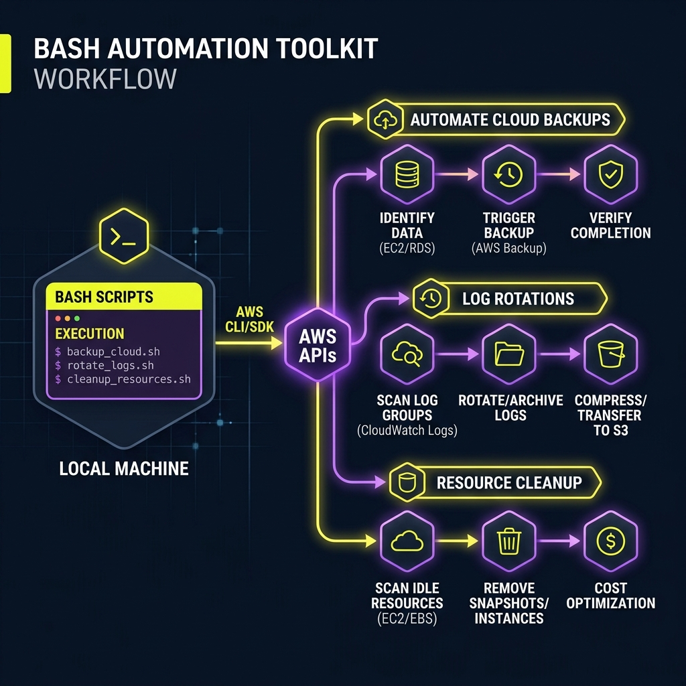
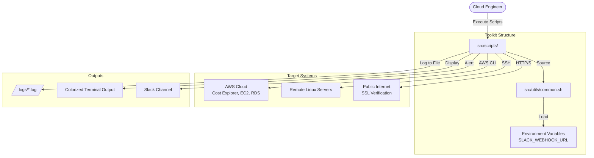

# Project 04: Bash Automation Workbook

## 1. Scenario (สถานการณ์จำลอง)

เรื่องราวเริ่มต้นในเช้าวันจันทร์ที่แสนวุ่นวาย

Lead Cloud Engineer (พี่บี) ได้แจ้งกับเราว่า:
"อรุณสวัสดิ์! โทษทีที่ต้องบอกเรื่องนี้แต่เช้า แต่เรากำลังมีปัญหาใหญ่
เมื่อวันจันทร์ที่แล้ว พี่ต้องเสียเวลาไปถึง 2 ชั่วโมงในการไล่คลิกบน AWS Console เพื่อดึงรายงานค่าใช้จ่ายส่งให้ทีมการเงิน

แถมตอน 10 โมง EC2 Instance ในระบบ Production ก็เกิดล่มขึ้นมาเพราะพื้นที่ดิสก์เต็ม 100% โดยที่เราไม่ได้รับการแจ้งเตือนเลยสักนิด
และที่แย่ไปกว่านั้นคือเราเพิ่งไปเจอ EBS Volume ผีสิง (Ghost Volumes) กว่า 50 ตัวที่ไม่ได้ผูกติดกับเครื่องไหนเลย แต่เราต้องจ่ายเงินทิ้งไปเฉยๆ ถึง $300 ต่อเดือน

ตอนนี้ทีมเราโตขึ้นเป็น 10 คนแล้ว เราจะทำงานแบบแมนนวลแบบนี้ต่อไปไม่ได้แล้ว
พี่อยากให้เราใช้ Sprint นี้ในการสร้าง Automation Toolkit ที่สามารถรันผ่าน cron job หรือรันเองแบบแมนนวลเวลาที่ต้องการข้อมูลได้เลย"

### โจทย์และเป้าหมาย (Goals)
คุณต้องเปลี่ยนขั้นตอนการทำงานซ้ำๆ ด้วยมือ (Manual Toil) ให้กลายเป็นระบบอัตโนมัติที่ถูกต้องและแม่นยำ

เป้าหมายคือการสร้างชุดสคริปต์ Bash ที่มีความเสถียรและทำงานได้เองอย่างปลอดภัย

สคริปต์ต้องมีโครงสร้างที่เข้าใจง่ายเพื่อให้วิศวกรทุกคนในทีมสามารถนำไปใช้งานต่อได้ทันที

เปรียบเทียบ Bash Script เหมือน "รีโมทคอนโทรลที่ตั้งโปรแกรมได้"

แทนที่เราจะกดปุ่มหน้า AWS Console ทุกครั้ง เราเขียนสคริปต์ทิ้งไว้เพื่อให้มันทำงานแทนได้ทันทีด้วยคำสั่งเดียว

### ปัญหาหลักของระบบในตอนนี้ (Pain Points)
- Invisible Costs: ไม่มีใครรู้ว่าเมื่อวานเราจ่ายเงินไปเท่าไหร่จนกว่าบิลค่าใช้จ่ายประจำเดือนของ AWS จะส่งมาตอนสิ้นเดือน
- Ghost Resources: เรากำลังเสียเงินให้ทรัพยากรที่ไม่ได้ใช้งาน เช่น EBS Volume ที่ไม่ได้ผูกกับเครื่อง หรือ Elastic IP ที่สร้างค้างไว้
- Manual Monitoring: การตรวจสอบพื้นที่ดิสก์หรือวันหมดอายุของใบรับรอง SSL Certificate ยังต้องคอยรีโมทเข้าไปเช็คเองทีละเครื่อง
- Inconsistent Backups: การทำ Backup ของ RDS Instance ในปัจจุบันไม่สม่ำเสมอ บางตัวทำแบบแมนนวล บางตัวไม่ได้ทำเลย และการตั้งชื่อก็สับสนปนเปกันไปหมด

### ข้อกำหนดการออกแบบ (Constraints)
- Production Grade Bash: สคริปต์ทั้งหมดต้องใช้คำสั่ง set -euo pipefail เพื่อให้หยุดทำงานทันทีหากเกิดข้อผิดพลาด ป้องกันไม่ให้ระบบพังเงียบ (Silent Failures)
- Standardized Output: สคริปต์ทุกตัวต้องรองรับ Flag --help และมีการพิมพ์ข้อความแสดงสีสันเพื่อเน้นเตือน Warnings หรือ Errors
- Safety First: สคริปต์ส่วนที่ใช้ทำความสะอาดหรือมีคำสั่งลบข้อมูล ต้องรองรับ Flag --dry-run เพื่อจำลองการทำงาน หรือมี Flag --execute ยืนยันก่อนจะลบข้อมูลจริง
- Integration: ต้องรองรับการแจ้งเตือนผ่าน Slack สำหรับกรณีวิกฤต เช่น ดิสก์เต็ม หรือ SSL Certificate กำลังจะหมดอายุ

### เกณฑ์การตรวจรับงาน (Definition of Done)
- มีชุดสคริปต์ Bash แบบแยกโมดูลทั้งหมด 6 ตัวในโฟลเดอร์ src/scripts/
- สคริปต์ทั้งหมดผ่านการทดสอบและทำงานร่วมกับ AWS CLI v2 ได้อย่างไร้รอยต่อ
- สร้างไฟล์ศูนย์กลาง utils/common.sh เพื่อใช้ฟังก์ชันร่วมกัน เช่น ฟังก์ชัน Logging, จัดการสี และส่งข้อความเข้า Slack
- มีสคริปต์รายงานสรุปค่าใช้จ่ายและรายการทรัพยากรคงเหลือในระบบโดยอัตโนมัติ
- มีสคริปต์ทำความสะอาดระบบ (Cleanup Script) ที่ระบุขยะที่ไม่ได้ใช้และช่วยคำนวณเงินที่จะประหยัดได้จริง

## 2. Topology Diagram (แผนผังระบบ)



### โครงสร้างของระบบ (Architecture Diagram)



### รายละเอียดของคอมโพเนนต์ (Component Breakdown)

#### 1. The Controller (common.sh)
- ทำหน้าที่เป็นศูนย์กลางของ Logic ทั้งหมดที่สามารถนำกลับมาใช้ซ้ำได้
- หากต้องการแก้ไขสคริปต์ส่ง Slack Webhook หรือปรับแต่งสีสัน สามารถทำได้ที่นี่ที่เดียว
- สคริปต์ทุกตัวในโฟลเดอร์ src/scripts/ จำเป็นต้อง Source ไฟล์นี้ก่อนเริ่มทำงานเสมอ

#### 2. Automation Scripts (src/scripts/)
- เป็นสคริปต์เฉพาะทางที่ทำงานแบบ Single-purpose
- สคริปต์ทุกตัวจะเขียนด้วยโครงสร้างที่เข้มงวด ได้แก่:
  - set -euo pipefail: สั่งให้สคริปต์หยุดทำงานทันทีหากเกิด Error หรือตรวจพบตัวแปรที่ไม่ได้ประกาศค่า หรือเกิดปัญหากลาง Pipe
  - check_dep: ตรวจสอบความพร้อมของ Dependency หรือโปรแกรมที่จำเป็น เช่น aws, jq, bc ก่อนเริ่มทำงานจริง
  - show_help: แสดงวิธีกำหนดค่าตัวแปรและอธิบายวิธีกรอก Option ต่างๆ ให้ผู้ใช้งานทราบ
  - dry-run: โหมดจำลองการทำงานของสคริปต์เพื่อตรวจสอบความถูกต้องโดยไม่ต้องดำเนินการจริงกับทรัพยากรบน Cloud

#### 3. External Integrations
- AWS SDK (CLI): ใช้สำหรับดึงข้อมูลสถานะและค่าใช้จ่ายของระบบ Cloud Infrastructure
- SSH Protocol: ใช้จัดการเครื่องเซิร์ฟเวอร์ปลายทางจากระยะไกลแบบ Agentless
- Slack Webhooks: ใช้สำหรับระบบแจ้งเตือนและรายงานข้อมูลกลับมายังช่องสื่อสารหลักของทีม

### หลักการออกแบบที่สำคัญ (Key Design Principles) [IRL]
- Idempotency: สคริปต์ต้องถูกออกแบบให้รันซ้ำกี่ครั้งก็ได้โดยไม่ทำให้ระบบพังหรือสร้างผลลัพธ์ซ้ำซ้อน (เช่น rds-snapshot.sh จะตั้งชื่อ Snapshot แบบไม่ซ้ำกันเสมอ)
- Graceful Failure: การใช้คำสั่ง trap (ระบุไว้ใน common.sh) เพื่อช่วยให้เราดักจับ Error ที่คาดไม่ถึง และบันทึกประวัติการทำงานลง Log ไฟล์ได้อย่างถูกต้อง
- Portability: หลีกเลี่ยงการใช้ Local Dependencies เฉพาะเครื่อง และใช้ตัวแปร SCRIPT_DIR เพื่อให้ชุดคำสั่งนี้สามารถนำไป Clone และรันได้ทันทีบนเครื่อง Linux อื่นๆ

### การทำงานร่วมกับภาพรวมระบบเดิม (Legacy Flow)
```text
[Admin Laptop] → (Bash Script + AWS CLI + jq) → [AWS API] → [Cloud Resources] → [Slack Notification]
```

### ประสิทธิภาพและการรองรับการขยายตัว (Performance & Scaling)
- ออกแบบให้ประมวลผลทรัพยากรหลักร้อยชิ้น (100+) ได้อย่างรวดเร็ว
- คอขวดมักเกิดจาก AWS API Rate Limiting หากรันคำสั่ง describe ถี่เกินไปในลูปขนาดใหญ่
- แก้ไขโดยใช้เทคนิค Pagination ใน AWS CLI และการรันคำสั่งแบบขนาน (Parallel) โดยใช้ `&` และ `wait` ใน Bash เพื่อประหยัดเวลา

## 3. Prerequisites & Estimated Time (สิ่งที่ต้องเตรียมและเวลาที่ใช้)

### เวลาและค่าใช้จ่ายที่คาดบังเกิดขึ้น (Estimated Time & Cost)
- เวลาที่ใช้: ประมาณ 15 ชั่วโมง
- ค่าใช้จ่าย AWS: $0 (สคริปต์เหล่านี้ใช้คำสั่ง describe และ get-cost-and-usage ซึ่งไม่มีค่าใช้จ่ายหรือมีน้อยมาก)

### สิ่งที่ต้องเตรียมก่อนเริ่ม (Prerequisites)
- เครื่องคอมพิวเตอร์ที่ติดตั้ง Ubuntu 22.04 (หรือ WSL2)
- AWS CLI v2 ที่ติดตั้งและตั้งค่าสิทธิ์การเข้าใช้งานเรียบร้อยแล้ว
- ติดตั้งแพ็กเกจที่จำเป็น: jq, column, curl โดยใช้คำสั่ง:
  ```bash
  sudo apt install jq bsdmainutils curl -y
  ```
- ความรู้พื้นฐานเกี่ยวกับ Resource บน AWS เช่น EC2 และ RDS

### ทักษะที่คุณจะได้เรียนรู้ (Skills Gained)
- Advanced Bash: การใช้งาน set -euo pipefail, traps และการควบคุม Signal
- JSON Processing: ใช้งาน jq เพื่อดึงและกรองข้อมูล JSON จาก AWS CLI ได้อย่างแม่นยำ
- AWS CLI Automation: การสั่งงาน AWS แบบอัตโนมัติร่วมกับ Cost Explorer, EC2 และ RDS
- Remote Execution: การใช้ SSH และ Loop เพื่อจัดการระบบในสภาพแวดล้อมที่มีเครื่องเซิร์ฟเวอร์จำนวนมาก
- Alerting: เชื่อมต่อและส่งข้อมูลหา Slack API หรือ Webhook เพื่อแจ้งเตือนแบบอัตโนมัติ
- Scripting Best Practices: การออกแบบเครื่องมือแบบ CLI ให้รับ Input Parameters ได้ และแสดงผลแบบเข้าใจง่าย

### รายการเครื่องมือใน Toolkit (Toolkit Tools)
1. `aws-cost-report.sh`: ดึงรายงานสรุปค่าใช้จ่าย AWS รายเดือนแยกตาม Service
2. `ec2-inventory.sh`: ตรวจสอบสถานะ EC2 Instance จากหลาย Region (Multi-region)
3. `ec2-cleanup.sh`: ค้นหาและลบ EBS Volume ที่ไม่ได้ใช้งาน และ EBS Snapshot ที่เก่าเกินไป
4. `rds-snapshot.sh`: สคริปต์จัดการการสำรองข้อมูล (Backup) ของ RDS Instance ตามมาตรฐาน
5. `ssl-checker.sh`: ระบบตรวจสอบอายุการใช้งาน SSL Certificate เพื่อแจ้งเตือนก่อนหมดอายุ
6. `disk-alert.sh`: ตรวจสอบและส่งแจ้งเตือนเมื่อพื้นที่ของดิสก์ในระบบเหลือน้อย

## 4. Tasks (ขั้นตอนการปฏิบัติ)

### Task 1: เตรียมสภาพแวดล้อมและ Dependency (Environment Setup)
1. ติดตั้งเครื่องมือพื้นฐานที่จำเป็นบน Ubuntu 22.04 หรือ WSL2:
   ```bash
   sudo apt update && sudo apt install jq bsdmainutils curl openssl bc -y
   ```
2. ตั้งค่า AWS Credentials บนเครื่องเซิร์ฟเวอร์เพื่อให้เข้าถึง AWS API ได้:
   ```bash
   aws configure
   ```
3. กำหนดค่าตัวแปร Slack Webhook URL ในระบบ:
   ```bash
   export SLACK_WEBHOOK_URL="https://hooks.slack.com/services/YOUR/WEBHOOK/URL"
   ```

### Task 2: สร้างไฟล์สคริปต์คอมมอน (Creating common.sh)
สร้างไฟล์ `src/utils/common.sh` เพื่อเก็บฟังก์ชันส่วนกลางที่นำกลับมาใช้ซ้ำได้ เช่น การแสดงผลสีแยกประเภทของ Log (INFO, SUCCESS, WARN, ERROR), การตรวจสอบ Dependency (`check_dep`), และการส่งข้อความแจ้งเตือนเข้า Slack:
- เริ่มต้นเขียนสคริปต์ด้วย Safety Boilerplate เพื่อความทนทาน:
  ```bash
  #!/bin/bash
  set -euo pipefail
  # -e: หยุดทำงานทันทีเมื่อมีคำสั่งล้มเหลว
  # -u: หยุดทำงานเมื่อพบตัวแปรที่ไม่ได้ประกาศค่า
  # -o pipefail: ตรวจจับข้อผิดพลาดใน Pipe
  ```
- ใช้ฟังก์ชัน `check_dep` ในการตรวจสอบเครื่องมือก่อนรันสคริปต์จริง
- กำหนดคำสั่ง `trap` เพื่อจับ Error และรายงาน Exit Code ก่อนที่ระบบจะหยุดทำงาน

### Task 3: สร้างสคริปต์ดึงรายงานค่าใช้จ่าย (AWS Cost Report)
สร้างสคริปต์ `src/scripts/aws-cost-report.sh` สำหรับดึงข้อมูลค่าใช้จ่าย AWS จาก Cost Explorer API:
- ใช้คำสั่ง `aws ce get-cost-and-usage` เพื่อดึงค่าใช้จ่ายสะสมตามระยะเวลาที่กำหนด
- จัดรูปแบบรายงานด้วย `jq`, `sort`, และ `column` เพื่อแสดงเป็นตารางที่อ่านง่ายใน Terminal
- เพิ่มการเช็คยอดรวมหากเกินเกณฑ์ที่กำหนด ($100) ให้ส่งข้อความเตือนไปยัง Slack

### Task 4: สร้างสคริปต์รายการ EC2 Instance (EC2 Inventory)
สร้างสคริปต์ `src/scripts/ec2-inventory.sh` เพื่อตรวจสอบสถานะการทำงานของ EC2:
- ค้นหารายการ Instance ที่มีสถานะเป็น `running` จาก Region ต่างๆ (Multi-region)
- ใช้ `jq` ในการกรอง Instance ID, Public IP, Instance Type, และ KeyName
- บันทึกผลลัพธ์เป็นไฟล์ CSV เพื่อความสะดวกในการนำข้อมูลไปวิเคราะห์ต่อ
- ตัวอย่างการค้นหา Instance ID ของเครื่องที่รันอยู่ด้วย `jq`:
  ```bash
  aws ec2 describe-instances | jq -r '.Reservations[].Instances[] | select(.State.Name=="running") | .InstanceId'
  ```

### Task 5: สร้างสคริปต์ทำความสะอาดพื้นที่ (EC2 Resource Cleanup)
สร้างสคริปต์ `src/scripts/ec2-cleanup.sh` เพื่อช่วยค้นหาและทำความสะอาดทรัพยากรที่ค้างอยู่:
- ค้นหา EBS Volumes ที่มีสถานะเป็น `available` (ไม่ได้ผูกกับเครื่องใดๆ)
- ตรวจสอบ EBS Snapshots ที่สร้างไว้นานเกินกำหนด
- รองรับ Flag `--dry-run` สำหรับจำลองผลลัพธ์ก่อนทำการลบข้อมูลจริง เพื่อป้องกันการลบผิดพลาด

### Task 6: สร้างสคริปต์สำรองข้อมูล RDS (RDS Snapshot Automation)
สร้างสคริปต์ `src/scripts/rds-snapshot.sh` เพื่อจัดระบบสำรองข้อมูล:
- ใช้คำสั่ง `aws rds create-db-snapshot` เพื่อสร้าง Backup Snapshot ของ RDS Instance
- ตั้งชื่อ Snapshot ตามวันเวลาที่ทำงานเพื่อความเป็นระบบระเบียบ
- ลบ Snapshot ที่เก่ากว่ากำหนด (Retention Period) เพื่อประหยัดพื้นที่จัดเก็บข้อมูล

### Task 7: สร้างสคริปต์ตรวจสอบ SSL Certificate (SSL Expiry Checker)
สร้างสคริปต์ `src/scripts/ssl-checker.sh` สำหรับความปลอดภัยของโดเมน:
- ใช้คำสั่ง `openssl` เพื่อดึงวันหมดอายุของใบรับรอง SSL Certificate จาก Endpoint โดเมนที่กำหนด
- คำนวณจำนวนวันที่เหลือก่อนจะหมดอายุ
- หากเหลือน้อยกว่า 30 วัน ให้แจ้งเตือนวิกฤตไปยัง Slack เพื่อป้องกันปัญหาระบบใช้ไม่ได้เนื่องจาก SSL หมดอายุ

### Task 8: ตรวจสอบและเตือนพื้นที่ดิสก์เหลือน้อย (Disk Usage Alert via SSH)
สร้างสคริปต์ `src/scripts/disk-alert.sh` เพื่อรีโมทตรวจสอบพื้นที่ของเครื่องปลายทาง:
- เชื่อมต่อไปยัง IP เครื่องเซิร์ฟเวอร์ปลายทางผ่าน SSH
- รันคำสั่ง `df -h` บนเครื่องปลายทางเพื่อประเมินการใช้งานพื้นที่เก็บข้อมูล
- หากพบการใช้งานพื้นที่ดิสก์เกินเกณฑ์ (Threshold) เช่น 90% ให้แจ้งเตือนกลับมาทาง Slack ทันที โดยส่งข้อมูลในรูปแบบ Webhook:
  ```bash
  curl -X POST -H 'Content-type: application/json' --data '{"text":"🚨 ERROR: Disk space critical!"}' $SLACK_WEBHOOK_URL
  ```

### ข้อมูลเพิ่มเติมที่เป็นประโยชน์ (Insights)
- set -euo pipefail: ระบบความปลอดภัยของ Bash หากมีคำสั่งใดในท่อส่งน้ำ (Pipe) ทำงานพลาด สคริปต์จะหยุดทำงานทันที ป้องกันไม่ให้เกิดความเสียหายต่อเนื่อง
- jq is a Must: การจัดการ JSON ด้วย grep หรือ awk ทำได้ยาก การใช้ jq จะทำให้สคริปต์ได้มาตรฐานและทนทานต่อการเปลี่ยนแปลงโครงสร้าง JSON ของ AWS API

### การนำไปใช้งานจริงในองค์กร (Real-World Enterprise Usage)
- Automated Daily Audit: ส่งรายงานทรัพยากรที่เปิดทิ้งไว้เข้า Slack Channel ของทีม DevOps ทุกเช้า
- Emergency Cleanup: สคริปต์ปุ่มกดเพื่อลบ Resource ทั้งหมดใน Sandbox Lab ทิ้งทันทีเพื่อไม่ให้ค่าใช้จ่ายบานปลาย
- Custom Monitoring: ตรวจสอบสถานะที่ CloudWatch ดูได้ยาก เช่น การเชื่อมต่อ VPN Tunnel ที่เกิดค้างอยู่ในระบบ
- Weekly Cost Summary: ใช้ทำรายงานสรุปค่าใช้จ่ายส่ง Email ให้ทีมทุกเช้าวันจันทร์
- SSL Expiry Monitoring: ตรวจสอบวันหมดอายุของใบรับรอง SSL Certificate ก่อนที่มันจะหมดอายุ

### วิธีทดลองให้ระบบล้มเหลว (Chaos Testing / Testing Failures)
- รันสคริปต์โดยไม่มี AWS Credentials: ลองสั่ง `unset AWS_ACCESS_KEY_ID AWS_SECRET_ACCESS_KEY` แล้วลองรันสคริปต์ดู
  - ผลลัพธ์: สคริปต์ควรแสดง Error แจ้งว่าหา Credentials ไม่พบ ไม่ใช่พังเงียบๆ เพื่อให้ได้ทดสอบระบบ Error Handling
- ป้อนข้อมูลผิดประเภท (Invalid Input): ลองใส่ชื่อ Region ที่ไม่มีอยู่จริงในการรันคำสั่ง
  - ผลลัพธ์: สคริปต์ควรจะกรองข้อมูล (Validation) และแจ้งเตือนความผิดพลาดของ Input ก่อนเริ่มทำงานจริง

### การล้างข้อมูลหลังการทดลอง (Cleanup)
- ลบสคริปต์ออกจากเครื่อง หรือลบไฟล์ชั่วคราว (Temporary Files) ที่สคริปต์สร้างขึ้นระหว่างทำงาน

### สรุปหลักการทำงาน (Summary)
- Bash คือทักษะสำคัญที่ขาดไม่ได้สำหรับ Cloud Engineer ในการทำงานประจำวัน
- การใช้ set -euo pipefail เป็นมาตรฐานบังคับสำหรับการเขียนสคริปต์ที่ต้องการความปลอดภัยสูง
- jq คือหัวใจหลักในการคัดกรองข้อมูล JSON ที่ได้จาก AWS CLI

## 5. Verification (การตรวจสอบผลการทำงาน)

ใช้รายการตรวจสอบนี้เพื่อตรวจสอบความถูกต้องในการตั้งค่าของระบบอัตโนมัติ

### 1. Environment Readiness (ความพร้อมของสภาพแวดล้อม)
- [ ] ติดตั้ง AWS CLI และตั้งค่าสิทธิ์เรียบร้อยแล้ว (`aws configure`)
- [ ] ติดตั้งเครื่องมือ `jq`, `bc`, `openssl`, `column` เรียบร้อยแล้ว
- [ ] ตั้งค่าการใช้งาน SSH Keys สำหรับเชื่อมต่อไปยังเครื่องเซิร์ฟเวอร์ปลายทางเรียบร้อยแล้ว
- [ ] กำหนดค่าตัวแปร `SLACK_WEBHOOK_URL` ใน Shell Environment แล้ว
- [ ] สคริปต์ทุกตัวได้รับการกำหนดสิทธิ์ให้รันได้ (`chmod +x src/scripts/*.sh`)

### 2. AWS Cost Reporting (รายงานค่าใช้จ่าย AWS)
- [ ] รันสคริปต์ `./src/scripts/aws-cost-report.sh` สำเร็จโดยไม่มี Error
- [ ] รายงานแสดงผลชื่อ Services และค่าใช้จ่ายต่างๆ ออกมาเป็นตารางที่อ่านง่าย
- [ ] คำนวณยอดรวมค่าใช้จ่ายสะสม (Total Cost) ได้ถูกต้อง
- [ ] ส่งแจ้งเตือนไปยัง Slack สำเร็จ เมื่อเกิดเหตุการณ์ค่าใช้จ่ายเกินกำหนด

### 3. EC2 Management (การจัดการ EC2)
- [ ] รันสคริปต์ `./src/scripts/ec2-inventory.sh` แล้วแสดงรายการ Instance ที่กำลังทำงานอยู่ได้ถูกต้อง
- [ ] ระบบส่งออกรายงานเป็นไฟล์ CSV ทำงานได้ และสามารถเปิดดูในโปรแกรม Spreadsheet ได้
- [ ] รันสคริปต์ `./src/scripts/ec2-cleanup.sh --dry-run` แล้วตรวจสอบรายการ Resource ที่ไม่ได้ใช้ได้ถูกต้อง

### 4. Maintenance & Security (การบำรุงรักษาและความปลอดภัย)
- [ ] รันสคริปต์ `./src/scripts/rds-snapshot.sh` เพื่อสร้าง Snapshot และรอจนสร้างเสร็จเรียบร้อย
- [ ] รันสคริปต์ `./src/scripts/ssl-checker.sh` แล้วค้นหาและแจ้งเตือน SSL Certificate ที่ใกล้หมดอายุได้ถูกต้อง
- [ ] รันสคริปต์ `./src/scripts/disk-alert.sh` เพื่อเชื่อมต่อผ่าน SSH และตรวจสอบพื้นที่ดิสก์ได้สำเร็จ
- [ ] ส่งข้อความแจ้งเตือนระดับวิกฤต (Critical Alerts) ไปยัง Slack Channel ได้สำเร็จ

### 5. Production Hardening (การปรับปรุงเพื่อพร้อมใช้งานบน Production) [IRL]
- [ ] สคริปต์ทั้งหมดใช้งานชุดคำสั่ง `set -euo pipefail`
- [ ] เพิ่มสคริปต์เข้าไปในระบบ `cron` หรือเครื่องมือ CI เพื่อตั้งเวลาทำงานแบบอัตโนมัติ
- [ ] ไฟล์ Log ได้รับการสร้างและจัดการด้วยระบบ Log Rotator
- [ ] AWS IAM User ที่ใช้งานได้รับสิทธิ์ขั้นต่ำที่จำเป็นเท่านั้น (Least Privilege)

## 6. Troubleshooting (การแก้ไขปัญหาที่พบบ่อย)

### 1. ปัญหาสิทธิ์การรันสคริปต์ถูกปฏิเสธ (Permission Denied)
- อาการ: แสดงผลข้อความ `bash: ./src/scripts/aws-cost-report.sh: Permission denied`
- สาเหตุ: ไฟล์สคริปต์ยังไม่ได้กำหนด Executable Permission
- วิธีแก้ไข: รันคำสั่งเพิ่มสิทธิ์การรันให้กับสคริปต์:
  ```bash
  chmod +x src/scripts/*.sh
  ```

### 2. ไม่สามารถดึง AWS Credentials ได้ (AWS CLI Unable to locate credentials)
- อาการ: แสดงข้อความ `Unable to locate credentials. You can configure credentials by running "aws configure".`
- สาเหตุ: ตัวเครื่องเซิร์ฟเวอร์ยังไม่มีข้อมูล Access Keys ของ AWS หรือคีย์หมดอายุ
- วิธีแก้ไข: ทำการตั้งค่าข้อมูลผู้ใช้ใหม่ หรือกำหนด Named Profile ให้ถูกต้อง:
  ```bash
  aws configure
  # หรือส่งออกค่าโปรไฟล์หากต้องการระบุเจาะจง
  export AWS_PROFILE=your-profile-name
  ```

### 3. การเชื่อมต่อ SSH ขัดข้อง (SSH Connection Timeout)
- อาการ: เกิดข้อผิดพลาด `ssh: connect to host 10.0.0.1 port 22: Connection timed out`
- สาเหตุ: Security Group หรือ Firewall บน Network กำลังบล็อกการเชื่อมต่อผ่าน Port 22
- วิธีแก้ไข:
  - ตรวจสอบว่าได้เพิ่ม IP ของเครื่องต้นทางเข้าไปใน Security Group ของเครื่องปลายทางแล้ว
  - ตรวจสอบว่าเครื่องเซิร์ฟเวอร์มี Public IP และใช้งาน Subnet ที่สามารถออกอินเทอร์เน็ตผ่าน Internet Gateway ได้

### 4. คำสั่ง jq หรือ bc ไม่พบในระบบ (jq or bc Command Not Found)
- อาการ: ระบบรายงานข้อความเช่น `src/utils/common.sh: line 15: jq: command not found`
- สาเหตุ: ยังไม่ได้ทำการติดตั้ง Dependency ที่จำเป็นในการทำงานของสคริปต์
- วิธีแก้ไข: ติดตั้งเครื่องมือเหล่านั้นโดยใช้ตัวจัดการแพ็กเกจ:
  ```bash
  sudo apt-get install jq bc -y
  ```

### 5. ยืนยัน SSH Host Key ล้มเหลว (SSH Host Key Verification Failed)
- อาการ: การเชื่อมต่อแจ้งข้อผิดพลาด `Host key verification failed.`
- สาเหตุ: ค่า Public Key ของเครื่องปลายทางเปลี่ยนไป หรือไม่มีข้อมูลระบุไว้ในไฟล์ `known_hosts`
- วิธีแก้ไข: สามารถตั้งค่าเพื่อข้ามระบบตรวจสอบในการทดสอบชั่วคราวได้:
  ```bash
  ssh -o StrictHostKeyChecking=no user@host
  ```
  - คำเตือน: วิธีนี้เป็นการหลีกเลี่ยงความปลอดภัยของระบบ [IRL] ควรใช้เฉพาะในแล็บเท่านั้น

### 6. การโหลดไฟล์ common.sh ล้มเหลว (Sourcing common.sh Failed)
- อาการ: แสดงข้อความ `src/scripts/aws-cost-report.sh: line 5: src/scripts/../utils/common.sh: No such file or directory`
- สาเหตุ: มีการสั่งรันสคริปต์จากตำแหน่งไดเรกทอรีอื่นๆ และระบบไม่สามารถระบุตำแหน่งของไฟล์ผ่าน Relative Path ได้
- วิธีแก้ไข: ใช้ Logic ในการกำหนดตัวแปร `SCRIPT_DIR` ในสคริปต์เสมอเพื่อให้ระบบอ้างอิง path ที่แน่นอน:
  ```bash
  SCRIPT_DIR="$(cd "$(dirname "${BASH_SOURCE[0]}")" && pwd)"
  source "$SCRIPT_DIR/../utils/common.sh"
  ```

### 7. สคริปต์หยุดทำงานกลางคันโดยไม่ทราบสาเหตุ (Script Stops Unexpectedly)
- อาการ: สคริปต์รันทำงานไม่ครบถ้วนและหยุดการทำงานไปเฉยๆ โดยไม่มี Error แจ้งบอก
- สาเหตุ: เนื่องจากเปิดใช้ `set -e` แล้วเกิดเหตุการณ์ที่คำสั่งส่งผลลัพธ์กลับมามีค่าไม่ใช่ 0 (เช่น grep ค้นหาค่าไม่พบ)
- วิธีแก้ไข: ให้ต่อท้ายคำสั่งด้วย `|| true` หรือตรวจสอบเงื่อนไขก่อนส่งคำสั่งนั้นทำงานจริง

### 8. ปัญหาช่องว่างในชื่อไฟล์ (Space in Filenames)
- อาการ: สคริปต์เกิดความเสียหายเมื่อต้องประมวลผลไฟล์ที่มีเว้นวรรค
- สาเหตุ: เกิดการใช้ลูป `for i in $(ls)` โดยไม่มีเครื่องหมาย Double quotes ครอบตัวแปรไว้
- วิธีแก้ไข: หันมาใช้การคำสั่ง `while read` ร่วมกับ Double quotes เสนอ:
  ```bash
  # ตัวอย่างการใช้งานที่ปลอดภัย
  find . -type f -print0 | xargs -0
  ```

## 7. Exercises & Solutions (แบบฝึกหัดและแนวทางการแก้ไข)

ในส่วนนี้ประกอบด้วยแบบฝึกหัดเพื่อฝึกทักษะการเขียนสคริปต์และการแก้ไขปัญหาจริง พร้อมแนวทางคำตอบ

### Exercise 1 (Easy): การสร้างสคริปต์จัดการ Log (Add a log rotation script)
- โจทย์ปฏิบัติ: สร้างสคริปต์ใหม่ชื่อ `log-rotator.sh` เพื่อจัดการกับขนาดไฟล์ Log ในไดเรกทอรี `logs/` ที่เพิ่มขึ้นเรื่อยๆ
- ข้อกำหนด:
  1. ค้นหาไฟล์ที่ลงท้ายด้วย `.log` ในไดเรกทอรีที่ระบุ
  2. บีบอัดไฟล์ Log ที่มีอายุเกิน 7 วันด้วยคำสั่ง `gzip`
  3. ลบไฟล์ Log ที่มีอายุเกิน 30 วันทิ้งทันที
  4. บันทึกประวัติการทำงานของระบบลงในไฟล์ `rotation.log` แยกต่างหาก
- เป้าหมาย: เข้าใจการบริหารจัดการ Lifecycle ของ Log ระบบเพื่อประหยัดพื้นที่จัดเก็บข้อมูล

#### แนวทางการแก้ไข (Solution 1):
```bash
#!/bin/bash
set -euo pipefail

LOG_DIR="/var/log/my-toolkit"
ROTATION_LOG="/var/log/rotation.log"

log() {
    echo "$(date '+%Y-%m-%d %H:%M:%S') - $1" >> "$ROTATION_LOG"
}

log "Starting log rotation in $LOG_DIR"

# 1. Compress logs older than 7 days
find "$LOG_DIR" -name "*.log" -type f -mtime +7 -exec gzip {} \;
log "Compressed logs older than 7 days"

# 2. Delete logs older than 30 days
find "$LOG_DIR" -name "*.log.gz" -type f -mtime +30 -delete
log "Deleted logs older than 30 days"

log "Log rotation completed"
```

---

### Exercise 2 (Medium): การดึงรายงานค่าใช้จ่ายหลายบัญชี (Multi-Account Cost Aggregator)
- โจทย์ปฏิบัติ: ปรับปรุงสคริปต์ `aws-cost-report.sh` หรือสร้างใหม่ให้รวบรวมค่าใช้จ่ายของหลาย AWS Profiles แทนที่จะแสดงของโปรไฟล์เดียว
- ข้อกำหนด:
  1. สามารถรับชื่อโปรไฟล์ผ่านอาร์กิวเมนต์เป็น `--profiles dev,prod,staging`
  2. สลับโปรไฟล์ระหว่างทำงานโดยส่งค่าผ่าน `AWS_PROFILE` หรือกำหนด Flag `--profile`
  3. รวบรวมค่าใช้จ่ายจากทุก Account นำมาสรุปไว้ในรายงานฉบับเดียว
  4. ไฮไลท์ข้อมูลของ Account ที่มีอัตราการใช้จ่ายสูงสุด
- เป้าหมาย: ฝึกการจัดการข้อมูลระดับองค์กรในลักษณะ Multi-account environment

#### แนวทางการแก้ไข (Solution 2):
```bash
#!/bin/bash
# (Snippet showing how to add multi-account support to aws-cost-report.sh)

PROFILES=("dev" "prod" "staging")
TOTAL_ACCOUNTS_COST=0

for profile in "${PROFILES[@]}"; do
    echo "Fetching cost for profile: $profile"
    
    # Run the cost explorer command using the specified profile
    ACCOUNT_COST=$(aws ce get-cost-and-usage \
        --profile "$profile" \
        --time-period Start="$START_DATE",End="$END_DATE" \
        --granularity MONTHLY \
        --metrics "UnblendedCost" \
        --query 'ResultsByTime[0].Total.UnblendedCost.Amount' \
        --output text)
    
    echo "$profile: \$$ACCOUNT_COST"
    TOTAL_ACCOUNTS_COST=$(echo "$TOTAL_ACCOUNTS_COST + $ACCOUNT_COST" | bc -l)
done

echo "Total Combined Cost: \$$TOTAL_ACCOUNTS_COST"
```

---

### Exercise 3 (Hard): สคริปต์ตรวจสอบสถานะของ Auto-Scaling Group (ASG Health Monitor)
- โจทย์ปฏิบัติ: สร้างสคริปต์ชื่อ `asg-health-check.sh` เพื่อแก้ปัญหากรณีเครื่อง EC2 แสดงผลเป็น Running ปกติบน AWS Console แต่เว็บแอปพลิเคชันล่ม
- ข้อกำหนด:
  1. รับชื่อของ ASG เข้ามาเป็นอาร์กิวเมนต์หลัก
  2. ค้นหารายการ Instance ID ทั้งหมดที่มีสถานะ Healthy ใน ASG
  3. เชื่อมต่อเข้าไปยัง IP เครื่องนั้นผ่าน SSH เพื่อตรวจกระบวนการทำงาน (เช่น `nginx` หรือ `python`)
  4. หากพบความล้มเหลว ให้สั่ง Restart Process ดังกล่าว
  5. หากสั่ง Restart แล้วยังล้มเหลว ให้สั่งทำลาย (Terminate) เครื่องนั้นทิ้งเพื่อให้ ASG สร้างตัวใหม่มาทดแทน (Self-healing)
  6. ส่งข้อมูลการดำเนินงานผ่าน Slack ทุกครั้ง
- เป้าหมาย: พัฒนาระบบตรวจสอบที่สามารถแก้ไขปัญหาเบื้องต้นได้ด้วยตนเองโดยอัตโนมัติ

#### แนวทางการแก้ไข (Solution 3):
```bash
#!/bin/bash
set -euo pipefail
# Requires aws, ssh, jq

ASG_NAME=$1
PROCESS_NAME="nginx"

# 1. Get Instance IDs from ASG
INSTANCE_IDS=$(aws autoscaling describe-auto-scaling-groups \
    --auto-scaling-group-names "$ASG_NAME" \
    --query 'AutoScalingGroups[0].Instances[?HealthStatus==`Healthy`].InstanceId' \
    --output text)

for id in $INSTANCE_IDS; do
    # 2. Get Public IP
    IP=$(aws ec2 describe-instances --instance-ids "$id" --query 'Reservations[0].Instances[0].PublicIpAddress' --output text)
    
    # 3. Check process via SSH
    if ! ssh -o BatchMode=yes "$IP" "pgrep $PROCESS_NAME" > /dev/null; then
        echo "Process $PROCESS_NAME is DOWN on $id ($IP). Attempting restart..."
        
        # 4. Attempt restart
        if ssh -o BatchMode=yes "$IP" "sudo systemctl restart $PROCESS_NAME"; then
            echo "Successfully restarted $PROCESS_NAME on $id"
        else
            # 5. Terminate if restart fails
            echo "Restart FAILED. Terminating instance $id..."
            aws ec2 terminate-instances --instance-ids "$id"
            # Slack alert
            curl -X POST -H 'Content-type: application/json' --data "{\"text\":\"❌ Health Check FAILED for $id ($IP). Instance terminated.\"}" "$SLACK_WEBHOOK_URL"
        fi
    fi
done
```
