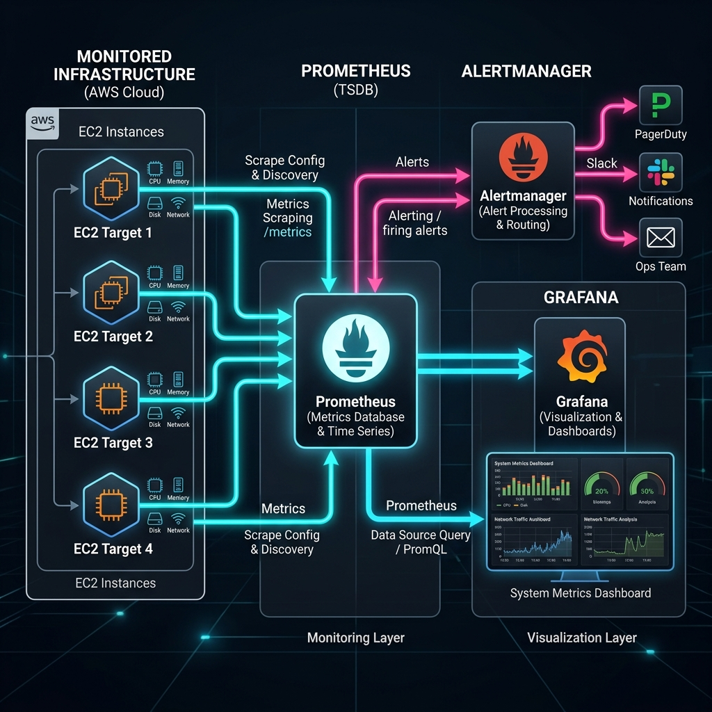
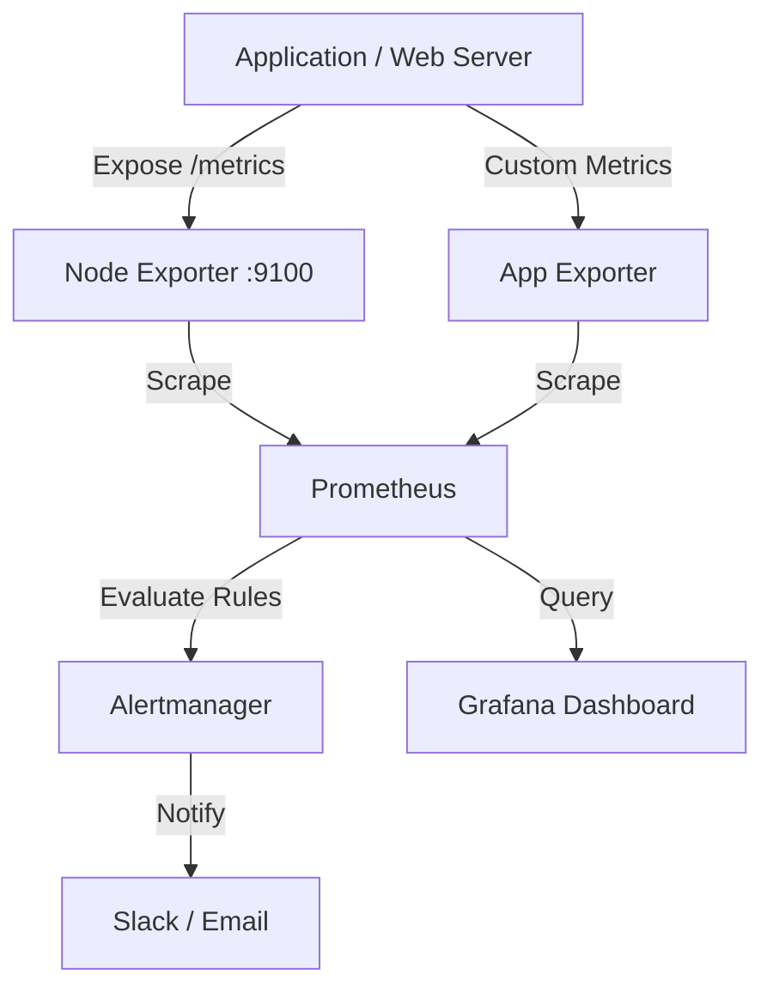

# Project 05: Monitoring Stack Workbook

> 🧠 **ภาพจำก่อนอ่าน:** 🧪 Lab → 📊 Metrics → 🧾 Logs → 🔎 Diagnose → ✅ Verify → 🧹 Cleanup  
> 🎨 [Visual Guide ของวิชานี้](../../VISUAL-MEMORY-GUIDE-TH.md) — ภาพช่วยจำ ไม่แทนคำอธิบายและคำสั่งจริง

## 1. Scenario (สถานการณ์จำลอง)

วันศุกร์ เวลา 5 ทุ่มตรง ขณะที่คุณกำลังจะเลิกงานและเตรียมตัวเริ่มวันหยุดสุดสัปดาห์ โทรศัพท์จาก CEO ก็ดังขึ้น
- "เฮ้ เว็บไซต์ e-commerce หลักของเราล่มมา 4 ชั่วโมงแล้ว ลูกพี่ลูกน้องของผมเพิ่งส่งข้อความมาบอก ทำไมไม่มีใครรู้เรื่องเลย? พวก Developer ก็บอกว่าใน Terminal ของพวกเขาเป็นสีเขียวปกติดีตอนที่เช็คครั้งล่าสุด เรื่องนี้ยอมรับไม่ได้นะ เราต้องรู้ตัวก่อนที่ลูกค้าของเราจะบ่นเข้ามา"

หลังจากนั้นอีกหนึ่งนาที CTO ก็ Slack หาคุณ:
- "เราต้องการระบบ Monitoring ของจริง ไม่มีการเดาสุ่มกันอีกแล้ว เราต้องส่ง Metrics, Dashboards และสร้าง Alerts ไปที่ Slack และ PagerDuty ผมเปิด VPS ราคา $20 ต่อเดือนไว้ให้คุณตัวหนึ่ง ใช้มันให้คุ้มค่าล่ะ ผมอยากเห็น Dashboard ภายในเช้าวันจันทร์นี้"

### งานของคุณ
1. ติดตั้ง Monitoring Stack บน VPS ที่จัดเตรียมไว้ให้โดยใช้ Docker Compose
2. ตั้งค่าการเก็บข้อมูล Metrics สำหรับ:
   - ตัวเครื่อง VPS เอง
   - Development Server อีกสองเครื่อง (ผ่าน Node Exporter)
   - ทุก Container ที่รันอยู่บนเซิร์ฟเวอร์เหล่านั้น (ผ่าน cAdvisor)
   - เว็บไซต์สาธารณะสามเว็บ (ผ่าน Blackbox Exporter)
3. แสดงผลข้อมูลทั้งหมดบน Grafana Dashboard
4. ตั้งค่า Alerting Rules เพื่อแจ้งเตือนทีมก่อนที่ระบบจะพัง (เช่น การใช้งาน Disk สูงถึง 80%)

### ข้อจำกัด
- งบประมาณ (Budget): สูงสุด $20 ต่อเดือนสำหรับ Monitoring VPS
- เครื่องมือ (Tools): Prometheus, Grafana, Alertmanager, Docker
- ระยะเวลา (Timeline): พร้อมสำหรับการเดโมวันจันทร์ เวลา 9.00 น.

### Definition of Done (คำนิยามว่าเสร็จงาน)
- Prometheus สามารถดึงข้อมูล (Scrape) จาก Targets ทั้งหมดได้สำเร็จ
- Grafana แสดงผลข้อมูล Live metrics ของ CPU, RAM และ Disk
- มีการเก็บประวัติและติดตามข้อมูล Website Uptime
- มีการส่งข้อความทดสอบ Alert และได้รับใน Slack เรียบร้อย

---

## 2. Topology Diagram (แผนผังระบบ)



### แผนผังการทำงานของระบบ (Mermaid Diagram)


### การวิเคราะห์ส่วนประกอบ (Component Analysis)

| Component | บทบาท | Port |
|:---|:---|:---:|
| Prometheus | Time-series database สำหรับจัดเก็บข้อมูล, Scrape target ต่างๆ และประเมิน Alert rules | 9090 |
| Node Exporter | Export metrics ระดับ OS (เช่น CPU, RAM, Disk, Network) | 9100 |
| Grafana | แสดงผล Metrics ออกมาในรูปแบบ Dashboard | 3000 |
| Alertmanager | รับ Alert จาก Prometheus และส่งต่อไปยังช่องทางแจ้งเตือนต่างๆ | 9093 |

### ขั้นตอนการทำงานของข้อมูล (Data Flow)
1. Node Exporter รันบน Host และเปิด Endpoint `/metrics`
2. Prometheus ดึงข้อมูล (Scrape) ทุก 15 วินาที
3. Prometheus ประเมิน Alert Rules และส่งแจ้งเตือนไปที่ Alertmanager เมื่อเข้าเงื่อนไขของ Rule
4. Grafana ดึงข้อมูลจาก Prometheus ผ่าน PromQL และนำเสนอในหน้า Dashboard

---

## 3. Prerequisites & Estimated Time (สิ่งที่ต้องเตรียมและเวลาที่ใช้)

### สิ่งที่ต้องเตรียม (Prerequisites)
- VPS (Ubuntu 22.04) หรือเครื่อง Local ที่ติดตั้ง Docker และ Docker Compose เรียบร้อยแล้ว
- การเปิด Port 9090 (Prometheus), 3000 (Grafana) และ 9093 (Alertmanager) ใน Firewall หรือ Security Group
- Slack Webhook URL สำหรับรับการแจ้งเตือน (หากต้องการทดสอบ Alerting)
- ทักษะพื้นฐาน: Prometheus, Grafana, Alertmanager, Docker Compose, Nginx Reverse Proxy, Prometheus Exporters

### เวลาที่ใช้และค่าใช้จ่าย (Estimated Time & Cost)
- ระยะเวลาที่ใช้: 20 ชั่วโมง
- ประมาณการค่าใช้จ่ายรายเดือน:
  - รันบนเครื่อง Local ด้วย Docker: $0
  - รันบน VPS (เช่น EC2 t3.small หรือ VPS ทั่วไป): ประมาณ $10 - $20 ต่อเดือน

---

## 4. Tasks (ขั้นตอนการปฏิบัติ)

### Task 1: การโคลนโปรเจกต์และการเตรียมความพร้อมบน VPS (Repository Setup)
1. เชื่อมต่อเข้ากับ VPS (Ubuntu 22.04) ด้วย SSH
2. ติดตั้ง Docker และ Docker Compose ลงบนเครื่อง
3. ทำการ Clone repository นี้และเข้าไปที่ไดเรกทอรีโปรเจกต์:
   ```bash
   cd project-05-monitoring/src/
   ```

### Task 2: การสร้างไฟล์ Configuration สำหรับ Prometheus (Prometheus Configuration Setup)
1. สร้างหรือแก้ไขไฟล์ `src/prometheus/prometheus.yml` เพื่อกำหนดการ Scraping Metrics ของเป้าหมายต่างๆ
2. ใช้โครงสร้าง configuration ดังนี้:
   ```yaml
   global:
     scrape_interval: 15s
     evaluation_interval: 15s

   scrape_configs:
     - job_name: 'prometheus'
       static_configs:
         - targets: ['localhost:9090']

     - job_name: 'node-exporter'
       static_configs:
         - targets: ['node-exporter:9100']
   ```
   *หมายเหตุ: ในระดับโปรดักชัน คุณสามารถเพิ่ม target ของเซิร์ฟเวอร์อื่นๆ และ Exporter ตัวอื่น เช่น cAdvisor และ Blackbox Exporter เข้าไปได้*

### Task 3: การตั้งค่าระบบ Monitoring ด้วย Docker Compose (Services Stack Setup)
1. ใช้ไฟล์ `src/docker-compose.yml` ในการกำหนดบริการทั้งหมด ได้แก่ Prometheus, Grafana และ Node Exporter
2. ตรวจสอบเนื้อหาในไฟล์ให้ตรงตามมาตรฐานดังนี้:
   ```yaml
   version: '3.8'

   services:
     prometheus:
       image: prom/prometheus:v2.49.1
       container_name: prometheus
       volumes:
         - ./prometheus/prometheus.yml:/etc/prometheus/prometheus.yml
         - prometheus_data:/prometheus
       command:
         - '--config.file=/etc/prometheus/prometheus.yml'
         - '--storage.tsdb.path=/prometheus'
       ports:
         - "9090:9090"
       networks:
         - monitoring

     grafana:
       image: grafana/grafana:10.3.3
       container_name: grafana
       ports:
         - "3000:3000"
       environment:
         - GF_SECURITY_ADMIN_PASSWORD=admin
       volumes:
         - grafana_data:/var/lib/grafana
       networks:
         - monitoring

     node-exporter:
       image: prom/node-exporter:v1.7.0
       container_name: node-exporter
       volumes:
         - /proc:/host/proc:ro
         - /sys:/host/sys:ro
         - /:/rootfs:ro
       command:
         - '--path.procfs=/host/proc'
         - '--path.sysfs=/host/sys'
         - '--collector.filesystem.ignored-mount-points=^/(sys|proc|dev|host|etc)($$|/)'
       ports:
         - "9100:9100"
       networks:
         - monitoring

   networks:
     monitoring:
       driver: bridge

   volumes:
     prometheus_data:
     grafana_data:
   ```
3. สั่งรันเซอร์วิสทั้งหมดขึ้นมาในแบบ Background:
   ```bash
   docker-compose up -d
   ```

### Task 4: การรันผ่าน Nginx Reverse Proxy และ Domain Name
1. อัปเดตไฟล์ `nginx/nginx.conf` ด้วย Domain Name ของคุณ (กรณี Deploy บน VPS จริง)
2. รันสคริปต์ Setup (หากมีเตรียมไว้ในโปรเจกต์):
   ```bash
   bash scripts/setup.sh
   ```
3. เข้าใช้งาน Grafana ได้ที่ `https://grafana.yourdomain.com` (หรือใช้ `http://<vps-ip>:3000` โดยตรง)

### Task 5: การดึงข้อมูลและสร้างแดชบอร์ดใน Grafana (Grafana Dashboard Setup)
1. เปิดเบราว์เซอร์แล้วเข้าใช้งาน Grafana ที่พอร์ต 3000 ล็อกอินด้วย `admin/admin`
2. ไปที่การตั้งค่า Data Source แล้วชี้ไปยัง Prometheus URL: `http://prometheus:9090` จากนั้นกด Save & Test
3. ทำการสร้าง Panel โดยเขียนคำสั่ง PromQL ตัวอย่าง:
   - CPU Usage: `100 - (avg by (instance) (irate(node_cpu_seconds_total{mode="idle"}[5m])) * 100)`
   - Memory Usage: `node_memory_MemTotal_bytes - node_memory_MemAvailable_bytes`
4. นอกจากนี้ยังสามารถดาวน์โหลดแดชบอร์ดสำเร็จรูป Node Exporter Full โดยระบุ ID `1860` ได้ทันที

### Task 6: การทดลองปั่นระบบเพื่อให้พังและการล้างระบบ (Chaos Testing & Cleanup)
1. ทดลองปิดเซอร์วิส Node Exporter เพื่อดูว่าสถานะเป้าหมายกลายเป็น DOWN หรือไม่:
   ```bash
   docker-compose stop node-exporter
   ```
2. ทดลองปั่น CPU ให้เต็มร้อยเปอร์เซ็นต์ด้วย stress เพื่อดูการทำงานของ Alerting:
   - ตรวจสอบว่าระบบแจ้งเตือนส่งข้อมูลไปยัง Slack หรือช่องทางที่ผูกไว้หรือไม่
3. สั่งทำความสะอาดระบบเพื่อประหยัดทรัพยากรหลังจากทดสอบเสร็จสิ้น:
   ```bash
   docker-compose down
   ```

---

## 5. Verification (การตรวจสอบผลการทำงาน)

- [ ] ตรวจสอบสถานะการทำงานของ Container ทั้งหมดว่าขึ้นเป็น running ผ่านคำสั่ง `docker-compose ps`
- [ ] หน้าเว็บ Prometheus UI ที่ `http://localhost:9090` หรือ IP ของคุณสามารถเปิดใช้งานได้สำเร็จ
- [ ] แท็บ `Status > Targets` ใน Prometheus UI แสดงเป้าหมาย `node-exporter` เป็นสีเขียว (UP)
- [ ] หน้าเว็บ Grafana ที่ `http://localhost:3000` สามารถล็อกอินและเพิ่ม Prometheus Data Source ได้โดยมีผลตรวจเป็นสีเขียว
- [ ] Dashboard ID `1860` ได้รับการนำเข้า (Import) และมีข้อมูล CPU, Memory, Disk และ Network แสดงผลเป็นกราฟ
- [ ] มีการส่งข้อความทดสอบ Alert ไปยังระบบปลายทาง (เช่น Slack) และได้รับแจ้งเตือนจริง
- [ ] ข้อมูลประวัติไม่สูญหายหลังจากสั่ง Restart บริการเนื่องจากมี Volumes จัดเตรียมไว้เรียบร้อยแล้ว

### ข้อแนะนำและแนวทางปฏิบัติจริง (Real-world Insights & Best Practices)
- **หลีกเลี่ยง Alert Fatigue**: อย่าตั้งการแจ้งเตือนพร่ำเพรื่อ ให้เตือนเฉพาะกรณีที่ทีมต้องลงมือแก้ไขทันที (Actionable Alerts) เท่านั้น
- **ปรับเปลี่ยน Scraping Interval**: สำหรับการใช้งานจริง การดึงข้อมูลทุกๆ 15-30 วินาทีก็เพียงพอแล้ว การดึงข้อมูลถี่เกินไป เช่น ทุก 1 วินาที จะสร้างภาระหนักให้กับ Disk I/O และเครื่องเซิร์ฟเวอร์
- **การขยายระบบประสิทธิภาพสูง (Scaling Approach)**: ในระบบขนาดใหญ่ ให้ใช้เทคนิค Prometheus Federation หรือขยับไปใช้ Thanos/VictoriaMetrics เพื่อความยืดหยุ่นและรองรับความต้องการระดับ Enterprise
- **คอขวดที่พบบ่อย (Bottlenecks)**: คอขวดของระบบมักเกิดขึ้นที่ Disk I/O และ RAM เมื่อเก็บข้อมูลย้อนหลัง (Retention) นานเกินไป หรือมี metrics จำนวนมาก

---

## 6. Troubleshooting (การแก้ไขปัญหาที่พบบ่อย)

### ปัญหาที่ 1: Prometheus Target แสดงสีแดง (State: DOWN)
- **อาการ**: หน้าจอ `Status > Targets` ในหน้า Prometheus UI แสดงสถานะเป้าหมายเป็น DOWN
- **สาเหตุ**:
  - Firewall หรือ Security Group บล็อก Port 9100 ของ Node Exporter
  - Node Exporter Container ไม่ทำงานหรือหยุดกะทันหัน
  - ตั้งชื่อ Hostname ในไฟล์ config ไม่ตรงกับที่รันบน Docker
- **วิธีแก้ไข**:
  ```bash
  # ตรวจสอบการตอบสนองของ Exporter
  curl http://node-exporter:9100/metrics | head -20

  # ตรวจสอบสถานะของบริการ
  docker-compose ps

  # ดู log การทำงานของ Prometheus
  docker-compose logs prometheus
  ```

### ปัญหาที่ 2: Grafana แสดง No Data ทุกแผงกราฟ (Panel)
- **อาการ**: แดชบอร์ดแสดงผลขึ้นมาได้ปกติ แต่ทุก Panel ไม่มีข้อมูลแสดงผลออกมา
- **สาเหตุ**:
  - ยังไม่ได้แอด Data Source ของ Prometheus หรือเขียน URL ไม่ถูกต้อง
  - เลือกขอบเขตช่วงเวลาใน Grafana ไม่ตรงกับปัจจุบันหรือช่วงที่มีข้อมูลจริง
  - ระบบเวลาภายในเซิร์ฟเวอร์เพี้ยนไม่ตรงกัน
- **วิธีแก้ไข**:
  1. ไปที่เมนู Configuration > Data Sources > Add data source > Prometheus
  2. กำหนด URL ไปที่ `http://prometheus:9090`
  3. คลิก Save & Test หากยังไม่สำเร็จให้ตรวจสอบเวลาบน Host Machine และปรับด้วย `chrony` หรือ `ntp`

### ปัญหาที่ 3: Alert ไม่ยอมส่งเข้าไปใน Slack
- **อาการ**: ใน Prometheus UI เห็นว่า Alert เป็นสถานะ Firing แต่ไม่มีเสียงหรือข้อความแจ้งเตือนมายัง Slack
- **สาเหตุ**:
  - กำหนดค่า Webhook URL ในไฟล์ตั้งค่า Alertmanager ผิดพลาด
  - Alert Rule นั้นๆ โดนสั่งปิดชั่วคราว (Silence) ใน Alertmanager UI
- **วิธีแก้ไข**:
  ```bash
  # ทดสอบยิง Webhook ตรงๆ เพื่อเช็คความถูกต้องของลิงก์ปลายทาง
  curl -X POST https://hooks.slack.com/services/YOUR/WEBHOOK/URL \
    -H 'Content-type: application/json' \
    --data '{"text":"Test from terminal"}'
  ```
  - เข้าตรวจสอบหน้า Alertmanager UI ที่ `http://localhost:9093/#/silences` ว่ามีสถานะโดนบล็อกการทำงานอยู่หรือไม่

---

## 7. Exercises & Solutions (แบบฝึกหัดและแนวทางการแก้ไข)

### แบบฝึกหัดที่ 1: ค้นหาคอขวดด้วย PromQL (PromQL Challenge)
- **โจทย์**: เซิร์ฟเวอร์ในระบบ Production มีอาการตอบสนองช้าลงอย่างมากในช่วง 10 นาทีที่ผ่านมา คุณได้รับมอบหมายให้ตรวจสอบเพื่อหาต้นตอ
- **สิ่งที่ต้องทำ**:
  1. เขียน PromQL Query เพื่อตรวจสอบ CPU Usage แยกราย Core (Per-Core) ในช่วง 5 นาทีที่ผ่านมา
  2. เขียน Query เพื่อตรวจสอบอัตราการใช้งาน Memory เป็นเปอร์เซ็นต์
  3. วิเคราะห์กราฟเพื่อระบุว่าทรัพยากรตัวใดที่มีพฤติกรรมใช้งานเพิ่มขึ้นต่อเนื่องอย่างน่าสงสัย
- **แนวทางแก้ไข (Solution)**:
  ```promql
  # CPU Usage (Per-Core)
  100 - (avg by (cpu) (irate(node_cpu_seconds_total{mode="idle"}[5m])) * 100)

  # Memory Used (%)
  (1 - (node_memory_MemAvailable_bytes / node_memory_MemTotal_bytes)) * 100
  ```
  - **การวิเคราะห์**: หากค่าเปอร์เซ็นต์การใช้งาน Memory พุ่งสูงขึ้นเรื่อยๆ โดยไม่มีทีท่าว่าจะลดลงเลย มีความเป็นไปได้สูงที่จะเกิดปัญหา Memory Leak บนแอปพลิเคชัน

### แบบฝึกหัดที่ 2: การออกแบบแจ้งเตือน (Alert Rule Engineering)
- **โจทย์**: ทีม DevOps ต้องการให้ระบบทำการแจ้งเตือนแบบอัตโนมัติทันทีที่เซิร์ฟเวอร์เริ่มมีปัญหาเรื่องของพื้นที่จัดเก็บข้อมูลใกล้เต็ม
- **สิ่งที่ต้องทำ**:
  1. เขียน Alert Rule เพื่อเตือนเมื่ออัตราการใช้งาน Disk สูงเกิน 80%
  2. กำหนดเงื่อนไขเวลา `for: 5m` เพื่อป้องกันการแจ้งเตือนผิดพลาด (False Positive)
  3. เพิ่ม Labels และ Annotations เข้าไปใน Alert เพื่อบอกวิธีแก้ไขเบื้องต้นให้ทีมงานทราบ
- **แนวทางแก้ไข (Solution)**:
  ```yaml
  # prometheus/rules/disk_alert.yml
  groups:
    - name: disk_alerts
      rules:
        - alert: DiskSpaceCritical
          expr: (node_filesystem_avail_bytes{mountpoint="/"} / node_filesystem_size_bytes{mountpoint="/"}) * 100 < 20
          for: 5m
          labels:
            severity: critical
          annotations:
            summary: "Disk space critical on {{ $labels.instance }}"
            description: "Disk usage > 80%. Current: {{ $value | printf \"%.1f\" }}% free. Run 'df -h' to identify large files."
  ```

### แบบฝึกหัดที่ 3: การออกแบบแดชบอร์ด (Dashboard Design)
- **โจทย์**: CTO ต้องการ Dashboard หน้าหลักตัวเดียวที่สามารถกวาดสายตาดูเพื่อประเมินสถานะโดยรวมของระบบได้ในเวลาไม่เกิน 10 วินาที
- **สิ่งที่ต้องทำ**:
  1. ออกแบบโครงสร้าง Dashboard ที่รวมแผงควบคุมสำคัญ เช่น CPU, Memory, Disk และ Network
  2. กำหนดค่าระดับการเตือน (Threshold) ของแต่ละ Panel โดยระบุสีเหลือง (>70%) และสีแดง (>90%)
  3. Export แดชบอร์ดเป็นรูปแบบไฟล์ JSON และบันทึกเข้า Git เพื่อให้คนในทีมสามารถนำไปใช้ได้เหมือนกัน
- **แนวทางแก้ไข (Solution)**:
  - ใช้ **Stat panels** แสดงตัวเลขสรุปเดี่ยว (เช่น CPU Usage เปอร์เซ็นต์) เพื่อให้สะดุดตาและรับรู้ปัญหาได้ทันที
  - ใช้ **Time Series** แสดงกราฟเพื่อดูแนวโน้มหรือทิศทางความเปลี่ยนแปลงของข้อมูลในช่วงเวลาที่ผ่านมา (Trend Analysis)
  - ใช้ **Table panels** เปรียบเทียบข้อมูลที่มาจากหลายเซิร์ฟเวอร์หรือโฮสต์ในหน้าจอเดียว
  - ปรับปรุงประสิทธิภาพในระดับ Production โดยการตั้งค่าหน้าจอให้ `Refresh: 30s` เพื่อไม่ให้สร้างภาระโหลดให้ Grafana มากเกินไป
  - การเก็บรักษาไฟล์ Dashboard JSON ควรเก็บไว้ในระบบ Git (ตามหลักการ Infrastructure as Code) เพื่อให้ง่ายต่อการ Deploy ซ้ำ
