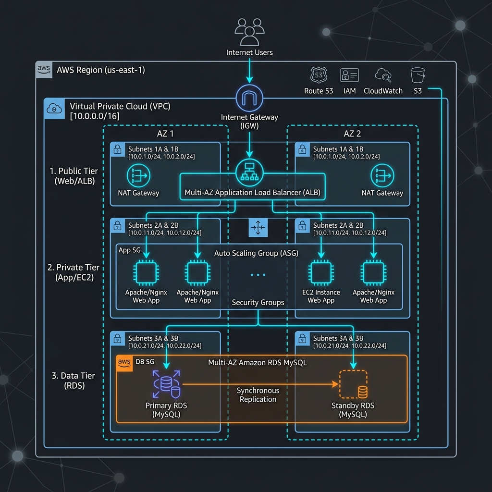
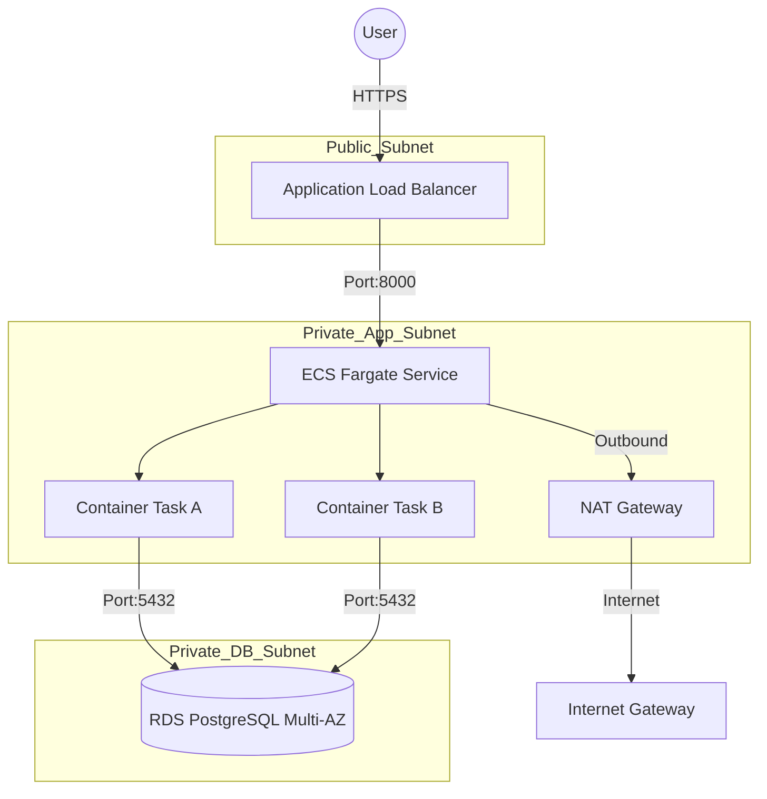

# Production-Ready 3-Tier Architecture (ECS Fargate) Workbook

## 1. Scenario (สถานการณ์จำลอง)

### บริบทธุรกิจ
คุณเป็น Cloud Engineer ของบริษัท E-Commerce ที่กำลังจะจัดแคมเปญใหญ่ "11.11 Flash Sale" ระบบปัจจุบันเป็นเซิร์ฟเวอร์ตัวเดียว (Monolith) ที่เสี่ยงต่อการล่มหากมีคนเข้าหลักแสนคนพร้อมกัน

### ปัญหาที่พบ (Pain Points)
- Downtime Risk: ถ้าเครื่องล่มตอนช่วงเที่ยงคืน บริษัทจะเสียรายได้มหาศาล
- Security Concern: ฐานข้อมูลเก็บข้อมูลบัตรเครดิตลูกค้า ต้องไม่ถูกเข้าถึงได้จากอินเทอร์เน็ต
- Operational Overhead: ทีมงานต้องมานั่งเปิดเครื่องเพิ่มเองแบบ Manual เมื่อโหลดสูง ซึ่งไม่ทันการณ์

### โซลูชัน: Enterprise 3-Tier Migration
ย้ายระบบมาสู่โครงสร้างที่เราออกแบบใน Lab นี้:
- Scalability: ใช้ ECS Fargate ให้ระบบขยายตัวเองโดยอัตโนมัติตามจำนวนลูกค้า
- High Availability: มั่นใจได้ว่าแม้ระบบของ AWS ในโซนนั้นมีปัญหา ระบบเราจะยังคงขายของได้ต่อเนื่อง
- Data Integrity: RDS Multi-AZ ช่วยรักษาข้อมูลคำสั่งซื้อให้ปลอดภัยและพร้อมใช้เสมอ

### ความคาดหวังจากผู้บริหาร
"เราต้องการระบบที่สามารถรับมือกับ Traffic ที่พุ่งสูงขึ้น 10 เท่าภายใน 1 นาทีได้ และต้องไม่มีจุดไหนที่เป็น Single Point of Failure"

### ข้อจำกัด (Constraints)
- ฐานข้อมูลเก็บข้อมูลบัตรเครดิตของลูกค้า ต้องจัดเก็บในระบบที่ปลอดภัยที่สุด ไม่สามารถเข้าถึงได้จากอินเทอร์เน็ตโดยตรง
- ระบบต้องรองรับ Traffic ที่พุ่งสูงขึ้นอย่างรวดเร็ว (10 เท่าภายใน 1 นาที) ในช่วง Flash Sale
- ต้องป้องกันการเกิด Single Point of Failure (SPOF) ในทุกจุดของระบบ

### เกณฑ์การส่งมอบงาน (Definition of Done)
- โครงสร้าง Network แยก Subnet 3 ชั้น (Public, Private App, Private DB) กระจายใน 2 Availability Zones เป็นอย่างน้อย
- การเชื่อมต่อและสิทธิ์การเข้าถึงเป็นไปตามหลัก Least Privilege ผ่าน Security Group Chaining
- ระบบขยายตัวอัตโนมัติด้วย Auto Scaling (Target Tracking ที่ 70% CPU)
- ทดสอบ Terminate เครื่อง/Container แล้วระบบสร้างทดแทนได้ทันที
- สามารถเรียกใช้งานหน้าเว็บผ่าน DNS ของ ALB ได้สมบูรณ์

---

## 2. Topology Diagram (แผนผังระบบ)





### เจาะลึก Architecture: 3-Tier Enterprise Design

- Network Layer (รากฐานความปลอดภัย):
  - เราใช้การแยก Subnet แบบ 3 ชั้น (Public, Private App, Private DB) เพื่อความปลอดภัยสูงสุด
  - Public Subnet: วางแค่ ALB และ NAT Gateway เพื่อเป็นด่านหน้าคอยรับ Request
  - Private App Subnet: วาง ECS Fargate Tasks (ไม่มี Public IP) เพื่อป้องกันการเจาะระบบจากภายนอกโดยตรง
  - Private DB Subnet: วาง RDS ฐานข้อมูลที่ลึกที่สุด เข้าถึงได้เฉพาะจาก App Tier เท่านั้น

- High Availability (การทนทานต่อความล้มเหลว):
  - Multi-AZ Strategy: ทุกทรัพยากรถูกกระจายใน 2 Availability Zones เป็นอย่างน้อย
  - ALB Health Checks: ตั้งค่าให้เช็คสถานะแอปทุก 30 วินาที หากเครื่องไหนล่ม ALB จะตัด Traffic ออกทันทีเพื่อไม่ให้ผู้ใช้เจอ Error
  - Connection Draining (Deregistration Delay): เมื่อมีการถอดเครื่องออกจากกลุ่ม (Deregister) หรือเครื่องกลายเป็น Unhealthy, ALB จะไม่ตัดการเชื่อมต่อทันที แต่จะรอให้ Request ที่ค้างอยู่ทำงานจนจบ (ปกติ 300 วินาที) เพื่อให้ผู้ใช้ได้รับประสบการณ์ที่ราบรื่นที่สุด
  - RDS Multi-AZ: มีการทำ Synchronous Replication ไปยังอีก AZ หนึ่ง หาก Master ล่ม AWS จะสลับ DNS ไปหา Standby ให้อัตโนมัติภายใน 60-120 วินาที
  - Expert Tip: ในมุม Developer ต้องมีการเขียน Retry Logic ในแอปเพื่อรอให้การทำ DNS Propagation เสร็จสมบูรณ์ในช่วงที่มีการเปลี่ยน IP ของ Master Node

- Scalability (การขยายตัว):
  - ECS Service Auto Scaling: เราใช้ Target Tracking Scaling Policy อิงจาก Average CPU Utilization ที่ 70%
  - ทำไมต้อง 70%?: เพื่อให้มี Buffer เพียงพอสำหรับการเพิ่ม Task ใหม่ก่อนที่ระบบจะวิกฤต

- Security (ความปลอดภัย):
  - Chain of Trust (Security Groups):
    - `ALB-SG`: รับ Port 80/443 จาก `0.0.0.0/0`
    - `APP-SG`: รับ Port 8000 จาก `ALB-SG` เท่านั้น
    - `DB-SG`: รับ Port 5432 จาก `APP-SG` เท่านั้น
  - Secrets Management: (แนะนำ) ควรใช้ AWS Secrets Manager แทนการใส่ Password ตรงๆ ใน Terraform เพื่อความปลอดภัยระดับสูงสุด

- Performance Insights (การวิเคราะห์ประสิทธิภาพ):
  - ALB Metrics: ติดตาม 4xx/5xx Errors และ Request Latency ผ่าน CloudWatch
  - RDS Performance Insights: ช่วยวิเคราะห์ SQL query ที่ช้า (Slow Query) เพื่อปรับปรุง Database Index

---

## 3. Prerequisites & Estimated Time (สิ่งที่ต้องเตรียมและเวลาที่ใช้)

### สิ่งที่ต้องเตรียม
- บัญชี AWS (AWS Account) พร้อมสิทธิ์ระดับ Administrator
- ติดตั้ง AWS CLI และตั้งค่า Credentials ให้เรียบร้อย
- ติดตั้ง Terraform CLI เวอร์ชันปัจจุบัน (>= 1.7.0)
- ติดตั้ง Git Client สำหรับดาวน์โหลดโค้ด

### เวลาที่ใช้โดยประมาณ
- 1.5 - 2 ชั่วโมง

---

## 4. Tasks (ขั้นตอนการปฏิบัติ)

### Task 1: การเตรียมโครงข่าย (VPC & Subnets Setup)
- เราจะแบ่งโครงสร้าง Network ออกเป็น 3 ชั้น เพื่อแยกบทบาทและรักษาความปลอดภัย
- ตั้งค่า VPC และ Subnets:
  - สร้าง VPC โดยระบุ CIDR Block เป็น `10.0.0.0/16`
  - สร้าง Public Subnet (2 Availability Zones) เพื่อใช้สำหรับ ALB และ NAT Gateway
  - สร้าง Private App Subnet (2 Availability Zones) เพื่อวาง ECS Fargate Tasks (ไม่มี Public IP)
  - สร้าง Private DB Subnet (2 Availability Zones) สำหรับวาง RDS Database
- การตั้งค่า Route Tables:
  - Public Route Table: ผูกเข้ากับ Internet Gateway (IGW) เพื่อรับส่งข้อมูลกับอินเทอร์เน็ตโดยตรง
  - Private Route Table: ผูกเข้ากับ NAT Gateway เพื่อให้ ECS Tasks ใน Private Subnet สามารถดึง Image หรือแพ็กเกจจากอินเทอร์เน็ตได้ โดยที่ภายนอกไม่สามารถเชื่อมต่อเข้ามาตรงๆ

### Task 2: การตั้งค่าความปลอดภัย (Security Group Chaining)
- ใช้หลักการ "Chain of Trust" เพื่อความปลอดภัยระดับสูงสุด
- ตั้งค่า Security Group แต่ละส่วน:
  - `ALB-SG`: เปิด Inbound Port 80 (HTTP) ให้ทุกคน (`0.0.0.0/0`)
  - `App-SG`: ห้ามเปิดให้สาธารณะเด็ดขาด แต่ตั้งค่าให้รับ Inbound Port 8000 เฉพาะ Source ที่มาจาก `ALB-SG` เท่านั้น
  - `DB-SG`: ตั้งค่าให้รับ Inbound Port 5432 (PostgreSQL) เฉพาะ Source ที่มาจาก `App-SG` เท่านั้น

### Task 3: การสร้างระบบฐานข้อมูล (RDS Multi-AZ Setup)
- เตรียมระบบฐานข้อมูลที่ทนต่อความล้มเหลว (Fault Tolerance)
- ตั้งค่า RDS Instance:
  - สร้าง RDS Subnet Group โดยผูกเข้ากับ Private DB Subnet ของทั้ง 2 Availability Zones
  - สร้าง RDS Instance โดยเลือกใช้ PostgreSQL (Engine Version 15.4) และ Instance Class `db.t3.micro`
  - เปิดใช้งาน Multi-AZ เพื่อทำ Synchronous Replication ไปยัง Standby Instance ในอีก AZ
  - จัดการรหัสผ่านผ่าน Variables ใน Terraform และหลีกเลี่ยงการ Hardcode ในโค้ด

### Task 4: การตั้งค่าส่วนประมวลผล (ECS Fargate & Application Load Balancer Setup)
- เตรียมระบบ Compute ที่ขยายตัวได้ยืดหยุ่นและมี Load Balancer คอยแจกจ่ายงาน
- ตั้งค่า ECS Fargate และ ALB:
  - สร้าง ECS Cluster ในชื่อ `thaidemo-cluster`
  - สร้าง ALB และ Target Group ใน Public Subnet เพื่อคอยเช็คสถานะแอปผ่าน Path `/health` ทุก 30 วินาที
  - สร้าง ECS Task Definition กำหนดเป็น Serverless Launch Type (Fargate) โดยใช้ Nginx เป็น Placeholder บน Port 8000
  - สร้าง ECS Service กำหนดจำนวน Task เริ่มต้น (Desired Count) เป็น 2 Tasks วาง in Private App Subnet และผูกเข้ากับ Target Group ของ ALB
  - ตั้งค่า Target Tracking Scaling Policy อิงตาม Average CPU Utilization ที่ 70% เพื่อการ Auto Scaling

### Task 5: การรัน Terraform เพื่อสร้างระบบ (Deploy Infrastructure)
- ทำการ Deploy ทรัพยากรทั้งหมดขึ้นไปที่ AWS
- ขั้นตอนการรันคำสั่ง:
  1. เปิด Terminal เข้าไปที่โฟลเดอร์ `project-06-3tier-architecture/src/terraform`
  2. ตั้งค่ารหัสผ่าน Database ด้วยการส่งผ่าน environment variable:
     ```bash
     export TF_VAR_db_password="YourSecurePassword123!"
     ```
  3. รันคำสั่ง Terraform ตามลำดับ:
     ```bash
     terraform init
     terraform plan
     terraform apply -auto-approve
     ```
  4. สังเกต Output ของ DNS name ที่ได้จากระบบหลังสั่ง Apply สำเร็จ

---

## 5. Verification (การตรวจสอบผลการทำงาน)

- [ ] VPC ถูกแบ่งออกเป็น 3 Subnets (Public, Private App, Private DB) ข้ามอย่างน้อย 2 Availability Zones (Multi-AZ)
- [ ] Security Group ได้รับการตั้งค่าตามหลัก Chain of Trust (ALB-SG, App-SG, DB-SG)
- [ ] Application Load Balancer (ALB) มีสถานะ Health Check เป็น Passing
- [ ] RDS Instance อยู่ใน Private Subnet และเปิดใช้งาน Multi-AZ Deployment เรียบร้อย
- [ ] เข้าใช้งานแอปพลิเคชันผ่าน URL ของ ALB DNS Name ได้สำเร็จ
- [ ] ทำการทดสอบ Resilience: ลอง Terminate เครื่อง Instance หรือ Task แล้วระบบสร้างตัวใหม่ขึ้นแทนที่โดยอัตโนมัติ (Self-Healing)
- [ ] ระบบยังคงทำงานได้อย่างปกติระหว่างการทำ RDS Failover
- [ ] ตรวจสอบงบประมาณและการล้างทรัพยากร (Clean up) เพื่อหลีกเลี่ยงค่าใช้จ่ายที่ไม่จำเป็น

---

## 6. Troubleshooting (การแก้ไขปัญหาที่พบบ่อย)

- กรณีที่ 1: หน้าเว็บขึ้น 502 Bad Gateway (ผู้ใช้เข้าใช้งานไม่ได้)
  - การวิเคราะห์หาสาเหตุ (RCA):
    - ตรวจสอบ Metrics ของ ALB พบว่า `UnHealthyHostCount` เพิ่มขึ้น
    - สถานะของ Task หรือ Instance ใน Target Group แสดงเป็น `Unhealthy`
    - ดู ECS Service Events พบ `Task failed health checks` หรือ `Task stopped`
    - ดู CloudWatch Logs พบข้อความ `Error: Cannot connect to database at 10.0.x.x`
  - สาเหตุรากเหง้า (Root Cause):
    - Security Group ของ RDS ไม่ได้เปิดพอร์ต 5432 หรือ 3306 ให้กับ Security Group ของ ECS/EC2
    - หรือ รหัสผ่านฐานข้อมูลใน Environment Variable ผิดพลาด
  - แนวทางการแก้ไข:
    - แก้ไข Security Group ของ RDS ให้ยอมรับ Inbound Traffic จาก App-SG
    - ตรวจสอบและอัปเดต Environment Variables ของ DB Connection ให้ถูกต้อง

- กรณีที่ 2: หน้าเว็บขึ้น 504 Gateway Timeout หรือไม่โหลด
  - สาเหตุรากเหง้า (Root Cause):
    - EC2/ECS ไม่สามารถเข้าถึงอินเทอร์เน็ตเพื่อดึงข้อมูลแพ็กเกจหรือติดตั้ง Nginx ได้ เนื่องจากไม่มี NAT Gateway หรือตั้งค่า Route Table ใน Private Subnet ผิด
  - แนวทางการแก้ไข:
    - ตรวจสอบการสร้าง NAT Gateway ใน Public Subnet และผูกเข้ากับ Route Table ของ Private Subnet ให้ถูกต้อง

- กรณีที่ 3: RDS เชื่อมต่อไม่ได้
  - สาเหตุรากเหง้า (Root Cause):
    - ลืมสร้าง RDS Subnet Group หรือตั้งค่า Ingress Rules ของ DB-SG ผิดพลาด
  - แนวทางการแก้ไข:
    - ตรวจสอบ Ingress Rules ของ DB-SG และเช็คว่า RDS อยู่ใน Subnet Group ที่ถูกต้อง

- กรณีที่ 4: การรัน Terraform Apply ล้มเหลวที่ขั้นตอน RDS
  - สาเหตุรากเหง้า (Root Cause):
    - รหัสผ่านที่กำหนดให้ฐานข้อมูลสั้นเกินไป ไม่ตรงตามข้อกำหนดความปลอดภัยของ RDS
  - แนวทางการแก้ไข:
    - กำหนดรหัสผ่านให้มีความยาวอย่างน้อย 8 ตัวอักษร มีตัวอักษรพิมพ์ใหญ่ พิมพ์เล็ก ตัวเลข และอักขระพิเศษ

---

## 7. Exercises & Solutions (แบบฝึกหัดและแนวทางการแก้ไข)

### Exercise 1: การตั้งค่า Health Check Grace Period สำหรับแอปพลิเคชันที่บูตช้า
- โจทย์: ในช่วงแคมเปญ Flash Sale แอปพลิเคชันมีขนาดใหญ่และใช้เวลาบูตนั่งอ่านคอนฟิกต่างๆ นานขึ้น ส่งผลให้ ECS สั่งฆ่า (Terminate) Task ทิ้งก่อนที่มันจะเปิดพอร์ตเสร็จ (เพราะติด Health Check จาก ALB) จะแก้ปัญหานี้อย่างไรใน Terraform?
- แนวทางแก้ไข (Solution):
  - ให้เพิ่มการตั้งค่า `health_check_grace_period_seconds` ในทรัพยากร `aws_ecs_service` เพื่อให้เวลาตัวแอปบูตก่อนที่จะเริ่มทำการตรวจสอบสถานะ
```hcl
resource "aws_ecs_service" "main" {
  name            = "thaidemo-service"
  cluster         = aws_ecs_cluster.main.id
  task_definition = aws_ecs_task_definition.app.arn
  desired_count   = 2
  launch_type     = "FARGATE"

  # เพิ่มฟิลด์นี้เพื่อให้เวลาแอปสตาร์ทก่อนโดนตรวจสุขภาพ
  health_check_grace_period_seconds = 120

  network_configuration {
    security_groups  = [var.app_sg_id]
    subnets          = var.private_subnets
    assign_public_ip = false
  }

  load_balancer {
    target_group_arn = aws_alb_target_group.app.arn
    container_name   = "app"
    container_port   = 8000
  }

  depends_on = [aws_alb_listener.http]
}
```

### Exercise 2: การจำกัดสิทธิ์ของ ECS Task Execution Role ตามหลัก Least Privilege
- โจทย์: ในโค้ดปัจจุบัน ECS Task Execution Role มีการใช้ Managed Policy ที่ชื่อว่า `AmazonECSTaskExecutionRolePolicy` ซึ่งมีสิทธิ์ดึง Image และส่ง Logs แต่ถ้าต้องการทำระบบให้ปลอดภัยที่สุดโดยระบุ Action ที่ต้องการเองโดยตรงใน IAM Policy เพื่อลดความเสี่ยงจากการโจมตีประเภทสิทธิ์ล้น (Privilege Escalation) จะต้องเขียนอย่างไร?
- แนวทางแก้ไข (Solution):
  - สร้าง inline policy หรือ custom IAM policy ที่อนุญาตเฉพาะการทำงานที่จำเป็น ได้แก่ การรับส่ง Auth tokens, การดึง Image ของ Docker จาก ECR และการสร้าง/เขียน Logs ลงใน CloudWatch
```json
{
  "Version": "2012-10-17",
  "Statement": [
    {
      "Effect": "Allow",
      "Action": [
        "ecr:GetAuthorizationToken",
        "ecr:BatchCheckLayerAvailability",
        "ecr:GetDownloadUrlForLayer",
        "ecr:BatchGetImage",
        "logs:CreateLogStream",
        "logs:PutLogEvents"
      ],
      "Resource": "*"
    }
  ]
}
```

---

### Cleanup (การล้างทรัพยากร)
- ลบ ECS Service และ Cluster
- ลบ RDS Instance (Multi-AZ)
- ลบ NAT Gateway และ Elastic IP (สำคัญมาก! คิดเงินรายชั่วโมง)
- ลบ VPC และ Subnets
- คำสั่งลบด้วย Terraform:
  ```bash
  terraform destroy -auto-approve
  ```
