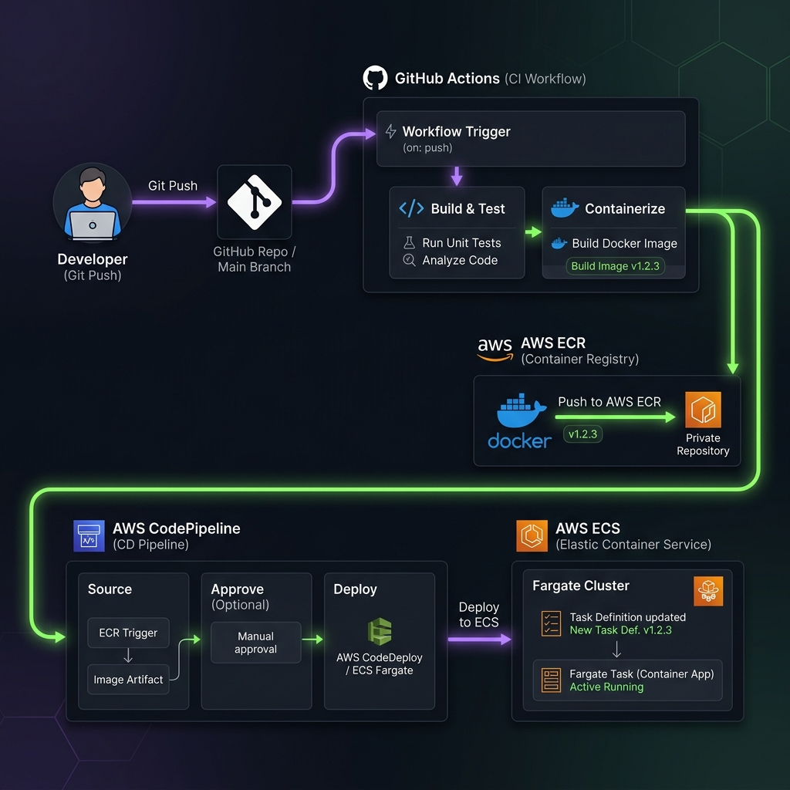
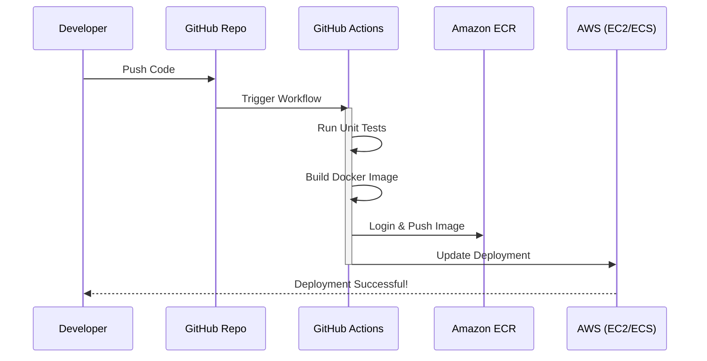

# Project 07: CI/CD Pipeline & Automated Deployment Workbook

> 🧠 **ภาพจำก่อนอ่าน:** 🧪 Lab → 📜 Code → ⚙️ Deploy → 🔎 Drift → ✅ Verify → 🧹 Cleanup  
> 🎨 [Visual Guide ของวิชานี้](../../VISUAL-MEMORY-GUIDE-TH.md) — ภาพช่วยจำ ไม่แทนคำอธิบายและคำสั่งจริง

## 1. Scenario (สถานการณ์จำลอง)

### ลูกค้า (The Client)
"DevFlow Solutions" เป็นบริษัทพัฒนาซอฟต์แวร์ที่มีทีม Developer 5 คน โดยพวกเขาจำเป็นต้องปล่อยอัปเดต (Release) เว็บไซต์ของลูกค้าอย่างน้อยวันละ 2 ครั้ง

### ปัญหาที่พบ (The Problem)
- **Human Error**: ล่าสุด Developer ลืมอัปเดตไฟล์ configuration ก่อน deploy ขึ้นเซิร์ฟเวอร์ ทำให้หน้าเว็บใช้งานไม่ได้ไป 2 ชั่วโมง
- **Slow Process**: การทำ Docker Build และส่งขึ้นเซิร์ฟเวอร์ใช้เวลาเกือบ 30 นาทีต่อครั้ง ทำให้ทีมเสียเวลาในการทำงานอื่น
- **Inconsistent Quality**: บางครั้งมีการปล่อยโค้ดที่มี Bug ออกไปสู่ระบบจริง เนื่องจากลืมรัน Unit Test ก่อนสั่ง Deploy

### โจทย์ (The Request)
ในฐานะ DevOps Engineer คุณต้องสร้าง CI/CD pipeline ที่เป็นระบบอัตโนมัติ 100% เพื่อลดความเสี่ยงและเพิ่มความเร็วในการทำงาน โดยมีเงื่อนไขดังนี้:
- ระบบต้องรัน Unit Test อัตโนมัติทุกครั้งที่มีการ push โค้ดใหม่เข้ามา
- ระบบต้องทำ Docker Build และเก็บ Docker Image ไว้ในที่ปลอดภัย (Private Registry)
- ระบบต้อง Deploy แอปพลิเคชันขึ้นสู่ AWS โดยอัตโนมัติเมื่อขั้นตอนการทดสอบ (Test) ผ่านเรียบร้อย

### รายละเอียดความท้าทาย (Challenge Details)
- **CI Tool**: GitHub Actions หรือ AWS CodePipeline
- **Registry**: Amazon ECR (Elastic Container Registry)
- **Deployment**: Deploy ไปยัง Amazon EC2 หรือ Amazon ECS
- **Automation**: ใช้ IAM Role และ Service Account เพื่อการเข้าถึงระบบที่ปลอดภัย

### ข้อจำกัด (Constraints)
- ต้องใช้ OIDC (OpenID Connect) ในการยืนยันตัวตนกับ AWS แทนการใช้ AWS Access Key แบบถาวรเพื่อความปลอดภัยขั้นสูง
- ห้ามใช้ tag "latest" สำหรับ Production Docker Image ในระบบจริงเด็ดขาด
- ต้องรัน Unit Test เสมอก่อนขั้นตอนการสร้าง Docker Image

### เงื่อนไขความสำเร็จ (Definition of Done)
- GitHub Actions workflow ทำงานโดยอัตโนมัติเมื่อมีการ push โค้ดไปยัง main branch
- ขั้นตอน Unit Test ทำงานผ่านเรียบร้อยก่อนที่จะเริ่มขั้นตอน build เสมอ
- Docker Image ถูกสร้างขึ้นโดยใช้ Tag ที่สอดคล้องกับ Git SHA และเก็บอยู่ใน Amazon ECR ได้อย่างปลอดภัย
- สภาพแวดล้อมปลายทางสามารถดึง Docker Image เวอร์ชันล่าสุดไปอัปเดตแอปพลิเคชันได้สำเร็จโดยไม่มี Downtime ที่ยาวนาน

### การนำไปใช้งานจริง (Real-World Application)
- **Blue-Green Deployment**: ใช้ Pipeline สลับสภาพแวดล้อมหน้าบ้าน เพื่อให้ผู้ใช้ไม่ได้รับผลกระทบระหว่างอัปเดตระบบ (Zero Downtime)
- **Automatic Security Scanning**: ใส่ขั้นตอนการสแกนหาช่องโหว่ความปลอดภัย เช่น Snyk หรือ Trivy ลงใน Pipeline ก่อนอัปเดตเวอร์ชันจริง
- **Multi-Environment Support**: ใช้ Pipeline ชุดเดียวกัน แต่แยกเป้าหมายการ Deploy ไปยัง Dev, Staging หรือ Production ตามเงื่อนไขของ Git Branch
- **Standard Practice**: ถือเป็นข้อปฏิบัติพื้นฐานสำหรับทีมซอฟต์แวร์ เพื่อช่วยให้ปล่อยฟีเจอร์ใหม่ได้วันละหลายครั้ง
- **Reduce Human Error**: การใช้ระบบอัตโนมัติช่วยลดโอกาสเกิดความเสียหายจากความผิดพลาดของบุคคล (Human Error) ระหว่างการ Deploy ด้วยมือ

---

## 2. Topology Diagram (แผนผังระบบ)



### แผนผังการทำงานของระบบ (Workflow Diagram)



```text
[Dev Laptop] -> (Git Push) -> [GitHub Actions Runner]
                                 ↓ (Build & Test)
                         [Amazon ECR (Image Registry)]
                                 ↓ (Trigger)
                         [Production Server (ECS/EC2)]
```

### รายละเอียดส่วนประกอบของระบบ (Component Breakdown)
- **Source Control (GitHub)**: เป็นที่เก็บซอร์สโค้ดและเป็นจุดเริ่มต้นของ Pipeline (Trigger) เมื่อมีการเปลี่ยนแปลงในไฟล์โค้ด
- **CI Engine (GitHub Actions)**: ทำหน้าที่เป็นระบบอัตโนมัติที่ทำงานตามสคริปต์ที่ระบุในไฟล์ YAML ของ workflow
  - **Continuous Integration (CI)**: ทำการตรวจสอบความถูกต้องของโค้ดด้วย Linting และ Testing
  - **Continuous Delivery (CD)**: ทำการสร้างและแพ็กเกจโค้ดเป็น Docker Image
- **Container Registry (Amazon ECR)**: เป็นคลังเก็บ Docker Image แบบส่วนตัว (Private Registry) ที่มีความปลอดภัยสูง และเชื่อมต่อกับบริการอื่นๆ ของ AWS ได้ง่าย
- **Target Environment (EC2/ECS)**: สภาพแวดล้อมปลายทางที่แอปพลิเคชันจะทำงานจริง โดยระบบจะดึง Docker Image เวอร์ชันล่าสุดจาก Amazon ECR มาใช้งาน

### มาตรการความปลอดภัย (Security Measures)
- **GitHub Secrets**: ใช้เก็บ AWS Credentials หรือค่าคอนฟิกสำคัญต่างๆ เพื่อป้องกันข้อมูลรั่วไหลสู่สาธารณะ
- **IAM Policy**: กำหนดสิทธิ์ให้ GitHub Actions สามารถ Push รูปภาพไปยัง Amazon ECR ได้เท่านั้นตามหลัก Principle of Least Privilege

---

## 3. Prerequisites & Estimated Time (สิ่งที่ต้องเตรียมและเวลาที่ใช้)

### สิ่งที่ต้องเตรียม (Prerequisites)
- GitHub Account และ Git Repository สำหรับจัดเก็บซอร์สโค้ด
- AWS Account ที่มีสิทธิ์การจัดการ IAM, ECR, EC2 หรือ ECS
- AWS CLI ที่ติดตั้งและกำหนดค่าคอนฟิกเรียบร้อยแล้วในเครื่อง Local
- Docker Desktop ติดตั้งและพร้อมรันบนเครื่อง Local สำหรับทดสอบ Dockerfile
- Terraform สำหรับการติดตั้งและจัดการ Infrastructure ในส่วนของ ECR และ IAM Role

### เวลาที่ใช้ในการทดลอง (Estimated Time)
- เวลาโดยประมาณ: 1.5 - 2 ชั่วโมง

### ค่าใช้จ่ายโดยประมาณ (Estimated Costs)
- GitHub Actions: ฟรีสำหรับโปรเจกต์ขนาดเล็กหรือบัญชีส่วนตัว (มีลิมิตจำนวนนาทีรันฟรีต่อเดือน)
- AWS CodePipeline: เสียค่าบริการรายเดือนเพียงเล็กน้อยตามการใช้งานจริง
- Amazon ECR: คิดค่าจัดเก็บ Docker Image ตามปริมาณพื้นที่จัดเก็บจริง ซึ่งราคาประหยัดและคุ้มค่ามาก

### การทำความสะอาดทรัพยากร (Cleanup)
- ลบ AWS CodePipeline และ AWS CodeBuild Projects (หากมีการสร้างขึ้นเพื่อใช้งาน)
- ลบ Amazon ECR Repository โดยต้องทำการลบ Docker Image ทั้งหมดที่เก็บอยู่ภายใน Repository นั้นออกก่อน

---

## 4. Tasks (ขั้นตอนการปฏิบัติ)

### Task 1: การเขียนไฟล์ GitHub Actions Workflow ขั้นพื้นฐาน
- ในขั้นตอนนี้ เราจะเขียนสคริปต์เพื่อควบคุมการทำงานแบบอัตโนมัติ (Automation workflow)
- ให้สร้างไฟล์ YAML ไว้ที่ไดเรกทอรี `.github/workflows/deploy.yml` ภายใน GitHub Repository
- สคริปต์นี้จะทำหน้าที่รัน Unit Test และรัน Docker Build เมื่อมีการตรวจพบการ Push โค้ดใหม่

ตัวอย่างโครงสร้างไฟล์ YAML สำหรับ Workflow:
```yaml
# .github/workflows/deploy.yml
name: CI/CD Pipeline

on:
  push:
    branches: [main]
  pull_request:
    branches: [main]

jobs:
  test:
    runs-on: ubuntu-latest
    steps:
      - uses: actions/checkout@v4
      - name: Set up Python
        uses: actions/setup-python@v5
        with:
          python-version: "3.11"
      - name: Install dependencies
        run: pip install -r requirements.txt
      - name: Run tests
        run: pytest --cov=app tests/

  build-and-push:
    needs: test  # รันหลัง test ผ่านเท่านั้น
    runs-on: ubuntu-latest
    steps:
      - uses: actions/checkout@v4
      - name: Build Docker image
        run: docker build -t myapp:${{ github.sha }} .
      - name: Push to ECR
        run: |
          aws ecr get-login-password | docker login --username AWS --password-stdin $ECR_URI
          docker push $ECR_URI/myapp:${{ github.sha }}
```

### Task 2: การตั้งค่า OIDC Authentication เพื่อความปลอดภัย (OIDC Setup)
- การใช้ AWS Access Key และ Secret Key ฝังลงใน GitHub Secrets เป็นความเสี่ยงสูงหากเกิดกรณีข้อมูลรั่วไหล
- แนวปฏิบัติที่ปลอดภัยที่สุด (Security Best Practice) คือการใช้ OIDC (OpenID Connect) เพื่อขอสิทธิ์ใช้งานชั่วคราวจาก AWS (Assume IAM Role)
- ให้เขียนแก้ไขสคริปต์ใน GitHub Actions workflow และกำหนด Trust Policy บน IAM Role ด้วย Terraform

สคริปต์ระบุสิทธิ์ in GitHub Actions workflow:
```yaml
permissions:
  id-token: write   # Required for OIDC
  contents: read

steps:
  - name: Configure AWS Credentials via OIDC
    uses: aws-actions/configure-aws-credentials@v4
    with:
      role-to-assume: arn:aws:iam::123456789:role/GitHubActionsRole
      aws-region: ap-southeast-1
```

ตัวอย่างการตั้งค่า Trust Policy บน AWS IAM Role โดยใช้ Terraform:
```hcl
data "aws_iam_policy_document" "github_actions" {
  statement {
    actions = ["sts:AssumeRoleWithWebIdentity"]
    principals {
      type        = "Federated"
      identifiers = [aws_iam_openid_connect_provider.github.arn]
    }
    condition {
      test     = "StringLike"
      variable = "token.actions.githubusercontent.com:sub"
      values   = ["repo:somkid-s5/Cloud-Engineer-Lab:ref:refs/heads/main"]
    }
  }
}
```

### Task 3: การตั้งค่าระบบ Deploy หลายสภาพแวดล้อม (Multi-Environment Deployment)
- ในระบบงานจริง เราไม่ควร Deploy ทุกอย่างตรงไปยัง Production ทันที
- แนวปฏิบัติที่ดีคือใช้ Trunk-Based Development ในการแบ่งสายการ Deploy (เช่น main branch ไปยัง Production และ develop branch ไปยัง Staging)
- เราสามารถตั้งค่า GitHub Environments เพื่อบล็อกไม่ให้มีการ Deploy ไปยัง Production โดยอัติโนมัติ และรอให้ผู้ดูแลระบบมาอนุมัติ (Required Reviewer) ก่อนเสมอ

ตัวอย่างการแยกสเตป Deploy ใน GitHub Actions และการทำ Smoke Test:
```yaml
deploy-to-staging:
  environment: staging   # ชี้ไปที่ GitHub Environment
  if: github.ref == 'refs/heads/develop'
  steps:
    - name: Deploy to ECS Staging
      run: aws ecs update-service --cluster staging --service app --force-new-deployment

deploy-to-production:
  environment: production  # GitHub จะ block และรอ Reviewer อนุมัติ
  if: github.ref == 'refs/heads/main'
  steps:
    - name: Deploy to ECS Production
      run: aws ecs update-service --cluster prod --service app --force-new-deployment
    - name: Smoke Test Production
      run: |
        sleep 30
        STATUS=$(curl -s -o /dev/null -w "%{http_code}" https://app.thaidemo.io/health)
        [ "$STATUS" = "200" ] || (echo "Smoke test FAILED" && exit 1)
```

### Task 4: การเปิดใช้งาน Caching เพื่อเพิ่มความเร็วของ Pipeline (Caching Optimization)
- ความเร็วของ Pipeline มีผลโดยตรงต่อการทำงานของทีมพัฒนาซอฟต์แวร์
- เราสามารถประหยัดเวลาการดาวน์โหลด Dependency ของ Python (pip packages) และลดเวลาการทำ Docker Build โดยใช้ Cache

ตัวอย่างการเพิ่มขั้นตอน Cache ในไฟล์ YAML:
```yaml
- name: Cache pip packages
  uses: actions/cache@v4
  with:
    path: ~/.cache/pip
    key: ${{ runner.os }}-pip-${{ hashFiles('requirements.txt') }}
    restore-keys: ${{ runner.os }}-pip-

- name: Cache Docker layers
  uses: actions/cache@v4
  with:
    path: /tmp/.buildx-cache
    key: ${{ runner.os }}-buildx-${{ github.sha }}
```

### Task 5: การส่งข้อความแจ้งเตือนเมื่อเกิดความเสียหายผ่าน Slack (Slack Notifications)
- เมื่อมีขั้นตอนใดของ Pipeline ล้มเหลว (Failed) ทีมงานควรทราบทันทีเพื่อความรวดเร็วในการแก้ไข
- ให้ระบุ Step การส่งข้อความแจ้งเตือนไปยัง Slack Webhook ในกรณีที่ Job ทำงานล้มเหลว

ตัวอย่างขั้นตอนแจ้งเตือนผ่าน Slack:
```yaml
- name: Notify Slack on Failure
  if: failure()
  uses: slackapi/slack-github-action@v1
  with:
    slack-message: |
      ❌ Pipeline Failed!
      Repo: ${{ github.repository }}
      Branch: ${{ github.ref_name }}
      Run: ${{ github.server_url }}/${{ github.repository }}/actions/runs/${{ github.run_id }}
  env:
    SLACK_BOT_TOKEN: ${{ secrets.SLACK_BOT_TOKEN }}
```

### Task 6: การทำระบบย้อนกลับเวอร์ชัน (Rollback System)
- ในกรณีที่เกิดปัญหาบนระบบ Production หลังจาก Deploy สำเร็จ เราต้องกู้คืนระบบให้กลับไปใช้เวอร์ชันที่เสถียรที่สุดก่อนหน้าโดยเร็วที่สุด
- ให้สร้างสคริปต์เชลล์สำหรับเรียกใช้งาน AWS CLI เพื่อดึง Task Definition เวอร์ชันเดิมมารันใหม่

โค้ดสคริปต์สำหรับ Rollback (src/scripts/rollback.sh):
```bash
#!/bin/bash
set -euo pipefail

# Configuration
CLUSTER="thaidemo-cluster"
SERVICE="thaidemo-service"
REGION="ap-southeast-1"
PROFILE="${AWS_PROFILE:-thaidemo-dev}"

echo "Fetching recent task definitions for $SERVICE in $CLUSTER..."

# Get current active task definition
CURRENT_TASK_DEF=$(aws ecs describe-services \
  --cluster "$CLUSTER" \
  --services "$SERVICE" \
  --region "$REGION" \
  --profile "$PROFILE" \
  --query "services[0].taskDefinition" \
  --output text)

echo "Current Active Task Definition: $CURRENT_TASK_DEF"
echo "---------------------------------------------------"

# Get family name
FAMILY=$(aws ecs describe-task-definition \
  --task-definition "$CURRENT_TASK_DEF" \
  --region "$REGION" \
  --profile "$PROFILE" \
  --query "taskDefinition.family" \
  --output text)

# List last 5 revisions
echo "Last 5 revisions for family '$FAMILY':"
aws ecs list-task-definitions \
  --family-prefix "$FAMILY" \
  --sort DESC \
  --max-items 5 \
  --region "$REGION" \
  --profile "$PROFILE" \
  --query "taskDefinitionArns[]" \
  --output table

read -p "Enter the FULL ARN of the task definition you want to rollback to: " TARGET_TASK_DEF

if [[ -z "$TARGET_TASK_DEF" ]]; then
    echo "Rollback cancelled."
    exit 0
fi

echo "Rolling back to $TARGET_TASK_DEF..."

aws ecs update-service \
  --cluster "$CLUSTER" \
  --service "$SERVICE" \
  --task-definition "$TARGET_TASK_DEF" \
  --region "$REGION" \
  --profile "$PROFILE" > /dev/null

echo "Update triggered. Waiting for service to stabilize..."

aws ecs wait services-stable \
  --cluster "$CLUSTER" \
  --services "$SERVICE" \
  --region "$REGION" \
  --profile "$PROFILE"

echo "Rollback complete! Service is stable with $TARGET_TASK_DEF."
```

---

## 5. Verification (การตรวจสอบผลการทำงาน)

ให้ตรวจสอบหัวข้อต่างๆ ต่อไปนี้หลังจากติดตั้งและรันระบบเรียบร้อยแล้ว:

- [ ] ฝากซอร์สโค้ดไว้บน GitHub เรียบร้อยแล้ว
- [ ] Dockerfile ถูกสร้างขึ้นและสามารถทดสอบรันในเครื่องตนเอง (Local) ได้สำเร็จ
- [ ] Amazon ECR Repository ถูกสร้างขึ้นเรียบร้อยและพร้อมใช้งาน
- [ ] IAM User หรือ IAM Role มีสิทธิ์การใช้งานขั้นต่ำ (Least Privilege) สำหรับจัดการ Amazon ECR เท่านั้น
- [ ] AWS Credentials ถูกเก็บอย่างปลอดภัยใน GitHub Secrets (ไม่มีการฝังลงในโค้ดโดยตรง)
- [ ] ไม่อนุญาตให้เข้าถึง Amazon ECR Repository แบบสาธารณะ (ต้องตั้งค่าเป็น Private Registry เท่านั้น)
- [ ] GitHub Actions Workflow ทำงานโดยอัตโนมัติทันทีที่มีการ push โค้ดไปยัง branch main
- [ ] ขั้นตอน Unit Test ทำงานเสร็จสิ้นและผ่านการตรวจสอบก่อนเริ่มทำการ Docker Build
- [ ] Docker Image ถูกสร้างขึ้นโดยใช้ Tag ที่ไม่ซ้ำกัน เช่น Git SHA (หลีกเลี่ยงการใช้ tag latest)
- [ ] Docker Image ถูกอัปโหลด (Push) ไปยัง Amazon ECR ได้สำเร็จ
- [ ] สภาพแวดล้อมปลายทาง (EC2 หรือ ECS) สามารถดึง Docker Image เวอร์ชันใหม่ล่าสุดมาติดตั้งเพื่อใช้งานได้
- [ ] แอปพลิเคชันอัปเดตเวอร์ชันใหม่สำเร็จโดยไม่มี Downtime ยาวเกินไป
- [ ] ตรวจสอบ Logs การทำงานแล้วพบว่าแอปพลิเคชันเวอร์ชันล่าสุดรันอย่างถูกต้อง

---

## 6. Troubleshooting (การแก้ไขปัญหาที่พบบ่อย)

### กรณีที่ 1: GitHub Actions ไม่มีสิทธิ์ Push ไปยัง Amazon ECR
- **อาการที่พบ**: เกิดข้อผิดพลาด `no basic auth credentials` หรือ `AccessDeniedException`
- **การวิเคราะห์**: ตรวจสอบว่าสิทธิ์ของ IAM Role ที่ Pipeline ใช้งานนั้นเพียงพอสำหรับจัดการ Amazon ECR หรือไม่
- **สาเหตุของปัญหา**: IAM Role ขาดสิทธิ์ `ecr:GetAuthorizationToken` และ `ecr:BatchCheckLayerAvailability`
- **แนวทางการแก้ไข**: เพิ่ม Managed Policy ชื่อ `AmazonEC2ContainerRegistryPowerUser` หรือปรับปรุง Policy ให้กับ GitHub Actions IAM Role

### กรณีที่ 2: เกิดข้อผิดพลาด OIDC "Could not assume role"
- **อาการที่พบ**: Pipeline ทำงานหยุดชะงักในขั้นตอนการยืนยันตัวตนกับ AWS
- **สาเหตุของปัญหา**: การตั้งค่า Condition ใน Trust Policy ของ AWS IAM Role ไม่ถูกต้อง เช่น เจ้าของ Repository หรือ Branch ไม่ตรงกัน
- **แนวทางการแก้ไข**: ตรวจสอบค่า `sub` ใน condition ให้ตรงกับรูปแบบ `repo:owner/repo:ref:refs/heads/main` ให้ชัดเจน

### กรณีที่ 3: ระบบแจ้งว่า Deploy สำเร็จแล้ว แต่แอปพลิเคชันยังทำงานบนโค้ดชุดเดิม
- **อาการที่พบ**: ตัวแอปพลิเคชันไม่มีการอัปเดตเวอร์ชันตามโค้ดใหม่บนเซิร์ฟเวอร์
- **สาเหตุของปัญหา**: ECS Service หรือเซิร์ฟเวอร์รัน Task Definition เดิม เนื่องจากใช้ Tag ของ Docker Image เป็น `latest` เสมอ ทำให้ระบบไม่เข้าใจว่าต้องมีการอัปเดต Container
- **แนวทางการแก้ไข**: ใช้ `${{ github.sha }}` เป็น Image Tag เสมอ เพื่อให้การ Build ในแต่ละรอบได้ Tag ที่ไม่ซ้ำกัน ซึ่งจะบีบให้ AWS ดึง Image ตัวใหม่มาใช้งานจริง

### กรณีที่ 4: Pipeline ล้มเหลวในขั้นตอน Deploy (Access Denied)
- **อาการที่พบ**: Pipeline ไม่สามารถเปลี่ยนสถานะหรือสั่งอัปเดต Instance/Task ได้
- **การวิเคราะห์**:
  - ตรวจสอบว่า AWS Credentials ที่ใช้ใน GitHub Secrets (เช่น AWS Access Key หรือ OIDC Token) ยังใช้งานได้ดีและไม่หมดอายุ
  - ตรวจสอบว่า Service Status ของ ECS Cluster หรือ EC2 Target Group อยู่ในสถานะ Healthy หรือไม่
- **แนวทางการแก้ไข**: ปรับปรุงสิทธิ์ของ IAM Role และอัปเดต Credentials ชุดใหม่เข้าไปใน GitHub Secrets

### ประสบการณ์จากระบบจริง (Production Experience Insights)
- **Immutable Tags**: ห้ามใช้ Tag `latest` สำหรับสภาพแวดล้อม Production เด็ดขาด เพราะจะทำให้ตรวจสอบประวัติย้อนหลังได้ยากมาก ควรเปลี่ยนมาใช้ Commit SHA หรือการทำ Semantic Versioning (เช่น v1.2.3) แทน
- **Cache is King**: การทำ Dependency Caching (เช่น `node_modules` หรือ Python Cache) ช่วยลดเวลาการทำงานของ Pipeline ได้อย่างมหาศาล ส่งผลให้ประหยัดงบประมาณและลดเวลาในการรอคอยของ Developer

---

## 7. Exercises & Solutions (แบบฝึกหัดและแนวทางการแก้ไข)

### แบบฝึกหัดที่ 1: OIDC Authentication Challenge
**สถานการณ์จำลอง (Scenario)**:
ทีมความปลอดภัย (Security Team) มีกฎข้อบังคับห้ามนำ AWS Access Key หรือ Secret Key ไปบันทึกและฝังไว้ในตัว Pipeline ของทุกโปรเจกต์เด็ดขาด

**โจทย์ (Task)**:
- อธิบายหลักการทำงานของ OIDC ว่ามีความปลอดภัยและแตกต่างจาก AWS Access Key ทั่วไปอย่างไร
- สร้าง AWS IAM Role ที่มี Trust Policy อนุญาตเฉพาะการเรียกใช้งานจาก GitHub Actions ของ Repository คุณเองเท่านั้น (ตัวอย่างรูปแบบ: `repo:somkid-s5/*`)
- เขียนส่วนหนึ่งของสคริปต์ (Workflow Snippet) สำหรับ GitHub Actions เพื่อดึง AWS Credentials ผ่านระบบ OIDC

**แนวทางการแก้ไข (Solution)**:
- **อธิบายความแตกต่าง**: OIDC จะสร้าง ID Token ชั่วคราวที่มีอายุใช้งานสั้นมากๆ (ปกติจำกัดที่ 15 นาที) มาใช้แทน ต่างจาก AWS Access Key ที่เป็น Credentials ถาวร ซึ่งหากหลุดรั่วไปสู่ภายนอกจะสร้างความเสียหายต่อระบบได้ระยะยาว
- **ตัวอย่าง IAM Trust Policy (Terraform HCL)**:
```hcl
data "aws_iam_policy_document" "github_actions_trust" {
  statement {
    effect  = "Allow"
    actions = ["sts:AssumeRoleWithWebIdentity"]
    principals {
      type        = "Federated"
      identifiers = [aws_iam_openid_connect_provider.github.arn]
    }
    condition {
      test     = "StringLike"
      variable = "token.actions.githubusercontent.com:sub"
      values   = ["repo:somkid-s5/*:ref:refs/heads/main"]
    }
  }
}
```
- **ตัวอย่าง GitHub Actions Workflow Snippet สำหรับยืนยันตัวตน**:
```yaml
- name: Configure AWS Credentials
  uses: aws-actions/configure-aws-credentials@v4
  with:
    role-to-assume: arn:aws:iam::123456789:role/GitHubActionsRole
    aws-region: ap-southeast-1
```

### แบบฝึกหัดที่ 2: Multi-Environment Deploy Strategy
**สถานการณ์จำลอง (Scenario)**:
ระบบมี 3 สภาพแวดล้อม ได้แก่ Dev, Staging และ Production โดยมีเงื่อนไขว่าต้อง Deploy อัตโนมัติไปยัง Dev และ Staging เท่านั้น ส่วนการ Deploy ขึ้น Production จะต้องผ่านการอนุมัติ (Approve) โดยแอดมินหรือผู้มีสิทธิ์ก่อนรันระบบจริง

**โจทย์ (Task)**:
- ออกแบบกลยุทธ์การแตกกิ่ง (Branching Strategy) เช่น GitFlow หรือ Trunk-Based Development ที่เหมาะกับระบบนี้
- ใช้ฟีเจอร์ GitHub Environments ร่วมกับ Required Reviewers เพื่อปกป้องการแก้ไขโค้ดบนกิ่ง Production
- ใส่ขั้นตอน Smoke Test หลังการ Deploy ในแต่ละสภาพแวดล้อมเพื่อตรวจจับปัญหาความเสียหายเบื้องต้น

**แนวทางการแก้ไข (Solution)**:
- **Branching Strategy**: ใช้ Trunk-Based Development โดยแบ่งการ Deploy ตาม Branch
  - main branch ทำการ Deploy ไปที่ Production (ตั้งเงื่อนไขบังคับให้มี Approval ก่อนเสมอ)
  - develop branch ทำการ Deploy ไปที่ Staging แบบอัตโนมัติ
  - Feature branches ทำการ Deploy ไปที่ Dev แบบอัตโนมัติ
- **การปกป้อง Production branch**: ไปที่หน้า GitHub Repository > Settings > Environments > เลือก `production` > เพิ่มติ๊กถูกที่ Required Reviewers และระบุชื่อแอดมินผู้มีสิทธิ์อนุมัติ
- **การทำ Smoke Test (GitHub Actions YAML)**:
```yaml
- name: Smoke Test
  run: |
    STATUS=$(curl -s -o /dev/null -w "%{http_code}" https://app.example.com/health)
    if [ "$STATUS" != "200" ]; then
      echo "Smoke test FAILED (HTTP $STATUS)" && exit 1
    fi
```

### แบบฝึกหัดที่ 3: Pipeline Failure Post-Mortem
**สถานการณ์จำลอง (Scenario)**:
ระบบทำงานล้มเหลวในช่วงค่ำคืนวันศุกร์ (Pipeline failure) ส่งผลให้การปล่อยฟีเจอร์ใหม่ให้กับผู้ใช้บริการล่าช้าไป 1 วันเต็ม

**โจทย์ (Task)**:
- ทำความเข้าใจการวิเคราะห์ Log จาก GitHub Actions เพื่อระบุขั้นตอนที่ผิดพลาด (Failed Step)
- ออกแบบระบบ Retry Logic สำหรับส่วนงานที่มีความไม่แน่นอน (Flaky Steps) เช่น ปัญหาการดาวน์โหลดไฟล์หรือปัญหา Network Timeout
- เพิ่มระบบส่งสัญญาณแจ้งเตือนไปยังเครื่องมือสื่อสารของทีมอย่าง Slack โดยแสดงลิงก์ไปยังจุดที่ทดสอบล้มเหลว

**แนวทางการแก้ไข (Solution)**:
- **การวิเคราะห์ Log**: เข้าไปดูที่รายละเอียดของ workflow run นั้นๆ มองหา Job หรือ Step ที่ขึ้นสัญลักษณ์เครื่องหมายกากบาทสีแดง จากนั้นอ่าน Log ใน Step นั้นเพื่อหาสาเหตุที่ทำให้คำสั่งส่งกลับรหัสที่ไม่ใช่ 0 (Non-zero exit code)
- **ระบบการดึงข้อมูลซ้ำ (Retry Flaky Steps) และระบบแจ้งเตือนผ่าน Slack**:
```yaml
# ตัวอย่างการทำงานร่วมกับขั้นตอนที่อาจล้มเหลวบ่อย
- name: Deploy with retry
  uses: nick-fields/retry@v2
  with:
    timeout_minutes: 10
    max_attempts: 3
    command: aws ecs update-service --cluster prod --service web --force-new-deployment

# การแจ้งเตือนความเสียหายผ่าน Slack Webhook
- name: Notify Slack on Failure
  if: failure()
  uses: slackapi/slack-github-action@v1
  with:
    slack-message: "❌ Pipeline failed: ${{ github.workflow }} | <${{ github.server_url }}/${{ github.repository }}/actions/runs/${{ github.run_id }}|View Run>"
```
