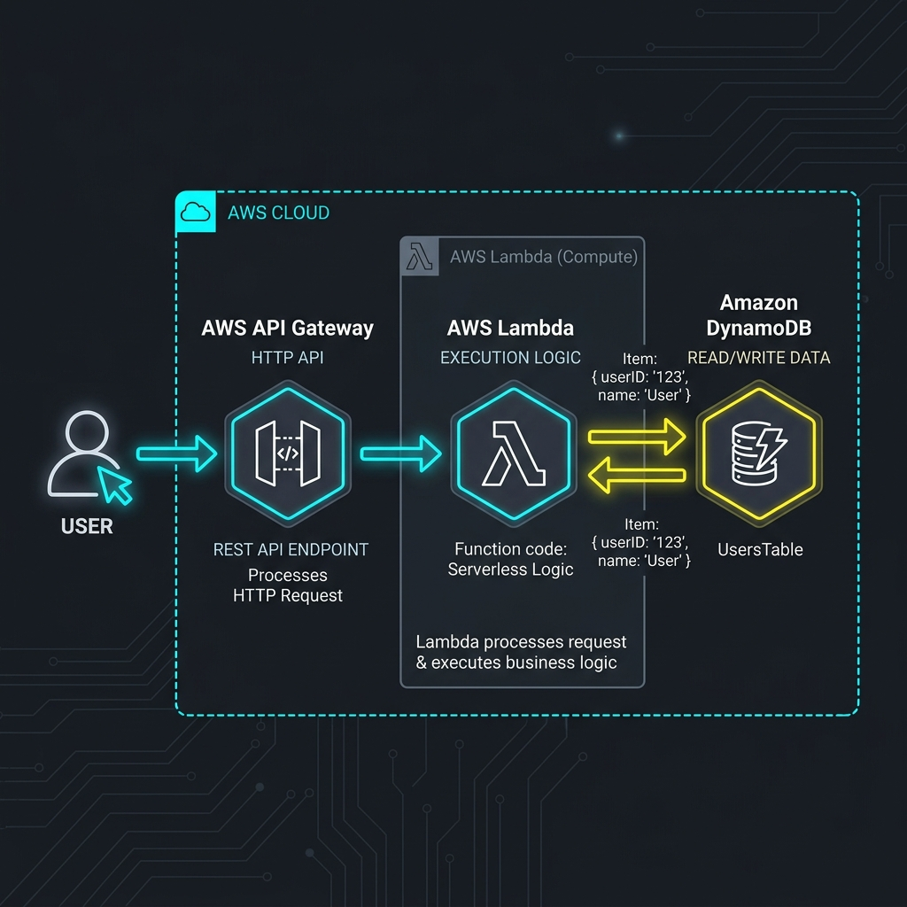
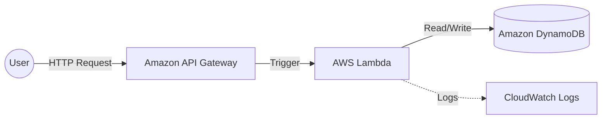

# Project 08: Serverless Web Application Workbook

> 🧠 **ภาพจำก่อนอ่าน:** 🧪 Lab → 🖥️ Workload → 📈 Scale → 🩺 Health → ✅ Verify → 🧹 Cleanup  
> 🎨 [Visual Guide ของวิชานี้](../../VISUAL-MEMORY-GUIDE-TH.md) — ภาพช่วยจำ ไม่แทนคำอธิบายและคำสั่งจริง

## 1. Scenario (สถานการณ์จำลอง)

### ลูกค้า (The Client)
"Promo-Alert" เป็นแอปพลิเคชันแจ้งเตือนโปรโมชั่นสินค้าที่ลูกค้าสนใจ ซึ่งปริมาณการใช้งานจะพุ่งสูงมากในช่วงเวลา Flash Sale (เช่น 12.12) แต่ในช่วงเวลาปกติจะแทบไม่มีผู้ใช้งานเลย

### ปัญหาที่พบ (The Problem)
- **Wasted Costs**: ปัจจุบันมีการเช่า EC2 และเปิดใช้งานตลอด 24 ชั่วโมง ซึ่งกว่า 90% ของเวลาเซิร์ฟเวอร์ทำงานแบบว่างเปล่า (Idle) แต่ยังคงต้องจ่ายค่าบริการเต็มจำนวน
- **Scaling Delay**: ในช่วง Flash Sale ระบบจะล่มบ่อยครั้ง เนื่องจากผู้ใช้งานแห่กันเข้ามาพร้อมกันเกินขีดจำกัดของ EC2
- การทำ Auto Scaling เพื่อเปิดเซิร์ฟเวอร์ใหม่ใช้เวลาเกือบ 2 นาที ซึ่งช้าเกินไปสำหรับช่วงวินาทีสำคัญ
- **Operational Overhead**: ทีมวิศวกรต้องคอยดูแลอัปเดต OS และติดตั้ง Patch ความปลอดภัยอยู่เสมอ ทำให้เสียเวลาพัฒนาฟีเจอร์หลักของธุรกิจ

### โจทย์ (The Request)
ในฐานะ Cloud Architect คุณได้รับมอบหมายให้ปรับเปลี่ยนระบบมาใช้สถาปัตยกรรม Serverless เพื่อเพิ่มประสิทธิภาพการรองรับ Traffic และประหยัดค่าใช้จ่าย:
- จัดการระบบโดยไม่ต้องดูแลเซิร์ฟเวอร์ (Zero Infrastructure Management)
- ระบบต้องขยายขีดความสามารถ (Scale) ได้ทันทีเมื่อมีการใช้งานพุ่งสูง
- จ่ายค่าบริการตามปริมาณการใช้งานจริงเท่านั้น (Pay-as-you-go)

### ข้อจำกัดทางเทคนิค (Technical Constraints)
- **Logic**: AWS Lambda (ใช้ Python หรือ Node.js)
- **API Entry**: Amazon API Gateway
- **Storage**: Amazon DynamoDB (NoSQL)
- **Deployment Tool**: AWS SAM หรือ Serverless Framework (เป็นตัวเลือกเสริม)

### แนวคิดการทำงาน (Analogy)
เปรียบเทียบ Serverless เหมือน "ตู้ขายน้ำอัตโนมัติอัจฉริยะ"
- **EC2 (แบบเก่า)**: เปรียบเหมือน "จ้างพนักงานมายืนขายน้ำ" ไม่ว่าวันนี้จะมีคนมาซื้อน้ำ 100 คน หรือไม่มีคนมาซื้อเลย คุณก็ยังคงต้องจ่ายค่าจ้างพนักงานแบบเต็มวันเต็มเวลา
- **Lambda (Serverless)**: เปรียบเหมือน "ตู้ขายน้ำหยอดเหรียญ" ตู้จะใช้พลังงานน้อยมากขณะตั้งรอ แต่เมื่อมีคนมาหยอดเหรียญและกดปุ่ม (Event) ระบบจึงจะทำงาน และคุณจะจ่ายค่าไฟเฉพาะเสี้ยววินาทีที่กระป๋องน้ำหล่นลงมาเท่านั้น
- **API Gateway**: เปรียบเหมือน "ปุ่มกดหน้าตู้" ที่รับคำสั่งจากลูกค้าว่าอยากได้เครื่องดื่มชนิดใด แล้วส่งต่อคำสั่งให้ระบบภายในทำงาน
- **DynamoDB**: เปรียบเหมือน "สมุดบัญชีท้ายตู้" สำหรับจดบันทึกยอดขายอย่างรวดเร็ว

### การใช้งานในงานจริง (Real-World Use Cases)
- **Flash Sale Event**: ระบบรับสิทธิ์ที่คนเข้าพร้อมกันหลักหมื่นคนในวินาทีเดียว
- **Image Processing**: ระบบย่อขนาดรูปภาพอัตโนมัติเมื่อมีการอัปโหลดขึ้น S3 Bucket
- **Webhook Integrations**: ระบบรับแจ้งเตือนจากภายนอก เช่น Stripe หรือ GitHub ที่ต้องการความประหยัด
- **Mobile Backend**: ระบบหลังบ้านสำหรับแอปพลิเคชันมือถือที่มีผู้ใช้พุ่งสูงเป็นช่วงๆ (Spiky Traffic)
- **Cron Jobs**: ใช้รันสคริปต์อัตโนมัติต่างๆ ตามเวลาที่กำหนดบน Cloud

### ค่าใช้จ่ายของระบบ (Cost Breakdown)
- บริการ API Gateway, Lambda และ DynamoDB ส่วนใหญ่มี Free Tier ให้ใช้งานอย่างเหลือเฟือสำหรับการทำ Lab
- สำหรับการใช้งานทั่วไปแทบไม่ต้องจ่ายเงินเลย
- นี่คือสถาปัตยกรรมที่คุ้มค่าและประหยัดที่สุดสำหรับธุรกิจเริ่มต้น (Startup)

### เงื่อนไขความสำเร็จ (Definition of Done)
- สร้างและตั้งค่า DynamoDB Table พร้อม Partition Key และใช้ Billing Mode แบบ On-demand
- เขียนและตั้งค่า Lambda Function พร้อม IAM Role ที่มีสิทธิ์เข้าถึงตามหลัก Least Privilege
- สร้างและตั้งค่า API Gateway เพื่อทำ Integration ร่วมกับ Lambda Function และ Deploy ไปยัง Stage ที่ต้องการ
- ระบบต้องรองรับการขยายตัวอัตโนมัติ (Auto-scaling) ในลักษณะ Request-by-request
- ผ่านรายการตรวจสอบทั้งหมดในคู่มือนี้

## 2. Topology Diagram (แผนผังระบบ)



### แผนภาพโครงสร้างระดับสถาปัตยกรรม (Architecture Diagram)



### รายละเอียดส่วนประกอบ (Component Breakdown)
- **Amazon API Gateway**
  - ทำหน้าที่เป็นประตูหน้า (Front Door) ของแอปพลิเคชันเพื่อรับ HTTP Request
  - จัดการเรื่อง Authentication และส่งต่อข้อมูลไปยัง AWS Lambda
- **AWS Lambda**
  - เป็นส่วนประมวลผล (Compute) ที่ทำงานแบบ Stateless
  - ทำงานเฉพาะเมื่อมี Event มากระตุ้นเท่านั้น และจะปิดตัวเองเมื่อประมวลผลเสร็จสิ้น
  - ไม่ต้องดูแลระบบปฏิบัติการ (OS) หรือติดตั้งโปรแกรมใดๆ เอง
- **Amazon DynamoDB**
  - ฐานข้อมูล NoSQL ที่ออกแบบมาเพื่อรองรับความเร็วในระดับมิลลิวินาที (Low Latency)
  - ทำงานโดยไม่ต้องจัดการเซิร์ฟเวอร์ และสามารถขยาย Throughput ได้มหาศาล
- **Amazon CloudWatch Logs**
  - สถานที่เก็บ Logs ของการทำงานใน AWS Lambda
  - ใช้สำหรับการวิเคราะห์ปัญหา (Debugging) และตรวจสอบประสิทธิภาพการทำงาน

### ประสิทธิภาพและการรองรับการขยายตัว (Performance & Scaling)
- **Estimated Load**: รองรับโหลดตั้งแต่ 0 ถึง 1,000+ Requests/second ได้โดยไม่ต้องแก้ไขสถาปัตยกรรมเพิ่ม
- **Bottlenecks**: จุดคอขวดมักอยู่ที่ Lambda Concurrency Limit (ค่าเริ่มต้นปกติคือ 1,000) และ DynamoDB RCU/WCU หากไม่ได้เลือกตั้งค่าเป็นแบบ On-demand
- **Scaling Approach**: ระบบทำการ Auto-scale ให้อัตโนมัติในระดับ Request-by-request โดยการแยกร่าง (Concurrency) ของ Lambda

### ประโยชน์หลักของสถาปัตยกรรมนี้ (Key Benefits)
- **No Idle Costs**: ไม่มีการเรียกใช้งานก็ไม่ต้องเสียค่าใช้จ่ายใดๆ ทั้งสิ้น
- **Instant Scaling**: ขยายระบบเพื่อรองรับ Request ได้มหาศาลในเสี้ยววินาที
- **High Availability**: บริการทั้งหมดออกแบบมาให้กระจายตัวอยู่ในหลาย Availability Zones (AZs) โดยอัตโนมัติ

## 3. Prerequisites & Estimated Time (สิ่งที่ต้องเตรียมและเวลาที่ใช้)

### สิ่งที่ต้องเตรียม (Prerequisites)
- **AWS Account**: บัญชี AWS ที่มีสิทธิ์สร้าง IAM Role, Lambda, API Gateway และ DynamoDB
- **AWS CLI**: ติดตั้งและกำหนดค่า Credentials เรียบร้อยแล้ว
- **Development Environment**: ติดตั้ง Python 3.11 หรือ Node.js บนเครื่องของคุณ
- **Terraform หรือ AWS SAM**: ในกรณีที่ต้องการ Deploy ด้วย Infrastructure as Code (IaC)
- **Basic Knowledge**: ความเข้าใจพื้นฐานเกี่ยวกับ NoSQL, REST API และสิทธิ์ IAM Policies

### เวลาที่ใช้โดยประมาณ (Estimated Time)
- เวลาที่ใช้: ประมาณ 90 ถึง 120 นาที

## 4. Tasks (ขั้นตอนการปฏิบัติ)

### บทนำการทำงานของ Serverless
- Serverless ไม่ได้แปลว่า "ไม่มี Server" แต่แปลว่า "คุณไม่ต้องจัดการ Server"
- AWS จะจัดการดูแลโครงสร้างพื้นฐานให้ทั้งหมด
- งานของคุณคือการคิดค้นและเขียนเฉพาะโค้ดของแอปพลิเคชัน

### หลักการเลือกใช้งานสถาปัตยกรรม Serverless
- **กรณีที่เหมาะสมในการเลือกใช้**:
  - Traffic ไม่สม่ำเสมอ (มีโหลดเข้ามารุนแรงเป็นช่วงๆ แล้วหายไป)
  - Event-driven workloads (ทำงานเมื่อได้รับสัญญาณหรือเหตุการณ์บางอย่าง)
  - ต้องการคุณสมบัติ Scale to Zero (ไม่มีผู้ใช้งานก็ไม่เสียเงิน)
- **กรณีที่ไม่เหมาะในการเลือกใช้**:
  - กระบวนการทำงานที่ยาวนาน (Long-running processes ที่ใช้เวลาเกินกว่า 15 นาที)
  - ระบบที่ต้องการ Low-latency ที่คงที่สม่ำเสมอเป็นพิเศษ (เนื่องจากปัญหา Cold Start)

### Task 1: การออกแบบและสร้างฐานข้อมูล Amazon DynamoDB
- เริ่มต้นด้วยการสร้าง Table บน Amazon DynamoDB สำหรับเก็บข้อมูลคำสั่งซื้อ (Orders)
- ตั้งค่า Partition Key (PK) และ Sort Key (SK) เพื่อเตรียมพร้อมสำหรับสถาปัตยกรรมแบบ One-Table Design
- เลือกใช้ Billing Mode แบบ On-demand (หรือ Pay-per-request) เพื่อให้ระบบปรับขนาดตามการเรียกใช้งานจริงโดยไม่ต้องคาดการณ์ Throughput ล่วงหน้า

### Task 2: การพัฒนาและกำหนดค่า AWS Lambda Function
- เขียนโค้ดของ Lambda Function (ตัวอย่างภาษา Python) เพื่อรับค่าและเขียนข้อมูลลงใน DynamoDB
- สร้าง IAM Role ที่สอดคล้องกับหลัก Least Privilege เพื่ออนุญาตให้ Lambda สามารถเขียนและอ่านข้อมูลใน DynamoDB ได้เฉพาะ Table ที่ระบุเท่านั้น

```python
# src/lambda/handler.py
import json
import boto3

dynamodb = boto3.resource('dynamodb')
table = dynamodb.Table('orders')

def handler(event, context):
    method = event['httpMethod']
    path = event['path']
    
    if method == 'POST' and path == '/orders':
        body = json.loads(event['body'])
        order_id = str(uuid.uuid4())
        table.put_item(Item={
            'orderId': order_id,
            'userId': body['userId'],
            'items': body['items'],
            'status': 'PENDING',
            'createdAt': datetime.utcnow().isoformat()
        })
        return {
            'statusCode': 201,
            'body': json.dumps({'orderId': order_id})
        }
```

- ใช้ Terraform หรือ AWS Console ในการตั้งค่า Lambda Function รวมถึงการกำหนด Memory, Timeout และ Environment Variables:

```hcl
# Terraform
resource "aws_lambda_function" "api" {
  filename      = "lambda.zip"
  function_name = "thaidemo-api"
  role          = aws_iam_role.lambda.arn
  handler       = "handler.handler"
  runtime       = "python3.11"
  timeout       = 30  # seconds
  memory_size   = 256 # MB
  
  environment {
    variables = {
      TABLE_NAME = aws_dynamodb_table.orders.name
    }
  }
}
```

### Task 3: การสร้างและเชื่อมต่อ Amazon API Gateway
- สร้าง Amazon API Gateway แบบ HTTP API ซึ่งช่วยลดค่าใช้จ่ายและ Latency ได้ดีกว่า REST API
- กำหนดค่า Integration แบบ AWS_PROXY เพื่อส่งต่อ Request ทั้งหมดไปยัง Lambda Function โดยตรง
- ตั้งค่า CORS เพื่ออนุญาตให้ Web Application หน้าบ้านสามารถยิง API มาได้ปลอดภัย

```hcl
resource "aws_apigatewayv2_api" "main" {
  name          = "thaidemo-api"
  protocol_type = "HTTP"
  cors_configuration {
    allow_origins = ["https://thaidemo.io"]
    allow_methods = ["GET", "POST", "PUT", "DELETE"]
  }
}

resource "aws_apigatewayv2_integration" "lambda" {
  api_id           = aws_apigatewayv2_api.main.id
  integration_type = "AWS_PROXY"
  integration_uri  = aws_lambda_function.api.invoke_arn
}
```

### Task 4: การนำ DynamoDB One-Table Design มาใช้งาน
- นำหลักการ One-Table Design มาใช้เพื่อเพิ่มประสิทธิภาพการอ่านเขียนข้อมูลภายใน Table เดียว
- การดึงข้อมูลควรใช้การค้นหาแบบคีย์เดียว เพื่อลดจำนวน Request และประหยัดค่าใช้จ่าย ดังตัวอย่างสคริปต์นี้:

```python
# ตัวอย่าง: ระบบ Order Management ใน 1 Table

# Pattern 1: Get all orders for a user
# PK = "USER#u001", SK starts with "ORDER#"
orders = table.query(
    KeyConditionExpression=Key('PK').eq('USER#u001') & Key('SK').begins_with('ORDER#')
)

# Pattern 2: Get a specific order
order = table.get_item(Key={'PK': 'USER#u001', 'SK': 'ORDER#o123'})

# Pattern 3: Get all PENDING orders (GSI)
pending = table.query(
    IndexName='status-index',
    KeyConditionExpression=Key('status').eq('PENDING')
)
```

### Task 5: การลดปัญหา Cold Start (Cold Start Mitigation)
- หากมีบาง Request ที่มี Latency สูงในช่วงเริ่มต้นใช้งาน ให้เลือกแนวทางการแก้ไขปัญหาระหว่าง:
  - การทำ Provisioned Concurrency เพื่อจัดเตรียม Lambda Instance ให้พร้อมใช้งานตลอดเวลา
  - หรือการตั้งค่า Scheduled Warm-up (การทริกเกอร์ทุกๆ 5 นาที) เพื่อหลีกเลี่ยงการโดนทำลาย Container ซึ่งช่วยประหยัดค่าใช้จ่ายได้มากกว่า

```hcl
# Provisioned Concurrency สำหรับ API ที่ต้องการ Latency ต่ำ
resource "aws_lambda_provisioned_concurrency_config" "main" {
  function_name                  = aws_lambda_function.api.function_name
  qualifier                      = aws_lambda_alias.live.name
  provisioned_concurrent_executions = 5
}

# Scheduled Warm-up สำหรับ Low-traffic เวลากลางคืน (ประหยัดกว่า Provisioned)
resource "aws_cloudwatch_event_rule" "warmup" {
  schedule_expression = "rate(5 minutes)"
}
```

### Task 6: การทดสอบความแข็งแกร่งของระบบ (Resilience & Chaos Testing)
- **การทำ Load Testing เพื่อทดสอบระบบ**:
  - ทดลองยิง Request เข้ามาพร้อมกันจำนวน 10,000 ครั้ง
  - ตรวจสอบว่า Lambda มีการแยกร่าง (Concurrency Scaling) ขึ้นมาจัดการได้อย่างไร
  - สังเกตผลกระทบจากปัญหา Cold Start (ความล่าช้าในเสี้ยววินาทีแรกที่เริ่มทำงาน) เพื่อศึกษาประสิทธิภาพ
- **การทดลองแก้ไขสิทธิ์ IAM Role ให้ผิดพลาด**:
  - ลองจงใจตั้งค่า IAM Role ผิดพลาด โดยไม่ให้ Lambda มีสิทธิ์เข้าถึง DynamoDB Table
  - ฝึกฝนอ่าน Error Logs บน CloudWatch Logs เพื่อหาสาเหตุของปัญหา และหาวิธีการกำหนดสิทธิ์ที่ถูกต้องตามหลัก Least Privilege

### Task 7: การล้างข้อมูลและทรัพยากรหลังเสร็จสิ้น (Cleanup)
- เพื่อป้องกันค่าใช้จ่ายที่อาจเกิดขึ้นโดยไม่ได้ตั้งใจ ให้ทำการลบทรัพยากรทั้งหมดเมื่อทำ Lab เสร็จสิ้น:
  - ลบ API Gateway APIs
  - ลบ Lambda Functions
  - ลบ DynamoDB Tables
- **ข้อควรระวัง**:
  - หากคุณใช้งานเครื่องมือช่วยจัดการทรัพยากร เช่น AWS SAM หรือ Serverless Framework
  - ให้ใช้คำสั่ง `sam delete` หรือ `sls remove` เพื่อลบโครงสร้างพื้นฐานทั้งหมดโดยอัตโนมัติ

## 5. Verification (การตรวจสอบผลการทำงาน)

- [ ] **การตั้งค่า Database (DynamoDB)**
  - สร้าง DynamoDB Table พร้อมตั้งค่า Partition Key ได้อย่างถูกต้อง
  - กำหนดค่า Billing Mode เป็น On-demand หรือตั้งค่า Provisioned Capacity ให้สอดคล้องกับเป้าหมายระบบ
  - ทดสอบเพิ่มข้อมูลตัวอย่างแบบ Manual ผ่าน AWS Management Console ได้สำเร็จ

- [ ] **การตรวจสอบ Logic (AWS Lambda)**
  - สร้าง Lambda Function และเลือก Runtime ได้ถูกต้อง (เช่น Python หรือ Node.js)
  - ตั้งค่า Environment Variables (เช่น TABLE_NAME) ได้ครบถ้วน
  - กำหนด IAM Role ให้เข้าถึงเฉพาะ DynamoDB Table ตามหลัก Least Privilege
  - โค้ดของ Lambda ไม่มีข้อผิดพลาดทาง Syntax และทดสอบผ่านด้วย Test Event เรียบร้อย

- [ ] **การเชื่อมต่อ API Gateway**
  - สร้าง API และทำ Integration กับ Lambda Function สำเร็จ
  - เปิดใช้งาน CORS เพื่อรองรับการยิง Request จาก Web Browser
  - Deploy API Gateway ไปยัง Stage ที่ต้องการ (เช่น Prod หรือ Dev)
  - ทดสอบเรียกใช้งานผ่าน Public Invoke URL และได้รับ Response กลับมาถูกต้อง

- [ ] **การตรวจสอบผ่าน Monitoring**
  - CloudWatch Logs บันทึกการทำงานที่สำเร็จและการทำงานที่ล้มเหลว (Error logs) ได้ครบถ้วน
  - ตรวจสอบ Metric graphs ใน CloudWatch เพื่อดูจำนวน Request และค่า Latency ของระบบ

## 6. Troubleshooting (การแก้ไขปัญหาที่พบบ่อย)

### กรณีที่ 1: ผู้ใช้งานพบปัญหาแอปพลิเคชันตอบสนองช้า (Latency) หรือตอบกลับด้วย Error 504
- **การวิเคราะห์ (Analysis)**:
  - ตรวจสอบ Lambda Duration ผ่าน CloudWatch Logs เพื่อตรวจหาอาการ Cold Start หรือ Logic ทำงานวนซ้ำ (Loop)
  - ตรวจสอบ DynamoDB Throttling ว่ามีการอ่านหรือเขียนข้อมูลเกินขีดจำกัดหรือไม่
  - เช็คปริมาณการใช้งาน Memory ของ Lambda ว่ามีค่าเข้าใกล้ขีดจำกัดที่ตั้งไว้หรือไม่
- **สาเหตุที่เป็นไปได้ (Root Cause)**:
  - เกิดปัญหา Cold Start เมื่อไม่ได้เรียกใช้งานระบบเป็นเวลานาน
  - หรือกำหนด Memory ให้กับ Lambda น้อยเกินไป ส่งผลให้ CPU น้อยลงตามสัดส่วน
- **แนวทางการแก้ไข (Fix)**:
  - เพิ่มขนาด Memory ของ Lambda Function ซึ่งจะเพิ่มทรัพยากร CPU ให้โดยอัตโนมัติ
  - หรือกำหนดค่า Provisioned Concurrency เพื่อให้มี Instance พร้อมตอบสนองตลอดเวลา

### กรณีที่ 2: เกิด Lambda Timeout ขณะพยายามเชื่อมต่อกับ DynamoDB
- **สาเหตุที่เป็นไปได้ (Root Cause)**:
  - Lambda Function ถูกกำหนดให้อยู่ใน VPC แต่ไม่มี VPC Endpoint สำหรับ DynamoDB
  - ส่งผลให้ระบบพยายามส่ง Traffic ออกไปทาง NAT Gateway ซึ่งทำงานช้าหรือเกิดปัญหาการเชื่อมต่อ
- **แนวทางการแก้ไข (Fix)**:
  - ให้สร้าง VPC Gateway Endpoint สำหรับ DynamoDB (Service name: `com.amazonaws.ap-southeast-1.dynamodb`)
  - หรือนำ Lambda Function ออกจาก VPC หากระบบไม่มีความจำเป็นต้องเชื่อมต่อทรัพยากรภายใน VPC

### กรณีที่ 3: เกิดปัญหา API Gateway CORS Error บน Browser
- **สาเหตุที่เป็นไปได้ (Root Cause)**:
  - API Gateway ไม่สามารถคืนค่า CORS Headers กลับไปยัง Client ได้เมื่อ Lambda เกิดการทำงานล้มเหลว (Error Response ไม่มี Header)
- **แนวทางการแก้ไข (Fix)**:
  - ปรับแต่งโค้ดใน Lambda Handler ให้คืนค่า CORS Headers ในทุกสถานะการตอบรับ รวมถึงกรณีที่เกิด Error:

```python
def make_response(status_code, body, error=None):
    return {
        'statusCode': status_code,
        'headers': {
            'Access-Control-Allow-Origin': 'https://thaidemo.io',
            'Content-Type': 'application/json'
        },
        'body': json.dumps(body if not error else {'error': str(error)})
    }
```

### กรณีที่ 4: เกิดข้อผิดพลาด DynamoDB ProvisionedThroughputExceededException
- **สาเหตุที่เป็นไปได้ (Root Cause)**:
  - กำหนดขนาด Capacity (RCU/WCU) แบบ Provisioned ไว้ต่ำเกินไป จนทนทานต่อ Traffic ที่สูงขึ้นไม่ไหว
- **แนวทางการแก้ไข (Fix)**:
  - เปลี่ยนรูปแบบ Billing Mode ให้เป็นแบบ On-demand (`billing_mode = "PAY_PER_REQUEST"`) เพื่อให้ระบบขยาย Capacity แบบไม่มีขีดจำกัด
  - หรือตั้งค่า Auto Scaling ให้กับ Read/Write Capacity ในโหมด Provisioned

### เกร็ดความรู้จากประสบการณ์จริง (Production Experience)
- **Memory สัมพันธ์กับ CPU**: ใน AWS Lambda การเพิ่ม Memory จะเพิ่ม CPU ให้ตามสัดส่วนด้วย การจ่ายค่าแรมเพิ่มอาจช่วยให้ประมวลผลเร็วขึ้นจนราคาเฉลี่ยต่อการทำงาน (Execution Cost) ลดลง
- **ความคุ้มค่าของการเลือกใช้ On-demand**: สำหรับแอปพลิเคชันที่สร้างใหม่และไม่สามารถคาดการณ์ปริมาณ Traffic ได้ การใช้ DynamoDB On-demand จะช่วยป้องกันแอปพังได้ดีกว่า และจ่ายเงินตามจริงช่วยให้ประหยัดสูงสุด

## 7. Exercises & Solutions (แบบฝึกหัดและแนวทางการแก้ไข)

### แบบฝึกหัดที่ 1: การบรรเทาปัญหา Cold Start (Cold Start Mitigation)

#### โจทย์ (Scenario)
ผู้ใช้งานบ่นว่า API ทำงานล่าช้าเมื่อไม่ได้เรียกใช้เป็นเวลานาน แต่ตอบสนองเร็วขึ้นเมื่อมีการใช้งานอย่างต่อเนื่อง

#### งานที่ต้องปฏิบัติ (Task)
1. อธิบายสาเหตุการเกิด Cold Start ใน AWS Lambda
2. แสดงวิธีตั้งค่า Provisioned Concurrency เพื่อทำการ Pre-warm Lambda function
3. เปรียบเทียบค่าใช้จ่ายของ Provisioned Concurrency กับการเปิดใช้ EC2 ตลอดเวลาสำหรับ Workload เดียวกัน

#### แนวทางการแก้ไข (Solution)
- **สาเหตุการเกิด Cold Start**: เกิดจากการที่ Lambda คืนทรัพยากร (Destroy Container) ไปเมื่อไม่มีการใช้งาน เมื่อมี Request ใหม่เข้ามา AWS จะต้องเตรียม Container และ Runtime ใหม่ ซึ่งจะส่งผลให้มีความล่าช้าในการเริ่มต้นทำงานเพิ่มขึ้นประมาณ 200-500ms
- **ตัวอย่างการตั้งค่า Provisioned Concurrency ผ่าน Terraform**:

```hcl
# Provisioned Concurrency (Terraform)
resource "aws_lambda_provisioned_concurrency_config" "main" {
  function_name                  = aws_lambda_function.api.function_name
  qualifier                      = aws_lambda_alias.live.name
  provisioned_concurrent_executions = 5 # Pre-warm 5 instances
}
```

- **ตารางเปรียบเทียบค่าใช้จ่ายโดยประมาณ (Region: ap-southeast-1)**:

| ตัวเลือกการใช้งาน | ค่าใช้จ่ายเฉลี่ยต่อเดือน | ปัญหา Cold Start |
|:---|:---:|:---:|
| On-demand Lambda | ~$2-5 | มีโอกาสเกิด (200-500ms) |
| Provisioned (5 concurrent) | ~$15-20 | แทบไม่มีเลย (~0ms) |
| t3.small EC2 | ~$15 | ไม่มีปัญหา (เนื่องจากเปิดตลอด 24 ชั่วโมง) |

---

### แบบฝึกหัดที่ 2: รูปแบบการเข้าถึงข้อมูลของ DynamoDB (DynamoDB Access Patterns)

#### โจทย์ (Scenario)
ต้องการออกแบบโครงสร้าง DynamoDB Table สำหรับระบบบริหารจัดการคำสั่งซื้อ (Order Management) ที่รองรับการสืบค้นข้อมูลในรูปแบบที่หลากหลาย

#### งานที่ต้องปฏิบัติ (Task)
1. ออกแบบโครงสร้าง Partition Key (PK) และ Sort Key (SK) เพื่อรองรับ Access Patterns สองประเภทหลัก: "ดูคำสั่งซื้อทั้งหมดของ User" และ "ดูรายละเอียดเฉพาะของแต่ละคำสั่งซื้อ"
2. เพิ่ม Global Secondary Index (GSI) เพื่อช่วยอำนวยความสะดวกในการค้นหาผ่าน Order status
3. คำนวณความจำเป็นของ Read/Write Capacity Units (RCU/WCU) เพื่อให้ระบบรองรับโหลดที่ 1,000 requests/second

#### แนวทางการแก้ไข (Solution)
- **การออกแบบคีย์ในรูปแบบ One-Table Design**:

```text
Table: Orders
PK: USER#<userId>  SK: ORDER#<orderId>

# Query 1: เรียกดูข้อมูล Orders ทั้งหมดของ User
query(PK = "USER#123")

# Query 2: เรียกดูรายละเอียดของออเดอร์ใดออเดอร์หนึ่ง
get_item(PK = "USER#123", SK = "ORDER#456")

# การออกแบบ GSI เพื่อคิวรีจาก Status
GSI: status-index
  PK: status (เช่น "PENDING")
  SK: createdAt
```

---

### แบบฝึกหัดที่ 3: สถาปัตยกรรม Lambda แบบขับเคลื่อนด้วยเหตุการณ์ (Event-Driven Lambda Architecture)

#### โจทย์ (Scenario)
ต้องการให้ระบบประมวลผลรูปภาพที่ถูกอัปโหลดโดยผู้ใช้งาน เช่น การย่อขนาดรูปภาพ (Resize) และการใส่ลายน้ำ (Watermark) แบบอัตโนมัติ

#### งานที่ต้องปฏิบัติ (Task)
1. ออกแบบภาพรวมสถาปัตยกรรมโดยใช้ S3 Event Trigger ส่งต่อไปยัง Lambda และบันทึกผลลัพธ์กลับไปยัง S3 Output Bucket
2. จัดการแนวทางเมื่อกระบวนการประมวลผลรูปภาพล้มเหลว (Error handling) โดยใช้ Dead Letter Queue (DLQ)
3. กำหนดค่า Timeout ของ Lambda ให้สอดคล้องกับการทำงานจริง

#### แนวทางการแก้ไข (Solution)
- **ตัวอย่างโค้ด Lambda ภาษา Python สำหรับย่อขนาดรูปภาพ**:

```python
import boto3
from PIL import Image
import io

def handler(event, context):
    s3 = boto3.client('s3')
    bucket = event['Records'][0]['s3']['bucket']['name']
    key = event['Records'][0]['s3']['object']['key']
    
    # Download original
    obj = s3.get_object(Bucket=bucket, Key=key)
    img = Image.open(io.BytesIO(obj['Body'].read()))
    
    # Resize
    img.thumbnail((800, 600))
    
    # Upload to output bucket
    buffer = io.BytesIO()
    img.save(buffer, format='JPEG')
    s3.put_object(Bucket='output-bucket', Key=f'resized/{key}', Body=buffer.getvalue())

# ข้อเสนอแนะ:
# - ตั้งค่า Lambda Timeout: แนะนำเริ่มต้นที่ 30 วินาที สำหรับการประมวลผลรูปภาพทั่วไป
# - ตั้งค่า Memory: แนะนำให้ตั้งไว้ที่อย่างน้อย 512MB เพื่อให้สมรรถนะเพียงพอสำหรับไลบรารี PIL
```
