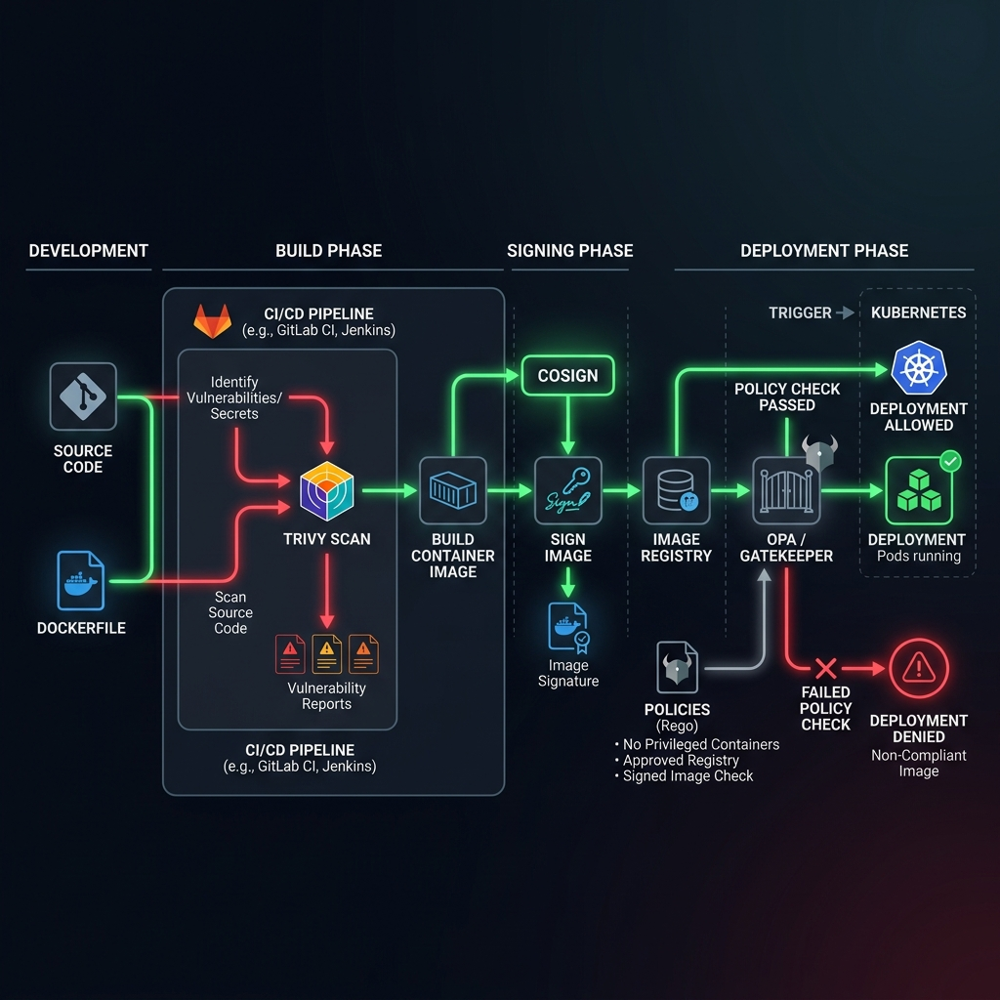
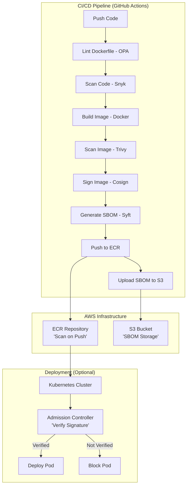

# Project 09: Container Security Workbook

> 🧠 **ภาพจำก่อนอ่าน:** 🧪 Lab → 👤 Identity → 🔑 Role → 🛡️ Scope → ✅ Verify → 🧹 Cleanup  
> 🎨 [Visual Guide ของวิชานี้](../../VISUAL-MEMORY-GUIDE-TH.md) — ภาพช่วยจำ ไม่แทนคำอธิบายและคำสั่งจริง

## 1. Scenario (สถานการณ์จำลอง)

### การตรวจสอบจาก Auditor
เช้าวันจันทร์ที่แสนวุ่นวาย Startup ของคุณกำลังอยู่ระหว่างการประเมินมาตรฐาน SOC2 ครั้งแรก
- Auditor ที่นั่งอยู่ตรงข้ามกับ CTO เอ่ยถามคำถามง่ายๆ แต่แฝงไปด้วยความกดดันว่า:
  "คุณจะมั่นใจได้อย่างไรว่า Container Image ที่รันอยู่บน Production ไม่มีช่องโหว่ระดับ Critical ที่ยังไม่ได้รับการแก้ไข? และคุณตรวจสอบอย่างไรว่า Image เหล่านั้นมาจาก CI/CD pipeline ของคุณจริงๆ ไม่ใช่ฝีมือของ Developer แอบ push ส่งเดชจากเครื่องตัวเอง?"

ห้องประชุมตกอยู่ในความเงียบทันที CTO หันมามองหน้าคุณ ขณะที่คุณจ้องไปที่หน้าจอ AWS Console
- คุณรู้ดีว่าถึงจะเปิดใช้งาน ECR Scanning ไว้ แต่ก็ยังมี Image เก่าเก็บจากเมื่อ 6 เดือนก่อนที่มีช่องโหว่ระดับ Critical ค้างอยู่
- ที่สำคัญคือ คุณไม่มีทางป้องกันไม่ให้ Developer แอบสั่ง docker push เพื่อส่ง Image ที่มีช่องโหว่ขึ้นระบบโดยตรงจากเครื่องของตัวเองได้เลย

### ข้อความทาง Slack จาก CTO
> CTO: "Auditor กำลังไล่บี้เรื่อง SOC2 อย่างหนัก เราจำเป็นต้องทำ Container Pipeline ที่ปลอดภัยแบบ Hardened ให้เสร็จภายในวันศุกร์หน้า หากเราไม่สามารถพิสูจน์แหล่งที่มาของ Image และผลการสแกนความปลอดภัยได้ เราจะชวดใบรับรอง Compliance ทันที เรื่องนี้สำคัญเป็นอันดับ 1"

### เป้าหมาย
คุณมีเวลา 2 สัปดาห์ในการสร้าง Secure Supply Chain ของระบบ Container ให้สำเร็จ:
- บล็อกสิ่งแปลกปลอม (Block the Bad): ห้ามไม่ให้ Image ที่มีช่องโหว่ระดับ Critical หรือ High ถูกอัปโหลดขึ้น ECR เด็ดขาด
- ยืนยันแหล่งที่มา (Verify the Source): ทุก Image จะต้องผ่านการเซ็นลายเซ็นกำกับด้วย Cosign หากตรวจไม่พบลายเซ็นจะไม่สามารถ Deploy ได้
- บังคับใช้กฎเหล็ก (Enforce the Rules): ใช้ Policy as Code (OPA) ตรวจสอบว่า Dockerfile ทำตามมาตรฐานความปลอดภัย (ห้ามใช้สิทธิ์ root, ห้ามใช้ Tag latest)
- ทำบัญชีส่วนประกอบซอฟต์แวร์ (Know the Parts): สร้าง SBOM (Software Bill of Materials) สำหรับแต่ละ Image เพื่อเตรียมไว้สำหรับ Auditor ตรวจสอบ

### ข้อจำกัด (Constraints)
- ระบบต้องรองรับการทำงานแบบอัตโนมัติผ่าน GitHub Actions Pipeline
- การจัดเก็บข้อมูลต้องแยกกันอย่างปลอดภัย โดย Image อยู่บน Amazon ECR และ SBOM อยู่บน Amazon S3
- ไม่อนุญาตให้ใช้ Dockerfile ที่ไม่มีการประกาศ USER หรือสั่งรันเป็น root
- Base Image ทั้งหมดต้องระบุเวอร์ชั่นให้ชัดเจน ห้ามใช้ Tag latest หรือไม่มี Tag ระบุเวอร์ชั่น

### เงื่อนไขการส่งงาน (Definition of Done)
- GitHub Actions Pipeline ต้องขึ้นสถานะ Fail ทันทีเมื่อ Trivy ตรวจพบช่องโหว่ระดับ Critical หรือ High
- Container Image ทั้งหมดได้รับการเซ็นชื่อกำกับด้วย Cosign ภายใน Pipeline
- OPA Policies ต้องบล็อก Dockerfile ที่มีการเรียกใช้งานด้วยสิทธิ์ root
- Amazon ECR Repository เปิดใช้ฟีเจอร์ Scan on Push พร้อมกำหนด Lifecycle Policy คอยเคลียร์ Image เก่าที่อาจเสี่ยงภัยทิ้ง
- มี S3 Bucket คอยจัดเก็บไฟล์ SBOM ในรูปแบบ Machine-readable สำหรับ Image รุ่นล่าสุดที่รันบน Production

### แนวคิดการทำงาน
เปรียบเทียบ Image Security เหมือนการตรวจคนเข้าเมือง:
- Trivy / Snyk: เปรียบเหมือนการตรวจกระเป๋าเดินทาง (สแกนหาช่องโหว่และไวรัส)
- OPA (Policy): เปรียบเหมือนกฎเกณฑ์การเข้าเมือง (ตรวจสอบว่าเอกสารและโครงสร้างถูกต้องครบถ้วน)
- Cosign: เปรียบเหมือนการประทับตรา Visa (ยืนยันว่าผ่านการตรวจสอบจากระบบแล้วและห้ามแก้ไขดัดแปลง)

### ประสิทธิภาพและการรองรับการขยายตัว (Performance & Scaling)
- Scan Performance: การสแกนปกติควรใช้เวลาไม่เกิน 1-3 นาทีต่อ Image เพื่อไม่ให้เป็นคอขวดใน CI/CD Pipeline
- Bottlenecks: ปัญหาคอขวดมักเกิดจากการอัปเดตฐานข้อมูลช่องโหว่ (Vulnerability DB) ใหม่ทุกครั้งในระหว่างรันขั้นตอนสแกน
- Scaling Approach: แนะนำให้ใช้ Centralized Scanning Service หรือติดตั้งระบบ Cache สำหรับ Trivy Database ภายในองค์กรเพื่อย่นระยะเวลาการดึงข้อมูล

### ประสบการณ์จริงจากหน้างาน (Production Experience Insight)
- Distroless is Better: การเลือกใช้ Base Image แบบ Distroless (ไม่มี Shell, ไม่มี Package Manager) ช่วยลดช่องโหว่ลงได้มหาศาล เนื่องจากลดพื้นที่หน้างานในการโจมตี (Attack Surface) ลงไปมาก
- False Positives: ในการทำงานจริงอาจพบการรายงานช่องโหว่ที่ไม่เป็นความจริง (False Positive) ซึ่งจำเป็นต้องใช้เครื่องมือช่วยตรวจสอบอย่าง VEX (Vulnerability Exploitability eXchange) เพื่อระบุความเสี่ยงตามความเป็นจริง

### การใช้งานจริงในธุรกิจ (Real-world Use Cases)
- Fintech & Banking: กลุ่มธุรกิจที่ต้องผ่านการตรวจสอบตามเกณฑ์ความปลอดภัยขั้นสูง และห้ามพบช่องโหว่ระดับ Critical ในระบบเด็ดขาด
- Healthcare: การดูแลระบบจัดการข้อมูลผู้ป่วยที่ต้องมีการป้องกัน Software Supply Chain อย่างเข้มงวดเพื่อรักษาความปลอดภัยของข้อมูล
- Cloud-Native SaaS: ช่วยสร้างความมั่นใจให้ผู้ใช้งานว่าทุก Container Image ที่รันอยู่ได้รับการเซ็นยืนยันแหล่งที่มาแล้ว
- การทดสอบ Compliance: ใช้รองรับการเตรียมระบบสำหรับตรวจสอบมาตรฐานความปลอดภัย เช่น SOC2 หรือ PCI-DSS
- การป้องกันโจมตีระบบ: ช่วยป้องกันปัญหา Software Supply Chain Attack ที่ Hacker มักใช้ฝังโค้ดอันตรายผ่าน Dockerfile หรือ Library จากภายนอก

## 2. Topology Diagram (แผนผังระบบ)



### แผนผังการทำงานของ CI/CD Pipeline (Workflow)


### ส่วนประกอบหลัก (Components)
- **GitHub Actions**: ทำงานเป็น Orchestration Engine ในการรัน Security Scan และ Build Pipeline ทั้งหมด
- **OPA (Open Policy Agent)**: ทำหน้าที่รัน Static Code Analysis เพื่อตรวจสอบสิทธิ์การตั้งค่าของ Dockerfile ก่อนเริ่มการ Build
- **Snyk**: ใช้สแกนหาช่องโหว่ความปลอดภัยระดับ Application Dependencies และ Source Code
- **Trivy**: ใช้ทำ Container Image Scanner เพื่อค้นหาช่องโหว่ในระดับ OS Packages และ System Libraries
- **Cosign**: ใช้เซ็นกำกับ Image ด้วยลายเซ็นดิจิทัลเข้ารหัสเพื่อยืนยันแหล่งที่มาของ Container Image (Provenance)
- **Syft**: ใช้ทำ SBOM Generator ในรูปแบบมาตรฐานสากล เช่น SPDX หรือ CycloneDX
- **Amazon ECR**: บริการ Container Registry ที่เปิดใช้งาน Scan on Push และกำหนด Lifecycle Policy
- **Amazon S3**: ใช้จัดเก็บไฟล์ SBOM แยกต่างหากพร้อมเปิดระบบ Versioning ป้องกันการสูญหาย

## 3. Prerequisites & Estimated Time (สิ่งที่ต้องเตรียมและเวลาที่ใช้)

### สิ่งที่ต้องเตรียมก่อนเริ่ม (Prerequisites)
- AWS CLI v2 ที่กำหนดค่า (Configure) เรียบร้อยแล้ว
- Terraform 1.7+
- Docker ติดตั้งพร้อมใช้งาน
- บัญชี GitHub ที่เปิดใช้งาน GitHub Actions
- Cosign ติดตั้งบนเครื่องโลคัล (ทางเลือกสำหรับการทดสอบ)

### ระยะเวลาที่ใช้โดยประมาณ (Estimated Time)
- 15-20 ชั่วโมง

## 4. Tasks (ขั้นตอนการปฏิบัติ)

### Task 1: การเตรียมโครงสร้างพื้นฐานบน AWS ด้วย Terraform (ECR และ S3)
เริ่มต้นด้วยการสร้าง Amazon ECR Repository และ S3 Bucket สำหรับเก็บข้อมูลความปลอดภัยของ Container:
1. ไปที่โฟลเดอร์ของ Terraform:
   ```bash
   cd src/terraform
   ```
2. ทำการตรวจสอบและเริ่มต้นดาวน์โหลด AWS Provider:
   ```bash
   terraform init
   ```
3. รันคำสั่ง Apply เพื่อสร้าง ECR Repository ที่เปิดใช้งาน Image scanning (Scan on Push) และ S3 Bucket สำหรับเก็บไฟล์ SBOM:
   ```bash
   terraform apply -auto-approve
   ```

### Task 2: การสร้าง Key-Pair สำหรับ Cosign
ใช้ Cosign สำหรับการทำ Image Signing เพื่อยืนยันว่า Image ถูกสร้างจากระบบ CI/CD ที่เชื่อถือได้:
1. รันคำสั่ง generate คีย์ด้วย Cosign ในเครื่องโลคัล:
   ```bash
   cosign generate-key-pair
   ```
2. คำสั่งนี้จะสร้างไฟล์ขึ้นมาสองไฟล์:
   - `cosign.key` (Private Key สำหรับใช้เซ็นกำกับ Image)
   - `cosign.pub` (Public Key สำหรับใช้ตรวจสอบลายเซ็นกำกับ)
3. ระบบจะให้กำหนด Password สำหรับป้องกันคีย์ ให้จำค่านี้ไว้ใช้ในขั้นตอนถัดไป

### Task 3: การตั้งค่า GitHub Secrets
นำความลับต่างๆ ไปบันทึกไว้ใน GitHub Repository Secrets เพื่อความปลอดภัยในการทำงานอัตโนมัติ:
- `AWS_ACCESS_KEY_ID`: IAM Access Key ID ของ AWS Account ที่มีสิทธิ์จัดการ ECR และ S3
- `AWS_SECRET_ACCESS_KEY`: IAM Secret Access Key ที่สอดคล้องกัน
- `AWS_ACCOUNT_ID`: หมายเลขบัญชี AWS ของคุณ (ใช้สำหรับระบุชื่อ S3 Bucket)
- `COSIGN_PRIVATE_KEY`: คัดลอกข้อความทั้งหมดภายในไฟล์ `cosign.key` ที่ได้จาก Task 2
- `COSIGN_PASSWORD`: รหัสผ่านที่คุณตั้งไว้เพื่อป้องกันไฟล์ Private Key ใน Task 2
- `SNYK_TOKEN`: สมัครบัญชีผู้ใช้ที่ snyk.io แล้วไปที่หน้า Account Settings เพื่อรับ Token สำหรับสแกนความปลอดภัยฟรี

### Task 4: การสร้าง OPA Policy สำหรับการทำ Lint Dockerfile
เขียนกฎ OPA เพื่อป้องกันปัญหาง่ายๆ เช่น การใช้ Tag latest หรือการรันด้วยสิทธิ์ root:
1. สร้างไฟล์นโยบาย OPA ที่ชื่อ `opa/policies/container_policy.rego`:
   ```rego
   package container_policy

   # Check if latest tag is used
   deny[msg] {
       input[i].Cmd == "from"
       val := input[i].Value
       contains(val, ":latest")
       msg = sprintf("Do not use 'latest' tag in base image: %v", [val])
   }

   # Check if no tag is used (defaults to latest)
   deny[msg] {
       input[i].Cmd == "from"
       val := input[i].Value
       not contains(val, ":")
       msg = sprintf("Explicit version tag required for base image: %v", [val])
   }

   # Check if root user is specified (should not be)
   deny[msg] {
       input[i].Cmd == "user"
       val := input[i].Value
       val == "root"
       msg = "Explicitly running as 'root' is not allowed"
   }

   # Check if non-root user is used
   deny[msg] {
       not has_user_command
       msg = "Dockerfile must contain a USER command (running as non-root is mandatory)"
   }

   has_user_command {
       input[i].Cmd == "user"
   }

   # Check for HEALTHCHECK
   deny[msg] {
       not has_healthcheck
       msg = "Dockerfile must contain a HEALTHCHECK command"
   }

   has_healthcheck {
       input[i].Cmd == "healthcheck"
   }
   ```
2. สามารถใช้เครื่องมือ Conftest บนเครื่องโลคัลเพื่อทดสอบความถูกต้องของ Dockerfile:
   ```bash
   conftest test Dockerfile -p opa/policies/
   ```

### Task 5: การติดตั้งและใช้งานโปรแกรมสแกนความปลอดภัยด้วย Snyk และ Trivy
เรากำหนดค่าโปรแกรมสองตัวเพื่อช่วยปกป้องตั้งแต่ระดับโค้ดของแอปพลิเคชันไปจนถึงระบบปฏิบัติการพื้นหลัง:
1. ตรวจสอบ dependencies และ Dockerfile ดิบด้วย Snyk ภายใน Pipeline ก่อนการ Build:
   ```yaml
   - name: Snyk Security Scan
     uses: snyk/actions/docker@master
     env:
       SNYK_TOKEN: ${{ secrets.SNYK_TOKEN }}
     with:
       image: secure-app:test
       args: --file=Dockerfile
   ```
2. รันคำสั่งตรวจหาช่องโหว่ความปลอดภัยระดับ HIGH และ CRITICAL ของตัว Container Image หลังการ Build ด้วย Trivy:
   ```bash
   trivy image --severity HIGH,CRITICAL thaifin-app:latest
   ```
3. บังคับใช้ใน GitHub Actions Workflow เพื่อให้ระบบหยุดทำงานเมื่อตรวจเจอระดับช่องโหว่ที่เป็นอันตราย:
   ```yaml
   - name: Run Trivy vulnerability scanner
     uses: aquasecurity/trivy-action@master
     with:
       image-ref: '${{ steps.login-ecr.outputs.registry }}/${{ env.ECR_REPOSITORY }}:${{ github.sha }}'
       format: 'table'
       exit-code: '1'
       ignore-unfixed: true
       vuln-type: 'os,library'
       severity: 'CRITICAL,HIGH'
   ```

### Task 6: การสร้างไฟล์ SBOM ด้วย Syft และบันทึกลงใน S3 Bucket
การสร้างบัญชีรายชื่อส่วนประกอบและบันทึกข้อมูลเพื่อใช้เป็นหลักฐานในการตรวจสอบ (Traceability):
1. สร้างสคริปต์ `src/scripts/sbom-generate.sh` สำหรับการตรวจสอบเบื้องต้น:
   ```bash
   #!/bin/bash
   set -euo pipefail

   IMAGE_NAME="${1:-thaidemo-app}"
   IMAGE_TAG="${2:-latest}"
   SBOM_FILE="sbom-${IMAGE_NAME}-${IMAGE_TAG}.json"

   echo "Generating SBOM for ${IMAGE_NAME}:${IMAGE_TAG} using Syft..."

   if ! command -v syft &> /dev/null; then
       echo "Syft is not installed. Installing..."
       curl -sSfL https://raw.githubusercontent.com/anchore/syft/main/install.sh | sh -s -- -b /usr/local/bin
   fi

   syft packages "${IMAGE_NAME}:${IMAGE_TAG}" -o json > "${SBOM_FILE}"
   echo "SBOM generated at ${SBOM_FILE}"
   echo "Done."
   ```
2. อัปโหลดไฟล์ขึ้น S3 Bucket อัตโนมัติผ่าน GitHub Actions:
   ```yaml
   - name: Install Syft
     run: curl -sSfL https://raw.githubusercontent.com/anchore/syft/main/install.sh | sh -s -- -b /usr/local/bin

   - name: Generate SBOM with Syft
     run: |
       syft ${{ steps.login-ecr.outputs.registry }}/${{ env.ECR_REPOSITORY }}:${{ github.sha }} -o spdx-json > sbom.json

   - name: Upload SBOM to S3
     run: |
       aws s3 cp sbom.json s3://${{ env.ECR_REPOSITORY }}-sbom-${{ secrets.AWS_ACCOUNT_ID }}/sbom-${{ github.sha }}.json
   ```

### Task 7: การสร้างและทดสอบ GitHub Actions Pipeline
สร้างไฟล์ `.github/workflows/security.yml` เพื่อผสานทุกคำสั่งเข้าด้วยกันตามรายละเอียดการทำงานนี้:
```yaml
name: Container Security Pipeline

on:
  push:
    branches: [ main ]
  pull_request:
    branches: [ main ]

env:
  AWS_REGION: ap-southeast-1
  ECR_REPOSITORY: secure-app

jobs:
  security-scan:
    runs-on: ubuntu-latest
    steps:
      - name: Checkout code
        uses: actions/checkout@v4

      - name: Install OPA
        run: |
          curl -L -o opa https://openpolicyagent.org/downloads/v0.61.0/opa_linux_amd64_static
          chmod 755 opa
          sudo mv opa /usr/local/bin/

      - name: Lint Dockerfile with OPA
        run: |
          docker run --rm -v $(pwd):/workspace openpolicyagent/conftest test Dockerfile -p opa/policies/

      - name: Snyk Security Scan
        uses: snyk/actions/docker@master
        env:
          SNYK_TOKEN: ${{ secrets.SNYK_TOKEN }}
        with:
          image: secure-app:test
          args: --file=Dockerfile

      - name: Configure AWS credentials
        uses: aws-actions/configure-aws-credentials@v4
        with:
          aws-access-key-id: ${{ secrets.AWS_ACCESS_KEY_ID }}
          aws-secret-access-key: ${{ secrets.AWS_SECRET_ACCESS_KEY }}
          aws-region: ${{ env.AWS_REGION }}

      - name: Login to Amazon ECR
        id: login-ecr
        uses: aws-actions/amazon-ecr-login@v2

      - name: Build and Tag Docker Image
        run: |
          docker build -t ${{ steps.login-ecr.outputs.registry }}/${{ env.ECR_REPOSITORY }}:${{ github.sha }} .
          docker tag ${{ steps.login-ecr.outputs.registry }}/${{ env.ECR_REPOSITORY }}:${{ github.sha }} ${{ steps.login-ecr.outputs.registry }}/${{ env.ECR_REPOSITORY }}:latest

      - name: Run Trivy vulnerability scanner
        uses: aquasecurity/trivy-action@master
        with:
          image-ref: '${{ steps.login-ecr.outputs.registry }}/${{ env.ECR_REPOSITORY }}:${{ github.sha }}'
          format: 'table'
          exit-code: '1'
          ignore-unfixed: true
          vuln-type: 'os,library'
          severity: 'CRITICAL,HIGH'

      - name: Install Cosign
        uses: sigstore/cosign-installer@v3.4.0

      - name: Sign image with Cosign
        env:
          COSIGN_PRIVATE_KEY: ${{ secrets.COSIGN_PRIVATE_KEY }}
          COSIGN_PASSWORD: ${{ secrets.COSIGN_PASSWORD }}
        run: |
          echo "$COSIGN_PRIVATE_KEY" > cosign.key
          cosign sign --key cosign.key --yes ${{ steps.login-ecr.outputs.registry }}/${{ env.ECR_REPOSITORY }}:${{ github.sha }}

      - name: Install Syft
        run: curl -sSfL https://raw.githubusercontent.com/anchore/syft/main/install.sh | sh -s -- -b /usr/local/bin

      - name: Generate SBOM with Syft
        run: |
          syft ${{ steps.login-ecr.outputs.registry }}/${{ env.ECR_REPOSITORY }}:${{ github.sha }} -o spdx-json > sbom.json

      - name: Upload SBOM to S3
        run: |
          aws s3 cp sbom.json s3://${{ env.ECR_REPOSITORY }}-sbom-${{ secrets.AWS_ACCOUNT_ID }}/sbom-${{ github.sha }}.json

      - name: Push Docker Image to Amazon ECR
        run: |
          docker push ${{ steps.login-ecr.outputs.registry }}/${{ env.ECR_REPOSITORY }}:${{ github.sha }}
          docker push ${{ steps.login-ecr.outputs.registry }}/${{ env.ECR_REPOSITORY }}:latest
```
ทำการอัปโหลดโค้ดขึ้นระบบเพื่อสั่งรันกระบวนการทำงานความปลอดภัยอัตโนมัติ:
```bash
git add .
git commit -m "feat: implement security pipeline"
git push origin main
```

### Task 8: การจัดการสิทธิ์เข้าถึงของ Pod ด้วย IAM Roles for Service Accounts (IRSA)
หลีกเลี่ยงการฝัง Credentials ถาวรไว้ในแอปพลิเคชัน โดยเปลี่ยนมาใช้บทบาทชั่วคราวบน AWS:
- เชื่อมต่อบัญชี IAM Role เข้ากับ Kubernetes ServiceAccount ที่แอปพลิเคชันใช้รันในระบบ
- กำหนดสิทธิ์การเข้าถึงผ่าน IAM Policy ที่อนุญาตให้ทำเฉพาะบริการที่จำเป็น เช่น การอ่านเขียน S3 หรือการดึง ECR เท่านั้น
- ติดป้ายกำกับ (Annotation) บน ServiceAccount เพื่อชี้ไปยัง ARN ของ IAM Role ที่เราเตรียมไว้

## 5. Verification (การตรวจสอบผลการทำงาน)

### รายการตรวจสอบเพื่อการส่งงาน (Checklist)
- [ ] AWS CLI ได้รับการกำหนดค่าและตรวจสอบร่วมกับ Named Profile สำเร็จ
- [ ] Terraform ติดตั้งและพร้อมใช้งาน (แนะนำเวอร์ชั่น 1.7 ขึ้นไป)
- [ ] OPA CLI ติดตั้งเสร็จสมบูรณ์บนเครื่องโลคัลสำหรับการทดสอบนโยบาย
- [ ] Cosign CLI ติดตั้งเสร็จสมบูรณ์บนเครื่องโลคัลเพื่อใช้สร้าง Key-Pair
- [ ] ตั้งค่า GitHub Secrets ครบถ้วน (AWS_ACCESS_KEY_ID, AWS_SECRET_ACCESS_KEY, COSIGN_PRIVATE_KEY, COSIGN_PASSWORD, SNYK_TOKEN)
- [ ] OPA Policy แสดงผลความล้มเหลว (Fail) ใน Pipeline เมื่อพบการระบุ Tag latest ใน Dockerfile
- [ ] OPA Policy แสดงผลความล้มเหลว (Fail) ใน Pipeline เมื่อไม่มีคำสั่ง USER หรือรันเป็น root ใน Dockerfile
- [ ] Trivy Scanner ทำงานและบล็อกการ Build เมื่อพบช่องโหว่ความปลอดภัยระดับ CRITICAL หรือ HIGH
- [ ] รายงานผลการสแกนความปลอดภัยของ Snyk สามารถตรวจสอบและเข้าถึงได้ทางหน้าเว็บ GitHub UI
- [ ] Amazon ECR Repository เปิดใช้งานฟีเจอร์ Scan on Push พร้อมใช้งาน
- [ ] Container Image บน Amazon ECR ได้รับลายเซ็นกำกับอย่างถูกต้อง (ยืนยันความถูกต้องด้วยคำสั่ง cosign verify)
- [ ] SBOM JSON ได้รับการส่งขึ้นไปบันทึกบน S3 Bucket เรียบร้อยตามเวอร์ชั่น
- [ ] กำหนดค่า Amazon ECR Lifecycle Policy ให้เคลียร์ Container Image รุ่นเก่าออกตามเป้าหมาย

### การทดลองระบบและตรวจสอบผลลัพธ์ (Chaos Experiment & Verification)

#### 1. ทดสอบกรณีใช้ Base Image ที่มีช่องโหว่ความปลอดภัยสะสม
ทำการแก้ไข Dockerfile ให้เรียกใช้งาน Base Image เวอร์ชั่นเก่าที่รู้กันดีว่ามีช่องโหว่ร้ายแรง เช่น:
```dockerfile
FROM python:3.7
```
- **ผลลัพธ์ที่คาดหวัง**: Pipeline ใน GitHub Actions ต้องหยุดทำงานทันทีในขั้นตอน Security Scan พร้อมระบุรายการจุดบกพร่องที่พบ

#### 2. ทดสอบกรณีรัน Image ที่ไม่ได้รับการเซ็นลายเซ็นกำกับ (Unsigned Image)
ในสภาวะที่มี Admission Controller (เช่น Kyverno) ปฏิบัติงานอยู่ใน Kubernetes Cluster:
- ทำการรัน Image ที่ไม่ได้ผ่านขั้นตอนการเข้ารหัสเซ็นลายเซ็น เช่น `kubectl run unsigned --image=nginx`
- **ผลลัพธ์ที่คาดหวัง**: Admission Controller จะปฏิเสธการขอ Deploy และแสดงข้อความเตือนให้ทราบ

## 6. Troubleshooting (การแก้ไขปัญหาที่พบบ่อย)

### ปัญหา 1: Trivy command failed with exit code 1
- **อาการ**: Pipeline ใน GitHub Actions ล้มเหลวและหยุดทำงานทันทีที่กระบวนการรัน Trivy
- **สาเหตุ**: Trivy ตรวจพบช่องโหว่ความปลอดภัยระดับ CRITICAL หรือ HIGH ตามเกณฑ์ที่กำหนดไว้ในเงื่อนไขการทำงาน
- **วิธีแก้ไข**:
  1. เปิดรายละเอียด Log ของ GitHub Actions ในส่วน of Trivy เพื่อดูหมายเลข CVE หรือตัวไลบรารีที่มีปัญหา
  2. ดำเนินการอัปเดตเวอร์ชั่นของ Base Image ใน Dockerfile (เช่น เปลี่ยนจาก python:3.11-slim เป็น python:3.12-slim)
  3. ดำเนินการอัปเดตเวอร์ชั่นของ dependencies ตัวที่มีปัญหาให้ได้รับการแก้ไข (Patch)
  4. หากผู้พัฒนาไลบรารียังไม่มีอัปเดต และไม่สามารถหลีกเลี่ยงได้ ให้เขียนไฟล์ .trivyignore เพื่อข้ามการประเมินในรอบนั้นพร้อมบันทึกเหตุผลกำกับ

### ปัญหา 2: OPA policy 'deny' triggered: Must not use 'latest' tag
- **อาการ**: Pipeline ล้มเหลวที่ขั้นตอนการรัน OPA Lint
- **สาเหตุ**: พบการระบุดึง Image รุ่นล่าสุดด้วย Tag latest (เช่น FROM alpine:latest) หรือไม่มีการกำหนดหมายเลขเวอร์ชั่นกำกับ
- **วิธีแก้ไข**: ระบุเวอร์ชั่นของ Base Image ให้ชัดเจนเสมอใน Dockerfile เช่น FROM alpine:3.19

### ปัญหา 3: Cosign signature verification failed
- **อาการ**: ระบบไม่สามารถตรวจสอบลายเซ็นกำกับ (Verify Signature) ของ Image ได้สำเร็จ
- **สาเหตุ**: คีย์ที่ใช้ตรวจสอบ (Public Key) ไม่ตรงกับ Private Key ที่ระบบใช้เซ็นกำกับใน Pipeline
- **วิธีแก้ไข**: ตรวจสอบการตั้งค่าและตัวแปรความลับ COSIGN_PRIVATE_KEY ใน GitHub Secrets ให้ตรงกับคู่ของ cosign.pub เสมอ

### ปัญหา 4: Snyk scan timed out
- **อาการ**: การรันสแกนความปลอดภัยใช้เวลานานผิดปกติจนเกิดการ Timeout
- **สาเหตุ**: ขนาดของ Repository ใหญ่มากหรือระบบ dependencies มีโครงสร้างที่ซับซ้อนเกินไป
- **วิธีแก้ไข**: สร้างไฟล์ .snyk เพื่อระบุโฟลเดอร์ที่ไม่จำเป็นต้องทำการสแกน เช่น node_modules หรือ docs

### ปัญหา 5: Unable to push to ECR: Access Denied
- **อาการ**: เกิดข้อผิดพลาดด้านสิทธิ์และไม่สามารถอัปโหลด (Push) Image ขึ้นไปยัง Amazon ECR
- **สาเหตุ**: สิทธิ์ของ IAM Role หรือ Credentials ที่ส่งให้ GitHub Actions ขาด Policy ที่สำคัญ เช่น ecr:BatchCheckLayerAvailability หรือ ecr:PutImage
- **วิธีแก้ไข**: ตรวจสอบการตั้งค่าสิทธิ์บน Terraform IAM Policy สำหรับ ECR Push Role ให้มีสิทธิ์ทำหน้าที่ได้ครบถ้วน

### ปัญหา 6: Image Registry Auth Failed (Kubernetes ErrImagePull)
- **อาการ**: Kubernetes Cluster ปฏิเสธการดึง Image พร้อมขึ้นสถานะ ErrImagePull
- **สาเหตุ**: ไม่ได้กำหนด imagePullSecrets หรือ IAM Role ของตัวโหนดใน EKS ขาดสิทธิ์การดึงข้อมูลจาก Amazon ECR
- **วิธีแก้ไข**: ตรวจสอบว่ามีนโยบาย AmazonEC2ContainerRegistryReadOnly ผูกกับ IAM Role ของตัวโหนดใน Kubernetes Cluster หรือไม่

### ปัญหา 7: นโยบาย OPA บล็อกการติดตั้งแบบผิดพลาด (False Positive)
- **อาการ**: คอนเทนเนอร์ที่ไม่ได้ทำงานด้วยสิทธิ์ root แต่ยังคงถูก OPA Policy บล็อกไม่ให้ Deploy
- **สาเหตุ**: กฎที่เขียนใน Rego ตรวจสอบค่าเข้มงวดเกินไป หรือตรวจสอบตำแหน่งฟิลด์คีย์ผิดพลาด
- **วิธีแก้ไข**: รันคำสั่ง kubectl describe เพื่อตรวจสอบข้อความแจ้งเตือนปฏิเสธจาก Admission Controller จากนั้นนำมาปรับแก้การกรองค่าในไฟล์ .rego

### ปัญหา 8: สิทธิ์ IRSA ไม่ทำงาน (Access Denied ในระดับ Application)
- **อาการ**: ซอฟต์แวร์แอปพลิเคชันที่ทำงานบน Pod แจ้งข้อความ Access Denied เมื่อเรียกใช้ทรัพยากร AWS เช่น Amazon S3
- **สาเหตุ**: Kubernetes ServiceAccount ของตัวแอปพลิเคชันไม่ถูกผูกเข้ากับ IAM Role อย่างถูกต้อง
- **วิธีแก้ไข**: ตรวจสอบการเพิ่ม Annotation eks.amazonaws.com/role-arn บนไฟล์ YAML ของ ServiceAccount และค่า ARN ของบทบาทสะกดตรงกันหรือไม่

## 7. Exercises & Solutions (แบบฝึกหัดและแนวทางการแก้ไข)

### แบบฝึกหัดที่ 1 (ระดับง่าย): การกำหนด Registry White-list ใน OPA
- **โจทย์**: แก้ไขไฟล์ `opa/policies/container_policy.rego` เพื่อให้ระบบอนุญาตให้เรียกใช้งานเฉพาะ Base Image ที่มาจาก python:3.11-slim หรือ amazonlinux:2023 เท่านั้น หากพบการอ้างอิง Image อื่นระบบต้องปฏิเสธ (Deny) การผ่านงานทันที
- **แนวทางการแก้ไข (Solution)**:
  อัปเดตข้อมูลไฟล์ `opa/policies/container_policy.rego` ตามรูปแบบกฎระเบียบนี้:
  ```rego
  package container_policy

  deny[msg] {
    input[i].Cmd == "from"
    val := input[i].Value
    not allowed_registry(val)
    msg = sprintf("Base image '%v' is not from an allowed registry", [val])
  }

  allowed_registry(image) {
    startswith(image, "python:3.11-slim")
  }

  allowed_registry(image) {
    startswith(image, "amazonlinux:2023")
  }
  ```

### แบบฝึกหัดที่ 2 (ระดับปานกลาง): การบล็อกช่องโหว่ความปลอดภัยระดับ High ใน Trivy
- **โจทย์**: ปรับปรุงการกำหนดค่าความเสี่ยงในระบบ Pipeline จากเดิมที่จะหยุดทำงานเฉพาะกรณีพบความปลอดภัยระดับ CRITICAL เท่านั้น ให้ปรับเป็นหยุดทำงานเมื่อตรวจเจอระดับ HIGH เพิ่มเติมด้วย
- **โบนัส (Bonus)**: ศึกษาการสร้าง whitelist สำหรับหมายเลข CVE บางรายการที่มั่นใจว่าเป็น False Positive หรือไม่กระทบระบบงานผ่าน `.trivyignore`
- **แนวทางการแก้ไข (Solution)**:
  ปรับการเรียกใช้ Parameter `severity` ในขั้นตอนการทำงานของ Trivy ใน `.github/workflows/security.yml` ให้ครอบคลุม:
  ```yaml
  - name: Run Trivy vulnerability scanner
    uses: aquasecurity/trivy-action@master
    with:
      image-ref: '${{ steps.login-ecr.outputs.registry }}/secure-app:${{ github.sha }}'
      format: 'table'
      exit-code: '1' # Fail the build
      ignore-unfixed: true
      vuln-type: 'os,library'
      severity: 'CRITICAL,HIGH' # Now fails on both CRITICAL and HIGH
  ```

### แบบฝึกหัดที่ 3 (ระดับยาก): การติดตั้งและใช้งาน Admission Controller บน Kubernetes Cluster
- **โจทย์**: สร้าง Kubernetes Cluster จำลองบนสภาพแวดล้อมของคุณ (เช่น kind หรือ minikube) จากนั้นเลือกติดตั้งระบบควบคุมการรับส่งข้อมูล (เช่น Kyverno) เพื่อสกัดกั้นการรัน Pod ของ Image ใดก็ตามที่ไม่มีการเซ็นลายเซ็นกำกับด้วย Cosign Public Key
- **รายการตรวจสอบการทำงาน (Checklist)**:
  - ติดตั้ง Kyverno หรือ Gatekeeper ลงในระบบ Kubernetes จำลอง
  - เขียน ClusterPolicy เพื่อตรวจสอบความถูกต้องด้วยการระบุข้อมูล Cosign Public Key
  - รันคำสั่งจำลองเพื่อทดสอบดึง Image ที่ไม่มีลายเซ็นดิจิทัลแล้วดูผลลัพธ์การบล็อกของระบบ
  - ตรวจสอบความถูกต้องว่า Image ที่ลงลายเซ็นถูกต้องสามารถผ่านเข้าทำงานได้ตามปกติ
- **แนวทางการแก้ไข (Solution)**:
  ตัวอย่างการเขียนไฟล์ YAML สำหรับสร้างนโยบายควบคุมบนระบบ Kyverno (ClusterPolicy):
  ```yaml
  apiVersion: kyverno.io/v1
  kind: ClusterPolicy
  metadata:
    name: check-image-signature
  spec:
    rules:
      - name: check-signature
        match:
          resources:
            kinds:
              - Pod
        verifyImages:
          - imageReferences:
              - "*/secure-app:*"
            attestors:
              - entries:
                  - keys:
                      publicKeys: |
                        -----BEGIN PUBLIC KEY-----
                        [YOUR_PUBLIC_KEY_CONTENT]
                        -----END PUBLIC KEY-----
  ```
  ทดสอบการบล็อกด้วยคำสั่ง deploy ของตัวโปรแกรมทั่วไป:
  ```bash
  kubectl run unsigned --image=nginx
  ```
  หากนโยบายถูกต้องคำสั่งด้านบนจะล้มเหลวเนื่องจากไม่มีลายเซ็นดิจิทัลประกอบ

---

## Cost & Cleanup Safety

การสแกน container ในเครื่องอาจไม่เกิดค่า cloud แต่ ECR, EKS/EC2 และระบบ logging/security integration ที่เปิดเพิ่มสามารถมีค่าใช้จ่ายได้

หลังจบ lab:

- ลบ EKS/test cluster หรือ EC2 worker ที่สร้างเฉพาะ lab
- ลบ ECR images/repositories ที่ไม่ต้องเก็บ
- ถอน security agents/operators ที่ติดตั้งเพื่อทดลองใน shared cluster
- ลบ temporary log destinations หรือ IAM resources ที่สร้างเฉพาะ lab
- ถ้า Terraform เป็น resource owner ให้ใช้ `terraform destroy` จาก state/workspace ที่ถูกต้อง
- ตรวจ Billing/Cost Explorer หลัง cleanup
