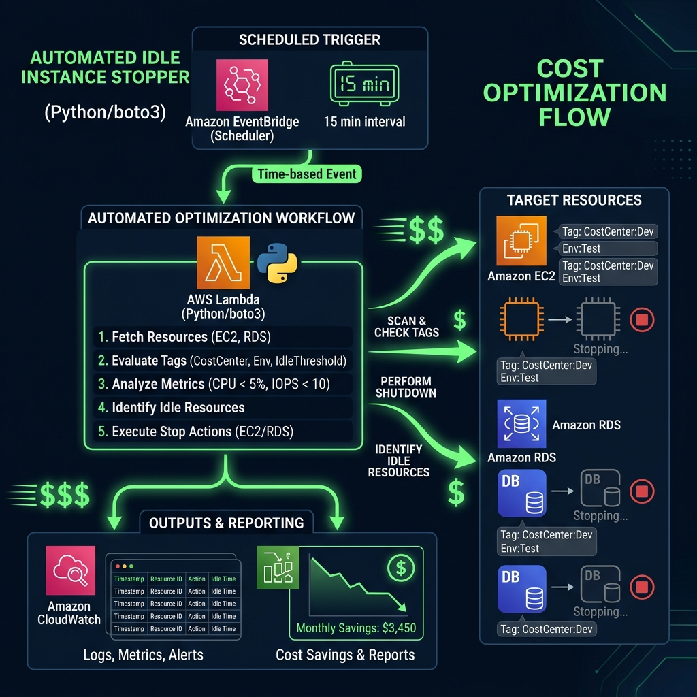
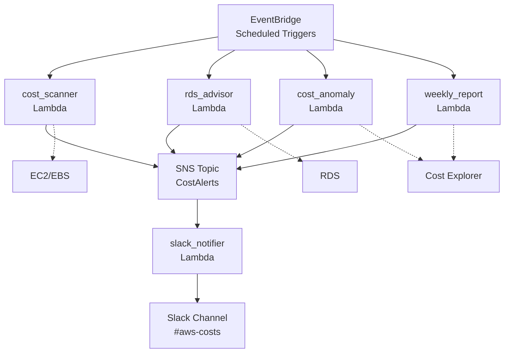

# Project 10: Cost Optimizer Workbook

> 🧠 **ภาพจำก่อนอ่าน:** 🧪 Lab → 📊 Usage → 💰 Cost → ✅ Optimize → 🧹 Cleanup  
> 🎨 [Visual Guide ของวิชานี้](../../VISUAL-MEMORY-GUIDE-TH.md) — ภาพช่วยจำ ไม่แทนคำอธิบายและคำสั่งจริง

โปรเจกต์นี้เน้นการสร้างระบบอัตโนมัติเพื่อค้นหาและแจ้งเตือนเกี่ยวกับทรัพยากร AWS ที่สูญเปล่า (AWS resource waste) โดยใช้ Python (Boto3) และ AWS Lambda เพื่อสแกนหาทรัพยากรที่ไม่ได้ใช้งาน เช่น Underutilized EC2 Instances, Unattached EBS Volumes และความผิดปกติของค่าใช้จ่าย (Cost Anomalies) พร้อมส่งการแจ้งเตือนเพื่อให้ทีมจัดการได้ทันท่วงที

### ทักษะที่จะได้เรียนรู้ (Skills Learned)
- **AWS Cost Management**: การทำความเข้าใจ Cost Explorer และรูปแบบการใช้งาน (Usage Patterns)
- **Boto3 (Python)**: การเขียนโปรแกรมเพื่อจัดการทรัพยากร AWS
- **Event-Driven Automation**: การใช้ EventBridge เพื่อตั้งเวลาสแกนแบบอัตโนมัติ (Schedule Scan)
- **FinOps**: การประยุกต์ใช้มาตรการประหยัดค่าใช้จ่ายโดยไม่ส่งผลกระทบต่อประสิทธิภาพการทำงาน (Performance)
- **Alerting**: การจัดรูปแบบการแจ้งเตือนบน Slack เพื่อให้ทีมนำข้อมูลไปใช้ดำเนินการต่อได้ทันที

---

## 1. Scenario (สถานการณ์จำลอง)

### ข้อความ Slack จาก CFO (The CFO's Slack)
วันที่ 2 ของเดือน CFO ของบริษัทเพิ่งส่งภาพสกรีนช็อตของ AWS billing dashboard เข้ามาในช่อง #engineering-leads
- CFO: "ช่วยอธิบายทีว่าทำไมค่าใช้จ่าย AWS ของเราถึงพุ่งจาก $6,200 เป็น $8,400 ภายในเวลาแค่ 30 วัน? เราไม่ได้เปิดตัวผลิตภัณฑ์ใหม่เลยนะ ผมขอรายละเอียดสรุปว่าเงินก้อนนี้หมดไปกับอะไรภายในสิ้นสัปดาห์นี้ และเราต้องหาวิธีป้องกันไม่ให้เกิดเรื่องเซอร์ไพรส์แบบนี้อีก"

### การสืบสวนหาสาเหตุ (The Investigation)
คุณใช้เวลาทั้งบ่ายในการไล่ดูข้อมูลบน Cost Explorer และได้พบสาเหตุต่อไปนี้:
- Ghost Resources: พบ EBS volumes จำนวน 12 ตัวที่หลงเหลือมาจาก EC2 instances ที่ถูกลบไปแล้ว ซึ่งยังคงคิดค่าบริการอยู่ $120 ต่อเดือน
- Idle Instances: พบเครื่อง t3.large จำนวน 3 เครื่องในบัญชี Dev ที่ทำงานโดยใช้ CPU เฉลี่ยแค่ 0.1% ตลอดช่วงสองสัปดาห์ที่ผ่านมา
- ตัวปัญหาหลัก (The Culprit): มีคนเปิดใช้งาน NAT Gateway ทิ้งไว้ใน test VPC แล้วลืมปิด ซึ่งไม่ได้ประมวลผลข้อมูลเลย (0 bytes) แต่เสียค่าบริการขั้นต่ำ $32 ต่อเดือน รวมค่าข้อมูล
- ความผิดปกติ (Anomaly): ค่าบริการ S3 พุ่งสูงขึ้นเนื่องจากสคริปต์บันทึก Log ถูกตั้งค่าระดับความสำคัญเป็น "DEBUG" โดยไม่ได้ตั้งใจ ส่งผลให้ไฟล์ Log เต็ม bucket ที่ไม่มีการตั้งค่า Lifecycle Policy

### แนวคิดการจัดการค่าใช้จ่าย (Concept)
เปรียบเทียบค่าใช้จ่าย Cloud เหมือน "ค่าน้ำค่าไฟในบ้าน"
- Unattached Volumes: เหมือน "เปิดก๊อกน้ำทิ้งไว้แต่ไม่มีใครใช้"
- Underutilized EC2: เหมือน "เปิดแอร์ตัวใหญ่ในห้องเล็กๆ" (เปลืองไฟเกินความจำเป็น)
- Cost Optimizer: เหมือน "พนักงานประหยัดพลังงาน" ที่คอยเดินเช็คและปิดไฟที่ไม่ได้ใช้ให้เราอัตโนมัติ

### เป้าหมาย (The Goal)
คุณมีเวลา 1 สัปดาห์ในการสร้าง AWS Cost Optimizer System:
- ตรวจหาทรัพยากรที่สูญเปล่า (Scan for Waste): พัฒนาระบบอัตโนมัติในการตรวจจับ Unattached EBS Volumes, Idle EC2 instances และ Unused NAT Gateways
- ให้คำแนะนำสำหรับ RDS (Advise on RDS): ระบุ RDS instances ที่มีการจองทรัพยากรสูงเกินความจำเป็น (Over-provisioned)
- ตรวจจับความผิดปกติ (Detect Anomalies): แจ้งเตือนเมื่อค่าบริการของบริการใดๆ เพิ่มขึ้นมากกว่า 20% แบบสัปดาห์ต่อสัปดาห์ (Week-over-week)
- รายงานประจำสัปดาห์ (Weekly Report): ส่งรายงานสรุป 5 อันดับบริการที่แพงที่สุดและจุดที่สามารถประหยัดค่าใช้จ่ายเพิ่มเติมได้ไปยัง Slack

### ประสบการณ์จากหน้างานจริง (Production Experience)
- Tagging is Everything: FinOps จะเป็นไปไม่ได้เลยถ้าไม่มีการติด Tag (เช่น Owner, Project, Environment) การทำ Cost Optimizer ที่ดีควรจะแจ้งเตือนผู้ใช้งานที่ไม่ปฏิบัติตามนโยบายการติด Tag ด้วย
- Automation vs. Safety: ใน Production "อย่าลบอัตโนมัติ" ในทันที! ให้ส่งแจ้งเตือนล่วงหน้า 3 วัน หากเจ้าของทรัพยากรไม่มีการตอบสนอง ค่อยทำการ Stop หรือ Delete เพื่อป้องกันความเสียหายต่อธุรกิจ (Business Continuity)

### การนำไปใช้ในงานจริง (Real-World Use Cases)
- Sandbox Cleanup: ลบทรัพยากรในห้องทดลองของ Developer ทุกวันศุกร์เวลา 18:00 เพื่อไม่ให้เสียเงินฟรีในวันหยุดสุดสัปดาห์
- Anomaly Detection: แจ้งเตือนเมื่อมีการสร้างทรัพยากรตระกูลเครื่องราคาสูง เช่น p3.16xlarge โดยไม่ได้ขออนุมัติล่วงหน้า
- Monthly Budget Report: ส่งรายงานสรุปค่าใช้จ่ายแยกตามแผนกให้ผู้บริหารทุกสิ้นเดือน
- Budget Control: ใช้ควบคุมงบประมาณของบริษัท Startup เพื่อให้ใช้เงินทุนได้อย่างคุ้มค่าที่สุด
- FinOps Culture: ใช้สร้างวัฒนธรรม FinOps (Finance + DevOps) ในองค์กรขนาดใหญ่

### เงื่อนไขการส่งมอบงาน (Definition of Done)
- Lambda functions ทั้ง 4 ตัว (Cost Scanner, RDS Advisor, Cost Anomaly และ Weekly Report) รันทำงานตามตารางเวลา (Schedule) ที่กำหนดไว้
- การแจ้งเตือนถูกส่งไปยัง Slack โดยใช้ Block Kit เพื่อให้อ่านง่าย
- การกำหนดสิทธิ์ IAM roles เป็นไปตามหลักการ Least Privilege
- โครงสร้างพื้นฐานทั้งหมด (Infrastructure) ถูกจัดการผ่าน Terraform ทั้งหมด
- ค่าใช้จ่ายรายเดือนโดยประมาณของระบบนี้ต่ำกว่า $5 (อยู่ภายใต้ข้อกำหนด Free Tier)

---

## 2. Topology Diagram (แผนผังระบบ)



### ภาพรวมสถาปัตยกรรม (Architecture Overview)
ระบบนี้ใช้กลุ่มของ AWS Lambda functions ที่ถูกทริกเกอร์โดย EventBridge (Cron jobs) เพื่อสแกนตรวจสอบสภาพแวดล้อม AWS ค้นหาทรัพยากรที่สูญเปล่าและความผิดปกติของค่าใช้จ่าย
- ข้อมูลที่ตรวจพบจะถูกส่งไปยัง SNS topic ส่วนกลาง
- SNS topic จะทริกเกอร์ Lambda function สำหรับแจ้งเตือนเพื่อโพสต์อัปเดตไปยัง Slack channel



### ส่วนประกอบของระบบ (Components)
- **EventBridge**: ทำหน้าที่ตั้งเวลาการทำงาน (Schedule) ของ Lambda functions (เช่น ทำงานทุกวันเพื่อตรวจสอบ Anomaly หรือทำงานทุกสัปดาห์เพื่อทำ Resource Scanning)
- **Lambda Functions**:
  - `cost_scanner`: ใช้ Boto3 ในการตรวจสอบการใช้งาน EC2, EBS และ NAT Gateway
  - `rds_advisor`: ตรวจสอบ CloudWatch metrics เพื่อดูจำนวนการเชื่อมต่อ (Connection Counts) และ CPU ของ RDS
  - `cost_anomaly`: คิวรีข้อมูลจาก Cost Explorer API เพื่อเปรียบเทียบการเปลี่ยนแปลงของค่าใช้จ่ายแบบสัปดาห์ต่อสัปดาห์ (Week-over-week)
  - `weekly_report`: สร้างรายงานสรุปค่าใช้จ่ายภาพรวมประจำสัปดาห์
- **SNS Topic**: ทำหน้าที่เป็น "Bus" ส่วนกลางสำหรับรับส่งการแจ้งเตือนเกี่ยวกับค่าใช้จ่ายทั้งหมด
- **Slack Notifier**: Lambda function ขนาดเล็กที่ทำหน้าที่แปลงข้อความจาก SNS ให้กลายเป็นข้อความแบบ Slack Block Kit และส่งผ่าน Webhook
- **Cost Explorer API**: แหล่งข้อมูลอ้างอิงหลัก (Source of Truth) สำหรับข้อมูลบิลและค่าใช้จ่ายทั้งหมดของระบบ

### ประสิทธิภาพและการรองรับการขยายตัว (Performance & Scaling)
- **Estimated Load**: สคริปต์รองรับการสแกนทรัพยากรระดับหลักพัน (1,000+) ชิ้นในหนึ่งรอบการทำงาน
- **Bottlenecks**: คอขวดมักเกิดจาก Lambda Execution Timeout (สูงสุด 15 นาที) หากต้องสแกนหลาย Region พร้อมกัน
- **Scaling Approach**: ใช้เทคนิค Step Functions เพื่อแยกการทำงานเป็นแบบ Parallel ราย Region หรือเพิ่ม Memory ให้ Lambda เพื่อประมวลผล Python ได้เร็วขึ้น

---

## 3. Prerequisites & Estimated Time (สิ่งที่ต้องเตรียมและเวลาที่ใช้)

### สิ่งที่ต้องเตรียม (Prerequisites)
- AWS CLI v2 ที่ตั้งค่าความปลอดภัย (Credentials) เรียบร้อยแล้ว
- Terraform 1.7 ขึ้นไป
- Python 3.11 ขึ้นไป
- Slack Webhook URL (สำหรับการส่งแจ้งเตือน)

### ระยะเวลาที่ใช้โดยประมาณ
- 10-12 ชั่วโมง

---

## 4. Tasks (ขั้นตอนการปฏิบัติ)

### Task 1: การตั้งค่า Slack Webhook และการติดตั้ง Infrastructure ด้วย Terraform
เริ่มต้นด้วยการกำหนด Webhook URL สำหรับส่งแจ้งเตือนไปยัง Slack และ Deploy โครงสร้างพื้นฐานด้วย Terraform
- ตั้งค่าตัวแปรสภาพแวดล้อมสำหรับ Slack Webhook URL
- ดำเนินการติดตั้งด้วยคำสั่งต่อไปนี้:

```bash
# 1. Configure your Slack Webhook
export SLACK_WEBHOOK_URL="https://hooks.slack.com/services/..."

# 2. Deploy infrastructure
cd src/terraform
terraform init
terraform apply -var="slack_webhook_url=$SLACK_WEBHOOK_URL"
```

### Task 2: การตรวจจับทรัพยากรที่ไม่ได้ใช้งาน (Zombie Resources)
ทรัพยากรที่ไม่ได้ใช้งานแต่ยังถูกเปิดทิ้งไว้ เช่น EBS Volumes ที่ไม่ได้เชื่อมต่อ หรือ Elastic IPs ที่ไม่ได้ผูกกับอินสแตนซ์ ถือเป็นค่าใช้จ่ายที่สิ้นเปลือง
- ค้นหา EBS Volumes ที่มีสถานะเป็น "available" (ไม่ได้ถูกใช้งาน) โดยใช้คำสั่ง AWS CLI:

```bash
# ค้นหา EBS Volumes ที่สถานะเป็น 'available' (ไม่ได้ใช้)
aws ec2 describe-volumes --filters Name=status,Values=available --query "Volumes[*].VolumeId"
```

### Task 3: การปิดระบบอัตโนมัติ (Instance Scheduler)
สำหรับสภาพแวดล้อมเพื่อการพัฒนา (Dev/Test) เราไม่จำเป็นต้องเปิดเครื่องทิ้งไว้ตลอด 24 ชั่วโมง
- ใช้ AWS Lambda เพื่อสั่งปิดเครื่อง EC2 instances ในเวลาเลิกงานและเปิดใหม่ตอนเช้าผ่านตารางเวลาของ EventBridge

### Task 4: การย้ายระบบไปใช้งาน Graviton (ARM64)
ประหยัดค่าใช้จ่ายและเพิ่มประสิทธิภาพการทำงานโดยการเลือกใช้สถาปัตยกรรมที่เหมาะสม
- เลือกใช้อินสแตนซ์ประเภท Graviton เช่น m6g หรือ c6g ซึ่งให้ประสิทธิภาพต่อราคาที่ดีกว่าสถาปัตยกรรมแบบ x86 สูงสุดถึง 40%

---

## 5. Verification (การตรวจสอบผลการทำงาน)

### ก่อนการเริ่มใช้งาน (Pre-Deployment)
- [ ] เปิดใช้งาน AWS Cost Explorer เรียบร้อยแล้วใน Billing Console
- [ ] สร้าง Slack Webhook URL สำหรับ Workspace ของคุณแล้ว
- [ ] ติดตั้ง Terraform 1.7 ขึ้นไป และ Python 3.11 ขึ้นไป บนเครื่องของตนเองแล้ว
- [ ] ตั้งค่า AWS CLI ด้วย IAM user ที่มีสิทธิ์ระดับ Administrative Access

### ขั้นตอนการเริ่มใช้งาน (Deployment)
- [ ] รันคำสั่ง `terraform init` และ `terraform apply`
- [ ] ตรวจสอบว่ามี Lambda functions จำนวน 4 ตัวถูกสร้างขึ้นใน AWS Console
- [ ] ตรวจสอบว่า EventBridge rules อยู่ในสถานะ Active
- [ ] ตรวจสอบ IAM roles ของแต่ละ Lambda เพื่อให้มั่นใจว่าเป็นไปตามหลักการ Least Privilege

### หลังการติดตั้งและการทดสอบ (Post-Deployment & Testing)
- [ ] ทริกเกอร์ `cost_scanner` Lambda ด้วยตนเอง (Manual) และตรวจดูผลลัพธ์ใน Slack
- [ ] ทริกเกอร์ `cost_anomaly` Lambda ด้วยตนเอง และตรวจสอบว่าการคิวรีข้อมูลถูกต้อง
- [ ] ตรวจสอบ CloudWatch Logs เพื่อดูว่ามีความผิดพลาด (Error) ระหว่างการรัน Lambda หรือไม่
- [ ] ตรวจสอบว่าข้อความ Slack สำหรับรายงานประจำสัปดาห์ (Weekly Report) ใช้ Block Kit ในการจัดรูปแบบให้สวยงามและอ่านง่าย
- [ ] ตั้งค่าการแจ้งเตือน AWS Budget alert ที่ระดับ 80% และ 100% ของค่าใช้จ่ายรายเดือนที่คาดการณ์ไว้

### การทดลองเชิงปฏิบัติ (Sandbox & Chaos Testing)
- ลองสร้าง EBS Volume ทิ้งไว้โดยไม่ผูกกับ EC2:
  - ผลลัพธ์ที่คาดหวัง: ระบบควรตรวจเจอภายในรอบการสแกนถัดไป และส่งข้อความเตือนเข้า Slack ทันที เพื่อพิสูจน์ว่าระบบสแกนได้อย่างถูกต้องและรวดเร็ว
- ลองรันสคริปต์โดยไม่มี Permission (IAM):
  - ผลลัพธ์ที่คาดหวัง: Lambda จะพบข้อผิดพลาด (Error) และบันทึกลง CloudWatch Logs เพื่อเรียนรู้การตั้งค่าแบบ Least Privilege IAM Policy

### สรุปและขั้นตอนการทำความสะอาดระบบ (Cleanup & Summary)
- ระบบการควบคุมค่าใช้จ่ายที่ดี เริ่มต้นจากการมองเห็นทรัพยากรทั้งหมด (Visibility)
- Automation คือกุญแจสำคัญของการทำ FinOps อย่างยั่งยืน
- ไม่ควร Hardcode รหัสผ่านหรือข้อมูลสำคัญลงในสคริปต์ (ควรใช้ Environment Variables หรือ Secrets Manager)
- หลังจากทดสอบระบบเสร็จเรียบร้อยแล้ว ให้ทำการลบทรัพยากรออกทั้งหมดเพื่อป้องกันการเสียค่าใช้จ่ายโดยไม่จำเป็น:

```bash
# ลบโครงสร้างพื้นฐานที่ติดตั้งผ่าน Terraform
terraform destroy
```
- ตรวจสอบและลบ EBS Volumes หรือ Snapshots ที่สร้างขึ้นระหว่างการทดสอบใน AWS Console ด้วยตนเอง

---

## 6. Troubleshooting (การแก้ไขปัญหาที่พบบ่อย)

### อาการ: ระบบส่งรายงานว่างเปล่า (Empty Report) ทั้งที่มีทรัพยากรเปิดทิ้งไว้
- **การวิเคราะห์ (Analysis)**:
  - ตรวจสอบ IAM Permissions: Lambda มีสิทธิ์ `ec2:DescribeVolumes` และ `ce:GetCostAndUsage` หรือไม่
  - ตรวจสอบ Region Configuration: สคริปต์สแกนแค่ `us-east-1` แต่ทรัพยากรอยู่ใน `ap-southeast-1` หรือไม่
  - ตรวจสอบ Filtering Logic: เงื่อนไขในสคริปต์ (เช่น Volume ต้องว่างเกิน 7 วัน) เข้มงวดเกินไปหรือไม่
- **สาเหตุ (Root Cause)**: สิทธิ์ IAM ไม่ครอบคลุมการดึงข้อมูลข้าม Region หรือไม่มีสิทธิ์เข้าถึง Cost Explorer API
- **การแก้ไข (Fix)**: อัปเดต IAM Policy ให้เป็นแบบ Cross-region และตรวจสอบรายชื่อ Region ในตัวแปรสภาพแวดล้อม (Environment Variables)

### Error 1: "ClientError: An error occurred (AccessDenied) when calling the GetCostAndUsage operation"
- **สาเหตุ**: IAM role ที่กำหนดให้กับ Lambda function ไม่มีสิทธิ์ `ce:GetCostAndUsage`
- **การแก้ไข**: เพิ่ม policy ต่อไปนี้เข้าไปใน IAM role ของ Lambda:

```json
{
    "Effect": "Allow",
    "Action": "ce:GetCostAndUsage",
    "Resource": "*"
}
```

### Error 2: "Metrics are empty for certain EC2 instances"
- **สาเหตุ**: EC2 instance อาจจะเพิ่งถูกสร้างขึ้นมาไม่นาน หรือยังไม่ได้ติดตั้ง CloudWatch agent (อย่างไรก็ตาม metrics พื้นฐานอย่าง CPU ไม่จำเป็นต้องใช้ agent)
- **การแก้ไข**: ตรวจสอบให้มั่นใจว่าเครื่องรันมาแล้วอย่างน้อยตามระยะเวลาที่ตั้งใน `Period` (เช่น 7 วัน) และตรวจสอบว่า instance ID ในส่วน dimensions ของการคิวรี CloudWatch นั้นถูกต้อง

### Error 3: "Slack Webhook returns 403 or 404"
- **สาเหตุ**: Webhook URL ไม่ถูกต้อง หมดอายุ หรือ Slack App ถูกลบไปแล้ว
- **การแก้ไข**: ตรวจสอบ URL ในการตั้งค่า "Incoming Webhooks" ของ Slack App และตรวจสอบว่าโครงสร้างข้อมูล JSON payload ที่ส่งไปนั้นถูกต้อง

### Error 4: "Lambda Timeout"
- **สาเหตุ**: การสแกนทรัพยากรจำนวนหลายร้อยชิ้นข้ามหลาย Region อาจใช้เวลามากกว่าค่า Timeout เริ่มต้นที่ตั้งไว้ 3 วินาที
- **การแก้ไข**: ปรับเพิ่มค่า Lambda timeout ให้เป็นอย่างน้อย 1 นาที (60 วินาที) ในไฟล์ Terraform configuration เช่น `timeout = 60`

### Error 5: "Cost Explorer Data not available"
- **สาเหตุ**: อาจจะยังไม่ได้เปิดใช้งาน Cost Explorer ในบัญชี AWS หรือคุณกำลังพยายามคิวรีข้อมูลของวันปัจจุบัน (Cost Explorer จะมีข้อมูลดีเลย์ประมาณ 24 ชั่วโมง)
- **การแก้ไข**: เปิดใช้งาน Cost Explorer ใน Billing Console และตรวจสอบให้แน่ใจว่าค่า `StartTime` และ `EndTime` ในคำสั่งคิวรีไม่ได้รวมวันปัจจุบันเข้าไปด้วย

### ปัญหาเพิ่มเติม (Additional Issues)
- **ปัญหา Lambda "Timeout" ขณะสั่งปิดเครื่อง**:
  - อาการ: สคริปต์ปิดเครื่องทำงานไม่ครบทุกตัว
  - วิธีแก้ไข: เพิ่มค่า Timeout ของ Lambda และใช้การทำงานแบบขนาน (Parallel execution)
- **ย้ายไป Graviton แล้วแอปพัง**:
  - อาการ: แอปไม่สามารถทำงานบนอินสแตนซ์ใหม่ได้
  - สาเหตุ: แอปหรือ Binary ไม่รองรับสถาปัตยกรรม ARM64
  - วิธีแก้ไข: คอมไพล์แอปใหม่เป็นแบบ Multi-arch หรือใช้ Docker Buildx เพื่อสร้าง Image สำหรับ ARM64
- **สิทธิ์การลบ (Cleanup) ไม่เพียงพอ**:
  - อาการ: สคริปต์แจ้งว่าลบทรัพยากรไม่ได้
  - วิธีแก้ไข: เพิ่มสิทธิ์ `ec2:DeleteVolume` หรือ `ec2:ReleaseAddress` ใน IAM Role ของตัวจัดการ

---

## 7. Exercises & Solutions (แบบฝึกหัดและแนวทางการแก้ไข)

### แบบฝึกหัดที่ 1: การติด Tag เพื่อแบ่งประเภทค่าใช้จ่าย (ระดับง่าย)
พัฒนาสคริปต์ `cost_scanner.py` เพิ่มเติมเพื่อตรวจสอบ EC2 instances และ EBS volumes ที่ไม่ได้ติด Tag `CostCenter` หรือ `Environment`
- **ข้อกำหนด (Requirement)**: รายงานทรัพยากรใดก็ตามที่ไม่มี Tag เหล่านี้ในรายงานประจำสัปดาห์บน Slack ภายใต้หัวข้อ "Untagged Resources"
- **เหตุผล (Why)**: ในองค์กรขนาดใหญ่ ทรัพยากรที่ไม่ได้ติด Tag มักเป็นแหล่งกำเนิดหลักของ "ค่าใช้จ่ายที่ซ่อนอยู่" เนื่องจากไม่มีใครรู้ว่าใครเป็นเจ้าของทรัพยากรเหล่านั้น

#### แนวทางการแก้ไข (Solution)
เพิ่มฟังก์ชันนี้เข้าไปใน `cost_scanner.py` เพื่อค้นหาทรัพยากรที่ไม่ได้ติด Tag:

```python
def check_untagged_resources(ec2_client):
    untagged = []
    required_tags = ['CostCenter', 'Environment']
    
    # Check Instances
    instances = ec2_client.describe_instances(Filters=[{'Name': 'instance-state-name', 'Values': ['running']}])
    for reservation in instances['Reservations']:
        for instance in reservation['Instances']:
            tags = {tag['Key']: tag['Value'] for tag in instance.get('Tags', [])}
            if not all(tag in tags for tag in required_tags):
                untagged.append(f"Instance: {instance['InstanceId']}")
                
    # Check Volumes
    volumes = ec2_client.describe_volumes()
    for volume in volumes['Volumes']:
        tags = {tag['Key']: tag['Value'] for tag in volume.get('Tags', [])}
        if not all(tag in tags for tag in required_tags):
            untagged.append(f"Volume: {volume['VolumeId']}")
            
    return untagged
```

### แบบฝึกหัดที่ 2: ระบบสั่งปิดเครื่อง Dev อัตโนมัติ (ระดับปานกลาง)
ปรับปรุง `cost_scanner.py` Lambda ให้หยุดการทำงาน (Stop แต่ไม่ใช่ Terminate) ของ EC2 instance ใดก็ตามที่มี Tag `Environment=Dev` หากมีค่าเฉลี่ย CPU utilization น้อยกว่า 1% ติดต่อกันนานกว่า 4 ชั่วโมง
- **ข้อกำหนด (Requirement)**: ส่งแจ้งเตือนไปยัง Slack ก่อนสั่งหยุดการทำงานของเครื่อง โดยให้มีระยะเวลาผ่อนผัน (Grace Period) 1 ชั่วโมง เพื่อให้ผู้ใช้งานสามารถยกเลิกคำสั่งได้หากจำเป็น
- **เหตุผล (Why)**: วิธีนี้สามารถประหยัดค่าใช้จ่ายได้มากถึง 70% ของงบสภาพแวดล้อมสำหรับการพัฒนา (Development Environment) ที่มักจะถูกเปิดทิ้งไว้ข้ามคืนและในช่วงวันหยุดสุดสัปดาห์

#### แนวทางการแก้ไข (Solution)
เพิ่มบล็อกโค้ดส่วนตรรกะ (Logic) เข้าไปใน `cost_scanner.py` โดยใช้ CloudWatch metrics และคำสั่ง `stop_instances`:

```python
def auto_stop_dev_instances(ec2_client, cw_client):
    instances = ec2_client.describe_instances(Filters=[
        {'Name': 'tag:Environment', 'Values': ['Dev']},
        {'Name': 'instance-state-name', 'Values': ['running']}
    ])
    
    for reservation in instances['Reservations']:
        for instance in reservation['Instances']:
            instance_id = instance['InstanceId']
            
            # Get CPU metrics for the last 4 hours
            stats = cw_client.get_metric_statistics(
                Namespace='AWS/EC2',
                MetricName='CPUUtilization',
                Dimensions=[{'Name': 'InstanceId', 'Value': instance_id}],
                StartTime=datetime.utcnow() - timedelta(hours=4),
                EndTime=datetime.utcnow(),
                Period=3600,
                Statistics=['Average']
            )
            
            if stats['Datapoints']:
                avg_cpu = sum(d['Average'] for d in stats['Datapoints']) / len(stats['Datapoints'])
                if avg_cpu < 1.0:
                    print(f"Stopping idle dev instance: {instance_id}")
                    ec2_client.stop_instances(InstanceIds=[instance_id])
```

### แบบฝึกหัดที่ 3: ระบบแนะนำ S3 Lifecycle (ระดับยาก)
สร้าง Lambda function ใหม่ในชื่อ `s3_advisor.py` เพื่อวิเคราะห์ข้อมูล S3 bucket metrics และ access logs
- **ข้อกำหนด (Requirement)**: ค้นหา bucket ที่ไม่มีการเข้าใช้งานเลยเป็นเวลา 30 วัน พร้อมทำข้อเสนอแนะในการย้ายข้อมูลไปยัง S3 Glacier Deep Archive
- **ข้อกำหนด (Requirement)**: ค้นหา bucket ที่ยังไม่มีการตั้งค่า Lifecycle Policies ใดๆ
- **เหตุผล (Why)**: ค่าใช้จ่ายในการจัดเก็บข้อมูลของ S3 (S3 Storage Costs) สามารถเพิ่มขึ้นได้อย่างไม่มีที่สิ้นสุด หากไม่มีการย้ายประเภทจัดเก็บ (Transition) หรือกำหนดวันหมดอายุ (Expire) ให้กับ Object

#### แนวทางการแก้ไข (Solution)
ตัวอย่างโค้ดสำหรับ `s3_advisor.py`:

```python
import boto3
from datetime import datetime, timedelta

def lambda_handler(event, context):
    s3 = boto3.client('s3')
    buckets = s3.list_buckets()['Buckets']
    recommendations = []
    
    for bucket in buckets:
        name = bucket['Name']
        
        # Check for Lifecycle Configuration
        try:
            s3.get_bucket_lifecycle_configuration(Bucket=name)
        except s3.exceptions.ClientError as e:
            if e.response['Error']['Code'] == 'NoSuchLifecycleConfiguration':
                recommendations.append(f"Bucket '{name}' has no lifecycle policy.")
                
    return recommendations
```
