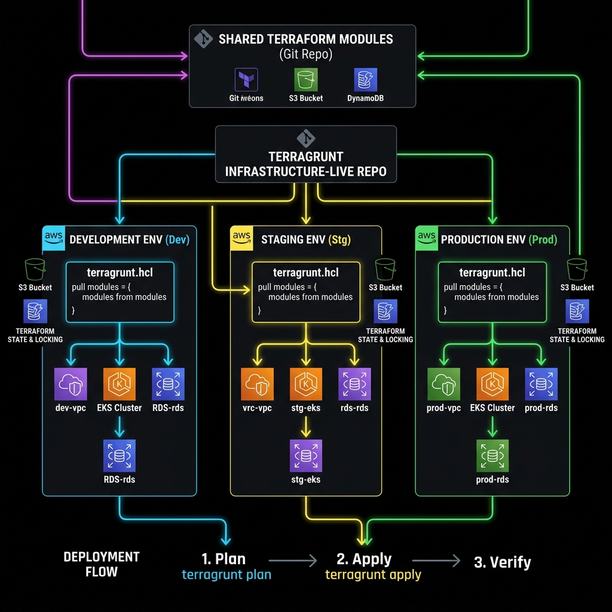
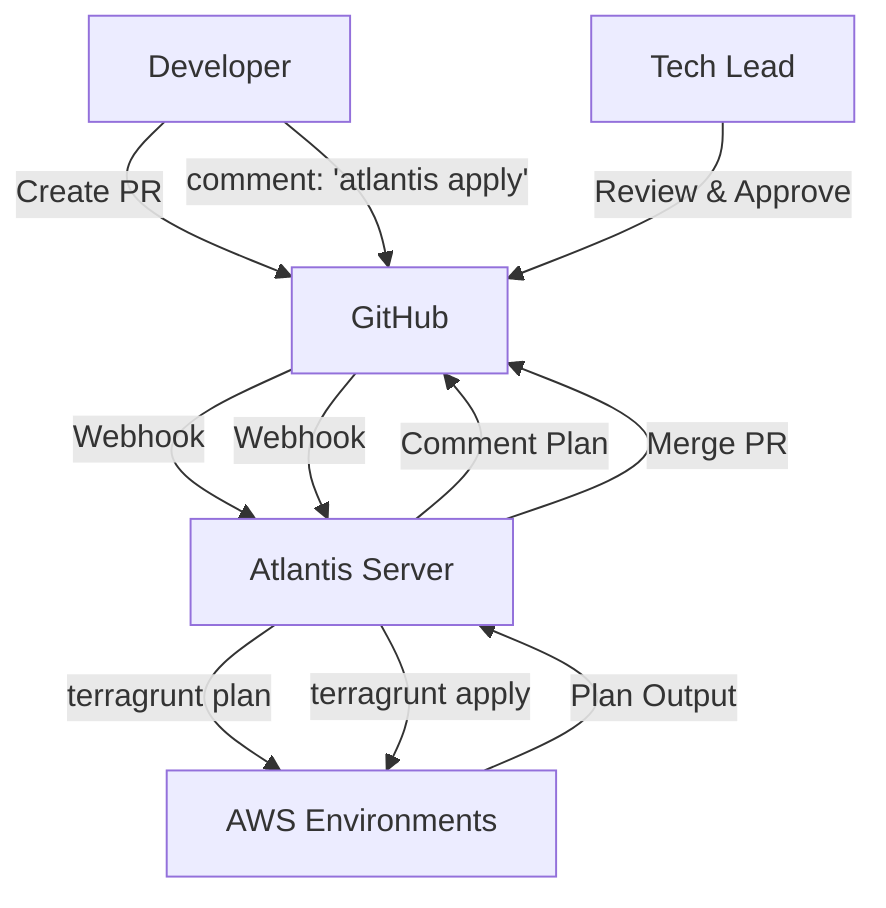

# Multi-Environment Terraform Workbook

## 1. Scenario (สถานการณ์จำลอง)

### วิกฤตการณ์ (The Crisis)
- เช้าวันจันทร์ที่แสนวุ่นวาย คุณกำลัง deploy อัปเดตเล็กๆ ของ RDS module ใน Production environment
- ผลลัพธ์จาก `terraform plan` แสดงรายการแก้ไขถึง 45 รายการ รวมถึงขั้นตอนการลบ Database หลักของ Production ด้วย
- ความจริงคุณต้องการเพียงแค่แก้ไขระยะเวลาการเก็บ Backup (Backup retention period) เท่านั้น

### สาเหตุหลัก (The Root Cause)
- มีการแก้ไขระบบด่วนกลางดึก (Hotfix) เมื่อสามสัปดาห์ก่อน
- Senior Engineer ได้ปรับเปลี่ยน database instance class และ storage type บน AWS Console โดยตรง เพื่อแก้ปัญหาระบบช้าชั่วคราว
- ไม่มีการปรับปรุงข้อมูลใน Terraform code ให้สอดคล้องกัน ทำให้โค้ดล้าหลังกว่าทรัพยากรจริงบนระบบคลาวด์
- Dev, Staging และ Production environment มี VPC CIDR block และมาตรฐาน Tagging ที่แตกต่างกันโดยสิ้นเชิง เนื่องจากสร้างขึ้นคนละเวลากัน

### เป้าหมาย (The Goal)
- CTO ต้องการให้ทุกการเปลี่ยนแปลงใน Production แสดงให้เห็นชัดเจนบน Pull Request
- ได้รับการอนุมัติอย่างถูกต้องก่อนที่จะสั่งนำไปใช้จริง โดยห้ามแก้ปัญหาด้วยการเปลี่ยนค่าบน AWS Console แบบไม่มีการควบคุมเด็ดขาด
- ต้องการให้ Dev environment มีความคล้ายคลึงกับ Production แต่มีขนาดที่เล็กลง เพื่อทดสอบระบบได้ดียิ่งขึ้น

คุณมีภารกิจหลักดังนี้:
- ปรับโครงสร้างใหม่ (Re-structure): ย้าย Terraform code ทั้งหมดไปอยู่ภายใต้โครงสร้างที่จัดการด้วย Terragrunt
- ทำ GitOps: ตั้งค่า Atlantis (หรือจำลองเวิร์กโฟลว์) เพื่อให้รัน `terraform apply` ได้หลังจาก Pull Request ได้รับการอนุมัติแล้วเท่านั้น
- ตรวจจับ Drift (Drift Detection): สร้าง Drift Detector Lambda เพื่อส่งแจ้งเตือนเข้า Slack หากสภาพแวดล้อมจริงไม่ตรงกับโค้ด
- บังคับใช้เวิร์กโฟลว์ (Enforce Workflow): บล็อกการสั่ง Apply ด้วยมือใน Production environment

### นิยามของคำว่าเสร็จ (Definition of Done)
- โครงสร้างไดเรกทอรี `terragrunt/` ครอบคลุมการทำงานของ Dev, Staging และ Production
- ตั้งค่าไฟล์ `atlantis.yaml` เพื่อรัน Plan แบบอัตโนมัติ
- มีสคริปต์ Drift Detector Lambda (`drift_detector.py`) ที่ใช้งานได้จริง
- มีคู่มือ "วิธีดึงข้อมูลกลับมาซิงค์กัน (How to Restore Sync)" รวมอยู่ในหัวข้อการแก้ไขปัญหา

### การนำไปใช้ในงานจริง (Real-World Application)
- **Global Expansion**: ใช้ Module เดียวกันเพื่อขยายระบบไปยังภูมิภาคใหม่ๆ เช่น Singapore, Tokyo หรือ London ในเวลาไม่กี่นาที
- **Compliance Audit**: ใช้ Git History เพื่อเป็นหลักฐานตรวจสอบว่า "ใครเป็นคนสั่งแก้ไขระบบ เมื่อไหร่ และเพื่อวัตถุประสงค์อะไร"
- **Self-Service Infrastructure**: เปิดโอกาสให้ Developer สามารถร้องขอหรือสร้าง Database ได้ด้วยตัวเองผ่านการเปิด Pull Request โดยมีทีม DevOps คอยตรวจสอบความปลอดภัย
- ป้องกันและลดความผิดพลาดจากฝีมือมนุษย์ (Human Error) เมื่อต้องแก้ไขระบบใน Production

### ค่าใช้จ่ายในการดำเนินงาน (Operational Cost)
- ค่าบริการ S3 และ DynamoDB สำหรับการเก็บ Terraform State (ราคาต่ำมาก)
- ค่าบริการสำหรับรัน Atlantis Server (สามารถเลือกใช้งาน Fargate หรือเครื่องขนาดเล็กเพื่อประหยัดทรัพยากรได้)

## 2. Topology Diagram (แผนผังระบบ)



### แผนผังระบบเดิม (Original System Overview)
```text
[Developer PR] → [GitHub Webhook] → [Atlantis Server]
                                          ↓ (Executes)
                                   [Terragrunt / Terraform]
                                          ↓ (State Lock)
                                   [S3 + DynamoDB Table]
                                          ↓ (API Call)
                                   [AWS Dev / Staging / Prod]
```

### ไดอะแกรมเวิร์กโฟลว์ (Workflow Diagram)


### กลยุทธ์การจัดโครงสร้างไฟล์ (File Structure Strategy)
```text
terragrunt/
├── terragrunt.hcl          # Global config (S3 bucket, DynamoDB, Providers)
├── dev/
│   ├── env_vars.yaml       # Dev-specific constants (account_id, region)
│   ├── networking/         # Inherits root + dev_vars
│   ├── ecs/                # Depends on networking
│   └── rds/                # Depends on networking
└── prod/
    ├── env_vars.yaml       # Prod-specific constants
    └── ...
```

### ส่วนประกอบหลัก (Components)
- **Terragrunt**: ทำหน้าที่เป็น Orchestration layer เพื่อช่วยให้โค้ด IaC เป็นแบบ DRY และคอยจัดการลำดับความสัมพันธ์ (Dependency) ระหว่าง Module ต่างๆ
- **Atlantis**: ทำหน้าที่เป็น GitOps executor เพื่อช่วยตรวจสอบว่าทุกการแก้ไขระบบได้ผ่านการทำ Peer review และเก็บประวัติย้อนหลังเรียบร้อยแล้ว
- **GitHub Actions**: ใช้สำหรับรัน Lint, ตรวจความปลอดภัย (Trivy) และสั่งเริ่มทำงานระบบตรวจจับ Drift (Drift Detector)
- **S3 & DynamoDB**: ใช้สำหรับเก็บ remote state จากส่วนกลางและทำ State locking เพื่อป้องกันการรันพร้อมกัน

### ประสิทธิภาพและการรองรับการขยายตัว (Performance & Scaling)
- **การรองรับโหลด (Estimated Load)**: รองรับการจัดการทรัพยากรขนาดใหญ่ระดับหมื่นชิ้น (10,000+ Resources) ด้วยการจัดการผ่าน Modules
- **คอขวดระบบ (Bottlenecks)**: คอขวดมักเกิดจากกระบวนการ Plan และ Apply ในระบบที่มีขนาดใหญ่เกินไป ทำให้ State file มีขนาดใหญ่และประมวลผลช้า
- **การจัดการขนาดของระบบ (Scaling Approach)**: ใช้แนวคิด Module Decoupling (แยก State File ออกเป็นส่วนๆ เช่น VPC, Database, App) เพื่อให้สั่งรันเฉพาะส่วนที่เกี่ยวข้องเท่านั้น

### ประสบการณ์จากหน้างานจริง (Production Experience & Insight)
- **Workspaces vs Folders**: ในระบบระดับ Enterprise การแยกแบบ Folder-based structure (ที่จัดการโดย Terragrunt) มีความปลอดภัยสูงกว่า Terraform Workspaces เนื่องจากลดความเสี่ยงที่วิศวกรจะกด Apply ผิด Environment อย่างไม่ตั้งใจ
- **รัศมีความเสียหาย (Blast Radius)**: พยายามออกแบบ Module ให้มีขนาดเล็กและแยกจากกัน (Small Blast Radius) เพื่อจำกัดผลกระทบหากส่วนใดส่วนหนึ่งมีปัญหา จะได้ไม่ทำให้ระบบทั้งหมดหยุดทำงาน

## 3. Prerequisites & Estimated Time (สิ่งที่ต้องเตรียมและเวลาที่ใช้)

### เวลาที่ใช้ในการทำ Lab
- เวลาที่คาดว่าจะใช้: 12-15 ชั่วโมง

### สิ่งที่ต้องเตรียมก่อนเริ่ม
- AWS CLI v2 ที่ตั้งค่าเรียบร้อยแล้ว
- Terraform 1.7+
- Terragrunt 0.55+
- GitHub repository สำหรับเก็บโค้ด IaC ของคุณ

## 4. Tasks (ขั้นตอนการปฏิบัติ)

### Task 1: การออกแบบและจัดเตรียมโครงสร้างโฟลเดอร์สำหรับ Multi-Environment ด้วย Terragrunt (Folder Structure Design)
- วางโครงสร้างโฟลเดอร์ให้เป็นระเบียบตามหลัก DRY (Don't Repeat Yourself) เพื่อให้สามารถเรียกใช้ Terraform Modules ร่วมกันระหว่าง Dev, Staging และ Production ได้
- โครงสร้างโฟลเดอร์จะมีลักษณะดังนี้:
```
project-11/
├── modules/
│   └── app/           ← Terraform module (เขียนครั้งเดียว)
│       ├── main.tf
│       └── variables.tf
├── environments/
│   ├── dev/
│   │   └── terragrunt.hcl
│   ├── staging/
│   │   └── terragrunt.hcl
│   └── prod/
│       └── terragrunt.hcl
└── terragrunt.hcl     ← Root config (Remote State)
```

### Task 2: การตั้งค่า Remote State จากส่วนกลางในไฟล์ Root `terragrunt.hcl`
- สร้างไฟล์ `terragrunt.hcl` ไว้ที่ระดับ Root ของโปรเจกต์ เพื่อทำการสืบทอดคอนฟิกที่จำเป็น เช่น การตั้งค่า S3 Bucket สำหรับจัดเก็บ State File และ DynamoDB สำหรับทำ State Locking จากส่วนกลาง
- กำหนดค่าในไฟล์ Root `terragrunt.hcl` ดังนี้:
```hcl
remote_state {
  backend = "s3"
  generate = {
    path      = "backend.tf"
    if_exists = "overwrite"
  }
  config = {
    bucket         = "thaidemo-terraform-state"
    key            = "${path_relative_to_include()}/terraform.tfstate"
    region         = "ap-southeast-1"
    encrypt        = true
    dynamodb_table = "thaidemo-terraform-locks"
  }
}
```

### Task 3: การตั้งค่าไฟล์คอนฟิกในระดับ Environment `terragrunt.hcl`
- แต่ละ Environment (เช่น Dev, Staging, Prod) จะมีไฟล์ `terragrunt.hcl` ของตนเองเพื่อทำการโหลดการสืบทอดค่าจากไฟล์ Root และระบุค่า Inputs (Variables) ที่แตกต่างกันออกไป
- สร้างและตั้งค่าไฟล์ `terragrunt.hcl` ของ Dev Environment ดังนี้:
```hcl
include "root" {
  path = find_in_parent_folders()
}

terraform {
  source = "../../modules/app"
}

inputs = {
  environment    = "dev"
  instance_count = 1
  instance_type  = "t3.micro"
  db_instance    = "db.t3.micro"
  enable_multi_az = false
}
```

### Task 4: การกำหนดค่า GitOps Workflow ด้วย Atlantis
- ใช้ Atlantis เพื่อตรวจสอบและควบคุมการรันคำสั่ง `terraform plan` และ `terraform apply` ผ่าน GitHub Pull Request เสมอ เพื่อลดผลกระทบของการแก้ไขระบบโดยตรง
- สร้างและกำหนดค่าไฟล์ `atlantis.yaml` ดังนี้:
```yaml
version: 3
autodiscover:
  enabled: true
projects:
- name: dev-networking
  dir: terragrunt/dev/networking
  workflow: terragrunt
- name: dev-ecs
  dir: terragrunt/dev/ecs
  workflow: terragrunt
- name: dev-rds
  dir: terragrunt/dev/rds
  workflow: terragrunt
- name: prod-networking
  dir: terragrunt/prod/networking
  workflow: terragrunt
  apply_requirements: [approved, mergeable]

workflows:
  terragrunt:
    plan:
      steps:
      - run: terragrunt plan -out=$PLANFILE
    apply:
      steps:
      - run: terragrunt apply $PLANFILE
```

### Task 5: การติดตั้งระบบตรวจจับความต่างของทรัพยากร (Drift Detection)
- สภาพแวดล้อมระบบอาจโดนแก้ไขโดยตรงจากผู้ดูแลระบบผ่านหน้า AWS Console ทำให้เกิด State Drift ซึ่งจะส่งผลให้ State File ไม่ตรงกับทรัพยากรจริง
- สามารถเขียนสคริปต์ Python ในไฟล์ `drift_detector.py` เพื่อรันคำสั่งตรวจสอบและส่งการแจ้งเตือนดังนี้:
```python
import subprocess
import json
import urllib.request
import os

SLACK_WEBHOOK_URL = os.environ.get('SLACK_WEBHOOK_URL')

def send_slack_alert(env, drift_details):
    if not SLACK_WEBHOOK_URL:
        print("SLACK_WEBHOOK_URL not set. Printing to stdout instead.")
        print(f"DRIFT DETECTED in {env}:\n{drift_details}")
        return

    payload = {
        "text": f"⚠️ *Terraform Drift Detected* in `{env}` environment!\n```\n{drift_details}\n```"
    }
    
    req = urllib.request.Request(
        SLACK_WEBHOOK_URL, 
        data=json.dumps(payload).encode('utf-8'),
        headers={'Content-Type': 'application/json'}
    )
    urllib.request.urlopen(req)

def run_plan(env_dir):
    try:
        print(f"Running terragrunt plan in {env_dir}...")
        result = subprocess.run(
            ["terragrunt", "plan", "-detailed-exitcode", "-no-color"],
            cwd=env_dir,
            capture_output=True,
            text=True
        )
        
        # detailed-exitcode: 0 = no changes, 1 = error, 2 = changes present
        if result.returncode == 2:
            return True, result.stdout
        elif result.returncode == 1:
            return False, f"Error running plan:\n{result.stderr}"
            
        return False, None
        
    except FileNotFoundError:
        return False, "terragrunt command not found"

if __name__ == "__main__":
    # In a real scenario, we'd iterate over all env dirs
    environments = [
        "../terragrunt/dev/networking",
        "../terragrunt/prod/networking"
    ]
    
    for env in environments:
        if os.path.exists(env):
            has_drift, details = run_plan(env)
            if has_drift:
                send_slack_alert(env, details)
            else:
                print(f"{env}: No drift detected or error occurred.")
        else:
            print(f"Directory {env} not found, skipping.")
```
- ตั้งค่าให้ระบบ Drift Detection ทำงานอัตโนมัติผ่าน GitHub Actions ด้วยการสร้างไฟล์ `.github/workflows/drift-detection.yml`:
```yaml
on:
  schedule:
    - cron: '0 1 * * *'  # ทุกวัน 01:00 UTC

jobs:
  detect-drift:
    runs-on: ubuntu-latest
    steps:
      - run: terragrunt run-all plan -detailed-exitcode
```

### Task 6: การสั่งรันคำสั่งจัดการระบบด้วย CLI ของ Terragrunt
- ใช้คำสั่ง CLI ของ Terragrunt ในการจัดการ Infrastructure ในแต่ละ Environment:
```bash
# Deploy ทุก environment พร้อมกัน (parallel)
terragrunt run-all apply

# Deploy เฉพาะ Dev
cd environments/dev
terragrunt apply

# ดู Plan ทั้งหมดก่อน Apply
terragrunt run-all plan

# Destroy เฉพาะ Dev (ลบ Resource ทิ้ง)
cd environments/dev
terragrunt destroy
```

## 5. Verification (การตรวจสอบผลการทำงาน)

### รายการตรวจสอบความถูกต้อง (Verification Checklist)
- [ ] ติดตั้ง Terragrunt binary และตั้งค่าใน PATH เรียบร้อยแล้ว
- [ ] สร้าง S3 Bucket สำหรับเก็บ Terraform State แล้ว (สร้างเองหรือผ่าน Bootstrap)
- [ ] สร้าง DynamoDB Table สำหรับทำ State locking เรียบร้อยแล้ว
- [ ] สร้าง GitHub repository และตั้งค่า GitHub Secrets เช่น `AWS_ACCESS_KEY_ID` เรียบร้อยแล้ว
- [ ] ไฟล์ `terragrunt.hcl` ระดับ Root กำหนดค่า S3 Bucket และ Region ถูกต้อง
- [ ] มีไฟล์ `dev/terragrunt.hcl` และ `prod/terragrunt.hcl` ประจำแต่ละ Environment เรียบร้อยแล้ว
- [ ] Module ทั้งหมดอ้างอิงผ่าน Relative path หรือ Git URL ที่ระบุ Version ชัดเจน
- [ ] มีการใช้บล็อก `dependency` สำหรับทรัพยากรที่มีความเกี่ยวข้องกัน เช่น RDS ต้องรอให้สร้าง VPC หรือ Networking เสร็จก่อน
- [ ] ไฟล์ `atlantis.yaml` ระบุรายละเอียดและพาธของ Project ต่างๆ ได้ถูกต้อง
- [ ] เซิร์ฟเวอร์ Atlantis สามารถรับ Webhook จาก GitHub ได้
- [ ] ทดสอบเวิร์กโฟลว์ Pull Request เรียบร้อยแล้ว เช่น การสั่ง Plan เมื่อเปิด PR และสั่ง Apply ผ่าน Comment
- [ ] รันคำสั่ง `terragrunt run-all plan` เพื่อตรวจสอบความถูกต้องของทุก Environment
- [ ] ตรวจสอบว่าใน `prod` ต้องได้รับการอนุมัติอย่างน้อย 1 คนก่อนที่จะสามารถสั่ง Apply ได้
- [ ] ยืนยันว่า Drift Detector Lambda ทำงานตรงตาม Schedule ที่ตั้งไว้ใน GitHub Actions
- [ ] ตรวจสอบและยืนยันว่าไฟล์ State ได้รับการตั้งค่า Encryption at rest ใน S3 เรียบร้อยแล้ว

### การทดลองเชิงปฏิบัติเพื่อตรวจสอบความแข็งแกร่ง (Verification through Testing)
- **ลองรันคำสั่งโดยไม่มีการรีวิว (Unreviewed Changes)**: พยายาม Merge โค้ดไปยัง Main Branch โดยข้ามขั้นตอนการรัน `atlantis plan`
  - *ผลลัพธ์*: ระบบควรจะมี Branch Protection และ Atlantis จะต้องบล็อกการผสานสาขา เพื่อพิสูจน์ว่า GitOps Workflow ทำงานได้อย่างปลอดภัย
- **ลองจงใจทำให้โค้ดพังในสภาพแวดล้อมเดียว (Test Isolation)**: ลองแก้ไขค่าที่ส่งผลเสียหรือลบ Resource สำคัญใน Dev Environment
  - *ผลลัพธ์*: ผลกระทบจากการทำลายทรัพยากรจะต้องจำกัดอยู่เฉพาะใน Dev Environment เท่านั้น โดยที่ Production Environment จะต้องไม่ได้รับผลกระทบ เพื่อยืนยันหลักการ Environment Isolation

### ขั้นตอนการเคลียร์ระบบหลังเสร็จสิ้น (Cleanup Phase)
- สามารถสั่งทำลายทรัพยากรทั้งหมดได้ผ่านคำสั่ง: `terragrunt run-all destroy`
- *คำเตือน*: คำสั่งนี้จะลบทรัพยากรทั้งหมดในทุกสภาพแวดล้อม (Environments) ควรใช้งานด้วยความระมัดระวังสูงสุด

## 6. Troubleshooting (การแก้ไขปัญหาที่พบบ่อย)

### กรณีที่ 1: Terragrunt หา Root Config ไม่เจอ
- **อาการ**: พบข้อความข้อผิดพลาด "Could not find a terragrunt.hcl file in any parent folder"
- **สาเหตุ**: ไฟล์ `terragrunt.hcl` ในระดับ Root ไม่ได้อยู่ในตำแหน่งที่ระบุ หรือตำแหน่งไฟล์เปลี่ยนไป
- **วิธีแก้ไข**: ตรวจสอบว่ามีไฟล์ `terragrunt.hcl` ในโฟลเดอร์หลัก และมีการใช้ฟังก์ชัน `find_in_parent_folders()` ในไฟล์คอนฟิกของ Environment อย่างถูกต้อง

### กรณีที่ 2: การทำ State Locking บน S3 / DynamoDB ล้มเหลว (DynamoDB Lock Error)
- **อาการ**: เกิดข้อความข้อผิดพลาด "Error: Error acquiring the state lock"
- **สาเหตุ**: มีผู้ใช้อื่นกำลังรันคำสั่ง Plan หรือ Apply อยู่ หรือคำสั่งก่อนหน้านี้หยุดทำงานกระทันหันจากข้อขัดข้องของเครือข่าย ส่งผลให้ไม่มีการปลด Lock ใน DynamoDB Table
- **วิธีแก้ไข**:
  - ตรวจสอบใน DynamoDB Table ชื่อ `thaidemo-terraform-locks` ว่ามีรายการ Lock ค้างอยู่หรือไม่
  - ยืนยันว่าไม่มีการรันคำสั่งอื่นค้างไว้จริง
  - นำ `LockID` จากข้อความแจ้งเตือนความผิดพลาดมารันคำสั่ง:
    `terraform force-unlock <LOCK_ID>`
  - หรือลบแถวที่มีค่านั้นใน DynamoDB Table ด้วยตนเองอย่างระมัดระวัง

### กรณีที่ 3: ข้อผิดพลาดเรื่อง Module Version
- **อาการ**: พบข้อความข้อผิดพลาด "Error: No matching versions for module"
- **สาเหตุ**: มีการปรับเปลี่ยน Module tag หรือเวอร์ชันในไฟล์ `terragrunt.hcl` แต่ไม่ได้รันคำสั่งสำหรับอัปเดตแคช
- **วิธีแก้ไข**: รันคำสั่ง `terragrunt init -upgrade` เพื่อดึงข้อมูล Module เวอร์ชันล่าสุดมาใช้ใหม่

### กรณีที่ 4: การสิทธิ์การ Assume Role ถูกปฏิเสธ (Assume Role Access Denied)
- **อาการ**: พบข้อความข้อผิดพลาด "AccessDenied: User is not authorized to perform: sts:AssumeRole"
- **สาเหตุ**: IAM User ของคุณไม่มีการอนุญาตสิทธิ์ใน IAM policy เพื่อทำการ Assume Role ของแต่ละสภาพแวดล้อมที่ตั้งไว้ในบล็อก `iam_role`
- **วิธีแก้ไข**: เพิ่มการอนุญาตสิทธิ์ `sts:AssumeRole` ใน IAM policy ของ User ปลายทางที่ระบุใน ARN

### กรณีที่ 5: หาไฟล์คอนฟิกของ Terragrunt ไม่พบขณะสั่งรันคำสั่ง
- **อาการ**: พบข้อความข้อผิดพลาด "Terragrunt could not find a terragrunt.hcl file"
- **สาเหตุ**: สั่งรันคำสั่ง `terragrunt plan` หรือ `terragrunt apply` จากโฟลเดอร์ที่ไม่มีไฟล์คอนฟิก `.hcl` อยู่
- **วิธีแก้ไข**: ย้ายเข้าไปทำงานที่โฟลเดอร์ระดับล่างสุด (Leaf Node) เช่น `terragrunt/dev/networking` ก่อนที่จะเริ่มสั่งรันคำสั่งใดๆ

### กรณีที่ 6: การส่งค่าผ่าน Environment Variable ล้มเหลว
- **อาการ**: พบข้อความข้อผิดพลาด "Invalid environment variable 'TF_VAR_xxx'"
- **สาเหตุ**: มีการประกาศส่งค่าของตัวแปรผ่าน Environment Variable แต่ตัวแปรนั้นยังไม่ได้ถูกนิยามในไฟล์ `variables.tf` ของ Terraform Module
- **วิธีแก้ไข**: ตรวจสอบให้มั่นใจว่าข้อมูล Input ทั้งหมดที่ส่งผ่านคำสั่ง Terragrunt ได้รับการนิยามโครงสร้าง `variable` รองรับไว้ใน Terraform Module เสมอ

### กรณีที่ 7: การสั่งรันคำสั่ง `run-all apply` ล้มเหลวในบางสภาพแวดล้อม
- **อาการ**: การรันคำสั่ง Apply ในบางสภาพแวดล้อมขัดข้องไม่ผ่านการทำงาน
- **สาเหตุ**: มีการอ้างอิง Dependencies ข้ามระหว่างสภาพแวดล้อมกันโดยตรง เช่น Staging ไปใช้งาน VPC ของ Dev
- **วิธีแก้ไข**: ออกแบบและตั้งค่าโครงสร้าง Module ให้แต่ละสภาพแวดล้อมมีความเป็นอิสระต่อกันในการสร้างและจัดการ Infrastructure ของตัวเอง

## 7. Exercises & Solutions (แบบฝึกหัดและแนวทางการแก้ไข)

### แบบฝึกหัดที่ 1: การจัดการค่าใช้จ่ายราย Environment (ระดับง่าย)
- **โจทย์**: แก้ไขไฟล์ `dev/terragrunt.hcl` เพื่อจำกัดให้ใช้เฉพาะ Spot Instances สำหรับ ECS Clusters ในขณะที่ไฟล์ `prod/terragrunt.hcl` จะต้องใช้ On-Demand Instances เท่านั้น โดยใช้ Common Module ตัวเดียวกัน แต่ส่งค่า `capacity_provider_strategy` ที่แตกต่างกันผ่าน Terragrunt
- **แนวทางแก้ไข**: ในไฟล์ `dev/ecs/terragrunt.hcl` ให้เพิ่มอินพุตค่าการตั้งค่า FARGATE_SPOT ดังนี้:
```hcl
include "root" { path = find_in_parent_folders() }

inputs = {
  capacity_providers = ["FARGATE_SPOT"]
  default_capacity_provider_strategy = {
    capacity_provider = "FARGATE_SPOT"
    weight            = 100
  }
}
```

### แบบฝึกหัดที่ 2: การจำลอง Staging ให้เหมือน Production (ระดับปานกลาง)
- **โจทย์**: CTO ต้องการให้ Staging Environment มีสถาปัตยกรรมที่เหมือนกับ Production แบบ 100% แต่ย่อขนาดของระบบลงมา โดยสร้างไฟล์ `staging/terragrunt.hcl` ที่ใช้ฟังก์ชัน `read_terragrunt_config` เพื่อโหลดค่าเริ่มต้นทั้งหมดมาจาก `prod/terragrunt.hcl` แล้วทำ Override เฉพาะค่า `min_size` และ `instance_type` เพื่อจำลองระบบในงบประมาณที่ประหยัดกว่า
- **แนวทางแก้ไข**: ในไฟล์ `staging/terragrunt.hcl` ให้เขียนคอนฟิกดังนี้:
```hcl
include "root" { path = find_in_parent_folders() }

locals {
  prod_vars = read_terragrunt_config(find_in_parent_folders("prod/terragrunt.hcl"))
}

inputs = merge(
  local.prod_vars.inputs,
  {
    instance_type = "t3.micro"
    min_size      = 1
    max_size      = 2
  }
)
```

### แบบฝึกหัดที่ 3: ระบบแก้ไขปัญหา Drift อัตโนมัติ (ระดับยาก)
- **โจทย์**: พัฒนาโค้ดของ Drift Detector Lambda (`drift_detector.py`) เพิ่มเติม เพื่อให้สั่งรัน `atlantis apply` อัตโนมัติผ่าน GitHub API เมื่อตรวจพบ Drift ใน Dev Environment โดยสำหรับ Production จะเน้นส่งการแจ้งเตือนเท่านั้น แต่สำหรับ Dev จะสั่งทำ Force Sync อัตโนมัติทุกวันเพื่อความคล่องตัว
- **แนวทางแก้ไข**: ตัวอย่างการเขียนสคริปต์ Python ในไฟล์ `drift_detector.py` เพื่อสั่ง Trigger การทำงานของ GitHub Actions Workflow:
```python
import requests

def trigger_github_workflow(repo, workflow_id, token):
    url = f"https://api.github.com/repos/{repo}/actions/workflows/{workflow_id}/dispatches"
    headers = {
        "Authorization": f"token {token}",
        "Accept": "application/vnd.github.v3+json"
    }
    data = {"ref": "main"}
    requests.post(url, headers=headers, json=data)
```
