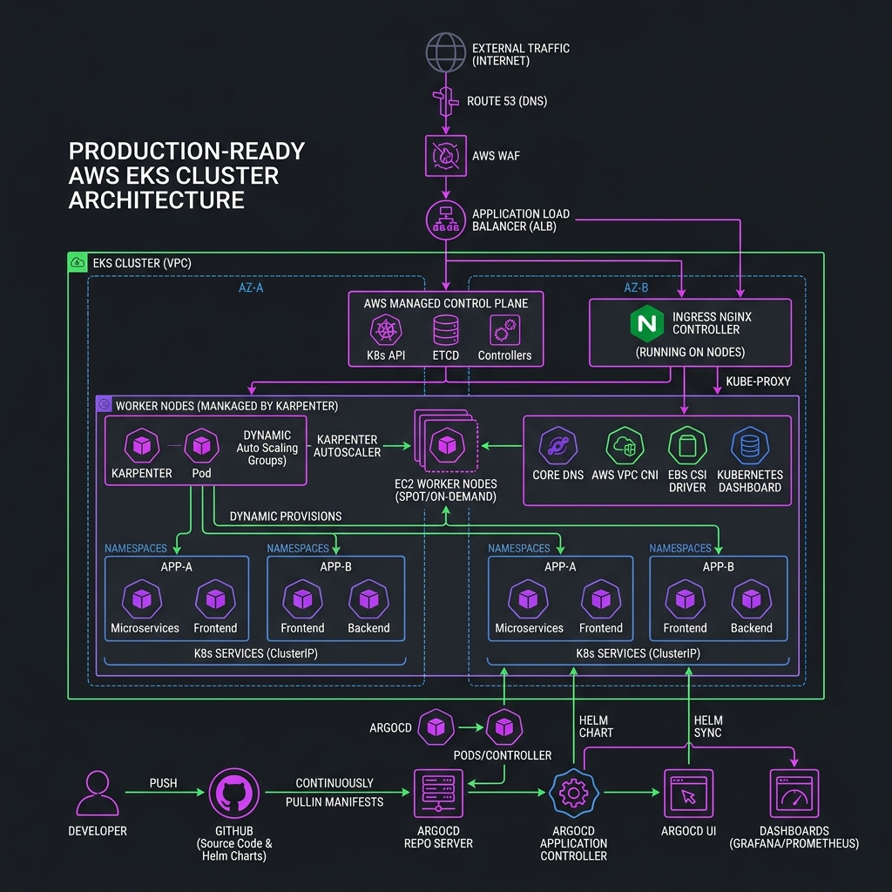
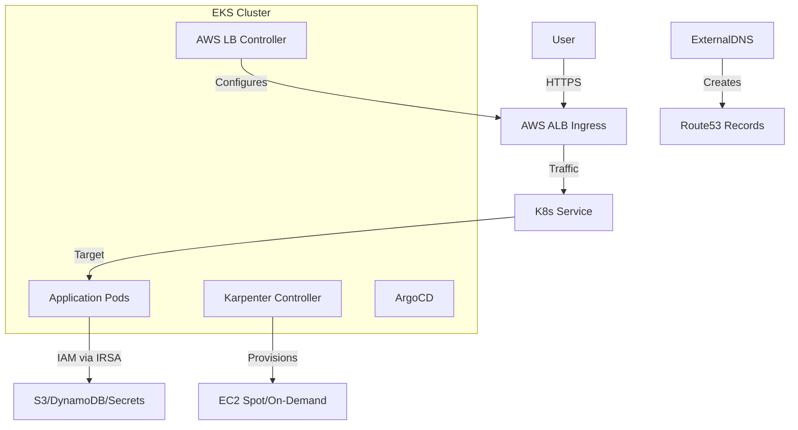

# Project 12: EKS Production-Grade Workbook

## 1. Scenario (สถานการณ์จำลอง)

เรื่องราวและบริบท:
คืนวันอังคาร เวลา 23:30 น. ณ "ThaiCommerce" สตาร์ทอัปอีคอมเมิร์ซที่กำลังเติบโตอย่างรวดเร็ว
- คุณได้รับข้อความ Slack ด่วนระดับ Priority-1 จากคุณสมชาย (CTO) ของบริษัท

ข้อความจากคุณสมชาย:
> @channel ตอนนี้เราชนกำแพงกับ ECS แล้ว การจัดการ 45 Task Definitions แยกกันกลายเป็นฝันร้าย
> - คืนนี้เราเจอปัญหา Deployment ล้มเหลวจาก Race Condition ในการทำ Rolling Update ซึ่งเราไม่สามารถปรับแต่งได้เลย
> - เราต้องการสิทธิ์ในการควบคุมการทำ Scheduling ที่ดีกว่านี้ และประสิทธิภาพด้านต้นทุนที่สูงขึ้น
> - เราจะย้ายไปใช้ EKS ผมต้องการ Cluster ระดับ Production ที่พร้อมรัน Microservices ชุดแรกใน 4 สัปดาห์
> - ห้ามใช้ Click-ops ทุกอย่างต้องเขียนด้วย Terraform
> - ระบบต้องรองรับ Traffic Spikes ได้โดยอัตโนมัติ และประหยัดค่าใช้จ่ายด้วยการใช้ Spot Instances เท่าที่เป็นไปได้

ข้อจำกัดของระบบ:
- Security: Endpoint ของ EKS ต้องเป็น Private เท่านั้น ห้ามเปิด Public Access เข้าหา API Server
- Cost: ใช้ Spot Instances สำหรับ Worker Nodes แต่ต้องรับประกันความพร้อมใช้งานสูง (High Availability)
- Automation: ทรัพยากรทั้งหมดต้องถูกติดตั้งผ่าน Terraform และ Helm
- State: ใช้ S3 Backend สำหรับการเก็บ Terraform State

เกณฑ์การยอมรับงาน (Definition of Done):
1. EKS 1.29 Cluster แบบ Multi-AZ กำลังทำงานอย่างสมบูรณ์
2. Karpenter ได้รับการติดตั้งและตั้งค่าให้สามารถสร้าง Nodes เพิ่มได้โดยอัตโนมัติตามความต้องการของ Pod
3. ArgoCD ได้รับการติดตั้งและสามารถเข้าถึงได้ผ่าน HTTPS ALB Ingress
4. แอปพลิเคชันตัวอย่างถูก Deploy พร้อมการตั้งค่า HPA และ PDB
5. ข้อมูลที่เป็นความลับ (Sensitive Data) ทั้งหมดถูกจัดการผ่าน External Secrets Operator (รันแบบ Mock หรือเชื่อมต่อจริง)

แนวคิดการเปรียบเทียบระบบ:
- Kubernetes (EKS) เปรียบเหมือน "นิติบุคคล" ที่คอยดูแลความเรียบร้อยของบ้านแต่ละหลัง
- Nodes (EC2) เปรียบเหมือน "ที่ดิน" ที่ใช้สำหรับสร้างบ้าน
- Pods (Containers) เปรียบเหมือน "บ้านแต่ละหลัง" ที่มีผู้อยู่อาศัยจริง
- Karpenter เปรียบเหมือน "ฝ่ายจัดหาที่ดิน" ที่จะซื้อที่ดินเพิ่มทันทีเมื่อมีคนจองบ้าน และขายทิ้งทันทีเมื่อคนย้ายออกเพื่อความคุ้มค่าสูงสุด

## 2. Topology Diagram (แผนผังระบบ)



แผนผังแสดงสถาปัตยกรรมของ EKS Cluster:


รายละเอียดขององค์ประกอบระบบ:
- Control Plane: ดูแลและจัดการโดย AWS มีความพร้อมใช้งานสูง (High Availability) ครอบคลุม 3 Availability Zones (AZs)
- Karpenter Controller: ตรวจจับ Pod ที่อยู่ในสถานะ Pending และเรียกใช้งาน EC2 Fleet API โดยตรงเพื่อทำ Node Scaling อย่างรวดเร็ว
- IAM Roles for Service Accounts (IRSA): ใช้ OIDC เพื่อกำหนดสิทธิ์ IAM Permissions ระดับละเอียดให้กับ Pod โดยตรงโดยไม่ต้องฝัง Access Keys บนโหนด
- ArgoCD: ใช้รูปแบบ Pull Model ของ GitOps คอยตรวจสอบความถูกต้องและ Sync สถานะใน Cluster ให้ตรงกับ Git Repository เสมอ

## 3. Prerequisites & Estimated Time (สิ่งที่ต้องเตรียมและเวลาที่ใช้)

สิ่งที่ต้องเตรียมก่อนเริ่มปฏิบัติ:
- AWS CLI v2 ที่ตั้งค่าด้วยสิทธิ์ Administrator Access เรียบร้อยแล้ว
- Terraform เวอร์ชัน 1.7 ขึ้นไป
- เครื่องมือ kubectl และ helm สำหรับจัดการทรัพยากรบน Kubernetes

เวลาที่ใช้ในการปฏิบัติงานโดยประมาณ:
- 20-25 ชั่วโมง

## 4. Tasks (ขั้นตอนการปฏิบัติ)

### Task 1: การสร้าง EKS Cluster ด้วย Terraform (Cluster Provisioning)
- 1. เข้าไปยังไดเรกทอรี `src/terraform` เพื่อตรวจสอบไฟล์ Terraform Configurations เช่น `main.tf` ที่มีการกำหนดค่า `aws_eks_cluster` และ Managed Node Groups เบื้องต้น
- 2. เริ่มต้นระบบและสร้าง Infrastructure ด้วย Terraform:
  ```bash
  cd src/terraform
  terraform init
  terraform apply -auto-approve
  ```
- 3. เมื่อระบบสร้างเสร็จสิ้น ให้รันคำสั่งดึงค่า `kubeconfig` เพื่อใช้สำหรับเชื่อมต่อและควบคุม Cluster:
  ```bash
  aws eks update-kubeconfig --region ap-southeast-1 --name thaidemo-eks --profile thaidemo-dev
  ```
- 4. ตรวจสอบว่าโหนดเริ่มต้นพร้อมทำงานแล้ว:
  ```bash
  kubectl get nodes
  ```
  คุณควรพบ Nodes จำนวน 2 เครื่องจาก Managed Node Group กำลังทำงานอยู่

### Task 2: การติดตั้งและตั้งค่า Karpenter สำหรับ Autoscaling
เพื่อประสิทธิภาพที่รวดเร็วและประหยัดต้นทุนในระดับ Production เราใช้ Karpenter ในการจัดการ Node Autoscaling แทน Cluster Autoscaler แบบดั้งเดิม
- 1. กำหนดตัวแปรสำหรับตั้งค่า Cluster:
  ```bash
  export CLUSTER_NAME="thaidemo-eks"
  export AWS_DEFAULT_REGION="ap-southeast-1"
  ```
- 2. ติดตั้ง Karpenter Controller เข้าสู่ Cluster ผ่าน Helm Chart:
  ```bash
  helm upgrade --install karpenter oci://public.ecr.aws/karpenter/karpenter \
    --version v0.32.1 \
    --namespace karpenter --create-namespace \
    --set settings.clusterName=${CLUSTER_NAME}
  ```
- 3. สร้างไฟล์กำหนดค่า NodePool เพื่อกำหนดลักษณะโหนดที่ Karpenter จะสร้าง (เช่น การใช้ Spot Instances และสถาปัตยกรรม ARM64/AMD64)
  สร้างไฟล์ `src/kubernetes/karpenter/nodepool.yaml`:
  ```yaml
  apiVersion: karpenter.sh/v1beta1
  kind: NodePool
  metadata:
    name: default
  spec:
    template:
      spec:
        requirements:
          - key: "karpenter.sh/capacity-type"
            operator: In
            values: ["spot", "on-demand"] # เลือกใช้ Spot ก่อนเพื่อประหยัดเงิน
          - key: "kubernetes.io/arch"
            operator: In
            values: ["amd64", "arm64"]    # รองรับทั้ง Intel และ Graviton!
     ```
- 4. รันคำสั่ง Apply เพื่อลงทะเบียน NodePool:
  ```bash
  kubectl apply -f src/kubernetes/karpenter/nodepool.yaml
  ```

### Task 3: การติดตั้ง AWS Load Balancer Controller และ Ingress
- 1. ติดตั้ง AWS Load Balancer Controller เพื่อทำหน้าที่ตรวจจับ Ingress resource ใน Cluster และสร้าง ALB บน AWS ให้อัตโนมัติ:
  ```bash
  helm repo add eks https://aws.github.io/eks-charts
  helm install aws-load-balancer-controller eks/aws-load-balancer-controller \
    -n kube-system \
    --set clusterName=thaidemo-eks \
    --set serviceAccount.create=true \
    --set serviceAccount.name=aws-load-balancer-controller
  ```
- 2. สร้าง Ingress Rules เพื่อรับ Traffic และกระจายไปยัง Service ที่ต้องการ
  สร้างไฟล์ `ingress.yaml`:
  ```yaml
  apiVersion: networking.k8s.io/v1
  kind: Ingress
  metadata:
    name: example-ingress
    annotations:
      alb.ingress.kubernetes.io/scheme: internet-facing
      alb.ingress.kubernetes.io/target-type: ip
  spec:
    ingressClassName: alb
    rules:
      - http:
          paths:
            - path: /
              pathType: Prefix
              backend:
                service:
                  name: my-service
                  port:
                    number: 80
  ```
- 3. รันคำสั่ง Apply Ingress เพื่อเชื่อมต่อภายนอกเข้าสู่ระบบ:
  ```bash
  kubectl apply -f ingress.yaml
  ```

### Task 4: การตั้งค่า High Availability ให้กับแอปพลิเคชัน
เพื่อป้องกันไม่ให้ระบบล่มในกรณีที่ Availability Zone (AZ) ใดหนึ่งขัดข้อง เราจำเป็นต้องกระจาย Pod ไปตาม AZs ต่างๆ
- เพิ่มบล็อกคำสั่ง `topologySpreadConstraints` ภายใต้สเปกของ Deployment:
  ```yaml
        topologySpreadConstraints:
          - maxSkew: 1
            topologyKey: topology.kubernetes.io/zone
            whenUnsatisfiable: DoNotSchedule
            labelSelector:
              matchLabels:
                app: my-app
  ```
  โครงสร้างนี้จะบังคับให้ Kubernetes หลีกเลี่ยงการจับกลุ่ม Pods ใน AZ เดียวกันมากเกินไป

### Task 5: ขั้นตอนการอัปเกรดเวอร์ชันของ Kubernetes (จาก 1.28 ไปยัง 1.29)
ในการอัปเดตเวอร์ชันของคลัสเตอร์ระดับ Production ให้ปฏิบัติตามแนวทางการวางแผนและเตรียมย้าย Node Group ต่อไปนี้:
- 1. ตรวจสอบเวอร์ชันและสำรองข้อมูล:
  - ตรวจสอบ EKS 1.29 Release Notes เพื่อหลีกเลี่ยง API ที่ประกาศ Deprecated
  - รันเครื่องมือ `kubent` (Kube No Trouble) เพื่อสแกนหาทรัพยากรเก่าใน Cluster
  - สำรองข้อมูลสถานะสำคัญทั้งหมด เช่น ArgoCD Configurations และค่า Persistent Volumes
- 2. อัปเกรดเวอร์ชัน EKS Control Plane ผ่านไฟล์ Terraform:
  ```hcl
  module "eks" {
    source  = "terraform-aws-modules/eks/aws"
    version = "~> 20.0"

    cluster_version = "1.29"
    # ...
  }
  ```
  รันคำสั่ง:
  ```bash
  terraform apply
  ```
  หมายเหตุ: ขั้นตอนนี้ใช้เวลาอัปเดตระบบประมาณ 10-20 นาที
- 3. อัปเกรด EKS Add-ons (เช่น VPC CNI, CoreDNS, Kube-proxy) เพื่อให้รองรับ Kubernetes 1.29:
  ```bash
  aws eks describe-addon-versions --kubernetes-version 1.29 --addon-name vpc-cni
  ```
- 4. ทำการย้ายโหนดแบบ Rolling Update ของ Managed Node Group:
  - เมื่อตรวจสอบพบว่า Launch Template อัปเดตแล้ว EKS จะจัดการดึงโหนดใหม่ขึ้นมาแทนที่โหนดเก่า
  - จำเป็นต้องตรวจสอบว่าแอปพลิเคชันหลักติดตั้ง PodDisruptionBudgets (PDB) เรียบร้อยเพื่อป้องกันแอปขัดข้องระหว่างสลับโหนด

## 5. Verification (การตรวจสอบผลการทำงาน)

ให้ตรวจสอบสถานะการทำงานของระบบตามรายการด้านล่างนี้:

- [ ] ตรวจสอบว่า VPC ถูกสร้างขึ้นพร้อมกับ 3 Public Subnets และ 3 Private Subnets
- [ ] ตรวจสอบว่า Subnets ได้รับการตั้ง Tags อย่างถูกต้องสำหรับ EKS
- [ ] ตรวจสอบว่า Terraform Backend (S3/DynamoDB) ถูก Initialize เรียบร้อยแล้ว
- [ ] ตรวจสอบว่า KMS Key สำหรับการทำ Secrets Encryption ของ EKS ถูกสร้างขึ้นแล้ว
- [ ] รัน `terraform apply` สำเร็จเสร็จสิ้นโดยไม่มีข้อผิดพลาด
- [ ] ตรวจสอบว่าสถานะของ EKS Cluster เป็น `ACTIVE`
- [ ] ตรวจสอบว่า OIDC Provider ถูกตั้งค่าและเชื่อมต่อเรียบร้อยแล้ว
- [ ] ตรวจสอบว่า Managed Node Groups มีสถานะเป็น `READY`
- [ ] ตรวจสอบว่า Karpenter ถูกติดตั้งและตั้งค่า `NodePool` เรียบร้อยแล้ว
- [ ] ตรวจสอบว่า AWS Load Balancer Controller กำลังทำงานอยู่โดยการดู Logs
- [ ] ตรวจสอบว่า ExternalDNS ทำการ Sync กับ Route53 เรียบร้อยแล้ว
- [ ] ตรวจสอบว่า EBS CSI Driver Pods กำลังทำงานอยู่ใน Namespace `kube-system`
- [ ] สามารถเข้าถึง ArgoCD UI ผ่าน Ingress ได้สำเร็จ
- [ ] ติดตั้งแอปพลิเคชันตัวอย่างผ่าน ArgoCD สำเร็จ
- [ ] ทดสอบว่า HPA สามารถทำการ Scale Pods ตามโหลดที่เกิดขึ้นจริงได้
- [ ] ตรวจสอบว่า PDB ช่วยป้องกันไม่ให้ Pods ทั้งหมดหยุดทำงานพร้อมกันระหว่างการซ่อมบำรุง Cluster
- [ ] ตรวจสอบสถานะการอัปเกรดเวอร์ชันของโหนด:
  ```bash
  kubectl get nodes
  ```
  ทุกลำดับต้องแสดงเวอร์ชัน v1.29.x
- [ ] ตรวจสอบสถานะของ Pods ทั้งหมดใน Cluster:
  ```bash
  kubectl get pods -A
  ```
  ต้องไม่มี Pod ค้างอยู่ในสถานะ Error หรือ Pending

## 6. Troubleshooting (การแก้ไขปัญหาที่พบบ่อย)

### ปัญหาที่ 1: Nodes ไม่เชื่อมต่อกับ Cluster (Nodes are not joining the cluster)
- อาการ: คำสั่ง `kubectl get nodes` ไม่แสดงผลลัพธ์ใดๆ
- สาเหตุ: Subnets ไม่มี Tags ที่กำหนด หรือไม่มี NAT Gateway ใน Private Subnets
- วิธีแก้ไข: ตรวจสอบ Tags `kubernetes.io/cluster/<name> = shared` และตรวจเช็ค Route Table ว่ามี Route `0.0.0.0/0 -> NAT Gateway` หรือไม่

### ปัญหาที่ 2: Ingress ไม่สร้าง ALB หรือค้างสถานะ Pending (Address is Empty / RequestError)
- อาการ: Ingress ค้างอยู่ที่สถานะ `<pending>` หรือช่อง `ADDRESS` ว่างเปล่า
- สาเหตุ:
  - AWS Load Balancer Controller ไม่ได้ทำงาน หรือ Controller ไม่มีสิทธิ์ IAM ในการสร้าง Load Balancer (Trust Policy ของ IRSA ไม่ถูกต้อง)
  - Subnets สำหรับ ALB (Public Subnets) ขาดแท็ก `kubernetes.io/role/elb: 1`
- วิธีแก้ไข:
  - ตรวจสอบ Logs ของ Controller:
    ```bash
    kubectl logs -n kube-system -l app.kubernetes.io/name=aws-load-balancer-controller
    ```
  - ตรวจสอบ OIDC Provider ARN ให้ถูกต้อง
  - เช็คว่าชื่อ ServiceAccount ใน Trust Policy ตรงกันทุกตัวอักษร
  - ตรวจสอบ Tags ของ Subnet

### ปัญหาที่ 3: Karpenter ไม่ยอมสร้าง Nodes ใหม่ (Karpenter not spinning up nodes)
- อาการ: Pods ค้างอยู่ที่สถานะ `Pending` พร้อมข้อความ "no nodes available"
- สาเหตุ:
  - Karpenter `EC2NodeClass` มีการระบุ Security Group หรือ Subnet IDs ที่ไม่ถูกต้อง
  - ขาดสิทธิ์ IAM สำหรับ Karpenter Node Role
  - Subnets ไม่ได้ถูกติดแท็ก `karpenter.sh/discovery: thaidemo-eks`
  - Security Groups ขาดแท็กที่ Karpenter ต้องการ
- วิธีแก้ไข:
  - ตรวจสอบ Logs ของ Karpenter Controller:
    ```bash
    kubectl logs -n karpenter -l app.kubernetes.io/name=karpenter
    ```
  - ตรวจสอบ Tags บน Subnets และ Security Groups

### ปัญหาที่ 4: Unauthorized เมื่อรันคำสั่ง kubectl
- อาการ: แสดงข้อความ `error: You must be logged in to the server (Unauthorized)`
- สาเหตุ: IAM Entity ที่ใช้ไม่ได้อยู่ใน `aws-auth` ConfigMap หรือ EKS Access Entry
- วิธีแก้ไข: ใช้ IAM Role หรือ User ที่ใช้สร้าง Cluster ในการเพิ่มบัญชีของคุณเข้าสู่ Access Entries ของ EKS

### ปัญหาที่ 5: ImagePullBackOff จาก ECR
- อาการ: Pod ไม่สามารถ Pull Image ได้
- สาเหตุ: ขาด Policy `AmazonEC2ContainerRegistryReadOnly` บน IAM Role ของ Node หรือ IRSA
- วิธีแก้ไข: เพิ่ม Policy `AmazonEC2ContainerRegistryReadOnly` ไปยัง Node Group IAM Role หรือ IRSA Role

### ปัญหาที่ 6: ปัญหา Pod Eviction (ทรัพยากรบนโหนดเต็ม)
- อาการ: เครื่อง Node ทำงาน 100% CPU หรือ RAM จนทำให้ Pod ถูกเตะออก (Evicted)
- สาเหตุ: ไม่ได้ตั้งค่า Resource Requests และ Limits ในแอปพลิเคชัน
- วิธีแก้ไข: ตั้งค่า `resources.requests` และ `resources.limits` ใน Deployment ให้ครบทุก Container เพื่อให้ Kubernetes สามารถวางแผนจองพื้นที่บน Node ได้เหมาะสม

### คำสั่ง Kubectl ที่มีประโยชน์ในการตรวจสอบระบบ (Useful Kubectl Commands)

การตรวจสอบเบื้องต้น (Debugging):
- `kubectl get pods -A` - ตรวจสอบ Pods ทั้งหมดในทุก Namespace
- `kubectl describe pod <name>` - ตรวจสอบรายละเอียดของ Pod เมื่อทำงานล้มเหลว
- `kubectl logs -f <name> -c <container>` - ติดตาม Logs ของ Container ที่กำหนด
- `kubectl get events --sort-by='.lastTimestamp'` - ตรวจสอบ Cluster Events เรียงตามเวลา
- `kubectl exec -it <name> -- /bin/bash` - เข้าไปรัน Shell ภายใน Pod

การจัดการทรัพยากร (Resource Management):
- `kubectl top nodes` - ตรวจสอบการใช้งาน CPU/RAM ของแต่ละ Node
- `kubectl top pods` - ตรวจสอบการใช้งาน CPU/RAM ของแต่ละ Pod
- `kubectl get nodes --show-labels` - ดู Labels ของ Node ทั้งหมด (มีประโยชน์สำหรับการเช็ค Karpenter/NodeSelector)
- `kubectl delete pod <name> --grace-period=0 --force` - บังคับลบ Pod ที่ค้างคา

ระบบเครือข่าย (Networking):
- `kubectl get ingress` - รายชื่อ Ingress และ Address ทั้งหมด
- `kubectl port-forward <pod-name> 8080:80` - เชื่อมต่อ Service ไปยังเครื่อง Local โดยไม่ต้องมี Ingress
- `kubectl get svc` - รายชื่อ Service ทั้งหมด

การจัดการคลัสเตอร์ (Cluster Maintenance):
- `kubectl config get-contexts` - ดู Contexts ของ Cluster ทั้งหมด
- `kubectl config use-context <name>` - สลับ Context ไปยัง Cluster ที่กำหนด
- `kubectl drain <node>` - เคลียร์ Pods ออกจาก Node เพื่อซ่อมบำรุง
- `kubectl uncordon <node>` - เปิดให้ Node กลับมารับการ Deploy Pods ได้อีกครั้ง

## 7. Exercises & Solutions (แบบฝึกหัดและแนวทางการแก้ไข)

### แบบฝึกหัดที่ 1: Multi-Tenant Isolation (ระดับง่าย)
โจทย์:
สร้าง Namespace สองตัว ได้แก่ `team-alpha` และ `team-beta`
- กำหนด `ResourceQuota` ให้กับแต่ละ Namespace เพื่อจำกัดจำนวน CPU และ Memory ทั้งหมดที่สามารถใช้งานได้
- กำหนด `LimitRange` เพื่อบังคับให้ Pod มีการระบุค่า Request ขั้นต่ำเสมอ

แนวทางการแก้ไข (Solution):
สร้างไฟล์ ResourceQuota ตัวอย่างสำหรับ Namespace `team-alpha`:
```yaml
apiVersion: v1
kind: ResourceQuota
metadata:
  name: compute-resources
  namespace: team-alpha
spec:
  hard:
    requests.cpu: "4"
    requests.memory: 8Gi
    limits.cpu: "10"
    limits.memory: 16Gi
```

### แบบฝึกหัดที่ 2: Vertical Pod Autoscaler (ระดับปานกลาง)
โจทย์:
ติดตั้ง Vertical Pod Autoscaler (VPA)
- Deploy แอปพลิเคชันที่กินทรัพยากรสูง (Noisy Application) ที่มีการใช้งาน Memory ที่คาดเดาได้ยาก
- กำหนดค่า VPA ในโหมด `Recommender` ก่อนเพื่อดูคำแนะนำการปรับขนาดทรัพยากร
- เปลี่ยนเป็นโหมด `Auto` และสังเกตการทำงาน of VPA ในการสั่ง Restart Pods เพื่อปรับขนาดทรัพยากรโดยอัตโนมัติ

แนวทางการแก้ไข (Solution):
ตัวอย่างการเขียนการตั้งค่า VPA ในโหมด `Auto` เพื่อปรับขนาดทรัพยากรของแอปพลิเคชันโดยอัตโนมัติ:
```yaml
apiVersion: autoscaling.k8s.io/v1
kind: VerticalPodAutoscaler
metadata:
  name: my-app-vpa
spec:
  targetRef:
    apiVersion: "apps/v1"
    kind: Deployment
    name: my-app
  updatePolicy:
    updateMode: "Auto"
```

### แบบฝึกหัดที่ 3: Zero-Downtime Migration (ระดับยาก)
โจทย์:
จำลองการทำ Cluster Upgrade จากเวอร์ชัน 1.28 ไปยัง 1.29
- อัปเดตเวอร์ชัน EKS ในโค้ด Terraform
- สร้าง Node Group ใหม่ (ใช้กลยุทธ์ Blue-Green Node Group Strategy)
- ใส่ Taint ให้กับโหนดเดิมเป็น "NoSchedule"
- ทำการ Drain โหนดเดิมออกทีละโหนด พร้อมทั้งคอยตรวจสอบความสมบูรณ์ของแอปพลิเคชันอย่างต่อเนื่อง
- ลบ Node Group เดิมออกหลังจากที่ Pods ทั้งหมดอพยพไปยังโหนดใหม่เรียบร้อยแล้วอย่างปลอดภัย

แนวทางการแก้ไข (Solution):
สคริปต์สลับ Node Group และทำการ Drain โหนดเดิมออกอย่างปลอดภัย:
```bash
#!/bin/bash
# Drain old nodes safely
# ค้นหาโหนดในกลุ่มเดิม
OLD_NODES=$(kubectl get nodes -l alpha.eksctl.io/nodegroup-name=old-group -o name)
for node in $OLD_NODES; do
  echo "Draining $node..."
  kubectl drain $node --ignore-daemonsets --delete-emptydir-data --force --grace-period=60
done
```

---

## Cost & Cleanup Safety

> [!WARNING]
> EKS, EC2 worker nodes, NAT Gateway, Load Balancer, EBS และ data transfer สามารถสร้างค่าใช้จ่ายต่อเนื่องแม้ไม่มีผู้ใช้งานแอป

ถ้า environment นี้เป็น lab แบบ disposable ให้ cleanup ตาม dependency:

1. ลบ application/Ingress/Service แบบ `LoadBalancer` ที่สร้าง cloud load balancers
2. ลบ workload, Karpenter capacity และ node groups ที่ไม่ต้องใช้
3. destroy Terraform stack/state ที่เป็นเจ้าของ VPC/EKS/NAT/ALB resources
4. ตรวจ EBS volumes, snapshots, Elastic IPs และ Load Balancers ที่อาจ orphan
5. ตรวจ Billing/Cost Explorer หลัง destroy

อย่ารัน destroy กับ production state หรือผิด AWS account/profile
