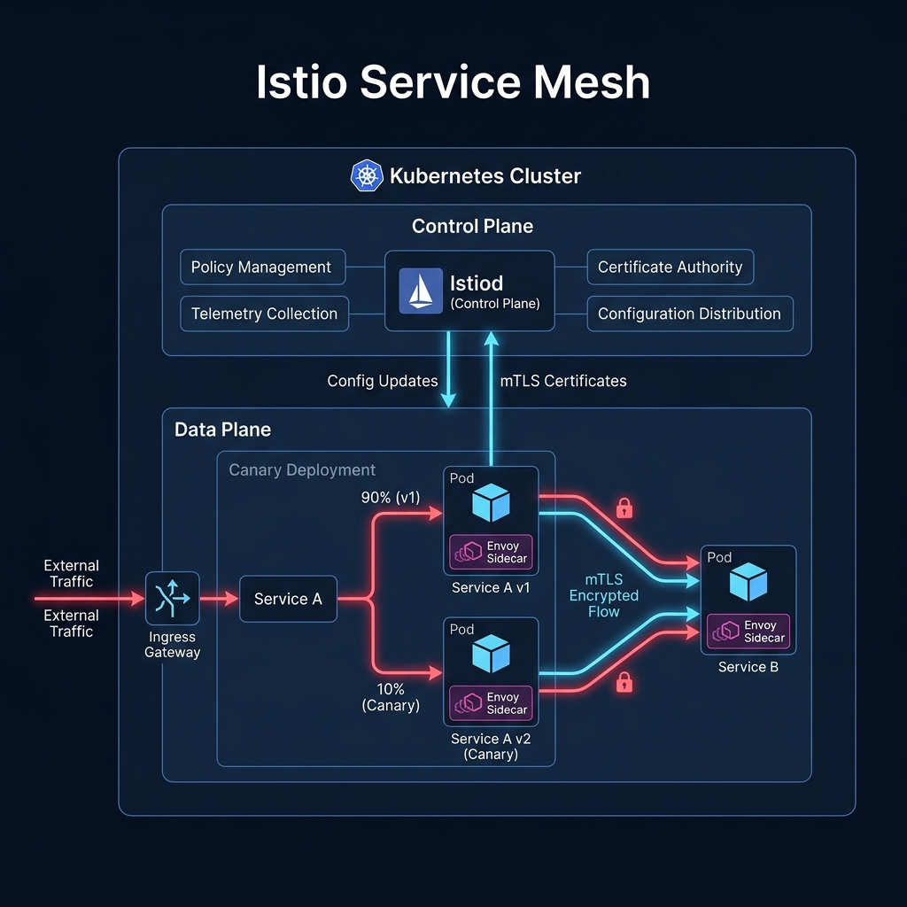
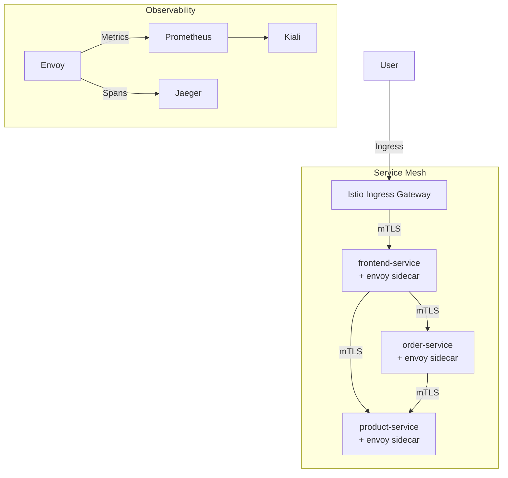

# Project 13: Service Mesh with Istio Workbook

## 1. Scenario (สถานการณ์จำลอง)

เช้าวันศุกร์ ณ บริษัทสตาร์ทอัปส่งอาหารชื่อ "QuickOrder" ทีมวิศวกรได้เติบโตขึ้นและแยกแอปพลิเคชันจาก Monolith ออกเป็น 15 Microservices จนทำให้เกิดปัญหาความวุ่นวายตามมา

CTO Khun Siri [09:15 AM]:
> @devops-team ตอนนี้เราเจอปัญหาอยู่ บริการตัวหนึ่งของเราทำงานช้าเป็นบางครั้ง และส่งผลกระทบต่อเนื่องจนทำให้ระบบ Checkout ทั้งหมดพังไปด้วย
>
> ตอนนี้เรายังไม่รู้เลยว่าบริการตัวไหนที่เป็นสาเหตุ แถมเดือนหน้าเราต้องรับการตรวจประเมินความปลอดภัย (Security Audit) ซึ่งต้องการให้ทำการเข้ารหัส Traffic ภายในทั้งหมด
>
> เราไม่สามารถขอให้เหล่านักพัฒนาเขียนโค้ดเพื่อรองรับ TLS ในทุกบริการได้ เพราะพวกเขาจะทำฟีเจอร์ใหม่ไม่ทันแน่ๆ ดังนั้นเราต้องการโซลูชันที่พร้อมใช้งานทันทีในระดับของ Infrastructure

### ข้อจำกัด
- ความปลอดภัย: บังคับใช้ Strict mTLS ระหว่างทุกบริการ
- การจัดการ Traffic: แบ่ง Traffic จำนวน 10% ไปยัง product-service v2 เพื่อทำการทดสอบ
- ความทนทาน (Resilience): ระบบต้องทำการคัดแยก (eject) Instance ของบริการที่ทำงานช้าหรือเกิดความล้มเหลวออกโดยอัตโนมัติ

### ข้อกำหนดในการส่งงาน (Definition of Done)
1. ติดตั้ง Istio และเปิดใช้งาน Sidecar Injection ใน default Namespace แล้ว
2. บังคับใช้งาน mTLS และทำการตรวจสอบความถูกต้องเรียบร้อยแล้ว
3. เริ่มต้นใช้งาน Canary Deployment สำหรับ product-service แล้ว
4. ตั้งค่า Circuit Breaker เพื่อป้องกันความเสียหายของ order-service แล้ว
5. Kiali สามารถแสดงผลแผนภาพบริการ (Service Graph) พร้อมสถานะการทำงานที่สมบูรณ์ได้

### ทักษะที่จะได้เรียนรู้
- การติดตั้งและจัดการ Istio Service Mesh
- การบังคับใช้ mTLS (Mutual TLS) ระหว่างบริการ
- การจัดการ Traffic ขั้นสูง เช่น Canary Deployment และ Circuit Breaking
- การทดสอบความทนทานของระบบด้วย Fault Injection
- การทำ Observability ด้วย Kiali, Jaeger และ Prometheus

### แนวคิดสำคัญในการทำงาน
เปรียบเทียบ Service Mesh เหมือน "ระบบสายลับและบอดี้การ์ดส่วนตัว"
- Sidecar Proxy (Envoy): เหมือนบอดี้การ์ดที่เดินตามติด Pod ทุกอัน คอยตรวจสอบทุกคนที่เดินเข้ามาคุย และจดบันทึกทุกคำพูด
- mTLS: เหมือนการคุยกันด้วยรหัสลับที่รู้กันแค่สองคน โดยบอดี้การ์ดจะตรวจสอบ Certificate ของกันและกันก่อนเริ่มคุย
- Canary Deployment: เหมือนการเปิดร้านอาหารสาขาใหม่ให้ลูกค้าลองกินแค่ 10% ก่อน ถ้าไม่มีใครท้องเสียค่อยเปิดให้ทุกคนกิน (การควบคุมเปอร์เซ็นต์ Traffic)

### การนำไปใช้งานจริงในระดับองค์กร
- Compliance (mTLS): ใช้ในระบบที่ต้องผ่านมาตรฐานความปลอดภัยระดับการเงินหรือหน่วยงานรัฐ
- Traffic Shifting: การทำ A/B Testing คัดแยกผู้ใช้งานตาม HTTP Header (เช่น พนักงานบริษัทเข้าหน้าตาเวอร์ชันใหม่ ลูกค้าทั่วไปใช้แบบเดิม)
- Distributed Tracing: ใช้ค้นหาจุดติดขัด (Bottlenecks) ของระบบ Microservices ที่มีเส้นทางการคุยกันที่ซับซ้อนหลายขั้นตอนผ่าน Jaeger
- High Resilience: เพิ่มความทนทานของระบบด้วยการสลับรุ่นการทำงานของแอปพลิเคชันแบบ Zero-Downtime

### ข้อพิจารณาด้านค่าใช้จ่าย
- Istio เป็นซอฟต์แวร์ Open Source ไม่มีค่าใช้จ่ายสัญญาใช้งาน
- มีผลกระทบต่อทรัพยากรระบบ (CPU/RAM) ที่เพิ่มขึ้นจาก Envoy Sidecar Proxies ในทุก Pod

## 2. Topology Diagram (แผนผังระบบ)





### ส่วนประกอบของสถาปัตยกรรม
- Control Plane (Istiod): ทำหน้าที่บริหารจัดการ Configuration, Certificates (CA) และดูแลระบบ Sidecar Injection
- Data Plane (Envoy): Proxy ดักรับและควบคุมทราฟฟิกข้อมูลทั้งหมด พร้อมบังคับใช้กฎ mTLS และ Circuit Breaking
- Ingress Gateway: ทางเข้าหลักของทราฟฟิกภายนอก ทำหน้าที่เป็น High-Performance Reverse Proxy
- mTLS (STRICT): การแลกเปลี่ยนข้อมูลแบบเข้ารหัสภายใน Mesh ที่ต้องยืนยันตัวตน (Certificates) ทั้งฝั่งรับและส่ง

## 3. Prerequisites & Estimated Time (สิ่งที่ต้องเตรียมและเวลาที่ใช้)

### สิ่งที่ต้องเตรียม
- EKS Cluster (จาก Project 12) หรือ Kubernetes Cluster สำหรับใช้งานทั่วไป
- เครื่องมือ `istioctl` ที่ผ่านการติดตั้งเรียบร้อยแล้ว
- Helm 3 สำหรับติดตั้งตัวเสริมภายนอก

### เวลาที่ใช้โดยประมาณ
- 12-15 ชั่วโมง

## 4. Tasks (ขั้นตอนการปฏิบัติ)

### Task 1: การติดตั้ง Istio Service Mesh
- ทำการติดตั้ง Istio บนระบบ Kubernetes โดยเลือกใช้งาน Demo Profile เพื่อทดสอบระบบเบื้องต้น:
  ```bash
  istioctl install --set profile=demo -y
  ```
- เปิดระบบ Inject ตัว Sidecar (Envoy Proxy) อัตโนมัติใน Namespace `default` เพื่อให้แอปพลิเคชันทุกตัวใช้งาน Mesh:
  ```bash
  kubectl label namespace default istio-injection=enabled
  ```

### Task 2: Deploy ระบบ Microservices
- ทำการ Deploy แอปพลิเคชันแบบ 3-tier:
  ```bash
  kubectl apply -f src/k8s/
  ```
- สังเกตและตรวจสอบว่า Pods เปลี่ยนสถานะเป็น 2/2 ซึ่งบ่งบอกว่า Envoy Proxy ถูกทำงานควบคู่กับคอนเทนเนอร์หลักอย่างสมบูรณ์:
  ```bash
  kubectl get pods
  ```

### Task 3: การตั้งค่าความปลอดภัยด้วย Mutual TLS (mTLS)
- การสร้าง PeerAuthentication เพื่อบังคับใช้โหมด STRICT mTLS บนเนมสเปซ `default` เพื่อป้องกันทราฟฟิกที่ไม่มีการเข้ารหัส:
  ```yaml
  apiVersion: security.istio.io/v1beta1
  kind: PeerAuthentication
  metadata:
    name: default
    namespace: default
  spec:
    mtls:
      mode: STRICT
  ```
- นำกฎการเชื่อมต่อมาติดตั้งใช้งาน:
  ```bash
  kubectl apply -f src/istio/
  ```

### Task 4: การตั้งค่า Canary Deployment และ Circuit Breaking
- สร้าง DestinationRule เพื่อแยกแยะรุ่นเวอร์ชัน v1 และ v2 ของ `product-service`:
  ```yaml
  apiVersion: networking.istio.io/v1alpha3
  kind: DestinationRule
  metadata:
    name: product-dr
  spec:
    host: product-service
    subsets:
    - name: v1
      labels:
        version: v1
    - name: v2
      labels:
        version: v2
  ```
- กำหนดสัดส่วนผู้ใช้โดยแชร์ทราฟฟิก 10% ไปยังเวอร์ชันใหม่ (v2) และอีก 90% ไปยังเวอร์ชันเสถียร (v1) ผ่าน VirtualService:
  ```yaml
  apiVersion: networking.istio.io/v1alpha3
  kind: VirtualService
  metadata:
    name: product-vs
  spec:
    hosts:
    - product-service
    http:
    - route:
      - destination:
          host: product-service
          subset: v1
        weight: 90
      - destination:
          host: product-service
          subset: v2
        weight: 10
  ```
- ใช้ฟีเจอร์ Outlier Detection ภายใต้ DestinationRule เพื่อตั้งค่า Circuit Breaker คอยตัดตัดความเสียหายของระบบเมื่อมีปัญหาระหว่างคุยกัน:
  ```yaml
  # ตัวอย่างการระบุ Outlier Detection
  trafficPolicy:
    connectionPool:
      http:
        http1MaxPendingRequests: 1
        maxRequestsPerConnection: 1
    outlierDetection:
      consecutive5xxErrors: 5
      interval: 10s
      baseEjectionTime: 30s
      maxEjectionPercent: 100
  ```

### Task 5: การติดตั้งระบบ Observability
- Deploy Addons ที่จำเป็นผ่านทาง Sample Config ของ Istio (ตรวจสอบรุ่นเวอร์ชันให้ตรงกับการติดตั้งจริง):
  ```bash
  kubectl apply -f https://raw.githubusercontent.com/istio/istio/release-1.20/samples/addons/prometheus.yaml
  kubectl apply -f https://raw.githubusercontent.com/istio/istio/release-1.20/samples/addons/kiali.yaml
  kubectl apply -f https://raw.githubusercontent.com/istio/istio/release-1.20/samples/addons/jaeger.yaml
  ```
- เรียกใช้งาน Dashboard ของ Kiali ในการเข้าชมเส้นทางการวิ่งของข้อมูลในระบบ Microservices แบบ Visual Graph:
  ```bash
  istioctl dashboard kiali
  ```

### Task 6: การล้างข้อมูลและทรัพยากร (Cleanup)
- กรณีต้องการถอนการติดตั้งตัว Istio และ Resources ทั้งหมดภายในคลัสเตอร์ ให้รันคำสั่ง:
  ```bash
  istioctl x uninstall --purge -y
  kubectl delete namespace istio-system
  ```

### ข้อคิดเห็นเชิงปฏิบัติและการปรับแต่งประสิทธิภาพ (Production Insights)
- ประสิทธิภาพและ Latency: การใช้งาน Istio จะทำให้มี Latency เพิ่มขึ้นประมาณ 1-3 ms ในการข้ามคุยกันแต่ละ Hop เนื่องจากกระบวนการตรวจสอบของ Envoy Proxy
- ปัญหาคอขวด (Bottleneck): คอขวดหลักจะอยู่ที่ทรัพยากรการประมวลผลของ Istiod (Control Plane) หากมีเซอร์วิสจำนวนมาก และ RAM ของ Sidecar อาจไม่พอกับแอปที่มีทราฟฟิกหนาแน่น
- การขยายระบบ (Scaling): ให้ใช้งาน Istio Revision สำหรับการทำ Canary Upgrade ตัว Mesh เอง และจูน Sidecar Resources เพื่อกำจัดการกิน RAM
- การเลือกโปรโตคอล (Protocol Detection): ต้องกำหนดชื่อพอร์ตของ Service ให้ชัดเจน (เช่น http-web) เสมอ ป้องกัน Envoy วิเคราะห์โปรโตคอลผิดพลาดและส่งผลให้ประมวลผลช้าลง
- วงจรการทำงานของ Sidecar (Sidecar Lifecycle): แนะนำให้ใช้ Native Sidecars บน Kubernetes 1.29+ เพื่อแก้ปัญหาแอปสตาร์ทเร็วกว่า Proxy Sidecar (Race Condition)

## 5. Verification (การตรวจสอบผลการทำงาน)

ตรวจสอบผลลัพธ์การ Deploy และการกำหนดค่าในระบบตามรายการตรวจสอบดังต่อไปนี้:

### การติดตั้งและเชื่อมต่อพื้นฐาน
- [ ] ติดตั้ง Istio และมีระบบ Control Plane ทำงานเป็นปกติ
- [ ] ติดตั้ง Addons สำหรับทำ Observability (Prometheus, Kiali, Jaeger) เรียบร้อยแล้ว
- [ ] กำหนด Label `istio-injection=enabled` ให้ Namespace `default` แล้ว

### การ Deploy Microservices
- [ ] Pods ของระบบ Microservices ทั้ง 3-tier มี Container ทำงานครบสถานะ 2/2 (App + Envoy Proxy Sidecar)
- [ ] ทดสอบเชื่อมต่อผ่านช่องทาง Istio Ingress Gateway ได้สมบูรณ์

### การจัดการและควบคุม Traffic
- [ ] สร้าง VirtualService และ DestinationRule สำเร็จตามกำหนดการทำ Canary Deployment
- [ ] ตั้งค่า Circuit Breaker สำเร็จเพื่อปกป้องระบบจากความเสียหาย
- [ ] ตรวจสอบทราฟฟิกเฉลี่ยมีสัดส่วน 10% ไปยังรุ่น v2 และ 90% ไปยังรุ่น v1 ของ product-service จริง

### การบังคับความปลอดภัย
- [ ] PeerAuthentication เปลี่ยนค่าเป้าหมายเป็นโหมด STRICT สำเร็จ
- [ ] ยืนยันสถานะการเข้ารหัสและความปลอดภัยด้วยคำสั่ง `istioctl proxy-config`

### การตรวจสอบผ่าน Observability
- [ ] แผนภูมิ Kiali Graph มีจุดเชื่อมโยงปกติแสดงสถานะสีเขียว (Healthy)
- [ ] Jaeger ตรวจพบ Trace ข้อมูลการเรียกใช้จากต้นน้ำจนถึงปลายน้ำ

### การทดสอบความทนทานและการตอบสนองต่อความเสียหาย (Resilience Testing)
- **การทดลองทำ Fault Injection**: บังคับทราฟฟิกให้ตอบสนองช้าลง (Latency) หรือจำลองส่ง Error 500 ไปยังเซอร์วิสปลายทาง
  - *การตรวจสอบ*: ต้องพบสถานะพังหรือข้อผิดพลาดบน Dashboard และระบบ Circuit Breaker ต้องตัดทราฟฟิกเพื่อปกป้องระบบตาม Config
- **การทดสอบความปลอดภัยของ mTLS**: ทำการจำลองส่งข้อมูลที่ไม่ได้เข้ารหัสผ่านช่องทางปกติไปยังเซอร์วิสที่ใช้ STRICT mode
  - *การตรวจสอบ*: ทราฟฟิกที่ไม่เข้ารหัสต้องถูกปิดกั้นและถูกปฏิเสธการเชื่อมต่อในทันที

## 6. Troubleshooting (การแก้ไขปัญหาที่พบบ่อย)

### กรณีที่ 1: Sidecar Proxy ไม่ถูกฉีด (Sidecar Injection Failed)
- อาการ: Pods แสดงสถานะพร้อมใช้งานเพียง 1/1 แทนที่จะเป็น 2/2
- สาเหตุ: Namespace ยังไม่ได้รับ Label หรือ Pod ถูกสร้างขึ้นก่อนการระบุ Label
- วิธีแก้ไข:
  - ใส่ Label ให้ Namespace ด้วยคำสั่ง:
    ```bash
    kubectl label namespace default istio-injection=enabled --overwrite
    ```
  - ทำการ Restart Pods เพื่อให้ทำงานภายใต้ Configuration ใหม่:
    ```bash
    kubectl rollout restart deployment <deployment-name>
    ```

### กรณีที่ 2: เกิดข้อผิดพลาด 503 Service Unavailable
- อาการ: บริการเชื่อมต่อกันไม่ได้และส่งข้อผิดพลาด HTTP 503 เป็นบางครั้ง
- สาเหตุ: เกิดจากการตั้งค่า VirtualService หรือ DestinationRule ไม่สอดคล้องกัน หรือมีปัญหาใบรับรอง mTLS ไม่ซิงค์กัน
- วิธีแก้ไข:
  - ใช้เครื่องมือตรวจสอบความถูกต้องของ Configuration:
    ```bash
    istioctl analyze
    ```
  - ตรวจสอบสถานะการทำงานของ Sidecar Sync:
    ```bash
    istioctl proxy-status
    ```
  - ตรวจสอบว่าได้ตั้งชื่อ Port ใน Service Manifest ไว้อย่างถูกต้อง เช่น `name: http-web` แทนที่จะระบุเพียงพอร์ตลอยๆ เพื่อป้องกันไม่ให้ Envoy เดา Protocol ผิดพลาด

### กรณีที่ 3: Kiali ไม่แสดง Service Graph หรือแสดงกราฟว่างเปล่า
- อาการ: แผนภาพใน Kiali Graph ไม่แสดง Traffic หรือแสดงผลลัพธ์ว่างเปล่า
- สาเหตุ: ไม่มี Traffic วิ่งเข้ามา หรือ Prometheus ไม่ได้ดึง Metrics จาก Istio Data Plane
- วิธีแก้ไข:
  - ทำการส่ง Request ทดสอบอย่างต่อเนื่องเพื่อสร้างข้อมูล Metrics:
    ```bash
    while true; do curl -s http://<ingress-gateway-ip>/; sleep 1; done
    ```
  - ตรวจสอบให้แน่ใจว่าได้ส่ง Header สำหรับ Tracing (เช่น `x-request-id`, `x-b3-traceid`) ต่อไปยังเซอร์วิสถัดไปภายใน Code เพื่อรักษา Trace Path ไว้
  - ตรวจสอบความถูกต้องของการระบุ Scraping Targets ใน Prometheus

### กรณีที่ 4: การตั้งค่า Strict mTLS ส่งผลกระทบต่อบริการภายนอกหรือระบบเดิม
- อาการ: บริการภายนอก (External Services) หรือบริการภายในอื่นๆ ที่ไม่อยู่ใน Mesh ไม่สามารถรับส่งข้อมูลกับบริการใน Mesh ได้
- สาเหตุ: โหมด STRICT กำหนดให้ทุก Client และ Server ต้องมี Sidecar Proxy และเชื่อมต่อผ่านการเข้ารหัสเท่านั้น
- วิธีแก้ไข:
  - ปรับโหมด PeerAuthentication เป็น PERMISSIVE เพื่อรองรับทั้งทราฟฟิกที่เข้ารหัสและไม่เข้ารหัสในขณะโยกย้ายระบบ:
    ```yaml
    spec:
      mtls:
        mode: PERMISSIVE
    ```
  - ทำการตรวจสอบและนำแอปพลิเคชันเดิมเข้าสู่ Service Mesh หรือตั้งค่าข้อยกเว้นเพิ่มเติม

### กรณีที่ 5: การติดตั้ง Istio ล้มเหลวจาก Timeout
- อาการ: การติดตั้งผ่าน `istioctl install` ค้างและล้มเหลว
- สาเหตุ: Kubernetes Cluster มีทรัพยากรระบบไม่เพียงพอ หรือการเชื่อมต่อไปยัง External Repositories ถูกบล็อก
- วิธีแก้ไข:
  - ตรวจสอบทรัพยากรขั้นต่ำของ Cluster โดยควรมีอย่างน้อย 4 vCPUs ที่ว่างสำหรับจัดการ Control Plane
  - ตรวจสอบ Logs ของ istio-operator Pod เพื่อวิเคราะห์ข้อผิดพลาดเพิ่มเติม

## 7. Exercises & Solutions (แบบฝึกหัดและแนวทางการแก้ไข)

### แบบฝึกหัดที่ 1: Egress Gateway (ระดับง่าย)
โจทย์: โดยทั่วไปแล้ว Istio จะอนุญาตให้ Pods สามารถเข้าถึง External URL ใดก็ได้ตามต้องการ
- ให้เปลี่ยนค่า `OutboundTrafficPolicy` ใน Mesh Config ให้เป็นแบบ `REGISTRY_ONLY`
- จากนั้นสร้าง ServiceEntry และ VirtualService เพื่ออนุญาตให้ Traffic วิ่งออกไปยัง `api.external-service.com` ได้เพียงโดเมนเดียวเท่านั้น

#### แนวทางการแก้ไข (Solution)
```yaml
apiVersion: networking.istio.io/v1alpha3
kind: ServiceEntry
metadata:
  name: external-api
spec:
  hosts:
  - api.external-service.com
  ports:
  - number: 443
    name: https
    protocol: HTTPS
  resolution: DNS
  location: MESH_EXTERNAL
```

### แบบฝึกหัดที่ 2: Request Timeouts (ระดับปานกลาง)
โจทย์: เพื่อป้องกันไม่ให้ทราฟฟิกรอการตอบสนอง (Response) จากเซอร์วิสปลายทางนานเกินไปอย่างไร้ขอบเขต
- กำหนดค่า Timeout ขนาด 2 วินาทีใน VirtualService สำหรับเส้นทางการเรียกใช้งาน `frontend` -> `order-service`
- ทำการทดสอบด้วย Fault Injection เพื่อจำลอง Delay ขนาด 5 วินาทีใน `order-service` เพื่อดูว่าการตั้งค่า Timeout ทำงานอย่างถูกต้อง

#### แนวทางการแก้ไข (Solution)
```yaml
apiVersion: networking.istio.io/v1alpha3
kind: VirtualService
metadata:
  name: order-vs
spec:
  hosts:
  - order-service
  http:
  - route:
    - destination:
        host: order-service
    timeout: 2s
```

### แบบฝึกหัดที่ 3: Traffic Mirroring (ระดับยาก)
โจทย์: ทดสอบประสิทธิภาพระบบใหม่โดยการส่งสำเนาของ Traffic จริงบน Production ไปยังระบบทดสอบ (Shadow Service)
- ทำการ Deploy `product-service:v3-beta`
- ตั้งค่า VirtualService เพื่อทำ Mirror Traffic 100% ไปยัง Subset v3-beta โดยที่ยังรับส่ง Traffic จริงกับ Subset v1 ตามปกติ 100%
- ตรวจสอบ Logs ของเวอร์ชัน v3-beta เพื่อยืนยันการรับ Request จริงโดยต้องไม่กระทบผู้ใช้จริง

#### แนวทางการแก้ไข (Solution)
```yaml
apiVersion: networking.istio.io/v1alpha3
kind: VirtualService
metadata:
  name: product-vs
spec:
  hosts:
  - product-service
  http:
  - route:
    - destination:
        host: product-service
        subset: v1
    mirror:
      host: product-service
      subset: v3-beta
    mirrorPercentage:
      value: 100.0
```
