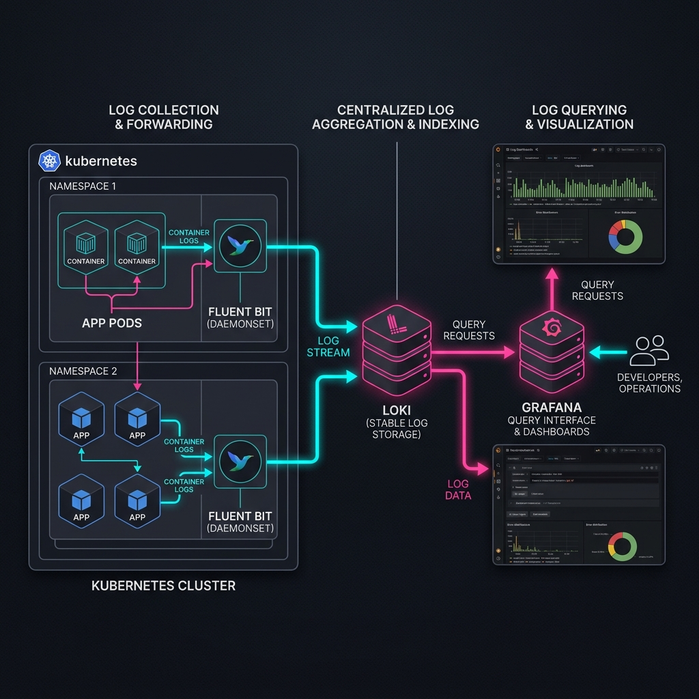

# Project 14: Centralized Logging Workbook

> 🧠 **ภาพจำก่อนอ่าน:** 🧪 Lab → 📊 Metrics → 🧾 Logs → 🔎 Diagnose → ✅ Verify → 🧹 Cleanup  
> 🎨 [Visual Guide ของวิชานี้](../../VISUAL-MEMORY-GUIDE-TH.md) — ภาพช่วยจำ ไม่แทนคำอธิบายและคำสั่งจริง

## 1. Scenario (สถานการณ์จำลอง)

### บริบทของระบบ (The Context)
ตอนนี้เป็นเวลาตีสอง คุณทำงานอยู่ที่ "PayThai" ซึ่งเป็น Startup ทำระบบ Digital Wallet เรื่องใหญ่ระดับ Production กำลังเกิดขึ้น ระบบทำธุรกรรมล้มเหลว แต่เกิดเฉพาะกับผู้ใช้บริการในภาคเหนือของประเทศไทยเท่านั้น

Senior Dev Jai ได้รายงานปัญหาไว้ดังนี้:
- ผมพยายาม debug บริการ "payment-gateway" แต่หา logs ไม่เจอเลย
- ผมไล่รัน "kubectl logs" บน pods ที่ต่างกันถึง 20 ตัวมาเกือบชั่วโมงแล้ว
- พอจะเจอ error ตัว pod ก็โดน restart ไปแล้วทำให้ logs หายไปหมด
- เราต้องหาวิธีค้นหา logs ทั้งหมดได้พร้อมกัน และดูสิ่งที่เกิดขึ้นในทุก services ณ เวลาที่ธุรกรรมล้มเหลวได้ทันที

### ข้อจำกัดของระบบ (Constraints)
- **Performance**: ระบบ logging ต้องไม่ทำให้ application pods ทำงานช้าลง (เลือกใช้ Fluent Bit)
- **Cost**: ไม่ใช้บริการ managed logging ที่มีราคาแพง รักษาค่าใช้จ่ายในการจัดเก็บข้อมูลให้ต่ำด้วยการใช้ AWS S3
- **Persistence**: Logs ต้องคงอยู่แม้จะมีการ restart pod และต้องเก็บไว้อย่างน้อย 30 วัน

### นิยามความสำเร็จ (Definition of Done)
- Loki กำลังทำงานและใช้ AWS S3 สำหรับการเก็บข้อมูลระยะยาว
- Fluent Bit ถูกติดตั้งในรูปแบบ DaemonSet บนทุก nodes
- Grafana Dashboard สามารถแสดงผล log volume, error rates และ live log stream ได้
- สามารถค้นหา "transaction_id" ที่ระบุเฉพาะเจาะจงในทุก services ได้เสร็จสิ้นภายในเวลาไม่เกิน 2 วินาที

## 2. Topology Diagram (แผนผังระบบ)



### แผนผังการทำงานของระบบ (Architecture Diagram)

```mermaid
graph TD
    subgraph "Nodes"
        App[App Pods] -->|Logs| File[/var/log/containers/*.log]
        FB[Fluent Bit DaemonSet] -->|Tail| File
    end
    
    FB -->|Batch Push| LGW[Loki Gateway]
    
    subgraph "Loki Cluster"
        LGW --> Write[Write Path\nDistributor/Ingester]
        LGW --> Read[Read Path\nQuerier/Query Frontend]
        Write -->|Chunks| S3[AWS S3]
        Write -->|Index| S3
    end
    
    Grafana -->|LogQL| LGW
    User -->|View| Grafana
```

### รายละเอียดส่วนประกอบของระบบ (Architectural Components)
- **Fluent Bit**: Lightweight Agent ที่คอยจัดงานอ่าน log files, ทำการพาร์สข้อมูล (parsing) และลองส่งข้อมูลใหม่ (retry) เมื่อส่งข้อมูลไปยัง Loki ล้มเหลว
- **Loki Gateway**: Nginx Proxy ที่ทำหน้าที่จัดเส้นทาง (route) คำขอไปยัง component ภายในของ Loki ที่เหมาะสม โดยแยกเส้นทางระหว่าง Read Path และ Write Path
- **Loki Ingester**: ทำหน้าที่บัฟเฟอร์ logs ไว้ในหน่วยความจำ (memory) ก่อนที่จะทำการเขียน (flush) ลง AWS S3
- **Loki Querier**: ดึงข้อมูลจากทั้ง Ingester (สำหรับ logs ล่าสุด) และ AWS S3 (สำหรับ logs ย้อนหลัง) เพื่อตอบกลับคำขอค้นหา (query)

### ประสิทธิภาพและการรองรับการขยายตัว (Performance & Scaling)
- **Estimated Load**: รองรับ log ได้มากกว่า 100GB+ ต่อวัน โดยใช้ทรัพยากรน้อยกว่า ELK Stack ราว 50-80%
- **Bottlenecks**: คอขวดมักอยู่ที่ Ingester Memory เมื่อมีปริมาณ log ไหลเข้ามามหาศาลพร้อมกัน และปัญหา High Cardinality หากเราตั้ง label เยอะเกินไป
- **Scaling Approach**: ใช้ Microservices Mode ของ Loki เพื่อแยกส่วน write (Ingester) และ read (Querier) ออกจากกัน เพื่อให้สามารถสเกลได้ตรงจุดตามปริมาณการใช้งานจริง

## 3. Prerequisites & Estimated Time (สิ่งที่ต้องเตรียมและเวลาที่ใช้)

### สิ่งที่ต้องเตรียมก่อนเริ่ม (Prerequisites)
- EKS Cluster (จาก Project 12)
- Helm 3
- AWS S3 Bucket สำหรับเก็บข้อมูลของ Loki

### ระยะเวลาในการเรียนรู้ (Estimated Time)
- 10-12 ชั่วโมง

## 4. Tasks (ขั้นตอนการปฏิบัติ)

### บทนำ: ทำไมต้องมี Centralized Logging
เมื่อระบบมีบริการมากกว่า 20 services การเข้าไปดู logs ทีละ container จะทำให้เสียเวลามาก Centralized Logging จึงถูกนำมาใช้เพื่อรวมศูนย์ข้อมูล:
- **Fluent Bit**: ทำหน้าที่เป็น Agent ดึง logs จากทุก pods และจัดส่ง
- **Loki**: ทำหน้าที่เป็น database คอยเก็บ logs โดยเน้นประหยัดเนื้อที่ด้วยการทำ index เฉพาะ label

### Task 1: การติดตั้ง Grafana Loki
เพิ่ม Grafana Helm repository และอัปเดตชาร์ตเวอร์ชันล่าสุด:
```bash
helm repo add grafana https://grafana.github.io/helm-charts
helm repo update
```

รันคำสั่งติดตั้ง Loki โดยอ้างอิง config file เพื่อให้ Loki เขียนข้อมูลลง AWS S3 Bucket:
```bash
helm install loki grafana/loki -f src/loki/values.yaml
```

(ทางเลือกเพิ่มเติม) หากต้องการทดสอบระบบเบื้องต้นภายในเครื่องจำลอง สามารถรันผ่าน Docker Compose ได้ดังนี้:
```yaml
# Docker Compose สำหรับ Loki Stack
services:
  loki:
    image: grafana/loki:latest
    command: -config.file=/etc/loki/local-config.yaml
    ports:
      - "3100:3100"

  promtail:
    image: grafana/promtail:latest
    volumes:
      - /var/log:/var/log:ro
      - /var/lib/docker/containers:/var/lib/docker/containers:ro
    command: -config.file=/etc/promtail/config.yml
```

### Task 2: การติดตั้งและตั้งค่า Fluent Bit
การตั้งค่า Fluent Bit config เพื่อใช้อ่านข้อมูล logs ของ pods ใน Kubernetes Cluster และส่งต่อไปยัง OpenSearch หรือ Loki:
```yaml
# src/kubernetes/fluent-bit/configmap.yaml
apiVersion: v1
kind: ConfigMap
metadata:
  name: fluent-bit-config
data:
  fluent-bit.conf: |
    [SERVICE]
        Flush         1
        Log_Level     info
        Parsers_File  parsers.conf

    [INPUT]
        Name              tail
        Path              /var/log/containers/*.log
        Parser            docker
        Tag               kube.*
        Mem_Buf_Limit     50MB
        Skip_Long_Lines   On

    [FILTER]
        Name                kubernetes
        Match               kube.*
        Kube_URL            https://kubernetes.default.svc:443
        Merge_Log           On
        K8S-Logging.Parser  On

    [OUTPUT]
        Name            es
        Match           *
        Host            opensearch.logging.svc.cluster.local
        Port            9200
        Index           k8s-logs
        HTTP_User       admin
        HTTP_Passwd     ${OPENSEARCH_PASSWORD}
        tls             On
        tls.verify      Off
```

ทำการติดตั้ง Fluent Bit ไปยัง Kubernetes Cluster โดยรันคำสั่ง:
```bash
helm install fluent-bit grafana/fluent-bit -f src/fluent-bit/values.yaml
```

### Task 3: การตั้งค่า Log Retention Policy
เพื่อควบคุมค่าใช้จ่ายในการจัดเก็บ log สามารถกำหนดอายุการเก็บรักษาข้อมูลให้ลบออกโดยอัตโนมัติเมื่อครบกำหนด ตัวอย่างการประกาศ Log Group ด้วย Terraform:
```hcl
resource "aws_cloudwatch_log_group" "app" {
  name              = "/app/production"
  retention_in_days = 90  # เก็บ 90 วัน แล้วลบอัตโนมัติ (ประหยัดค่า Storage)
}
```

### Task 4: การสืบค้นข้อมูล logs ด้วย LogQL
ใช้คำสั่ง LogQL ในหน้า Grafana Explore เพื่อวิเคราะห์ปัญหา ตัวอย่างคำสั่งที่นิยมใช้งาน:
- ดู logs ของ payment-service ที่มีคำว่า ERROR:
  ```logql
  {namespace="production", app="payment-service"} |= "ERROR"
  ```
- ค้นหาข้อมูลและฟิลเตอร์จาก JSON log:
  ```logql
  {app="api"} | json | status_code >= 500
  ```
- ดูอัตราการเรียกใช้งาน (Request Rate) ในช่วงเวลา 5 นาที:
  ```logql
  rate({app="nginx"} |= "200"[5m])
  ```

### ข้อแนะนำสำหรับการใช้งานในระบบ Production
- **JSON Logging is a Must**: ควรเขียน code ให้แอปพลิเคชันพ่น log เป็น JSON เพื่อความง่ายในการ parse ข้อมูลโดยไม่ต้องใช้ regex ที่ประมวลผลช้า
- **Avoid Label Overload**: หลีกเลี่ยงการนำฟิลด์ที่มีความหลากหลายสูง เช่น user_id หรือ request_id ไปกำหนดเป็น Loki label เพราะจะทำให้ index มีขนาดใหญ่จนเกิดปัญหาพังได้
- **Back-pressure Management**: ตั้งค่า Mem_Buf_Limit ใน Fluent Bit เสมอ เพื่อป้องกันปัญหาหน่วยความจำของ agent เต็มจนส่งผลกระทบต่อ node เมื่อปลายทางรับ logs ไม่ทัน
- **Real-world Applications**: นำระบบ centralized logging ไปประยุกต์ใช้เพื่อเก็บ log ย้อนหลังสำหรับ Compliance Audit ตามกฎหมาย หรือช่วยวิเคราะห์ root cause ได้อย่างทันท่วงที

## 5. Verification (การตรวจสอบผลการทำงาน)

ตรวจสอบความถูกต้องของการติดตั้งระบบ logging ตามรายการดังต่อไปนี้:

- [ ] สร้าง S3 Bucket สำหรับ Loki เรียบร้อยแล้ว
- [ ] สร้าง IRSA Role สำหรับ Loki พร้อมสิทธิ์การใช้งาน S3 เรียบร้อยแล้ว
- [ ] ติดตั้ง Loki ผ่าน Helm (ใช้ Distributed Mode) เรียบร้อยแล้ว
- [ ] ติดตั้ง Fluent Bit เป็น DaemonSet บนทุก Nodes เรียบร้อยแล้ว
- [ ] ตั้งค่า Fluent Bit ร่วมกับ kubernetes filter เรียบร้อยแล้ว
- [ ] ตั้งค่า Loki ให้มี Retention Period เป็นเวลา 30 วันเรียบร้อยแล้ว
- [ ] เพิ่ม Loki เป็น Data Source ใน Grafana เรียบร้อยแล้ว
- [ ] สามารถมองเห็น Logs ของทุก Namespaces ใน Grafana Explore ได้
- [ ] มี Kubernetes Labels (pod, container, namespace) ให้เลือกใช้สำหรับคัดกรอง (filtering)
- [ ] การค้นหาคำเฉพาะเจาะจง (string) สามารถแสดงผลลัพธ์ได้ทันที
- [ ] Dashboard แสดง Live Log Stream และ Error Rates ได้อย่างถูกต้อง
- [ ] ตรวจสอบแล้วว่า Logs ยังคงอยู่แม้จะมีการ Restart Pod
- [ ] ตรวจสอบ S3 Bucket เพื่อให้แน่ใจว่ามีการเขียน Chunks ลงไปจริง
- [ ] ตรวจสอบการทำ Log Masking สำหรับข้อมูลสำคัญ (Sensitive Data) (หากมีการตั้งค่าไว้)

## 6. Troubleshooting (การแก้ไขปัญหาที่พบบ่อย)

### Case 1: "Loki: Data source is not working" ใน Grafana
- **Symptom**: Grafana ไม่สามารถเชื่อมต่อกับ Loki ได้
- **Cause**: ชื่อ Loki Service ไม่ถูกต้อง หรือ Loki Pods ไม่ทำงาน
- **Fix**: ตรวจสอบสถานะ Pod ด้วยคำสั่ง `kubectl get pods -l app=loki` และตรวจสอบให้แน่ใจว่าได้ระบุ URL เป็น `http://loki-gateway.logging.svc.cluster.local`

### Case 2: "Maximum active streams limit exceeded"
- **Symptom**: Loki ปฏิเสธไม่รับ logs ใหม่เข้าระบบ
- **Cause**: มีการตั้งค่า label ที่ไม่ซ้ำกันมากเกินไป (เกิด cardinality explosion)
- **Fix**: ลด dynamic labels ที่ไม่จำเป็นใน Fluent Bit และห้ามนำ user_id หรือ ip_address มาใช้เป็น Loki label เด็ดขาด

### Case 3: Fluent Bit cannot connect to Loki หรือไม่ส่ง logs ไปยัง OpenSearch
- **Symptom**: Logs ไม่แสดงผลบน Grafana Explore
- **Cause**: มี NetworkPolicy บล็อก traffic หรือระบุ endpoint ผิดใน Fluent Bit configuration หรือข้อมูลสิทธิ์ในการ authentication ไม่ถูกต้อง
- **Fix**: ตรวจสอบด้วยคำสั่ง `kubectl logs -n logging -l app=fluent-bit | grep -i "error\|failed"` และยืนยันความถูกต้องของ Host, Port และ Credentials ใน ConfigMap

### Case 4: S3 Access Denied
- **Symptom**: Loki เกิด CrashLoopBackOff หรือพ่น log ฟ้องเรื่องไม่สามารถเขียนไฟล์ลง AWS S3
- **Cause**: IAM Role for Service Account (IRSA) ไม่มีอยู่ หรือไม่ได้แนบสิทธิ์การเข้าถึง AWS S3 ที่ถูกต้องให้กับ Role
- **Fix**: ตรวจสอบ AWS Trust Policy และ Bucket Policy หรือทดลองรันคำสั่ง `aws s3 ls s3://your-bucket` จาก pod ที่ใช้ทดสอบสิทธิ์

### Case 5: Logs are delayed (Log แสดงผลล่าช้า)
- **Symptom**: Logs ล่าสุดใช้เวลาแสดงผลนานหลายนาทีกว่าแสดงผลแบบ real-time
- **Cause**: ค่า Flush interval ใน Fluent Bit ตั้งไว้สูงเกินไป หรือ Loki กำลังรับภาระการเขียนข้อมูลหนักมาก
- **Fix**: ตั้งค่า `Flush 1` ใน Fluent Bit config หรือสเกลส่วน Loki Ingester (write component) เพิ่มเติม

### Case 6: Loki ไม่สามารถ Query ข้อมูล - "Entry out of order"
- **Symptom**: Loki ฟ้อง error ไม่สามารถค้นหาข้อมูลย้อนหลังได้
- **Cause**: มี Promtail หรือ Fluent Bit หลายตัวส่ง log ที่มี timestamp สลับกันไม่เรียงลำดับเวลา
- **Fix**: แก้ไข config ของ Loki โดยเพิ่ม `max_chunk_age: 1h` และเปิดใช้งาน `allow_structured_metadata: true`

## 7. Exercises & Solutions (แบบฝึกหัดและแนวทางการแก้ไข)

### Exercise 1: Log Parsing (ระดับง่าย)
แอปพลิเคชันพ่น log ออกมาในรูปแบบ text ที่ไม่เป็นระเบียบ:
- ใช้ Fluent Bit `Parser` (regex หรือ json) เพื่อแปลงข้อมูลเหล่านี้ให้อยู่ในรูป structured logs
- ตรวจสอบใน Loki ว่าคุณสามารถกรอง (filter) ข้อมูลด้วย fields เช่น `http_status` หรือ `user_id` ได้แล้ว

#### แนวทางการแก้ไข (Solution)
ในไฟล์ `fluent-bit-configmap.yaml` ให้ตั้งค่า parser ใน block parsing ดังนี้:
```yaml
[PARSER]
    Name         docker
    Format       json
    Time_Key     time
    Time_Format  %Y-%m-%dT%H:%M:%S.%L
```

### Exercise 2: Alerting on Logs (ระดับปานกลาง)
ต้องการรับการแจ้งเตือนเมื่ออัตราการเกิดข้อผิดพลาด (error rate) พุ่งสูงขึ้น:
- สร้าง Loki `RecordingRule` เพื่อคำนวณจำนวน error ต่อนาที
- สร้าง `AlertingRule` ให้แจ้งเตือนเมื่อมี error rate มากกว่า 50 เป็นเวลาติดต่อกัน 2 นาที
- จัดเส้นทางของ alert ไปยัง Slack ผ่าน Alertmanager

#### แนวทางการแก้ไข (Solution)
เขียน Alerting Rule กำหนดโครงสร้างลงใน Loki configurations:
```yaml
groups:
  - name: logging_alerts
    rules:
      - alert: HighErrorRate
        expr: sum(rate({app="payment-gateway"} |= "error" [1m])) > 10
        for: 2m
        labels:
          severity: critical
        annotations:
          summary: High error rate detected in payment gateway
```

### Exercise 3: Log Data Masking (ระดับยาก)
ฝ่ายตรวจสอบความปลอดภัย (security audit) แจ้งว่าระบบมีการบันทึกข้อมูลส่วนบุคคลที่ระบุตัวตนได้ (PII) เช่น หมายเลขบัตรเครดิต ลงใน log:
- ตั้งค่า Fluent Bit `Filter` โดยใช้ `modify` หรือ `lua` เพื่อทำ masking ตัวเลขเหล่านี้ก่อนที่ข้อมูลจะถูกส่งออกจาก node
- `1234-5678-9012-3456` -> `XXXX-XXXX-XXXX-3456`
- ตรวจสอบใน Grafana เพื่อให้แน่ใจว่าไม่มีข้อมูล PII หลุดรอดไปให้เห็น

#### แนวทางการแก้ไข (Solution)
เขียนสคริปต์ Lua ชื่อ `mask.lua` เพื่อทำ masking ข้อมูล:
```lua
function mask_cc(tag, timestamp, record)
    if record["log"] then
        record["log"] = string.gsub(record["log"], "%d%d%d%d%-%d%d%d%d%-%d%d%d%d%-(%d%d%d%d)", "XXXX-XXXX-XXXX-%1")
    end
    return 1, timestamp, record
end
```

จากนั้น ทำการประกาศ config filter ใน configuration ของ Fluent Bit:
```conf
[FILTER]
    Name    lua
    Match   kube.*
    script  mask.lua
    call    mask_cc
```

---

## Cost & Cleanup Safety

Observability stack สามารถสร้างค่า ingest/storage สูง โดยเฉพาะ log retention, OpenSearch/managed backend, S3 และ compute ที่รัน Loki/Grafana

หลังจบ lab:

- ถอน Helm releases/manifests ของ Fluent Bit, Loki, Grafana หรือ collector ที่สร้างเฉพาะ lab
- ลบ test indices, log groups หรือ buckets ตาม retention requirement
- ถ้ามี OpenSearch/managed logging domain ที่สร้างเพื่อทดลอง ให้ลบเมื่อไม่ใช้ต่อ
- ลบ EKS/EC2 resources เฉพาะ lab หาก environment เป็น disposable
- ตรวจ retention policy และ Billing/Cost Explorer เพื่อกันค่า ingest/storage ค้าง
