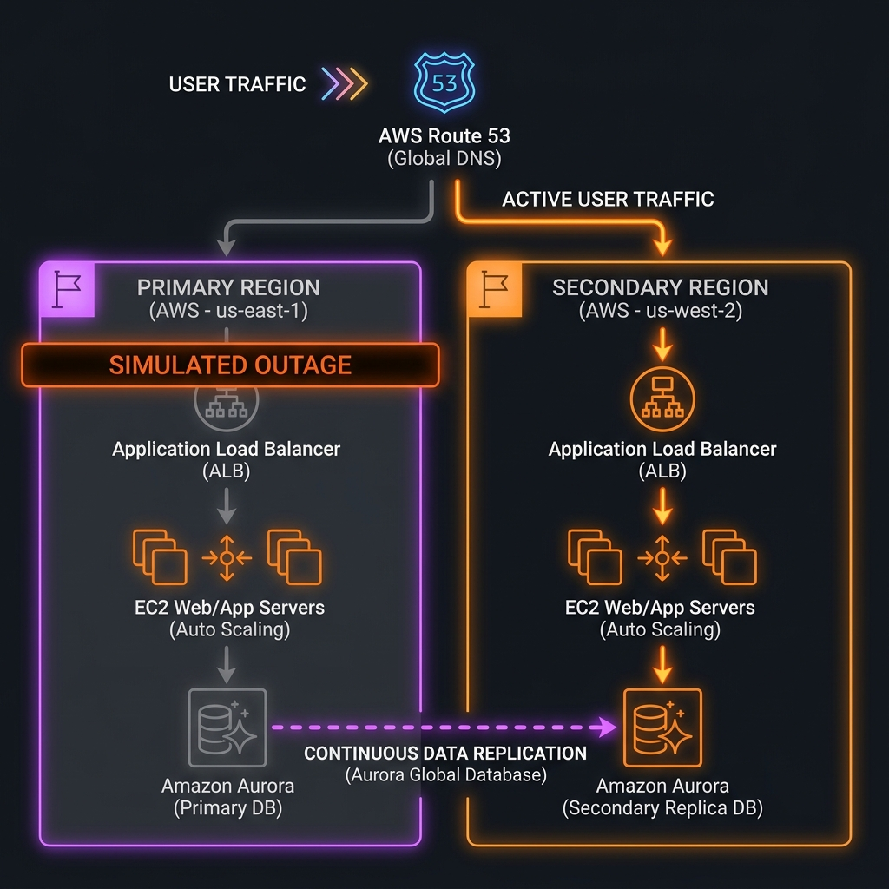
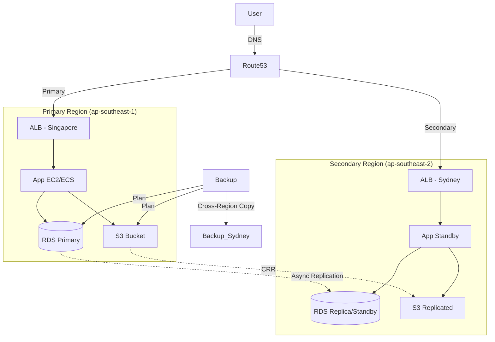

# Project 15: Disaster Recovery System Workbook

> 🧠 **ภาพจำก่อนอ่าน:** 🧪 Lab → 🧠 Concept → 🗺️ Flow → 🔎 Check → ✅ Explain → 🧹 Cleanup  
> 🎨 [Visual Guide ของวิชานี้](../../VISUAL-MEMORY-GUIDE-TH.md) — ภาพช่วยจำ ไม่แทนคำอธิบายและคำสั่งจริง

## 1. Scenario (สถานการณ์จำลอง)

วันจันทร์ เวลา 10:00 น. คุณทำงานที่ SecureBank Thai ซึ่งเป็น Fintech ที่กำลังเติบโต

ทันใดนั้นระบบ Monitoring ฝั่ง Production ทั้งหมดก็แจ้งเตือนเป็นสีแดง

AWS Service Health Dashboard รายงานการล่มครั้งใหญ่ใน Region ap-southeast-1 (Singapore) ซึ่งส่งผลกระทบต่อ RDS และ EC2

CEO Khun Wichai [10:05 AM]:
> @here ตอนนี้ระบบล่ม ลูกค้าใช้งานไม่ได้ ทุกๆ นาทีที่ระบบล่มจะทำให้เราสูญเสียเงินกว่า $50,000 จากธุรกรรมที่ล้มเหลว แถมเสียชื่อเสียงอย่างมากด้วย
> เราเคยคุยกันเรื่องแผน DR ในไตรมาสที่แล้ว - แผนนั้นพร้อมใช้งานหรือยัง? เราจะสลับไปใช้งานที่ Sydney ได้เร็วแค่ไหน?

### ข้อจำกัด (Constraints)
- RPO: ข้อมูลสูญหายได้ไม่เกิน 15 นาที
- RTO: ต้องกู้ระบบกลับมาให้บริการได้ปกติใน Region สำรองภายใน 30 นาที
- Automation: ระบบ Failover ต้องเป็นแบบอัตโนมัติมากที่สุดเพื่อลดความผิดพลาดจากคน (Human Error) ในช่วงวิกฤต

### ข้อตกลงความสำเร็จ (Definition of Done)
1. AWS Backup ต้องถ่าย Snapshots ข้อมูลสำคัญทั้งหมดทุกๆ 1 ชั่วโมง
2. มี Standby Environment เตรียมพร้อมใน Region สำรอง
3. Route53 คอยตรวจสอบ Singapore ALB และจะชี้ DNS ไปยัง Secondary ALB อัตโนมัติหาก Region หลักล่ม
4. เอกสาร Failover Runbook ได้รับการทดสอบและยืนยันความถูกต้องแล้ว
5. มีการกำหนดขั้นตอน Failback เพื่อย้ายระบบกลับมายัง Region หลักเมื่อการล่มสิ้นสุดลง

## 2. Topology Diagram (แผนผังระบบ)



### รายละเอียดแผนผังระบบ (Architecture Details)



```text
[User] → [Route53 (Active-Passive)]
             ↓ (Healthy)             ↓ (Failover)
[Primary Region (Singapore)]   [Secondary Region (Sydney)]
     ↓                               ↓
[RDS Master] ↔ (Replication) ↔ [RDS Read Replica]
```

### ส่วนประกอบทางสถาปัตยกรรม (Architectural Components)
- Pilot Light Pattern: ข้อมูลสำคัญจะถูก Replica แบบ Real-time แต่ Application Servers ใน Region สำรองจะปิดอยู่หรือรันด้วย Capacity ที่ต่ำที่สุด
- AWS Backup: จัดการการทำ Point-in-time Recovery สำหรับกรณีที่ข้อมูลถูกลบโดยไม่ได้ตั้งใจหรือเกิด Database Corruption
- Route53 Health Checks: ทำหน้าที่เป็นระบบตรวจจับสัญญาณชีพ (Heartbeat) เพื่อทริกเกอร์ระบบ Automated Failover
- RDS Multi-Region Replica: ช่วยให้มั่นใจว่า Database ใน Sydney ได้รับข้อมูลอัปเดตล่าสุดจาก Singapore ตลอดเวลา

## 3. Prerequisites & Estimated Time (สิ่งที่ต้องเตรียมและเวลาที่ใช้)

### สิ่งที่ต้องเตรียมตัวก่อนเริ่ม (Prerequisites)
- AWS Account ที่เปิดใช้งาน 2 Regions (เช่น ap-southeast-1 และ ap-southeast-2)
- Terraform เวอร์ชัน 1.7+
- ความเข้าใจพื้นฐานเกี่ยวกับ Route53 และ DNS

### เวลาที่ใช้ในการเรียนรู้ (Estimated Time)
- 10-15 ชั่วโมง

### เป้าหมายและแนวคิดระบบ DR (DR Concept & Objectives)
- เป้าหมายคือการสร้างระบบกู้คืนความเสียหายอัตโนมัติ โดยเน้นการรักษาข้อมูล (RPO) และการกู้คืนระบบให้เร็วที่สุด (RTO) เมื่อเกิดเหตุการณ์ไม่คาดฝันในระดับภูมิภาค
- แนวคิดระบบ DR เปรียบเทียบเหมือน "การมีบ้านสำรองและประกันภัย"
  - **Backups**: เหมือน "การเก็บรูปภาพและเอกสารสำคัญไว้ในตู้เซฟนอกบ้าน"
  - **Cross-region Replication**: เหมือน "การมีบ้านฝาแฝดอีกหลังที่ต่างจังหวัด" ที่มีเฟอร์นิเจอร์และของใช้เหมือนกันเป๊ะ
  - **Route53 Failover**: เหมือน "การติดป้ายหน้าบ้านเดิม" ว่า "ถ้าบ้านหลังนี้ไฟไหม้ ให้ไปหาผมได้ที่บ้านหลังที่สองทันที" (เปลี่ยนทิศทาง Traffic อัตโนมัติ)

### ความรู้พื้นฐานเรื่อง RTO และ RPO
ก่อนออกแบบ DR ทุกครั้ง ต้องตอบคำถาม 2 ข้อให้ธุรกิจก่อน:
- **RTO (Recovery Time Objective)**: ระบบล่มแล้วต้องกลับมาได้ภายในกี่นาที/ชั่วโมง?
- **RPO (Recovery Point Objective)**: ยอมรับสูญข้อมูลได้สูงสุดกี่นาที?

ตัวอย่างการเปรียบเทียบระดับ DR:
| ระดับ | RTO | RPO | ค่าใช้จ่าย |
|:---|:---:|:---:|:---:|
| Backup & Restore | 24 ชม. | 24 ชม. | ต่ำ |
| Pilot Light | 4 ชม. | 1 ชม. | ปานกลาง |
| Warm Standby | 30 นาที | 15 นาที | สูง |
| Active-Active | < 1 นาที | < 1 วินาที | สูงมาก |

### ประสิทธิภาพและความทนทาน (Performance & Scaling)
- **RTO (Recovery Time Objective)**: เป้าหมายคือการกู้ระบบคืนมาภายใน 5-10 นาที (เวลาที่ใช้ในการสลับ DNS และอัปเกรด DB)
- **RPO (Recovery Point Objective)**: เป้าหมายคือข้อมูลสูญหายไม่เกิน 5 นาที (Lag ของการ Replication ข้ามภูมิภาค)
- **Bottlenecks**: คอขวดมักอยู่ที่ Cross-Region Replication Lag หากมีการเขียนข้อมูลลงฐานข้อมูลมหาศาล และเวลาในการรอ DNS TTL (Time To Live) ทั่วโลกให้อัปเดต

### ข้อควรระวังและค่าใช้จ่าย (Cost & Production Insights)
- การใช้งานจริง:
  - **Critical Financial Systems**: ระบบธนาคารหรือการเงินที่ต้องการความพร้อมใช้งานระดับ 99.99% และห้ามข้อมูลหายเด็ดขาด
  - **E-Government Services**: บริการภาครัฐที่ต้องออนไลน์ตลอดเวลาแม้เกิดภัยพิบัติทางธรรมชาติ
  - **Global SaaS Platform**: ระบบซอฟต์แวร์ที่ให้บริการลูกค้าทั่วโลกและต้องกระจายความเสี่ยงข้ามภูมิภาค
  - **Mission Critical Systems**: ระบบที่มีความสำคัญสูงมาก เช่น ระบบชำระเงิน หรือระบบโรงพยาบาล
  - **Compliance & Auditing**: ใช้ในการทำ Compliance เพื่อตอบคำถามผู้ตรวจสอบบัญชีว่า "หากเกิดภัยพิบัติ ระบบจะใช้เวลาฟื้นฟูเท่าใด?"
- ค่าใช้จ่าย:
  - **ข้อควรระวัง**: การมีระบบสองภูมิภาค (Active-Passive หรือ Active-Active) จะทำให้ค่าใช้จ่ายสูงขึ้นเกือบเท่าตัว
  - **แนวทางประหยัด**: ใช้กลยุทธ์ Pilot Light คือเปิดระบบสำรองไว้เฉพาะฐานข้อมูล ส่วน App Server ค่อยเปิดเมื่อเกิดเหตุจริง

## 4. Tasks (ขั้นตอนการปฏิบัติ)

### Task 1: การตั้งค่าระบบจำลองด้วย Terraform (Deployment)
เริ่มต้นเปิดใช้งานและทดสอบระบบด้วยขั้นตอนดังนี้:
1. เข้าไปยังโฟลเดอร์ Terraform:
   ```bash
   cd src/terraform
   ```
2. ทำการ Initial ทรัพยากร:
   ```bash
   terraform init
   ```
3. สั่ง Deploy Infrastructure ทั้งหมด:
   ```bash
   terraform apply
   ```

ตัวอย่างการตั้งค่า Aurora Global Database ใน Primary Region (Singapore) และ Secondary Region (Tokyo/Sydney) ด้วย Terraform:
```hcl
# Aurora Global Database
resource "aws_rds_global_cluster" "main" {
  global_cluster_identifier = "thaidemo-global"
  engine                    = "aurora-postgresql"
  engine_version            = "15.4"
  database_name             = "thaidemo"
}

# Primary Cluster (Singapore)
resource "aws_rds_cluster" "primary" {
  cluster_identifier        = "thaidemo-primary"
  global_cluster_identifier = aws_rds_global_cluster.main.id
  engine                    = "aurora-postgresql"
  engine_version            = "15.4"
  availability_zones        = ["ap-southeast-1a", "ap-southeast-1b"]
  master_username           = "admin"
  master_password           = var.db_password
}

# Secondary Cluster (Tokyo) — READ ONLY until failover
resource "aws_rds_cluster" "secondary" {
  provider                  = aws.tokyo
  cluster_identifier        = "thaidemo-secondary"
  global_cluster_identifier = aws_rds_global_cluster.main.id
  engine                    = "aurora-postgresql"
  engine_version            = "15.4"
  availability_zones        = ["ap-northeast-1a", "ap-northeast-1b"]
}
```

### Task 2: การกำหนดค่า Route53 Failover (Route53 Failover Configuration)
ตั้งค่า Route53 Health Check และจัดเตรียม DNS Records สำหรับ Active-Passive Failover:
```hcl
resource "aws_route53_health_check" "primary" {
  fqdn              = "app.ap-southeast-1.thaidemo.io"
  port              = 443
  type              = "HTTPS"
  resource_path     = "/health"
  failure_threshold = 3
  request_interval  = 10
}

resource "aws_route53_record" "primary" {
  zone_id = aws_route53_zone.main.zone_id
  name    = "app.thaidemo.io"
  type    = "A"

  failover_routing_policy {
    type = "PRIMARY"
  }

  health_check_id = aws_route53_health_check.primary.id
  set_identifier  = "primary"
  alias {
    name    = aws_lb.singapore.dns_name
    zone_id = aws_lb.singapore.zone_id
    evaluate_target_health = true
  }
}

resource "aws_route53_record" "secondary" {
  zone_id = aws_route53_zone.main.zone_id
  name    = "app.thaidemo.io"
  type    = "A"

  failover_routing_policy {
    type = "SECONDARY"
  }

  set_identifier = "secondary"
  alias {
    name    = aws_lb.tokyo.dns_name
    zone_id = aws_lb.tokyo.zone_id
    evaluate_target_health = true
  }
}
```

### Task 3: การซ้อมแผนกู้คืนระบบเมื่อเกิดภัยพิบัติ (Chaos Drill / Runbook)
ขั้นตอนในการกู้คืนระบบตามคู่มือ Runbook เมื่อ Region หลักล่ม:
```bash
# Step 1: ยืนยันว่า Primary ล่มจริง (ไม่ใช่ False Alarm)
aws route53 get-health-check-status --health-check-id <HC_ID>

# Step 2: Promote Aurora Secondary เป็น Writer
aws rds failover-global-cluster \
  --global-cluster-identifier thaidemo-global \
  --target-db-cluster-identifier arn:aws:rds:ap-northeast-1:123456789:cluster:thaidemo-secondary

# Step 3: Scale up Secondary ASG
aws autoscaling set-desired-capacity \
  --auto-scaling-group-name thaidemo-tokyo-asg \
  --desired-capacity 4

# Step 4: ตรวจสอบว่า Health Check ของ Tokyo ผ่าน
watch -n 5 'aws route53 get-health-check-status --health-check-id <TOKYO_HC_ID>'

# Step 5: Verify DNS Failover
nslookup app.thaidemo.io
```

### Task 4: การจำลองการล่มของระบบและการกู้คืนข้อมูล (Failure Simulation & Backup Recovery)
ทำการทดสอบสองรูปแบบเพื่อทดสอบการทำงานของระบบ DR:
- **จำลองภูมิภาคหลักล่ม (Simulation)**:
  - รันสคริปต์ `src/scripts/simulate-failure.sh` เพื่อทำให้ Health Check ของ Route53 ล้มเหลว
  - ตรวจสอบว่า Traffic ทั้งหมดถูกสลับไปยังภูมิภาคสำรอง (Sydney) โดยอัตโนมัติภายในไม่กี่นาที และสามารถเข้าถึงเว็บไซต์สำรองได้ปกติ
- **กู้คืนข้อมูลจาก Backup**:
  - จำลองความผิดพลาดโดยการลบฐานข้อมูล RDS หลัก
  - ทดลองกู้คืนข้อมูลจาก AWS Backup ล่าสุด
  - ตรวจสอบความสมบูรณ์ของข้อมูลและประเมินค่า RPO (ข้อมูลสูญหายกี่นาที)

### Task 5: การล้างข้อมูลและลบทรัพยากร (Cleanup)
หลังจากการทำ Lab เสร็จสิ้น ให้ทำลายทรัพยากรที่สร้างขึ้นเพื่อป้องกันค่าใช้จ่ายส่วนเกิน:
```bash
terraform destroy
```
*หมายเหตุ: ต้องสั่งลบทรัพยากรทั้งหมดในทั้งสองภูมิภาคให้ครบถ้วน*

## 5. Verification (การตรวจสอบผลการทำงาน)

ให้ทำการตรวจสอบความครบถ้วนของการตั้งค่าระบบ DR ตาม Checklists ดังต่อไปนี้:

### Data Protection (การป้องกันข้อมูล)
- [ ] สร้าง AWS Backup Plan ที่มีความถี่ทุก 1 ชั่วโมง
- [ ] เปิดใช้งาน Cross-region Copy ไปยัง Region สำรอง
- [ ] ติดตั้ง RDS Read Replica และมีสถานะ Healthy ใน Sydney
- [ ] ตั้งค่า S3 Cross-Region Replication (CRR) เรียบร้อย

### Infrastructure (โครงสร้างพื้นฐาน)
- [ ] สร้าง Secondary VPC และ Subnets ใน Sydney
- [ ] Deploy แอปพลิเคชัน Standby Stack (แม้จะ Scale เหลือ 0 ก็ตาม)
- [ ] ตั้งค่า Security Groups ใน Sydney ให้ตรงกับกฎของ Singapore

### Traffic Management (การจัดการ Traffic)
- [ ] สร้าง Route53 Health Check สำหรับ Singapore ALB
- [ ] ตั้งค่า DNS Failover Routing Policy ให้กับ `app.yourdomain.com`
- [ ] กำหนด TTL สำหรับ Failover Record เป็น 60 วินาที

### Validation (การทดสอบและกู้คืน)
- [ ] ทดสอบ Trigger Failover แบบ Manual แล้วตรวจสอบว่า DNS ชี้ไปที่ Sydney จริง
- [ ] ตรวจสอบว่าแอปพลิเคชันใน Sydney สามารถ Read/Write ข้อมูลลง Local DB ได้สำเร็จ
- [ ] ทดสอบขั้นตอน Failback (ย้ายระบบกลับมายัง Singapore)

## 6. Troubleshooting (การแก้ไขปัญหาที่พบบ่อย)

### กรณีที่ 1: Route53 ไม่ยอมสลับ Traffic ไปยังภูมิภาคสำรอง (Route53 not failing over)
- **อาการ (Symptom)**: ภูมิภาคหลักล่มแล้วแต่ DNS ยังคงชี้ไปที่ IP/Endpoint เดิม
- **สาเหตุ (Cause)**:
  - ค่า TTL (Time to Live) สูงเกินไป ทำให้ Client หรือ ISP แคชระเบียนเดิมไว้
  - Health Check endpoint `/health` ถูก Block โดย WAF หรือ Security Group
  - Health Check ตรวจสอบผิดจุด (เช่น ไปตรวจสอบที่ EC2 Instance รายตัวแทนที่จะเป็น ALB)
- **วิธีแก้ไข (Fix)**:
  - ลดค่า TTL ของ DNS ลงเหลือ 60 วินาทีหรือน้อยกว่านั้น
  - ปรับ Health Check Threshold ให้ต่ำลงและทำงานไวขึ้น (เช่น ล้มเหลว 3 ครั้งติดต่อกัน)
  - เพิ่ม Route53 Health Check IP ranges ใน Security Group Ingress rule ของ ALB
  - ตรวจสอบให้แน่ใจว่า Health Check ตรวจสอบที่ ALB ไม่ใช่ EC2 Instance รายตัว

### กรณีที่ 2: Aurora Promotion หรือ RDS Read Replica promotion ใช้เวลานานเกินไปหรือเกิดข้อผิดพลาด
- **อาการ (Symptom)**: การทำ Promotion ใช้เวลานานเกินกว่า 30 นาที หรือล้มเหลว
- **สาเหตุ (Cause)**:
  - Aurora Secondary Cluster มี Instance Size เล็กเกินไป ไม่สามารถรับ Write Load ได้ทันที
  - ข้อมูลระหว่าง Region หลักกับ Region สำรองไม่ตรงกัน (Out of sync) จาก Replication Lag
  - มี Transaction ที่ทำงานค้างอยู่เป็นเวลานานก่อนเกิดการล่ม
- **วิธีแก้ไข (Fix)**:
  - ปรับขนาด Secondary Instance ให้เท่ากับ Primary Instance (เช่น `db.r6g.2xlarge` ทั้งสองฝั่ง) เพื่อให้รับโหลดได้ทันที
  - ตรวจสอบค่า `Replica_Lag` อย่างสม่ำเสมอในระบบ Monitoring
  - ตรวจสอบว่า Region สำรองมี Instance Quota เพียงพอก่อนเกิดภัยพิบัติจริง

### กรณีที่ 3: Cross-Region Copy Failed ใน AWS Backup
- **อาการ (Symptom)**: ข้อมูล Backup คัดลอกข้าม Region ล้มเหลว ทำให้ Backup อยู่เฉพาะใน Region หลักเท่านั้น
- **สาเหตุ (Cause)**:
  - KMS Keys เป็นแบบ Region-specific ทำให้ AWS Backup ไม่สามารถถอดรหัสฝั่งต้นทางเพื่อไปเข้ารหัสใหม่ในปลายทางได้
- **วิธีแก้ไข (Fix)**:
  - เปลี่ยนไปใช้ Multi-region KMS Key
  - หรือตั้งค่าให้ Destination Vault มี KMS Key ของตนเองและให้สิทธิ์การเข้าใช้งานที่ถูกต้องแก่ AWS Backup Service Role

### กรณีที่ 4: แอปพลิเคชันใน Region สำรองทำงานล้มเหลวเนื่องจาก Hardcoded URLs
- **อาการ (Symptom)**: แอปพลิเคชันรันขึ้นมาได้แต่ไม่สามารถเชื่อมต่อกับ Database หรือ S3 Bucket ปลายทางได้
- **สาเหตุ (Cause)**:
  - Application Configuration ใช้ URL แบบ Hardcoded เช่น `db.singapore.internal` แทนที่จะใช้ Dynamic Endpoint หรือ DNS Name ของ Resource ปลายทางใน Region สำรอง
- **วิธีแก้ไข (Fix)**:
  - หลีกเลี่ยงการ Hardcode ค่า Endpoint ใน Source Code
  - ใช้ Environment Variables เพื่อเก็บ Endpoint ของบริการภายนอกทั้งหมด และอัปเดตเมื่อ Deploy ไปยัง Region สำรอง

### กรณีที่ 5: ขาดสิทธิ์การใช้งาน IAM (IAM permissions missing) ใน Region สำรอง
- **อาการ (Symptom)**: บริการต่างๆ ใน Region สำรองเริ่มทำงานได้ แต่พบข้อผิดพลาด Access Denied เมื่อเรียกใช้ AWS APIs
- **สาเหตุ (Cause)**:
  - แม้ว่า IAM Policies จะเป็นแบบ Global แต่ Policies บางตัวระบุ ARN ของ Resource เฉพาะเจาะจงที่อยู่เฉพาะใน Region หลักเท่านั้น (เช่น ARN ระบุ `ap-southeast-1`)
- **วิธีแก้ไข (Fix)**:
  - ใช้ Wildcards ใน ARN ตามความเหมาะสม (เช่น `arn:aws:s3:::*-app-data`)
  - หรือระบุ ARN ของ Resource ทั้งสอง Region ใน IAM Policy เดียวกัน

### กรณีที่ 6: Region สำรองไม่มีข้อมูล Session ของผู้ใช้ (User Session Loss)
- **อาการ (Symptom)**: เมื่อเกิดการ Failover ผู้ใช้ทั้งหมดต้องเข้าสู่ระบบใหม่ หรือข้อมูลตะกร้าสินค้าหายไป
- **สาเหตุ (Cause)**:
  - ข้อมูล Session ของผู้ใช้ถูกเก็บอยู่ใน Application Memory ของ Region หลัก (Singapore) โดยไม่ได้ Sync ข้าม Region
- **วิธีแก้ไข (Fix)**:
  - ใช้ ElastiCache Global Datastore (Redis) เพื่อ Replicate ข้อมูล Session ข้าม Region แบบ Real-time

## 7. Exercises & Solutions (แบบฝึกหัดและแนวทางการแก้ไข)

### แบบฝึกหัดที่ 1: การลดค่าใช้จ่ายระบบ DR (Cost-Optimized DR) - ระดับง่าย (Easy)
- **โจทย์**:
  การทำ Warm Standby มีค่าใช้จ่ายสูงเกินไปสำหรับ Dev Environment
  - แก้ไข Terraform เพื่อใช้กลยุทธ์ "Backup and Restore" (Cold DR) สำหรับ Dev Environment
  - ตรวจสอบว่ามี Secondary VPC อยู่จริง แต่ต้องมี EC2 Instance ทำงานอยู่ 0 เครื่อง
  - เขียนสคริปต์เพื่อสร้าง EC2 Instance เฉพาะเมื่อมีการสั่งรันเท่านั้น
- **แนวทางการแก้ไข (Solution)**:
  สคริปต์สำหรับการทำ Cold DR (restore-ec2.sh):
  ```bash
  #!/bin/bash
  # restore-ec2.sh
  INSTANCE_ID=$(aws ec2 describe-images --filters "Name=name,Values=prod-ami-*" --query 'sort_by(Images, &CreationDate)[-1].ImageId' --output text)

  aws ec2 run-instances \
      --image-id $INSTANCE_ID \
      --instance-type t3.medium \
      --subnet-id $SECONDARY_SUBNET_ID \
      --region ap-southeast-2
  ```

### แบบฝึกหัดที่ 2: การใช้ Global Accelerator (Global Accelerator) - ระดับปานกลาง (Medium)
- **โจทย์**:
  Route53 DNS Failover ต้องพึ่งพาค่า TTL (Time to Live) ซึ่งอาจเกิดความล่าช้า (Delay) เนื่องจาก ISP ฝั่งผู้ใช้แคชระเบียนเดิมไว้
  - ติดตั้ง AWS Global Accelerator
  - ใช้ Anycast IP แบบคงที่ทั้งสองค่าเป็นจุดเชื่อมต่อหลัก (Entry Point)
  - ตั้งค่า Failover ภายใน Global Accelerator และทดสอบว่าการสลับระบบทำงานเร็วกว่า DNS เพียงใด (ปกติแล้วใช้เวลา < 10 วินาที)
- **แนวทางการแก้ไข (Solution)**:
  ตัวอย่าง Terraform สำหรับตั้งค่า Global Accelerator:
  ```hcl
  resource "aws_globalaccelerator_accelerator" "main" {
    name            = "dr-accelerator"
    ip_address_type = "IPV4"
    enabled         = true
  }

  resource "aws_globalaccelerator_endpoint_group" "primary" {
    listener_arn = aws_globalaccelerator_listener.main.id
    endpoint_group_region = "ap-southeast-1"
    endpoint_configuration {
      endpoint_id = aws_lb.primary.arn
      weight      = 100
    }
  }
  ```

### แบบฝึกหัดที่ 3: การสำรองข้อมูลข้ามบัญชี (Cross-Account Backup) - ระดับยาก (Hard)
- **โจทย์**:
  ผู้ไม่หวังดีอาจเข้าถึง AWS Account หลักและสั่งลบทุกอย่าง รวมถึง Backup ของคุณด้วยเพื่อเรียกค่าไถ่
  - ตั้งค่า AWS Backup Vault ใน AWS Account อื่นแยกต่างหาก
  - กำหนดค่าการคัดลอก Backup ข้ามบัญชี (Cross-Account Backup Copying)
  - วิธีนี้จะช่วยเพิ่มความปลอดภัยแบบ Air-Gapped เพื่อป้องกัน Ransomware หรือภัยคุกคามจากบุคคลภายในองค์กร
- **แนวทางการแก้ไข (Solution)**:
  นโยบายการเข้าใช้งาน (Vault Access Policy) สำหรับการ Copy ข้าม Account:
  ```json
  {
    "Version": "2012-10-17",
    "Statement": [
      {
        "Effect": "Allow",
        "Principal": { "AWS": "arn:aws:iam::DEST_ACCOUNT_ID:root" },
        "Action": "backup:CopyIntoBackupVault",
        "Resource": "*"
      }
    ]
  }
  ```
