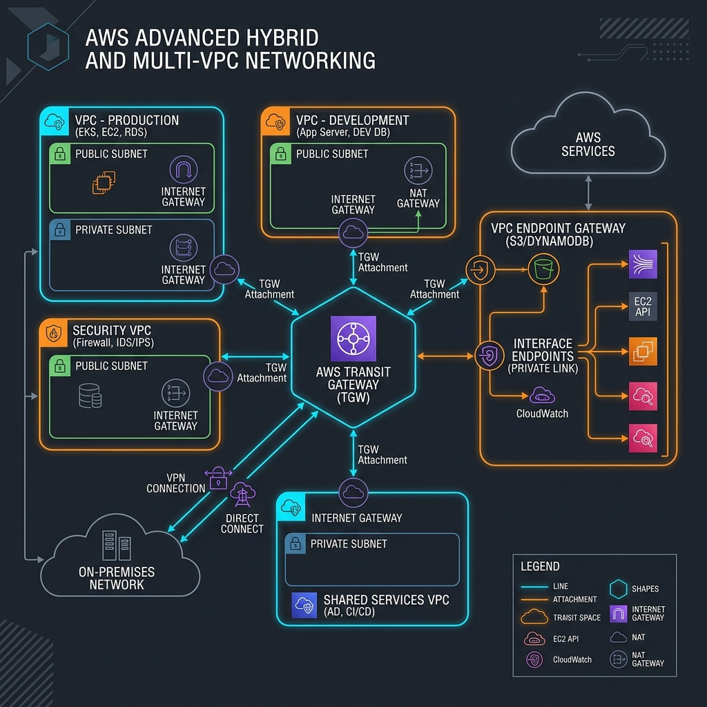
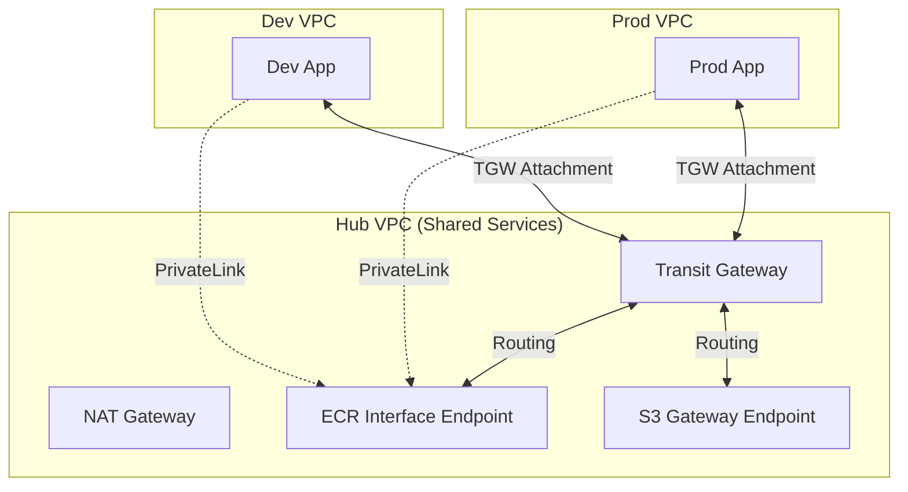

# Project 16: Advanced Networking Workbook

## 1. Scenario (สถานการณ์จำลอง)
ณ บริษัท "ThaiLogistics" ซึ่งเป็นบริษัทโลจิสติกส์ขนาดใหญ่ ปัจจุบันบริษัทเติบโตรวดเร็วมาก
ทำให้ตอนนี้มี AWS Accounts ถึง 15 บัญชี และแต่ละบัญชีต่างก็มี VPC เป็นของตัวเอง
การเชื่อมต่อระบบเครือข่ายระหว่างบัญชีเหล่านี้เกิดปัญหาความซับซ้อนในการจัดการ

- **ความเป็นมาและปัญหาหลัก:**
  - เครือข่ายปัจจุบันยุ่งเหยิงมากเนื่องจากการทำ VPC Peering เชื่อมต่อกันโดยตรงแบบ Mesh Network จนเหมือนเส้นสปาเกตตี
  - ทุกครั้งที่เพิ่ม VPC ใหม่ ทีมงานต้องสร้าง VPC Peering เพิ่มอีก 14 เส้น และต้องอัปเดต Route Table อีกหลายสิบจุด
  - วิธีการนี้ไม่เอื้อต่อการขยายตัว (Scalability) และกำลังจะติด Limit สูงสุดของ VPC Peering ที่ AWS กำหนด
  - ค่าใช้จ่าย NAT Gateway สูงขึ้นอย่างน่าตกใจ เนื่องจากเราดึง Image จาก ECR ผ่าน Public Internet ทั้งหมด
  - เราต้องการจัดตั้ง Hub ตรงกลางเพื่อแก้ปัญหานี้ และบังคับให้ Traffic ไปยัง AWS Services วิ่งผ่านเครือข่ายส่วนตัว (Private Network) เท่านั้น

- **ข้อจำกัด (Constraints):**
  - **Scalability:** ระบบใหม่ต้องรองรับการขยายและเพิ่ม VPC ใหม่เข้ามาได้ภายในเวลาไม่เกิน 5 นาที
  - **Security:** Traffic ระหว่าง VPC ต้องได้รับการควบคุมอย่างเข้มงวดผ่านการจัดการ Transit Gateway Route Tables
  - **Cost:** ต้องลดค่าบริการ Data Processing ของ NAT Gateway ลงอย่างน้อย 40%

- **นิยามของคำว่าเสร็จสิ้น (Definition of Done):**
  1. ติดตั้ง Transit Gateway (TGW) ทำหน้าที่เป็น Hub สำหรับเชื่อมต่อ 3 VPC (Shared Services, Prod, Dev) สำเร็จ
  2. ตั้งค่า Routing อย่างถูกต้องเพื่อให้แต่ละ VPC สื่อสารกับ Shared Services VPC ได้ โดยแยกไม่ให้คุยกันเองหากไม่มีความจำเป็น
  3. เปิดใช้งาน VPC Endpoints สำหรับ S3 (Gateway Endpoint) และ ECR/SSM (Interface Endpoint) เรียบร้อยแล้ว
  4. ผลการรันคำสั่ง `traceroute` หรือสคริปต์ `verify-connectivity.sh` แสดงชัดเจนว่า Traffic ที่วิ่งไปยัง ECR ไม่ได้วิ่งผ่าน NAT Gateway
  5. ตั้งค่า VPC Endpoint Policy เพื่อจำกัดสิทธิ์การเข้าใช้งาน S3 เฉพาะ Bucket ที่บริษัทกำหนดเท่านั้น

## 2. Topology Diagram (แผนผังระบบ)




### แผนผังการเชื่อมต่อแบบภาพรวม (Text Diagram)
```text
[Spoke VPC: App]       [Spoke VPC: Database]
       ↓                         ↓
[Transit Gateway (Central Hub)] ↔ [Direct Connect / VPN]
       ↓
[Shared Services VPC] → [VPC Endpoints (S3, ECR, SSM)]
```

### ส่วนประกอบทางสถาปัตยกรรม (Architectural Components)
- Transit Gateway: ทำหน้าที่จัดการ Traffic ทั้งหมดระหว่าง VPCs และ On-premises Network จากศูนย์กลาง
- Gateway Load Balancer: ในงานระดับ Production มักติดตั้งก่อนหน้า Transit Gateway เพื่อคัดกรอง Traffic ผ่าน Firewall อย่างโปร่งใส
- Interface Endpoints: มอบ Private IP ให้แก่ AWS Services เพื่อส่งผ่านข้อมูลโดยไม่ต้องวิ่งผ่าน NAT Gateway
- TGW Route Table Propagation: เรียนรู้เส้นทาง (Route) จาก VPC ที่นำมาเชื่อมต่อ (Attachment) โดยอัตโนมัติ ช่วยลดภาระในการตั้งค่าด้วยตนเอง

### ประสิทธิภาพและการรองรับการขยายตัว (Performance & Scaling)
- Throughput: Transit Gateway รองรับ Bandwidth ได้สูงสุดถึง 50 Gbps ต่อหนึ่ง Attachment
- Estimated Scale: เชื่อมต่อ VPC และ On-premises Network ได้สูงสุดหลายร้อยตัว (สูงสุด 5,000 Attachments ต่อหนึ่ง Transit Gateway)
- Bottlenecks: คอขวดมักเกิดจาก Route Table Limits (ค่าเริ่มต้นปกติ 10,000 Routes) และค่าบริการ Data Processing จาก Traffic ที่ผ่าน Hub

### ประสบการณ์จากหน้างานจริง (Production Insights)
- CIDR Overlap: การทับซ้อนของ IP Address เป็นเรื่องที่แก้ไขยากที่สุด ควรทำตาราง Master CIDR เพื่อแบ่งช่วง IP ให้แต่ละแผนกก่อนเริ่มสร้าง VPC แรก
- Shared Services VPC: ในระบบจริงนิยมสร้าง VPC กลาง (Hub) เพื่อวาง Resource ที่ใช้ร่วมกัน เช่น Active Directory, Monitoring หรือ NAT Gateways
- Endpoint Policies: อย่าเปิด VPC Endpoint ทิ้งไว้เฉยๆ ควรตั้งค่า Endpoint Policy จำกัดสิทธิ์ให้เข้าถึงเฉพาะ Bucket ของบริษัทเพื่อป้องกัน Data Exfiltration

### การนำไปใช้งานจริง (Real-World Use Cases)
- Enterprise Multi-account: เชื่อมต่อ AWS Accounts จำนวนมากของแต่ละทีมในองค์กรเข้าด้วยกันอย่างเป็นระบบ
- Hybrid Cloud Integration: เชื่อมต่อ Data Center สาขาหลักเข้ากับ AWS ผ่าน Direct Connect โดยใช้ Transit Gateway เป็นจุดกระจายสัญญาณ
- Centralized Security Inspection: ส่ง Traffic ทั้งหมดไปตรวจสอบที่ VPC กลางที่ติดตั้ง Firewall เช่น Palo Alto หรือ AWS Network Firewall ก่อนออกอินเทอร์เน็ต
- การเชื่อมต่อระบบหลายแผนก: จัดระเบียบการเชื่อมต่อสำหรับองค์กรที่เข้มงวดเรื่องความปลอดภัย เช่น ธุรกิจการเงิน หรือประกันภัย ที่ห้ามข้อมูลวิ่งผ่านอินเทอร์เน็ต

### การทดสอบเพื่อยืนยันความทนทาน (Failure Testing)
- ทดลองลบ Route ใน Transit Gateway: ลบเส้นทางเดินรถจาก VPC A ไปยัง VPC B เพื่อดูว่า Traffic ขาดหายไปทันทีหรือไม่
- ทดลองเข้าถึง S3 แบบไร้ VPC Endpoint: ปิด Public Access และลบ VPC Endpoint เพื่อดูว่าเครื่องใน Private Subnet จะคุยกับ S3 ไม่ได้เลยจนกว่าจะสร้าง Gateway Endpoint

### การบริหารจัดการค่าใช้จ่าย (Cost Management)
- ข้อควรระวัง: Transit Gateway มีค่าธรรมเนียมรายชั่วโมงต่อ Attachment และค่า Data Processing เพิ่มเติม
- VPC Endpoints: มีค่าใช้จ่ายรายชั่วโมงตามจำนวนใช้งาน ควรเปิดใช้เฉพาะ Endpoint ที่จำเป็นจริงๆ เท่านั้น

## 3. Prerequisites & Estimated Time (สิ่งที่ต้องเตรียมและเวลาที่ใช้)
- **สิ่งที่ต้องเตรียมก่อนเริ่มปฏิบัติงาน:**
  - AWS Account ที่มีสิทธิ์เต็มในการสร้าง Transit Gateway และ VPC
  - ติดตั้ง Terraform เวอร์ชัน 1.7 ขึ้นไป
- **ระยะเวลาที่ใช้ในการทดลอง:**
  - ประมาณ 12-18 ชั่วโมง (รวมการทำความเข้าใจและการทดสอบ)

## 4. Tasks (ขั้นตอนการปฏิบัติ)

### Task 1: การเตรียมโครงสร้างพื้นฐานและการเริ่มต้นอย่างรวดเร็ว (Quick Start)
สำหรับการเริ่มต้นทดสอบการทำงานของระบบเครือข่าย ให้ทำตามขั้นตอนดังต่อไปนี้:
1. เข้าไปยังโฟลเดอร์ของ Terraform:
   ```bash
   cd src/terraform
   ```
2. ทำการดาวน์โหลด Provider Plugins และเตรียมระบบ:
   ```bash
   terraform init
   ```
3. รันคำสั่งเพื่อสร้างทรัพยากรบน AWS:
   ```bash
   terraform apply
   ```

### Task 2: การสร้าง Transit Gateway และ VPC Attachment ด้วย Terraform
เมื่อต้องการเชื่อมต่อหลาย VPC เข้าหาศูนย์กลาง เราจะใช้ Transit Gateway ในการจัดการการเชื่อมต่อ:
1. ประกาศสร้าง Transit Gateway ในไฟล์ Terraform:
   ```hcl
   resource "aws_ec2_transit_gateway" "main" {
     description                     = "thaidemo-tgw"
     default_route_table_association = "disable"  # เราจัดการ Route Tables เอง
     default_route_table_propagation = "disable"
     auto_accept_shared_attachments  = "enable"

     tags = { Name = "thaidemo-tgw" }
   }
   ```
2. สร้าง VPC Attachment สำหรับ Production VPC เพื่อเชื่อมต่อเข้ามายัง Transit Gateway:
   ```hcl
   resource "aws_ec2_transit_gateway_vpc_attachment" "prod" {
     subnet_ids         = module.prod_vpc.private_subnets
     transit_gateway_id = aws_ec2_transit_gateway.main.id
     vpc_id             = module.prod_vpc.vpc_id
   }
   ```
3. สร้าง VPC Attachment สำหรับ Shared Services VPC:
   ```hcl
   resource "aws_ec2_transit_gateway_vpc_attachment" "shared" {
     subnet_ids         = module.shared_vpc.private_subnets
     transit_gateway_id = aws_ec2_transit_gateway.main.id
     vpc_id             = module.shared_vpc.vpc_id
   }
   ```
4. สร้าง Route Table ใน Transit Gateway และเปิดการ Propagation เส้นทาง:
   ```hcl
   # Route Table สำหรับ Prod — เห็นแค่ Shared Services
   resource "aws_ec2_transit_gateway_route_table" "prod" {
     transit_gateway_id = aws_ec2_transit_gateway.main.id
   }

   resource "aws_ec2_transit_gateway_route_table_propagation" "prod_to_shared" {
     transit_gateway_attachment_id  = aws_ec2_transit_gateway_vpc_attachment.shared.id
     transit_gateway_route_table_id = aws_ec2_transit_gateway_route_table.prod.id
   }
   ```

### Task 3: การสร้าง Site-to-Site VPN สำหรับการเชื่อมต่อกับ On-premises
ในสถาปัตยกรรมระดับองค์กร จำเป็นต้องเชื่อมต่อเครือข่ายคลาวด์เข้ากับศูนย์ข้อมูลหลัก (Data Center):
1. สร้าง VPN Gateway บนฝั่ง AWS:
   ```hcl
   resource "aws_vpn_gateway" "main" {
     vpc_id = module.prod_vpc.vpc_id
   }
   ```
2. กำหนดค่า Customer Gateway โดยระบุ IP Address ของฝั่ง On-premises:
   ```hcl
   resource "aws_customer_gateway" "dc_bangkok" {
     bgp_asn    = 65000  # AS Number ของ On-premises Router
     ip_address = "203.0.113.1"  # Public IP ของ On-premises Router
     type       = "ipsec.1"
   }
   ```
3. สร้าง VPN Connection และกำหนดค่าให้รองรับการเชื่อมต่อผ่าน BGP:
   ```hcl
   resource "aws_vpn_connection" "to_bangkok" {
     vpn_gateway_id      = aws_vpn_gateway.main.id
     customer_gateway_id = aws_customer_gateway.dc_bangkok.id
     type                = "ipsec.1"
     static_routes_only  = false  # ใช้ BGP
   }
   ```

### Task 4: การตั้งค่าลำดับความสำคัญของ BGP Route Priority
หากมีช่องทางการเชื่อมต่อทั้ง Direct Connect (DX) และ VPN เข้ามายังระบบเครือข่ายเดียวกัน:
1. การเลือกเส้นทางของระบบเครือข่าย AWS จะอ้างอิงลำดับความสำคัญดังนี้:
   - Direct Connect จะมีสิทธิ์การเลือกใช้งานสูงกว่าเสมอ (เนื่องจากค่า BGP Local Preference ในระบบของ AWS สูงกว่า)
   - Site-to-Site VPN จะทำหน้าที่เป็นเพียง Backup Route
2. วิธีจำลองสถานการณ์ให้ VPN กลายเป็น Backup Line โดยการทำ AS-PATH Prepending บนอุปกรณ์ Router ของฝั่ง On-premises:
   ```text
   ! Cisco IOS
   route-map VPN_PREPEND permit 10
    set as-path prepend 65000 65000 65000
   !
   neighbor 169.254.x.x route-map VPN_PREPEND out
   ```

### Task 5: การตรวจสอบการเชื่อมต่อและความปลอดภัยทางเครือข่าย
เมื่อทำการ Deploy โครงสร้างพื้นฐานเรียบร้อยแล้ว ให้รันสคริปต์การตรวจสอบในระบบ:
1. ใช้สคริปต์ตรวจสอบความถูกต้องของ Private Connectivity:
   ```bash
   bash src/scripts/verify-connectivity.sh
   ```
   *หมายเหตุ: สคริปต์นี้จะรันการตรวจสอบ Ping, Traceroute, DNS Resolution ของ ECR และทดสอบดึงข้อมูล S3 ผ่าน Endpoint*

### Task 6: การล้างข้อมูลหลังการใช้งาน (Cleanup)
- หากต้องการทำลายทรัพยากรทั้งหมดที่ถูกสร้างขึ้น ให้รันคำสั่ง:
  ```bash
  terraform destroy
  ```
- *ข้อควรระวัง:* ควรระวังลำดับการลบทรัพยากร โดยคุณต้องทำการลบ Transit Gateway Attachment ออกก่อนที่จะสั่งลบตัว Transit Gateway หลัก เพื่อหลีกเลี่ยงข้อผิดพลาดเกี่ยวกับการพึ่งพิงกันของทรัพยากร (Dependency Errors)

## 5. Verification (การตรวจสอบผลการทำงาน)
- **การตรวจสอบฝั่ง Transit Gateway:**
  - [ ] สร้าง Transit Gateway เรียบร้อยแล้ว
  - [ ] สร้าง VPC Attachments ครบสำหรับทั้ง 3 VPC (Shared Services, Prod, Dev)
  - [ ] ตั้งค่า Transit Gateway Route Tables (Prod, Dev, Shared) เรียบร้อยแล้ว
  - [ ] ตรวจสอบการ Routing เพื่อให้มั่นใจว่า Spoke VPCs สามารถเชื่อมต่อมายัง Shared Services ได้
- **การตรวจสอบฝั่ง VPC Endpoints:**
  - [ ] สร้าง S3 Gateway Endpoint ในทุก VPC เรียบร้อยแล้ว
  - [ ] สร้าง ECR Interface Endpoints (api และ dkr) ใน Shared Services VPC เรียบร้อยแล้ว
  - [ ] เปิดใช้งาน Private DNS สำหรับทุก Interface Endpoints
  - [ ] ตรวจสอบ Endpoint Policy เพื่อป้องกันการเปิดสิทธิ์แบบกว้างเกินไป (หลีกเลี่ยงการใช้ `Action: *` ในระบบจริง)
- **การตรวจสอบด้านการเชื่อมต่อและการกำหนดเส้นทาง (Connectivity & Routing):**
  - [ ] อัปเดต VPC Route Tables เพื่อชี้ช่วง CIDR ภายในองค์กรไปยัง Transit Gateway
  - [ ] อัปเดต Security Groups เพื่อเปิดรับ Traffic จาก CIDR ของ Transit Gateway
  - [ ] ตรวจสอบด้วยคำสั่ง `traceroute` ว่า Traffic ที่ไปยัง Instance ปลายทางวิ่งผ่าน Transit Gateway จริง
  - [ ] ตรวจสอบด้วยคำสั่ง `nslookup` ว่า ECR Address ได้รับการ Resolve เป็น Private IP
- **การตรวจสอบด้านความปลอดภัยและการปฏิบัติตามข้อกำหนด (Security & Compliance):**
  - [ ] เปิดใช้งาน Transit Gateway Flow Logs เรียบร้อยแล้ว
  - [ ] โครงสร้างของ Transit Gateway Route Tables ต้องไม่เป็นแบบ Full Mesh เพื่อควบคุมการแยกเครือข่าย (Network Isolation) อย่างปลอดภัย

## 6. Troubleshooting (การแก้ไขปัญหาที่พบบ่อย)

### กรณีที่ 1: เกิดสถานะ Blackhole routes ใน Transit Gateway
- **อาการที่พบ:** Traffic ส่งเข้ามาที่ Transit Gateway แต่หยุดชะงักและไม่ถูกส่งต่อไปยังจุดหมายปลายทาง
- **สาเหตุที่เป็นไปได้:** ไม่มีรายการ Route ปลายทาง (Destination CIDR) ระบุอยู่ใน Transit Gateway Route Table
- **แนวทางการแก้ไข:** ไปตรวจสอบที่ `TGW Route Tables -> Routes` เพื่อตรวจสอบว่า Destination CIDR ได้รับการเชื่อมโยง (Associate) กับ VPC Attachment ที่ถูกต้องเรียบร้อยแล้ว

### กรณีที่ 2: ปัญหาเส้นทางไม่สมมาตร (Asymmetric Routing)
- **อาการที่พบ:** การเชื่อมต่อเริ่มต้นทำงานได้สำเร็จ แต่จากนั้นจะค้างอยู่ในระหว่างขั้นตอน TCP Handshake (ไม่ได้รับ SYN-ACK ตอบกลับ)
- **สาเหตุที่เป็นไปได้:** Traffic ขาไปวิ่งผ่าน Transit Gateway แต่ Traffic ขากลับวิ่งผ่านอีกเส้นทางหนึ่ง เช่น ผ่าน Direct Peering หรือ VPC Attachment คนละตัว ทำให้ Stateful Firewall หรือ Security Group บล็อก Traffic ขากลับเนื่องจากมองว่าเป็น Request ที่ไม่ถูกต้อง
- **แนวทางการแก้ไข:** ตรวจสอบการทำ Symmetrical Routing โดยบังคับให้เส้นทางขากลับต้องวิ่งผ่าน Transit Gateway Attachment ตัวเดิมกับขาไป หรือเปิดใช้งาน Appliance Mode บน Transit Gateway Attachment เพื่อบังคับใช้เส้นทางที่สมมาตร

### กรณีที่ 3: VPC Endpoint DNS ไม่สามารถทำการ Resolve เป็น Private IP ได้
- **อาการที่พบ:** เมื่อใช้คำสั่ง `nslookup s3.ap-southeast-1.amazonaws.com` ผลลัพธ์กลับคืนมาเป็น Public IP แทนที่จะเป็น Private IP ของ Endpoint
- **สาเหตุที่เป็นไปได้:** ไม่ได้เลือกเปิดใช้งานตัวเลือก `Enable Private DNS` บน Interface Endpoint หรือไม่ได้ตั้งค่าเปิดใช้งาน `enableDnsSupport` และ `enableDnsHostnames` ในการตั้งค่า VPC
- **แนวทางการแก้ไข:** เปิดใช้งาน `Private DNS` บนตัว Endpoint และตรวจสอบว่า VPC Route Table มีการตั้งค่าเปิดใช้งาน DNS Hostnames และ DNS Support เป็น True แล้ว

### กรณีที่ 4: การเกิด Access Denied เมื่อเรียกใช้งานผ่าน S3 Gateway Endpoint
- **อาการที่พบ:** Instance ไม่สามารถดึงข้อมูลหรือเชื่อมต่อเข้ากับ S3 Bucket ได้ ทั้งที่ได้ทำการแนบ IAM Role ที่มีสิทธิ์แบบ Full Access ให้กับ Instance แล้ว
- **สาเหตุที่เป็นไปได้:** มีการกำหนดค่า Endpoint Policy ที่ตัว S3 Gateway Endpoint เข้มงวดมากเกินไปจนบล็อกการเข้าถึงโดยไม่ได้ตั้งใจ
- **แนวทางการแก้ไข:** ตรวจสอบไฟล์ JSON Policy ที่ผูกติดกับ S3 Gateway Endpoint และปรับปรุงสิทธิ์ให้เหมาะสมกับ Instance และ Bucket ที่ระบุ

### กรณีที่ 5: ปัญหาขนาดแพ็กเก็ตไม่สอดคล้องกัน (MTU Mismatch)
- **อาการที่พบ:** การส่งแพ็กเก็ตข้อมูลขนาดเล็ก เช่น การรันคำสั่ง Ping ทำงานได้ตามปกติ แต่เมื่อส่งข้อมูลที่มีขนาดใหญ่ เช่น การโหลดหน้าเว็บ หรือการใช้คำสั่ง HTTP/SCP การรับส่งข้อมูลจะค้าง
- **สาเหตุที่เป็นไปได้:** Transit Gateway รองรับขนาด MTU สูงสุดที่ 8500 สำหรับ VPC Attachment แต่รองรับสูงสุดเพียง 1500 สำหรับ VPN Connection หรือ Transit Gateway Peering
- **แนวทางการแก้ไข:** กำหนดค่าให้กับ Application หรือการเชื่อมต่อ VPN Tunnel ให้เปิดการทำงาน MSS Clamping หรือเปิดใช้ Path MTU Discovery (PMTUD) เพื่อปรับขนาดแพ็กเก็ตโดยอัตโนมัติ

### กรณีที่ 6: VPC ไม่สามารถเชื่อมโยงสื่อสารกันได้แม้ทำการ Attach เข้ากับ Transit Gateway แล้ว
- **อาการที่พบ:** ตัว Instance ใน VPC ต่างๆ ไม่สามารถส่งข้อมูลหากันได้ ทั้งที่ตั้งค่า VPC Attachment กับ Transit Gateway ครบถ้วนแล้ว
- **สาเหตุที่เป็นไปได้:** ลืมอัปเดตเส้นทางใน VPC Route Table ของแต่ละ VPC ให้ชี้ช่วง IP Address ของฝั่งตรงข้ามไปยัง Transit Gateway
- **แนวทางการแก้ไข:** เพิ่ม Route ใน VPC Route Table ของแต่ละฝั่งให้ชี้ Destination CIDR ไปยัง Transit Gateway:
  ```hcl
  resource "aws_route" "private_to_shared" {
    route_table_id         = module.prod_vpc.private_route_table_id
    destination_cidr_block = "10.1.0.0/16"  # CIDR ของ Shared Services VPC
    transit_gateway_id     = aws_ec2_transit_gateway.main.id
  }
  ```

### กรณีที่ 7: VPN Tunnel เชื่อมต่อสำเร็จ (Up) แต่ไม่มี Traffic วิ่งผ่าน
- **อาการที่พบ:** สถานะของอุโมงค์ VPN Connection แสดงสถานะใช้งานได้ แต่ไม่มีข้อมูลวิ่งผ่าน
- **สาเหตุที่เป็นไปได้:** การเชื่อมต่อ BGP Session ไม่สำเร็จ (Not Established) เนื่องจากการตั้งค่า ASN หรือ Authentication Key ไม่ตรงกัน
- **แนวทางการแก้ไข:** ตรวจสอบสถานะการเชื่อมต่อโดยรันคำสั่ง CLI:
  ```bash
  aws ec2 describe-vpn-connections --query 'VpnConnections[0].VgwTelemetry'
  ```
  จากนั้นเช็คสถานะที่ `Status` และ `LastStatusChange` เพื่อหาสาเหตุที่ทำให้ BGP Down

## 7. Exercises & Solutions (แบบฝึกหัดและแนวทางการแก้ไข)

### แบบฝึกหัดที่ 1: Centralized Egress (ระดับง่าย)
แทนที่จะสร้าง NAT Gateway ในทุก VPC ให้ทำการออกแบบและสร้าง Egress VPC ขึ้นมาเป็นจุดรวมสำหรับออกอินเทอร์เน็ตเพียงตัวเดียว
- **โจทย์:**
  - ตั้งค่า Route Table เพื่อให้ Traffic `0.0.0.0/0` ทั้งหมดจาก Spoke VPCs วิ่งผ่าน Transit Gateway ไปยัง Egress VPC
  - วิธีนี้จะช่วยประหยัดค่าบริการ NAT Gateway รายชั่วโมงของแต่ละ VPC แต่จะแลกมาด้วยการเสียค่าบริการ Data Processing ของ Transit Gateway ให้ทดลองวิเคราะห์หาจุดคุ้มทุน (Break-even point) ก่อนนำไปปรับใช้จริง
- **แนวทางการแก้ไข:**
  - ตั้งค่าใน Spoke VPC Route Table เพื่อส่ง Traffic ทั่วไปมายัง Transit Gateway:
    ```hcl
    resource "aws_route" "tgw_default" {
      route_table_id         = aws_route_table.spoke.id
      destination_cidr_block = "0.0.0.0/0"
      transit_gateway_id     = aws_ec2_transit_gateway.main.id
    }
    ```
  - ตั้งค่าใน Transit Gateway Route Table สำหรับฝั่ง Spoke VPCs โดยการเพิ่ม Static Route สำหรับ `0.0.0.0/0` ชี้เป้าหมายไปยัง Egress VPC Attachment

### แบบฝึกหัดที่ 2: VPN Integration (ระดับปานกลาง)
จำลองระบบเพื่อทำการเชื่อมต่อไปยัง Data Center ภายในองค์กร (On-Premises):
- **โจทย์:**
  - ทำการสร้าง `Customer Gateway` และ `VPN Connection` แล้วนำไปต่อเชื่อม (Attach) เข้ากับ Transit Gateway
  - ตั้งค่า BGP (หรือใช้ Static Routes) เพื่ออนุญาตให้ระบบเครือข่ายของฝั่ง On-Premises สามารถเข้าถึง AWS VPCs ได้
- **แนวทางการแก้ไข:**
  - ใช้โค้ด Terraform ด้านล่างนี้ในการสร้างการเชื่อมต่อ VPN ร่วมกับ Transit Gateway:
    ```hcl
    resource "aws_customer_gateway" "main" {
      bgp_asn    = 65000
      ip_address = "203.0.113.12"
      type       = "ipsec.1"
    }

    resource "aws_vpn_connection" "main" {
      customer_gateway_id = aws_customer_gateway.main.id
      transit_gateway_id  = aws_ec2_transit_gateway.main.id
      type                = "ipsec.1"
      static_routes_only  = true
    }
    ```

### แบบฝึกหัดที่ 3: Cross-Region TGW Peering (ระดับยาก)
ในกรณีที่บริษัทเติบโตและต้องการขยายระบบไปยัง Region อื่น เช่น ทวีปยุโรป:
- **โจทย์:**
  - สร้าง Transit Gateway ขึ้นมาใน Region `eu-west-1`
  - เชื่อมต่อผ่าน Transit Gateway Peering Attachment ระหว่าง Transit Gateway ที่สิงคโปร์ (Singapore TGW) และดับลิน (Dublin TGW)
  - อัปเดต Transit Gateway Route Tables เพื่อให้ VPC ของแต่ละ Region สามารถสื่อสารข้ามประเทศกันได้
- **แนวทางการแก้ไข:**
  - กำหนดค่า Resource สำหรับ TGW Peering ในไฟล์ Terraform:
    ```hcl
    resource "aws_ec2_transit_gateway_peering_attachment" "example" {
      peer_account_id         = aws_ec2_transit_gateway.peer.owner_id
      peer_region             = "eu-west-1"
      peer_transit_gateway_id = aws_ec2_transit_gateway.peer.id
      transit_gateway_id      = aws_ec2_transit_gateway.main.id
    }
    ```

