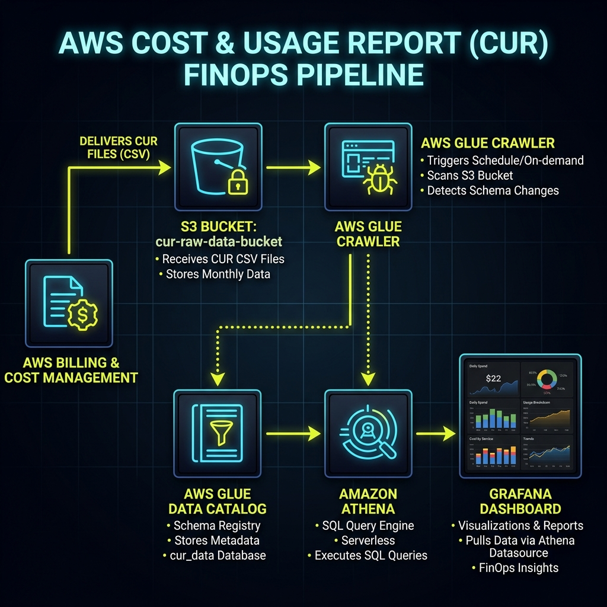
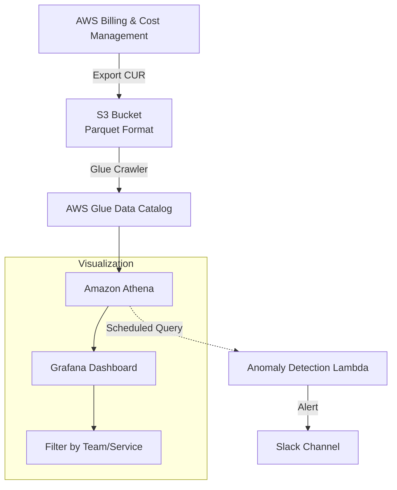

# Project 18: FinOps Dashboard Workbook

> 🧠 **ภาพจำก่อนอ่าน:** 🧪 Lab → 📊 CUR → 🧮 Athena → 📈 Dashboard → 💰 Optimize → 🧹 Cleanup  
> 🎨 [Visual Guide ของวิชานี้](../../VISUAL-MEMORY-GUIDE-TH.md) — ภาพช่วยจำ ไม่แทนคำสั่งและเนื้อหาจริง

โปรเจกต์นี้จะช่วยลดช่องว่างระหว่างทีม Engineering และทีม Finance โดยการสร้าง FinOps Dashboard ที่ใช้งานได้จริงเพื่อสร้าง Visibility ในการติดตามค่าใช้จ่าย AWS โดยใช้ Cost and Usage Report (CUR), Amazon Athena และ Grafana

ทักษะที่จะได้เรียนรู้:
- การตั้งค่า AWS Cost and Usage Reports (CUR)
- การตั้งค่าส่งข้อมูล CUR ไปยัง S3 Bucket แบบอัตโนมัติ
- การสืบค้นข้อมูลค่าใช้จ่ายด้วย SQL ใน Amazon Athena
- การทำ Data Visualization แสดงผลค่าใช้จ่าย Cloud ใน Grafana
- การใช้งาน Cost Allocation Tags และการคำนวณ Unit Economics
- การตรวจจับความผิดปกติของค่าใช้จ่าย (Cost Anomalies) ด้วย SQL

แนวคิดหลักของ FinOps:
- เปรียบการทำ FinOps เหมือน "การอ่านใบเสร็จจากซุปเปอร์มาร์เก็ต"
- AWS Bill (ปกติ) = ยอดเงินรวมที่ต้องจ่าย (รู้ว่าแพง แต่ไม่รู้รายละเอียดการใช้งานจริง)
- CUR (Cost and Usage Report) = ใบเสร็จแบบละเอียด (ที่บอกข้อมูลสินค้าเป็นรายชิ้นและช่วงเวลาชัดเจน)
- Athena = พนักงานบัญชี (คอยแยกหมวดหมู่และคิวรีข้อมูลตามสั่ง)
- Grafana Dashboard = กราฟสรุปยอดใช้จ่ายประจำเดือนเพื่อให้ทุกคนในองค์กรเห็นภาพและประหยัดร่วมกัน

การใช้งานในชีวิตจริง:
- Enterprise Chargeback: การสรุปยอดใช้จ่ายเพื่อเรียกเก็บเงินคืนจากแต่ละแผนก (BU) ในบริษัทใหญ่
- Rightsizing Analysis: ใช้ข้อมูลการใช้งานจริงมาเปรียบเทียบกับราคา เพื่อดูว่าเราใช้เครื่องใหญ่เกินความจำเป็น (Over-provisioned) หรือไม่
- Budget Forecasting: การทำนายแนวโน้มค่าใช้จ่ายในอีก 3-6 เดือนข้างหน้าเพื่อของบประมาณจากฝ่ายการเงิน
- Internal Billing: การเรียกเก็บเงินคืนตามหน่วยงานจริงในบริษัท
- Anomaly Detection: ใช้ตรวจหาความผิดปกติของค่าใช้จ่าย เช่น มีคนแอบเปิดเครื่องขุด Bitcoin หรือลืมปิด Resource ขนาดใหญ่

ค่าใช้จ่ายและงบประมาณในการทำ Lab:
- ค่าเก็บข้อมูลใน S3 (ราคาถูกมาก)
- ค่า Scan ข้อมูลของ Athena ($5 ต่อ 1 TB)
- ความคุ้มค่า: ช่วยให้บริษัทประหยัดเงินได้มหาศาลจากการมองเห็น (Visibility) ของการใช้จ่าย

สรุปเนื้อหาสำคัญ:
- FinOps คือวัฒนธรรมที่ทำให้ทุกคนมีส่วนรับผิดชอบต่อค่าใช้จ่าย (Accountability)
- "Visibility is the first step to optimization" - ถ้ามองไม่เห็น ก็ลดค่าใช้จ่ายไม่ได้
- การใช้ Tagging อย่างมีระบบคือหัวใจสำคัญของการวิเคราะห์ข้อมูล

---

## 1. Scenario (สถานการณ์จำลอง)

เช้าวันจันทร์เวลา 09:00 น. ในบริษัท "ThaiRetail" ซึ่งเป็นแพลตฟอร์ม e-commerce ขนาดใหญ่ CFO คุณมาลี เดินเข้ามาหาด้วยสีหน้ากังวลและแจ้งข้อมูลว่า:
- บิลค่าใช้จ่าย AWS ของเราเมื่อเดือนที่แล้วพุ่งสูงถึง $45,000 ซึ่งเพิ่มขึ้นจากเดือนก่อนหน้าถึง $10,000
- เมื่อไปสอบถามหัวหน้าทีม Engineer ก็ไม่มีใครสามารถตอบได้ชัดเจนว่ายอดที่เพิ่มขึ้นนี้มาจากทีมใดหรือโปรเจกต์ไหน
- ปัจจุบันเรามี 10 ทีม และ 200 microservices จึงมีความจำเป็นต้องสร้าง Dashboard เพื่อแสดงผลข้อมูลต่อไปนี้:
  - แสดงค่าใช้จ่ายแยกตามทีม (Cost by Team) และแยกตามบริการ (Cost by Service)
  - แสดงข้อมูลเฉพาะเจาะจงว่าค่าใช้จ่ายที่เกิดขึ้นต่อ 1 รายการคำสั่งซื้อของลูกค้า (Cost per Order) เป็นเท่าใด
  - ต้องการเห็นรายงานอัปเดตในทุกเช้าโดยไม่ต้องรอจนถึงสิ้นเดือน

ข้อจำกัดของระบบ:
- Granularity: ต้องสามารถฟิลเตอร์กรองข้อมูลตาม "Team", "Environment" และ "Service" ได้โดยใช้ Tag
- Automation: ข้อมูลจะต้องได้รับการอัปเดตโดยอัตโนมัติในทุกๆ 24 ชั่วโมง
- Cost: การคิวรีข้อมูลเพื่อแสดงผลจะต้องประหยัดที่สุด โดยเลือกใช้งาน Athena Partitioning

คำนิยามของงานที่เสร็จสมบูรณ์ (Definition of Done):
- ตั้งค่า AWS CUR ให้ส่งออกข้อมูลไปยัง S3 Bucket โดยอัตโนมัติ
- ตั้งค่า Athena เพื่อสืบค้นข้อมูล CUR ผ่าน Partitioned Table เรียบร้อย
- หน้าจอ Grafana Dashboard พร้อมใช้งานจริง โดยต้องแสดงตัวชี้วัดดังนี้:
  - ยอดรวมค่าใช้จ่ายตั้งแต่ต้นเดือนจนถึงปัจจุบัน (Month-to-Date Cost) เทียบกับงบประมาณ (Budget)
  - รายละเอียดค่าใช้จ่ายแยกตามบริการ AWS Service เช่น EC2, RDS, S3
  - รายละเอียดค่าใช้จ่ายแยกตาม Tag เช่น Team: Alpha, Beta
  - ตัวชี้วัด Unit Metric: "Cost per Order" ซึ่งเชื่อมโยงคำนวณร่วมกับยอดคำสั่งซื้อจาก Database
- มีระบบแจ้งเตือนความผิดปกติแบบอัตโนมัติ (Anomaly Report) ส่งไปยัง Slack Channel หากค่าใช้จ่ายพุ่งสูงเกิน 20% ภายในวันเดียว

---

## 2. Topology Diagram (แผนผังระบบ)





การไหลของข้อมูลและโครงสร้างระบบ:
```text
[AWS Billing Entity] → (Hourly/Daily Export) → [S3 Bucket (CUR)]
                                                  ↓
[Amazon Glue (Crawler)] → [Athena Table (Schema)] ↔ [Partitioning]
                                                  ↓ (SQL)
[Grafana Dashboard] ← (Athena Plugin) ← [S3 Query Results]
```

การไหลของข้อมูลเบื้องต้น:
```text
[AWS Billing (CUR)] → [S3 Bucket] → [Amazon Athena (SQL Query)] → [Grafana Dashboard]
```

ส่วนประกอบทางสถาปัตยกรรม:
- CUR (Cost and Usage Report) คือ แหล่งข้อมูลดิบ (Raw Data Source) ที่อัปเดตจาก AWS หลายครั้งต่อวัน
- S3 Lifecycle คือ การตั้งค่าเพื่อย้ายข้อมูล CUR เก่าไปยัง Storage Class ที่ราคาประหยัดกว่า หรือลบข้อมูลโดยอัตโนมัติ
- Amazon Athena คือ บริการ Serverless Interactive Query ที่ช่วยวิเคราะห์ข้อมูลใน S3 โดยใช้ SQL มาตรฐาน
- Grafana คือ หน้าจอแสดงผลเปรียบเสมือน "หน้าต่างกระจก" (Glass) ที่ช่วยให้มองเห็นภาพรวมและเข้าใจง่าย โดยใช้ Athena Plugin เพื่อคิวรีข้อมูลแบบ Real-time

ประสิทธิภาพและการขยายระบบ (Performance & Scaling):
- Estimated Data Size: รองรับไฟล์ CUR ขนาดใหญ่หลายร้อย GB (บริษัทขนาดใหญ่ที่มี Resources หลักหมื่นชิ้น)
- Bottlenecks: คอขวดมักอยู่ที่ Athena Scan Limit และเวลาในการประมวลผล Query หากไม่ได้ทำ Partitioning ข้อมูลตามปีและเดือน
- Scaling Approach: ใช้การเก็บข้อมูลแบบ Apache Parquet Format แทน CSV เพื่อลดปริมาณข้อมูลที่ต้อง Scan ลงได้สูงสุด 90% และประหยัดค่าใช้จ่ายได้มหาศาล

---

## 3. Prerequisites & Estimated Time (สิ่งที่ต้องเตรียมและเวลาที่ใช้)

สิ่งที่ต้องเตรียมก่อนเริ่ม:
- AWS Account ที่มีสิทธิ์เข้าถึงข้อมูล Billing
- สิทธิ์การใช้งาน Athena และ S3 Bucket
- Grafana ที่เชื่อมต่อกับ Athena ผ่าน Plugin เรียบร้อย

เวลาที่ใช้ในการทำ Lab:
- 10-15 ชั่วโมง

---

## 4. Tasks (ขั้นตอนการปฏิบัติ)

ในการสร้างระบบ FinOps Dashboard ให้ดำเนินงานตามขั้นตอนต่างๆ ดังต่อไปนี้:

### Task 1: การวางแผนและการเปิดใช้งาน AWS Cost and Usage Report (CUR)
เปิดใช้งาน CUR ใน AWS Billing Console เพื่อบันทึกข้อมูลค่าใช้จ่ายดิบลงใน S3 Bucket:
- เข้าไปยัง AWS Billing Console
- เปิดใช้งาน CUR โดยเลือกรูปแบบการส่งออกเป็น Parquet เพื่อลดค่าใช้จ่ายการสืบค้นข้อมูลผ่าน Amazon Athena
- หากต้องการจัดการค่าผ่านระบบ Terraform สามารถใช้โครงสร้างทรัพยากรดังนี้:

```hcl
resource "aws_cur_report_definition" "main" {
  report_name                = "thaidemo-cur"
  time_unit                  = "HOURLY"
  format                     = "Parquet"
  compression                = "Parquet"
  additional_schema_elements = ["RESOURCES"]
  s3_bucket                  = aws_s3_bucket.cur.id
  s3_prefix                  = "cur/"
  s3_region                  = "ap-southeast-1"
  report_versioning          = "OVERWRITE_REPORT"
  refresh_closed_reports      = true
}
```

### Task 2: การปรับใช้ Infrastructure ด้วย Terraform
สร้าง S3 Bucket, Athena Workgroup และ Glue Catalog Database เพื่อเตรียมวิเคราะห์ข้อมูล:
- เข้าไปยังไดเรกทอรีของ Terraform:
  ```powershell
  cd src/terraform
  terraform init
  terraform apply
  ```
- ยืนยันการทำงานเพื่อสร้าง Infrastructure ในการเก็บข้อมูลและประมวลผล

### Task 3: การสืบค้นข้อมูลและวิเคราะห์ค่าใช้จ่ายด้วย Amazon Athena
เมื่อข้อมูล CUR ถูกนำส่งไปยัง S3 Bucket แล้ว ให้ใช้ SQL ในการดึงข้อมูลและจัดการตาราง:
- สร้างตารางแบบ External Table เพื่อรองรับ Schema ข้อมูล CUR:

```sql
CREATE EXTERNAL TABLE IF NOT EXISTS cur_data (
  identity_line_item_id string,
  line_item_usage_start_date timestamp,
  line_item_usage_end_date timestamp,
  line_item_product_code string,
  line_item_usage_type string,
  line_item_unblended_cost double,
  line_item_resource_id string,
  resource_tags_user_team string,
  resource_tags_user_service string,
  resource_tags_user_environment string
)
PARTITIONED BY (year string, month string)
STORED AS PARQUET
LOCATION 's3://thairetail-billing-data-123456789012/cur/main-cur/main-cur/';
```

- ใช้คำสั่งคิวรีเพื่อค้นหายอดใช้จ่ายรายวัน (Daily Spend Trend):

```sql
SELECT 
    CAST(line_item_usage_start_date AS DATE) as usage_date,
    SUM(line_item_unblended_cost) as total_cost
FROM cur_data
WHERE year = '2024' AND month = '03'
GROUP BY 1
ORDER BY 1;
```

- ค้นหา Resources 10 อันดับแรกที่มีราคาสูงที่สุด (Top 10 Most Expensive Resources):

```sql
SELECT 
    line_item_resource_id,
    line_item_product_code,
    SUM(line_item_unblended_cost) as total_cost
FROM cur_data
WHERE year = '2024' AND month = '03'
GROUP BY 1, 2
ORDER BY 3 DESC
LIMIT 10;
```

- วิเคราะห์ยอดจ่ายสูงสุด 10 บริการแรกของเดือนปัจจุบัน:

```sql
SELECT
  product_product_name AS service,
  SUM(line_item_unblended_cost) AS total_cost
FROM cur_table
WHERE line_item_usage_start_date >= DATE_TRUNC('month', CURRENT_DATE)
  AND line_item_line_item_type = 'Usage'
GROUP BY product_product_name
ORDER BY total_cost DESC
LIMIT 10;
```

- วิเคราะห์สัดส่วนการใช้จ่ายแยกตามแท็กทีม (Cost by Team):

```sql
SELECT
  resource_tags_user_team AS team,
  SUM(line_item_unblended_cost) AS cost
FROM cur_table
WHERE month = '2025-04'
GROUP BY resource_tags_user_team
ORDER BY cost DESC;
```

- ตรวจสอบยอดใช้จ่ายส่วนของ NAT Gateway ในระบบเครือข่าย:

```sql
SELECT
  line_item_usage_account_id,
  SUM(line_item_unblended_cost) AS nat_cost
FROM cur_table
WHERE product_product_name = 'Amazon Virtual Private Cloud'
  AND line_item_usage_type LIKE '%NatGateway%'
GROUP BY line_item_usage_account_id;
```

### Task 4: การตั้งค่าระบบแจ้งเตือนงบประมาณด้วย AWS Budget Alert
เขียนคอนฟิกสำหรับการควบคุมค่าใช้จ่ายผ่าน AWS Budget:
- ใช้ Terraform ในการกำหนดเกณฑ์งบประมาณและรูปแบบช่องทางรับการเตือน:

```hcl
resource "aws_budgets_budget" "monthly" {
  name         = "thaidemo-monthly-budget"
  budget_type  = "COST"
  limit_amount = "500"
  limit_unit   = "USD"
  time_unit    = "MONTHLY"

  notification {
    comparison_operator        = "GREATER_THAN"
    threshold                  = 80
    threshold_type             = "PERCENTAGE"
    notification_type          = "ACTUAL"
    subscriber_email_addresses = ["somkid@thaidemo.io"]
  }

  notification {
    comparison_operator        = "GREATER_THAN"
    threshold                  = 100
    threshold_type             = "PERCENTAGE"
    notification_type          = "FORECASTED"  # แจ้งเมื่อ Forecast เกิน Budget
    subscriber_sns_topic_arns  = [aws_sns_topic.cost_alert.arn]
  }
}
```

### Task 5: การนำเข้าแดชบอร์ดและการทำ Visualization ใน Grafana
สร้างแดชบอร์ดสำหรับแสดงผลตัวชี้วัดค่าใช้จ่ายทั้งหมดแบบเรียลไทม์:
- เชื่อมต่อ Grafana เข้าหา Amazon Athena Data Source ในระบบ
- นำเข้าไฟล์แดชบอร์ด `src/grafana/finops-dashboard.json` หรือจัดทำหน้าจอแดชบอร์ดเพื่อแสดงยอดสะสมรายเดือนและสัดส่วนของแต่ละทีม

### Task 6: การเก็บกวาดทรัพยากร (Cleanup)
ลบทรัพยากรเมื่อเสร็จสิ้นการใช้งานหรือการฝึกฝนเพื่อไม่ให้เกิดค่าใช้จ่ายค้างคา:
- สั่งรันคำสั่งทำลายทรัพยากรระบบ:
  ```powershell
  terraform destroy
  ```
- ตรวจสอบและทำการลบข้อมูล CUR ใน S3 Bucket รวมถึงตัว Glue Catalog Database ใน Amazon Athena ด้วยตนเอง

ข้อควรระวังและข้อมูลเชิงลึก (Production Insights):
- Unit Economics: อย่าดูเพียงแค่ยอดใช้จ่ายรวม ให้วิเคราะห์ลึกลงถึงราคาจ่ายจริงต่อหน่วยธุรกิจ เช่น Cost per Order
- Shared Costs Allocation: ประเด็นเรื่องค่าใช้จ่ายส่วนกลาง เช่น Data Transfer หรือค่าบริการระบบ Support ต้องอาศัยสูตรคำนวณปันส่วนกลับไปยังทีมย่อยให้สอดคล้องกับการใช้งานจริง
- Athena Cost Management: การรีเฟรชข้อมูลใน Grafana บ่อยครั้งจะสั่งคิวรีไปยัง Athena ซึ่งมีค่า Scan ข้อมูล แนะนำให้ตั้งค่าการทำ Cache หรือทำ Summary Table สำรองไว้ล่วงหน้า

---

## 5. Verification (การตรวจสอบผลการทำงาน)

ให้ตรวจสอบความถูกต้องของการตั้งค่าและผลการดำเนินงานตามรายการด้านล่าง:

ระบบข้อมูลดิบและการเชื่อมโยง (Data Pipeline):
- [ ] เปิดใช้งาน AWS Cost and Usage Report (CUR) แล้วโดยเลือกฟอร์แมต Parquet และเปิดใช้งาน Resource IDs
- [ ] สร้าง S3 Bucket พร้อมกำหนด Bucket Policy สำหรับรับข้อมูล Billing จาก AWS อย่างถูกต้อง
- [ ] สร้าง Athena Workgroup พร้อมเปิดใช้งานการเข้ารหัสข้อมูล (Encryption)
- [ ] รัน Glue Crawler หรือใช้ DDL Script ในการสร้าง Athena Table สำเร็จ

การกำหนดป้ายกำกับ (Tagging):
- [ ] กำหนดนโยบายการจัดทำ Tag บังคับสำหรับทรัพยากรระบบเรียบร้อย เช่น Team, Service, Environment
- [ ] เปิดใช้งาน Tag "Team" และ "Service" ในระบบ Cost Allocation Tags บน AWS Billing Console เรียบร้อย
- [ ] ตรวจสอบให้แน่ใจว่ามี Resource ในระบบไม่ต่ำกว่า 80% ที่ระบุ Tag เหล่านี้อย่างถูกต้อง

การแสดงผลข้อมูล (Visualization):
- [ ] เชื่อมต่อ Grafana เข้ากับ Athena Data Source ได้สำเร็จ
- [ ] Panel "Spend by Service" แสดงผลค่าใช้จ่ายของบริการแต่ละประเภทได้อย่างถูกต้อง
- [ ] Panel "Spend by Team" แสดงยอดใช้จ่ายแยกตามทีมของตนเองได้อย่างถูกต้อง
- [ ] คำนวณและแสดงผลค่าใช้จ่ายต่อตัวชี้วัดธุรกิจ (Unit Economics) เช่น Cost per Order สำเร็จ

การดำเนินการอัตโนมัติ (Automation):
- [ ] ตั้งค่าระบบวิเคราะห์หาความผิดปกติของค่าใช้จ่ายรายวัน (Daily Cost Anomaly Alert) และแจ้งเตือนสำเร็จ
- [ ] กำหนดสิทธิ์และเปิดใช้งาน S3 Lifecycle Policy บน S3 Bucket ที่เก็บข้อมูล CUR
- [ ] ตั้งค่าระบบส่งรายงานสรุปยอดใช้จ่ายประจำเดือน (Monthly Cost Report) ไปยังฝ่ายการเงินโดยอัตโนมัติ

---

## 6. Troubleshooting (การแก้ไขปัญหาที่พบบ่อย)

หัวข้อปัญหาต่างๆ ที่อาจพบในการตั้งค่าและการทำงานจริง พร้อมแนวทางแก้ไข:

### ปัญหาที่ 1: Athena Table ว่างเปล่า หรือแสดงข้อมูลเป็น 0
- อาการ: คิวรีข้อมูลใน Amazon Athena แล้วไม่พบรายการข้อมูลใดๆ (Zero records)
- สาเหตุ: AWS CUR อาจยังส่งออกข้อมูลรอบแรกไม่เสร็จสิ้น (ปกติใช้เวลา 24 ชั่วโมง) หรือพาธ S3 ในคำสั่ง CREATE TABLE ไม่ถูกต้อง
- วิธีแก้ไข: ตรวจสอบใน S3 Bucket ว่ามีไฟล์ Parquet ส่งมาจริงหรือไม่ และตรวจสอบค่า LOCATION ใน Hive DDL ให้ตรงกับพาธจริง

### ปัญหาที่ 2: เกิดข้อผิดพลาด HIVE_PARTITION_SCHEMA_MISMATCH หรือ HIVE_BAD_DATA
- อาการ: คำสั่งคิวรีข้อมูลล้มเหลวหลังจากใช้งานระบบไปได้ระยะหนึ่ง
- สาเหตุ: AWS ปรับปรุงหรือเปลี่ยนรูปแบบ CUR เช่น การเพิ่มคอลัมน์ใหม่เข้ามา ทำให้โครงสร้างตารางของ Athena ไม่ตรงกับข้อมูลจริงใน S3
- วิธีแก้ไข: ทำการ Drop ตารางเดิมทิ้ง แล้วสร้างตารางใหม่โดยการใช้ Glue Crawler เพื่อสแกนโครงสร้าง Schema ล่าสุด

### ปัญหาที่ 3: Grafana เกิดข้อผิดพลาด Query Timeout
- อาการ: การแสดงผล Panel บนหน้าจอ Grafana แจ้งเตือน Timeout หรือตอบสนองช้ามาก
- สาเหตุ: ส่งคำสั่งคิวรีข้อมูลจำนวนมากเกินไปโดยไม่มีการใช้ Partitioning
- วิธีแก้ไข: ปรับปรุงคำสั่ง SQL ใน Grafana ให้ระบุเงื่อนไขการใช้ Partition เช่น `WHERE year = '${year}' AND month = '${month}'` เสมอ

### ปัญหาที่ 4: ข้อมูลป้ายกำกับ (Tag) แสดงเป็นสถานะว่างเปล่าหรือ Untagged
- อาการ: แดชบอร์ดแสดงสัดส่วนค่าใช้จ่ายส่วนใหญ่เป็น Untagged ทั้งที่ติด Tag ไว้แล้ว
- สาเหตุ: ลืมเปิดใช้งาน Tag นั้นๆ ในระบบ Cost Allocation Tags ของ AWS
- วิธีแก้ไข: ไปที่ AWS Billing Console -> เลือก Cost Allocation Tags -> ค้นหา Tag ที่ต้องการ แล้วคลิก Activate (ต้องรอข้อมูลอัปเดตในระบบประมาณ 24 ชั่วโมง)

### ปัญหาที่ 5: ยอดตัวเลขค่าใช้จ่ายใน Athena ไม่ตรงกับหน้าต่าง Cost Explorer
- อาการ: ยอดเงินที่สืบค้นได้ไม่ตรงกับยอดที่ปรากฏบน AWS Cost Explorer
- สาเหตุ: การเลือกใช้ตัวชี้วัดที่ต่างกัน เช่น Athena ใช้ข้อมูล unblended_cost ขณะที่ Cost Explorer แสดง amortized_cost หรือคำนวณรวมภาษี
- วิธีแก้ไข: เลือกใช้ตัวชี้วัดให้ตรงกัน แนะนำให้ใช้ unblended_cost สำหรับการดูบิลจริง และใช้ amortized_cost เพื่อวิเคราะห์ประสิทธิภาพทางวิศวกรรม

### ปัญหาที่ 6: ระบบส่งการแจ้งเตือนงบประมาณ (Budget Notification) ไม่ทำงาน
- อาการ: ค่าใช้จ่ายจริงเกินค่าที่ตั้งไว้ แต่ไม่มีเมลหรือการเตือนส่งมา
- สาเหตุ: SNS Topic ยังไม่ได้รับการ Confirm Subscription หรือระบบจัดส่งอีเมลถูกคัดแยกเป็นเมลขยะ (Spam)
- วิธีแก้ไข: ตรวจสอบ SNS Subscription Confirmation และเช็ค AWS CloudTrail เพื่อดูว่ามีการเรียกใช้งาน API `PutNotificationChannel` ถูกต้องหรือไม่

### ปัญหาที่ 7: แดชบอร์ดแสดงยอดเงินเป็น 0 หรือข้อมูลไม่อัปเดตเกิน 2 วัน
- วิธีวิเคราะห์:
  - ตรวจสอบ S3 Bucket ว่ามีไฟล์ CUR ชุดใหม่ถูกจัดส่งออกมาตามกำหนดเวลาหรือไม่
  - ลองคิวรีทดสอบใน Amazon Athena โดยรันคำสั่ง `SELECT * FROM cur_table LIMIT 10` เพื่อดูการมีอยู่ของข้อมูลล่าสุด
  - ตรวจสอบว่า Glue Crawler ทำงานสำเร็จและไม่มีการเปลี่ยนแปลงใดๆ ในโครงสร้างไฟล์ Schema
- สาเหตุ: ไฟล์ CUR ชุดใหม่ถูกส่งออกมาด้วยฟอร์แมตใหม่ ทำให้ตารางเดิมใช้งานไม่ได้ หรือ Glue Crawler ไม่ได้รันเพื่ออัปเดต Partition ของเดือนนั้นๆ
- วิธีแก้ไข: สั่งให้ Glue Crawler ทำงานเพื่ออัปเดต Schema และเพิ่ม Partition ของเดือนปัจจุบันเข้าไปใน Athena

### ปัญหาที่ 8: ค่าใช้จ่ายพุ่งสูงผิดปกติโดยไม่ทราบสาเหตุ
- วิธีสืบสวนและวิเคราะห์:
  - ใช้คำสั่งคิวรีตรวจสอบการเปลี่ยนแปลงรายวันเพื่อหาช่วงเวลาที่มีปัญหา:
    ```sql
    SELECT DATE(line_item_usage_start_date) AS day,
           SUM(line_item_unblended_cost) AS daily_cost
    FROM cur_table
    WHERE month >= '2025-04'
    GROUP BY day ORDER BY day;
    ```
  - เมื่อพบวันที่ผิดปกติ ให้ทำการเจาะลึก (Drill down) เพื่อค้นหาว่าบริการใดมีค่าใช้จ่ายพุ่งขึ้นมา

การทดลองทำให้ระบบเสียหายเพื่อเรียนรู้ (Experiment to Break):
- ลองจงใจเปลี่ยนหรือกำหนด Tag ของ Resource บางตัวให้ไม่ตรงกับแบบแผนมาตรฐาน:
  - ผลลัพธ์: แดชบอร์ดจะแสดงรายการเป็น Unallocated หรือ Unknown เพื่อให้ฝึกจัดการนโยบายการจัดทำแท็ก (Tagging Enforcement)
- ลองส่งคำสั่ง SQL คิวรีข้อมูลที่มีความซับซ้อนโดยไม่ระบุเงื่อนไขกรองข้อมูลใน Athena:
  - ผลลัพธ์: จะได้เรียนรู้เรื่องต้นทุนค่าใช้จ่ายในการ Scan ข้อมูลของ Athena และเห็นความสำคัญของการทำ Partitioning เพื่อลดการ Scan ข้อมูล

---

## 7. Exercises & Solutions (แบบฝึกหัดและแนวทางการแก้ไข)

แบบฝึกหัดสำหรับการทดสอบความเข้าใจในการจัดการและเพิ่มประสิทธิภาพค่าใช้จ่าย (FinOps Maturity) พร้อมแนวทางการแก้ไข:

### แบบฝึกหัดที่ 1: Storage Optimization Analysis (ระดับง่าย)
โจทย์: ค่าใช้จ่ายในการจัดเก็บข้อมูลของ S3 เพิ่มสูงขึ้นอย่างต่อเนื่อง
- ให้เขียน Athena Query เพื่อสืบค้นข้อมูลระบุชื่อ S3 Bucket ที่มีค่าใช้จ่ายด้าน Storage สูง แต่มีปริมาณการทำ Request ต่ำ
- เพื่อนำข้อมูลมาพิจารณาย้ายข้อมูลไปเก็บใน S3 Intelligent-Tiering หรือ Glacier ในการประหยัดงบประมาณต่อไป

แนวทางการแก้ไข (Solution):
```sql
SELECT 
    line_item_resource_id,
    SUM(CASE WHEN line_item_usage_type LIKE '%UsageByteHrs%' THEN line_item_unblended_cost ELSE 0 END) as storage_cost,
    SUM(CASE WHEN line_item_usage_type LIKE '%Requests%' THEN line_item_unblended_cost ELSE 0 END) as request_cost
FROM cur_data
WHERE line_item_service_code = 'AmazonS3'
GROUP BY 1
HAVING SUM(CASE WHEN line_item_usage_type LIKE '%Requests%' THEN 1 ELSE 0 END) < 100
ORDER BY storage_cost DESC
```

### แบบฝึกหัดที่ 2: Savings Plan Impact (ระดับปานกลาง)
โจทย์: ทีมผู้บริหารต้องการประเมินความคุ้มค่าของการสั่งซื้อ Savings Plan มูลค่า $5,000 ต่อเดือน
- ให้เขียน SQL Query เปรียบเทียบระหว่างค่าใช้จ่ายที่อาจเกิดขึ้นจริงตามเรท On-Demand (Potential Cost) กับยอดเงินที่จ่ายจริงตามสิทธิของ Savings Plan (Actual Cost)
- ทำการคำนวณหายอดรวมส่วนต่างที่ประหยัดได้ (Total Savings) และสัดส่วนเปอร์เซ็นต์การใช้งานจริง (Utilization Percentage)

แนวทางการแก้ไข (Solution):
```sql
SELECT 
    savings_plan_savings_plan_a_r_n,
    sum(savings_plan_savings_plan_effective_cost) as effective_cost,
    sum(line_item_unblended_cost) as on_demand_equivalent,
    (sum(line_item_unblended_cost) - sum(savings_plan_savings_plan_effective_cost)) as total_savings
FROM cur_data
WHERE savings_plan_savings_plan_a_r_n != ''
GROUP BY 1
```

### แบบฝึกหัดที่ 3: Shared Cost Allocation (ระดับยาก)
โจทย์: ระบบโครงสร้างเครือข่ายส่วนกลาง (Transit Gateway และ Shared Services VPC) มีค่าใช้จ่ายคงที่อยู่ที่เดือนละ $2,000
- ให้สร้าง SQL View เพื่อจัดสรรงบประมาณส่วนเครือข่ายนี้ (Tax) ย้อนกลับไปให้แก่ทีมย่อยต่างๆ ตามสัดส่วนยอดการใช้งาน Compute จริง
- ตัวอย่างเช่น หาก Team Alpha มียอดใช้งาน Compute เป็น 40% ของทั้งระบบ แดชบอร์ดจะต้องคำนวณและปันส่วนค่าใช้จ่ายส่วนกลางนี้ไปเป็นจำนวนเงิน 40% ของยอดค่าบริการเครือข่าย

แนวทางการแก้ไข (Solution):
```sql
WITH team_spend AS (
    SELECT 
        resource_tags_user_team as team,
        sum(line_item_unblended_cost) as spend
    FROM cur_data
    WHERE resource_tags_user_team != ''
    GROUP BY 1
),
total_spend AS (
    SELECT sum(spend) as total FROM team_spend
),
shared_costs AS (
    SELECT sum(line_item_unblended_cost) as shared_total
    FROM cur_data
    WHERE line_item_resource_id LIKE '%tgw-%' OR line_item_resource_id LIKE '%nat-%'
)
SELECT 
    team,
    spend as direct_cost,
    (spend / (SELECT total FROM total_spend)) * (SELECT shared_total FROM shared_costs) as allocated_shared_cost
FROM team_spend
```

