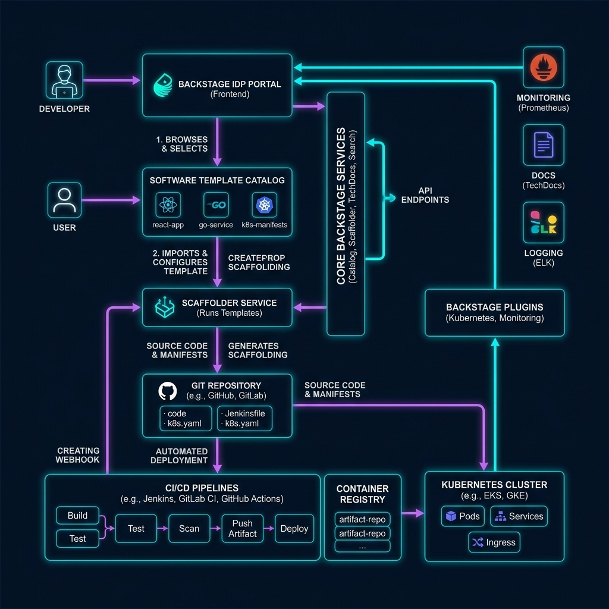
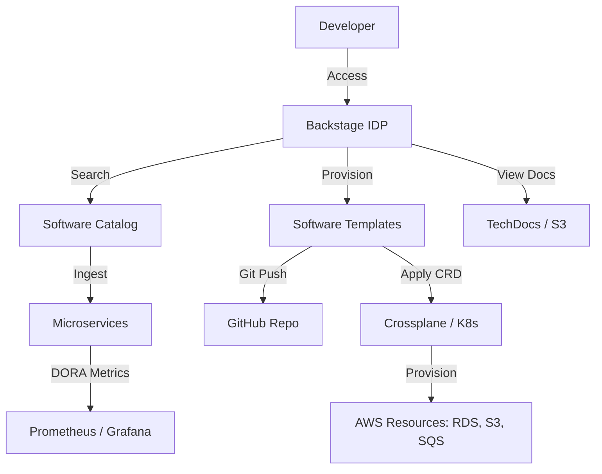

# Internal Developer Platform (สร้างพอร์ทัลกลางสำหรับนักพัฒนาด้วย Backstage) Workbook

> 🧠 **ภาพจำก่อนอ่าน:** 🧪 Lab → 📜 Catalog → 🧩 Templates → ⚙️ Delivery → ✅ Verify → 🧹 Cleanup  
> 🎨 [Visual Guide ของวิชานี้](../../VISUAL-MEMORY-GUIDE-TH.md) — ภาพช่วยจำ ไม่แทนคำสั่งและเนื้อหาจริง

## 1. Scenario (สถานการณ์จำลอง)

เรื่องราวจำลองสำหรับความท้าทายนี้เกิดขึ้นที่ FastMove ซึ่งเป็นสตาร์ทอัพด้านขนส่งสินค้าสัญชาติไทยที่เพิ่งรับวิศวกรใหม่เข้ามาถึง 30 คน
ในช่วงเช้าวันจันทร์ มีข้อความถามคำถามเข้ามาอย่างต่อเนื่องในช่อง Slack ของทีม:
- วิศวกรใหม่ A ถามว่า "จะหา API Docs ของ shipping-service ได้จากที่ไหน? Wiki ในระบบไม่ได้อัปเดตมา 2 ปีแล้ว"
- วิศวกรใหม่ B ถามว่า "ถ้าต้องการสร้าง Microservice ใหม่ต้องทำอย่างไร? สามารถ Copy-paste โค้ดจาก order-service มาได้เลยไหม? แล้ว Template ไหนเป็นเวอร์ชันล่าสุด?"
- วิศวกรอาวุโส C แจ้งว่า "อยากได้ RDS Instance ไปทดสอบทำ POC หน่อย แต่ทีม DevOps บอกว่ามีคิวงาน Terraform ค้างอยู่ ต้องรออีกตั้ง 3 วัน"

ต่อมา CTO โทรหาคุณโดยตรงเพื่อแจ้งประเด็นสำคัญ:
- นักพัฒนาของเราเสียเวลาทำงานถึง 40% ไปกับการค้นหาข้อมูลและรอคอยการเตรียม Infrastructure
- เราต้องการสร้าง Internal Developer Platform (IDP) เพื่อเปิดระบบทุกอย่างเป็นแบบ Self-service
- บริษัทตัดสินใจเลือกใช้ Backstage โดยให้เวลาคุณ 2 สัปดาห์ในการทำระบบนี้ให้เป็น Single Source of Truth

ข้อจำกัดของระบบ (Constraints):
- ต้องรองรับการค้นหาบริการในระบบ (Service Discovery)
- การเตรียมทรัพยากรระบบ (Infrastructure Provisioning) ต้องทำงานได้โดยอัตมัติ เพื่อเลิกการเปิดตั๋วงานในการร้องขอทรัพยากรระบบ
- มีระบบ Standardized Templates ที่เป็นมาตรฐานสำหรับการสร้าง Service ใหม่ทั้งหมด

บันทึกการตัดสินใจเชิงสถาปัตยกรรม (Architecture Decision Record - ADR 001) สำหรับการเลือกใช้ Backstage:
- สถานะการตัดสินใจ: Accepted
- บริบท: FastMove เผชิญความล่าช้าจากขั้นตอนการจัดเตรียมทรัพยากร และการกระจัดกระจายของเอกสารตาม Notion, GitHub และ Google Docs
- การตัดสินใจ: นำระบบ Backstage ซึ่งเป็นระบบแบบ Open Source พัฒนาโดย Spotify มาใช้งานเป็นพอร์ทัลหลักสำหรับนักพัฒนา
- ทางเลือกอื่นที่พิจารณา:
  - Custom Portal: ปฏิเสธเนื่องจากใช้เวลาพัฒนานานและมีภาระดูแลระบบสูง
  - Port หรือ Compass: ปฏิเสธเนื่องจากเป็นระบบ SaaS ในขณะที่องค์กรต้องการการเชื่อมโยงข้อมูลภายในและระบบ On-premise ที่มีความปลอดภัยสูงกว่า
- ข้อดีข้อเสีย (Trade-offs):
  - ข้อดี: ชุมชนผู้ใช้งานขนาดใหญ่ ปรับแต่งผ่านระบบ Plugins ได้ง่าย และพิสูจน์แล้วในระบบขนาดใหญ่
  - ข้อเสีย: Learning Curve เริ่มต้นสูง และต้องการการดูแลจัดการเซิร์ฟเวอร์ด้วยตนเอง

คำนิยามของความสำเร็จ (Definition of Done):
- ติดตั้งและรัน Backstage Core เชื่อมต่อกับ PostgreSQL สำเร็จ
- สามารถ Import และลงทะเบียน Component ผ่านไฟล์ catalog-info.yaml บน GitHub ได้อย่างถูกต้อง
- มีระบบ Software Templates (Scaffolder) ที่สามารถสร้าง Repository ใหม่บน GitHub พร้อมลงทะเบียนเข้า Catalog ได้อัตโนมัติ
- ติดตั้งและแสดงผลเอกสารการพัฒนาด้วย TechDocs ได้อย่างสมบูรณ์แบบโดยไม่เกิด Error

## 2. Topology Diagram (แผนผังระบบ)



แผนผังแสดงโครงสร้างและความเชื่อมโยงภายในระบบ Backstage IDP:



ภาพรวมสถาปัตยกรรมของตัวระบบ (Architecture Text Diagrams):

```text
[Developer] → [Backstage Portal (Frontend)]
                      ↓ (APIs)
[Backend Plugins] ↔ [PostgreSQL (Data Storage)]
          ↓                   ↓
[GitHub (Catalog)]  [ArgoCD/GitHub Actions]  [Kubernetes]
```

```text
[Developer] → [Backstage Portal] → [GitHub (Auth/Code)] & [Crossplane (Infrastructure)] & [Kubernetes]
```

วิเคราะห์องค์ประกอบหลัก (Component Analysis):
- Backstage: ทำหน้าที่เป็น UI หลักและตัวประสานงาน (Orchestrator) ของระบบทั้งหมด
- Software Catalog: แหล่งรวบรวมข้อมูล Metadata ของทุกบริการภายในองค์กรแบบศูนย์กลาง
- Software Templates: แม่แบบมาตรฐาน (Golden Paths) สำหรับใช้ในการเริ่มต้นพัฒนาบริการใหม่
- Crossplane: ตัวควบคุมประเภท Kubernetes-native สำหรับเตรียมและจัดการทรัพยากรระบบ

## 3. Prerequisites & Estimated Time (สิ่งที่ต้องเตรียมและเวลาที่ใช้)

ระยะเวลาในการศึกษาและทำปฏิบัติการ:
- ประมาณ 25 ชั่วโมง

สิ่งที่ต้องจัดเตรียมก่อนเริ่มต้นปฏิบัติการ:
- Docker และ Docker Compose สำหรับการจำลองระบบในเครื่องคอมพิวเตอร์ของคุณ
- Node.js เวอร์ชัน 18 ขึ้นไปสำหรับการพัฒนาและทดสอบระบบหลังบ้าน
- npx และ yarn สำหรับการจัดการแพ็กเกจของ Backstage
- บัญชี GitHub และสร้าง Personal Access Token (PAT) พร้อมสิทธิ์เข้าถึงที่จำเป็น
- Kubernetes Cluster เช่น EKS, Kind, หรือ Minikube
- ฐานข้อมูล PostgreSQL สำหรับเก็บข้อมูล Metadata ในระบบ

## 4. Tasks (ขั้นตอนการปฏิบัติ)

### Task 1: การติดตั้งและเริ่มต้นใช้งาน Backstage
- แนะนำเบื้องต้น:
  - Backstage ช่วยแก้ปัญหาการตามหาเจ้าของบริการหรือคู่มือการทำงาน
  - ทุกอย่างจะถูกรวมอยู่ในระบบเดียวเพื่อให้ทำงานได้เร็วขึ้น
- การติดตั้งในโหมดการพัฒนาด้วยเครื่องคอมพิวเตอร์ของคุณ:
  - รันคำสั่งต่อไปนี้เพื่อสร้างโครงสร้างแอปพลิเคชันเวอร์ชันล่าสุด:
    ```bash
    npx @backstage/create-app@latest
    ```
  - ตั้งชื่อแอปพลิเคชัน เช่น fastmove-developer-portal
  - ระบบจะให้เลือกใช้ฐานข้อมูล แนะนำให้เลือก PostgreSQL
- การเริ่มต้นรันระบบเพื่อทดสอบเบื้องต้น:
  - เข้าโฟลเดอร์โครงการเพื่อสั่งติดตั้งและรันแบบ Local:
    ```bash
    cd fastmove-developer-portal
    yarn install
    yarn dev
    ```
  - ในกรณีที่ต้องการทำงานร่วมกับ Docker Compose เพื่อดึงฐานข้อมูล PostgreSQL ขึ้นมาร่วมกัน สามารถใช้คำสั่ง:
    ```bash
    cd src/backstage
    docker-compose up -d
    ```

### Task 2: การสร้าง Software Catalog
- ข้อมูลสำคัญ:
  - Software Catalog เป็นส่วนประกอบในการลงทะเบียนข้อมูล Metadata ของบริการทั้งหมด
  - การลงทะเบียนช่วยทำความเข้าใจความสัมพันธ์ของระบบได้โดยสะดวก
- การกำหนดคุณสมบัติข้อมูลด้วย yaml:
  - สร้างไฟล์ catalog-info.yaml ไว้ที่ Root ของ Repository โครงการ
  - ตัวอย่างคอนฟิกของไฟล์:
    ```yaml
    apiVersion: backstage.io/v1alpha1
    kind: Component
    metadata:
      name: payment-service
      description: ระบบจัดการการชำระเงินขององค์กร
      links:
        - url: https://dashboard.datadoghq.com/
          title: Datadog Dashboard
          icon: dashboard
      spec:
        type: service
        owner: team-payment
        lifecycle: production
        dependsOn:
          - component:user-service
    ```
- วิธีการนำไฟล์ประวัติการลงทะเบียนเข้าระบบ:
  - เข้าสู่หน้า UI ของระบบ Backstage เลือกเมนู Create และกด Register existing component
  - ป้อนที่อยู่ไฟล์ catalog-info.yaml จาก Git Repository ของคุณ

### Task 3: ระบบเทมเพลต (Software Templates / Scaffolder)
- ข้อมูลสำคัญ:
  - ช่วยให้นักพัฒนาสร้างโครงการย่อยขึ้นมาได้อย่างเป็นมาตรฐานใน 5 นาที
  - ช่วยลดการก็อปปี้โค้ดเก่าและช่วยติดตั้งการนำส่งข้อมูลอัตโนมัติ
- วิธีการตั้งค่าเทมเพลต:
  - ศึกษาโครงสร้างตัวอย่างจากไฟล์ src/backstage/template.yaml
  - ส่วนประกอบหลักมีดังนี้:
    - Parameters: ส่วนรับข้อมูลบนหน้า UI เช่น ชื่อโครงการหรือเทคโนโลยีที่นักพัฒนาเลือกใช้
    - Steps: ลำดับขั้นตอนระบบ ได้แก่ การดึงโค้ดต้นแบบ (fetch:template), การอัปโหลดเข้า GitHub (publish:github), และการนำเข้าสู่พอร์ทัล (catalog:register)

### Task 4: การเชื่อมโยงเอกสารผ่าน TechDocs
- ข้อมูลสำคัญ:
  - ใช้หลักการแบบ Docs-like-code เพื่อเขียนเอกสาร Markdown ในโครงการร่วมกับตัวโค้ด
  - ไฟล์จะเปลี่ยนเป็นหน้าเว็บสวยงามให้โดยอัตโนมัติหลังจากสั่ง Push ขึ้น Git
- ขั้นตอนการตั้งค่า:
  - ติดตั้งโปรแกรมคอมไพล์เอกสารในระบบของคุณ:
    ```bash
    pip install mkdocs-techdocs-core
    ```
  - ทำการจัดทำไฟล์ตั้งค่า mkdocs.yml ไว้ใน Root ของโฟลเดอร์โครงการ
  - ปรับการตั้งค่าบนระบบ Backstage เพื่ออ่านข้อมูลและแปลงเอกสารมาแสดงผล

### Task 5: การนำระบบขึ้นทำงานจริง (Production Deployment)
- ข้อมูลสำคัญ:
  - การนำระบบขึ้นสู่สภาวะจริงมักจะใช้งานระบบ Kubernetes
  - ช่วยให้มั่นใจได้เรื่องความทนทานและการขยายทรัพยากร
- ขั้นตอนการดำเนินการ:
  - สร้าง Docker Image ของ Backstage จากซอร์สโค้ดในโครงการ
  - นำไปทำ Deployment เข้าสู่ระบบ Kubernetes Cluster ด้วย Helm Chart
  - เปลี่ยนจากการใช้งานฐานข้อมูล SQLite ไปใช้งาน PostgreSQL สำหรับเก็บข้อมูลจริง

### การจัดการและขยายระบบ (Performance & Scaling)
- ปริมาณการโหลดระบบ: รองรับผู้พัฒนาได้จำนวนมากและดูแล Catalog ได้มากกว่า 10,000+ รายการ
- จุดติดขัด (Bottlenecks): ความช้าจากขั้นตอนการทำดัชนีเพื่อค้นหาข้อมูล หรือการดึงข้อมูลผ่าน API ของผู้ให้บริการภายนอก
- แนวทางจัดการ: ใช้ระบบ Redis ทำ Caching ข้อมูล และแยกระบบส่วนงานหนักออกไปรันแยกต่างหากเมื่อมีปริมาณความต้องการพร้อมๆ กัน

### ข้อมูลเชิงลึกจากผู้เชี่ยวชาญ (Insights)
- เน้นสร้างเส้นทางทองคำ (Golden Paths): อย่าเน้นออกกฎระเบียบเพื่อบีบบังคับให้นักพัฒนาใช้งาน
- ออกแบบเครื่องมือที่สะดวกจนผู้พัฒนาอยากขยับมาใช้งานร่วมกันเอง
- ลดปริมาณ Plugins: การติดตั้ง Plugins มากเกินไปจะส่งผลลบต่อความเร็วของระบบหน้าบ้าน
- ติดตั้งการทำระบบสร้างฐานข้อมูลอัตโนมัติเพื่อลดคิวงานที่ต้องทำด้วยมือของทีม Operations

### การทดลองความทนทานและการจัดการหลังการใช้งาน (Resilience & Cleanup)
- การทดลองระบบ:
  - ทดสอบสร้างโปรเจกต์จาก Template ที่มีช่องโหว่ด้านความปลอดภัยเพื่อตรวจสอบกระบวนการตรวจสอบ
  - ทดลองปิดฐานข้อมูลเพื่อวิเคราะห์ว่าหน้าเว็บหลักยังแสดงข้อมูลที่แคชไว้ได้หรือไม่
- การทำความสะอาดระบบ (Cleanup):
  - หยุดระบบในพื้นที่พัฒนาด้วยคำสั่ง:
    ```bash
    docker-compose down
    ```
  - ลบ Helm Release บน Kubernetes Cluster หรือทรัพยากรชั่วคราวทั้งหมด

## 5. Verification (การตรวจสอบผลการทำงาน)

ให้ทำการตรวจสอบสถานะการทำงานตามรายการตรวจสอบต่อไปนี้:

- [ ] เตรียม Kubernetes Cluster ในสภาพแวดล้อมจำลองหรือบนระบบ Cloud เรียบร้อย
- [ ] ติดตั้งแพ็กเกจ npx และ yarn บนเครื่องพัฒนาเสร็จสมบูรณ์
- [ ] สร้าง GitHub Personal Access Token (PAT) พร้อมระบุสิทธิ์สอดคล้องกับการใช้งานเรียบร้อย
- [ ] ตั้งค่าและเชื่อมโยงฐานข้อมูล PostgreSQL สำหรับทำงานกับแอปพลิเคชัน
- [ ] รันชุดคำสั่ง @backstage/create-app เพื่อสร้างโครงการใหม่ได้สำเร็จ
- [ ] กำหนดค่าของตัวแปรระบบหลังบ้านในไฟล์ app-config.yaml สอดคล้องกับพอร์ตและระบบฐานข้อมูล
- [ ] กำหนดตัวแปรสภาพแวดล้อม INTEGRATION_GITHUB_TOKEN ให้มีมูลค่าโทเค็นเรียบร้อย
- [ ] ทดสอบการเข้าสู่ระบบ Backstage UI และดึงค่าจากไฟล์ catalog-info.yaml บนหน้าประวัติได้ถูกต้อง
- [ ] ทดสอบสร้างโปรเจกต์ย่อยผ่าน Software Templates ไปยังบัญชี GitHub ของบริษัทสำเร็จ
- [ ] ทดสอบการเรียกหน้าเอกสารคู่มือ TechDocs ผ่านพอร์ทัลหลักแล้วสามารถเปิดอ่านข้อมูลได้สำเร็จ
- [ ] ตรวจสอบว่าระบบมีระบบบังคับใช้ความปลอดภัยและเรียกสิทธิ์ยืนยันตัวตนก่อนการใช้งาน
- [ ] ทำการย้ายฐานข้อมูลชั่วคราว (SQLite) ในโหมดทดสอบไปสู่ระบบฐานข้อมูลระดับ Enterprise (PostgreSQL)

ประมาณการค่าใช้จ่ายสำหรับการทำงาน (Cost Estimate):
- ทำการรันระบบเพื่อทดสอบบนเครื่อง Local ผ่าน Docker: ไม่มีค่าใช้จ่าย ($0)
- รันระบบในระดับองค์กรผ่าน AWS EKS และ Amazon RDS: ประมาณ $80 ถึง $150 ต่อเดือน

## 6. Troubleshooting (การแก้ไขปัญหาที่พบบ่อย)

### Case 1: Request failed with status 401 Unauthorized (GitHub)
- อาการ: ระบบขึ้นแจ้งเตือนข้อผิดพลาดเรื่องสิทธิ์เข้าถึง หรือไม่สามารถดึงข้อมูล Catalog และเทมเพลตได้
- สาเหตุ: ตัวแปรค่าโทเค็นหรือ GITHUB_TOKEN มีปัญหา หรือหมดอายุการใช้งานลง
- การแก้ไข: ทำการออก GitHub Personal Access Token (PAT) ชุดใหม่ กำหนดสิทธิ์ repo และ read:org ให้ถูกต้อง

### Case 2: Template step fetch:template failed
- อาการ: การทำงานของ Scaffolder ล้มเหลวไม่สามารถดึงข้อมูลต้นแบบได้
- สาเหตุ: การเขียนระบุตำแหน่งสำหรับโฟลเดอร์ skeleton ภายใต้โค้ดตั้งค่าไม่ถูกต้อง
- การแก้ไข: ตรวจสอบและแก้ไขให้เป็น Absolute Path หรือเช็กดูว่าโฟลเดอร์อยู่ในตำแหน่งเดียวกันกับไฟล์ตั้งค่าเทมเพลต

### Case 3: Crossplane: resource remains in PENDING state
- อาการ: ทรัพยากรค้างอยู่ที่สถานะ PENDING บนระบบ Kubernetes ไม่สำเร็จเสียที
- สาเหตุ: เกิดปัญหาจากความถูกต้องของข้อมูล ProviderConfig หรือสิทธิ์ในการจัดสรรทรัพยากรบนคลาวด์ไม่พอ
- การแก้ไข: รันคำสั่งตรวจสอบรายละเอียดผ่านคำสั่ง kubectl describe providerconfig aws-provider

### Case 4: Catalog entity already exists
- อาการ: เกิดข้อผิดพลาดตอนสั่งสมัครทรัพยากรเข้าระบบ Catalog
- สาเหตุ: มีการลงทะเบียนข้อมูลชื่อบริการที่ซ้ำกันกับ Component เก่าที่เคยถูกลงทะเบียนไปแล้ว
- การแก้ไข: เข้าไปที่หน้าเว็บระบบแล้วลบ Entity เดิม หรือทำการเปลี่ยนชื่อตรงหัวข้อ metadata.name ในไฟล์ catalog-info.yaml

### Case 5: TechDocs: failed to generate documentation
- อาการ: ไม่สามารถแสดงคู่มือของตัวระบบได้ หรือเกิดการค้างหน้าจอโหลดซ้ำๆ
- สาเหตุ: ไม่ได้ติดตั้งแพ็กเกจช่วยการแปลงข้อมูล Markdown หรือไม่ได้ตั้งค่าที่เก็บข้อมูลปลายทางในระบบ Production
- การแก้ไข: เพิ่มคำสั่งติดตั้ง python3-pip และ mkdocs-techdocs-core ในระบบ หรือเช็กการตั้งค่า S3 ในไฟล์ app-config.production.yaml

### Case 6: ข้อมูลใน Service Catalog ไม่อัปเดต ทั้งที่เพิ่มไฟล์ catalog-info.yaml ใน Git แล้ว
- อาการ: การแก้ไขข้อมูลบน Git ไม่ถูกอัปเดตบนหน้าเว็บพอร์ทัล
- สาเหตุ: ชนเพดานข้อจำกัดความถี่ในการเรียกใช้ API จากทางระบบภายนอก หรือมีข้อผิดพลาดทางด้าน Syntax ของตัวข้อมูล Metadata
- การแก้ไข: ตรวจสอบบันทึก Logs ของ Backstage และนำเครื่องมือ backstage-cli มาใช้ในการตรวจสอบก่อนจะทำการ Commit ข้อมูล

### Case 7: แพลตฟอร์มทำงานตอบสนองช้า (Database Connection)
- อาการ: หน้าจอระบบประมวลผลดึงข้อมูลช้าผิดปกติ
- สาเหตุ: ยังใช้ระบบจัดการฐานข้อมูลแบบ SQLite ในโหมดใช้งานจริง หรือ Connection Pool มีปริมาณไม่เพียงพอต่อระบบ
- การแก้ไข: ตั้งค่า Connection Pool ในตัวแปร backend.database ให้พร้อมใช้งานระดับสูง และย้ายระบบไปทำงานร่วมกับ PostgreSQL

## 7. Exercises & Solutions (แบบฝึกหัดและแนวทางการแก้ไข)

### แบบฝึกหัดที่ 1: การลงทะเบียน Service ที่มีอยู่ (Easy)
- โจทย์:
  - สร้างไฟล์ catalog-info.yaml สำหรับ Dummy Service และทำการลงทะเบียนเข้าไปใน Backstage UI ด้วยตนเอง
  - ตรวจสอบว่า Component ดังกล่าวไปปรากฏใน Software Catalog เรียบร้อยแล้ว
  - เพิ่ม API Definition (OpenAPI) เข้าไปยัง Service นั้น
- แนวทางการแก้ไข:
  - สร้างไฟล์ชื่อ catalog-info.yaml ใน Root Directory ของแอปพลิเคชันจำลองด้วยโค้ดดังนี้:
    ```yaml
    apiVersion: backstage.io/v1alpha1
    kind: Component
    metadata:
      name: dummy-service
      description: บริการจำลองเพื่อการทดสอบระบบ
    spec:
      type: service
      lifecycle: experimental
      owner: guests
      providesApis:
        - dummy-api
    ---
    apiVersion: backstage.io/v1alpha1
    kind: API
    metadata:
      name: dummy-api
      description: API เอกสารจำลองของ Dummy Service
    spec:
      type: openapi
      lifecycle: experimental
      owner: guests
      definition: |
        openapi: 3.0.0
        info:
          title: Dummy API
          version: 1.0.0
        paths:
          /hello:
            get:
              responses:
                '200':
                  description: Success response
    ```
  - ทำการอัปโหลดไฟล์นี้ขึ้นไปเก็บไว้บน GitHub Repository ของคุณ
  - นำ URL ของไฟล์ดังกล่าวมาทำการลงทะเบียนผ่านหน้าเว็บโดยเข้าไปที่เมนู Create จากนั้นระบุที่อยู่ของ Component สำเร็จ

### แบบฝึกหัดที่ 2: ปรับแต่งขั้นตอนใน Scaffolder (Medium)
- โจทย์:
  - แก้ไข Template new-microservice เพื่อให้สั่งสร้าง Slack Channel สำหรับ Service ใหม่ได้โดยอัตโนมัติ ผ่านการใช้งาน Backstage Scaffolder Action
  - ต้องทำการติดตั้ง Slack Plugin สำหรับ Backstage เพิ่มเติมเพื่อเริ่มใช้งาน
- แนวทางการแก้ไข:
  - ติดตั้ง Scaffolder Backend Module สำหรับ Slack ด้วยการรันคำสั่ง:
    ```bash
    yarn --cwd packages/backend add @backstage/plugin-scaffolder-backend-module-slack
    ```
  - นำเข้าโมดูลและลงทะเบียน Action ในตัวหลังบ้าน โดยปรับปรุงไฟล์ packages/backend/src/plugins/scaffolder.ts เพิ่มโค้ด:
    ```typescript
    import { createSlackChannelAction } from '@backstage/plugin-scaffolder-backend-module-slack';
    
    builder.addActions(createSlackChannelAction({ token: process.env.SLACK_BOT_TOKEN }));
    ```
  - ปรับการตั้งค่าในไฟล์ของ Software Template (template.yaml) ในส่วนของลำดับการรันงาน steps:
    ```yaml
    spec:
      steps:
        - id: create-slack-channel
          name: Create Slack Channel
          action: slack:channel:create
          input:
            channelName: ${{ parameters.name }}-alerts
            topic: Alerts and updates for ${{ parameters.name }}
    ```

### แบบฝึกหัดที่ 3: การเชื่อมโยง Infrastructure ด้วย Crossplane (Hard)
- โจทย์:
  - อัปเดต Software Template เพื่อให้นักพัฒนาสามารถเลือก Checkbox "Need Database?" ตอนสร้าง Service ใหม่ได้
  - หากเลือกตัวเลือกนี้ ให้ Template สั่งทำงาน Crossplane XPostgreSQLInstance Composition โดยอัตโนมัติ
  - เชื่อมต่อและนำ DB Credentials ใส่เข้าไปใน Environment Variables ของ Service นั้นๆ
- แนวทางการแก้ไข:
  - เพิ่มพารามิเตอร์เงื่อนไข Boolean ในหัวข้อ parameters ในไฟล์ template.yaml เพื่อสร้างแบบฟอร์มติ๊กบน UI:
    ```yaml
    spec:
      parameters:
        - title: Database Options
          properties:
            needDatabase:
              title: Need Database?
              type: boolean
              default: false
    ```
  - เพิ่มขั้นตอนการตรวจสอบเงื่อนไขในลำดับงานของ steps ภายในไฟล์เทมเพลต โดยจะรันขั้นตอนเมื่อมีค่าเป็นจริง:
    ```yaml
    spec:
      steps:
        - id: provision-db
          name: Provision PostgreSQL via Crossplane
          if: ${{ parameters.needDatabase }}
          action: kubernetes:apply
          input:
            manifest: |
              apiVersion: database.aws.crossplane.io/v1alpha1
              kind: XPostgreSQLInstance
              metadata:
                name: ${{ parameters.name }}-db
              spec:
                parameters:
                  storageGB: 20
                writeConnectionSecretToRef:
                  namespace: default
                  name: ${{ parameters.name }}-db-conn
    ```
  - ปรับแต่งขั้นตอนการรันโปรเจกต์หรือกระบวนการ CI/CD เพื่อดึงค่าการเข้าถึงจาก Kubernetes Secrets มาบรรจุเป็นตัวแปรความปลอดภัยเพื่อส่งต่อให้ซอฟต์แวร์ทำงานต่อไป

