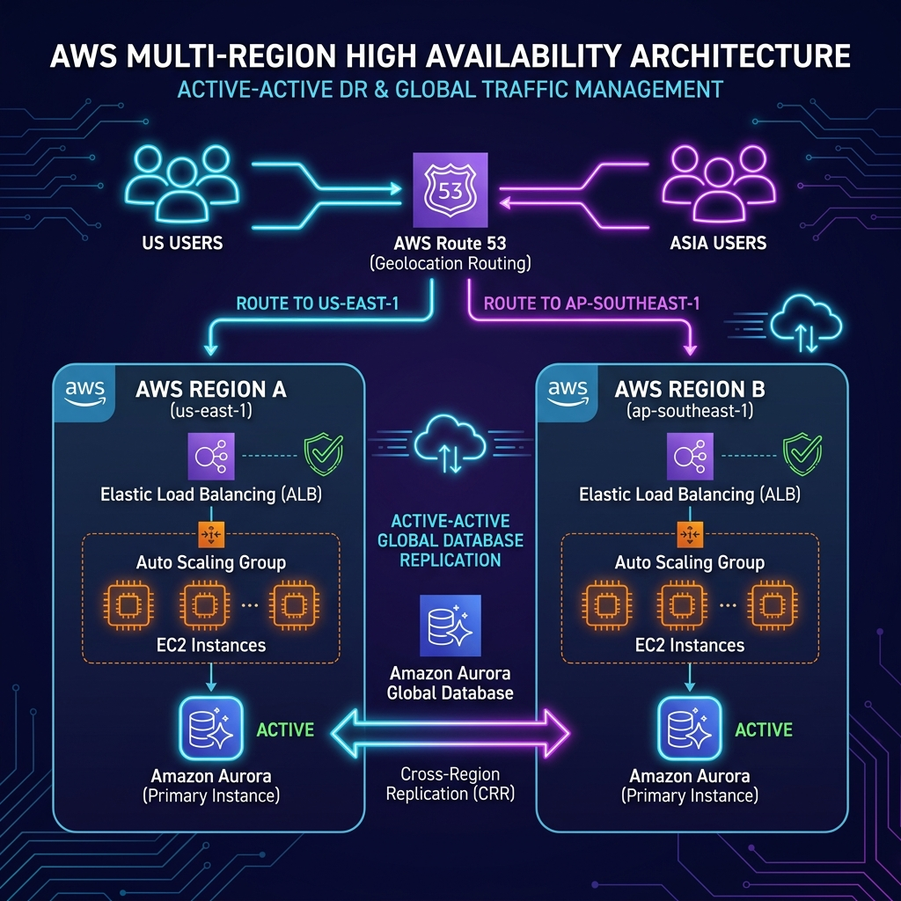

# Project 20: Multi-Region Active-Active Workbook

## 1. Scenario (สถานการณ์จำลอง)

นี่คือสถานการณ์จำลองเหตุการณ์จริงในสายงาน DevOps:
- เวลาตีสองของวันเสาร์ ระบบชำระเงิน ThaiPay ซึ่งเป็น High-Volume Payment Processor ที่กำลังประมวลผลธุรกรรมอยู่ที่ 5,000 รายการต่อวินาที เกิดเหตุการณ์ Region ap-southeast-1 (Singapore) ล่มสลายทั้งหมดจากปัญหา Network Partition ครั้งใหญ่
- โทรศัพท์ของคุณสั่นอย่างต่อเนื่องจากการแจ้งเตือนของ PagerDuty ขณะที่ระบบสื่อสารอย่าง Slack ล่มตามไปด้วย
- ข้อความจาก CTO ส่งผ่าน Signal แจ้งว่าเรากำลังสูญเสียรายได้ค่าธรรมเนียมธุรกรรมถึง 1 ล้านบาทต่อนาที และสั่งให้ย้ายทุกอย่างไป Sydney (ap-southeast-2) ทันที พร้อมถามว่าทำไมเราจึงไม่ทำแบบนี้โดยอัตโนมัติ

เป้าหมายและข้อจำกัด (Goals & Constraints):
- คุณต้องออกแบบและติดตั้งสถาปัตยกรรมแบบ Active-Active (หรือ Active-Passive ที่รองรับ Automated Failover)
- ระบบต้องสามารถทนทานต่อการล่มสลายของทั้งภูมิภาคได้โดยมีค่า RTO (Recovery Time Objective) ต่ำกว่า 1 นาที
- ข้อมูลต้องมีความปลอดภัยและเข้าเกณฑ์ RPO (Recovery Point Objective) ต่ำกว่า 1 วินาที เพื่อให้ข้อมูลไม่สูญหาย
- ออกแบบการทำ Data Replication ข้ามทวีปด้วยความหน่วงต่ำ
- บริหารจัดการ Routing Traffic ให้ผู้ใช้งานเข้าถึงระบบได้รวดเร็วที่สุดจากจุดที่ใกล้ที่สุด

แนวคิดการเปรียบเทียบระบบ Multi-Region Active-Active (Concept):
- Single Region: เหมือนห้างสรรพสินค้าขนาดใหญ่ที่มีสาขาเดียวในเมือง หากถนนหน้าห้างปิดหรือไฟฟ้าดับ ทุกคนก็ไม่สามารถเข้าห้างได้
- Multi-Region: เหมือนสาขาร้านสะดวกซื้อที่กระจายอยู่ทั่วประเทศ หากสาขาหนึ่งปิดหรือบริการมีปัญหา ลูกค้าสามารถเดินไปใช้บริการอีกสาขาที่อยู่ใกล้เคียงได้
- Aurora Global Database: เหมือนบัญชีคลังสินค้าส่วนกลาง ที่ทุกสาขาสามารถมองเห็นข้อมูลสินค้าเดียวกันแบบ Real-time ไม่ว่าใครจะสั่งซื้อสินค้าจากสาขาใดก็ตาม

การนำไปใช้งานในชีวิตจริง (Real-World Use Cases):
- Online Gaming: ระบบเก็บข้อมูลและเซสชันของผู้เล่นที่ต้องการความเร็วและความหน่วงต่ำสุดทั่วโลก
- Global Payment Gateway: ระบบประมวลผลการชำระเงินข้ามชาติที่ต้องการความเสถียรสูงและห้ามหยุดทำงาน
- Airline Reservation: ระบบจองตั๋วเครื่องบินที่ต้องการข้อมูลตรงกันทั่วโลกแบบ Real-time
- Social Media และ Streaming Platform ระดับโลกที่มีผู้ใช้จากทุกทวีปจำนวนมาก
- ระบบการเงินหรือธนาคารที่ต้องการมาตรฐานความพร้อมใช้งานสูงระดับ 99.999% (Five Nines)

## 2. Topology Diagram (แผนผังระบบ)



```mermaid
graph TB
    User[ผู้ใช้งานทั่วโลก (Users Worldwide)]

    User -->|Latency Routing| R53[Route53 Geolocation/Latency Policy]

    R53 -->|ap-southeast-1 Primary| SEA[Singapore Region]
    R53 -->|ap-southeast-2 Secondary| AUS[Sydney Region]

    subgraph SEA [Singapore - Primary]
        ALB1[Application Load Balancer] --> ECS1[ECS / EKS Cluster]
        ECS1 --> DB1[(Aurora Writer)]
    end

    subgraph AUS [Sydney - Secondary]
        ALB2[Application Load Balancer] --> ECS2[ECS / EKS Cluster]
        ECS2 --> DB2[(Aurora Reader / Promoted Writer)]
    end

    DB1 <-->|Aurora Global Replication| DB2
    R53 --> HC1[Health Check - Singapore]
    R53 --> HC2[Health Check - Sydney]
```

ลำดับขั้นตอนการ Failover ของระบบ:
- Route53 Health Check ตรวจพบว่า Application Load Balancer (ALB) ใน Singapore ไม่ตอบสนอง
- Route53 จะปรับเส้นทาง Request ทั้งหมดไปยัง Sydney โดยอัตโนมัติภายในเวลาประมาณ 60 วินาที
- Aurora Global Database ดำเนินการ Failover โดยยกระดับ Reader ใน Sydney ขึ้นเป็น Writer ภายในเวลาประมาณ 30 วินาที
- RTO รวมของระบบทั้งหมดใช้เวลาประมาณ 90 วินาที

## 3. Prerequisites & Estimated Time (สิ่งที่ต้องเตรียมและเวลาที่ใช้)

สิ่งที่ต้องเตรียมก่อนเริ่มปฏิบัติ (Prerequisites):
- AWS Account ที่มีสิทธิ์ครบถ้วนสำหรับการสร้าง Resource ในภูมิภาค ap-southeast-1 (Singapore) และ ap-southeast-2 (Sydney)
- AWS CLI ติดตั้งและตั้งค่าการเชื่อมต่อเรียบร้อยแล้ว
- Terraform สำหรับใช้เขียนและควบคุม Infrastructure as Code (IaC)
- ความเข้าใจพื้นฐานเกี่ยวกับการจัดการ Traffic บน Cloud, VPC Peering และระบบ Database Replication

ระยะเวลาปฏิบัติการโดยประมาณ (Estimated Time):
- 30 ชั่วโมง (30h)

ประสิทธิภาพและการขยายระบบ (Performance & Scaling):
- RTO / RPO Targets: ตั้งเป้าหมายกู้คืนระบบ (RTO) ต่ำกว่า 1 นาที และข้อมูลสูญหาย (RPO) ต่ำกว่า 1 วินาที
- Global Replication Lag: ข้อมูลใน Aurora Global Database ซิงค์ข้ามภูมิภาคปกติไม่เกิน 1 วินาทีในสภาวะเครือข่ายปกติ
- Bottlenecks: คอขวดสำคัญอยู่ที่ Write Latency หากผู้ใช้งานในภูมิภาคสำรองส่งคำสั่งเขียน (Write) ข้อมูลต้องวิ่งกลับมาประมวลผลที่ Primary Region เสมอ นอกเสียจากจะใช้งาน Write Forwarding
- Scaling Approach: ใช้ Global Read Replicas ในภูมิภาคปลายทาง เพื่อให้ระบบอ่านข้อมูลในพื้นที่ได้ทันทีโดยไม่ต้องข้ามทวีป

เกร็ดความรู้จากประสบการณ์จริง (Production Experience):
- Physics is Real: ข้อจำกัดด้านความเร็วแสง (Speed of Light) ทำให้การสื่อสารข้ามทวีป เช่น สิงคโปร์ ไปยัง อเมริกา หรือ ออสเตรเลีย มี Latency อย่างน้อย 150-200ms เสมอ หลีกเลี่ยงขั้นตอนที่ต้องสื่อสารข้าม Region หลายครั้งติดต่อกันใน transaction เดียวกัน
- Write Forwarding: ฟีเจอร์นี้ใน AWS Aurora ช่วยให้ลดความซับซ้อนของ Application Logic ลงไปได้มาก โดย Application ใน Local Region สามารถส่งคำสั่งเขียนเข้า Local Node ได้โดยตรง แล้ว Aurora จะช่วยส่งต่อให้เองหลังบ้าน
- S3 CRR Metadata Lag: ระวังกรณีการตั้งค่า S3 Replication ที่แม้ว่าตัวข้อมูลจะซิงค์ไปแล้ว แต่ Metadata หรือข้อมูลประกอบอื่นๆ อาจมาช้ากว่าเล็กน้อย (Eventual Consistency)

ค่าใช้จ่ายโดยประมาณ (Cost Estimate):
- การรันระบบแบบ Multi-Region (ประกอบด้วย 2x ALB, 4x EC2/ECS, Aurora Global) จะมีค่าใช้จ่ายประมาณ 250 - 400 USD ต่อเดือน
- มีค่าบริการการโอนย้ายข้อมูลข้ามภูมิภาค (Inter-Region Data Transfer) เพิ่มเติมตามปริมาณการใช้งานจริง
- คำเตือน: สถาปัตยกรรมแบบนี้มีค่าใช้จ่ายสูง ควรทำลาย Resource ทั้งหมดด้วยคำสั่ง Destroy ทันทีที่ทำ Lab เสร็จสิ้น

## 4. Tasks (ขั้นตอนการปฏิบัติ)

### Task 1: การเตรียมความพร้อมและตั้งค่า Profile ของแต่ละ Region

สำหรับการทำงานแบบ Multi-region คุณต้องสลับการทำงานระหว่างภูมิภาคบ่อยครั้ง การตั้งค่า CLI ให้รองรับหลายภูมิภาคจึงเป็นเรื่องสำคัญมาก

```bash
# กำหนด Environment Variables สำหรับ Session นี้

> 🧠 **ภาพจำก่อนอ่าน:** 🧪 Lab → 🧠 Concept → 🗺️ Flow → 🔎 Check → ✅ Explain → 🧹 Cleanup  
> 🎨 [Visual Guide ของวิชานี้](../../VISUAL-MEMORY-GUIDE-TH.md) — ภาพช่วยจำ ไม่แทนคำอธิบายและคำสั่งจริง
export AWS_REGION_PRIMARY="ap-southeast-1"  # สิงคโปร์ (Singapore)
export AWS_REGION_SECONDARY="ap-southeast-2" # ซิดนีย์ (Sydney)

# ตรวจสอบการเข้าถึงทั้งสองภูมิภาค
aws ec2 describe-regions --region $AWS_REGION_PRIMARY
aws ec2 describe-regions --region $AWS_REGION_SECONDARY
```

### Task 2: การตั้งค่า S3 Cross-Region Replication (CRR)

การทำ Replication บน S3 จำเป็นต้องเปิดใช้งาน Versioning ทั้งบนถังเก็บข้อมูลต้นทาง (Source Bucket) และปลายทาง (Destination Bucket) รวมถึงต้องมี IAM Role ที่อนุญาตให้ S3 คัดลอกข้อมูลข้ามภูมิภาคได้

ขั้นตอนที่ 1: สร้าง Bucket ในทั้งสองภูมิภาค
```bash
# ภูมิภาคหลัก (Singapore)
aws s3api create-bucket --bucket thaipay-assets-sg --region $AWS_REGION_PRIMARY --create-bucket-configuration LocationConstraint=$AWS_REGION_PRIMARY

# ภูมิภาคสำรอง (Sydney)
aws s3api create-bucket --bucket thaipay-assets-syd --region $AWS_REGION_SECONDARY --create-bucket-configuration LocationConstraint=$AWS_REGION_SECONDARY
```

ขั้นตอนที่ 2: เปิดใช้งาน Versioning (จำเป็นสำหรับการทำ CRR)
```bash
aws s3api put-bucket-versioning --bucket thaipay-assets-sg --versioning-configuration Status=Enabled
aws s3api put-bucket-versioning --bucket thaipay-assets-syd --versioning-configuration Status=Enabled
```

### Task 3: การสร้าง Aurora Global Database

Aurora Global Database ช่วยให้เราสามารถอ่านข้อมูลข้ามภูมิภาคได้ด้วย Latency ที่ต่ำ และรองรับการทำ Disaster Recovery หากภูมิภาคใดภูมิภาคหนึ่งเกิดล่ม

ขั้นตอนที่ 1: สร้าง Global Cluster
```hcl
resource "aws_rds_global_cluster" "main" {
  global_cluster_identifier = "thaipay-global-db"
  engine                    = "aurora-postgresql"
  engine_version            = "15.4"
  database_name             = "thaipay"
}
```

ขั้นตอนที่ 2: สร้าง Regional Clusters
คุณต้องสร้าง Cluster ในสิงคโปร์ (Primary) และซิดนีย์ (Secondary) โดยเชื่อมโยงทั้งคู่เข้ากับ `global_cluster_identifier`

```bash
cd src/terraform
terraform init
terraform apply -target=module.aurora_primary
terraform apply -target=module.aurora_secondary
```

### Task 4: การตั้งค่า Route53 Latency-Based Routing

เพื่อให้มั่นใจว่าผู้ใช้ในไทยจะถูกส่งไปยังสิงคโปร์ และผู้ใช้ในออสเตรเลียจะถูกส่งไปยังซิดนีย์ เราจะใช้ Latency Routing

ขั้นตอนในการตั้งค่า:
1. สร้าง A record สำหรับ `api.thaipay.co`
2. ตั้งค่า Routing Policy เป็น Latency
3. ภูมิภาค `ap-southeast-1` กำหนดปลายทางไปที่ ALB สิงคโปร์
4. ภูมิภาค `ap-southeast-2` กำหนดปลายทางไปที่ ALB ซิดนีย์

### Task 5: การทดสอบกลยุทธ์ Global Failover

หากภูมิภาคสิงคโปร์ล่ม ระบบ Route53 Health Checks จะตรวจพบความผิดปกติของ ALB และหยุดส่งทราฟฟิกไปยังสิงคโปร์โดยอัตโนมัติ

การทดสอบ Failover (Simulation):
- ในสถานการณ์จำลองการทำงานจริง คุณสามารถทดสอบได้โดยการลบ Target Group หรือแก้ไข Security Group Rules ของ ALB เพื่อจำลองว่าเชื่อมต่อไม่ได้
- ติดตามและสังเกตการณ์เปลี่ยนเส้นทางการรับส่งข้อมูลไปยัง Region สำรองโดยอัตโนมัติ

### Task 6: การลบ Resource (Cleanup)

หลังจากการทดสอบและทำแล็บเสร็จสิ้น ควรทำการทำลาย Resources ทั้งหมดเพื่อประหยัดค่าใช้จ่าย

คำสั่งในการ Cleanup:
```bash
# ลบ Resources ทั้งหมดผ่าน Terraform
cd src/terraform
terraform destroy
```
- หมายเหตุ: คุณต้องทำการลบ Cluster ในระดับ Global Database ก่อนจึงจะลบ Regional Clusters ได้สำเร็จ

## 5. Verification (การตรวจสอบผลการทำงาน)

- [ ] สร้าง AWS resources ใน Primary Region (เช่น ap-southeast-1) เรียบร้อยแล้ว
- [ ] สร้าง AWS resources ใน Secondary Region (เช่น ap-southeast-2) เรียบร้อยแล้ว
- [ ] เปิดใช้งาน Aurora Global Database ครอบคลุมทั้งสองภูมิภาคเสร็จสมบูรณ์
- [ ] ตั้งค่า DynamoDB Global Tables พร้อมการทำ replication ที่ถูกต้อง
- [ ] สร้าง Latency-based routing policy บน Route53
- [ ] สร้าง Geolocation routing policy (หากจำเป็นต่อความต้องการธุรกิจ)
- [ ] ตั้งค่า Health checks สำหรับ endpoints ในทั้งสองภูมิภาคและมีสถานะปกติ
- [ ] ทดสอบ Database Failover จาก Primary และ Secondary สามารถได้รับการโปรโมตเป็น Writer สำเร็จ
- [ ] Route53 ปรับเส้นทาง traffic ออกจากภูมิภาคที่ไม่สมบูรณ์โดยอัตโนมัติภายใน 2 นาที
- [ ] บันทึกค่า RTO และ RPO โดยต้องอยู่ภายใต้เกณฑ์ที่ออกแบบไว้ (RTO < 1 นาที, RPO < 1 วินาที)
- [ ] ทดสอบจำลองสถานการณ์เครือข่ายล่ม (Regional Outage Simulation) และยืนยันว่าผู้ใช้ยังใช้งานได้ปกติผ่าน Region สำรอง
- [ ] ทดสอบความหน่วง (Latency Test) เพื่อให้มั่นใจว่าผู้ใช้งานถูกเลือกปลายทางไปยังจุดที่อยู่ใกล้สุดโดยอัตโนมัติ

## 6. Troubleshooting (การแก้ไขปัญหาที่พบบ่อย)

### ปัญหาที่ 1: Route53 ไม่ Failover แม้ว่า Primary Region ล่ม
- อาการ: Health Check แสดงสถานะ Unhealthy แต่ Traffic ยังคงส่งไปยัง Primary Region
- สาเหตุ:
  - Alias Record ไม่ได้ผูกกับการตรวจสอบสุขภาพ (ต้องเปิดตัวเลือก Evaluate Target Health)
  - DNS TTL ของ Record ยังไม่หมดอายุ ทำให้เครื่อง Client ยังคงใช้งาน IP เดิมที่แคชไว้
  - Health Check ใช้การตั้งค่า Threshold ที่กว้างเกินไป ทำให้ระบบรับรู้ปัญหาช้ากว่าปกติ
- วิธีแก้ไข:
  ```bash
  # ตรวจสอบสถานะของ Health Check
  aws route53 get-health-check-status --health-check-id <HC_ID>

  # ทำการล้าง DNS Cache บนเครื่องคอมพิวเตอร์ของคุณ
  ipconfig /flushdns   # Windows
  sudo dscacheutil -flushcache  # macOS
  ```

### ปัญหาที่ 2: Aurora Failover ใช้เวลานานกว่าปกติ
- อาการ: Aurora Failover ใช้เวลานานกว่า 60 วินาที ส่งผลให้เกิด Application Error แก่ผู้ใช้งานเป็นเวลานาน
- สาเหตุ:
  - Application ไม่ได้เชื่อมต่อผ่าน Aurora Cluster Endpoint แต่ระบุไอพีแบบเจาะจงไปที่ Instance Endpoint โดยตรง
  - Connection Pool ไม่มีกลไก Retry Logic ที่รองรับการเปลี่ยนตัวเครื่อง Writer
- วิธีแก้ไข:
  - ปรับตั้งค่า Application ให้ใช้งาน Aurora Cluster Endpoint เสมอ (เช่น `cluster.cluster-xxx.rds.amazonaws.com`)
  - เพิ่ม Retry Logic ใน Source Code ของแอปพลิเคชัน โดยดักจับข้อผิดพลาด `OperationalError` แล้วตั้งค่าให้ลองเชื่อมต่อใหม่ทุก 2 วินาที

### ปัญหาที่ 3: ข้อมูลไม่ตรงกันระหว่าง 2 Region (Stale Read)
- อาการ: ผู้ใช้งานบันทึกข้อมูลใน Singapore แต่เมื่อระบบสลับไปแสดงผลที่ Sydney กลับแสดงค่าเดิมอยู่ชั่วขณะ
- สาเหตุ: เกิดจาก Aurora Replication Lag ซึ่งปกติจะต่ำมาก (ระดับมิลลิวินาที) แต่อาจสูงขึ้นได้หากมีปัญหาเครือข่ายข้ามทวีปหนาแน่น
- วิธีแก้ไข:
  - สำหรับธุรกรรมที่มีความไวสูง (Read-After-Write) ควรตั้งค่าทราฟฟิกให้วิ่งไปหา Primary Writer โดยตรง
  - ตรวจสอบและเปิดใช้งานระบบ Aurora Read-After-Write Consistency Flag หากตัวพัฒนาโปรแกรมและ SDK รองรับ
  - ตรวจติดตาม Metric ของ `AuroraGlobalDBReplicationLag` ใน CloudWatch ให้ต่ำกว่า 1000ms อยู่เสมอ

### ปัญหาที่ 4: ปริศนา Replication Lag บนบริการ S3
- อาการ: มีการเขียนข้อมูลใน S3 ที่ Singapore แต่ที่ Sydney ต้องรอนานกว่า 10 นาทีกว่าข้อมูลจะมาถึง
- สาเหตุ: S3 CRR ทำงานแบบ Asynchronous (ไม่เรียลไทม์) หากต้องการให้ข้อมูลมีความสอดคล้องกันทั่วโลกทันที S3 จะไม่สามารถตอบโจทย์ในส่วนนี้ได้ แนะนำให้ใช้ Aurora Global Database สำหรับการจัดเก็บข้อมูลประเภทที่มีโครงสร้างแทน
- วิธีตรวจสอบ:
  ```bash
  aws s3api get-bucket-replication --bucket thaipay-assets-sg
  ```

### ปัญหาที่ 5: ข้อผิดพลาด Read-Only บนระบบฐานข้อมูล Region สำรอง
- อาการ: แอปพลิเคชันใน Sydney พยายามแก้ไขหรือบันทึกข้อมูลลง Aurora Global Database แล้วเกิดข้อผิดพลาด:
  `ERROR: cannot execute INSERT in a read-only transaction`
- วิธีแก้ไข:
  - เปิดใช้งาน Write Forwarding ในการตั้งค่าของ Aurora Global Cluster ซึ่งจะช่วยให้ Replica จัดส่งคำสั่งเขียนย้อนกลับไปยัง Primary ได้โดยอัตโนมัติ

### ปัญหาที่ 6: ปัญหา DNS Sticky Traffic
- อาการ: ย้ายการประมวลผลไปที่ Sydney สำเร็จแล้ว แต่ยังคงมีผู้ใช้งานกว่า 30% พยายามส่งทราฟฟิกไปยัง Singapore
- สาเหตุ: เกิดจากค่า DNS TTL (Time To Live) ถูกตั้งไว้สูง (เช่น 5 นาที หรือ 300 วินาที) ทำให้เครื่องปลายทางยังเก็บไอพีสิงคโปร์ไว้
- วิธีแก้ไข:
  - ปรับลดค่า TTL สำหรับ Global Endpoints ของคุณลงมาเหลือเพียง 60 วินาที เพื่อให้ DNS อัปเดตได้อย่างรวดเร็ว

## 7. Exercises & Solutions (แบบฝึกหัดและแนวทางการแก้ไข)

### แบบฝึกหัดที่ 1: การจำลองสถานการณ์ Failover
- สถานการณ์: ทีมงานต้องการตรวจสอบความพร้อมของระบบเมื่อเกิดการล่มสลายของ Region หลัก
- งานที่ต้องทำ:
  1. ใช้คำสั่ง Route53 Health Check Override เพื่อตั้งค่าให้เสมือนว่า Primary Region ไม่พร้อมให้บริการ
  2. สังเกตและจับเวลาว่าทราฟฟิกใช้เวลาทั้งหมดกี่วินาทีเพื่อเปลี่ยนเส้นทางไปยัง Secondary Region
  3. ตรวจสอบว่าระบบ Aurora Replica ที่ Sydney ได้รับการยกระดับขึ้นเป็น Writer สมบูรณ์หรือไม่

#### แนวทางการแก้ไขแบบฝึกหัดที่ 1:
```bash
# จำลองสถานการณ์ Primary Region ล้มเหลวด้วยการปิดการทำงานของ Route53 Health Check
aws route53 update-health-check \
  --health-check-id HCID_PRIMARY \
  --disabled

# ทำการมอนิเตอร์เวลาที่ใช้ย้ายทราฟฟิก (วนลูปตรวจสอบทุก 10 วินาที)
for i in {1..12}; do
  echo "Check $i: $(curl -s -o /dev/null -w '%{time_total}s from %{remote_ip}' https://app.example.com)"
  sleep 10
done

# ทำการตรวจสอบสถานะการยกระดับ Aurora Cluster
aws rds describe-global-clusters --global-cluster-identifier myapp-global
```
- ค่า RTO ที่คาดหวัง: Route53 DNS TTL (60s) + Aurora Failover (~30s) = **รวมประมาณ 90 วินาที**

### แบบฝึกหัดที่ 2: การคำนวณ RPO และ RTO
- สถานการณ์: Aurora Global Database รายงานค่า Replication Lag อยู่ที่ประมาณ 1 วินาที
- งานที่ต้องทำ:
  1. คำนวณค่า RPO (Recovery Point Objective) ที่เกิดขึ้นจริงของสถาปัตยกรรมนี้
  2. ระบุ Components ที่มีผลต่อระยะเวลารวมในการกู้คืนระบบ (RTO) พร้อมระบุตัวเลขเวลาของแต่ละส่วนประกอบ
  3. เปรียบเทียบความคุ้มค่าระหว่าง Active-Active และ Active-Passive ในแง่ของ RTO, RPO และงบประมาณค่าใช้จ่าย

#### แนวทางการแก้ไขแบบฝึกหัดที่ 2:
- รายละเอียด RTO:
  | Component | เวลาที่เพิ่มไปยัง RTO |
  |:---|:---:|
  | Route53 Health Check failure detection | 30-60s |
  | Route53 DNS propagation (TTL) | 60s |
  | Aurora Global DB Failover | 30s |
  | Application reconnect to new writer | 5-10s |
  | **Total RTO** | **ประมาณ 2-3 นาที** |
- คำนวณ RPO: โดยทั่วไป Replication Lag ของ Aurora จะเฉลี่ยไม่เกิน 1 วินาที ดังนั้นค่า **RPO ≈ 1 วินาที**

### แบบฝึกหัดที่ 3: ความท้าทายเรื่องความถูกต้องของข้อมูล (Data Consistency)
- สถานการณ์: ระบบรับสั่งซื้อสินค้าชำระเงินรองรับการทำคำสั่งซื้อจากทั้งสองภูมิภาคพร้อมๆ กันในเวลาเดียวกัน
- งานที่ต้องทำ:
  1. วิเคราะห์และระบุปัญหาข้อขัดแย้งของข้อมูล (Write Conflict) ที่อาจจะเกิดขึ้นในโครงสร้าง Active-Active
  2. นำเสนอแนวคิด (Pattern) ที่จะมาจัดการปัญหานี้ (เช่น Home Region หรือ Event Sourcing)
  3. ออกแบบแนวทางป้องกันความขัดแย้ง (Conflict Resolution Strategy) สำหรับ DynamoDB Global Tables

#### แนวทางการแก้ไขแบบฝึกหัดที่ 3:
- Home Region Pattern: ใช้ระบบแบ่งกลุ่มไอดีของผู้ใช้งาน เช่น การทำ Hash UserID mod 2 เพื่อแบ่งเส้นทางใช้งาน โดยจัดสรรให้กลุ่มแรกใช้งานที่ Singapore และอีกกลุ่มไปใช้งานที่ Sydney วิธีนี้ช่วยลดโอกาสเกิดข้อขัดแย้งข้อมูล แต่ส่งผลกระทบทำให้ผู้ใช้บางกลุ่มมี Latency สูงขึ้นเล็กน้อย
- DynamoDB Global Tables Conflict Resolution: ระบบมีตัวเลือกใช้ Last Writer Wins (LWW) เป็นหลัก โดยคำสั่งที่มาพร้อม Timestamp ล่าสุดจะเป็นฝ่ายชนะ และระบบต้องออกแบบแอปพลิเคชันให้ทำงานในรูปแบบ Idempotent เพื่อรองรับการส่งซ้ำ
- Event Sourcing Pattern: หลีกเลี่ยงการแก้ไขหรือบันทึกข้อมูลโดยตรงลงที่ตัว Record แต่ใช้วิธีแนบเหตุการณ์เข้าไปต่อท้าย Event Log (เช่น การใช้ Amazon Kinesis Global Stream) เพื่อให้ทั้งสองระบบได้รับชุดข้อมูลเดียวกันและประมวลผลตามลำดับ เพื่อให้ได้ข้อมูลที่ตรงกันในที่สุดแบบ Eventual Consistency

### สรุปหัวข้อและแนวคิดสำคัญ (Key Takeaways):
- การวางระบบข้ามภูมิภาค (Multi-Region) คือระดับสูงสุดของการจัดการสถาปัตยกรรมสำหรับ Disaster Recovery และ High Availability
- ข้อมูล (Data) เป็นส่วนที่จัดการได้ยากที่สุดในการทำงานแบบ Multi-Region เนื่องจากมีขีดจำกัดทางกายภาพและระยะทาง (Latency)
- การทดสอบจำลองเหตุการณ์ Failover อย่างเป็นประจำและสม่ำเสมอเป็นหนทางเดียวที่จะยืนยันได้ว่าระบบของคุณจะกู้คืนกลับมาได้จริงเมื่อเกิดภัยพิบัติทางระบบขึ้น

