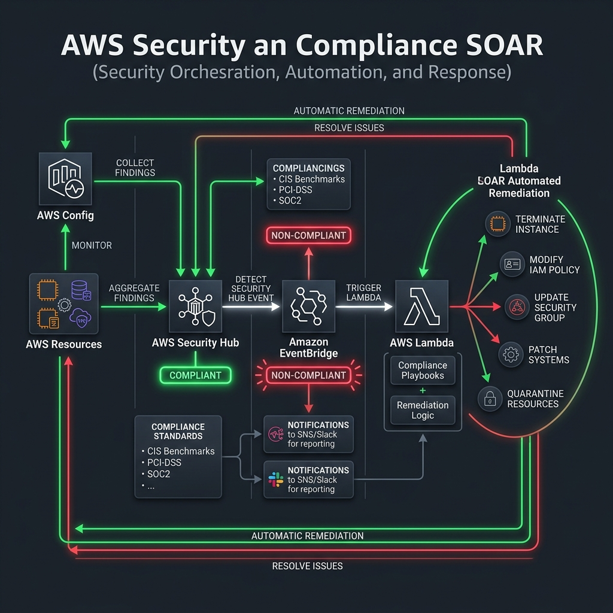
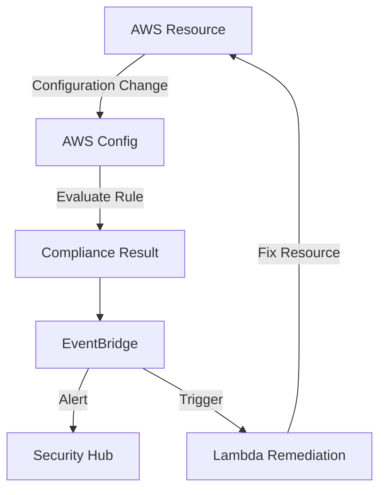

# Project 21: Security & Compliance Workbook

## 1. Scenario (สถานการณ์จำลอง)

บริษัท ThaiFin ของเรากำลังเผชิญกับการตรวจสอบมาตรฐาน PCI-DSS Level 1 เป็นครั้งแรก
- CISO ได้ส่งรายการความต้องการระบบรักษาความปลอดภัย (Must-Haves) มาให้ทำทั้งหมด 40 ข้อ
- เมื่อสัปดาห์ที่ผ่านมา มีนักพัฒนาเผลอตั้งค่า S3 Bucket ให้เป็นแบบสาธารณะ (Public)
- ถึงแม้ไฟล์ข้างในจะเป็นเพียงรูปภาพทั่วไป แต่หากเป็นข้อมูลธุรกรรมจริงของลูกค้า จะก่อให้เกิดความเสียหายร้ายแรงได้

CISO จึงต้องการระบบควบคุมอัตโนมัติ (Automated Remediation) เพื่อตรวจจับและจัดการความเสี่ยงทันที
- หากระบบพบการเปิด Port หรือการแก้ไข S3 Bucket ให้กลายเป็นสาธารณะ
- ระบบต้องเข้าแก้ไขและปิดช่องโหว่ดังกล่าวกลับคืนสถานะปลอดภัยโดยอัตโนมัติภายในเวลาไม่เกิน 60 วินาที

### ภารกิจของคุณ (Your Mission)
1. เปิดใช้งานระบบ Security Monitoring แบบอัตโนมัติ เพื่อคอยตรวจสอบโครงสร้างพื้นฐานตลอดเวลา
2. ออกแบบและพัฒนาโครงสร้างพื้นฐานที่สามารถเยียวยาตัวเองได้ (Self-Healing Infrastructure)
3. ติดตั้ง WAF เพื่อป้องกันภัยคุกคามและการโจมตีเว็บแอปพลิเคชันจากภายนอก

### ข้อจำกัด (Constraints)
- ระบบต้องสามารถตรวจจับและแก้ไขข้อผิดพลาดของการตั้งค่าทรัพยากร (Misconfigurations) ได้อย่างรวดเร็ว (เป้าหมายไม่เกิน 60 วินาที)
- การใช้มาตรการควบคุมความปลอดภัยแบบตรวจหาและแก้ไข (Detective Control) เช่น AWS Config ควรเลือกใช้อย่างเหมาะสมเพื่อไม่ให้กระทบหรือขัดขวางการทำงานของทีมพัฒนา (Developer)
- ระบบจัดการความปลอดภัยต้องรองรับระบบยกเว้นบางกรณี (Exception List) ผ่านกลไกการติดป้ายระบุ (Tags) เช่น "PublicAccess: Allowed"
- IAM Policy ที่เขียนขึ้นมาต้องควบคุมไม่ให้มีขนาดตัวอักษรเกินข้อจำกัดของระบบที่ 6,144 ตัวอักษร
- การเปิดใช้งาน AWS WAF จะต้องระวังปัญหาการบล็อกผู้ใช้งานปกติ (False Positives) โดยเฉพาะกลุ่มผู้ใช้ในประเทศไทย

### ข้อกำหนดความสำเร็จ (Definition of Done)
1. เปิดใช้งาน GuardDuty และ Security Hub เพื่อเฝ้าระวังภัยคุกคามและความปลอดภัยภาพรวมแบบรวมศูนย์
2. ติดตั้ง AWS Config Rules และระบุ Remediation Configuration เพื่อบล็อกและสั่งปิด S3 Bucket Public Access อัตโนมัติ
3. พัฒนาและติดตั้งระบบแก้ไขและเยียวยาตัวเองอัตโนมัติ ผ่าน AWS Systems Manager (SSM) หรือ Lambda Function
4. เปิดใช้ IAM Access Analyzer เพื่อตรวจสอบและประเมินว่ามีทรัพยากรตัวใดถูกเปิดเผยข้าม Account หรือออกสู่ Public
5. ติดตั้งและผูก AWS WAF เข้ากับ Application Load Balancer (ALB) พร้อมกำหนด Managed Rules
6. ผ่านการจำลองการโจมตีหรือการตั้งค่าที่ผิดพลาด (เช่น เปิด S3 Bucket เป็น Public หรือเปิด Port SSH) และระบบสามารถตอบโต้แก้ไขได้ทันที

## 2. Topology Diagram (แผนผังระบบ)



แผนผังแสดงการทำงานของระบบ Compliance Automation:



ลำดับการทำงานทางเทคนิค:
`[AWS Resource Change] -> [AWS Config Check] -> [EventBridge] -> [Lambda Remediation] -> [Security Hub Notification]`

## 3. Prerequisites & Estimated Time (สิ่งที่ต้องเตรียมและเวลาที่ใช้)

### สิ่งที่ต้องเตรียม (Prerequisites)
- บัญชี AWS Account ที่มีสิทธิ์ระดับ AdministratorAccess สำหรับติดตั้งทรัพยากรระบบ
- AWS CLI เวอร์ชันล่าสุด ติดตั้งและกำหนดสิทธิ์เข้าถึงเสร็จเรียบร้อย
- Terraform สำหรับใช้เขียนและสั่งสร้างทรัพยากร (Infrastructure as Code)
- เครื่องมือทดสอบเครือข่ายและการยิง Request เช่น curl

### เวลาที่ใช้โดยประมาณ (Estimated Time)
- 20 ชั่วโมง

## 4. Tasks (ขั้นตอนการปฏิบัติ)

### Task 1: การเปิดใช้งาน Security Hub และ GuardDuty
ก่อนที่เราจะเริ่มแก้ปัญหาความปลอดภัย สิ่งสำคัญคือเราต้องมองเห็นปัญหาเหล่านั้นก่อน
- เครื่องมือหลักที่จะเปรียบเสมือนดวงตาให้กับทีมวิศวกรคือ AWS Security Hub และ AWS GuardDuty
- รันคำสั่ง AWS CLI ด้านล่างนี้เพื่อเปิดใช้งานทั้งสองบริการ:

```bash
# เปิดใช้งาน GuardDuty
aws guardduty create-detector --enable

# เปิดใช้งาน Security Hub
aws securityhub enable-security-hub
```

### Task 2: การตั้งค่า AWS Config สำหรับสร้างระบบที่ปลอดภัยตั้งแต่เริ่มต้น (Compliant by Default)
AWS Config จะทำหน้าที่บันทึกประวัติและตรวจสอบสถานะการตั้งค่าทรัพยากรของคุณแบบเรียลไทม์

**ขั้นตอนที่ 1: ตรวจสอบความพร้อมของ Recorder**
- ตรวจสอบว่าใน AWS Account มีการเปิดใช้ Config Recorder เอาไว้ก่อนแล้วหรือไม่ ด้วยคำสั่งนี้:
```bash
# ตรวจสอบว่ามี Recorder เดิมอยู่หรือไม่
aws configservice describe-configuration-recorders
```

**ขั้นตอนที่ 2: เขียน Terraform Rule เพื่อควบคุมการอ่าน S3 Bucket แบบสาธารณะ**
- เพิ่ม Config Rule เพื่อคอยเช็คและรับประกันว่าจะไม่มีใครเผลอปล่อยให้ S3 Bucket ถูกเข้าถึงแบบสาธารณะได้:
```hcl
resource "aws_config_config_rule" "s3_public_read_prohibited" {
  name = "s3-bucket-public-read-prohibited"

  source {
    owner             = "AWS"
    source_identifier = "S3_BUCKET_PUBLIC_READ_PROHIBITED"
  }
}
```

### Task 3: ตั้งค่าระบบแก้ไขปัญหาอัตโนมัติ (Automated Remediation) ผ่าน AWS Systems Manager (SSM)
หลังจากมีระบบตรวจจับแล้ว เราจะมาทำท่อสำหรับสั่งการแก้ไขปัญหาด้วย SSM Automation เพื่อจัดระเบียบโครงสร้างพื้นฐาน

กระบวนการจัดการจะเกิดขึ้นดังนี้:
1. **Event:** AWS Config ตรวจพบบัคเก็ตที่เป็นสาธารณะ (Non-compliant)
2. **Trigger:** EventBridge คอยจับตาดูกลุ่มเหตุการณ์นี้
3. **Action:** สั่งรัน SSM Automation Document "AWS-DisableS3BucketPublicReadWrite" เพื่อปิดการเข้าถึงภายนอกทันที

ตัวอย่างการเขียนโค้ด Terraform สำหรับกำหนด Remediation:
```hcl
resource "aws_config_remediation_configuration" "s3_remediation" {
  config_rule_name = aws_config_config_rule.s3_public_read_prohibited.name
  target_type      = "SSM_DOCUMENT"
  target_id        = "AWS-DisableS3BucketPublicReadWrite"

  parameter {
    name         = "BucketName"
    resource_id  = "RESOURCE_ID"
  }
}
```

### Task 4: การใช้งาน IAM Access Analyzer เพื่อสแกนสิทธิ์เข้าถึงภายนอก
เครื่องมือนี้จะสแกนหาทรัพยากรที่อาจจะหลุดรอดไปเชื่อมต่อหรือถูกเข้าถึงโดยผู้ใช้ภายนอกระบบ หรือบัญชี AWS อื่นที่ไม่ได้อยู่ในสถาปัตยกรรมหลัก

- รันคำสั่งเพื่อสร้างตัวสแกน (Analyzer) ประจำ Account:
```bash
# สร้าง Analyzer
aws accessanalyzer create-analyzer --analyzer-name thaifin-analyzer --type ACCOUNT
```

- ตรวจสอบผลลัพธ์การสแกนความปลอดภัย (Findings):
```bash
aws accessanalyzer list-findings --analyzer-arn <ANALYZER_ARN>
```

### Task 5: การติดตั้งและใช้งาน AWS WAF (Web Application Firewall)
ตั้งกฎควบคุมและเฝ้าระวังตรงทางเข้าเพื่อปกป้อง Application Load Balancer (ALB) ของคุณจากการถูกโจมตีผ่านช่องโหว่ทางเว็บ

ชุดกฎสำเร็จรูปหลัก (Managed Rules) ที่ทีม Security แนะนำให้เปิดใช้งานมีดังนี้:
- "AWSManagedRulesCommonRuleSet": กฎหลักสำหรับครอบคลุมและป้องกันภัยคุกคามทั่วไปบนเว็บแอปพลิเคชัน
- "AWSManagedRulesSQLiRuleSet": ป้องกันการโจมตีประเภท SQL Injection
- "AWSManagedRulesKnownBadInputsRuleSet": ป้องกันช่องโหว่หรือตัวแปรที่เป็นอันตราย เช่น Log4j

## 5. Verification (การตรวจสอบผลการทำงาน)

ให้ตรวจสอบสถานะการตั้งค่าและทดสอบผลลัพธ์ตามรายการตรวจสอบต่อไปนี้:

### รายการตรวจสอบก่อนการติดตั้ง (Pre-deployment)
- [ ] เปิดใช้งาน AWS Config ในทุก Region ที่ต้องการจัดระเบียบและตรวจสอบระบบเรียบร้อยแล้ว
- [ ] เปิดใช้งาน AWS Security Hub และมีกฎตามเฟรมเวิร์กความปลอดภัยที่กำหนด เช่น CIS, NIST, หรือ PCI-DSS
- [ ] IAM Role ของ AWS Config Rules ได้รับอนุญาตและมีสิทธิ์สำหรับสแกนทรัพยากรเป้าหมายได้ถูกต้อง

### รายการตรวจสอบหลังการติดตั้ง (Deployment)
- [ ] รันคำสั่ง "terraform apply" สำเร็จและมีรายชื่อ Config Rules ปรากฏใน AWS Console
- [ ] สามารถเรียกเปิดหน้าแดชบอร์ดของ Security Hub และแสดงรายการ Findings ได้ตามปกติ

### การยืนยันผลการทำงานและระบบ Self-Healing (Validation)
- [ ] Config Rule "restricted-ssh" ทำงานได้จริงและตรวจจับ Security Group ที่เปิด Port 22 ให้กับ "0.0.0.0/0" ได้ถูกต้อง
- [ ] หน้าแดชบอร์ด Security Hub แสดงตัวเลข Security Score อย่างสมบูรณ์
- [ ] ทดลองจงใจตั้งค่าทรัพยากรให้ไม่ปลอดภัย (Non-compliant) และตรวจสอบว่า AWS Config จับสถานะดังกล่าวได้หรือไม่
- [ ] ระบบ SOAR Automation (ผ่าน Lambda) ถูกเรียกให้ทำงานเรียบร้อยเมื่อได้รับแจ้งเตือน Critical Finding
- [ ] ตรวจจับกระบวนการแก้ไขอัตโนมัติเมื่อทำการจำลองเปลี่ยน S3 Bucket เป็นสาธารณะ (Public) ว่าระบบสั่งปิดกลับคืนได้ภายใน 60 วินาทีจริงหรือไม่

### ข้อมูลค่าใช้จ่ายและการดูแลรักษา (Cost & Recommendation)
- ค่าใช้จ่าย AWS Config (ประมาณ 50 rules) ร่วมกับ Security Hub จะเฉลี่ยที่ 15-25 USD ต่อเดือนต่อ Region
- แนะนำให้ปิดใช้งานการบันทึกประวัติ (Config Recording) สำหรับประเภทของทรัพยากรที่ไม่มีความจำเป็น เพื่อช่วยเซฟค่าใช้จ่ายของระบบลงได้

## 6. Troubleshooting (การแก้ไขปัญหาที่พบบ่อย)

### เคสที่ 1: Config Rule แสดงสถานะ "INSUFFICIENT_DATA" ไม่ยอมอัปเดตเป็น COMPLIANT หรือ NON_COMPLIANT
- **อาการที่พบ**: เมื่อสร้างกฎ Config Rule ขึ้นมาใหม่ สถานะค้างอยู่ที่ "INSUFFICIENT_DATA" และไม่ยอมเปลี่ยนสถานะตรวจสอบ
- **สาเหตุที่เป็นไปได้**:
  - ยังไม่ได้เริ่มการทำงานของ Config Recorder ประจำภูมิภาค
  - ทรัพยากรระบบที่ผูกไว้กับกฎข้อนี้ยังไม่มีความเคลื่อนไหวหรือการเปลี่ยนแปลง (กรณีใช้การทริกเกอร์แบบ Evaluate on Change)
- **แนวทางการแก้ไข**: ให้ส่งคำสั่งขอเริ่มสแกนด้วยตนเอง หรือตรวจสถานะการทำงานของ Recorder ด้วยคำสั่งดังนี้:
```bash
# Trigger evaluation manually
aws configservice start-config-rules-evaluation --config-rule-names restricted-ssh

# Check recorder status
aws configservice describe-configuration-recorders
```

### เคสที่ 2: ข้อมูลใน Security Hub Findings ไม่อัปเดตหรือเป็นข้อมูลเก่า
- **อาการที่พบ**: การแจ้งเตือนหรือรายการความเสี่ยงใน Dashboard ของ Security Hub ไม่อัปเดตทันที
- **สาเหตุที่เป็นไปได้**: Security Hub จะทำการอัปเดตสถานะ Findings ทุกๆ 12 ชั่วโมง โดยไม่ได้ออกแบบมาสำหรับการวิเคราะห์แบบ Real-time
- **แนวทางการแก้ไข**: ในกรณีที่ต้องการตรวจสอบและตอบสนองต่อภัยคุกคามทันที ให้ใช้บริการ GuardDuty ผสมผสานร่วมกับ EventBridge แทน

### เคสที่ 3: ระบบ Lambda SOAR ไม่ทำงานตามสั่งเมื่อได้รับแจ้งเตือนวิกฤต (Critical Finding)
- **อาการที่พบ**: มีเหตุการณ์ความเสี่ยงสูงปรากฏ แต่โค้ดจัดการอัตโนมัติ (Lambda) ไม่ได้รับการทริกเกอร์
- **สาเหตุที่เป็นไปได้**: ตัวกรองสัญญาณ (Rule Pattern) ของ EventBridge ไม่แมตช์กับโครงสร้าง JSON ของ Security Hub Findings ที่ส่งมา
- **แนวทางการแก้ไข**: แก้ไขตัวกรองให้ถูกต้องตรงตามข้อมูลที่ AWS ส่งมา โดยศึกษาโครงสร้างที่แนะนำนี้:
```json
// EventBridge Rule Pattern ที่ถูกต้อง
{
  "source": ["aws.securityhub"],
  "detail-type": ["Security Hub Findings - Imported"],
  "detail": {
    "findings": {
      "Severity": { "Label": ["CRITICAL", "HIGH"] },
      "RecordState": ["ACTIVE"],
      "WorkflowState": ["NEW"]
    }
  }
}
```

### เคสที่ 4: เกิดปัญหา "Auto-Remediation Loop" ในระบบ S3 Bucket
- **อาการที่พบ**: ทีมงานมีความจำเป็นต้องเปิด S3 Bucket ให้บุคคลภายนอกเข้าถึงไฟล์ (เช่น เก็บ Asset รูปภาพเพื่อนำไปแคชใน CDN) แต่ระบบ Auto-Remediation กลับส่งคำสั่งสตรีมกลับมาบล็อก S3 Bucket เป็น Private ทุกๆ 60 วินาที
- **สาเหตุที่เป็นไปได้**: กฎแก้ไขอัตโนมัติขาดการคัดกรองข้อยกเว้นและมีผลบังคับใช้ครอบคลุมกว้างเกินไป
- **แนวทางการแก้ไข**: กำหนดกลไกการยกเว้นกฎ (Exceptions) ผ่านระบบป้ายกำกับ (Tags) โดยเขียนส่วนเสริมในบทบาทหน้าที่ของ SSM หรือ Lambda เพื่อข้ามการประมวลผลเมื่อพบบัคเก็ตที่มีแท็ก "PublicAccess: Allowed"

### เคสที่ 5: ข้อผิดพลาด "IAM Policy Too Large" จากการเขียน Policy จำกัดสิทธิ์ขั้นต่ำ
- **อาการที่พบ**: การพยายามเขียนนโยบาย IAM Policy ให้กระชับรัดกุมที่สุดตามนโยบาย Least Privilege แต่ผลลัพธ์คือขนาดไฟล์รวมยาวเกิน 6,144 ตัวอักษร ซึ่งเป็นขีดจำกัดสูงสุดของระบบ AWS
- **แนวทางการแก้ไข**:
  - หลีกเลี่ยงการยัดคำสั่งทั้งหมดลงไปในนโยบายผืนเดียว
  - ให้แยกสิทธิ์ออกเป็นกลุ่มงาน (IAM Groups) หรือสร้าง Customer Managed Policies หลายฉบับนำมาผูกร่วมกัน
  - หรือแนะนำให้วางระบบการเข้าถึงตามบทบาทและคุณสมบัติ (Attribute-Based Access Control - ABAC) โดยใช้ Tags แทนการผูกนโยบายแบบตรงๆ

### เคสที่ 6: เกิดอาการบล็อกผู้ใช้ปกติแบบผิดพลาด (WAF False Positives)
- **อาการที่พบ**: ผู้เข้าใช้งานปกติในประเทศไทย ไม่สามารถใช้งานเว็บแอปพลิเคชันได้และเจอหน้าจอระบุข้อผิดพลาด HTTP 403 Forbidden
- **สาเหตุที่เป็นไปได้**: กฎสำเร็จรูป เช่น SQL Injection (SQLi) ของ WAF เข้าใจอักขระภาษาไทยหรือแพทเทิร์นข้อมูลคำสั่งบางตัวผิดพลาด
- **แนวทางการแก้ไข**: ปรับเปลี่ยนโหมดการทำงานของ Rule ตัวที่มีความขัดแย้งให้อยู่ในโหมดเฝ้าสังเกตการณ์ (Count Mode) เพื่อเก็บล็อกการทำงานและสถิติแทนการบล็อก จากนั้นคอยดูเหตุการณ์ใน CloudWatch Logs และตั้งกฎละเว้น (Exclusion) เฉพาะ Rule ID ที่เป็นปัญหา

### เคสที่ 7: มีการตั้งค่าเปิด S3 Bucket เป็นแบบสาธารณะแต่ระบบเยียวยาอัตโนมัติไม่ทำงาน (Remediation ไม่ทำงาน)
- **อาการที่พบ**: มี S3 Bucket กลายสภาพเป็น Public Access แต่ระบบ Auto-Remediation ไม่ยอมสั่งปิดกั้นการเข้าถึง
- **การวิเคราะห์ระบบ (Analysis)**:
  - ไปที่ AWS Config Logs ตรวจเช็คว่า Config Rule แจ้งเจอสถานะ Non-compliant ของทรัพยากรตัวนี้แล้วจริงหรือไม่
  - เช็ค IAM Permissions ของ Lambda Function หรือระบบทำงานอัตโนมัติว่ามีสิทธิ์ในการสั่งการ "s3:PutBucketPublicAccessBlock" หรือไม่
  - เปิด CloudWatch Logs เพื่อหาสัญญาณความล้มเหลว (เช่น ฟังก์ชันทำงานเกินเวลา - Timeout หรือติดปัญหาโควตา AWS - Service Quotas)
- **สาเหตุที่เป็นไปได้**: โค้ดหรือบทบาทหน้าที่ของ Lambda ไม่มีสิทธิ์เข้าทำงานกับบัญชี AWS ปลายทาง หรือมีนโยบายอื่นๆ มาขัดแย้งกับคำสั่งแก้ไข
- **แนวทางการแก้ไข**: ปรับแก้ IAM Policy ของบทบาทหน้าที่ให้ได้รับอนุญาตทำงานตามชุดคำสั่งแก้ไข และตรวจสอบให้มั่นใจว่าข้อมูลตัวแปรที่ส่งต่อมาจาก EventBridge ถูกฟอร์แมตถูกต้อง

## 7. Exercises & Solutions (แบบฝึกหัดและแนวทางการแก้ไข)

### แบบฝึกหัด

#### แบบฝึกหัดที่ 1: การกำหนดขอบเขตสิทธิ์ (Permission Boundaries) - ระดับง่าย
- จงสร้าง IAM Role สำหรับกลุ่ม Developer เพื่อให้พวกเขาสามารถพัฒนาสร้างระบบต่างๆ เช่น Lambda และ S3 ได้อย่างอิสระ
- แต่ต้องมีเงื่อนไขบล็อกไม่ให้พวกเขาสามารถแก้สิทธิ์ตัวเองขึ้นเป็น Admin (Privilege Escalation) และห้ามลบ Log ความปลอดภัยโดยเด็ดขาด
- คำแนะนำ: ให้ใช้ฟังก์ชัน IAM Permission Boundary ในการควบคุม

#### แบบฝึกหัดที่ 2: การเขียนกฎจำเพาะบน WAF (WAF Custom Rule) - ระดับปานกลาง
- จงสร้างกฎ WAF Rule เพื่อทำการสแกนหาข้อความที่มีแพทเทิร์นการระบุคำสั่ง SQL Injection ที่อาจแฝงตัวมาใน "User-Agent" Header
- ทดสอบการยิง Request เพื่อความปลอดภัยด้วยคำสั่ง:
```bash
curl -H "User-Agent: OR 1=1" <URL_TARGET>
```

#### แบบฝึกหัดที่ 3: ระบบตอบโต้ภัยคุกคามอัตโนมัติระดับสูง (Automated Incident Response) - ระดับยาก
- จงออกแบบและขยายขีดความสามารถของ Lambda Function ที่เชื่อมต่ออยู่กับ GuardDuty ให้รับมือกับกรณีที่ EC2 Instance ถูกเจาะระบบ (Compromised):
  1. สั่งสั่งบันทึกข้อมูลย้อนหลังของเครื่องโดยการรัน Snapshot ของ EC2 Instance ที่มีปัญหาทันที
  2. สั่งปลดเครื่อง EC2 ตัวดังกล่าวออกจาก Application Load Balancer (ALB)
  3. ปรับเปลี่ยน Security Group ของเครื่องนั้นให้ไปใช้ Forensic Security Group ซึ่งไม่มีการเปิด Rule ขาเข้า (Ingress) และขาออก (Egress) เพื่อกักกันสิทธิ์ในการส่งข้อมูล
  4. ทำการจัดส่งข้อความสรุปรายละเอียดการละเมิดและดำเนินการทั้งหมด แจ้งเตือนไปยัง Slack Channel ชื่อ "#security-alerts"

---

### แนวทางการแก้ไขแบบฝึกหัด (Solutions)

#### Solution 1: ตัวอย่างการเขียน AWS Config Custom Rule ด้วย Python (Lambda) สำหรับตรวจสอบ S3 Bucket Versioning
- ตัวอย่างโค้ดสแกนหาและตรวจสอบว่า S3 Bucket ใน Account มีการตั้งค่าเปิดใช้การจำแนกเวอร์ชัน (Versioning) หรือไม่:

```python
import boto3
import json

def evaluate_compliance(config_item, rule_parameters):
    """Custom rule: ตรวจสอบให้แน่ใจว่า S3 Bucket ทั้งหมดเปิดใช้งาน Versioning แล้ว"""
    if config_item['resourceType'] != 'AWS::S3::Bucket':
        return 'NOT_APPLICABLE'
    
    versioning = config_item.get('supplementaryConfiguration', {}).get('BucketVersioningConfiguration', {})
    if versioning.get('status') == 'Enabled':
        return 'COMPLIANT'
    return 'NON_COMPLIANT'

def handler(event, context):
    config = boto3.client('config')
    invoking_event = json.loads(event['invokingEvent'])
    config_item = invoking_event['configurationItem']
    
    compliance = evaluate_compliance(config_item, {})
    
    config.put_evaluations(
        Evaluations=[{
            'ComplianceResourceType': config_item['resourceType'],
            'ComplianceResourceId': config_item['resourceId'],
            'ComplianceType': compliance,
            'OrderingTimestamp': config_item['configurationItemCaptureTime']
        }],
        ResultToken=event['resultToken']
    )
```

#### Solution 2: ตัวอย่างการทำ SOAR Auto-Remediation Pattern ด้วย Lambda
- ตัวอย่างโค้ดฟังก์ชันอัตโนมัติที่จะทำการลบสิทธิ์เปิดช่องโหว่ Port 22 บน Security Group ทันทีที่ Security Hub รายงานผล:

```python
# Lambda ที่ Auto-remediate เมื่อ Security Hub ส่ง Finding
def handler(event, context):
    finding = event['detail']['findings'][0]
    resource_id = finding['Resources'][0]['Id']
    
    if finding['Title'] == 'Security group allows unrestricted SSH access':
        ec2 = boto3.client('ec2')
        sg_id = resource_id.split('/')[-1]
        # ลบกฎที่อันตรายออกโดยอัตโนมัติ (Remove dangerous rule automatically)
        ec2.revoke_security_group_ingress(
            GroupId=sg_id,
            IpPermissions=[{'IpProtocol': 'tcp', 'FromPort': 22, 'ToPort': 22, 
                           'IpRanges': [{'CidrIp': '0.0.0.0/0'}]}]
        )
```

---

## Cost & Cleanup Safety

Security services เช่น AWS Config, GuardDuty, WAF, CloudWatch และ EventBridge/Lambda automation สามารถมีค่าใช้จ่ายได้แม้ traffic ต่ำ

หลังจบ lab:

- destroy Terraform-owned resources หาก environment นี้สร้างด้วย Terraform
- ลบ WAF rules/web ACL associations, Config rules และ remediation resources ที่สร้างเฉพาะ lab
- ปิดหรือลบ GuardDuty detector เฉพาะ **isolated lab account** เมื่อแน่ใจว่าไม่ใช่ security control ที่ต้องเก็บ
- ลบ test Lambda/EventBridge resources และ log groups ตามความเหมาะสม
- อย่า cleanup ด้วยวิธีที่ทำให้ shared/production account สูญเสีย security baseline
- ตรวจ Billing/Cost Explorer หลังจบ
