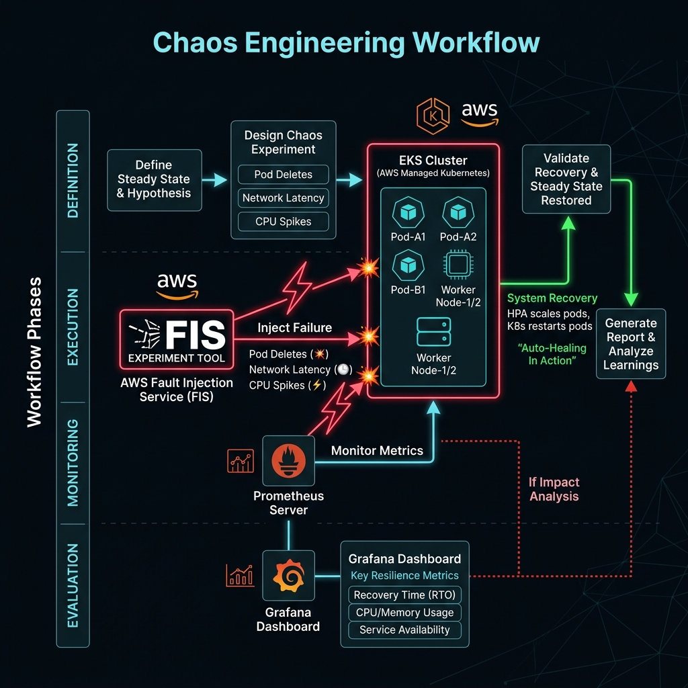
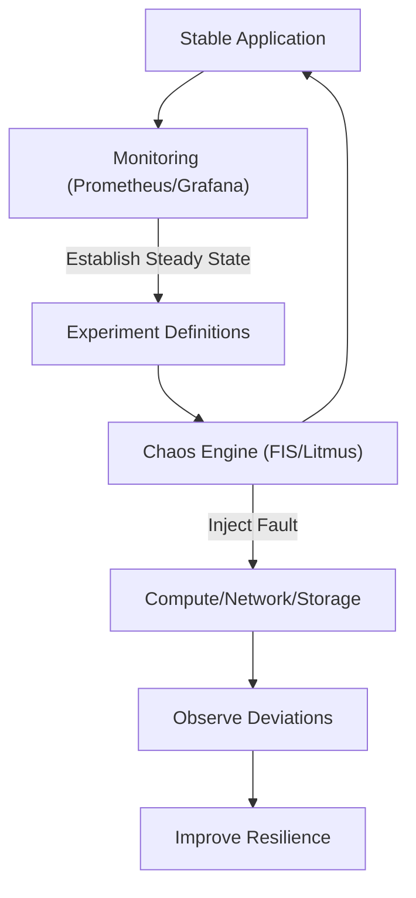

# Project 22: Chaos Engineering Workbook

## 1. Scenario (สถานการณ์จำลอง)

วิทยาที่เป็น CTO เพิ่งอ่านเรื่อง Chaos Engineering และมอบหมายโจทย์สำคัญให้พวกเรา:
- ปกติพวกเรามักเคลมว่า EKS Cluster ของเราเป็น High Availability แต่ถ้าเราทำลาย Availability Zone ไปทั้งโซนล่ะระบบยังรอดไหม
- Database จะทำการ Failover หรือไม่ และ ALB จะหยุดส่ง Traffic ไปยังกลุ่มที่ล่มหรือไม่
- วิทยาอยากให้พวกเราจำลองพัง Staging Environment ทุกวันอังคารเวลา 10.00 น. เพราะถ้าไม่ซ้อมรับมือไว้ก่อน จะไม่มีทางรอดเมื่อเจอเหตุการณ์จริง

แนวคิดของวิศวกรรมความโกลาหล (Chaos Engineering Concept):
- เปรียบเทียบเหมือน "การซ้อมดับเพลิง" หรือ "การฉีดวัคซีน" เพื่อค้นหาจุดอ่อนก่อนจะเกิดปัญหาจริง
- Vaccine: การฉีดความปั่นป่วนเล็กๆ เข้าไป เพื่อกระตุ้นให้ระบบสร้างกลไกรับมือและมีภูมิต้านทาน
- Steady State: สถานะปกติของสุขภาพระบบที่ต้องรู้และวัดผลได้ก่อนการทดลองรันจริง
- Chaos Experiment: การซ้อมเพื่อดูพฤติกรรมของทีมงานและระบบอัตโนมัติในการจำกัดความเสียหาย

การนำไปประยุกต์ใช้งานจริง (Real-world Use Cases):
- Flash Sale Readiness: จำลอง Database ทำงานช้าเพื่อดูพฤติกรรมการลดทอนความสามารถในการแสดงผลหน้าเว็บ (Graceful Degradation)
- Network Outage Test: จำลองสาย Direct Connect ขาด เพื่อตรวจสอบการสลับช่องทางสำรองผ่าน VPN แบบอัตโนมัติ
- Zombie Process Test: จำลองอาการหน่วยความจำรั่ว (Memory Leak) เพื่อยืนยันว่าระบบ Monitoring ส่งการแจ้งเตือนทันเวลา
- การเตรียมความพร้อมก่อนแคมเปญใหญ่ (เช่น 11.11): มั่นใจว่าถ้าระบบย่อยล่ม ลูกค้าจะยังคงใช้งานฟังก์ชันหลักอื่นๆ ได้อยู่
- การสร้างความมั่นใจในระดับผู้บริหาร: ใช้รายงานผลการทดสอบยืนยันว่าระบบมีความทนทานและพร้อมรับมือภัยพิบัติจริง

เป้าหมาย (Goals) และข้อกำหนดสำหรับแล็บนี้:
- กำหนดเมตริกสถานะปกติ (Steady State) เช่น Success Rate > 99.9% และ Latency < 200ms
- จัดทำระบบอัตโนมัติสำหรับการรันชั่วโมงโกลาหล (Chaos Hour) ในแต่ละสัปดาห์
- ยืนยันว่าระบบแจ้งเตือนของ Prometheus Alerts ส่งสัญญาณแจ้งเตือนได้จริงระหว่างจำลองสถานการณ์ความโกลาหล

นิยามความสำเร็จ (Definition of Done):
- ออกแบบและทำลายระบบโดยควบคุมรัศมีความเสียหาย (Blast Radius) ไม่ให้กระทบผู้ใช้ส่วนใหญ่
- พิสูจน์ได้ว่าระบบมีขีดความสามารถการกู้คืนตัวเอง (Self-healing) กลับสู่สถานะปกติ (Steady State) ได้โดยอัตโนมัติ
- ระบบหยุดทำงานทันที (Stop Conditions) หากเกิดผลกระทบเกินระดับเกณฑ์ปลอดภัยที่ระบุไว้

## 2. Topology Diagram (แผนผังระบบ)





ภาพรวมสถาปัตยกรรมระบบทดสอบ (System Under Test Overview):
- [System Under Test (EKS/EC2)] ← [AWS FIS (Experiment)] & [LitmusChaos (Cloud Native Chaos)] → [Observability Dashboards]

## 3. Prerequisites & Estimated Time (สิ่งที่ต้องเตรียมและเวลาที่ใช้)

เวลาที่คาดว่าจะใช้ในการทำแล็บ: 20 ชั่วโมง

สิ่งที่ต้องจัดเตรียมก่อนเริ่มต้น:
- EKS Cluster ที่รันแอปพลิเคชันทดสอบและพร้อมใช้งาน
- การติดตั้งระบบส่งคำสั่งทดลอง เช่น AWS FIS หรือ LitmusChaos ในระบบ
- ระบบ Monitoring Dashboard อย่าง Grafana หรือ CloudWatch เพื่อวิเคราะห์ความล้มเหลว
- การแจ้งเตือนและติดต่อประสานงานร่วมกับทีมพัฒนาอื่นๆ ก่อนดำเนินการรัน Chaos Experiment ทุกครั้ง

ทักษะที่จะได้รับจากการทำแล็บนี้ (Skills Learned):
- การวิเคราะห์การตั้งสมมติฐานสถานะปกติ (Steady State Hypothesis Testing)
- การใช้งาน AWS FIS (Fault Injection Service) ในการขัดขวางการทำงานของ Resource
- การติดตั้งใช้งานระบบ LitmusChaos บน Kubernetes Cluster
- การประเมินความแข็งแกร่งของสถาปัตยกรรมระบบผ่านการจัด Game Days (Resilience Analysis)

ข้อมูลประมาณการค่าใช้จ่ายในการทดสอบ (Cost Estimation):
- AWS FIS: คิดค่าบริการจริงตามเวลาในการทำ Action (~$0.10 ต่อ Action ต่อนาที)
- LitmusChaos บน EKS Cluster: ไม่มีค่าซอฟต์แวร์เพิ่มเติม (Open Source) แต่มีค่าใช้จ่ายของโฮสต์คอมพิวเตอร์ที่ใช้ประมวลผล EKS

## 4. Tasks (ขั้นตอนการปฏิบัติ)

### Task 1: กำหนดสภาวะปกติ (Steady State)
ก่อนจะเริ่มทำลายส่วนประกอบใดๆ ต้องเริ่มจากการกำหนดสภาวะปกติของระบบก่อน
- เพื่อใช้วัดผลเปรียบเทียบทั้งก่อนและหลังการฉีดความล้มเหลว (Fault Injection)
- ตัวชี้วัดที่ใช้ระบุสถานะปกติ (Steady State):
  - HTTP 2xx Success Rate > 99.5%
  - Latency (Percentile 95) < 300ms
  - CPU Usage ต่อ Pod < 80%

ใช้คำสั่งตรวจสอบค่าเฉลี่ย HTTP 2xx ในช่วงเวลาที่ผ่านมาผ่าน CloudWatch/Prometheus:
```bash
# ตรวจสอบอัตราความสำเร็จปัจจุบันผ่าน CloudWatch/Prometheus

> 🧠 **ภาพจำก่อนอ่าน:** 🧪 Lab → 🧠 Concept → 🗺️ Flow → 🔎 Check → ✅ Explain → 🧹 Cleanup  
> 🎨 [Visual Guide ของวิชานี้](../../VISUAL-MEMORY-GUIDE-TH.md) — ภาพช่วยจำ ไม่แทนคำอธิบายและคำสั่งจริง
# (ตัวอย่างคำสั่งสำหรับ CloudWatch)
aws cloudwatch get-metric-statistics \
    --namespace AWS/ApplicationELB \
    --metric-name HTTPCode_Target_2XX_Count \
    --period 60 --statistics Sum \
    --start-time $(date -u -d "-10 minutes" +%Y-%m-%dT%H:%M:%SZ) \
    --end-time $(date -u +%Y-%m-%dT%H:%M:%SZ)
```

### Task 2: ตั้งค่า AWS FIS (Fault Injection Service)
ใช้งาน AWS FIS ในการสุ่มสั่งหยุดการทำงานของ EC2 Instances ใน EKS Cluster
- เพื่อทดสอบว่า Auto Scaling Group (ASG) จะทำงานและสร้าง Node ใหม่ขึ้นมาทดแทนได้จริงหรือไม่

ตัวอย่าง HCL Configuration สำหรับสร้าง Experiment Template บน Terraform:
```hcl
resource "aws_fis_experiment_template" "terminate_instances" {
  description = "หยุดการทำงานของ 50% ของ Nodes ใน EKS ASG"
  role_arn    = aws_iam_role.fis_role.arn

  stop_condition {
    source = "none"
  }

  action {
    name      = "terminate-instances"
    action_id = "aws:ec2:terminate-instances"

    target {
      key   = "Instances"
      value = "eks-nodes"
    }
  }

  target {
    name           = "eks-nodes"
    resource_type  = "aws:ec2:instance"
    selection_mode = "PERCENT(50)"

    resource_tag {
      key   = "eks:cluster-name"
      value = "production-cluster"
    }
  }
}
```

### Task 3: ติดตั้งและใช้งาน LitmusChaos บน Kubernetes
เมื่อต้องการจำลองความเสียหายที่ระดับ Microservices ที่ลึกยิ่งขึ้น
- เช่น สั่งลบ Pod รายตัว หรือเพิ่ม Latency ระหว่าง Network ภายใน Namespace

ขั้นตอนที่ 1: ติดตั้ง Litmus Operator บน Kubernetes Cluster
```bash
kubectl create ns litmus
kubectl apply -f https://litmuschaos.github.io/litmus/2.12.0/litmus-operator-v2.12.0.yaml
```

ขั้นตอนที่ 2: รันการทดสอบลบ Pod (Pod-Delete Experiment) ด้วย YAML Resource:
```yaml
apiVersion: litmuschaos.io/v1alpha1
kind: ChaosEngine
metadata:
  name: engine-pod-delete
spec:
  appinfo:
    appns: 'default'
    applabel: 'app=frontend'
    appkind: 'deployment'
  chaosServiceAccount: pod-delete-sa
  experiments:
    - name: pod-delete
      spec:
        components:
          env:
            - name: TOTAL_CHAOS_DURATION
              value: '30'
            - name: CHAOS_INTERVAL
              value: '10'
```

### Task 4: วางแผนรันกิจกรรม Game Days
จำลองสถานการณ์ความล้มเหลวแบบนัดหมายเพื่อให้ทีมงานมาเฝ้าดูและเรียนรู้ระบบไปพร้อมๆ กัน
- ตั้งสมมติฐาน: "ถ้าเราสั่ง Failover ที่ Aurora Database ตัวหลัก แอปพลิเคชันต้องล่มไม่เกิน 30 วินาที และจะสามารถสลับไปชี้ฐานข้อมูลสำรองและใช้งานได้ปกติโดยอัตโนมัติ"
- สั่งรันการจำลองความล้มเหลวของ Aurora Cluster ด้วย AWS CLI:
```bash
aws rds failover-db-cluster --db-cluster-identifier prod-db
```
- ติดตามผลลัพธ์จากแดชบอร์ด Prometheus ดูการพุ่งขึ้นของ HTTP 5xx Errors และคำนวณเวลาที่ใช้ในการ Recovery
- ปรับปรุงการตั้งค่าเพิ่มเติม: หากระบบใช้เวลากู้คืนนานเกิน 30 วินาที ให้แก้ไขค่า DB Connection Pool และลด `connection_timeout` ในการเชื่อมต่อของแอปพลิเคชัน

### Task 5: การล้างข้อมูลและทรัพยากร (Cleanup)
หลังการรันทดสอบเสร็จสิ้นทุกครั้ง ต้องทำการลบเครื่องมือและคืนค่าระบบให้เป็นปกติ:
- สั่งหยุดหรือลบ Active Experiments ที่กำลังทำงานอยู่ทั้งหมดใน AWS FIS Console
- ถอนการติดตั้งทรัพยากร LitmusChaos บน Kubernetes:
```bash
helm uninstall litmus
```

## 5. Verification (การตรวจสอบผลการทำงาน)

ให้ตรวจสอบสถานะและการทำงานของระบบตามรายการ Checklist ต่อไปนี้:

รายการตรวจสอบก่อนการติดตั้ง (Pre-deployment Checklist):
- [ ] EKS Cluster ทำงานปกติและทำการ Deploy แอปพลิเคชันจำลองเรียบร้อยแล้ว
- [ ] ติดตั้ง AWS FIS หรือ LitmusChaos สำเร็จและมีสิทธิ์ใช้งานสอดคล้องกับสภาพแวดล้อม
- [ ] เตรียมระบบ Monitoring Dashboard (Grafana หรือ CloudWatch) พร้อมสังเกตผลกระทบแล้ว
- [ ] ส่งคำเตือนและประสานงานร่วมกับทีมที่เกี่ยวข้องก่อนเริ่มรัน Chaos Experiment ทุกครั้ง

รายการตรวจสอบระหว่างรันการทดลอง (Experiment Execution Checklist):
- [ ] มีการกำหนด Hypothesis ล่วงหน้าก่อนรัน (เช่น "ระบบยังรับ Traffic ได้ 99% แม้ Node ล่ม")
- [ ] มีการตั้งค่า Stop Conditions เสมอ (เช่น หาก Error Rate สูงเกิน 5% ต้องทำการยกเลิกการทดลองทันที)
- [ ] ทำการทดสอบบนสภาพแวดล้อม Staging ก่อนรันบน Production เสมอ

รายการตรวจสอบหลังการทดลอง (Post-Experiment Checklist):
- [ ] ตรวจวัดและบันทึกขอบเขตความเสียหายที่แท้จริง (Blast Radius) ของการทดลอง
- [ ] ตรวจสอบว่าระบบรองรับ Self-healing และสามารถ Recover กลับมาใช้งานได้เองโดยไม่ต้องมีคนเข้ามาแก้ไขระบบ (Manual Intervention)
- [ ] จัดทำรายงานสรุปผลการทดลอง (Experiment Report) เพื่อนำเสนอ Action Items ในการแก้ไขระบบระยะยาว

## 6. Troubleshooting (การแก้ไขปัญหาที่พบบ่อย)

### เคสที่ 1: LitmusChaos Experiment ค้างอยู่ที่สถานะ Running ตลอดกาล (Eternal Chaos)
- **อาการ:** สภาพแวดล้อมช้าผิดปกติ หรือการรันยาวนานเกินค่า `TOTAL_CHAOS_DURATION` ที่กำหนดไว้ และไม่ยอมหยุดทำงานโดยอัตโนมัติ
- **สาเหตุ:**
  - ตัว Chaos Controller ล่ม หรือขาดการเชื่อมต่อกับ Agent/Pod ปลายทางในระหว่างการทำ Latency Injection
  - ChaosEngine หรือ ChaosResult CRD ไม่ถูกสร้างขึ้นมาอย่างถูกต้อง หรือตัว Chaos Runner Pod ถูก OOM Killed
- **การแก้ไข:**
  - ให้สั่งลบหรือปรับแต่งสถานะของทรัพยากร `ChaosEngine` เพื่อหยุดการทำงานแบบ Force Stop
  - สั่งลบ Pod ที่ได้รับผลกระทบเพื่อให้ระบบ Kubernetes สปินอัป Pod ตัวใหม่ขึ้นมาทดแทน
  - ใช้คำสั่งตรวจเช็คสถานะและ Force Stop ด้วยคำสั่งเหล่านี้:
    ```bash
    # ตรวจสอบสถานะของ ChaosEngine
    kubectl describe chaosengine pod-delete-experiment -n litmus

    # ตรวจสอบประวัติ Log ของ Chaos Runner
    kubectl logs -n litmus -l chaosUID=<uid>

    # สั่งให้การทดลองหยุดทำงานด้วยการ Patch Spec
    kubectl patch chaosengine pod-delete-experiment -n litmus \
      --type merge -p '{"spec":{"engineState":"stop"}}'

    # หรือลบ Pod เพื่อบังคับให้สร้างใหม่
    kubectl delete pods -l app=frontend
    ```

### เคสที่ 2: ข้อความ No Targets Found หรือ Insufficient Permissions ใน AWS FIS
- **อาการ:** เมื่อสั่งรัน AWS FIS Experiment แล้วล้มเหลวทันทีพร้อมแจ้งว่าไม่พบเป้าหมาย
- **สาเหตุ:**
  - IAM Role ที่ใช้รัน AWS FIS ไม่มีสิทธิ์จัดการหรืออ้างอิงเป้าหมายที่แท้จริง
  - ค่า Resource Tags ที่กำหนดใน Terraform หรือตัวแปรอื่นๆ ไม่ตรงกับ EC2 Instances จริงที่รันอยู่
- **การแก้ไข:**
  - ตรวจสอบการตั้งค่า `resource_tag` ของทรัพยากรในสคริปต์
  - เพิ่มสิทธิ์จัดการ instance ให้กับ IAM Role ของ AWS FIS ด้วย IAM Policy ตัวอย่างนี้:
    ```json
    {
      "Effect": "Allow",
      "Action": ["ec2:StopInstances", "ec2:TerminateInstances"],
      "Resource": "*",
      "Condition": {
        "StringEquals": {"ec2:ResourceTag/Environment": "staging"}
      }
    }
    ```

### เคสที่ 3: Stop Condition ไม่ทำงานเมื่อระบบเกิดความเสียหาย
- **อาการ:** Error Rate ทะลุเกินเกณฑ์ความปลอดภัยแล้ว แต่การทดลองไม่ยอมกู้คืนระบบหรือยุติโดยอัตโนมัติ
- **สาเหตุ:**
  - CloudWatch Alarm ที่ใช้เช็ค Stop Condition ตั้งค่า Evaluation Period นานเกินไป ทำให้ไม่ถูกกระตุ้นเป็นสถานะ ALARM ได้ทันท่วงที
- **การแก้ไข:**
  - ปรับปรุงการตั้งค่า Alarm ให้ไวกว่าเดิม โดยลดค่า `EvaluationPeriods` ให้เหลือเพียง 1 และเปลี่ยนค่า `Period` เป็น 60 วินาที เพื่อให้เช็คและระงับความเสียหายอย่างรวดเร็ว
  - สำหรับการตั้งค่าใน AWS FIS ให้แน่ใจว่าได้ระบุ Stop Condition เสมอ เพื่อเป็นระบบเซฟตี้หลักในการตัดความเสียหาย (Rollback)

### เคสที่ 4: เกิดอาการ Silent Alerting (ระบบพังแต่ไม่มีเสียงแจ้งเตือน)
- **อาการ:** จำลองระบบล่มสำเร็จ แต่ไม่มี Alert ส่งไปถึงทาง Slack หรือช่องทางการรับเรื่องอื่นๆ
- **สาเหตุ:**
  - กฎการหน่วงหรือการยุติการแจ้งเตือน (Inhibition Rules) บน Alertmanager ของ Prometheus มีการผูกไว้เข้มงวดเกินไป
  - เกณฑ์การส่ง Alert (Threshold) สูงเกินไป เช่น ตั้งค่าแจ้งเตือนต่อเมื่อเกิด 5xx HTTP code > 100 ครั้ง แต่การทดลองรันเพียงช่วงเวลาสั้นๆ เกิดขึ้นเพียง 50 ครั้งเท่านั้น
- **การแก้ไข:**
  - ให้ปรับระดับเกณฑ์ลดลงชั่วคราวในการจัดเตรียมงานรัน Game Day เพื่อตรวจสอบการทำงานของท่อ Alerting ตั้งแต่ต้นน้ำถึงปลายน้ำ

## 7. Exercises & Solutions (แบบฝึกหัดและแนวทางการแก้ไข)

### แบบฝึกหัด (Exercises)

#### Exercise 1: Latency Injection (ระดับง่าย)
- **โจทย์:** ใช้ AWS FIS ในการฉีด Latency ขนาด 2000ms เข้าไปใน Network Traffic ของ EC2 Instance ที่กำหนด
- **เป้าหมาย:** สังเกตผลกระทบที่เกิดขึ้นกับเมตริก Application Load Balancer (ALB) Response Time เพื่อวิเคราะห์ผลตอบสนองของแอปพลิเคชัน

#### Exercise 2: Dependency Failure (ระดับปานกลาง)
- **โจทย์:** จำลองความล้มเหลวของบริการ Redis Cache
- **เป้าหมาย:**
  - ตรวจสอบว่าแอปพลิเคชันมีกลไกทำ Fallback กลับไปดึงข้อมูลโดยตรงจาก Database หลักแทนหรือไม่
  - มีการใช้ Circuit Breaker เพื่อปกป้องไม่ให้แอปพลิเคชันล่ม (Crash) หรือไม่

#### Exercise 3: The "Blackhole" Experiment (ระดับยาก)
- **โจทย์:** ใช้ Litmus หรือ Chaos Mesh ในการจำลองสภาวะ Packet Loss 100% ไปยัง AWS Metadata Service (IMDS)
- **เป้าหมาย:** SDK ของ AWS หลายตัวมักจะทำงานล้มเหลวทันทีเมื่อไม่สามารถดึงข้อมูล IAM Role จาก IMDS ได้ ให้เฝ้าสังเกตพฤติกรรมและการทำ Retry/Timeout ของระบบเมื่อขาดสิทธิเหล่านี้

---

### แนวทางการแก้ไข (Solutions)

#### 1. กรอบการสร้างสคริปต์การทดลอง LitmusChaos (Chaos Experiment Design Framework)
ใช้เทมเพลตสำหรับจัดการทดลองสุ่มลบ Pod เพื่อตรวจสอบพฤติกรรมความพร้อมใช้งานของ Payment Service:
```yaml
# LitmusChaos Experiment
apiVersion: litmuschaos.io/v1alpha1
kind: ChaosEngine
metadata:
  name: pod-delete-experiment
spec:
  appinfo:
    appns: production
    applabel: "app=payment-service"
  chaosServiceAccount: litmus-admin
  experiments:
    - name: pod-delete
      spec:
        components:
          env:
            - name: TOTAL_CHAOS_DURATION
              value: "60"  # seconds
            - name: CHAOS_INTERVAL
              value: "10"  # delete every 10s
            - name: FORCE
              value: "false"  # graceful termination
```

#### 2. เทมเพลต Terraform สำหรับการรัน AWS FIS หยุด EC2 Instance
```hcl
resource "aws_fis_experiment_template" "stop_ec2" {
  description = "Stop 50% of EC2 instances in ASG"
  role_arn    = aws_iam_role.fis.arn

  action {
    name      = "stop-instances"
    action_id = "aws:ec2:stop-instances"
    target { key = "Instances" value = "ec2-targets" }
  }

  target {
    name           = "ec2-targets"
    resource_type  = "aws:ec2:instance"
    selection_mode = "PERCENT(50)"
    resource_tag { key = "Environment" value = "staging" }
  }

  stop_condition {
    source = "aws:cloudwatch:alarm"
    value  = aws_cloudwatch_metric_alarm.error_rate.arn
  }
}
```

#### 3. การวิเคราะห์และการสังเกตผลลัพธ์ (Analyzing Results)
- **สัญญาณที่ดี (Good Sign):** Error Rate < 1% และระบบสามารถกู้คืนกลับสู่สถานะปกติได้เองอย่างอัตโนมัติ (Self-healing) ภายในเวลา 2 นาที
- **สัญญาณเตือนอันตราย (Bad Sign):** Error Rate พุ่งทะลุเกิน 5% หรือระบบค้างยาวจนทีมวิศวกรต้องเข้าจัดการด้วยตัวเอง (Manual Intervention) หรือเกิดปัญหาข้อมูลสูญหาย (Data Loss)
- **สิ่งที่ควรทำต่อ (Action Items):** ในกรณีที่ระบบทดสอบล้มเหลวและไม่สามารถกู้คืนได้เอง ให้ปรับจูนการตั้งค่า Health Checks หรือตั้งค่า Pod Replicas เพิ่มขึ้น ตลอดจนจัดการความยืดหยุ่นด้วย PodDisruptionBudgets

