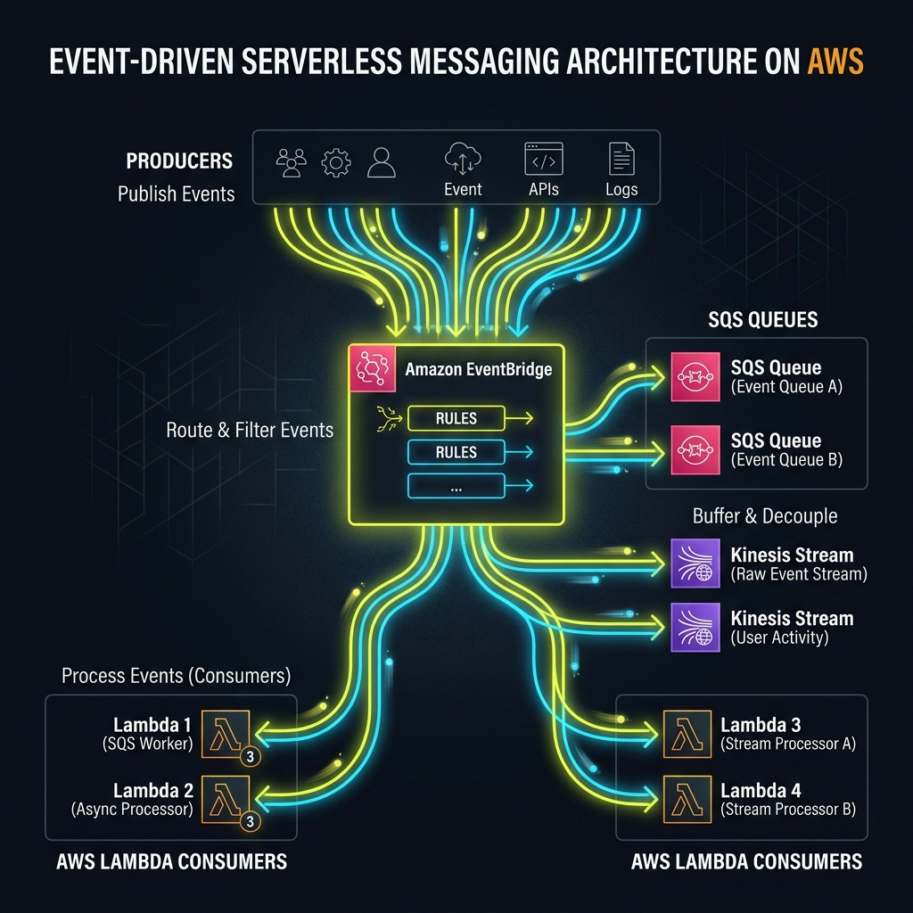
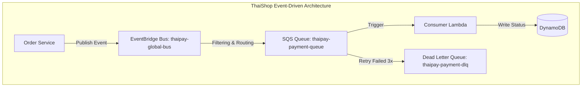

# Project 24: Event-Driven Architecture Workbook

## 1. Scenario (สถานการณ์จำลอง)

ThaiShop กำลังประสบปัญหาเรื่องการสเกลระบบ (Scaling Issue) เมื่อผู้ใช้งานคลิกปุ่ม "Buy" (ซื้อสินค้า) เพื่อทำรายการชำระเงิน:
- checkout-service เรียกใช้งาน payment-service (แบบ Synchronous)
- payment-service เรียกใช้งาน bank-api (แบบ Synchronous)
- checkout-service เรียกใช้งาน inventory-service (แบบ Synchronous)
- checkout-service เรียกใช้งาน email-service (แบบ Synchronous)

หาก Bank API ใช้เวลาทำงานนานเกิน 5 วินาที ผู้ใช้งานจะเห็นสัญลักษณ์กำลังโหลด (Loading Spinner) และมักจะกดปุ่ม "Buy" ซ้ำอีกครั้ง ส่งผลให้เกิดการเรียกเก็บเงินซ้ำซ้อน (Double Charges)

แนวทางการแก้ไข (Solution):
- เปลี่ยนไปใช้รูปแบบการทำงานแบบ Asynchronous
- checkout-service จะส่ง (Emit) OrderCreated Event ออกมา
- ส่งคืนสถานะ HTTP 202 Accepted กลับไปให้ผู้ใช้งานทันที
- ขั้นตอนอื่นๆ ทั้งหมดจะถูกส่งไปประมวลผลต่อในเบื้องหลัง (Background)

ข้อจำกัดของระบบ (Constraints):
- ระบบต้องประมวลผลแบบ Asynchronous โดยไม่มีการพึ่งพากันโดยตรง (Decoupled) ระหว่างบริการ เพื่อเพิ่มความทนทาน (Resilience) และขยายตัวได้ง่าย
- หลีกเลี่ยงการใช้ FIFO Queue หากไม่จำเป็นเนื่องจากมีข้อจำกัดเรื่อง Throughput (TPS) และมีค่าใช้จ่ายสูงกว่า ให้ใช้ Standard Queue แล้วจัดการเรื่องความซ้ำซ้อนและการเรียงลำดับในระดับแอปพลิเคชันแทน
- ในกรณีที่เกิดข้อผิดพลาดในการประมวลผล (Processing Failure) ข้อความต้องไม่สูญหายและต้องถูกย้ายไปที่ Dead Letter Queue (DLQ) หลังจากทำ Retry ครบตามที่กำหนด
- ต้องป้องกันการทำงานซ้ำ (Idempotency) ที่อาจเกิดขึ้นจากนโยบายการส่งข้อมูลแบบ At-least-once Delivery
- ต้องรับประกันความสอดคล้องของข้อมูลในกรณีที่ฐานข้อมูลอัปเดตสำเร็จ แต่ส่ง Event ออกไม่สำเร็จ โดยใช้ Outbox Pattern

เงื่อนไขการส่งงาน (Definition of Done):
- ออกแบบและสร้าง Custom Event Bus บน Amazon EventBridge สำเร็จ
- ออกแบบระบบ Fan-out และ Queue-based Processing โดยแยกการทำงานของ Payment, Email, และ Analytics ออกจากกันได้สำเร็จ
- สามารถจำลองสถานการณ์ความล้มเหลว (Consumer Failure) และตรวจสอบว่าข้อความถูกดึงไปที่ Dead Letter Queue (DLQ) ได้อย่างถูกต้อง
- ผ่านการทดสอบการส่งข้อมูลปริมาณมาก (Massive Ingestion) และสามารถสเกล Lambda Concurrency เพื่อเคลียร์คิวได้สำเร็จ
- แก้ไขปัญหาทับซ้อนและจุดอ่อนอื่นๆ เช่น Ghost Events, DLQ Overflows, และ Idempotency Issues ได้ตามคำแนะนำ

## 2. Topology Diagram (แผนผังระบบ)





## 3. Prerequisites & Estimated Time (สิ่งที่ต้องเตรียมและเวลาที่ใช้)

สิ่งที่ต้องเตรียม (Prerequisites):
- AWS Account พร้อมสิทธิ์สถาปัตยกรรม (IAM Roles) สำหรับ Lambda, EventBridge, SQS, Kinesis
- AWS CLI ติดตั้งและทำ Configuration เรียบร้อยแล้ว
- Terraform สำหรับเขียนสคริปต์สร้าง Infrastructure (HCL)
- ความเข้าใจพื้นฐานในภาษา Python และ JSON

เวลาที่ใช้ในการเรียนรู้และปฏิบัติงาน (Estimated Time):
- ประมาณ 25 ชั่วโมง

## 4. Tasks (ขั้นตอนการปฏิบัติ)

### Task 1: สร้าง Event Bus ส่วนกลางด้วย EventBridge (Global Event Bus)
แทนที่จะใช้การเรียกบริการต่อบริการโดยตรง (REST API) เราจะเปลี่ยนมาใช้ Amazon EventBridge เป็นระบบประสาทส่วนกลาง เพื่อให้บริการต่างๆ ส่ง Event ออกมาและบริการที่เกี่ยวข้องรอรับข้อมูลเหล่านั้นไปทำต่อ

ขั้นตอนย่อย:
1. สร้าง Custom Event Bus ชื่อ `thaipay-global-bus` โดยใช้คำสั่ง AWS CLI ดังนี้:
   ```bash
   aws events create-event-bus --name thaipay-global-bus
   ```
2. กำหนด Schema (JSON) เพื่อให้ผู้ส่งและผู้รับข้อมูลตกลงรูปแบบข้อมูลที่สอดคล้องกัน

### Task 2: แยกส่วนบริการด้วย SQS และการทำ Fan-out (Decoupling with SQS and SNS)
สำหรับงานที่สำคัญมาก (เช่น การประมวลผลการชำระเงิน) เราจะไม่รับส่งข้อมูลตรงเข้า Lambda โดยตรง แต่จะใช้ Amazon SQS มาช่วยเก็บรักษาข้อความเพื่อความทนทานและรองรับ Retry Policy

ระบบจะกระจายข้อมูลในรูปแบบ Fan-out ดังนี้:
1. EventBridge ตรวจพบเหตุการณ์และส่งต่อให้ SNS Topic
2. SNS Topic จะกระจายข้อความไปยัง SQS Queues หลายๆ ตัวพร้อมกัน (เช่น PaymentQueue, EmailQueue, AnalyticsQueue)

ตัวอย่างการเขียน Terraform (HCL) สำหรับตั้งค่า SQS Queue พร้อม Dead Letter Queue (DLQ) เพื่อรองรับ Retry Policy 3 ครั้ง:
```hcl
resource "aws_sqs_queue" "payment_queue" {
  name                      = "thaipay-payment-queue"
  message_retention_seconds = 86400
  redrive_policy = jsonencode({
    deadLetterTargetArn = aws_sqs_queue.payment_dlq.arn
    maxReceiveCount     = 3 # ลองใหม่ 3 ครั้งก่อนส่งไปที่ DLQ
  })
}
```

### Task 3: ออกแบบและใช้งาน Transactional Outbox Pattern
ในระบบจริงอาจเกิดปัญหาที่บันทึกข้อมูลลงฐานข้อมูลสำเร็จ แต่ระบบส่งข้อมูลไปยัง EventBridge ล้มเหลว ทำให้ข้อมูลสองฝั่งไม่สอดคล้องกัน (Distributed State Inconsistency)

การแก้ไขโดยใช้ Transactional Outbox Pattern:
1. บันทึกข้อมูลหลักลงในตาราง `transactions` และบันทึกข้อมูล Event ลงในตาราง `outbox` ภายในฐานข้อมูลเดียวกันภายใต้ Transaction เดียวกัน
2. ใช้ Lambda หรือบริการแยกเพื่ออ่านค่าจากตาราง `outbox` (เช่น อ่านผ่าน DynamoDB Streams) เพื่อนำ Event ดังกล่าวไปส่งต่อให้ EventBridge

ตัวอย่างโค้ดจำลองการทำ Outbox Publisher ด้วย Python:
```python
# src/python/outbox_publisher.py
# (จำลองการทำงาน) อ่านจาก DB และส่งเหตุการณ์
event_bus.put_events(
    Entries=[{
        'Source': 'thaipay.payments',
        'DetailType': 'PaymentSuccess',
        'Detail': json.dumps(payment_data),
        'EventBusName': 'thaipay-global-bus'
    }]
)
```

### Task 4: การกู้คืนและตรวจสอบเหตุการณ์ด้วย EventBridge Archive & Pipes (Event Replay & Pipes)
ในระบบ Event-Driven ข้อมูลจะถูกส่งแบบ Asynchronous (Fire and Forget) ทำให้เกิดความยากลำบากในการตรวจสอบย้อนกลับ (Traceability)

ขั้นตอนย่อย:
1. ใช้ EventBridge Archive เพื่อเก็บข้อมูล Event ย้อนหลัง ทำให้สามารถ "ย้อนรอย" (Replay) ข้อมูลเก่ามาทดสอบใหม่ได้
   ```bash
   aws events create-archive --archive-name thaipay-replay-archive \
       --event-source-arn <EVENT_BUS_ARN> \
       --retention-days 14
   ```
2. ใช้ EventBridge Pipes เพื่อเชื่อมต่อ DynamoDB Streams เข้ากับ SQS หรือ SNS โดยตรงโดยเลี่ยงการใช้ Lambda เปลืองทรัพยากร

## 5. Verification (การตรวจสอบผลการทำงาน)

- [ ] ตรวจสอบสิทธิ์ของ IAM Roles สำหรับ Lambda, EventBridge, SQS, Kinesis ให้ครบถ้วน
- [ ] สร้าง Dead Letter Queue (DLQ) และเชื่อมต่อกับ SQS Queue หลักเรียบร้อยแล้ว
- [ ] รัน `terraform apply` สำเร็จ และแสดง EventBridge Rule ใน AWS Console
- [ ] Deploy ตัว Lambda Functions และสร้าง Log Groups ใน CloudWatch เรียบร้อย
- [ ] ส่ง Test Event เข้า EventBridge แล้วตรวจสอบว่า Lambda ถูก Trigger หรือไม่
- [ ] ทดสอบ SQS: ส่ง Message -> Lambda ประมวลผล -> Message ถูกลบออกจาก Queue
- [ ] จำลองกรณี Lambda ทำงานล้มเหลว (Consumer Failure) -> Message ต้องถูกส่งเข้า DLQ อัตโนมัติหลังจากพยายามครบจำนวนครั้ง (Retry Policy) เพื่อรับประกันความสอดคล้องของข้อมูล (Data Persistence)
- [ ] ทดลองส่งข้อมูลปริมาณมหาศาล (Massive Ingestion) -> ตรวจสอบว่า SQS สามารถรองรับ Traffic และ Lambda สามารถทำ Concurrency Scaling เพื่อเคลียร์คิวได้รวดเร็ว
- [ ] ตรวจสอบการอ่านข้อมูลของ Kinesis Consumer ว่าทำงานได้ถูกต้อง (ไม่พบปัญหา Shard iterator expired)

## 6. Troubleshooting (การแก้ไขปัญหาที่พบบ่อย)

### ปัญหา 1: Lambda ไม่ถูก Trigger แม้ว่ามี Message ใน SQS
- **สาเหตุ**: Event Source Mapping (ESM) ระหว่าง SQS กับ Lambda ไม่ได้ถูกสร้าง หรือ Lambda ไม่มีสิทธิ์ `sqs:ReceiveMessage`
- **วิธีแก้ไข**: ตรวจสอบและแก้ไขผ่านคำสั่ง AWS CLI ดังนี้:
  ```bash
  # ตรวจสอบ Event Source Mapping
  aws lambda list-event-source-mappings --function-name my-function

  # ดู Error ใน ESM
  aws lambda get-event-source-mapping --uuid <mapping-uuid>
  ```

### ปัญหา 2: Message เข้า DLQ ทันทีโดยไม่มีการ Retry หรือ DLQ ล้น
- **สาเหตุ**: ค่า `maxReceiveCount` ถูกกำหนดเป็น 1 หรือตั้งค่า Timeout ของ Lambda สั้นกว่า SQS Visibility Timeout ส่งผลให้ข้อความกลับเข้า Queue ก่อนที่ Lambda จะทำงานเสร็จ สถาปัตยกรรมจะมองว่าเป็นความล้มเหลว
- **วิธีแก้ไข**: ปรับตั้งค่า `visibility_timeout_seconds` ของ SQS ให้มีค่าอย่างน้อย **6 เท่า** ของ Timeout ของ Lambda และใช้ Exponential Backoff ในโค้ด Lambda

### ปัญหา 3: Kinesis Shard Iterator Expired ทุกๆ ไม่กี่นาที
- **สาเหตุ**: ฟังก์ชัน `GetRecords` ไม่ได้ถูกเรียกอย่างสม่ำเสมอ ส่งผลให้ Shard Iterator หมดอายุภายใน 5 วินาที / นาที
- **วิธีแก้ไข**:
  - แนะนำให้ใช้ Lambda Event Source Mapping เข้ามาจัดการการดึงข้อมูล แทนที่จะเขียนแอปเพื่อส่ง Poll เอง
  - หากจำเป็นต้องทำ Client Poll เอง ต้องมั่นใจว่ามีการเรียก `GetRecords` อย่างสม่ำเสมอภายในระยะเวลาก่อนหมดอายุ

### ปัญหา 4: EventBridge Event ไม่ Match Rule (Ghost Events)
- **สาเหตุ**: รูปแบบเหตุการณ์ (Event Pattern) ระหว่างผู้ส่งและ Event Rule ไม่สอดคล้องกัน เนื่องจาก EventBridge ตรวจสอบตัวพิมพ์เล็ก-ใหญ่อย่างเข้มงวด
- **วิธีแก้ไข**: ตรวจสอบ `DetailType` และ `Source` ให้ตรงกันทุกตัวอักษร และตรวจสอบผ่านคำสั่งทดสอบ Pattern:
  ```bash
  # ทดสอบ Pattern matching ก่อนใช้งานจริง
  aws events test-event-pattern \
    --event-pattern '{"source":["com.company.orders"],"detail-type":["OrderPlaced"]}' \
    --event '{"source":"com.company.orders","detail-type":"OrderPlaced","detail":{"orderId":"123"}}'
  ```

### ปัญหา 5: ปัญหาจ่ายเงินซ้ำ (Idempotency Issues)
- **สาเหตุ**: SQS Standard Queue รับประกันการส่งข้อมูลขั้นต่ำหนึ่งครั้ง (At-least-once Delivery) ทำให้มีโอกาสที่ Consumer ได้รับข้อความซ้ำ
- **วิธีแก้ไข**: ออกแบบโค้ดให้เป็น Idempotent โดยให้ Lambda ไปตรวจสอบความซ้ำซ้อนในตาราง DynamoDB ก่อน เช่น ค้นหา ID ที่เคยทำรายการสำเร็จไปแล้วด้วย `idempotency_key` หากซ้ำให้ยุติการทำงานและข้ามข้อความนั้นไป

## 7. Exercises & Solutions (แบบฝึกหัดและแนวทางการแก้ไข)

### แบบฝึกหัดที่ 1: Dead Letter Queues (ระดับง่าย)
ตั้งค่า SQS queue พร้อมกับ Redrive Policy เพื่อย้าย messages ไปยัง DLQ หลังจากประมวลผลล้มเหลวครบ 3 ครั้ง
- เขียน Lambda ที่ตั้งใจทำให้การทำงานล้มเหลว (Intentionally Fails) เพื่อทดสอบกระบวนการย้ายข้อความ

#### แนวทางการแก้ไข (Solutions)
เขียนสคริปต์ Terraform (HCL) เพื่อสร้าง Queue หลักและ DLQ พร้อมทั้งผูก Redrive Policy:
```hcl
resource "aws_sqs_queue" "orders" {
  name                      = "orders-queue"
  visibility_timeout_seconds = 300  # Must be >= Lambda timeout
  
  redrive_policy = jsonencode({
    deadLetterTargetArn = aws_sqs_queue.orders_dlq.arn
    maxReceiveCount     = 3  # Retry 3x before DLQ
  })
}

resource "aws_sqs_queue" "orders_dlq" {
  name = "orders-dlq"
  message_retention_seconds = 1209600  # Keep failed messages 14 days
}
```

### แบบฝึกหัดที่ 2: Event Filtering (ระดับปานกลาง)
สร้าง EventBridge rule ที่จะ trigger ตัว shipping-service ก็ต่อเมื่อ OrderCreated event มีค่า total_amount > 1000 และ shipping_method เป็น "Express"

#### แนวทางการแก้ไข (Solutions)
ตัวอย่างการเขียน Lambda Handler ด้วย Python เพื่อรอรับ Event จาก EventBridge และดึงข้อมูลไปสั่งงานต่อ:
```python
# Lambda handler triggered by EventBridge
def handler(event, context):
    """Process order events from EventBridge"""
    detail_type = event['detail-type']
    detail = event['detail']
    
    if detail_type == 'OrderPlaced':
        process_new_order(detail['orderId'], detail['userId'])
    elif detail_type == 'OrderCancelled':
        process_cancellation(detail['orderId'])

def process_new_order(order_id, user_id):
    # Publish downstream event
    events = boto3.client('events')
    events.put_events(Entries=[{
        'Source': 'com.company.order-service',
        'DetailType': 'InventoryReservationRequired',
        'Detail': json.dumps({'orderId': order_id, 'userId': user_id}),
        'EventBusName': 'orders-bus'
    }])
```

### แบบฝึกหัดที่ 3: Exactly-Once ด้วย FIFO (ระดับยาก)
พัฒนาระบบโดยใช้ SQS FIFO queue ร่วมกับ MessageDeduplicationId
- สาธิตให้เห็นว่าการส่ง message เดิมซ้ำกันสองครั้ง จะทำให้มีเพียง message เดียวเท่านั้นที่ถูกส่งไปยัง consumer

#### แนวทางการแก้ไข (Solutions)
การใช้งาน Kinesis Consumer หรือ SQS FIFO ใน Python เพื่อทำ Checkpointing และควบคุมความถูกต้องของข้อความ:
```python
import boto3

kinesis = boto3.client('kinesis')
shard_iterator = kinesis.get_shard_iterator(
    StreamName='order-events',
    ShardId='shardId-000000000000',
    ShardIteratorType='TRIM_HORIZON'
)['ShardIterator']

while True:
    response = kinesis.get_records(ShardIterator=shard_iterator, Limit=100)
    for record in response['Records']:
        process_record(record['Data'])
    shard_iterator = response['NextShardIterator']
```

---

## Cost & Cleanup Safety

Lambda, EventBridge, SQS/SNS และ DynamoDB มักคิดเงินตาม usage แต่ event loop, retention หรือ test traffic ที่ตั้งผิดสามารถสร้างค่าใช้จ่ายโดยไม่ตั้งใจ

หลังจบ lab:

- ปิด producer/test traffic ก่อน เพื่อไม่ให้ event ใหม่ไหลเข้าระหว่าง cleanup
- destroy Terraform-owned resources หรือ delete EventBridge rules/targets, Lambda functions, queues/topics และ DynamoDB tables ที่สร้างเฉพาะ lab
- ตรวจ DLQ, message retention และ CloudWatch log groups ว่ามีข้อมูลที่ต้องเก็บหรือไม่
- ตรวจ Billing/Cost Explorer หลัง cleanup
