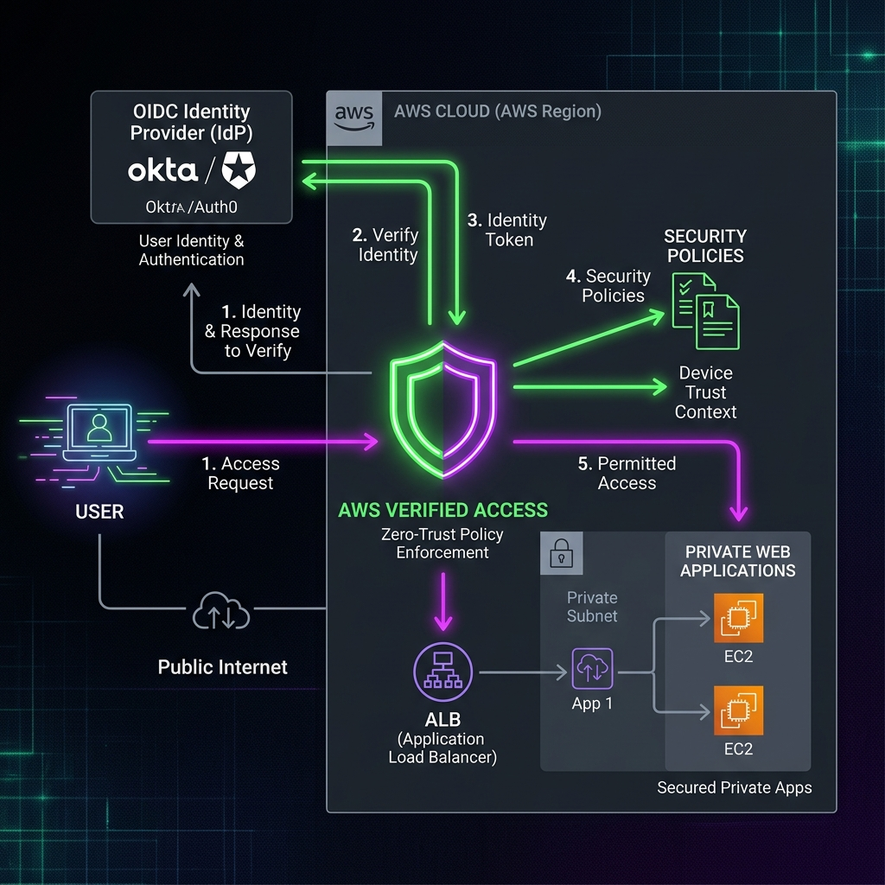
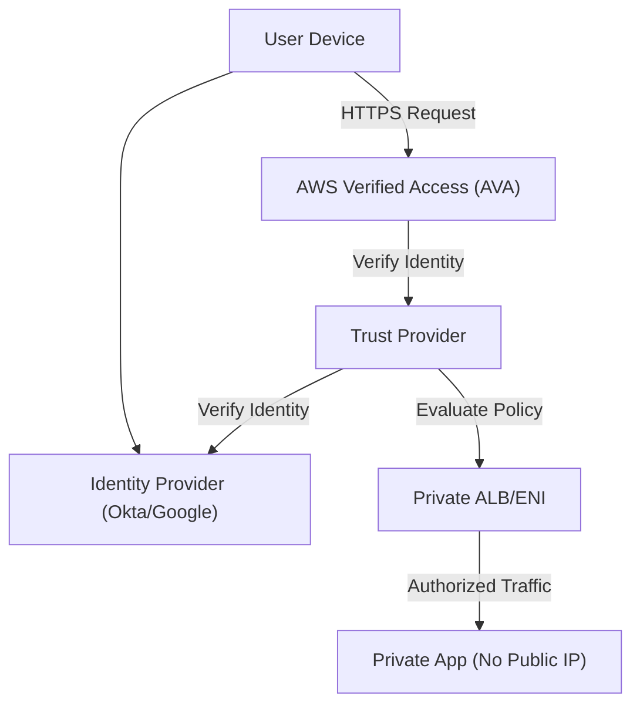

# Project 25: Zero-Trust Network (ระบบเครือข่ายความปลอดภัยสูงแบบไม่ไว้ใจใคร) Workbook

## 1. Scenario (สถานการณ์จำลอง)

บริษัท ThaiCloud กำลังเผชิญปัญหาจากระบบ VPN แบบเก่าของ Cisco ดังนี้:
- ปัญหา A: ระบบทำงานช้ามาก จนทำให้ทีม Engineer หลีกเลี่ยงที่จะใช้งาน
- ปัญหา B: เมื่อเชื่อมต่อเข้ามาใน VPN ได้แล้ว จะสามารถ SSH เข้าเซิร์ฟเวอร์ใดก็ได้ในทุก VPC โดยไม่มีการแบ่งส่วนเครือข่ายภายใน (Internal Segmentation)
- ปัญหา C: ขาดระบบตรวจสอบและบันทึกข้อมูล (Visibility) ว่าใครกำลังเข้าใช้งานเครื่องมือดูแลระบบ (Internal Admin Tool) ตัวใดอยู่บ้าง

CEO จึงต้องการให้คุณปรับปรุงระบบไปสู่แนวคิด Zero Trust Architecture ด้วยเงื่อนไขดังนี้:
- พนักงานจะต้องทำงานจากที่ใดก็ได้ ไม่ว่าจะเป็นออฟฟิศหรือร้านกาแฟภายนอก
- ทุกการเชื่อมต่อ (Request) ต้องผ่านการ Authenticated และ Authorized เสมอก่อนเข้าถึงทรัพยากร
- การตรวจสอบสิทธิ์ต้องอ้างอิงจาก GitHub Identity ของผู้ใช้ ไม่ใช่เพียงแค่ Network Location หรือ IP Address

บทบาทของคุณ:
- ติดตั้งและกำหนดค่า AWS Verified Access สำหรับระบบหน้าบ้านของผู้ดูแลระบบภายใน (Internal Admin Dashboard)

### แนวคิดพื้นฐาน (Concept)
เปรียบเทียบ Zero Trust เหมือน "ระบบรักษาความปลอดภัยในหอพักระดับหรู"
- Traditional VPN: เหมือนการใช้กุญแจหลักเปิดประตูหน้าหอพัก เมื่อผ่านประตูหน้าได้แล้ว จะเข้าห้องไหนหรือพื้นที่ส่วนกลางใดก็ได้หากไม่มีคนเฝ้า
- Zero Trust: เหมือนการใช้คีย์การ์ดสแกนทุกประตู แม้จะเข้าอาคารได้แล้ว แต่การเข้าห้องสำคัญยังต้องตรวจสอบสิทธิ์ เวลา และตัวตนเสมอ
- AWS Verified Access (AVA): เหมือน รปภ. ประจำแต่ละห้องที่ตรวจสอบคีย์การ์ดและสิทธิ์ของคุณอย่างเข้มงวดก่อนให้ผ่านประตู

### เป้าหมายของโครงการ (Project Goals)
- สร้างระบบการเข้าถึงทรัพยากรภายในองค์กรที่อ้างอิงจาก Identity (ตัวตน) และ Context (บริบท) แทนการอ้างอิงจาก Network Location (IP Address/VPN) เพียงอย่างเดียว

### ข้อจำกัดและเงื่อนไข (Constraints)
- ห้ามใช้ long-term IAM Keys บังคับให้ใช้ IAM Roles และ Temporary Credentials ผ่าน `sts:AssumeRole` เท่านั้น
- บังคับใช้ Multi-Factor Authentication (MFA) ในการจัดการและเข้าถึงระบบ
- การเชื่อมต่อไปยัง AWS Services (เช่น S3, DynamoDB, SSM) ต้องผ่าน VPC Endpoints (PrivateLink) โดยตรง ไม่ผ่านอินเทอร์เน็ตสาธารณะ
- การแบ่งส่วนเครือข่ายภายใน (Micro-segmentation) ต้องระบุด้วย Security Group IDs แทนการระบุด้วย CIDR Block
- AWS Verified Access คิดค่าบริการเป็นรายชั่วโมงและตามปริมาณข้อมูล ควรวางแผนจัดการและลบหลังใช้งานเสร็จสิ้น

### การนำไปใช้งานจริง (Real-World Use Cases)
- Secure Remote Work (WFH): ให้พนักงานเข้าถึงแอปหลังบ้าน (Admin Dashboard / Admin Panel) หรือระบบภายในจากที่ไหนก็ได้ในโลกโดยไม่ต้องต่อ VPN ให้ยุ่งยากและช้า
- Third-party / Vendor Access: ให้คู่สัญญาภายนอกเข้ามาทำงานในระบบเฉพาะส่วนที่ได้รับอนุญาต โดยไม่ต้องให้เข้าถึง Network ทั้งหมด
- Legacy App Modernization: นำแอปเก่าๆ ที่ไม่มีระบบล็อกอินมาวางไว้หลัง AWS Verified Access เพื่อเพิ่มความปลอดภัยระดับสูงสุดได้ทันที

### ประสิทธิภาพและการรองรับการขยายตัว (Performance & Scaling)
- Concurrent Connections: AWS Verified Access รองรับการเชื่อมต่อพร้อมกันจำนวนมากและขยายตัวอัตโนมัติ (Managed Service)
- Latency: การตรวจสอบ Policy ทุกครั้งที่เข้าถึงอาจเพิ่ม Latency เล็กน้อยในระดับมิลลิวินาที
- Scaling Approach: แยกกลุ่มแอปพลิเคชัน (Verified Access Groups) ตามระดับความสำคัญเพื่อลดปัญหาคอขวดและจัดการง่ายขึ้น

### การบริหารจัดการค่าใช้จ่าย (Cost Management)
- AWS Verified Access คิดค่าบริการเป็นรายชั่วโมงและตามปริมาณข้อมูลที่ใช้งาน
- ความคุ้มค่า: ลดค่าใช้จ่ายในการดูแลระบบ VPN Server และลดความเสี่ยงจาก Ransomware ที่โจมตีผ่านช่องโหว่ VPN

### บทสรุปแนวคิด (Summary)
- Identity is the new perimeter: ตัวตนคือด่านป้องกันแรกและสำคัญที่สุด
- Micro-segmentation: ช่วยจำกัดผลกระทบเมื่อเกิดการโจมตี (Blast Radius Reduction)
- Zero Trust: ไม่ใช่แค่เครื่องมือหรือซอฟต์แวร์ แต่เป็นกลยุทธ์การออกแบบความปลอดภัยขององค์กร

### ข้อคิดเห็นจากประสบการณ์จริง (Production Experience Insights)
- VPN Fatigue is Real: ผู้ใช้มักบ่นเรื่องความช้าและความยุ่งยากในการเชื่อมต่อ VPN การใช้ Zero-Trust (Clientless) ช่วยเพิ่มความสะดวกและรวดเร็ว
- Cedar Policy Language: ภาษา Cedar ใช้สำหรับเขียน Policy ใน AWS Verified Access ซึ่งอ่านง่ายและปลอดภัยกว่า JSON
- Micro-segmentation: ช่วยป้องกัน Lateral Movement โดยแอปพลิเคชันในระบบเครือข่ายเดียวกันจะไม่สามารถมองเห็นกันได้หากไม่ได้รับอนุญาต

---

## 2. Topology Diagram (แผนผังระบบ)





---

## 3. Prerequisites & Estimated Time (สิ่งที่ต้องเตรียมและเวลาที่ใช้)

- เวลาในการทำ Lab: 20 ชั่วโมง (Estimated Time: 20h)
- ทักษะที่จะได้เรียนรู้ (Skills Learned):
  - AWS Verified Access (AVA)
  - Tailscale / WireGuard สำหรับ Mesh VPN
  - OIDC Integration กับทรัพยากรบน AWS
  - Network Micro-segmentation
- สิ่งที่ต้องเตรียม (Prerequisites):
  - บัญชี AWS ที่มีสิทธิ์สร้างทรัพยากร เช่น VPC, EC2, IAM, และ AWS Verified Access
  - Identity Provider (เช่น Okta, Google Workspace หรือ GitHub Identity)
  - ติดตั้ง AWS CLI และ Terraform บนเครื่องโลคอล

---

## 4. Tasks (ขั้นตอนการปฏิบัติ)

### Task 1: เลิกใช้ IAM Keys แบบระยะยาว และบังคับใช้ MFA (Enforce MFA)
ในแนวคิด Zero Trust การอยู่ในเน็ตเวิร์กเดียวกันไม่เพียงพอที่จะได้รับสิทธิ์เข้าถึง ทุกคำขอต้องได้รับการตรวจสอบตัวตน การอนุญาตสิทธิ์ และการเข้ารหัส
- บังคับให้ผู้ใช้งานและแอปพลิเคชันใช้ IAM Roles พร้อมกับ Temporary Credentials ผ่าน `sts:AssumeRole`
- เพิ่มเงื่อนไข (Condition) ใน IAM Policy เพื่อปฏิเสธการเข้าถึงหากไม่ได้ล็อกอินด้วย MFA
- ใช้โค้ด Terraform ด้านล่างเพื่อบังคับใช้ MFA:

```hcl
# src/terraform/main.tf
resource "aws_iam_policy" "mfa_enforced" {
  name = "EnforceMFA"
  policy = jsonencode({
    Version = "2012-10-17"
    Statement = [{
      Effect = "Deny"
      Action = "*"
      Resource = "*"
      Condition = { "BoolIfExists": { "aws:MultiFactorAuthPresent": "false" } }
    }]
  })
}
```

### Task 2: ติดตั้งและกำหนดค่า AWS Verified Access (AVA)
AVA ช่วยให้สามารถเข้าถึงแอปพลิเคชันภายในได้อย่างปลอดภัยโดยไม่ต้องใช้ VPN โดยใช้การตรวจสอบตัวตน (IdP) และสถานะความปลอดภัยของอุปกรณ์ (Device Posture)
- องค์ประกอบหลักของ AWS Verified Access:
  1. AVA Instance: ตัวจัดการหลักของระบบ
  2. AVA Trust Provider: เชื่อมต่อกับ Identity Provider (IdP) เช่น OIDC/SAML
  3. AVA Endpoint: จุดรับทราฟฟิกของแอป (เช่น `admin.internal.thaifin.co`)
  4. AVA Policy: ใช้ภาษา Cedar เพื่อกำหนดกฎการเข้าถึง
- ตัวอย่างการเขียนนโยบายความปลอดภัยด้วย Cedar Policy:

```cedar
// ตัวอย่าง Cedar Policy
permit(principal, action, resource)
when {
    context.identity.groups.contains("admin") &&
    context.device.is_managed == true
};
```

### Task 3: กำหนดค่า VPC Endpoints (PrivateLink) สำหรับ SSM
เพื่อความปลอดภัยสูงสุด ทราฟฟิกที่ไปยังบริการ AWS (เช่น S3, DynamoDB, SSM) จะต้องไม่ผ่านอินเทอร์เน็ตสาธารณะ
- สร้าง Interface Endpoints สำหรับบริการ SSM, SSMMessages และ EC2Messages
- ช่วยให้สามารถล็อกอินเข้า EC2 ผ่าน SSM Session Manager ได้อย่างปลอดภัยโดยไม่ต้องใช้ Public IP หรือ NAT Gateway
- ใช้โค้ด Terraform ด้านล่างในการสร้าง VPC Endpoint:

```hcl
resource "aws_vpc_endpoint" "ssm" {
  vpc_id              = aws_vpc.main.id
  service_name        = "com.amazonaws.ap-southeast-1.ssm"
  vpc_endpoint_type   = "Interface"
  security_group_ids  = [aws_security_group.vpce.id]
  private_dns_enabled = true
}
```

### Task 4: การแบ่งส่วนเครือข่ายย่อยด้วย Security Groups (Micro-segmentation)
Security Groups ควรถูกตั้งค่าให้เข้าถึงได้แคบที่สุดตามหลัก Least Privilege
- หลีกเลี่ยงการระบุด้วย IP Address หรือ CIDR Block ในพื้นที่ภายใน แต่ให้ใช้การระบุผ่าน Security Group IDs แทน
- การกำหนดกฎ (Rules):
  - `Web-SG` อนุญาต HTTPS จาก `ALB-SG` เท่านั้น
  - `App-SG` อนุญาตพอร์ต 8080 จาก `Web-SG` เท่านั้น
  - `DB-SG` อนุญาตพอร์ต 5432 จาก `App-SG` เท่านั้น

### Task 5: การล้างข้อมูลและทำลายระบบ (Cleanup)
เพื่อหลีกเลี่ยงการเสียค่าใช้จ่ายจากการเปิดใช้งานบริการทิ้งไว้
- ลบ Verified Access Endpoint, Verified Access Group และ Verified Access Instance
- ปิดการเชื่อมต่อกับ Identity Provider ที่ไม่ได้ใช้งาน

---

## 5. Verification (การตรวจสอบผลการทำงาน)

ตรวจสอบความถูกต้องของการตั้งค่าระบบตามรายการตรวจสอบต่อไปนี้:

- [ ] แอปพลิเคชันภายในทั้งหมด (Internal Applications) อยู่หลัง Identity-Aware Proxy (IAP)
- [ ] ไม่มีทรัพยากรใดที่มี Public IP Address
- [ ] Security Groups ปฏิบัติตามหลัก Least Privilege (Deny by Default)
- [ ] กำหนดให้ใช้ MFA สำหรับการเข้าถึงเพื่อดูแลระบบ (Administrative Access) ทั้งหมด
- [ ] ตรวจสอบความปลอดภัยของอุปกรณ์ (Device Health) ก่อนอนุญาตให้เข้าใช้งาน เช่น การเข้ารหัสดิสก์ (Encrypted Disk) และ OS Version
- [ ] ยกเลิกการใช้งาน VPN หรือจำกัดการใช้งานเฉพาะ Legacy Protocol เท่านั้น
- [ ] มีระบบ Audit Logging ที่บันทึกข้อมูลอย่างครบถ้วนสำหรับทุกการเข้าถึง (Who, When, What)

### การทดสอบระบบ (Chaos Engineering)
- [ ] การเข้าใช้งานผ่าน Untrusted Device: ทดลองเข้าใช้แอปจากอุปกรณ์ส่วนตัวที่ไม่ได้ลงทะเบียน
  - ผลลัพธ์: Verified Access Policy ต้องบล็อกการเข้าถึงทันที เพื่อยืนยันระบบ Context-based Security
- [ ] การเข้าใช้งานนอกเวลาทำงาน:
  - ผลลัพธ์: เขียนนโยบายเพื่อจำกัดเวลาในการเข้าใช้งาน (Time-based Access Control) และทดสอบว่าระบบบล็อกการเข้าถึงนอกเวลาที่กำหนด

---

## 6. Troubleshooting (การแก้ไขปัญหาที่พบบ่อย)

### กรณีที่ 1: ปัญหา Istio mTLS ทำให้ Service ไม่สามารถสื่อสารกันได้ (Connection Refused)
- **อาการ**: หลังจากประยุกต์ใช้ PeerAuthentication STRICT mode แล้ว Services ที่ไม่มี Istio Sidecar จะไม่สามารถรับ Traffic ได้
- **สาเหตุ**: มีบาง Pod ที่ยังไม่มีการติดตั้ง Envoy Sidecar (Sidecar Inject) ทำให้ส่งข้อมูลเป็นแบบ Plaintext แต่ฝั่งปลายทางต้องการการเข้ารหัสแบบ mTLS
- **วิธีแก้ไข**:
  ```bash
  # ตรวจสอบว่า Sidecar inject แล้วหรือไม่ (ต้องมี 2/2 containers)
  kubectl get pods -n production

  # ถ้า Pod ไม่มี Sidecar ให้เพิ่ม label ที่ namespace
  kubectl label namespace production istio-injection=enabled

  # Restart Pods เพื่อให้ Sidecar inject
  kubectl rollout restart deployment -n production
  ```

### กรณีที่ 2: ปัญหา AWS Verified Access ส่งคืน 403 Forbidden หรือปัญหา AVA 403
- **อาการ**: ผู้ใช้ล็อกอินผ่าน Google หรือ Okta สำเร็จแล้ว แต่หน้าเว็บแสดง Access Denied หรือ Verified Access ส่งคืน 403 Forbidden
- **สาเหตุ**: การกำหนดค่า Trust Provider ผิดพลาด หรือ User ที่ล็อกอินไม่มี Group ตามที่กำหนดไว้ใน Access Policy หรือ Cedar Policy ทำงานไม่สำเร็จจากชื่อกลุ่ม/ข้อมูลอุปกรณ์ไม่ตรงกัน (เช่น `Admin` กับ `admins`)
- **วิธีตรวจสอบ**:
  - เปิดใช้งาน Verified Access Logs ไปยัง S3 หรือ CloudWatch เพื่อดูข้อมูล JSON ดิบที่ Cedar ใช้ตัดสินใจ
  - เรียกดู Access Logs ด้วยคำสั่ง:
  ```bash
  # ดู Access Logs
  aws logs filter-log-events \
    --log-group-name /aws/verifiedaccess/ \
    --filter-pattern '{ $.httpStatusCode = 403 }' \
    --query 'events[].message'
  ```
- **วิธีแก้ไข**:
  - แก้ไข Cedar Policy ให้ตรงกับ Claims จาก Identity Provider และตรวจสอบสถานะอุปกรณ์ของผู้ใช้
  - อัปเดตเงื่อนไขใน Cedar Policy ให้ตรงกับชื่อกลุ่มที่ IdP ส่งมา เช่น การสะกดตัวพิมพ์เล็ก/ใหญ่

### กรณีที่ 3: ปัญหา SPIRE Agent ไม่สามารถทำการ Attestation กับ Server ได้
- **อาการ**: Log ของ SPIRE Agent แสดงข้อความ "failed to attest agent"
- **สาเหตุ**: การเลือกใช้ Node Attestation Plugin ไม่ตรงกับแพลตฟอร์มที่รันจริง (เช่น ใช้ aws_iid plugin แต่รันอยู่บน Local Kubernetes)
- **วิธีแก้ไข**: เปลี่ยนไปใช้ plugin `k8s_sat` (Kubernetes Service Account Token) สำหรับ EKS:
  ```
  NodeAttestor "k8s_sat" {
    plugin_data {
      clusters = {
        "thaidemo-eks" = {
          service_account_allow_list = ["spire:spire-agent"]
        }
      }
    }
  }
  ```

### กรณีที่ 4: ฝันร้ายของ SSM Connectivity
- **อาการ**: ลบ NAT Gateway ออกเพื่อลดต้นทุนและทำตาม Zero Trust แต่ไม่สามารถใช้ SSM Session Manager เพื่อล็อกอินเข้า EC2 ได้
- **สาเหตุ**: SSM ต้องการ Endpoint 3 ตัวคือ `ssm`, `ssmmessages`, และ `ec2messages` หากขาดตัวใดตัวหนึ่ง Session Manager จะใช้งานไม่ได้
- **วิธีแก้ไข**: ตรวจสอบว่า Interface Endpoints ทั้ง 3 ตัวถูกสร้างและกำหนดค่าเรียบร้อยแล้ว และ Security Group อนุญาตพอร์ต 443 จาก VPC CIDR

### กรณีที่ 5: ปัญหา S3 Access Denied จากภายใน VPC
- **อาการ**: EC2 มี IAM Role ที่มีสิทธิ์ `s3:FullAccess` แต่กลับได้รับ 403 (Access Denied) เมื่อพยายามอ่านข้อมูลจาก Bucket ในบัญชีเดียวกัน
- **สาเหตุ**: การใช้ VPC Endpoint Policy ที่เข้มงวดเกินไป หรือ S3 Bucket Policy มีเงื่อนไข (Condition) ที่อนุญาตเฉพาะหมายเลข IP ต้นทางบางตัว (ซึ่งค่า IP จะเปลี่ยนไปเมื่อใช้ VPC Endpoint)
- **วิธีแก้ไข**: เพิ่มหมายเลข VPC Endpoint ID (`vpce-xxxxxx`) ลงในเงื่อนไข `aws:sourceVpce` ของ S3 Bucket Policy

---

## 7. Exercises & Solutions (แบบฝึกหัดและแนวทางการแก้ไข)

### แบบฝึกหัดที่ 1: Tailscale Subnet Router (ระดับง่าย)
- **โจทย์**: ติดตั้ง Tailscale Subnet Router บน EC2 Instance เพื่อเปิดให้เข้าถึง Private RDS Instance ได้โดยไม่ต้องเปิดเผยข้อมูลออกสู่อินเทอร์เน็ต

### แบบฝึกหัดที่ 2: Cedar Policy Language (ระดับปานกลาง)
- **โจทย์**: AWS Verified Access ใช้ภาษา Cedar Policy Language ในการจัดการนโยบายความปลอดภัย เขียน Policy ที่อนุญาตให้เข้าใช้งาน `billing-app` เฉพาะช่วงเวลาทำงานเท่านั้น (09.00 น. - 18.00 น. ตามเวลาประเทศไทย)

### แบบฝึกหัดที่ 3: Micro-segmentation with Terraform (ระดับยาก)
- **โจทย์**: ใช้ Terraform ในการสร้างระบบเครือข่ายที่มีเงื่อนไขดังนี้:
  - `frontend` สามารถเชื่อมต่อกับ `backend` บน Port 8080 ได้เท่านั้น
  - `backend` สามารถเชื่อมต่อกับ `database` บน Port 5432 ได้เท่านั้น
  - ไม่อนุญาตให้ Traffic อื่นๆ ผ่านเข้าออกเลย (รวมถึง ICMP หรือ Ping)
  - ตรวจสอบความถูกต้องโดยการใช้ `nmap` ทดสอบจาก Subnet ต่างๆ

---

### แนวทางการแก้ไข (Solutions)

#### SPIFFE/SPIRE Workload Identity
```yaml
# SPIRE Server ConfigMap
apiVersion: v1
kind: ConfigMap
metadata:
  name: spire-server
data:
  server.conf: |
    server {
      bind_address = "0.0.0.0"
      bind_port = "8081"
      trust_domain = "thaidemo.internal"
      data_dir = "/run/spire/data"
      
      ca_subject = {
        country = ["TH"],
        organization = ["ThaiDemo Corp"],
      }
    }
    
    plugins {
      DataStore "sql" {
        plugin_data {
          database_type = "sqlite3"
          connection_string = "/run/spire/data/datastore.sqlite3"
        }
      }
      
      KeyManager "disk" {
        plugin_data {
          keys_path = "/run/spire/data/keys.json"
        }
      }
    }
```

#### mTLS กับ Istio (Zero Trust Service-to-Service)
```yaml
# PeerAuthentication: Force mTLS for all services in namespace
apiVersion: security.istio.io/v1beta1
kind: PeerAuthentication
metadata:
  name: default
  namespace: production
spec:
  mtls:
    mode: STRICT  # No plaintext allowed

---
# AuthorizationPolicy: Only payment-service can call order-service
apiVersion: security.istio.io/v1beta1
kind: AuthorizationPolicy
metadata:
  name: order-service-policy
  namespace: production
spec:
  selector:
    matchLabels:
      app: order-service
  rules:
    - from:
        - source:
            principals: ["cluster.local/ns/production/sa/payment-service"]
      to:
        - operation:
            methods: ["POST"]
            paths: ["/api/orders/*"]
```

#### AWS Verified Access (Zero Trust สำหรับ Web Apps)
```hcl
resource "aws_verifiedaccess_instance" "main" {}

resource "aws_verifiedaccess_trust_provider" "okta" {
  trust_provider_type = "user"
  user_trust_provider_type = "oidc"
  
  oidc_options {
    issuer                = "https://company.okta.com"
    authorization_endpoint = "https://company.okta.com/oauth2/v1/authorize"
    token_endpoint        = "https://company.okta.com/oauth2/v1/token"
    user_info_endpoint    = "https://company.okta.com/oauth2/v1/userinfo"
    client_id             = var.okta_client_id
    client_secret         = var.okta_client_secret
    scope                 = "openid profile email"
  }
}
```

