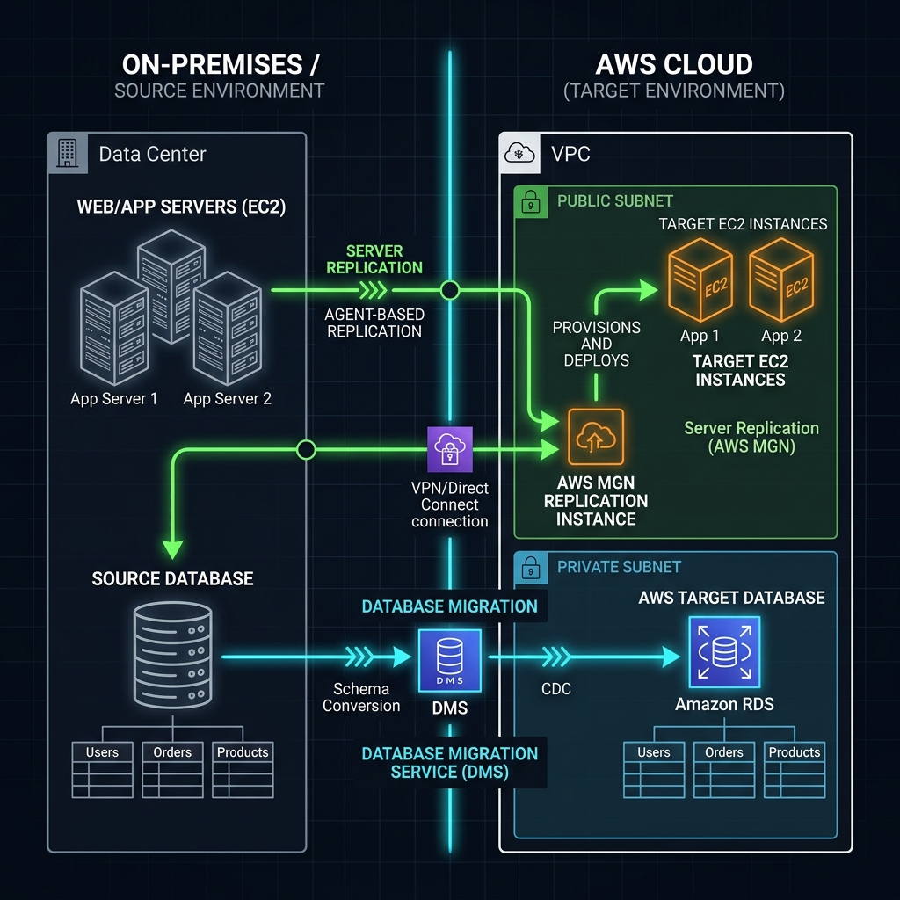
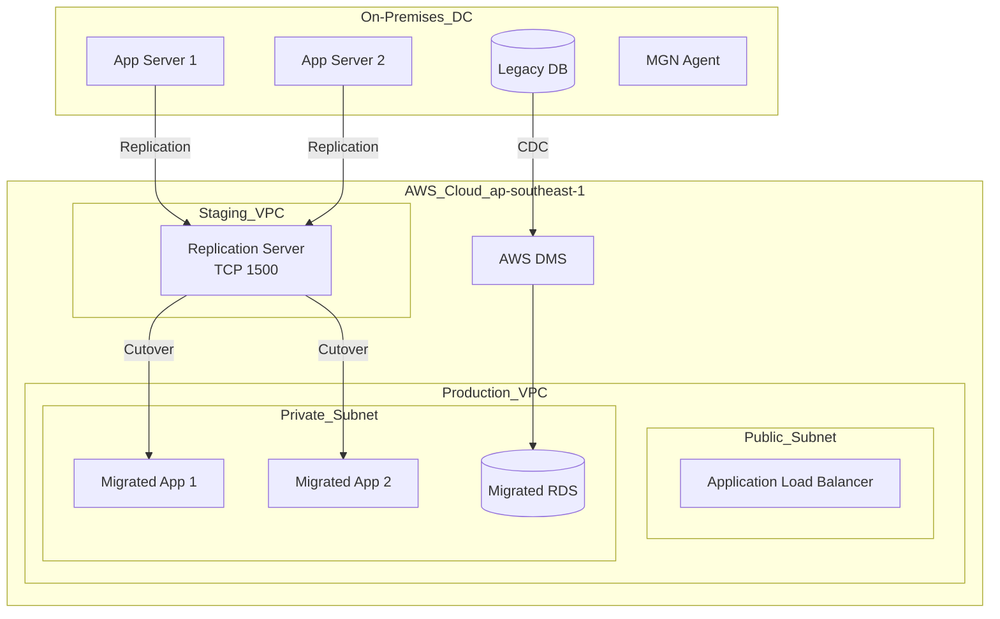

# Cloud Migration Framework Workbook

โปรเจกต์นี้จัดเตรียม Cloud Migration Framework ที่ครอบคลุมการย้าย Workload ที่ซับซ้อนขึ้นระบบ Cloud
- ครอบคลุมขั้นตอน Assessment, Planning, Patterns และ Execution
- ออกแบบมาสำหรับการย้ายระบบระดับ Enterprise ขนาดใหญ่

---

## 1. Scenario (สถานการณ์จำลอง)

**สถานที่:** สำนักงานใหญ่ของ ThaiRetail ยักษ์ใหญ่ด้านการค้าปลีก
**เวลา:** วันจันทร์ เวลา 09:30 น.

บอร์ดผู้บริหารเพิ่งออกประกาศสำคัญ:
- เราจะปิด Data Centers ทั้งหมดภายในสิ้นปีนี้
- ปัจจุบันเรามี 450 Servers, 12 Legacy Databases และ 5 Mainframe Integrations
- เรากำลังเสียเงินเปล่าไปกับค่าระบบทำความเย็นและบำรุงรักษาฮาร์ดแวร์ที่กำลังหมดอายุการใช้งานถึงเดือนละ $50,000

CTO ส่งข้อความหาคุณผ่าน Slack:
- เราต้องการสร้าง Migration Factory ไม่ใช่การย้ายทีละเซิร์ฟเวอร์แบบเดิมอีกต่อไป
- ต้องการ Framework ที่รองรับการย้ายระบบได้สัปดาห์ละ 50 Servers
- หากพลาดเดดไลน์เดือนธันวาคมนี้ จะต้องจ่ายค่าเช่า Data Center เดิมเพิ่มเป็นสองเท่าตัว
- ให้เริ่มทดลองย้ายระบบแรกคือ Inventory Management System ก่อน

### ภารกิจของคุณ
1. ประเมิน (Assess) เครื่องเซิร์ฟเวอร์ทั้งหมด 450 เครื่อง
2. กำหนด Migration Pattern (6Rs) สำหรับระบบหลัก (Core Systems)
3. ดำเนินการทำ Pilot Migration สำหรับระบบ Inventory System โดยใช้ MGN และ DMS
4. เขียนสคริปต์อัตโนมัติในการตรวจสอบความถูกต้อง (Validate) ของระบบบน Cloud
5. รายงานผลการประหยัดค่าใช้จ่ายให้ CFO ทราบ

### ข้อจำกัด (Constraints)
- ต้องมี Downtime เป็นศูนย์ (Zero Downtime) สำหรับเว็บไซต์หลักที่ลูกค้าใช้งาน
- ด้านข้อมูลอธิปไตย (Data Sovereignty): ข้อมูลทั้งหมดต้องเก็บอยู่ใน Region `ap-southeast-1`
- งบประมาณสำหรับการย้ายระบบอยู่ที่ $1M และต้องลด TCO ได้อย่างน้อย 30%

### Definition of Done (ข้อกำหนดความสำเร็จของงาน)
- ดำเนินการประเมินสภาพแวดล้อมระบบเดิม 450 เครื่องเสร็จสิ้น
- กำหนด Migration Pattern (6Rs) ให้สอดคล้องกับคุณลักษณะของแต่ละ Workload
- การติดตั้งและจัดเตรียมโครงสร้างพื้นฐานบน AWS (Staging Area และ Target Environment) ใน Region `ap-southeast-1` สำเร็จโดยใช้ Terraform
- ย้ายแอปพลิเคชันและฐานข้อมูลระบบ Inventory Management System ขึ้นคลาวด์แบบต่อเนื่องด้วย MGN และ DMS
- รันสคริปต์ตรวจสอบความถูกต้องหลังย้ายระบบ (`src/post-migration-validation.sh`) สำเร็จโดยไม่มีข้อผิดพลาด
- รายงานสรุปการวิเคราะห์ประเมิน TCO และเปรียบเทียบค่าใช้จ่ายหลังย้ายระบบ (ลดลง 30%)
- Decommission ทรัพยากรเซิร์ฟเวอร์เดิม และปิดเครื่องมือช่วยย้าย (MGN/DMS) เพื่อประหยัดทรัพยากร

### ประสิทธิภาพและการปรับขยาย (Performance & Scaling)
- **Data Transfer Rate**: ความเร็วในการย้ายขึ้นอยู่กับ Bandwidth ของ Direct Connect หรือ VPN โดยทั่วไปแนะนำขั้นต่ำ 100 Mbps สำหรับการย้ายข้อมูลระดับ TB
- **Cutover Window**: เป้าหมายคือการทำให้มี Downtime น้อยที่สุด โดยปกติคือต่ำกว่า 30 นาที ด้วยการใช้ Continuous Data Replication จนถึงวินาทีสุดท้าย
- **Scaling Approach**: ใช้ Migration Hub ในการจัดการและติดตามสถานะการย้ายเซิร์ฟเวอร์พร้อมกันได้ทีละหลายร้อยเครื่องแบบ Wave Migration

### การนำไปใช้งานในชีวิตจริง (Real-World Use Cases)
- **Data Center Exit**: การปิด Data Center ของบริษัทและย้ายระบบทั้งหมดขึ้น AWS 100% หรือการย้ายระบบของธนาคารและองค์กรขนาดใหญ่
- **Legacy Modernization**: การย้ายฐานข้อมูล Oracle/SQL Server รุ่นเก่ามาใช้ Amazon Aurora เพื่อลดค่า License หรือปรับเปลี่ยนระบบเก่า (Legacy) ให้เป็นระบบที่ทันสมัยขึ้น
- **Hybrid Cloud Strategy**: การย้ายเฉพาะบางส่วนของแอปพลิเคชันขึ้น Cloud เพื่อรองรับกรณีที่ต้องการขยายตัวในช่วง Traffic พุ่งสูง (Bursting)

---

## 2. Topology Diagram (แผนผังระบบ)





### ส่วนประกอบสำคัญ
- **AWS MGN**: จัดการการทำ Replication ในระดับ Block-level ของ EC2 Volumes
- **AWS DMS**: จัดการการทำ Logical Data Migration และการ Sync ข้อมูลสำหรับ Databases
- **Replication Server**: Instance ขนาด t3.small แบบชั่วคราวที่ทำหน้าที่รับข้อมูลจาก MGN Agents
- **Target Environment**: VPC ปลายทางที่จะเป็นที่อยู่ถาวรของ Applications หลังทำ Cutover เรียบร้อยแล้ว

---

## 3. Prerequisites & Estimated Time (สิ่งที่ต้องเตรียมและเวลาที่ใช้)

### สิ่งที่ต้องเตรียม
- AWS Account ที่มีสิทธิ์ระดับ Admin
- ติดตั้งและตั้งค่า AWS CLI เรียบร้อยแล้ว
- Terraform 1.7+
- Python 3.9+
- ความรู้พื้นฐานเกี่ยวกับ On-premises Infrastructure

### เวลาที่ใช้ในการทดสอบ
- เวลาที่ใช้โดยประมาณ: 2-3 ชั่วโมง

---

## 4. Tasks (ขั้นตอนการปฏิบัติ)

### Task 1: การสำรวจและการประเมินความพร้อม (Assess & Discovery)
ก่อนเริ่มย้ายข้อมูลระบบ คุณต้องสำรวจและรวบรวมข้อมูล Workload ทั้งหมดเพื่อประเมินความพร้อมและค่าใช้จ่าย

#### 1. การติดตั้ง Discovery Agent บน VMware VMs
- ใช้ AWS Application Discovery Service รวบรวมข้อมูลการใช้งาน CPU, RAM, และ Disk เพื่อเตรียมทำ Right-sizing
- รันสคริปต์เพื่อติดตั้ง Discovery Agent:
  ```bash
  chmod +x src/scripts/discovery-agent-install.sh
  ./src/scripts/discovery-agent-install.sh ap-southeast-1 <AK> <SK>
  ```
- ข้อมูลนี้จะส่งไปแสดงบน AWS Migration Hub เพื่อใช้วิเคราะห์

> [!NOTE]
> การทำ Right-sizing สามารถช่วยประหยัดค่าใช้จ่าย AWS หลังการย้ายระบบได้ถึง 30-50% เนื่องจาก VM ในระบบ On-premise มักจะถูกจองทรัพยากรไว้เกินความจำเป็น (เช่น จอง 8 vCPUs สำหรับงานที่ใช้จริงเพียง 2)

#### 2. เกณฑ์การประเมินความพร้อม (Migration Assessment Criteria)
ประเมินแต่ละ Workload ตามเกณฑ์ 50 คำถาม โดยแบ่งเป็น 3 ด้านหลัก ดังนี้:

##### ด้าน Business Impact (คะแนน 1-10)
- ความสำคัญของ Workload นี้ต่อรายได้ของธุรกิจ
- มูลค่าความเสียหายหากระบบเกิด Downtime
- ข้อกำหนดด้าน Regulatory Compliance (เช่น PCI, GDPR)
- กำหนดเวลาการหมดอายุสัญญาเช่าฮาร์ดแวร์เดิม (Hardware Lease Expiration)

##### ด้าน Technical Complexity (คะแนน 1-10)
- รุ่นของ OS: สามารถใช้งานบน AWS Cloud ได้หรือไม่ (เช่น Windows 2008, RHEL 5)
- ขนาดและ Engine ของ Database (เช่น Oracle, DB2, Mainframe)
- การเชื่อมโยงภายนอก (External Dependencies) เช่น Hardcoded IPs, Proprietary Hardware
- ความอ่อนไหวต่อ Network Latency

##### ด้าน Migration Readiness
- เอกสารอธิบายการทำงานของระบบเดิมมีอยู่ครบถ้วนหรือไม่
- ซอร์สโค้ด (Source Code) ของแอปพลิเคชันยังสามารถเข้าถึงได้หรือไม่
- แอปพลิเคชันสามารถแปลงเป็น Container ได้ง่ายเพียงใด

##### เกณฑ์การจัดกลุ่มและตัดสินใจ (Scoring Matrix)
- **คะแนน 1-20:** Retire (ปิดตัว) หรือ Retain (คงไว้ที่เดิม)
- **คะแนน 21-40:** Rehost (Lift & Shift) โดยใช้ AWS MGN
- **คะแนน 41-70:** Replatform (Relocate ไปยัง Managed Service เช่น RDS/ECS)
- **คะแนน 71-100:** Refactor (ออกแบบระบบใหม่เป็น Cloud Native)

---

### Task 2: การเลือกกลยุทธ์ 6Rs และการสื่อสารภายในองค์กร (Migration Patterns & Communication)
นำคะแนนและข้อมูลที่ได้จาก Task 1 มาเลือก Migration Pattern ที่เหมาะสม และสื่อสารแผนการทำงานกับผู้เกี่ยวข้อง

#### 1. ตารางเปรียบเทียบกลยุทธ์ 6Rs
| Pattern | Definition | Best For | Risk |
| :--- | :--- | :--- | :--- |
| **Rehost** | Lift and Shift without changes. | Urgent deadlines, massive scale. | Low |
| **Replatform** | Lift and Reshape (e.g., DB to RDS). | Reducing DB licensing, easy wins. | Medium |
| **Refactor** | Rewrite as Cloud Native (Serverless). | Core competitive advantage apps. | High |
| **Relocate** | Move VMware to VMware (VMC on AWS). | Zero downtime requirement. | Low |
| **Repurchase** | Move to SaaS (e.g., Mail to M365). | Common utility services. | Low |
| **Retire/Retain** | Decommission or keep on-prem. | Zombie apps or Mainframe. | N/A |

#### 2. แผนผังการตัดสินใจ (Decision Tree)
- ระบบประเภท Legacy App ที่ไม่มี Source Code: **Rehost**
- ระบบประเภท Modern Web App: **Replatform** (เช่น ย้ายไป ECS/RDS)
- ระบบประเภท Monolith ขนาดใหญ่ที่ต้องการแก้ไขฟังก์ชันการทำงาน: **Refactor** (เช่น เปลี่ยนเป็น Microservices)
- ระบบประเภท Third-party Tool ที่มีผู้ให้บริการอื่นดูแล: **Repurchase** (ย้ายไป SaaS)

#### 3. การสื่อสารกับ Stakeholders (Phase 1 Announcement Template)
ใช้เทมเพลตอีเมลนี้ในการแจ้งข่าวสารเกี่ยวกับการเริ่มโครงการให้ทุกคนในองค์กรรับทราบ:
```markdown
Subject: Upcoming Cloud Migration Initiative - ThaiRetail Inventory System

Dear Team,

As part of our strategic goal to modernize our infrastructure and reduce operational costs, we are initiating the migration of the **Inventory Management System** to AWS.

**Why are we doing this?**
- To improve application reliability and scaling.
- To exit our aging data center facility.
- To leverage cloud-native services like managed databases.

**What to expect?**
Over the next 4 weeks, the Cloud Engineering team will be:
1. Installing non-intrusive replication agents on source servers.
2. Setting up a secure environment in AWS.
3. Conducting testing waves to ensure functional parity.

**Will there be downtime?**
We are aiming for a zero-downtime migration using continuous replication. A short maintenance window will be scheduled for the final cutover in Week 4.

Please reach out to the DevOps team if you have any questions.

Best regards,

Cloud Engineering Team
```

---

### Task 3: การเตรียมระบบปลายทางบน AWS (Mobilize - Infrastructure Setup)
ในขั้นตอนนี้จะเป็นการสร้าง Staging Area บน AWS สำหรับรับข้อมูล Replication

- เข้าไปที่โฟลเดอร์ Terraform และรันคำสั่งด้านล่างเพื่อสร้างระบบเครือข่ายและสิทธิ์การเข้าถึงบน AWS:
  ```bash
  cd src/terraform
  terraform init
  terraform apply
  ```
- ผลลัพธ์ของการรัน Terraform:
  - สร้าง Staging VPC (CIDR 10.250.0.0/16) และ Subnet สำหรับ Replication Servers
  - กำหนดค่า Replication Template สำหรับ AWS MGN โดยระบุประเภท instance เป็น t3.small
  - สร้าง IAM Role สำหรับ AWS MGN ในการทำ Replication และ Launch instance ปลายทาง

---

### Task 4: การติดตั้งและซิงค์ข้อมูล (Replication with MGN & DMS)
ขั้นตอนการติดตั้ง Agent บน Source Servers เพื่อเริ่มกระบวนการคัดลอกข้อมูลระดับ Block-level รวมถึงการใช้ DMS ย้ายฐานข้อมูล

#### 1. การติดตั้ง AWS MGN Agent บน Linux
- ดาวน์โหลดและติดตั้ง Agent โดยใช้ Access Key และ Secret Key ของ IAM User ที่มีสิทธิ์ `AWSApplicationMigrationAgentInstallationPolicy`
  ```bash
  # Download Installer
  wget -O ./aws-replication-installer-init.py https://aws-application-migration-service-ap-southeast-1.s3.ap-southeast-1.amazonaws.com/latest/linux/aws-replication-installer-init.py

  # Install Agent
  sudo python3 aws-replication-installer-init.py \
    --region ap-southeast-1 \
    --aws-access-key-id <ACCESS_KEY_ID> \
    --aws-secret-access-key <SECRET_ACCESS_KEY>
  ```

#### 2. การติดตั้ง AWS MGN Agent บน Windows
- ดาวน์โหลด `AwsReplicationInstaller.exe` จาก AWS MGN Console
- เปิด PowerShell ในสิทธิ์ Administrator และรันคำสั่ง:
  ```powershell
  .\AwsReplicationInstaller.exe --region ap-southeast-1 --aws-access-key-id <ID> --aws-secret-access-key <KEY>
  ```

#### 3. การตรวจสอบความถูกต้องของ Agent (Verification)
- ไปที่ AWS MGN Console -> Source Servers
- ตรวจสอบให้แน่ใจว่า Hostname ของเครื่องต้นทางแสดงขึ้นมา
- รอจนสถานะ "Data Replication Status" เป็น 100%

#### 4. การย้าย Database ด้วย AWS DMS (Database Migration Service)
- ใช้ Terraform หรือ AWS Console ในการตั้งค่า DMS Replication Task เพื่อย้ายฐานข้อมูล MySQL แบบ Full Load และเก็บการเปลี่ยนแปลงด้วย CDC (Change Data Capture)
- ตัวอย่างโครงสร้าง Terraform สำหรับ DMS Task:
  ```hcl
  resource "aws_dms_replication_task" "inventory_mig" {
    migration_type           = "full-load-and-cdc"
    replication_instance_arn = aws_dms_replication_instance.main.replication_instance_arn
    source_endpoint_arn      = aws_dms_endpoint.source.endpoint_arn
    target_endpoint_arn      = aws_dms_endpoint.target.endpoint_arn
    table_mappings           = jsonencode({
      rules = [{
        rule-type = "selection",
        rule-id = "1",
        rule-name = "1",
        object-locator = { schema-name = "inventory", table-name = "%" },
        rule-action = "include"
      }]
    })
  }
  ```

---

### Task 5: การทดสอบรันและการ Cutover ระบบจริง (Test Launch & Cutover Runbook)
ห้ามเปลี่ยนระบบจริงโดยไม่มีการทดสอบเป็นอันขาด

#### 1. การทำ Test Launch
- AWS MGN จะรันสำเนาของ Server ต้นทางในสภาพแวดล้อม "Test" โดยไม่กระทบกับโปรดักชันเดิม
- ใช้คำสั่ง CLI ตรวจสอบสถานะการคัดลอกข้อมูล:
  ```bash
  aws mgn describe-source-servers --source-server-ids s-12345
  ```

#### 2. ตารางแผนการเปลี่ยนถ่ายระบบ (Cutover Runbook: Inventory System)
| Time | Task | Owner | Dependency |
| :--- | :--- | :--- | :--- |
| T-24h | Lower DNS TTL to 60 seconds | DevOps | None |
| T-1h | Final smoke test on staging | QA | None |
| T-30m | Notify stakeholders of start | PM | None |
| **T-0** | **Start Maintenance Window** | **All** | **None** |
| T+5m | Stop source application services | App Team | None |
| T+10m | Verify DMS replication task "Sync" | DB Admin | App Stopped |
| T+15m | Initiate MGN Cutover Instance | DevOps | None |
| T+25m | Update Route53 DNS A Record | DevOps | EC2 Healthy |
| T+30m | Run `post-migration-validation.sh` | DevOps | DNS Propagated |
| T+45m | Functional testing (UAT) | QA | Validation OK |
| T+60m | **Sign-off / End Maintenance** | **CTO** | **All OK** |

#### 3. แผนการย้อนกลับกรณีเกิดปัญหา (Rollback Plan)
- หากขั้นตอนการทดสอบ (UAT) ล้มเหลว ณ เวลา T+45 ให้ทำตามขั้นตอนต่อไปนี้:
  - สั่งเปลี่ยนระเบียน Route53 DNS กลับไปชี้ที่ IP Address ของระบบ On-premises
  - สั่ง Start บริการแอปพลิเคชันบน Source Servers ฝั่ง On-premises
  - ตรวจสอบความสมบูรณ์และสถานะการทำงานของระบบ On-premises (Health Check)

---

### Task 6: การตรวจสอบและการปรับปรุงระบบ (Post-Migration Validation & Modernization)
ภายหลังการ Cutover คุณจะต้องทำการทดสอบความพร้อมใช้งาน ตลอดจนเปรียบเทียบค่าใช้จ่ายที่เกิดขึ้นจริง

#### 1. การทดสอบด้วยสคริปต์อัตโนมัติ (Automated Validation)
- รันสคริปต์ `src/post-migration-validation.sh` บนเครื่องควบคุม:
  ```bash
  chmod +x src/post-migration-validation.sh
  ./src/post-migration-validation.sh https://inventory.thairetail.co/health rds-inventory.ap-southeast-1.rds.amazonaws.com
  ```
- สคริปต์จะตรวจสอบสี่หัวข้อหลัก:
  - ตรวจเช็ค HTTP Connection ของ Application Endpoint (ต้องได้ HTTP Code 200)
  - ทดสอบการเชื่อมต่อกับ RDS database ผ่าน TCP Port 5432
  - ตรวจสอบความมีอยู่ของ Regional Web ACL ใน AWS WAF (เพื่อความปลอดภัย)
  - ทำการจำลองการยิงโหลดทดสอบขนาดเล็ก (Smoke Load Test) ด้วย Apache Benchmark (ab) 100 requests

#### 2. การวิเคราะห์ค่าใช้จ่ายและ ROI
- รันโปรแกรมคำนวณด้านการเงินเพื่อวิเคราะห์ค่าใช้จ่ายที่ประหยัดได้:
  ```bash
  python src/cost-comparison-calculator.py
  ```
- โปรแกรมจะวิเคราะห์:
  - Monthly & Annual Savings
  - ระยะเวลาคืนทุน (Payback Period)
  - 3-Year ROI (หากต่ำกว่า 20% จะแนะนำให้ทำ Replatform หรือ Refactor เพิ่มเติม)

#### 3. กลยุทธ์ในการทำ Modernization หลังย้ายระบบสำเร็จ
- **Rehost (EC2):** รันระบบในรูปแบบ Infrastructure as a Service (IaaS) บน EC2
- **Replatform (EKS/RDS):** เปลี่ยนไปใช้ Managed Services เช่น Amazon RDS หรือ AWS EKS เพื่อลดภาระการบำรุงรักษา
- **Refactor (Serverless):** ปรับโค้ดของแอปพลิเคชันเดิมและแยกการทำงานไปใช้ AWS Lambda

---

### Task 7: การลบทรัพยากรเพื่อประหยัดค่าใช้จ่าย (Cleanup)
- สั่ง Terminate Migration Servers ใน AWS MGN
- ลบ Replication Instances ใน DMS และลบ Target Resources ทั้งหมดที่สร้างขึ้นมาทดสอบ

---

## 5. Verification (การตรวจสอบผลการทำงาน)

### Phase 1: Preparation (ขั้นตอนการเตรียมการ)
- [ ] ทำ Migration Assessment สำหรับแต่ละ Workload ครบถ้วน
- [ ] ตรวจสอบและบันทึกข้อมูล Network Dependencies (IP addresses, Firewall rules) ทั้งหมด
- [ ] ตรวจสอบและจัดทำสรุป Software Licenses (BYOL เทียบกับ License-included)
- [ ] ตั้งค่า AWS Landing Zone (VPC, IAM, Security Hub) ให้มีความปลอดภัยตามมาตรฐาน
- [ ] ติดตั้ง AWS MGN Agents บน Source Servers ที่กำหนดครบทุกเครื่อง

### Phase 2: Replication (ขั้นตอนการจำลองข้อมูล)
- [ ] ตรวจสอบความถูกต้องและสถานะการซิงค์ข้อมูลบน AWS MGN Console
- [ ] ทดสอบสร้าง DMS Replication Tasks สำหรับการสำรองข้อมูลของ Databases
- [ ] รันการทดสอบเปลี่ยนถ่ายระบบเสมือน (Test Cutover) ในสภาพแวดล้อมเครือข่ายที่ตัดขาด (Isolated VPC)
- [ ] ตรวจสอบฟังก์ชันและความพร้อมในการรันแอปพลิเคชันใน Test Environment

### Phase 3: Cutover (ขั้นตอนการเปลี่ยนถ่ายระบบ)
- [ ] สั่งหยุดการทำงาน (Quiesce) ของบริการฝั่งต้นทาง (Source) ในช่วงเวลาปิดปรับปรุง (Maintenance Window)
- [ ] ซิงค์ข้อมูลขั้นตอนสุดท้ายผ่านระบบ DMS และ MGN ให้เสร็จสิ้น
- [ ] อัปเดต DNS Server (ต้องตั้งค่าลด TTL ล่วงหน้าอย่างน้อย 24 ชั่วโมง)
- [ ] รันสคริปต์ `post-migration-validation.sh` เพื่อเช็คความเรียบร้อยของพอร์ตและสิทธิ์ความปลอดภัย
- [ ] ทำพิธี Handover มอบหมายงานการควบคุมและดูแล (Monitoring) ให้ทีมการ (Ops Team)

### Phase 4: Post-Migration (ขั้นตอนหลังการย้ายระบบ)
- [ ] ปิดการทำงานและทำการถอดถอน (Decommission) ฮาร์ดแวร์เซิร์ฟเวอร์เดิมฝั่ง Source
- [ ] ทำการปรับขนาดขนาดอินสแตนซ์ให้เหมาะสม (Right-sizing) โดยใช้ข้อมูลจาก CloudWatch Metrics
- [ ] ตั้งค่าและเปิดใช้งาน AWS Backup เพื่อความปลอดภัยของข้อมูล
- [ ] ตรวจสอบบิลค่าบริการเดือนแรกเปรียบเทียบกับราคา TCO ที่ประเมินไว้

### การทดลองความเสียหาย (Failure Injection & Resiliency Testing)
- **ลองทำ Migration Cutover ขณะที่ระบบยังมีการเขียนข้อมูล:**
  - ผลลัพธ์ที่คาดหวัง: เพื่อศึกษาการทำ Data Consistency Check และวิเคราะห์ความแม่นยำของ DMS ในการทำ Continuous Replication เพื่อเก็บข้อมูลส่วนต่าง (Delta)
- **ลองย้ายระบบที่มี Dependency ซับซ้อนโดยไม่ได้วางแผนล่วงหน้า:**
  - ผลลัพธ์ที่คาดหวัง: ฝึกใช้ Migration Hub เพื่อวิเคราะห์ความเชื่อมโยงของแอปพลิเคชัน (Dependency Mapping) และเรียนรู้การเกิดข้อผิดพลาดของระบบหากลืมย้ายฐานข้อมูลไปด้วยกัน

---

## 6. Troubleshooting (การแก้ไขปัญหาที่พบบ่อย)

### 1. MGN Agent Connection Failure & Replication Stalled
- **ข้อผิดพลาด (Error):** `Failed to connect to replication server on port 1500` หรือแสดงสถานะ "Stalled" ค้างที่ 99%
- **สาเหตุ:** Security Group ใน AWS หรือ Firewall ฝั่ง On-premises ไม่อนุญาตให้เชื่อมต่อแบบ Inbound TCP Port 1500 ซึ่งจำเป็นต้องใช้ในการจำลองข้อมูลระดับ Block-level
- **การแก้ไข:**
  - ตรวจสอบเครือข่ายและอัปเดต Security Group ของ "Replication Server" ในการตั้งค่าของ AWS MGN
  - ตรวจสอบให้แน่ใจว่า Firewall ฝั่ง On-premises อนุญาตให้ส่งทราฟฟิกขาออกไปยังพอร์ต TCP 1500 และ TCP 443

### 2. DMS Task ค้างที่ 99% หรือล้มเหลว (DMS Task "Failed" State / LOB Errors)
- **ข้อผิดพลาด (Error):** DMS Task แจ้งเตือนข้อผิดพลาดเกี่ยวกับ LOB (Large Objects) หรือแจ้งว่า `Column 'XXX' not found in target table`
- **สาเหตุ:**
  - โครงสร้างของข้อมูล (Schema) ใน RDS ฝั่ง Target ไม่ตรงกับ Database ฝั่ง Source
  - ข้อมูลจำพวกรูปภาพหรือเอกสารขนาดใหญ่ (LOB) มีขนาดใหญ่เกินกว่าค่าคอนฟิกที่ตั้งไว้ใน DMS Task
- **การแก้ไข:**
  - ใช้งาน AWS Schema Conversion Tool (SCT) เพื่อตรวจสอบและปรับโครงสร้างฐานข้อมูลปลายทางก่อนเริ่มต้นรัน DMS Task
  - ปรับคอนฟิกของ DMS Task โดยเปลี่ยนเป็นโหมด Full LOB Mode หรือปรับตั้งค่า Max LOB Size ให้ครอบคลุมขนาดไฟล์ที่มีอยู่จริง

### 3. ข้อผิดพลาด Post-Migration HTTP 403 Forbidden
- **ข้อผิดพลาด (Error):** ตรวจพบสถานะ `AccessDenied` หลังย้ายข้อมูลแอปพลิเคชันบางส่วนไปใช้บริการ S3/CloudFront
- **สาเหตุ:** S3 Bucket Policy ยังคงอ้างอิงสิทธิ์การเข้าถึงแบบเดิม โดยกำหนดความปลอดภัยเฉพาะ IP Addresses ของระบบ On-premises
- **การแก้ไข:**
  - อัปเดตนโยบายความปลอดภัย S3 Bucket Policy ให้ยินยอมการเข้าถึงข้อมูลผ่านระบบ CloudFront OAC (Origin Access Control)

### 4. ปัญหาระบบมี Latency สูง (Latency Spikes)
- **ข้อผิดพลาด (Error):** ความเร็วในการทำงานของแอปพลิเคชันช้าลงกว่าเดิม 5 เท่าภายหลังการย้ายระบบ
- **สาเหตุ:** เกิดจากการออกแบบแอปพลิเคชันประเภท Chatty Application ซึ่งมีการเรียกใช้งาน Database จำนวนหลายครั้งในหนึ่ง Request แต่ตัว App และ DB ติดตั้งข้าม Availability Zone (AZ) กัน
- **การแก้ไข:**
  - จัดสรรให้ EC2 Application Server และ RDS Database ตั้งอยู่ใน Availability Zone (AZ) เดียวกัน
  - เลือกเปิดใช้งาน RDS Read Replicas เพื่อช่วยลดภาระงานอ่านของฐานข้อมูลหลัก

### 5. ข้อผิดพลาดการแปลชื่อโฮสต์ (DNS Resolution Error)
- **ข้อผิดพลาด (Error):** `Host not found`
- **สาเหตุ:** ตัวระบบหรือแอปพลิเคชันยังคงจดจำค่า cache จาก On-premises DNS Servers เดิมก่อนการเปลี่ยนผ่านระบบ
- **การแก้ไข:**
  - สั่งล้างข้อมูลแคชด้วยคำสั่ง Flush local DNS cache
  - ตรวจสอบการตั้งค่าและประวัติการชี้ DNS Records ใน Route53 Public Hosted Zone ให้ชี้ไปยัง Cloud Elastic IP หรือ ALB

### 6. ปัญหาการติดตั้ง Agent บน OS เก่าไม่รองรับ (Unsupported OS on Source VM)
- **ข้อผิดพลาด (Error):** การติดตั้ง Agent ล้มเหลวพร้อมแสดงความผิดพลาดเกี่ยวกับการทำงานของ Kernel
- **สาเหตุ:** ระบบเซิร์ฟเวอร์ฝั่งต้นทางรัน Kernel รุ่นที่เก่าจนเกินไป (เช่น CentOS 5 หรือ Ubuntu 14.04 ที่ขาดการอัปเกรด) ซึ่งระบบ AWS MGN ไม่รองรับ
- **การแก้ไข:**
  - ดำเนินการอัปเกรด Kernel ของเซิร์ฟเวอร์ฝั่งต้นทางให้มีเวอร์ชันตามเกณฑ์มาตรฐาน
  - หรือเปลี่ยนไปใช้วิธีนำเข้าผ่านระบบ VM Import/Export ซึ่งเป็นเครื่องมือสำรองสำหรับการจัดการระบบปฏิบัติการรุ่นเก่า

### 7. ปัญหา Cutover Instance ไม่มี Network หรือเข้าใช้งานไม่ได้
- **ข้อผิดพลาด (Error):** Instance รันสำเร็จใน AWS เรียบร้อยแต่ไม่สามารถเชื่อมต่อผ่าน SSH เข้าไปใช้งานได้
- **สาเหตุ:** ระบบ MGN แปลงไฟล์ VMDK ของ VMware ไปเป็น AMI โดยการติดตั้งไดรเวอร์ของ AWS หากเครื่องต้นทางถูกล็อกค่าคอนฟิกเป็น Static IP หรือมี NIC หลายตัว อาจทำให้การเชื่อมต่อพังหลังย้ายระบบ
- **การแก้ไข:**
  - ก่อนเริ่มกระบวนการย้ายระบบ ให้ตั้งค่า VM ต้นทางให้รับ Network configuration ผ่าน DHCP
  - หากเกิดปัญหาแล้วและต้องการตรวจสอบ ให้เปิดใช้ฟังก์ชัน EC2 Serial Console บน AWS เพื่อตรวจสอบปัญหาเน็ตเวิร์ก

### บทเรียนและคำแนะนำจากการทำงานจริง (Production Experience Insights)
- **The DNS Cutover Trap**: ปัญหาใหญ่สุดในวันย้ายระบบจริงไม่ใช่ตัวข้อมูล แต่คือ DNS Cache ที่ยังชี้ไปที่ Server ตัวเก่า ในงานจริงต้องลดค่า TTL ของ DNS ลงเหลือ 60 วินาที ล่วงหน้าอย่างน้อย 1-2 วันก่อนวันย้ายจริง
- **Rehost First, Refactor Later**: อย่าพยายามเปลี่ยนโครงสร้างแอปพลิเคชัน (Refactor) ไปพร้อมๆ กับการย้ายระบบ (Migrate) เพราะจะทำให้ระบุสาเหตุปัญหาได้ยาก แนะนำให้ใช้การยกไปวาง (Rehost) ให้สามารถรันได้บน Cloud ก่อน แล้วค่อยทำ Modernization ทีหลัง
- **Inventory is Always Wrong**: เอกสารระบบเดิมของลูกค้ามักจะไม่ตรงกับความเป็นจริงเสมอ การใช้เครื่องมือสแกน Network เพื่อหา Dependency ที่ซ่อนอยู่ เช่น แอปพลิเคชันแอบไปคุยกับ DB ตัวอื่น จะช่วยลดความผิดพลาดในการย้ายระบบได้มาก

---

## 7. Exercises & Solutions (แบบฝึกหัดและแนวทางการแก้ไข)

### Exercise 1: การเปลี่ยนรูปแบบด่วนด้วยวิธี Rehost (ระดับง่าย)
- **โจทย์:** ให้ทำการย้ายระบบ Static Web Server จากฝั่ง On-premises (จำลองโดยใช้ VPC อื่นแยกต่างหาก) ไปยัง Production VPC โดยใช้วิธี Rehost ผ่าน AWS MGN
- **ข้อกำหนด:** ตรวจสอบความถูกต้องและควบคุมให้ข้อมูลหน้าเว็บเพจยังคงแสดงผลได้ถูกต้องและมีหน้าตาเหมือนเดิมทุกประการ

#### แนวทางการแก้ไข (Solution)
1. สร้าง IAM User ชื่อ `MigrationUser` พร้อมแนบนโยบายความปลอดภัย `AWSApplicationMigrationFullAccess`
2. สร้าง Access Key และ Secret Key ของผู้ใช้นั้นๆ
3. ดำเนินการติดตั้ง AWS MGN Agent บนเว็บเซิร์ฟเวอร์ต้นทาง
4. กำหนดคอนฟิก Launch Settings ในหน้าคอนโซลของ AWS MGN เพื่อให้ Launch instance ใน Private Subnets ของระบบคลาวด์
5. สั่ง Launch Test/Cutover และตรวจสอบความถูกต้องผ่านการเปิด URL ของเว็บเพจ

### Exercise 2: การโยกย้ายฐานข้อมูลหลักด้วยวิธี Replatform (ระดับปานกลาง)
- **โจทย์:** ทำการย้ายระบบ MySQL Database ขนาด 1GB จากเซิร์ฟเวอร์เดิมไปยัง Amazon RDS MySQL โดยใช้เครื่องมือ AWS DMS
- **ข้อกำหนด:** กำหนดค่าการทำงานแบบ CDC (Change Data Capture) เพื่อป้องกันข้อมูลสูญหาย (Zero Data Loss) ในระหว่างการเปลี่ยนถ่ายระบบภายในกรอบเวลา Cutover Window 1 ชั่วโมง

#### แนวทางการแก้ไข (Solution)
- เขียนและติดตั้งคอนฟิก Terraform ในการตั้งค่า DMS Replication Task:
  ```hcl
  resource "aws_dms_replication_task" "inventory_mig" {
    migration_type           = "full-load-and-cdc"
    replication_instance_arn = aws_dms_replication_instance.main.replication_instance_arn
    source_endpoint_arn      = aws_dms_endpoint.source.endpoint_arn
    target_endpoint_arn      = aws_dms_endpoint.target.endpoint_arn
    table_mappings           = jsonencode({
      rules = [{
        rule-type = "selection",
        rule-id = "1",
        rule-name = "1",
        object-locator = { schema-name = "inventory", table-name = "%" },
        rule-action = "include"
      }]
    })
  }
  ```

### Exercise 3: การปรับโครงสร้างระบบเดิมให้เป็น Container (ระดับยาก)
- **โจทย์:** แทนที่จะทำการย้ายแอปพลิเคชัน Java Web App เดิมในลักษณะ Rehost ให้ทำการแปลงเป็น Container และขึ้นระบบบน Amazon EKS เพื่อปรับให้เป็น Replatform Architecture
- **ข้อกำหนด:** ใช้เครื่องมืออัตโนมัติ AWS App2Container เพื่อช่วยสร้าง Dockerfile และ Infrastructure manifest โดยอัตโนมัติ

#### แนวทางการแก้ไข (Solution)
- ล็อกอินเข้าไปที่เซิร์ฟเวอร์ต้นทางที่ติดตั้ง Java App และรันคำสั่งดังต่อไปนี้:
  ```bash
  # 1. ติดตั้งซอฟต์แวร์ App2Container บนเครื่องต้นทาง
  sudo app2container install

  # 2. ค้นหาแอปพลิเคชันทั้งหมดที่รันอยู่บนเครื่อง
  app2container inventory

  # 3. วิเคราะห์รายละเอียดของแอปพลิเคชัน (ระบุ ID จากขั้นตอนที่แล้ว)
  app2container analyze --application-id java-app-01

  # 4. ทำการแปลงระบบเป็น Container Image
  app2container containerize --application-id java-app-01

  # 5. สร้างไฟล์สำหรับเอาไปสั่งรัน deployment บน Kubernetes (EKS)
  app2container generate-deployment --application-id java-app-01
  ```

### สรุปบทเรียนการย้ายระบบ (Summary)
- การวางแผน (Planning) สำคัญมากกว่าการลงมือทำ (Execution) ในงาน Migration เสมอ
- ไม่มีรูปแบบที่ตายตัว (No one-size-fits-all) แอปพลิเคชันแต่ละตัวอาจต้องใช้กลยุทธ์ 6Rs ที่แตกต่างกัน
- การทำ Post-migration Validation คือขั้นตอนสำคัญที่จะเป็นตัวตัดสินความสำเร็จของโปรเจกต์

