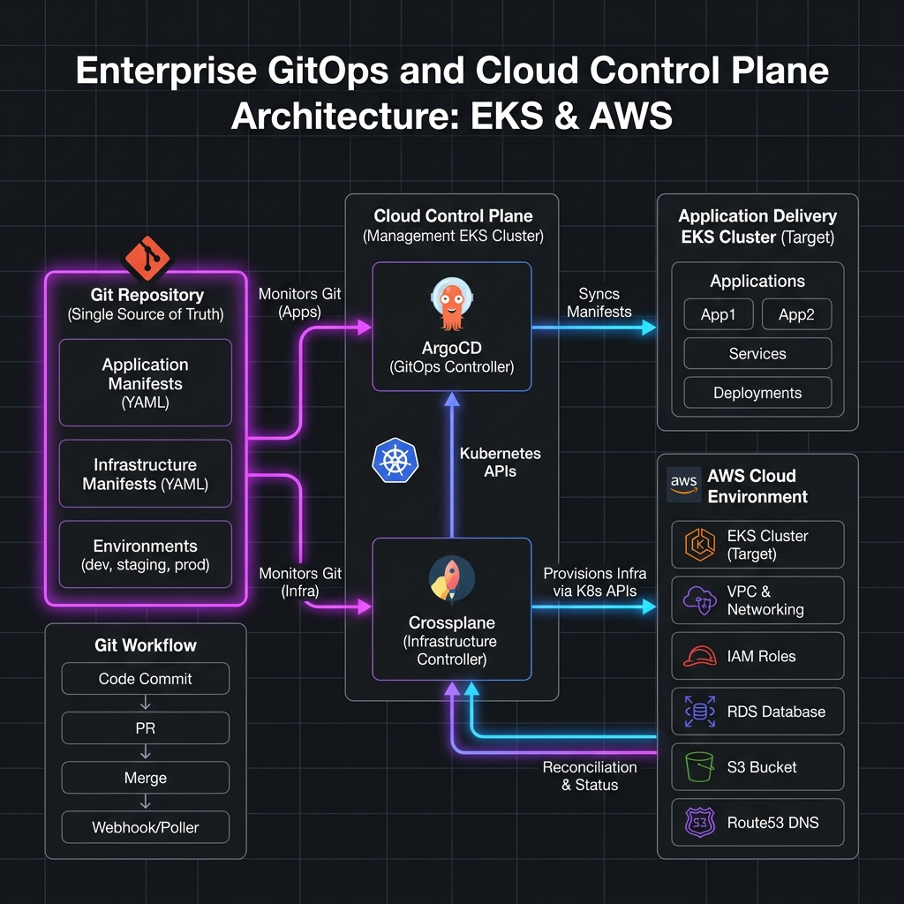
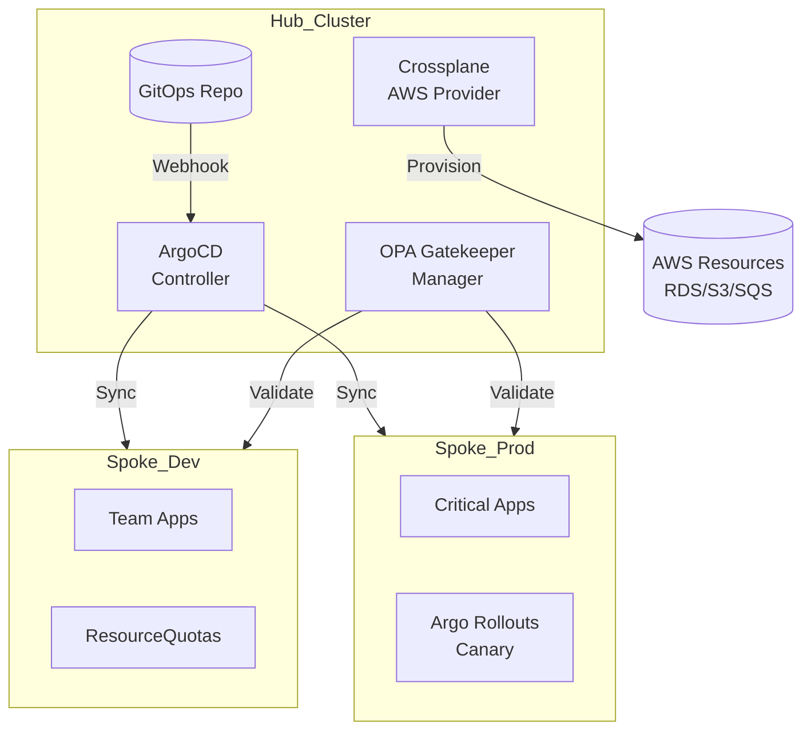

# GitOps Enterprise (ระบบจัดการ Infrastructure และ App ระดับองค์กร) Workbook

> 🧠 **ภาพจำก่อนอ่าน:** 🧪 Lab → 📜 Git → ⚙️ Controller → ☸️ Cluster → ✅ Reconcile → 🧹 Cleanup  
> 🎨 [Visual Guide ของวิชานี้](../../VISUAL-MEMORY-GUIDE-TH.md) — ภาพช่วยจำ ไม่แทนคำสั่งและเนื้อหาจริง

## 1. Scenario (สถานการณ์จำลอง)
- **เรื่องราวสถานการณ์:**
  TechWave ผู้ให้บริการ SaaS ที่กำลังเติบโตอย่างรวดเร็ว ประสบปัญหาการจัดการระบบในคืนวันศุกร์ เวลา 23:45 น. (Manual Friday Disaster)
  - Developer คนหนึ่งเข้าไปแก้ไข Deployment ใน Production Cluster เพื่อเพิ่ม Replica ด้วยตนเอง แต่ลืมอัปเดตไฟล์ใน Git
  - 30 นาทีต่อมา Developer อีกคนได้รันสคริปต์เพื่อ Sync ข้อมูลจาก Git ลง Cluster
  - ผลลัพธ์คือ Replica ถูกปรับลดกลับไปเป็นค่าเดิม ทำให้เว็บไซต์ล่มเนื่องจากไม่สามารถรองรับโหลดมหาศาลได้
- **คำสั่งจาก VP ฝ่าย Engineering:**
  - Status ของ Cluster ต้องตรงกับ Git 100% ตลอดเวลา หากไม่มีใน Git ก็ไม่ควรมีอยู่ใน Cluster
  - ต้องสามารถสร้างสภาพแวดล้อมใหม่สำหรับทีมใหม่ได้ภายในเวลาไม่เกิน 5 นาที
  - สภาพแวดล้อมใหม่นี้ต้องรวมถึง RDS Database และ S3 Buckets ด้วย
- **ข้อจำกัด (Constraints):**
  - การเปลี่ยนแปลงทั้งหมดต้องผ่าน Pull Requests เท่านั้น
  - ไม่อนุญาตให้ Developer เข้าใช้งาน Prod Cluster โดยตรงผ่าน `kubectl`
  - การจัดการด้านค่าใช้จ่าย: ใช้ Spot Instances สำหรับสภาพแวดล้อม Dev และ Staging
- **เป้าหมายความสำเร็จ (Definition of Done):**
  - ติดตั้ง ArgoCD ใน Hub Cluster เพื่อจัดการสภาพแวดล้อม Dev, Staging และ Prod
  - นำรูปแบบ App-of-Apps มาใช้สำหรับการตั้งค่าระบบทั้งหมด
  - ใช้ Crossplane เพื่อให้ Developer สามารถขอใช้งาน Cloud Resources ผ่านไฟล์ YAML ได้
  - บังคับใช้นโยบายความปลอดภัยที่เข้มงวดด้วย OPA Gatekeeper (เช่น ห้ามใช้ Privileged Containers)
  - สร้างระบบอัตโนมัติในการ Onboard ทีมด้วยสคริปต์เดียว
- **ประสิทธิภาพและการขยายระบบ (Performance & Scaling):**
  - Reconciliation Loop: ArgoCD จะตรวจจับความเปลี่ยนแปลงจาก Git ทุก 3 นาที (ค่าเริ่มต้น) และสามารถปรับแต่งให้เร็วขึ้นได้ผ่านการใช้ Webhooks
  - Estimated Scale: สามารถจัดการแอปพลิเคชันได้หลายพันตัว (Apps) และ Cluster ได้หลายร้อยแห่งพร้อมกันจากจุดเดียว
  - Bottlenecks: คอขวดมักอยู่ที่ API Server ของ Hub Cluster หากมีการส่งคำสั่ง Sync พร้อมกันจำนวนมหาศาล หรือเน็ตเวิร์กระหว่าง Cluster ช้า
  - Scaling Approach: ใช้ ArgoCD ApplicationSets เพื่อสร้างแอปพลิเคชันโดยอัตโนมัติตามโครงสร้างโฟลเดอร์ใน Git และใช้ Crossplane Compositions เพื่อลดความซับซ้อนของ Infrastructure

## 2. Topology Diagram (แผนผังระบบ)




- **ส่วนประกอบสำคัญ (Key Components):**
  - **ArgoCD ApplicationSets:** สร้างทรัพยากร `Application` แบบไดนามิกตามรายชื่อ Cluster หรือการดึงข้อมูลผ่าน Git generators
  - **Crossplane Compositions:** กำหนดสถาปัตยกรรมโครงสร้างพื้นฐานระดับสูงในรูปแบบ Class (เช่น "SmallPostgres") เพื่อให้ Developer สามารถดึงไปใช้งานได้ทันที
  - **Argo Rollouts:** เพิ่มความสามารถของ Kubernetes ในการ Deploy แบบ Canary และ Blue/Green พร้อมทั้งเชื่อมต่อกับ Prometheus เพื่อทำระบบ Rollback อัตโนมัติ
- **ภาพรวมระบบเดิม:**
  `[Git Repo (Manifests)] -> [ArgoCD (Hub)] -> [Crossplane] -> [AWS Resources]`
  `                             ↓`
  `                      [Spoke Clusters]`

## 3. Prerequisites & Estimated Time (สิ่งที่ต้องเตรียมและเวลาที่ใช้)
- **สิ่งที่ต้องเตรียม (Prerequisites):**
  - Kubernetes Clusters 3 ตัว (สามารถใช้ Kind, EKS หรือ GKE)
  - Helm 3.10 ขึ้นไป
  - ArgoCD CLI
  - Crossplane CLI
- **เวลาที่ใช้โดยประมาณ (Estimated Time):**
  - ประมาณ 2-3 ชั่วโมง
- **การนำไปใช้งานจริง (Real-World Use Cases):**
  - SaaS Multi-tenancy: การสร้างสภาพแวดล้อมแยกรายลูกค้า (Isolation) อัตโนมัติเมื่อมีการเซ็นสัญญาใหม่
  - Global Fleet Management: การจัดการคอนฟิกูเรชันของสาขา (Edge Computing) หลายพันสาขาให้ตรงกันทั่วโลก
  - Developer Self-Service: ให้นักพัฒนาเขียนไฟล์ YAML ง่ายๆ เพื่อขอเบิกฐานข้อมูล Production โดยผ่านการตรวจความปลอดภัยอัตโนมัติ
  - Internal Developer Platform (IDP): เพื่อให้ Developer ขอเบิก Database หรือ S3 ได้เองผ่าน Git
  - การจัดการมาตรฐานความปลอดภัยและ Config ของ Kubernetes Cluster จำนวนมากพร้อมๆ กัน
- **ค่าใช้จ่าย (Estimated Cost):**
  - ค่ารัน EKS Cluster (แนะนำให้ใช้ Kind สำหรับ Lab นี้เพื่อประหยัดเงิน)
  - ค่า Managed Resources ที่ Crossplane ไปสร้างขึ้น (เช่น RDS, S3)

## 4. Tasks (ขั้นตอนการปฏิบัติ)
- **Task 1: ติดตั้ง ArgoCD และ Root Application (App-of-Apps)**
  - ในองค์กรขนาดใหญ่ คุณไม่ได้จัดการแอปพลิเคชันทีละตัวด้วยตัวเอง แต่คุณจะใช้รูปแบบ App-of-Apps หรือ ApplicationSet เพื่อจัดการคลัสเตอร์และแอปพลิเคชันนับร้อยจาก Git repository เพียงแห่งเดียว
  - **ขั้นตอนที่ 1: ติดตั้ง ArgoCD**
    ```bash
    kubectl create namespace argocd
    kubectl apply -n argocd -f https://raw.githubusercontent.com/argoproj/argo-cd/stable/manifests/install.yaml
    ```
  - **ขั้นตอนที่ 2: ติดตั้ง Root Application**
    - Root App จะชี้ไปยังโฟลเดอร์ใน Git repo ของคุณที่ประกอบด้วยไฟล์ Application ของ ArgoCD ตัวอื่นๆ
    ```yaml
    # src/kubernetes/root-app.yaml
    apiVersion: argoproj.io/v1alpha1
    kind: Application
    metadata:
      name: root-app
      namespace: argocd
    spec:
      project: default
      source:
        repoURL: https://github.com/your-org/gitops-repo.git
        targetRevision: HEAD
        path: apps/production
      destination:
        server: https://kubernetes.default.svc
        namespace: argocd
      syncPolicy:
        automated:
          prune: true
          selfHeal: true
    ```

- **Task 2: การทำ Infrastructure-as-Code ด้วย Crossplane**
  - Crossplane ช่วยให้คุณจัดการทรัพยากรบนคลาวด์ (เช่น S3, RDS, EKS) โดยใช้ Kubernetes manifests
  - สิ่งนี้ทำให้การติดตั้งแอปพลิเคชันและโครงสร้างพื้นฐานรวมกันอยู่ใน GitOps pipeline เดียวกัน
  - **ขั้นตอนที่ 1: ติดตั้ง Crossplane และ AWS Provider**
    ```bash
    helm repo add crossplane-stable https://charts.crossplane.io/stable
    helm install crossplane --namespace crossplane-system crossplane-stable/crossplane
    ```
  - **ขั้นตอนที่ 2: สร้าง S3 Bucket ผ่าน GitOps**
    ```yaml
    # src/crossplane/s3-bucket.yaml
    apiVersion: s3.aws.upbound.io/v1beta1
    kind: Bucket
    metadata:
      name: thaipay-gitops-assets
    spec:
      forProvider:
        region: ap-southeast-1
      providerConfigRef:
        name: default
    ```

- **Task 3: การส่งมอบซอฟต์แวร์แบบก้าวหน้า (Progressive Delivery) ด้วย Argo Rollouts**
  - เปลี่ยนจากการใช้ Deployment แบบมาตรฐานมาเป็น Rollouts
  - เพื่อรองรับการทำ Blue/Green หรือ Canary deployments พร้อมการวิเคราะห์อัตโนมัติ
  ```yaml
  # src/argo-rollouts/canary.yaml
  apiVersion: argoproj.io/v1alpha1
  kind: Rollout
  metadata:
    name: payment-api
  spec:
    strategy:
      canary:
        steps:
        - setWeight: 20
        - pause: { duration: 5m }
        - setWeight: 50
        - pause: { duration: 10m }
  ```

- **Task 4: การจัดการ Multi-Tenancy และการกำกับดูแลด้วย OPA/Gatekeeper**
  - เพื่อให้มั่นใจว่าแต่ละทีมปฏิบัติตามนโยบายขององค์กร เช่น LoadBalancers ทั้งหมดต้องติดป้ายกำกับ owner
  ```bash
  # src/opa/enforce-tags.rego
  package kubernetes.admission

  deny[msg] {
    input.request.kind.kind == "Service"
    input.request.object.spec.type == "LoadBalancer"
    not input.request.object.metadata.labels.owner
    msg := "LoadBalancer Services ต้องมีป้ายกำกับ 'owner'"
  }
  ```

- **Task 5: การแยกสภาพแวดล้อม (Isolation) และ Onboarding สิทธิ์ใช้งาน (Multi-Tenancy Guide)**
  - เพื่อรองรับระบบ Soft Multi-Tenancy ในองค์กร เราจะตั้งค่าการจัดการสิทธิ์และข้อจำกัดของทรัพยากรผ่านสคริปต์และข้อกำหนดนโยบาย
  - **ข้อกำหนดในการแยกสภาพแวดล้อม:**
    - **RBAC:** ห้ามให้สิทธิ์ `cluster-admin` แก่ทีมพัฒนา ให้ใช้ `AppProject` ใน ArgoCD เพื่อจำกัดพื้นที่ที่ต้องการ Deploy
    - **NetworkPolicies:** บล็อกการเชื่อมต่อภายนอกเป็นแบบ Default Deny ทั้งหมด จากนั้นระบุเปิดให้เฉพาะ Pod ที่ต้องการคุยกัน หรือต่อเชื่อมไปยัง External Service เช่น RDS
    - **ResourceQuotas:** จำกัดปริมาณการใช้งาน CPU/RAM ของแต่ละ Namespace เพื่อป้องกันปัญหา Noisy Neighbor
    - **Self-Service Model:** แต่ละทีมสามารถดูแลไฟล์ Application ใน Git Repo ของตัวเอง และให้ ApplicationSet ใน Hub Cluster ดึงข้อมูลไปสร้างให้อัตโนมัติ
  - **สคริปต์ Onboard ทีมวิศวกรรม (src/scripts/team-onboarding.sh):**
    ```bash
    #!/bin/bash
    # team-onboarding.sh
    # Automated onboarding for new engineering teams

    set -euo pipefail

    TEAM_NAME=$1
    ENVIRONMENT=${2:-"dev"}

    if [ -z "$TEAM_NAME" ]; then
        echo "Usage: $0 <team-name> [environment]"
        exit 1
    fi

    echo "--- Onboarding Team: $TEAM_NAME to $ENVIRONMENT ---"

    # 1. Create Namespace
    kubectl create namespace "$TEAM_NAME-$ENVIRONMENT" --dry-run=client -o yaml | kubectl apply -f -

    # 2. Set Resource Quotas
    cat <<EOF | kubectl apply -f -
    apiVersion: v1
    kind: ResourceQuota
    metadata:
      name: ${TEAM_NAME}-quota
      namespace: ${TEAM_NAME}-${ENVIRONMENT}
    spec:
      hard:
        requests.cpu: "4"
        requests.memory: 8Gi
        limits.cpu: "8"
        limits.memory: 16Gi
        pods: "20"
        services.loadbalancers: "0"
    EOF

    # 3. Create ArgoCD AppProject
    cat <<EOF | kubectl apply -f -
    apiVersion: argoproj.io/v1alpha1
    kind: AppProject
    metadata:
      name: ${TEAM_NAME}
      namespace: argocd
    spec:
      description: Project for team ${TEAM_NAME}
      sourceRepos:
      - 'https://github.com/techwave/${TEAM_NAME}-*.git'
      destinations:
      - namespace: ${TEAM_NAME}-${ENVIRONMENT}
        server: '*'
      clusterResourceWhitelist:
      - group: ''
        kind: Namespace
    EOF

    echo "[SUCCESS] Team $TEAM_NAME onboarded. GitOps repo ready at https://github.com/techwave/$TEAM_NAME-apps"
    ```

- **Task 6: การล้างข้อมูลและทรัพยากร (Cleanup)**
  - หลังจากเสร็จสิ้นการทำ Lab หรือต้องการคืนค่าระบบ ให้ทำตามขั้นตอนดังนี้:
    - ลบ Application ใน ArgoCD (และเลือกลบ Resources ที่เกี่ยวข้องทั้งหมด)
    - รันคำสั่งถอนการติดตั้ง Helm Charts:
      ```bash
      helm uninstall argo-cd crossplane
      ```

## 5. Verification (การตรวจสอบผลการทำงาน)
ตรวจสอบผลการติดตั้งและทดสอบฟังก์ชันต่างๆ ตามรายการดังนี้:
- [ ] ติดตั้ง ArgoCD ผ่าน Helm สำเร็จ
- [ ] ติดตั้ง Crossplane และตั้งค่า AWS Provider ด้วย IRSA สำเร็จ
- [ ] ติดตั้ง OPA Gatekeeper สำเร็จ
- [ ] Deploy "App-of-Apps" ตัวหลัก (Root) สำเร็จ
- [ ] เปิดใช้งานนโยบาย Rego สำหรับ "No Privileged Containers"
- [ ] เปิดใช้งานนโยบาย Rego สำหรับ "Resource Limits"
- [ ] สร้าง AppProjects สำหรับทุกทีมเรียบร้อย
- [ ] บังคับใช้ NetworkPolicy แบบ Default Deny ทั่วทั้ง Cluster
- [ ] Deploy แอปพลิเคชันทดสอบผ่าน ArgoCD สำเร็จ
- [ ] ตรวจสอบว่า Crossplane สามารถสร้าง S3 Bucket จาก YAML ได้ถูกต้อง
- [ ] ทดลอง Deploy pod ที่ใช้สิทธิ์ privileged (ต้องโดนบล็อกโดย Gatekeeper)
- [ ] รันสคริปต์ `team-onboarding.sh` แล้วตรวจสอบการสร้าง namespace และ resource quota
- [ ] ทดลองแก้ไข Config ใน Cluster โดยตรง (Manual Change) โดยลองเข้าไปลบ Service หรือเปลี่ยนจำนวน Replica ผ่าน kubectl
  - ผลลัพธ์ที่คาดหวัง: ArgoCD ควรตรวจพบสถานะ "OutOfSync" และทำการ Self-heal (แก้ไขกลับคืน) ภายในไม่กี่วินาที
- [ ] ทดลอง Deploy Resource ที่ผิดกฎความปลอดภัย (OPA Violation) เช่น สร้าง Namespace โดยไม่มีป้ายชื่อที่บังคับไว้
  - ผลลัพธ์ที่คาดหวัง: OPA Gatekeeper ต้องสั่ง Reject คำสั่งนั้นทันทีพร้อมแจ้งเตือนว่าผิดกฎข้อใด

## 6. Troubleshooting (การแก้ไขปัญหาที่พบบ่อย)
- **ปัญหา "Out of Sync" วนลูปไม่รู้จบ (Config Drift Loop)**
  - **อาการ:** ArgoCD แสดงสถานะ "Syncing" ตลอดเวลา แม้จะกด Sync ด้วยตัวเองแล้วระบบก็จะดีดกลับมาเป็น "Out of Sync"
  - **สาเหตุ:** มี Controller หรือ Admission Webhook ภายนอก (เช่น mutating webhook หรือ HPA) เข้าไปแก้ไขค่าในฟิลด์ที่ ArgoCD พยายามควบคุมอยู่จาก Git (เช่น `replicas` หรือ `labels`) ทำให้ค่าหมุนวนไปมา
  - **วิธีแก้ไข:** ใช้ฟังก์ชัน `ignoreDifferences` ใน ArgoCD Application เพื่อสั่งให้ระบบข้ามการตรวจสอบฟิลด์ที่มีการแก้ไขโดยระบบภายนอก หรือปรับแต่งกฎใน OPA ให้สอดคล้องกับ Manifest ใน Git
- **ปัญหา Crossplane "Resource Stuck in Deleting" (ลบค้าง)**
  - **อาการ:** ทำการลบ Kubernetes manifest ของ RDS ไปแล้ว แต่ออบเจกต์ค้างอยู่ที่สถานะ `Deleting` นานหลายชั่วโมง
  - **สาเหตุ:** มี Finalizer ป้องกันการลบอยู่ เนื่องจากทรัพยากรจริงบน Cloud (เช่น AWS RDS/S3) ยังลบไม่สำเร็จ หรือ Crossplane ไม่มีสิทธิ์เข้าถึงเพื่อลบ
  - **วิธีแก้ไข:** ตรวจสอบรายละเอียดจากคำสั่ง `kubectl describe` และเช็คสิทธิ์การเข้าถึง AWS ของ `ProviderConfig` หากจำเป็นต้องลบแบบบังคับ (คำเตือน: โปรดระมัดระวังในการใช้งาน):
    ```bash
    kubectl patch <resource> -p '{"metadata":{"finalizers":null}}' --type=merge
    ```
- **ปัญหาการทำ Canary แล้วถูก Rollback ลึกลับ**
  - **อาการ:** Argo Rollout ย้อนกลับไปเวอร์ชันเดิม (Rollback) อัตโนมัติ ทั้งที่ Pod ทำงานปกติ
  - **สาเหตุ:** ตัวชี้วัดใน `AnalysisTemplate` ตรวจไม่ผ่าน เช่น อัตราความผิดพลาด 5xx จาก Prometheus สูงเกินเกณฑ์ที่ตั้งไว้ในช่วง Canary
  - **วิธีแก้ไข:** ตรวจสอบ PromQL query ใน `AnalysisTemplate` และยืนยันว่าชื่อเมตริกและป้ายกำกับถูกต้องสำหรับ Pod เวอร์ชันใหม่
- **คำแนะนำจากประสบการณ์จริงบน Production (Insight):**
  - **ApplicationSets are Mandatory:** หากมีแอปพลิเคชันมากกว่า 5 แอปขึ้นไป ห้ามสร้าง Application ทีละตัวด้วยมือเด็ดขาด ให้ใช้ ApplicationSet เพื่อสร้างระบบที่ขยายตัวเองได้ตามรายชื่อโปรเจกต์ใน Git
  - **Auto-Sync in Prod?:** ในสภาพแวดล้อม Production แนะนำให้เปิด Auto-sync แต่ "ปิด" Self-heal ไว้ในช่วงแรก เพื่อให้ทีมวิศวกรได้มีโอกาสตรวจสอบความผิดพลาดก่อนที่ระบบจะทำการแก้ไขเองโดยอัตโนมัติ
  - **Crossplane vs Terraform:** Crossplane ไม่ได้มาแทนที่ Terraform แต่เข้ามาช่วยให้โครงสร้างพื้นฐานมีสถานะเป็น "Live" ตลอดเวลา (Continuous IaC) เหมาะกับงานที่ต้องสร้างหรือลบทรัพยากรบ่อยตามการเปลี่ยนแปลงของแอปพลิเคชัน

## 7. Exercises & Solutions (แบบฝึกหัดและแนวทางการแก้ไข)
- **แบบฝึกหัด: การเพิ่มกฎ OPA Gatekeeper เพื่อป้องกันการใช้ Container Images จาก Public Registry ที่ไม่ได้รับอนุญาต**
  - **โจทย์:**
    ทีม Security ต้องการเพิ่มความปลอดภัยโดยบังคับไม่ให้ Deploy คอนเทนเนอร์ที่ดึง Image จาก Public Registry (เช่น Docker Hub) โดยตรง และกำหนดให้ใช้งานได้เฉพาะ Private Registry ของบริษัทเท่านั้น คือ `123456789012.dkr.ecr.ap-southeast-1.amazonaws.com` จงเขียนนโยบาย Rego เพื่อควบคุมกฎนี้
  - **แนวทางแก้ไข:**
    เขียนนโยบาย Rego (OPA Gatekeeper ConstraintTemplate) ดังนี้:
    ```rego
    package kubernetes.admission

    deny[msg] {
      input.request.kind.kind == "Pod"
      image := input.request.object.spec.containers[_].image
      not startswith(image, "123456789012.dkr.ecr.ap-southeast-1.amazonaws.com/")
      msg := sprintf("Container image '%v' ไม่ได้รับอนุญาตให้ใช้งาน ต้องดึงจาก Private ECR Registry (123456789012.dkr.ecr.ap-southeast-1.amazonaws.com/) เท่านั้น", [image])
    }
    ```
- **สรุปภาพรวม (Conclusion):**
  - Git คือ "Source of Truth" เพียงหนึ่งเดียวของทั้งระบบ
  - Crossplane ทำให้เราจัดการ Cloud ได้เหมือนการจัดการ Kubernetes (Unified API)
  - การทำ Policy-as-Code ช่วยลดภาระของทีม Security ในการตามเช็คความผิดพลาด

