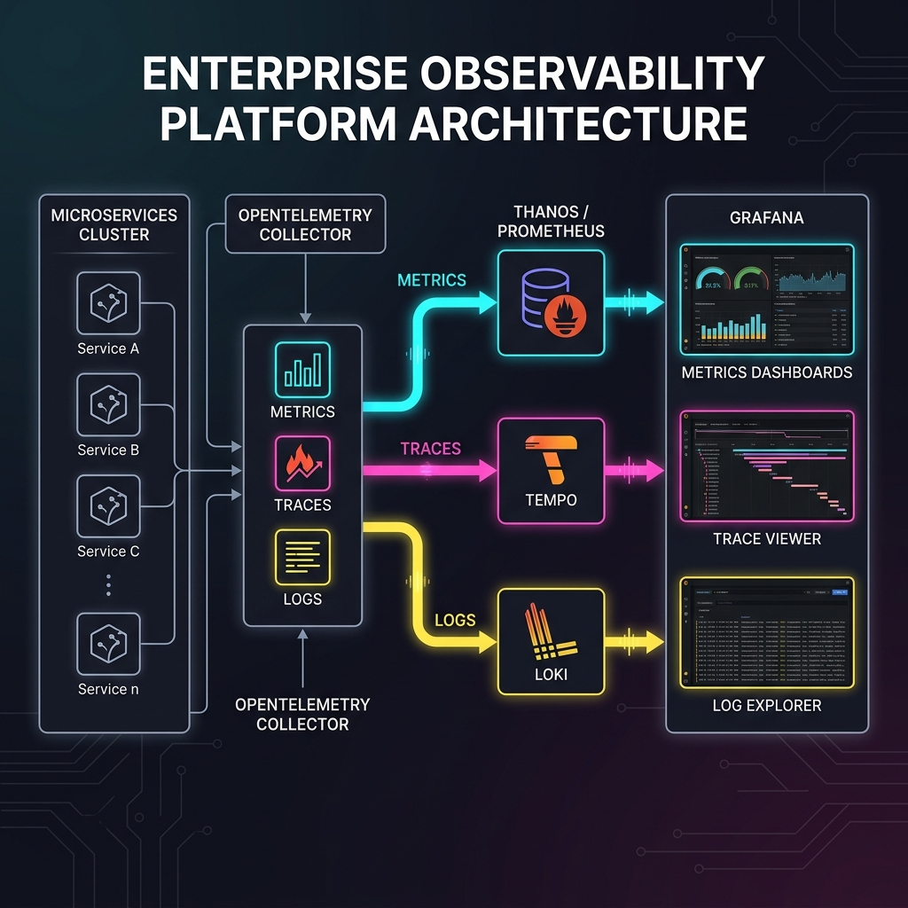
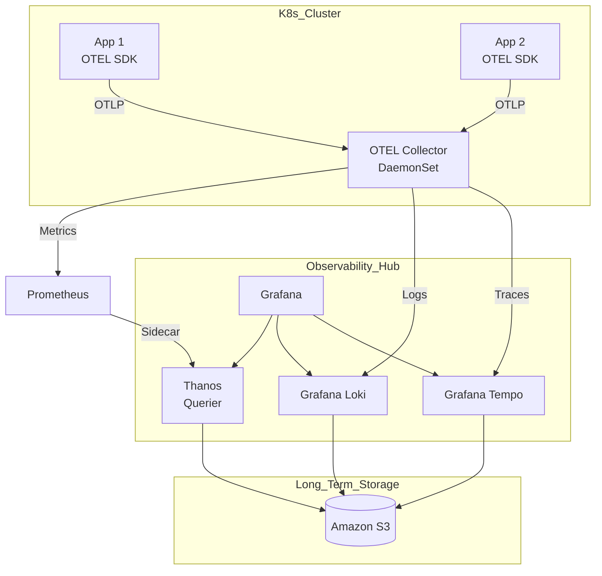

# Project 28: Observability Platform Workbook

> 🧠 **ภาพจำก่อนอ่าน:** 🧪 Lab → 📊 Metrics → 🧾 Logs → 🔗 Traces → 🔎 Diagnose → 🧹 Cleanup  
> 🎨 [Visual Guide ของวิชานี้](../../VISUAL-MEMORY-GUIDE-TH.md) — ภาพช่วยจำ ไม่แทนคำสั่งและเนื้อหาจริง

## 1. Scenario (สถานการณ์จำลอง)

- สถานที่: DataFlow ระบบ High-frequency trading platform
- เวลา: วันจันทร์ บ่าย 2:15 น.
- ลูกค้าแจ้งว่าการส่งคำสั่งซื้อขาย (Trades) ล่าช้ากว่าปกติถึง 5 วินาที
- ผลการตรวจสอบ Grafana Dashboard พบว่า CPU และ RAM ปกติดี และ 5xx errors เป็น 0% ทุกอย่างแสดงผลเป็นสีเขียว
- ข้อมูล Logs ของลูกค้าแสดงว่ามีความล่าช้าเกิดขึ้นจริงและเกิดปัญหาคอขวดที่มองไม่เห็นในระบบ
- CTO ต้องการเห็น Trace ของ Request จากลูกค้ารายนี้อย่างชัดเจน และต้องการหาสาเหตุว่าทำไมไม่มีการแจ้งเตือนเรื่อง Latency spike นี้

### ภารกิจของคุณ
1. ติดตั้ง OpenTelemetry Collector ส่วนกลางเพื่อรวบรวม Traces จากทุก Services
2. ตั้งค่า Grafana Tempo เพื่อบันทึกข้อมูลและเชื่อมโยง Traces เหล่านี้เข้ากับ Logs
3. กำหนดค่า Thanos เพื่อช่วยเก็บประวัติ Metrics ย้อนหลังเป็นเวลา 1 ปี
4. กำหนด SLOs (Service Level Objectives) สำหรับขั้นตอน "Trade Execution"
5. ตั้งค่า Grafana OnCall เพื่อแจ้งเตือนทีมเมื่อ Error budget ถูกใช้งานไปแล้ว 80%

### ข้อจำกัด
- ห้ามใช้เครื่องมือแบบมีลิขสิทธิ์ราคาแพง (เช่น Datadog หรือ New Relic)
- ต้องรองรับปริมาณ Logs 50GB และ 100M spans ต่อวัน
- ต้องปรับแต่งการบันทึกข้อมูล (Storage) โดยใช้ S3 Intelligent-Tiering

### เกณฑ์การส่งงาน (Definition of Done)
- ติดตั้ง OpenTelemetry Collector เป็น DaemonSet และสามารถรวบรวม Traces ได้สำเร็จ
- ตั้งค่า Grafana Tempo เพื่อบันทึกข้อมูลลง S3 และเชื่อมโยงเข้ากับ Logs ได้สมบูรณ์
- ตั้งค่า Thanos ให้ดึง Metrics จาก Prometheus และบันทึกข้อมูลลง S3 ระยะยาวได้
- กำหนดค่า SLO และสร้าง Dashboard เพื่อติดตาม Error Budget สำหรับกระบวนการ Trade Execution
- ตั้งค่าระบบการแจ้งเตือนผ่าน Grafana OnCall เมื่อมีการใช้ Error Budget ถึงเกณฑ์ที่กำหนด

### แนวคิดการเปรียบเทียบ
- Metrics (Prometheus/Mimir) - เหมือนเครื่องวัดสัญญาณชีพ เช่น ความดัน อัตราการเต้นของหัวใจ หรืออุณหภูมิ เพื่อดูว่าตอนนี้ร่างกายเป็นอย่างไร
- Logs (Loki) - เหมือนบันทึกอาการของคนไข้ที่บอกรายละเอียดว่าคนไข้รู้สึกอย่างไรบ้างในแต่ละช่วงเวลา
- Traces (Tempo) - เหมือนการฉีดสารทึบรังสีเพื่อเอกซเรย์ ทำให้เห็นเส้นทางการทำงานทั้งหมดและรู้ว่าคอขวดหรือจุดที่อุดตันอยู่ที่ไหน
- OpenTelemetry (OTel) - เหมือนพยาบาลที่คอยเก็บรวบรวมข้อมูล Telemetry ทั้งหมดแล้วส่งต่อไปยังระบบแสดงผล (Grafana)

## 2. Topology Diagram (แผนผังระบบ)





### คำอธิบายโครงสร้างระบบ
- Application Pods ที่พัฒนาขึ้นจะส่งข้อมูล Telemetry ไปยัง OpenTelemetry Collector ผ่านโปรโตคอล OTLP
- OpenTelemetry Collector ทำหน้าที่เป็น DaemonSet ทำการเก็บรวบรวม ประมวลผล และส่งข้อมูลออกไปยัง Backend ต่างๆ
- Prometheus จะคอยจัดเก็บข้อมูล Metrics และมี Thanos Sidecar ช่วยอัปโหลดข้อมูลลง Amazon S3
- Grafana Loki จัดเก็บ Logs และ Grafana Tempo จัดเก็บ Traces โดยทั้งคู่ใช้ Amazon S3 เป็น Storage หลักในการจัดเก็บข้อมูลระยะยาว
- Grafana ทำหน้าที่ดึงข้อมูลทั้งหมดมาแสดงผลผ่าน Dashboard ในรูปแบบของ Single Pane of Glass

## 3. Prerequisites & Estimated Time (สิ่งที่ต้องเตรียมและเวลาที่ใช้)

### สิ่งที่ต้องเตรียม
- Kubernetes Cluster (เช่น EKS, Kind, หรือ GKE)
- Helm 3.10 ขึ้นไป
- Amazon S3 Bucket สำหรับเก็บข้อมูลระยะยาวของ Thanos, Loki และ Tempo
- ความเข้าใจพื้นฐานเกี่ยวกับ PromQL และ TraceQL

### เวลาที่ใช้โดยประมาณ
- 2 - 3 ชั่วโมง

## 4. Tasks (ขั้นตอนการปฏิบัติ)

### Task 1: การติดตั้ง OpenTelemetry Collector (OTel Collector) บน EKS
- เราใช้ OTel Collector เพื่อทำหน้าที่เป็นตัวกลางในการจัดส่ง Telemetry Data โดยไม่ต้องแก้โค้ดเมื่อเปลี่ยน Backend
- เขียนค่าคอนฟิกสำหรับ OTel Collector ไว้ที่ `src/opentelemetry/collector-config.yaml` ดังนี้:
```yaml
receivers:
  otlp:
    protocols:
      grpc:
      http:
exporters:
  prometheus:
    endpoint: "0.0.0.0:8889"
  logging:
    loglevel: debug
service:
  pipelines:
    metrics:
      receivers: [otlp]
      exporters: [prometheus, logging]
```

### Task 2: การติดตั้ง Prometheus และ Grafana (kube-prometheus-stack)
- Prometheus จะทำหน้าที่เก็บรวบรวมข้อมูล Metrics และ Grafana จะใช้สำหรับสร้าง Dashboard และแสดงผล
- รันคำสั่งต่อไปนี้เพื่อติดตั้ง Helm Chart ของ Prometheus Operator:
```bash
helm repo add prometheus-community https://prometheus-community.github.io/helm-charts
helm install monitoring prometheus-community/kube-prometheus-stack --namespace monitoring --create-namespace
```

### Task 3: การกำหนดค่า ServiceMonitor
- Prometheus จะเก็บข้อมูลจากเป้าหมายที่ระบุผ่านทรัพยากรระดับ Kubernetes ที่เรียกว่า ServiceMonitor
- สร้างไฟล์ `src/helm/service-monitor.yaml` เพื่อใช้ติดตามสถานะของแอปพลิเคชัน Payment API:
```yaml
apiVersion: monitoring.coreos.com/v1
kind: ServiceMonitor
metadata:
  name: payment-api
  labels:
    release: monitoring
spec:
  selector:
    matchLabels:
      app: payment-api
  endpoints:
  - port: metrics
    interval: 15s
```

### Task 4: การกำหนดค่า Service Level Objectives (SLOs)
- ความเข้าใจพื้นฐานเกี่ยวกับการบริหารจัดการความมั่นคงและคุณภาพของบริการ:
  - SLI (Service Level Indicator) คือ อัตราการทำงานจริง เช่น อัตราความสำเร็จของ /checkout API
  - SLO (Service Level Objective) คือ เป้าหมายของคุณภาพการบริการ เช่น 99.9% ของคำขอต้องผ่านเกณฑ์ภายในเวลา 30 วัน
  - Error Budget คือ สัดส่วนความผิดพลาดที่ยอมให้เกิดได้ก่อนที่จะต้องหันกลับมาพัฒนาและปรับปรุงคุณภาพของระบบ
- คำสั่ง PromQL ทั่วไปสำหรับการวัดค่า SLI/SLO อ้างอิงอัตราความสำเร็จของ HTTP Requests:
`sum(rate(http_requests_total{status=~"2.."}[30d])) / sum(rate(http_requests_total[30d]))`
- เทมเพลตและค่าเป้าหมายสำหรับระบบ Trade Execution (อ้างอิงจาก slo-definition-template.md):
  - Service: `trading-engine`
  - SLO Name: Latency - P99 under 500ms
  - SLI Description: เปอร์เซ็นต์ของคำขอส่งคำสั่งซื้อขายสำเร็จที่ประมวลผลเสร็จในเวลาน้อยกว่า 500ms โดยวัดค่าที่ Load Balancer
  - Target: Objective: 99.9% ในช่วงเวลา Rolling window: 28 วัน
  - Error Budget: ยอมให้คำขอ 0.1% เกินกว่า 500ms ได้ (คิดเป็นเวลา Error ประมาณ 43 นาทีต่อเดือน)
  - Prometheus Expression สำหรับใช้วัดผลจริง:
```promql
sum(rate(http_request_duration_seconds_bucket{le="0.5", service="trading-engine"}[5m]))
/
sum(rate(http_request_duration_seconds_count{service="trading-engine"}[5m]))
```
  - Alerting Policy: แจ้งเตือน Warning เมื่อใช้ Error budget ไปแล้ว 80% และแจ้งเตือน Critical เมื่อใช้ไปแล้ว 100% (Burn rate > 14x)

### Task 5: การติดตั้งระบบรวบรวม Log ส่วนกลางด้วย Grafana Loki
- Grafana Loki ทำหน้าที่รวบรวม Logs โดยมีหลักการเก็บ Index คล้ายกับ Prometheus ทำให้ประหยัดเนื้อที่การจัดเก็บอย่างมาก
- รันคำสั่งต่อไปนี้เพื่อทำการติดตั้ง Loki stack พร้อมเครื่องมือดึง Log อย่าง Promtail:
```bash
helm install loki grafana/loki-stack --set promtail.enabled=true,loki.persistence.enabled=true
```

### Task 6: การวางแผนขนาดและความจุระบบสังเกตการณ์ (Capacity Planning)
- การออกแบบโครงสร้างความจุข้อมูลตามแนวทางปฏิบัติจริง (อ้างอิงจาก capacity-planning-guide.md):
  - 1. Metrics (Prometheus/Thanos):
    - ตั้งค่าเก็บข้อมูลใน SSD ท้องถิ่น 15 วัน และจัดเก็บระยะยาวบน S3 เป็นเวลา 1 ปี
    - สูตรคำนวณความจุ: `Samples * Size * Retention`
    - แนะนำให้ใช้ Prometheus Agent mode + Thanos หากมี active series เกิน 1,000,000 ชุด
  - 2. Logs (Loki):
    - ตั้งค่าเก็บ Index 7 วัน และจัดเก็บออบเจกต์ 30 วัน
    - หลีกเลี่ยงการทำ Index ทั้งหมด ให้เลือกทำเฉพาะป้ายกำกับสำคัญ (เช่น env, service, cluster)
    - การเก็บข้อมูลบน S3 ช่วยประหยัดค่าใช้จ่ายได้มากกว่า Local Block Storage ถึง 90%
  - 3. Traces (Tempo):
    - กำหนดอัตราสุ่มเก็บข้อมูล (Sampling) ที่ 100% สำหรับ Dev และ 1-5% สำหรับ Prod
    - เปิดใช้งาน TraceQL และ Parquet storage เพื่อเพิ่มความเร็วในการสืบค้นข้อมูล Spans
    - ใช้ `tail_sampling` ใน OTel Collector เพื่อเก็บเฉพาะ Spans ที่มีข้อผิดพลาดหรือมี Latency สูง

### Task 7: ข้อแนะนำและสถาปัตยกรรมระดับ Production (Production Insights)
- ป้องกันปัญหา High Cardinality โดยหลีกเลี่ยงการใช้ค่าที่มีการเปลี่ยนแปลงบ่อยๆ ใน Metrics Labels (เช่น User ID)
- การทำ Observability ที่ดีคือเมื่อพบปัญหาในระบบวัดผล (Metrics) ต้องสามารถกดดู Logs และ Traces ที่เชื่อมโยงด้วย Trace ID หรือ Exemplars ได้ในทันที
- หลีกเลี่ยงการส่งสัญญาณแจ้งเตือนยิบย่อย แต่ควรเลือกส่งสัญญาณเมื่อมีการใช้งาน Error Budget ของ SLO เกินเกณฑ์เพื่อป้องกันปัญหา Alert Fatigue ของทีมวิศวกร

### Task 8: การล้างข้อมูล (Cleanup)
- หากต้องการถอนการติดตั้งชุดซอฟต์แวร์สังเกตการณ์ ให้รันคำสั่ง:
```bash
helm uninstall observability-stack
```
- ทำการลบข้อมูลที่เหลืออยู่ใน Amazon S3 Buckets ที่ใช้จัดเก็บ Telemetry ของโปรเจกต์นี้ทั้งหมด

## 5. Verification (การตรวจสอบผลการทำงาน)

- [ ] ติดตั้ง OpenTelemetry Collector เป็น DaemonSet บนระบบเรียบร้อย
- [ ] ตั้งค่า Resource Detection processor เพื่อตรวจสอบ Kubernetes labels ในระบบ
- [ ] เปิดใช้งาน Batch และ Memory Limiter processors ใน OTel Collector เรียบร้อย
- [ ] ตรวจสอบว่า OTLP exporters มีการเชื่อมต่อไปยัง Tempo และ Loki ได้อย่างถูกต้อง
- [ ] ติดตั้ง Thanos Sidecar และ Thanos Querier สำหรับรวบรวม Metrics สำเร็จ
- [ ] กำหนดนโยบาย (S3 bucket policy) อนุญาตสิทธิ์การเข้าถึงให้แก่ Thanos, Loki และ Tempo เรียบร้อย
- [ ] เปิดใช้ Tempo parquet storage เพื่อประมวลผลคำสั่งค้นหาแบบ TraceQL
- [ ] เปิดใช้งานนโยบาย Loki compaction และ retention policies สำหรับจัดการข้อมูลเก่า
- [ ] กำหนดค่า SLIs และ SLOs สำหรับระบุความสำเร็จของคำขอใน Prometheus
- [ ] ติดตั้งหน้าจอตรวจสอบ Error Budget Dashboard และแสดงผลบน Grafana ได้สมบูรณ์
- [ ] ทำการเชื่อมโยงระบบการเตือนภัย Grafana OnCall เข้ากับระบบภายนอก (Slack หรือ PagerDuty)
- [ ] ทดสอบสร้างสภาวะผิดปกติปลอมเพื่อยืนยันว่ามีเสียงแจ้งเตือนเมื่อเกิดวิกฤต Error Budget

## 6. Troubleshooting (การแก้ไขปัญหาที่พบบ่อย)

- 1. ไม่พบข้อมูล Traces ใน Tempo
  - อาการ: หน้าจอระบบ Logs แสดงข้อมูล TraceID ชัดเจน แต่เมื่อตรวจสอบใน Tempo กลับไม่แสดงประวัติ
  - สาเหตุ: คิวส่งข้อมูล (Buffer) ของ OTel Collector เต็ม หรือตั้งค่าอัตราการสุ่มข้อมูล (Sampling rate) ต่ำเกินไป
  - วิธีแก้ไข: ตรวจสอบค่า Metric `otelcol_exporter_send_failed_spans` และปรับค่าหน่วยความจำสูงสุด (Memory limit) ของ OTel Collector ให้มากขึ้น
- 2. Thanos Deduplication ไม่ทำงาน
  - อาการ: เส้นกราฟแสดงผลสำหรับ Metric ตัวเดียวกันแสดงซ้อนกันหลายเส้นในหน้าจอระบบที่มี High Availability
  - สาเหตุ: ไม่ได้ระบุ External label ในรูปแบบ replica หรือค่าดังกล่าวแต่ละเครื่องไม่เหมือนกัน
  - วิธีแก้ไข: ตั้งค่า replica label ให้แตกต่างกันในทุก instance และตั้งออปชัน `--query.replica-label=replica` ให้ Thanos Querier
- 3. เกิดข้อผิดพลาด Loki "Out of Order"
  - อาการ: ปรากฏข้อผิดพลาด `entry with timestamp ... out of order` ในบันทึก Logs
  - สาเหตุ: มีการส่ง logs จากตัวสะสมหลายแหล่งสลับเวลาไปมา หรือเวลาบนเครื่องเซิร์ฟเวอร์คลาดเคลื่อน (Clock drift)
  - วิธีแก้ไข: ปรับแต่งคอนฟิก `loki.write_parallelism` และเปิดใช้ NTP บนเครื่อง Nodes ทั้งหมดเพื่อรักษาระดับเวลา
- 4. หน้าจอ Grafana Dashboards โหลดช้ามาก
  - อาการ: หน้ารายงานใช้เวลาในการประมวลผลและแสดงกราฟนานเกินกว่า 10 วินาที
  - สาเหตุ: มีการเรียกใช้งานคำสั่ง PromQL ที่ซับซ้อนและดึงข้อมูลย้อนหลังยาวนานเกินความจำเป็น (เช่น 30 วัน)
  - วิธีแก้ไข: ใช้ฟีเจอร์ Prometheus Recording Rules เพื่อสร้างผลสรุปข้อมูลไว้ล่วงหน้า
- 5. ค่าใช้จ่ายพื้นที่จัดเก็บ S3 Storage สูงขึ้นผิดปกติ
  - อาการ: ค่าบริการ Amazon S3 สำหรับจัดเก็บข้อมูล Observability มีอัตราสูงขึ้นอย่างผิดสังเกต
  - สาเหตุ: ไม่ได้ตั้งค่า retention policies หรือมีไฟล์ข้อมูลขนาดเล็กถูกสร้างใน Bucket เป็นจำนวนล้านไฟล์
  - วิธีแก้ไข: เปิดใช้และกำหนดค่า Thanos Compactor และ Loki Compactor เพื่อรวมไฟล์ข้อมูลขนาดเล็กเข้าด้วยกันเป็นไฟล์ใหญ่
- 6. ปัญหา High Cardinality ในระบบ Metrics
  - อาการ: Prometheus ใช้แรมสูงขึ้นผิดปกติจนระบบทำงานไม่ได้และถูกจัดการด้วย OOMKill
  - สาเหตุ: มีการระบุ Labels ที่เปลี่ยนค่าไปมาจำนวนมากในระบบ เช่น user_id หรือ order_id ทำให้ระบบสร้างชุดข้อมูลบวม
  - วิธีแก้ไข: นำเอาป้ายกำกับที่มีความหลากหลายสูงออกจากเมตริก และเลือกใช้ Relabeling เพื่อทิ้งค่าป้ายกำกับที่ไม่จำเป็น
- 7. ข้อมูล Metrics ไม่แสดงผลบน Grafana
  - อาการ: ตรวจสอบ Metrics ในระดับเครื่องแอปพลิเคชันผ่าน curl สำเร็จ แต่บน Grafana ไม่ขึ้นข้อมูล
  - สาเหตุ: ป้ายกำกับ `release: monitoring` ของ ServiceMonitor ไม่จับคู่กับค่า Helm release ของ Prometheus Operator
  - วิธีแก้ไข: รันคำสั่ง `kubectl get prometheus -n monitoring` ตรวจดู `serviceMonitorSelector` และปรับป้ายกำกับของ ServiceMonitor ให้ตรงกัน
- 8. มีอาการดีเลย์ของการส่ง Log ผ่าน Promtail
  - อาการ: แอปพลิเคชันประมวลผลแล้วและพิมพ์ Log ออกมาแล้ว แต่ในระบบ Loki แสดงช้าไป 2 นาที
  - สาเหตุ: Promtail DaemonSet โดน Throttled ทรัพยากร หรือเกิดสภาวะ Disk IO ของโหนดระบบเต็ม หรือติดข้อจำกัดอัตราส่งข้อมูล
  - วิธีแก้ไข: ขยาย CPU/Memory limits ให้กับ Promtail DaemonSet และตรวจดู log เพื่อยืนยันว่ามีปัญหา RateLimit หรือไม่
- 9. ข้อมูล Trace ไม่แสดงผล หรือแสดงผลไม่สมบูรณ์ (Broken Trace)
  - อาการ: หน้าจอระบบไม่สามารถโยงการเรียกใช้ (Traces) หรือขาดหายไประหว่างบริการ
  - สาเหตุ: แอปพลิเคชันปลายทางไม่ได้รับการส่งข้อมูล context (เช่น traceparent header) หรือตั้งค่า Sampling Rate ไว้ต่ำเกินไป
  - วิธีแก้ไข: ตรวจสอบและตั้งค่าให้แอปพลิเคชันเปิดใช้ Trace context propagation และสเกลขนาดคิวรวมถึงขยาย OTel Collector

## 7. Exercises & Solutions (แบบฝึกหัดและแนวทางการแก้ไข)

### แบบฝึกหัดที่ 1: การวัดระดับความสามารถด้านการสังเกตการณ์ (Observability Maturity Model Assessment)
- โจทย์: จงตอบคำถามเพื่อวิเคราะห์ความสามารถของระบบในปัจจุบันตามระดับ Observability Maturity Model:
  1. คุณสามารถวิเคราะห์หาสาเหตุของ Latency Spike ที่เกิดขึ้นข้าม 3 บริการย่อยได้ในเวลาน้อยกว่า 5 นาทีหรือไม่?
  2. คุณทราบปริมาณ Error Budget ที่คงเหลืออยู่ในเดือนปัจจุบันนี้หรือไม่?
  3. คุณสามารถทำการเชื่อมโยงบรรทัดของ Log ไปยังข้อมูล Trace ID ได้อย่างสะดวกและอัตโนมัติหรือไม่?
  4. สัญญาณเตือนภัยในระบบใช้ข้อมูลระดับอาการของระบบ (Latency) หรือข้อมูลทรัพยากรภายใน (CPU High) เป็นหลัก?
- แนวทางการแก้ไข:
  - ข้อ 1 และ 3: การประมวลผลต้องอาศัยการจัดเก็บและดึงข้อมูลด้วย Grafana Tempo และ Loki ที่มีการนำค่า Trace ID มาบันทึกลงใน Log ทุกบรรทัด เพื่อช่วยชี้จุดคอขวดที่เกิดขึ้นได้ทันที
  - ข้อ 2 และ 4: เปลี่ยนแนวทางการตรวจวัดจากการวัดฮาร์ดแวร์พื้นฐานมาเป็นการทำ Service Level Objectives (SLOs) โดยใช้ข้อมูล Prometheus Metrics เป็นตัวสะท้อนการตอบสนองจริงที่มีผลกระทบต่อผู้ใช้งาน

### แบบฝึกหัดที่ 2: การจัดการสภาวะผิดปกติจำลอง (Latency Spike Simulation)
- โจทย์: หากพบว่ามีแอปพลิเคชันตอบสนองช้าลงส่งผลต่อกระบวนการ Trade Execution เป็นเวลา 5 วินาที จงอธิบายขั้นตอนในการแกะรอยหาจุดบกพร่องของระบบโดยละเอียด
- แนวทางการแก้ไข:
  - 1. ค้นหาช่วงเวลาที่เกิดปัญหาบน Dashboard ของ Grafana
  - 2. สืบข้อมูล Trace ID จาก Logs ที่เกิดขึ้นในช่วงเวลานั้นและเปิดดูผ่าน Grafana Tempo
  - 3. พิจารณาแผนผังลำดับ Spans (Gantt chart) ใน Tempo เพื่อระบุจุดที่มีความยาวผิดปกติ
  - 4. ตรวจสอบ HTTP headers ของแอปพลิเคชันเพื่อให้มั่นใจว่าไม่ได้ทำข้อมูล context propagation ตกหล่นระหว่างทาง

### แบบฝึกหัดที่ 3: การคำนวณอัตราความล้มเหลวตามระดับ SLO
- โจทย์: จงเขียนสมการการวัดผลการใช้ระบบ Trade Execution (trading-engine) ที่มีค่าเป้าหมายการส่งสำเร็จ 99.9% ภายในระยะเวลา 5 นาที และการวางแผนระงับเหตุ
- แนวทางการแก้ไข:
  - 1. สร้างสมการการตรวจสอบประสิทธิภาพ (SLI) ผ่าน PromQL:
```promql
sum(rate(http_request_duration_seconds_bucket{le="0.5", service="trading-engine"}[5m]))
/
sum(rate(http_request_duration_seconds_count{service="trading-engine"}[5m]))
```
  - 2. ทำการกำหนดค่าบน Grafana Alerting เพื่อส่งสัญญาณเตือนไปที่ Grafana OnCall หากมีการใช้ Error Budget เกิน 80% ของข้อตกลง
  - 3. เชื่อมต่อ OnCall เข้ากับระบบจัดส่งข้อความ เช่น Slack หรือ PagerDuty เพื่อส่งคำสั่งงานแจ้งเตือนไปยังทีม SRE ให้ทำการเข้ามาแก้ไขระบบโดยเร็ว

