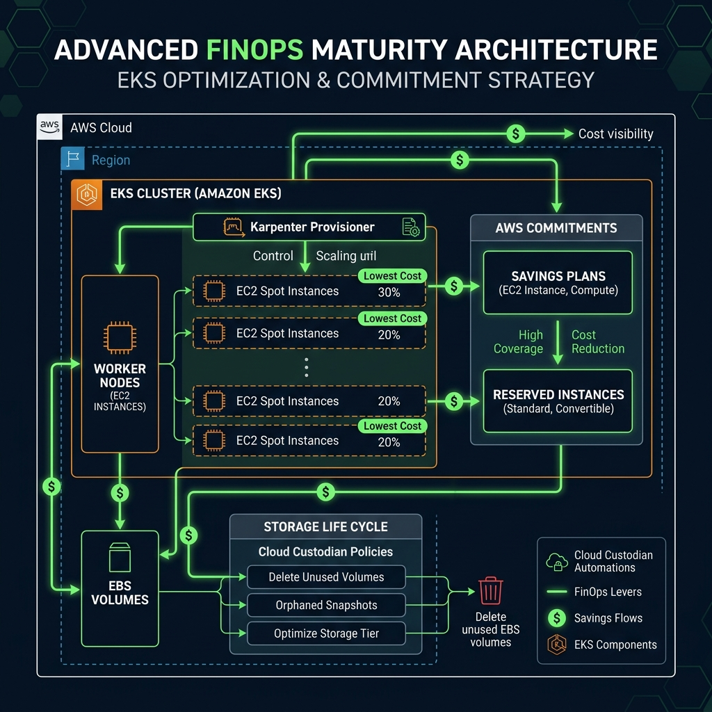
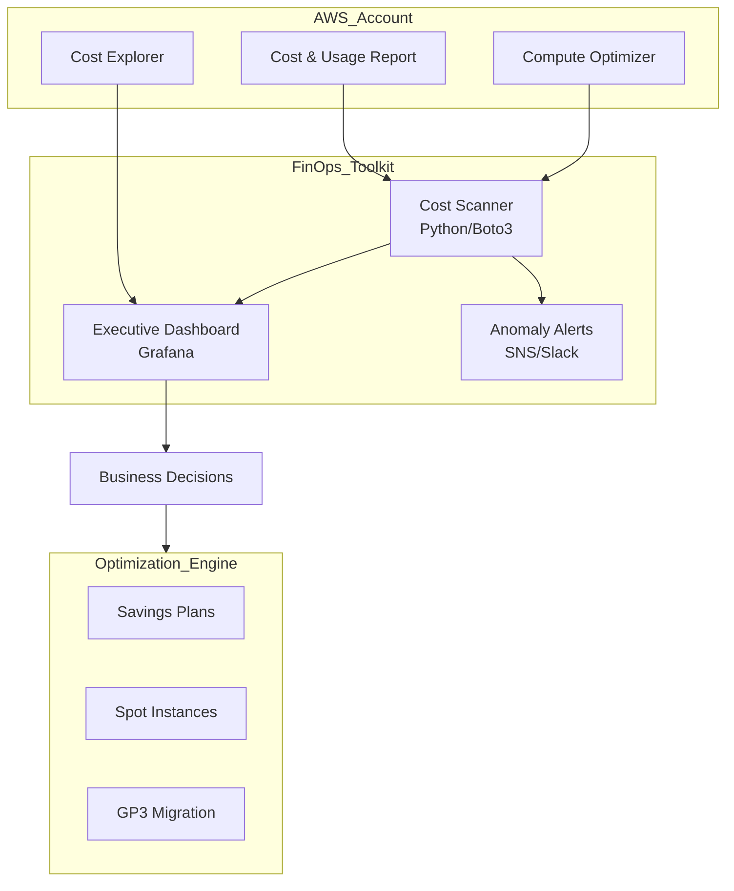

# Project 29: FinOps Maturity Workbook

## 1. Scenario (สถานการณ์จำลอง)

บริษัท SkyBudget ซึ่งเป็นแพลตฟอร์มจองตั๋วท่องเที่ยว กำลังประสบปัญหาค่าใช้จ่าย Cloud ที่ไม่คาดคิด
CFO เดินเข้ามาพบคุณพร้อมกับรายงานบิลค่าบริการของ AWS และแจ้งประเด็นต่อไปนี้:
- เดือนที่แล้วมียอดชำระ $65,000 แต่เดือนนี้พุ่งสูงถึง $102,000 (เพิ่มขึ้นถึง 60%)
- ในขณะที่รายได้ของบริษัทเติบโตขึ้นเพียง 5% เท่านั้น
- คุณต้องส่งรายงานแจกแจงค่าใช้จ่ายแยกตามรายทีม Product ภายในวันศุกร์นี้ มิฉะนั้นจะถูกระงับการจ้างงานพนักงานใหม่ทั้งหมด

จากการตรวจสอบเบื้องต้นใน AWS Console พบสาเหตุดังนี้:
- ค่าใช้จ่ายกว่า 40% ถูกจัดอยู่ในกลุ่ม "Other" เนื่องจากทรัพยากรระบบมี Tag เพียงครึ่งเดียว (52% Tagging Coverage)
- พบ EBS Volumes ที่ไม่ได้ใช้งานและไม่มีการเชื่อมต่อ (Unattached) ค้างอยู่ในระบบถึง 200 ตัว
- พบ Cluster ของ i3.metal Instances ที่เปิดทิ้งไว้หลังจากทีมทดสอบประสิทธิภาพระบบ (Performance Test) แล้วลืมปิด

### ข้อจำกัด (Constraints)
- การดำเนินงานต้องไม่ส่งผลกระทบใดๆ ต่อประสิทธิภาพการทำงาน (Performance) ของระบบ Production
- ต้องแสดงผลลัพธ์การลดค่าใช้จ่ายลงให้ได้ 15% ภายใน 30 วันแรก
- มุ่งเน้นการใช้เครื่องมือที่เป็น Native ของ AWS ให้ได้มากที่สุด

### เงื่อนไขการบรรลุเป้าหมาย (Definition of Done)
- ทำการประเมิน FinOps Maturity Assessment เพื่อวัดระดับความพร้อมขององค์กร
- กำหนดนโยบาย "Tag or Terminate" โดยใช้งาน AWS Config เพื่อบังคับใช้ Tagging Policy
- เขียนสคริปต์ Python หรือใช้เครื่องมือตรวจหาทรัพยากรที่ไม่ได้ใช้งาน (Idle Resources) เพื่อจัดการลบหรือปิดใช้งานโดยเร็ว
- วิเคราะห์ความคุ้มค่าและเปรียบเทียบข้อเสนอแนะในการจอง Compute Savings Plans กับ Reserved Instances (RI)
- สร้าง Executive Dashboard เพื่อแสดงผลลัพธ์ของ Unit Economics เช่น Cost per Booking

---

## 2. Topology Diagram (แผนผังระบบ)





---

## 3. Prerequisites & Estimated Time (สิ่งที่ต้องเตรียมและเวลาที่ใช้)

- **เวลาที่ใช้โดยประมาณ**: 3 ชั่วโมง
- **สิ่งที่ต้องเตรียมก่อนเริ่ม**:
  - AWS Account ที่มีสิทธิ์เข้าถึงข้อมูล Billing หรือใช้ข้อมูลจำลองเพื่อวิเคราะห์
  - ติดตั้งและตั้งค่า AWS CLI เรียบร้อยแล้ว
  - Python 3.9 ขึ้นไปสำหรับการรันสคริปต์วิเคราะห์
  - ความรู้พื้นฐานเกี่ยวกับ AWS Cost Explorer และ AWS Compute Optimizer
  - ระบบ Kubernetes (เช่น EKS) และ Karpenter สำหรับหัวข้อ Spot Instances

---

## 4. Tasks (ขั้นตอนการปฏิบัติ)

### Task 1: การบังคับใช้ป้ายกำกับ (Tagging Enforcement) ผ่าน Service Control Policy (SCP)
หากไม่ทราบแหล่งที่มาของค่าใช้จ่าย ก็เป็นไปไม่ได้ที่จะจัดการต้นทุนได้อย่างมีประสิทธิภาพ
ในระดับ FinOps ที่ก้าวหน้า จำเป็นต้องมี Tag Coverage 100% สำหรับการกระจายต้นทุน
- ให้เริ่มจากการสร้าง SCP เพื่อป้องกันไม่ให้ใครเปิดใช้งาน EC2 instance หรือ RDS DB Instance หากไม่มีการกำหนดแท็ก `Project` และ `Owner`
- ใช้การเขียนเงื่อนไข Deny เพื่อบังคับใช้นโยบายดังโค้ดด้านล่างนี้:

```json
{
  "Version": "2012-10-17",
  "Statement": [{
    "Sid": "EnforceProjectTag",
    "Effect": "Deny",
    "Action": ["ec2:RunInstances", "rds:CreateDBInstance"],
    "Resource": ["arn:aws:ec2:*:*:instance/*", "arn:aws:rds:*:*:db:*"],
    "Condition": { "Null": { "aws:RequestTag/Project": "true" } }
  }]
}
```

---

### Task 2: การย้ายระบบไปใช้ Spot Instances (Spot Instance Migration)
การย้าย Workload ที่ไม่สำคัญมากหรือสามารถหยุดทำงานชั่วคราวได้ ไปรันบน Spot Instances จะช่วยลดค่าใช้จ่ายลงได้สูงสุดถึง 90%
- ตรวจสอบความเหมาะสมของระบบ (Workload Qualification) ก่อนการเริ่มย้ายระบบ:

| Safe for Spot | Not Safe for Spot |
| :--- | :--- |
| CI/CD Runners | Production Databases |
| Batch Processing | Stateful Legacy Apps |
| Dev/Staging Clusters | Real-time APIs (unless using multiple AZs) |
| Microservices (Stateless) | In-memory Caches (Redis/Memcached) |

- กำหนดค่า Karpenter NodePool เพื่อรัน Spot Instances บน EKS และกำหนดให้ Rollback ไปใช้ On-Demand ในกรณีที่ Spot Instances ขาดแคลน:

```yaml
apiVersion: karpenter.sh/v1beta1
kind: NodePool
metadata:
  name: spot-nodes
spec:
  template:
    spec:
      requirements:
        - key: "karpenter.sh/capacity-type"
          operator: In
          values: ["spot", "on-demand"]
        - key: "kubernetes.io/arch"
          operator: In
          values: ["arm64"] # ประหยัดเพิ่มขึ้นอีก 20% ด้วย Graviton (ARM)
```

- วางมาตรการจัดการกับ Spot Interruption (เมื่อ AWS ขอเครื่องคืน):
  1. เปิดใช้งาน Capacity Rebalancing ใน Auto Scaling Groups
  2. ตั้งค่า Termination Grace Period ให้แอปพลิเคชันจัดการปิดตัวแบบเรียบร้อย (Graceful Shutdown) ในเวลา 2 นาที
  3. กำหนดค่า Pod Disruption Budgets (PDBs) เพื่อควบคุมจำนวน Pod ขั้นต่ำที่พร้อมให้บริการเสมอข้าม Availability Zones

---

### Task 3: การประเมินและเปรียบเทียบการซื้อ Savings Plans กับ Reserved Instances
การจัดทำ Commit-based Discounts เป็นหัวใจสำคัญของกระบวนการปรับต้นทุนให้เหมาะสม (Optimization)
- Reserved Instances (RI): เหมาะสำหรับทรัพยากรระดับฐานข้อมูล (เช่น RDS) หรือ ElastiCache ที่ใช้งานต่อเนื่องคงที่เป็นเวลานาน
- Savings Plans (SP): เหมาะสำหรับงานประมวลผลที่มีการเปลี่ยนแปลงได้ตลอดเวลา (Compute Workloads เช่น EC2, Fargate, Lambda) เนื่องจากมีความยืดหยุ่นสูง
- เรียกดูสถิติ Coverage ปัจจุบันของ RI และ SP ผ่าน AWS CLI:

```bash
aws ce get-reservation-coverage --time-period Start=2023-10-01,End=2023-11-01 --granularity MONTHLY
aws ce get-savings-plans-coverage --time-period Start=2023-10-01,End=2023-11-01 --granularity MONTHLY
```

- รันสคริปต์ Python ในโฟลเดอร์ของแล็บเพื่อคำนวณข้อเสนอแนะในการซื้อ Savings Plans ตามปริมาณการใช้งานแบบจำลอง:

```python
import boto3
import json

def analyze_savings_plans():
    """
    Analyzes compute usage and recommends Savings Plan commitment.
    """
    client = boto3.client('ce') # Cost Explorer
    
    # In a real environment, we'd use GetSavingsPlansPurchaseRecommendation
    # For the lab, we'll simulate the logic.
    
    on_demand_hourly_avg = 15.50 # $15.50/hr average on-demand spend
    sp_discount_avg = 0.30       # 30% average discount
    
    target_commitment = on_demand_hourly_avg * 0.8 # Aim for 80% coverage
    estimated_monthly_savings = (on_demand_hourly_avg * sp_discount_avg) * 24 * 30
    
    print("--- Savings Plan Recommendation ---")
    print(f"Current Avg On-Demand: ${on_demand_hourly_avg}/hr")
    print(f"Recommended Commitment: ${target_commitment:.2f}/hr")
    print(f"Estimated Monthly Savings: ${estimated_monthly_savings:,.2f}")
    print(f"Total Annual Savings: ${estimated_monthly_savings * 12:,.2f}")

if __name__ == "__main__":
    analyze_savings_plans()
```

---

### Task 4: การตั้งค่าระบบควบคุมอัตโนมัติด้วย Cloud Custodian (Automated Governance)
การลดงานแบบ manual โดยใช้ระบบอัตโนมัติ (Automation) จะช่วยให้เรากำจัดขยะ (Resource Waste) ได้อย่างมีประสิทธิภาพและถาวร
- ใช้ Cloud Custodian เขียนนโยบายเพื่อค้นหาและลบ EBS Volumes ที่ไม่มีการเชื่อมต่อกับเครื่อง instance ใดๆ (Unattached Volumes) โดยอัตโนมัติ:

```yaml
policies:
  - name: ebs-unattached-cleanup
    resource: ebs
    filters:
      - AttachTime: null
    actions:
      - delete
```

---

### Task 5: การประเมิน FinOps Maturity Assessment และการพัฒนา Executive Dashboard
เพื่อให้ธุรกิจสามารถขับเคลื่อนคุณค่า (Value-Driven) ได้อย่างต่อเนื่อง เราต้องประเมินสถานะปัจจุบันและมี Dashboard สำหรับฝ่ายบริหาร
- การทำ FinOps Maturity Assessment (การประเมินความพร้อม):

**Phase 1: Inform (Visibility)**
- [ ] มีทรัพยากรมากกว่า 90% ขึ้นไปที่ติดแท็ก `CostCenter` และ `Project` ใช่หรือไม่?
- [ ] มีการประชุมทบทวนค่าใช้จ่าย (Cost Review Meeting) รายเดือนร่วมกับผู้มีส่วนเกี่ยวข้องหรือไม่?
- [ ] สามารถระบุ Workload ที่แพงที่สุด 5 อันดับแรกได้หรือไม่?

**Phase 2: Optimize (Efficiency)**
- [ ] ใช้ Spot Instances สำหรับ Non-production Workloads มากกว่า 50% หรือยัง?
- [ ] ซื้อ Savings Plans/RI ครอบคลุมอย่างน้อย 70% ของการใช้งานประมวลผลที่คงที่ (Stable Compute) หรือยัง?
- [ ] มีการจัดทำกระบวนการปรับขนาดทรัพยากร (Right-sizing) เป็นส่วนหนึ่งของ Weekly Sprint Cycle หรือไม่?

**Phase 3: Operate (Business Value)**
- [ ] มีการติดตามประสิทธิภาพทางเศรษฐศาสตร์ต่อหน่วย (Unit Economics) เช่น Cost per Transaction แล้วหรือยัง?
- [ ] เรื่อง Cloud Cost ถูกกำหนดเป็น KPI ของผู้จัดการทีม Engineering หรือไม่?
- [ ] มีระบบตรวจจับค่าใช้จ่ายผิดปกติ (Anomaly Detection) และแจ้งเตือนภายใน 24 ชั่วโมงหรือไม่?

**เกณฑ์การให้คะแนน (Scoring Matrix)**
- 0-30 คะแนน (Crawl): ทำงานเชิงรับ (Reactive), มีทรัพยากรเหลือทิ้งสูง, ไม่มีเจ้าของค่าใช้จ่ายที่ชัดเจน
- 31-70 คะแนน (Walk): มีการออกรายงานสม่ำเสมอ, มีการล้างทรัพยากรแบบกึ่งอัตโนมัติ, มีการบังคับใช้ Tagging Policy
- 71-100 คะแนน (Run): ประสิทธิภาพด้านต้นทุนเป็นส่วนหนึ่งของวัฒนธรรมองค์กร, มีระบบปรับขนาดทรัพยากรอัตโนมัติ (Automated Right-sizing)

- การสร้าง Executive Dashboard สำหรับวัดค่า Unit Economics:
  ใช้ Grafana หรือ QuickSight ในการทำ Dashboard โดยแสดงค่าตัวชี้วัดสำคัญดังนี้:

  1. ค่าใช้จ่ายหลัก 3 รายการ (The Big Three)
     - ยอดใช้จ่ายรวมรายเดือน (Total Monthly Spend) เช่น ปัจจุบัน $102,000 (เพิ่มขึ้น 60% จากเดือนก่อน)
     - ยอดใช้จ่ายคาดการณ์รายปี (Forecasted Spend) เช่น $1.2M
     - โอกาสในการประหยัด (Optimization Potential) เช่น $18,500 (สามารถลดลงได้อีก 18%)

  2. ประสิทธิภาพทางเศรษฐศาสตร์ต่อหน่วย (Unit Economics)
     - ต้นทุนต่อการจอง (Cost per Booking): $0.45 (เป้าหมายคือ < $0.35)
     - ต้นทุนต่อผู้ใช้ที่ใช้งานจริง (Cost per Active User): $1.20
     - อัตราส่วนค่าใช้จ่าย Infrastructure ต่อรายได้ (Infrastructure Cost % of Revenue): 12% (เป้าหมายคือ 8%)

  3. ประสิทธิภาพของการใช้งานทรัพยากร (Efficiency Metrics)
     - อัตราความครอบคลุมของแท็ก (Tagging Coverage): 52% (เป้าหมายคือ 95%)
     - อัตราส่วนการใช้ Spot Instances: 15% (เป้าหมายคือ 40%)
     - อัตราความครอบคลุมการซื้อส่วนลด Compute SP/RI: 45% (เป้าหมายคือ 80%)

- แผนปฏิบัติการเร่งด่วน (Action Plan):
  1. ดำเนินการลบ 200 unused EBS volumes ทันที เพื่อประหยัดเงิน $2,000/เดือน
  2. ซื้อ Compute Savings Plans เพิ่มเติมขนาด $10/ชั่วโมง ช่วยประหยัดได้ $2,500/เดือน
  3. ทยอยย้ายสภาพแวดล้อม Dev/Staging ทั้งหมดไปยัง Spot Instances ช่วยประหยัดได้ $8,000/เดือน

---

## 5. Verification (การตรวจสอบผลการทำงาน)

ให้ดำเนินการตรวจสอบระบบตามรายการตรวจสอบความพร้อม FinOps ต่อไปนี้:

### รายการตรวจสอบทั่วไป (FinOps Checklist)
- [ ] ประกาศใช้งานเอกสาร Tagging Policy เพื่อกำหนดขอบเขตและความรับผิดชอบ
- [ ] สร้างรายงานแยกตาม Tag (Groups by Tag) ใน AWS Cost Explorer เพื่อแสดงรายละเอียดค่าใช้จ่ายอย่างชัดเจน
- [ ] ตั้งค่าการเตือนภัยด้วย CloudWatch Anomalies Alert เพื่อรับการแจ้งเตือนเมื่อค่าใช้จ่ายรายวันสูงขึ้นผิดปกติเกิน 20%
- [ ] ตรวจสอบการย้าย EBS Volumes จากประเภท GP2 ไปเป็น GP3 ทั้งหมด
- [ ] ทบทวนและอนุมัติใบเสนอราคาแนะนำสำหรับการซื้อ Savings Plans บน AWS Console
- [ ] สร้างและทดสอบ NodePool แบบ Spot Instances สำหรับ Dev Cluster ให้ทำงานได้สำเร็จ
- [ ] ส่งรายงานทรัพยากรที่ไม่ได้ใช้งาน (Idle Resources Report) ไปยังหัวหน้าทีมพัฒนาทุกคนเพื่อดำเนินการต่อ
- [ ] กำหนดวันและเวลาในการประชุมทบทวนค่าใช้จ่ายเป็นประจำทุกเดือน (Monthly FinOps Review)
- [ ] กำหนดขั้นตอน Cost-aware Architecture Review ให้เป็นส่วนหนึ่งของการตรวจสอบและส่ง Pull Request (PR)
- [ ] เปิดใช้งาน Dashboard แสดงผล Unit Economics (Cost per Transaction) บนระบบ Grafana หรือ QuickSight

### รายการตรวจสอบสถาปัตยกรรมที่คำนึงถึงต้นทุน (Cost-aware Architecture Review)
- [ ] **Compute:** ทรัพยากรที่เป็น Stateless ทั้งหมดได้รับการปรับย้ายมาใช้ Spot Instances แล้วหรือยัง?
- [ ] **Compute:** แอปพลิเคชันสามารถคอมไพล์และรันบนสถาปัตยกรรม Graviton (ARM) เพื่อประหยัดเพิ่มขึ้นอีก 20% แล้วหรือยัง?
- [ ] **Compute:** มีการตั้งค่า Resource Limits (CPU/Memory Request & Limit) ใน Kubernetes เพื่อจำกัดการดึงทรัพยากรหรือยัง?
- [ ] **Compute:** มีการตั้งค่า Auto-scaling ทั้งแนวราบ (Horizontal) และแนวดิ่ง (Vertical) สำหรับรองรับการใช้งานตามจริงแล้วหรือยัง?
- [ ] **Storage:** มีการเปิดใช้งานนโยบาย S3 Intelligent-Tiering เพื่อลดค่าใช้จ่ายสำหรับการเก็บข้อมูลที่ใช้งานไม่บ่อยหรือยัง?
- [ ] **Storage:** มีระบบหรือนโยบายลบ EBS Snapshots ที่เก่าเกินระยะเวลาที่กำหนดแบบอัตโนมัติแล้วใช่ไหม?
- [ ] **Storage:** กำหนดระยะเวลาเก็บรักษา Log (Retention Period) ใน CloudWatch Logs เรียบร้อยแล้ว (หลีกเลี่ยงการใช้ "Never Expire")?
- [ ] **Networking:** มีการสร้าง VPC Gateway Endpoints สำหรับเชื่อมต่อไปยัง S3 และ DynamoDB โดยตรง เพื่อหลีกเลี่ยงการคิดเงินผ่าน NAT Gateway แล้วหรือยัง?
- [ ] **Networking:** มีการออกแบบให้ระบบรันข้ามหลาย Availability Zones (Multi-AZ) เฉพาะบน Production ในขณะที่ Dev/Staging รันแบบ Single-AZ หรือไม่?
- [ ] **Networking:** มีการปรับปรุงโครงสร้างเพื่อลดปริมาณการโอนย้ายข้อมูลข้ามเขตพื้นที่ (Cross-AZ Data Transfer) ให้น้อยที่สุดแล้วหรือยัง?
- [ ] **Databases:** มีการตรวจสอบขนาดของ RDS Instance ให้เหมาะสมกับการใช้งานจริง (Right-sized) แล้วหรือยัง?
- [ ] **Databases:** ในการเก็บข้อมูลที่ไม่แน่นอน คาดเดายาก มีการปรับเปลี่ยนมาใช้ DynamoDB On-Demand แล้วหรือยัง?
- [ ] **Databases:** มีการตั้งค่าลบ snapshots ทิ้งเมื่อลบ cluster เพื่อไม่ให้มีไฟล์ขยะตกค้างแล้วหรือยัง?

---

## 6. Troubleshooting (การแก้ไขปัญหาที่พบบ่อย)

### ปัญหาที่ 1: ทรัพยากรระบบไม่มี Tag ใน Cost Explorer (Untagged Resources)
- **อาการ:** พบสถานะ "No Tag Key" สูงถึง 50% ของค่าใช้จ่ายทั้งหมดในหน้ารายงานของ Cost Explorer
- **สาเหตุ:** ทรัพยากรถูกสร้างด้วยมือผ่านหน้าจอ Console หรือใช้โมดูล Terraform รุ่นเก่าที่ไม่มีการประกาศ Tag standard เอาไว้
- **แนวทางการแก้ไข:**
  - รันคำสั่ง AWS CLI ด้านล่างเพื่อค้นหาทรัพยากรที่ไม่มีแท็กกำกับ:
    ```bash
    aws resourcegroupstaggingapi get-resources
    ```
  - จัดเตรียมสคริปต์แก้ไขและย้ายการจัดการโครงสร้างพื้นฐานมาอยู่ภายใต้ Terraform เพื่อบังคับใส่ Default Tags ในระดับ Provider

### ปัญหาที่ 2: ค่าใช้จ่าย NAT Gateway สูงเกินกว่าปกติ
- **อาการ:** บิลแสดงยอดค่าใช้จ่ายในหมวดหมู่ "EC2-Other" สูงกว่า "EC2-Instances" อย่างมีนัยสำคัญ
- **สาเหตุ:** มีการส่งผ่านข้อมูลจำนวนมากข้ามไปมาระหว่าง Private Subnet กับ Amazon S3 หรือ DynamoDB ผ่านทาง NAT Gateway
- **แนวทางการแก้ไข:**
  - ติดตั้ง VPC Gateway Endpoints สำหรับบริการ S3 และ DynamoDB ซึ่งไม่มีค่าบริการในการส่งข้อมูล:
    - สร้าง Endpoint ชนิด Gateway
    - อัปเดตตารางเส้นทาง (Route Table) ของ Private Subnet ให้ชี้ไปที่ Endpoint ดังกล่าวโดยตรง

### ปัญหาที่ 3: อัตราการใช้สิทธิ์ของ Savings Plans ต่ำผิดปกติ (Under-utilization)
- **อาการ:** รายงานในระบบระบุว่าอัตราการใช้งานส่วนลด Savings Plans ต่ำกว่า 100% (Utilization < 100%)
- **สาเหตุ:** ทำการจองซื้อขนาดที่สูงเกินไป หรือเกิดจากการย้าย Workload หลักข้าม Account หรือข้าม Region ที่ไม่เข้าเงื่อนไขการรับส่วนลด
- **แนวทางการแก้ไข:**
  - ดำเนินการย้ายแผนการซื้อและการทำ Commitments ไปทำในระดับ Payer Account (Root Account) ภายใน AWS Organizations
  - วิธีนี้จะช่วยแชร์สิทธิประโยชน์และเฉลี่ยส่วนลดไปยัง Linked Accounts ทุกตัวในตระกูลเดียวกันได้อย่างทั่วถึง

### ปัญหาที่ 4: ปัญหาแอปพลิเคชันหยุดทำงานเมื่อเกิด Spot Interruptions
- **อาการ:** บริการ Pod หรือ EC2 Instance ถูกปิดตัวลงกะทันหัน ส่งผลให้เกิดข้อผิดพลาดชั่วขณะประมาณ 1-2 นาที
- **สาเหตุ:** ในการยื่นคำขอ Spot Instance มีการเจาะจงประเภท Instance น้อยเกินไป หรือขาดการตั้งค่า Pod Disruption Budgets (PDBs)
- **แนวทางการแก้ไข:**
  - ปรับปรุงการกำหนดชนิดของเครื่องใน NodePool ให้มีความหลากหลาย (Instance Type Diversification) เช่น ระบุประเภท m5.large, m4.large, t3.large ผสมผสานกัน
  - ตั้งค่า PDB เพื่อบังคับให้ระบบประคองปริมาณรันขั้นต่ำของแอปพลิเคชันไว้เสมอในขณะที่เกิดการสับเปลี่ยน Node

### ปัญหาที่ 5: ค่าบริการ CloudWatch Logs สูงติดอันดับท็อปบิลค่าใช้จ่าย
- **อาการ:** มีค่าบริการในหมวด CloudWatch Logs สูงขึ้นอย่างน่าตกใจ จนขึ้นมาเป็นอันดับต้นๆ ของค่าใช้จ่ายประจำเดือน
- **สาเหตุ:** มีการเปิด Log Level เป็น DEBUG ค้างไว้บนสภาพแวดล้อม Production หรือไม่ได้ระบุเวลาในการลบ Log อัตโนมัติ (Retention Period)
- **แนวทางการแก้ไข:**
  - ปรับลด Log Level ในระดับแอปพลิเคชันกลับไปเป็น INFO
  - ตั้งเวลาลบข้อมูล Log ที่ไม่ได้ใช้งานแล้ว โดยกำหนด Retention Period ไว้ที่ 30 วันแทนการเก็บแบบไม่มีกำหนด (Never Expire)

### ปัญหาที่ 6: ค่าใช้จ่ายแฝงที่ไม่สามารถระบุแหล่งที่มาได้ในระบบ (Unallocated Costs)
- **อาการ:** มีค่าบริการประเภทการรับส่งข้อมูล (Data Transfer), Shared NAT Gateways หรือ EBS Snapshots ตกหล่นและไม่ติดป้ายกำกับ
- **สาเหตุ:** ทรัพยากรประเภท Shared Services หรือ Network Transfer มักจะไม่สามารถระบุแท็กแบบเจาะจงเจ้าของคนใดคนหนึ่งตรงๆ ได้
- **แนวทางการแก้ไข:**
  - ใช้ฟังก์ชัน Cost Categories บน AWS Billing
  - สร้างเงื่อนไขในการกระจายต้นทุน (Cost Allocation Rules) ไปยังแผนกต่างๆ อ้างอิงตาม VPC IDs, Subnets, หรือ Metadata ตัวอื่น

### ปัญหาที่ 7: อัตราค่าบริการสะสมคงที่ในระดับสูง แม้จะมีการลดจำนวนเซิร์ฟเวอร์ลงแล้ว (Savings Plan Over-commitment)
- **อาการ:** บิลรายเดือนขององค์กรคงที่ในระดับที่สูง แม้จะปิดการทำงานของ EC2 Instance ที่ไม่จำเป็นไปหมดแล้ว
- **สาเหตุ:** มีการคำนวณและทำสัญญาซื้อบริการจองล่วงหน้า (Savings Plans/RI) ในสัดส่วน 100% ของช่วงที่มีการใช้งานสูงสุด (Peak Usage)
- **แนวทางการแก้ไข:**
  - หลีกเลี่ยงการทำสัญญาคุ้มครองครอบคลุมปริมาณการใช้งานทั้งหมด 100% ในอนาคต
  - ให้ตั้งเป้าการจองซื้อเบื้องต้นไว้ที่ 60-70% ของการใช้งานระดับปกติ (Baseline) จากนั้นค่อยๆ ซื้อเพิ่มเมื่อมั่นใจในเสถียรภาพของ Workload

---

## 7. Exercises & Solutions (แบบฝึกหัดและแนวทางการแก้ไข)

ในส่วนนี้จะเป็นแบบฝึกหัดในการเขียนโค้ดและคอนฟิกูเรชันต่างๆ สำหรับแก้ปัญหา FinOps ของระบบ SkyBudget พร้อมแนวทางการแก้ไขอย่างเป็นระบบ

### Exercise 1: การบังคับใช้ Tagging Policy ด้วย Service Control Policy (SCP)
**โจทย์:**
จงเขียนนโยบาย IAM (ในรูปแบบ SCP) เพื่อบล็อกหรือปฏิเสธ (Deny) การสร้าง EC2 Instances และ RDS Instances หากผู้ใช้ไม่ระบุแท็กที่ชื่อ `Project` เพื่อควบคุมระดับความครอบคลุมของแท็กให้มีประสิทธิภาพมากขึ้น

**แนวทางการแก้ไข (Solution):**
นโยบายจะใช้เงื่อนไขตรวจสอบแท็กในขณะที่มีการเรียกใช้งาน Action `ec2:RunInstances` และ `rds:CreateDBInstance` หากไม่มีแท็กดังกล่าวจะปฏิเสธการเข้าถึงทันที:
```json
{
  "Version": "2012-10-17",
  "Statement": [{
    "Sid": "EnforceProjectTag",
    "Effect": "Deny",
    "Action": ["ec2:RunInstances", "rds:CreateDBInstance"],
    "Resource": ["arn:aws:ec2:*:*:instance/*", "arn:aws:rds:*:*:db:*"],
    "Condition": { "Null": { "aws:RequestTag/Project": "true" } }
  }]
}
```

---

### Exercise 2: การออกแบบ NodePool ใน Karpenter เพื่อให้ความสำคัญกับ Spot Instances และ Graviton
**โจทย์:**
จงเขียนโครงสร้างไฟล์การตั้งค่า (YAML) สำหรับ Karpenter NodePool เพื่อดึงทรัพยากรแบบ Spot Instances มาใช้งานเป็นอันดับแรก แต่ถ้าทรัพยากรขาดแคลนให้เปลี่ยนไปใช้ On-Demand และต้องกำหนดให้รันบนสถาปัตยกรรม ARM64 เพื่อลดต้นทุน

**แนวทางการแก้ไข (Solution):**
ใช้ข้อกำหนด `requirements` ในไฟล์ Kubernetes Manifest ของ Karpenter ดังต่อไปนี้:
```yaml
apiVersion: karpenter.sh/v1beta1
kind: NodePool
metadata:
  name: spot-nodes
spec:
  template:
    spec:
      requirements:
        - key: "karpenter.sh/capacity-type"
          operator: In
          values: ["spot", "on-demand"]
        - key: "kubernetes.io/arch"
          operator: In
          values: ["arm64"]
```

---

### Exercise 3: การเขียนสคริปต์วิเคราะห์และประเมินงบประมาณการซื้อ Savings Plans
**โจทย์:**
จงเขียนสคริปต์ Python ร่วมกับ Boto3 SDK เพื่อวิเคราะห์ความคุ้มค่าของการเลือกใช้ Savings Plans และแนะนำจำนวนงบประมาณ Commit ที่เหมาะสม (เทียบจาก 80% ของการใช้งานปกติ) พร้อมคำนวณส่วนประหยัดรายเดือนและรายปีโดยสมมติว่าได้ส่วนลดเฉลี่ย 30%

**แนวทางการแก้ไข (Solution):**
โค้ดด้านล่างเป็นสคริปต์คำนวณหาค่าเฉลี่ยและประเมินผลต่างของการประหยัดแบบจำลอง:
```python
import boto3
import json

def analyze_savings_plans():
    """
    Analyzes compute usage and recommends Savings Plan commitment.
    """
    client = boto3.client('ce') # Cost Explorer
    
    # In a real environment, we'd use GetSavingsPlansPurchaseRecommendation
    # For the lab, we'll simulate the logic.
    
    on_demand_hourly_avg = 15.50 # $15.50/hr average on-demand spend
    sp_discount_avg = 0.30       # 30% average discount
    
    target_commitment = on_demand_hourly_avg * 0.8 # Aim for 80% coverage
    estimated_monthly_savings = (on_demand_hourly_avg * sp_discount_avg) * 24 * 30
    
    print("--- Savings Plan Recommendation ---")
    print(f"Current Avg On-Demand: ${on_demand_hourly_avg}/hr")
    print(f"Recommended Commitment: ${target_commitment:.2f}/hr")
    print(f"Estimated Monthly Savings: ${estimated_monthly_savings:,.2f}")
    print(f"Total Annual Savings: ${estimated_monthly_savings * 12:,.2f}")

if __name__ == "__main__":
    analyze_savings_plans()
```

---

### Exercise 4: การสร้างนโยบาย Cloud Custodian เพื่อทำความสะอาดดิสก์ขยะ (Idle Storage)
**โจทย์:**
จงเขียนนโยบาย YAML สำหรับใช้ร่วมกับเครื่องมือ Cloud Custodian ในการกวาดล้างทรัพยากรเก็บข้อมูลดิสก์ EBS Volumes ที่มีสถานะว่างอยู่ (ไม่ได้เชื่อมต่อหรือรันบน Instance ใดๆ) เพื่อแก้ปัญหายอดบิลส่วนเกินทันที

**แนวทางการแก้ไข (Solution):**
นโยบายจะกำหนดชนิดทรัพยากรเป็น `ebs` กรองค่า `AttachTime` ที่ว่างเปล่า (Null) และสั่ง `delete` ทันที:
```yaml
policies:
  - name: ebs-unattached-cleanup
    resource: ebs
    filters:
      - AttachTime: null
    actions:
      - delete
```

---

### Exercise 5: การประกาศใช้ Terraform สำหรับตรวจจับการใช้จ่ายที่ผิดปกติและแจ้งเตือนงบประมาณรายเดือน
**โจทย์:**
จงเขียนคอนฟิกูเรชัน Terraform (HCL) เพื่อสร้างทรัพยากรตรวจสอบ 2 อย่าง:
1. การแจ้งเตือนงบประมาณรายเดือนขนาด $100 ที่มีการแจ้งเตือนเมื่อใช้จริงถึง 80%
2. ตัวจับตรวจความผิดปกติทางค่าใช้จ่าย (AWS Anomaly Monitor และ Anomaly Subscription) โดยให้ส่งอีเมลแจ้งเตือนมาทันทีที่เกิดความผิดปกติเกิน $10

**แนวทางการแก้ไข (Solution):**
ประกาศใช้ทรัพยากร `aws_budgets_budget`, `aws_ce_anomaly_monitor` และ `aws_ce_anomaly_subscription` ในรูปแบบ HCL:
```hcl
# Project 29: Advanced FinOps Budgeting and Anomaly Detection

resource "aws_budgets_budget" "monthly" {
  name              = "monthly-budget"
  budget_type       = "COST"
  limit_amount      = "100"
  limit_unit        = "USD"
  time_period_start = "2024-01-01_00:00"
  time_unit         = "MONTHLY"

  notification {
    comparison_operator        = "GREATER_THAN"
    threshold                  = 80
    threshold_type             = "PERCENTAGE"
    notification_type          = "ACTUAL"
    subscriber_email_addresses = ["admin@thaidemo.co"]
  }
}

resource "aws_ce_anomaly_monitor" "main" {
  name         = "thaidemo-cost-monitor"
  monitor_type = "DIMENSIONAL"
  monitor_dimension = "SERVICE"
}

resource "aws_ce_anomaly_subscription" "main" {
  name      = "thaidemo-cost-alerts"
  threshold = 10
  frequency = "IMMEDIATE"
  monitor_arn_list = [
    aws_ce_anomaly_monitor.main.arn
  ]

  subscriber {
    type    = "EMAIL"
    address = "admin@thaidemo.co"
  }
}
```

