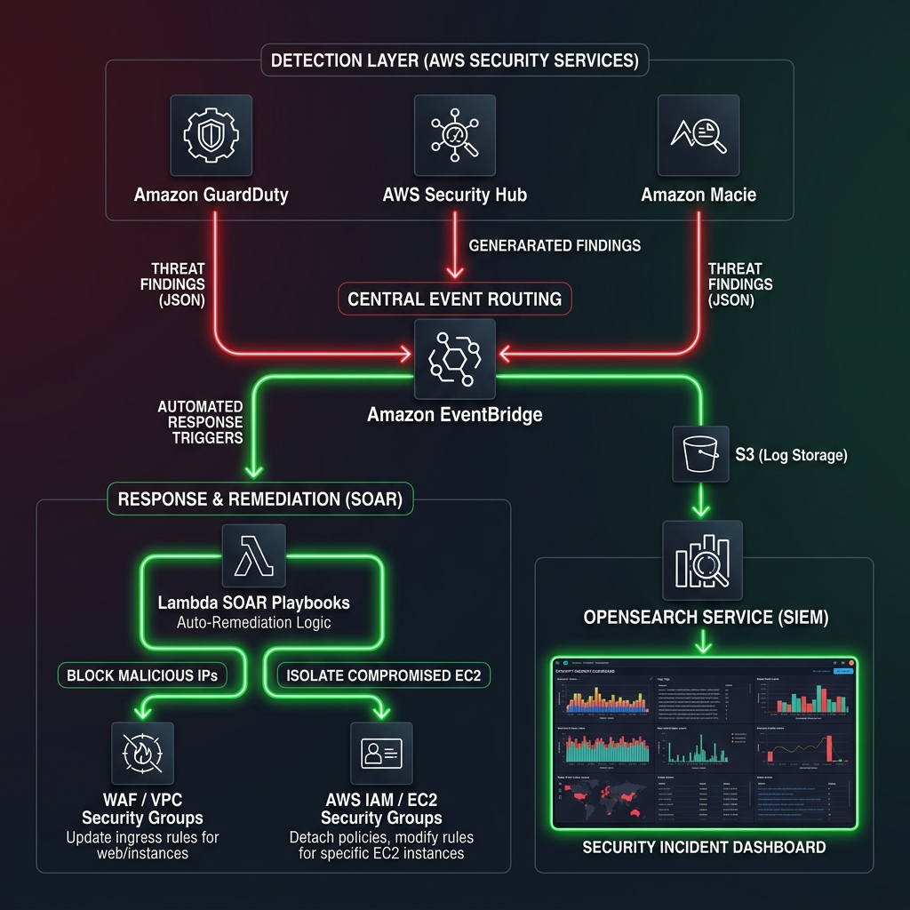
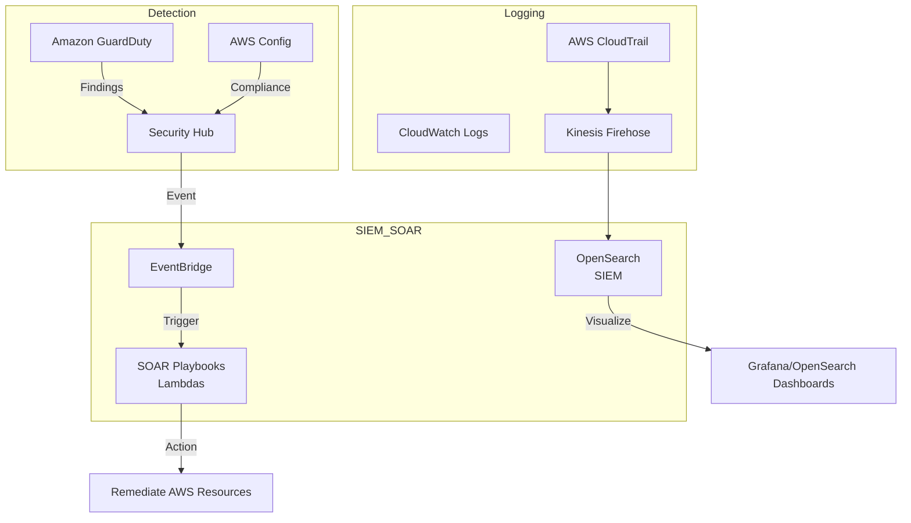

# Cloud Native SecOps Workbook

## 1. Scenario (สถานการณ์จำลอง)

**สถานที่:** SecureBank ธนาคารดิจิทัลในประเทศไทย
**เวลา:** วันอาทิตย์ เวลา 03:00 น.

ระบบตรวจจับภัยคุกคาม Amazon GuardDuty แจ้งเตือนข้อความผิดปกติขึ้นมา:
"UnauthorizedAccess:IAMUser/ConsoleLoginFromUnfamiliarLocation"

หลังจากนั้น 5 นาที ระบบตรวจพบข้อความเตือนลำดับถัดมา:
"CryptoCurrency:EC2/BitcoinTool.B!DNS"

สถานการณ์คือมีผู้ประสงค์ร้ายแอบขโมย IAM credentials ของ Developer ไปใช้ และกำลังสั่งเปิด EC2 GPU instances ใน region us-east-1 เพื่อขุดเหรียญดิจิทัล

CISO โทรหาคุณทันทีและสั่งการ:
- ให้ทำการระงับใช้งานและกำจัด EC2 instances เหล่านั้นทิ้งทันที
- ยกเลิกการใช้งาน credentials ของ Developer ชุดดังกล่าว
- ส่งรายงานผลสืบสวนคดีความมั่นคงปลอดภัยไซเบอร์ (Forensics Report) ภายในเวลา 08:00 น.
- อธิบายและวิเคราะห์ว่าเพราะเหตุใด Service Control Policies (SCPs) ขององค์กรจึงไม่บล็อก region us-east-1 ตั้งแต่แรก

### ภารกิจของคุณ (Your Mission)
1. สร้าง SIEM ด้วย Amazon OpenSearch Serverless เพื่อใช้เป็นศูนย์รวมข้อมูล Security Logs ทั้งหมด
2. พัฒนา SOAR Playbooks โดยใช้ AWS Lambda ด้วยภาษา Python เพื่อให้ระบบตอบสนองภัยคุกคามทั่วไปแบบอัตโนมัติ
3. ใช้ Amazon Athena ค้นหาภัยคุกคาม (Threat Hunting) และตรวจสอบพฤติกรรมการเคลื่อนย้ายภายในระบบ (Lateral Movement) จาก CloudTrail Logs
4. เขียนนโยบายตรวจสอบความปลอดภัยด้วย AWS Config Rules เพื่อบังคับใช้นโยบายจำกัดการใช้งานในบาง Region
5. ออกแบบโครงการ Security Champion Program เพื่อยกระดับความรู้และความใส่ใจด้านความปลอดภัยให้กับทีมพัฒนา

### ข้อกำหนดด้านสถาปัตยกรรม (Constraints)
- ระบบตอบสนองอัตโนมัติ (Automation/SOAR) บนสภาพแวดล้อม Production จะต้องมีขั้นตอนควบคุมโดยมนุษย์ (Human-in-the-loop) เพื่ออนุมัติก่อนทำรายการสำคัญ
- ข้อมูล Security Logs ทั้งหมดต้องได้รับการเข้ารหัสทั้งในขณะจัดเก็บ (Encryption at Rest) และระหว่างการรับส่งข้อมูล (Encryption in Transit)
- การบริหารจัดการงบประมาณ: เลือกใช้ Amazon OpenSearch Serverless เพื่อหลีกเลี่ยงการเสียค่าใช้จ่ายจาก instances ที่รันตลอดเวลาและลดภาระในการดูแลระบบ (Management Overhead)

### นิยามความสำเร็จ (Definition of Done)
- ระบบ SIEM บน OpenSearch Serverless สามารถรับและแสดงผลข้อมูล Security Logs ได้สมบูรณ์
- พัฒนาและทดสอบ SOAR Playbooks (Lambda) เพื่อแยกเครื่องที่ถูกแฮกและระงับการใช้งาน IAM keys ที่หลุดรอดได้จริง
- สามารถรันคำสั่ง SQL ผ่าน Amazon Athena เพื่อค้นหาข้อมูลการกระทำผิดปกติได้เสร็จสิ้น
- ออกแบบนโยบายและมาตรการป้องกันความปลอดภัย รวมถึง Runbooks และโครงการพัฒนาสำหรับวิศวกรซอฟต์แวร์

### แนวคิดการออกแบบ (Core Concept)
เปรียบเทียบ Cloud Native SecOps เหมือน "ระบบป้องกันฐานทัพในภาพยนตร์ไซไฟ"
- **Detection (GuardDuty/Macie):** เปรียบเสมือน "เรดาร์และเซนเซอร์ความร้อน" คอยตรวจจับสิ่งผิดปกติ เช่น การลักลอบเข้าระบบหรือโดรนแปลกปลอม
- **Aggregation (OpenSearch):** เปรียบเสมือน "ห้องปฏิบัติการสงคราม (War Room)" รวมข้อมูลจากทุกเซนเซอร์มาแสดงผลบนแผนที่หลักเพียงจุดเดียว
- **SOAR (Lambda Playbooks):** เปรียบเสมือน "ระบบป้องกันตัวอัตโนมัติ" เมื่อยืนยันเป้าหมายว่าเป็นศัตรู ปืนกลกลไกจะทำงานหรือปิดประตูกั้นทันทีโดยไม่ต้องรอคนสั่ง

### กรณีใช้งานจริง (Use Cases)
- **Automated Ransomware Containment:** เมื่อพบพฤติกรรมการเขียนไฟล์ผิดปกติใน S3 Bucket ระบบจะสั่งตัดสิทธิ์การเข้าใช้งานของ IAM User นั้นทันทีเพื่อจำกัดความเสียหาย
- **Compromised Credentials Revocation:** เมื่อตรวจพบการใช้งาน Access Key จากพิกัดที่ไม่น่าเชื่อถือ ระบบจะสั่งระงับคีย์นั้นทันทีและแจ้งผู้ใช้ทันที
- **Vulnerability Patching Orchestration:** เมื่อ AWS Inspector ตรวจพบช่องโหว่ร้ายแรง ระบบจะสร้างตั๋วปัญหาใน Jira และสั่งการแก้ไขอัตโนมัติผ่าน SSM Patch Manager
- **Security Operations Center (SOC) on Cloud:** สำหรับหน่วยงานที่ต้องการตั้งศูนย์ปฏิบัติการความปลอดภัยส่วนบุคคลเพื่อควบคุมความปลอดภัยบนคลาวด์
- **Advanced Persistent Threat (APT) Protection:** ปกป้องข้อมูลสำคัญในระบบจากภัยคุกคามที่มีความซับซ้อนและพยายามหลบเลี่ยงการตรวจจับ

---

## 2. Topology Diagram (แผนผังระบบ)





### แผนภาพการส่งผ่านข้อมูลดิบ (Text Architecture Flow)
```text
[Internet / Internal Threats]
           ↓
[GuardDuty / Security Hub / Macie] → (Finding) → [EventBridge]
                                                    ↓
[OpenSearch (SIEM)] ← (Log) ← [Kinesis Firehose] ← [Lambda (SOAR)]
                                                    ↓ (Action)
[Block IP / Revoke IAM / Isolate EC2] ← (Remediation) ┘
```

### ขั้นตอนการทำงานของระบบ (System Workflow)
```text
[Threats] → [GuardDuty/Security Hub] → [EventBridge] → [Lambda SOAR (Remediation)] → [OpenSearch (SIEM)]
```

### ส่วนประกอบของระบบ (System Architecture Components)
- **Detection (การตรวจจับ):** GuardDuty, Security Hub, AWS Config
- **Aggregation (การรวบรวมข้อมูล):** CloudWatch Logs, OpenSearch
- **Automation (การตอบสนองอัตโนมัติ):** SOAR Playbooks พัฒนาด้วย AWS Lambda
- **Analysis (การวิเคราะห์):** Amazon Athena, Amazon SageMaker

---

## 3. Prerequisites & Estimated Time (สิ่งที่ต้องเตรียมและเวลาที่ใช้)

### สิ่งที่ต้องเตรียม (Prerequisites)
- บัญชี AWS Account ที่เปิดใช้งาน GuardDuty, Security Hub, และ Macie เรียบร้อยแล้ว
- คลัสเตอร์ Kubernetes (EKS หรือแบบจำลอง)
- ติดตั้ง Python เวอร์ชัน 3.9 ขึ้นไป
- ความรู้พื้นฐานเกี่ยวกับ MITRE ATT&CK Framework

### เวลาที่ใช้ในการทำ Lab (Estimated Time)
- ประมาณ 3 ถึง 4 ชั่วโมง (ขึ้นอยู่กับการจัดเตรียมสภาพแวดล้อมและการคิวรีข้อมูล)

### ทักษะที่จะได้เรียนรู้ (Skills Learned)
- การจัดทำ SIEM (Security Information and Event Management) ด้วย OpenSearch
- พัฒนาระบบตอบสนองภัยคุกคามอัตโนมัติด้วย SOAR (Security Orchestration, Automation, and Response)
- ทำการตรวจหาภัยคุกคาม (Threat Hunting) ด้วย Amazon Athena และ CloudTrail Logs
- เขียนนโยบายความปลอดภัยแบบ Policy-as-Code ตรวจสอบความเข้ากันได้ของระบบคลาวด์ (Security Compliance)
- ฝึกปฏิบัติการ Red/Purple Teaming เพื่อทดสอบประสิทธิภาพของระบบตรวจจับภัยคุกคาม (Detection Validation)

### ค่าใช้จ่ายที่คาดว่าจะเกิดขึ้น (Cost Breakdown)
- ค่าบริการ AWS Security Services คำนวณตามปริมาณ Logs ที่เปิดใช้งานระบบตรวจสอบ
- ค่าบริการสำหรับรัน OpenSearch Cluster ซึ่งมีราคาสูง แนะนำให้ปิดใช้งานทันทีที่ทำ Lab เสร็จสิ้น

---

## 4. Tasks (ขั้นตอนการปฏิบัติ)

### Task 1: การเปิดใช้งานโครงสร้างพื้นฐานความปลอดภัยส่วนกลางและตั้งค่า Amazon Security Lake
ในระบบ SecOps ยุคใหม่ เราจะไม่ส่ง Log ทุกอย่างเข้า SIEM โดยตรง
- เราจะเก็บข้อมูล Logs บน S3 Bucket ภายใต้มาตรฐาน OCSF (Open Cybersecurity Schema Framework)
- วิธีนี้ทำให้แอปพลิเคชันหรือระบบความปลอดภัยภายนอกสามารถดึงไปประมวลผลต่อได้สะดวก

1. เปิดใช้งาน GuardDuty, Security Hub และ Macie ผ่านโค้ด Terraform ด้านล่างนี้:
```hcl
# src/terraform/guardduty.tf
resource "aws_guardduty_detector" "main" {
  enable = true
}

resource "aws_securityhub_account" "main" {}

# Enable standard: CIS AWS Foundations Benchmark
resource "aws_securityhub_standards_subscription" "cis" {
  depends_on    = [aws_securityhub_account.main]
  standards_arn = "arn:aws:securityhub:ap-southeast-1::standards/cis-aws-foundations-benchmark/v/1.2.0"
}

# Macie for Sensitive Data discovery
resource "aws_macie2_account" "main" {}

resource "aws_macie2_classification_job" "pii_scan" {
  name     = "pii-scan-job"
  job_type = "SCHEDULED"
  s3_job_definition {
    bucket_definitions {
      account_id = data.aws_caller_identity.current.account_id
      buckets    = ["thaidemo-ml-data-lake-${data.aws_caller_identity.current.account_id}"]
    }
  }
  schedule_frequency {
    daily_schedule = true
  }
}
```

2. เปิดใช้งาน Security Lake ผ่าน AWS CLI โดยระบุ region และ KMS Key สำหรับเข้ารหัส:
```bash
aws securitylake create-data-lake --configurations '[{"region": "ap-southeast-1", "encryptionConfiguration": {"kmsKeyId": "my-kms-key"}}]'
```

### Task 2: การทำ Threat Hunting ด้วย Amazon Athena
ค้นหา Log ข้อมูลการทำงานปริมาณมหาศาลจาก CloudTrail ใน Security Lake ผ่านระบบคิวรี SQL ของ Athena

1. ค้นหาประวัติการเรียกใช้ API ที่ติดขัดข้อผิดพลาด Access Denied ในช่วง 24 ชั่วโมงที่ผ่านมา:
```sql
SELECT eventTime, eventSource, eventName, userIdentity.arn 
FROM "amazon_security_lake_glue_db"."cloud_trail_mgmt"
WHERE errorCode = 'AccessDenied' AND eventTime > now() - interval '24' hour
```

2. ตรวจสอบการทำ ConsoleLogin ที่ไม่ได้ใช้งาน Multi-Factor Authentication (MFA) เพื่อระบุบัญชีที่มีความเสี่ยงสูง:
```sql
-- Threat Hunting: Find console logins without MFA
SELECT
    useridentity.arn,
    sourceipaddress,
    eventtime,
    additionalEventData
FROM cloudtrail_logs
WHERE eventname = 'ConsoleLogin'
  AND json_extract_scalar(additionalEventData, '$.MFAUsed') = 'No'
ORDER BY eventtime DESC;
```

3. ค้นหาการใช้งานคำสั่งดาวน์โหลดวัตถุ S3 GetObject ที่มีปริมาณสูงเกินปกติจาก Bucket ข้อมูลสำคัญ:
```sql
-- Threat Hunting: Find suspicious S3 data exfiltration (large Gets)
SELECT
    useridentity.arn,
    sourceipaddress,
    requestparameters,
    eventtime
FROM cloudtrail_logs
WHERE eventname = 'GetObject'
  AND json_extract_scalar(requestparameters, '$.bucketName') = 'customer-data-sensitive'
ORDER BY eventtime DESC;
```

4. ตรวจจับการโจมตีแบบสุ่มทดลองหรือกวาดสิทธิ์ โดยสืบหาบัญชีที่รันแล้วเกิดความล้มเหลวเกิน 50 ครั้ง:
```sql
-- Threat Hunting: Find unauthorized API calls (Access Denied spikes)
SELECT
    useridentity.arn,
    eventname,
    errorcode,
    count(*) as total_attempts
FROM cloudtrail_logs
WHERE errorcode = 'AccessDenied'
GROUP BY useridentity.arn, eventname, errorcode
HAVING count(*) > 50;
```

### Task 3: การพัฒนาระบบตอบสนองอัตโนมัติ (SOAR Playbooks)
เมื่อตรวจเจอเหตุการณ์บุกรุกที่ยืนยันแน่ชัด ระบบความปลอดภัยอัจฉริยะจะต้องกักกันผู้บุกรุกทันทีโดยไม่ต้องรอทีมผู้ดูแลระบบ

1. พัฒนาฟังก์ชัน AWS Lambda เพื่อปิดการทำงานของ IAM Access Key ที่หลุดรอด และจำกัดสิทธิ์การเข้าถึงทั้งหมด:
```python
# src/soar-playbooks/exposed_keys.py
import boto3
import json

def remediate_exposed_key(event, context):
    """
    SOAR Playbook: Automatically revokes access for an exposed IAM key.
    Triggered by: GuardDuty or AWS Health (Secrets Manager).
    """
    iam = boto3.client('iam')
    access_key_id = event['detail']['additionalLearnMoreContext']['accessKeyId']
    user_name = event['detail']['resource']['accessKeyDetails']['userName']
    
    print(f"--- SOAR Action: Revoking Exposed Key {access_key_id} for user {user_name} ---")
    
    # 1. Deactivate the key
    iam.update_access_key(
        UserName=user_name,
        AccessKeyId=access_key_id,
        Status='Inactive'
    )
    
    # 2. Attach a "DenyAll" policy to the user (Safety first)
    iam.put_user_policy(
        UserName=user_name,
        PolicyName='ExposedKeyQuarantine',
        PolicyDocument=json.dumps({
            "Version": "2012-10-17",
            "Statement": [{"Effect": "Deny", "Action": "*", "Resource": "*"}]
        })
    )
    
    # 3. Notify Security Team via Slack
    print(f"[SUCCESS] User {user_name} quarantined. Key {access_key_id} deactivated.")

if __name__ == "__main__":
    # Mock event
    mock_event = {
        'detail': {
            'additionalLearnMoreContext': {'accessKeyId': 'AKIAEXAMPLE'},
            'resource': {'accessKeyDetails': {'userName': 'dev-user-01'}}
        }
    }
    remediate_exposed_key(mock_event, None)
```

2. ใช้สคริปต์อัตโนมัติในการควบคุม EC2 Instance ที่คาดว่าติดมัลแวร์ขุดเหมือง โดยนำไปใส่ใน Security Group แบบปิดกั้นการเข้าถึงและทำสำเนา Backup:
```bash
# src/scripts/isolate-instance.sh
INSTANCE_ID=$1
aws ec2 modify-instance-attribute --instance-id $INSTANCE_ID --groups <ISOLATED_SG_ID>
aws ec2 create-snapshot --volume-id <ROOT_VOLUME_ID> --description "Forensic snapshot for $INSTANCE_ID"
```

### Task 4: การรวบรวมและวิเคราะห์ข้อมูลผ่าน OpenSearch SIEM
- จัดตั้งแดชบอร์ดความปลอดภัยบน OpenSearch Serverless เพื่อจับตาดูภัยคุกคามประเภทแอบแฝงอย่างช้าๆ (Low and Slow)
- ตรวจจับพฤทีพฤติกรรม Brute Force เช่น ความพยายามในการสแกนสิทธิ์จากภายนอก
- เฝ้าระวังกรณีข้อมูลรั่วไหลจากเหตุการณ์ที่มีการสั่งดาวน์โหลดไฟล์ผิดปกติจาก IAM Role ในระบบ Non-production

### Task 5: การตั้งค่าตรวจสอบความปลอดภัยขณะใช้งาน (Runtime Security) ด้วย Falco บน EKS
- เครื่องมือเฝ้าสังเกตการณ์พื้นฐานของระบบคลาวด์ไม่สามารถสแกนถึงภายในคอนเทนเนอร์ระดับลึกได้
- เราจะประยุกต์ใช้งาน Falco ในการวิเคราะห์ System Calls เพื่อจับตาการเปิดใช้งาน Shell
- กำหนดค่ากฎการตรวจจับไฟล์ YAML ของ Falco ด้านล่างนี้:
```yaml
# ตัวอย่างกฎของ Falco
- rule: Shell in Container
  desc: ตรวจพบการใช้งาน shell ภายในคอนเทนเนอร์
  condition: container.id != host and proc.name = bash
  output: "ตรวจพบการรัน shell ในคอนเทนเนอร์ (user=%user.name pod=%k8s.pod.name)"
  priority: WARNING
```

### ข้อแนะนำและประสบการณ์จากระบบโปรดักชัน (Production Insights)
- **Context is King:** ข้อมูล Logs ดิบที่ไม่มีรายละเอียดการทำงานจริงจะทำให้ทีมวิเคราะห์ยาก ควรเพิ่มคุณลักษณะของ Resource เช่น tags ของเครื่องเพื่อนำมาแสดงรายละเอียดร่วมกับ Alerts ด่วน
- **Alert Fatigue kills SOC:** หลีกเลี่ยงปัญหาทีมตื่นตระหนกจากสัญญาณเตือนจำนวนมาก ให้ใช้งาน Security Hub Insights เพื่อจัดกลุ่มพฤติกรรมใกล้เคียงกันเป็นเคสเดียวแทนที่จะรับ Alerts ย่อยๆ นับร้อยรายการ
- **The "Kill Switch" Strategy:** บนระบบงานสำคัญสูง (Critical System) การทำระบบปิดกั้นอัตโนมัติอาจทำให้ระบบล่ม แนะนำให้ทำระบบกึ่งอัตโนมัติ (Human-in-the-loop) โดยให้เจ้าหน้าที่กดยอมรับปุ่มอนุมัติผ่าน Slack

### การเก็บกวาดทรัพยากรหลังเสร็จสิ้น (Cleanup Guide)
เมื่อทำการเรียนรู้เสร็จสิ้น ควรปิดการใช้งานทรัพยากรเพื่อไม่ให้มียอดค่าบริการค้างคา:
- ปิดระบบการตรวจจับของ GuardDuty และ Security Hub ในคอนโซล
- ลบ OpenSearch Domain หรือ Serverless Collections ทั้งหมดที่สร้างขึ้น
- นำ Lambda Playbooks และกฎของ EventBridge Rules ออกทั้งหมด

---

## 5. Verification (การตรวจสอบผลการทำงาน)

เพื่อการันตีความถูกต้องของระบบตรวจจับภัยคุกคาม ให้ใช้รายการตรวจสอบด้านล่างนี้:

### รายการตรวจสอบความปลอดภัยของระบบ (Security Checklist)
- [ ] เปิดใช้งาน GuardDuty ในทุกๆ AWS Region ที่มีการทำกิจกรรมของระบบคลาวด์
- [ ] เชื่อมโยงและตั้งค่าการแลกเปลี่ยนข้อมูลระหว่าง Security Hub และ AWS Config
- [ ] สร้างและทดสอบการรัน OpenSearch Serverless Collection สำหรับบันทึกเหตุการณ์ความปลอดภัย
- [ ] กำหนดให้มีการส่งข้อมูลระบบ CloudTrail Logs ผ่าน Kinesis Firehose เข้าสู่ระบบ OpenSearch SIEM
- [ ] ทำการ Deploy Lambda Function สำหรับยับยั้งการทำงานเมื่อตรวจพบช่องโหว่ Exposed IAM Key
- [ ] ทำการ Deploy Lambda Function สำหรับคัดแยกเครื่อง EC2 ที่เข้าข่ายการรันงาน Cryptomining
- [ ] ติดตั้งระบบแจ้งเตือนแบบด่วนผ่านช่องทาง SNS Topic สำหรับเหตุการณ์ผิดปกติร้ายแรง
- [ ] สร้างเงื่อนไขบน EventBridge Rules เพื่อดักจับข้อมูลแจ้งเตือนความรุนแรงระดับ Critical จาก GuardDuty
- [ ] สร้างและทดสอบเขียนตารางบน Amazon Athena สำหรับสืบค้นข้อมูล CloudTrail Logs พร้อมกำหนด Partition รายวัน
- [ ] วางกรอบและจัดรอบเวลารันกิจกรรมค้นหาภัยคุกคาม (Threat Hunting) ประจำเดือน
- [ ] นำเสนอร่างแผนงานพัฒนา Security Champion Program ให้แก่ผู้นำกลุ่มวิศวกรซอฟต์แวร์รับทราบ
- [ ] เขียนและอัปโหลด Runbooks สำหรับการแก้ไขเหตุการณ์บุกรุกระบบขึ้นสู่คลังข้อมูลวิกิกลางขององค์กร

### การทดลองเชิงปฏิบัติเพื่อตรวจสอบการทำงาน (Validation & Testing)
- **จำลองการจู่โจมแบบพยายามเข้าถึงระบบ (Brute Force Simulation):**
  - ใช้สคริปต์สุ่มส่งรหัสผ่านถี่ๆ ไปยัง EC2 Instance
  - *ผลลัพธ์ที่คาดหวัง:* GuardDuty จะต้องตรวจจับและแจ้งเตือนพฤติกรรมนี้ภายในไม่กี่นาที และระบบ SOAR (Lambda) จะต้องทำการอัปเดต Security Group เพื่อบล็อก IP ผู้โจมตีทันที
- **จำลองการลักลอบนำข้อมูลออกจากระบบ (Data Exfiltration Simulation):**
  - ทำการเรียกคิวรีดึงข้อมูลปริมาณมากจาก S3 Bucket ไปยังบัญชีผู้ใช้งานภายนอก
  - *ผลลัพธ์ที่คาดหวัง:* ระบบวิเคราะห์ตรวจจับความผิดปกติจะส่งสัญญาณเตือนระดับ Critical ให้ทีมงานความมั่นคงปลอดภัยรับรู้ทันที

---

## 6. Troubleshooting (การแก้ไขปัญหาที่พบบ่อย)

### 1. การส่ง Log ไปยัง OpenSearch เกิดความล่าช้า
- **อาการ (Symptom):** เหตุการณ์เกิดขึ้นจริงในเวลา 10:00 น. แต่ข้อมูลความปลอดภัยแสดงผลบน OpenSearch SIEM ช้ากว่าปกติ (เช่น เวลา 10:30 น.)
- **สาเหตุ (Cause):** ตั้งค่าขนาดข้อมูลสำรอง (Buffer) หรือระยะเวลาพักรอใน Kinesis Firehose กว้างเกินไป
- **วิธีแก้ไข (Fix):** ปรับลดค่า Buffer Interval ในส่วนกำหนดค่าของ Kinesis Firehose ให้มาอยู่ที่ระดับต่ำสุดคือ 60 วินาที เพื่อให้ส่งข้อมูลแบบเกือบเรียลไทม์

### 2. เกิดเหตุการณ์บุกรุกจริงแต่ระบบ SOAR ไม่ทำการปิดกั้นผู้ใช้งาน
- **อาการ (Symptom):** มีการแจ้งเตือนจาก GuardDuty ปรากฏขึ้น แต่ไม่มีการรันระบบบล็อกหรือจำกัดสิทธิ์ผู้ใช้ทำงาน
- **สาเหตุ (Cause):** เกิดจากการกรองระดับความรุนแรง (Severity) ในเงื่อนไข EventBridge สูงเกินไป หรือ Lambda ไม่มีสิทธิ์ IAM ในการปรับปรุงสิทธิ์ของ Resource
- **วิธีแก้ไข (Fix):** แก้ไขรายละเอียดของเงื่อนไขการตรวจจับใน EventBridge ให้ครอบคลุมความรุนแรงระดับปานกลาง (Medium) และแก้ไขสิทธิ์ใน IAM Role/IRSA ของ Lambda ให้เหมาะสม

### 3. การกักกันเครื่องด้วยการทำ Forensic Snapshot ล้มเหลว
- **อาการ (Symptom):** สคริปต์ทำงานล้มเหลวระหว่างการสั่งบันทึกสถานะ Snapshot ของเครื่อง EC2
- **สาเหตุ (Cause):** เครื่องนั้นทำงานบนสถาปัตยกรรมเก็บข้อมูลแบบ Instance Store หรือ Volume นั้นใช้สิทธิ์เข้ารหัสผ่าน KMS Key ที่ SecOps Role ไม่มีสิทธิ์เปิดใช้งาน
- **วิธีแก้ไข (Fix):** ตรวจสอบว่า SecOps IAM Role มีสิทธิ์ดำเนินการ `kms:CreateGrant` ในกุญแจเข้ารหัส (CMKs) ที่เกี่ยวข้องครบถ้วน

### 4. มีการส่งสัญญาณแจ้งเตือนผิดพลาดบ่อยครั้ง (False Positives)
- **อาการ (Symptom):** GuardDuty รันข้อความแจ้งเตือนตรวจพบ SSH Brute Force บ่อยครั้งจาก Bastion Host หลักของวิศวกรระบบ
- **สาเหตุ (Cause):** เกิดจากรอบการทำงานของระบบตรวจสอบความปลอดภัย (Security Scanner) หรือสคริปต์ตรวจสอบการรันระบบตามรอบระยะเวลา
- **วิธีแก้ไข (Fix):** เพิ่มช่วงไอพีการทำงานของระบบเหล่านั้นลงใน Trusted IP List ของ GuardDuty เพื่อป้องกันสัญญาณรบกวนที่ไม่จำเป็น

### 5. ระบบตอบสนองภัยคุกคาม SOAR Lambda เกิดการหมดเวลาทำงาน (Timeout)
- **อาการ (Symptom):** สคริปต์ในการแก้ไขปรับเปลี่ยนสิทธิ์ระบบความปลอดภัยค้างและยุติการทำงานก่อนจะดำเนินการเสร็จสิ้น
- **สาเหตุ (Cause):** ระยะเวลากำหนดการทำงานสูงสุดของ Lambda ต่ำเกินไป (เช่น ค่าเริ่มต้น 3 วินาที) ในขณะที่การตอบสนองผ่าน AWS API ใช้เวลาการทำงานจริงสูงกว่านั้น
- **วิธีแก้ไข (Fix):** แก้ไขให้ระบบตอบรับขยายระยะเวลาทำงานสูงสุดของ Lambda ขึ้นเป็น 30 วินาที และใส่ระบบตรวจจับข้อผิดพลาด (Error Handling) เพิ่มเติมเพื่อความเสถียร

### 6. การคิวรีข้อมูลบน Amazon Athena ไม่ปรากฏข้อมูลประวัติ (Zero Results)
- **อาการ (Symptom):** เขียน SQL ตรวจสอบประวัติบันทึกการสืบค้นข้อมูล CloudTrail Logs แล้วผลลัพธ์ว่างเปล่า ทั้งที่ข้อมูลถูกนำส่งเข้ามาจริง
- **สาเหตุ (Cause):** ตารางในคิวรีไม่ได้ทำการโหลดการแบ่งแยกข้อมูล (Partitions) เพื่อดึงข้อมูลประวัติชุดใหม่ล่าสุด
- **วิธีแก้ไข (Fix):** รันคำสั่ง SQL เพื่อตรวจเช็คและอัปเดตสารบัญข้อมูลย้อนหลัง:
  ```sql
  MSCK REPAIR TABLE cloudtrail_logs;
  ```

### 7. ปัญหาการแจ้งเตือนความปลอดภัยท่วมท้นระบบ (Security Tool Overload)
- **อาการ (Symptom):** ทีมปฏิบัติการความปลอดภัยเกิดความล้าจากการรับแจ้งเตือนที่เกิดซ้ำซ้อนจากหลายแหล่งข้อมูลในเวลาเดียวกัน
- **สาเหตุ (Cause):** ขาดระบบบริหารรวบรวมและกรองสัญญาณเตือนที่ซ้ำซ้อน (Finding Aggregation)
- **วิธีแก้ไข (Fix):** เปิดการตั้งค่า AWS Security Hub Finding Aggregator เพื่อนำเข้าสัญญาณเตือนทั้งหมดจากทุก Region มารวมศูนย์การตรวจและจัดการที่เดียว

### 8. งบประมาณค่าใช้จ่ายสำหรับการใช้งานระบบค้นหา OpenSearch สูงเกินงบประมาณ
- **อาการ (Symptom):** บิลค่ารันบริการรายเดือนของ OpenSearch เพิ่มขึ้นสูงมากแม้จะไม่มีข้อมูลความปลอดภัยไหลผ่านปริมาณสูง
- **สาเหตุ (Cause):** การจองขนาด Instance ประมวลผลเกินขนาดใช้งานจริง หรือการกำหนดสิทธิ์การบันทึกสำเนาข้อมูลบ่อยครั้ง
- **วิธีแก้ไข (Fix):** เปลี่ยนมาใช้งานรูปแบบประมวลผล OpenSearch Serverless และกำหนดนโยบายจัดเก็บข้อมูลแบบ Index Lifecycle Management (ILM) เพื่อล้างข้อมูลที่ไม่ใช้งานแบบอัตโนมัติ

---

## 7. Exercises & Solutions (แบบฝึกหัดและแนวทางการแก้ไข)

### Exercise 1: การทดสอบระบบความปลอดภัยด้วยสถาปัตยกรรมทีมทดสอบสีม่วง (Purple Team Testing)
- **เป้าหมาย:** ทำการทดสอบและวิเคราะห์หาช่องว่างของระบบแจ้งเตือน (Detection Gap) เมื่อมีการบุกรุกจริง
- **แนวทางปฏิบัติการจำลองการจู่โจมและรับมือ (Purple Team Cycle):**
  1. **Red Team (Attack):** จำลองพฤติกรรมจู่โจมด้วยเทคนิคพิเศษ เช่น เขียนสคริปต์สแกนข้อมูลและเข้ารหัสไฟล์ข้อมูลทั้งหมดใน S3 Bucket ด้วย KMS Key ของผู้บุกรุก (S3 Ransomware Scenario)
  2. **Blue Team (Defend):** ตรวจสอบว่าระบบแจ้งเตือนบน GuardDuty หรือแดชบอร์ดความปลอดภัยบน OpenSearch แสดงข้อความแจ้งภัยคุกคามนี้ขึ้นมาหรือไม่
  3. **Review:** หากการแจ้งเตือนไม่ทำงาน ให้ทำการตรวจสอบสาเหตุ เช่น ขาดข้อมูล Logs ส่งเข้ามา หรือการเขียนกฎระบบตรวจสอบแคบเกินไป
  4. **Improve:** ปรับปรุงความรัดกุมในการแจ้งเตือน เช่น ตั้งค่า CloudWatch Metric Filter เพื่อระบุปริมาณ PutObject หรือ KMS:Encrypt ที่พุ่งสูงขึ้นรวดเร็วจาก IAM Role เดียวกัน
  5. **Repeat:** ทำซ้ำเพื่อตรวจเช็คความพร้อมของระบบป้องกัน

### Exercise 2: การจัดทำคู่มือและตอบสนองเหตุการณ์เร่งด่วนเมื่อสิทธิ์ข้อมูลรั่วไหล (Incident Response Playbook for Exposed Credentials)
- **แนวทางการจัดการปัญหาเมื่อตรวจพบกรณี IAM Credentials รั่วไหลสู่สาธารณะ:**

1. **การวิเคราะห์ข้อมูลความปลอดภัยเบื้องต้น (Identification):**
   - ตรวจจับจากการแจ้งเตือนข้อความ `UnauthorizedAccess:IAMUser/ExposedCredentials` จากระบบ GuardDuty
   - แหล่งข้อมูลรั่วไหลมาจากพื้นที่เก็บโค้ดสาธารณะ เช่น GitHub Public Repository

2. **มาตรการกักกันภัยและควบคุมความเสียหายด่วน (Containment):**
   - ปิดใช้งาน Access Key ดังกล่าวทันทีโดยรันคำสั่ง AWS CLI:
     ```bash
     aws iam update-access-key --access-key-id <ID> --status Inactive
     ```
   - แนบนโยบายเพื่อสกัดกั้นการทำงานทุกช่องทาง (DenyAll Policy Document) ไปยังผู้ใช้ดังกล่าว:
     ```json
     {
       "Version": "2012-10-17",
       "Statement": [
         {
           "Effect": "Deny",
           "Action": "*",
           "Resource": "*"
         }
       ]
     }
     ```
   - ทำการเพิกถอน Active Session ของ STS ที่กำลังเชื่อมต่ออยู่ทั้งหมดเพื่อยกเลิกการล็อกอินค้าง

3. **การแก้ไขและการกวาดล้างร่องรอยการจู่โจม (Eradication):**
   - ลบคีย์ที่เสี่ยงทิ้งและอัปเดตสร้างคีย์การเข้าใช้งานชุดใหม่เฉพาะในกรณีที่จำเป็นเท่านั้น
   - รันประวัติสืบค้นผ่าน Athena ในตาราง CloudTrail Logs เพื่อวิเคราะห์ดูพฤติกรรมย้อนหลังว่าผู้บุกรุกมีการสแกนหรือแก้ไขสิทธิ์อะไรไปบ้างในระบบ
   - ตรวจหาคีย์รหัสอื่นๆ ที่อาจค้างในโปรเจกต์ซอร์สโค้ดผ่านซอฟต์แวร์ เช่น `gitleaks`

4. **การฟื้นฟูระบบ (Recovery):**
   - นำนโยบาย `DenyAll` ออกหลังจากทำการตรวจสอบจนมั่นใจแล้วว่าไม่มีร่องรอยพฤติกรรมผิดปกติตกค้าง
   - ย้ายการเก็บค่า credentials ทั้งหมดในไฟล์โค้ดไปจัดเก็บที่ระบบจัดการความลับส่วนกลาง เช่น AWS Secrets Manager

5. **บทเรียนที่ได้รับและการปรับปรุงระบบความปลอดภัยในอนาคต (Lessons Learned):**
   - ประเมินสาเหตุที่มีการอัปโหลดรหัสเข้าสู่คลังซอร์สโค้ด
   - สอบถามสาเหตุที่มีการหลบเลี่ยงการรันตรวจสอบของ Pre-commit hooks
   - นำระบบมาตรการคุมขอบเขตสิทธิ์สูงสุด (Permission Boundaries) มาประยุกต์ใช้ในการป้องกันการยกระดับสิทธิ์เข้าถึงข้อมูลของวิศวกรซอฟต์แวร์

### Exercise 3: การวางระบบโครงการสร้างความตระหนักรู้ด้านความปลอดภัย (Security Champion Program)
การยกระดับความปลอดภัยไม่สามารถทำได้จากทีมปฏิบัติการระบบเพียงอย่างเดียว จำเป็นต้องสร้างทัศนคติความปลอดภัยในกลุ่มทีมพัฒนาผลิตภัณฑ์ด้วย

- **แนวคิดและภารกิจของ Security Champion:**
  - กำหนดให้นักพัฒนาซอฟต์แวร์ (Developer) ประจำทีมเป็น "สะพานเชื่อมโยง" ด้านเทคนิคความปลอดภัยระหว่างทีม SecOps และทีมสร้างผลิตภัณฑ์
- **ความรับผิดชอบหลักของทีมพัฒนาที่เป็น Security Champion:**
  - ตรวจเช็คซอร์สโค้ดบน Pull Requests (PRs) เพื่อค้นหาข้อบกพร่องด้านความมั่นคงปลอดภัย (เช่น XSS, SQLi หรือการเขียนคีย์ลงในโค้ด) ก่อนการผสานโค้ดต้นฉบับ
  - เป็นผู้นำในการจัดประชุมจำลองและรันประเมินความปลอดภัยร่วมกับโปรเจกต์ที่เริ่มออกแบบใหม่ (Threat Modeling)
  - ทำหน้าที่เป็นผู้ประสานงานและตอบกลับคนแรก (First Responder) ในกลุ่มผลิตภัณฑ์ของตนเมื่อตรวจพบสัญญาณเตือนความปลอดภัยของแอปพลิเคชัน
- **โร้ดแมปหลักสูตรการฝึกอบรม (Training Path):**
  - **เดือนที่ 1:** อบรมและทดสอบความเข้าใจเกี่ยวกับมาตรฐานความปลอดภัยของเว็บซอฟต์แวร์ (OWASP Top 10 Workshop)
  - **เดือนที่ 2:** ศึกษาและฝึกฝนการใช้สิทธิ์ตรวจความปลอดภัยจริงบนระบบ Security Hub และ GuardDuty
  - **เดือนที่ 3:** ซ้อมจำลองปฏิบัติการแก้ไขช่องโหว่และจู่โจมร่วมกับระบบทีมทดสอบสีม่วง (Purple Team Simulation)
- **การผลักดันและแรงจูงใจในการทำงาน (Incentives):**
  - จัดสรรเวลาทำงานในการจัดการและช่วยพัฒนาระบบความปลอดภัยคิวยักษ์ใหญ่คิดเป็นสัดส่วน 20% ของชั่วโมงทำงานทั้งหมด
  - สนับสนุนของรางวัลหรือสิทธิพิเศษต่างๆ (Security Champion Swag) และการประกาศยกย่องความสามารถในระบบกลางขององค์กร
  - ให้สิทธิ์มีส่วนร่วมคิดและกำหนดเกณฑ์และนโยบายความมั่นคงปลอดภัยที่ทุกกลุ่มพัฒนาในองค์กรจะต้องยึดถือปฏิบัติร่วมกัน

