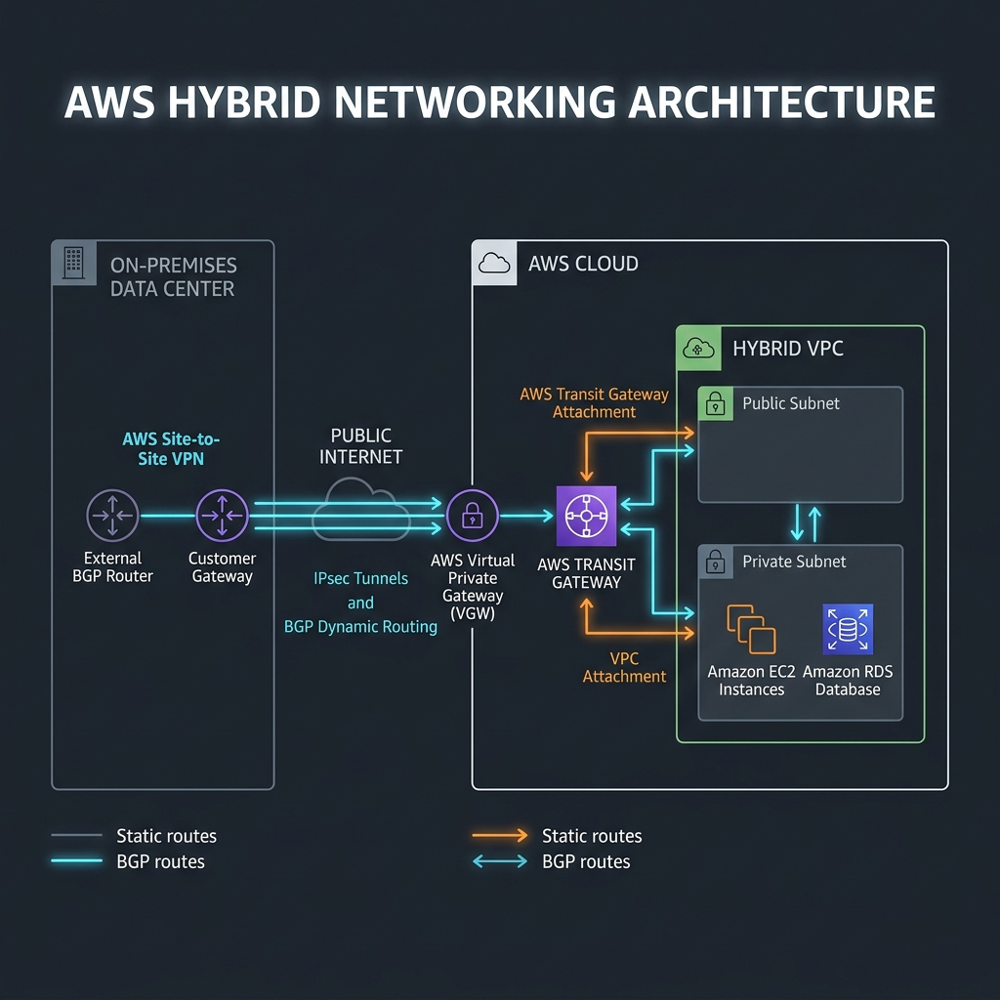
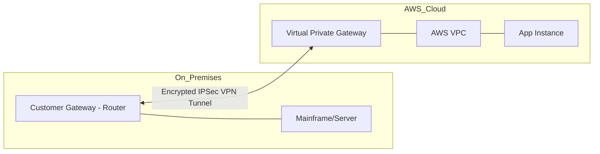

# Hybrid Networking Workbook

## 1. Scenario (สถานการณ์จำลอง)

### ลูกค้า (The Client)
- **Global-Banking-Corp** เป็นธนาคารขนาดใหญ่ที่มี Data Center ของตัวเองในกรุงเทพฯ
- กำลังเริ่มย้ายระบบบริการบางส่วนขึ้นไปบน AWS เพื่อเพิ่มความยืดหยุ่นในการทำงาน

### ปัญหาที่พบ (The Problem)
1. **Security Vulnerability**: พนักงานต้องเข้าถึง Database บน AWS ผ่านอินเทอร์เน็ตสาธารณะ ซึ่งขัดต่อระเบียบข้อบังคับด้านความปลอดภัยของธนาคาร
2. **Data Privacy**: ข้อมูลลูกค้าที่รับส่งระหว่างออฟฟิศกับ Cloud ไม่มีการเข้ารหัสข้อมูลในระดับ Network Layer
3. **Connectivity Gap**: Application ที่รันอยู่บน AWS ไม่สามารถเชื่อมต่อเพื่อดึงข้อมูลจาก Mainframe ในออฟฟิศได้โดยตรง

### โจทย์ความต้องการ (The Request)
ในฐานะ Cloud Network Engineer คุณต้องออกแบบและติดตั้งระบบ Hybrid Networking ที่เสถียรและปลอดภัย เพื่อเชื่อมต่อระบบของออฟฟิศเข้ากับ AWS VPC ภายใต้เงื่อนไขดังนี้:
- ข้อมูลทั้งหมดต้องรับส่งผ่านช่องทางที่เข้ารหัส (Encrypted Tunnel) อย่างปลอดภัย
- ระบบต้องรองรับการทำ Routing ค้นหาเส้นทางเชื่อมต่อระหว่างทั้งสองฝั่งโดยอัตโนมัติ
- ต้องมีการออกแบบระบบสำรอง (Redundancy) เพื่อป้องกันกรณีช่องทางเชื่อมต่อหลักชำรุดหรือขาดหาย

### รายละเอียดความท้าทาย (Challenge Details)
- **Connectivity**: AWS Site-to-Site VPN
- **Routing**: BGP (Border Gateway Protocol) สำหรับ Dynamic Routing
- **Security**: Customer Gateway (CGW) และ Virtual Private Gateway (VGW)
- **Monitoring**: CloudWatch VPN Metrics

### ข้อกำหนดในการเสร็จสิ้นงาน (Definition of Done)
- VPN Connection ต้องเชื่อมต่อสำเร็จและมีสถานะเป็น UP อย่างน้อย 1 Tunnel
- สามารถรับส่งข้อมูล (Ping) แบบสองทิศทาง (Bidirectional) ระหว่าง EC2 Instance บน AWS และเครื่อง Server ฝั่ง On-premises ได้สำเร็จ
- การแลกเปลี่ยนข้อมูลเส้นทางเครือข่าย (Route) ระหว่างทั้งสองฝั่งผ่าน BGP (Dynamic Routing) สำเร็จโดยอัตโนมัติ

### แนวคิดการออกแบบ (Design Concept)
เปรียบเทียบ Hybrid Networking เหมือน "การต่อท่อระหว่างบ้านสองหลัง" ดังนี้:
- **AWS VPC**: เหมือน "บ้านใหม่บนภูเขา" ที่มีความทันสมัยแต่ตั้งอยู่ห่างไกล
- **On-premises**: เหมือน "บ้านเดิมในเมือง" ที่มีความเก่าแก่แต่มีข้อมูลสำคัญและระบบงานหลักอยู่
- **Site-to-Site VPN**: เหมือน "การเดินท่อส่วนตัวเชื่อมระหว่างสองบ้าน" เพื่อให้ติดต่อกันได้โดยไม่ต้องใช้ถนนสาธารณะ
- **Customer Gateway (CGW)**: เหมือน "ประตูของบ้านเดิม" ที่คอยรองรับการเชื่อมต่อของท่อ

### ประสิทธิภาพและข้อจำกัด (Performance & Constraints)
- **Throughput**: AWS Site-to-Site VPN รองรับความเร็วสูงสุด 1.25 Gbps ต่อหนึ่ง Tunnel และสามารถใช้ ECMP เพื่อรวมความเร็วจากหลาย Tunnels ได้
- **Estimated Scale**: สามารถเชื่อมต่อ On-premises ได้หลายสาขาพร้อมกันโดยใช้ AWS Transit Gateway ในการจัดการเครือข่ายส่วนกลาง
- **Bottlenecks**: จุดคอขวดมักอยู่ที่ความเร็วของอินเทอร์เน็ตฝั่ง On-premises และขีดความสามารถของอุปกรณ์ Hardware ที่ทำ VPN
- **Scaling Approach**: หากต้องการความเร็วที่เสถียรและ Bandwidth สูงสุดถึง 100 Gbps ควรพิจารณาเปลี่ยนไปใช้ AWS Direct Connect

### การนำไปใช้ในงานจริง (Real-World Use Cases)
- **Hybrid AD / LDAP**: เชื่อมต่อ Active Directory ในออฟฟิศเพื่อให้พนักงานใช้ User เดิมเข้าใช้งานแอปพลิเคชันบน AWS ได้ (AD Integration)
- **Database Hybrid Replication**: ซิงค์ข้อมูลจากฐานข้อมูลในตึก On-premises ขึ้นไปไว้บน AWS เพื่อทำ Disaster Recovery หรือย้ายข้อมูลขึ้นสู่ Cloud อย่างปลอดภัย
- **Office-to-Cloud Access**: ให้พนักงานในออฟฟิศสามารถเข้าถึงไฟล์แชร์ (S3/EFS) หรือเว็บแอปภายในที่รันอยู่บน AWS ได้โดยตรง

### สรุปภาพรวมหลักการ (Summary of Principles)
- Hybrid Cloud คือสถาปัตยกรรมที่ได้รับความนิยมอย่างมากในองค์กรขนาดใหญ่
- ความปลอดภัยและความเสถียรของช่องทางการเชื่อมต่อ (Connectivity) คือหัวใจสำคัญ
- การจัดทำระบบสำรอง (Redundancy) สำหรับ VPN เป็นสิ่งที่ต้องทำในระบบที่มีความสำคัญสูงเสมอ

## 2. Topology Diagram (แผนผังระบบ)





### รายละเอียดของส่วนประกอบ (Component Breakdown)
- **Customer Gateway (CGW)**:
  - เป็นอุปกรณ์ Router หรือ Firewall ฝั่ง On-premises (เช่น Cisco, Juniper หรือ Fortinet)
  - ทำหน้าที่เป็นจุดเชื่อมต่อเริ่มต้น (Gateway) สำหรับการทำ VPN
- **Virtual Private Gateway (VGW)**:
  - เป็น Gateway เสมือนบน AWS Cloud
  - ทำหน้าที่รับการเชื่อมต่อ VPN และนำส่ง Traffic เข้าไปใน VPC
- **IPSec VPN Tunnel**:
  - ช่องทางรับส่งข้อมูลที่มีการเข้ารหัส (Encrypted Tunnel) วิ่งผ่านเครือข่ายอินเทอร์เน็ตสาธารณะ
  - ป้องกันบุคคลภายนอกไม่ให้ดักฟังหรืออ่านข้อมูลได้
- **Dynamic Routing (BGP)**:
  - โปรโตคอลการหาเส้นทางที่ช่วยให้ Router ทั้งสองฝั่งสามารถแลกเปลี่ยนข้อมูลเครือข่ายกันได้อัตโนมัติ
  - ทำให้ระบบปรับปรุงและรับรู้เส้นทางใหม่ๆ ได้โดยไม่ต้องแก้ไขด้วยตนเอง

### คุณสมบัติด้านความปลอดภัยที่สำคัญ (Key Security Features)
- **Internet Key Exchange (IKE)**: โปรโตคอลสำหรับเจรจาตกลงและแลกเปลี่ยนคีย์เข้ารหัสลับอย่างปลอดภัย
- **AES-256 Encryption**: มาตรฐานการเข้ารหัสข้อมูลระดับสูงที่ได้รับการยอมรับในระดับสากล

## 3. Prerequisites & Estimated Time (สิ่งที่ต้องเตรียมและเวลาที่ใช้)

### สิ่งที่ต้องเตรียม (Prerequisites)
- AWS Account ที่มีสิทธิ์ในการสร้างและจัดการ VPC, Subnet, Route Table, Customer Gateway (CGW), Virtual Private Gateway (VGW) และ VPN Connection
- AWS CLI ที่ผ่านการกำหนดสิทธิ์ (Credentials) เรียบร้อยแล้ว
- อุปกรณ์เครือข่ายจำลองฝั่ง On-premises (เช่น Cisco Router, pfSense หรือ Linux Server)
- ความเข้าใจพื้นฐานเกี่ยวกับ CIDR Block, Routing Table และ BGP Dynamic Routing

### เวลาที่ใช้ในการทดสอบ (Estimated Time)
- ประมาณ 1-2 ชั่วโมง (ขึ้นอยู่กับความพร้อมของอุปกรณ์จำลองฝั่ง On-premises)

## 4. Tasks (ขั้นตอนการปฏิบัติ)

### Task 1: การสร้าง Customer Gateway (CGW) บน AWS
- ทำการประกาศสิทธิ์ของอุปกรณ์ Router ฝั่ง On-premises ให้ AWS ทราบโดยระบุ Public IP และ BGP ASN:
```bash
aws ec2 create-customer-gateway \
  --type ipsec.1 \
  --public-ip 203.0.113.1 \
  --bgp-asn 65000
```

### Task 2: การสร้าง VPN Connection บน AWS
- ทำการสร้างการเชื่อมต่อ VPN Connection ระหว่าง CGW และ VGW โดยเปิดใช้งาน Dynamic Routing (BGP):
```bash
aws ec2 create-vpn-connection \
  --type ipsec.1 \
  --customer-gateway-id cgw-xxxxxx \
  --vpn-gateway-id vgw-xxxxxx \
  --options '{"StaticRoutesOnly":false}'
```

### Task 3: การดาวน์โหลดไฟล์ตั้งค่า VPN Configuration
- ดึงข้อมูลคู่มือการตั้งค่า VPN ที่เข้ากันได้กับอุปกรณ์ Router ที่ใช้งานอยู่:
```bash
aws ec2 describe-vpn-connections --query 'VpnConnections[0].CustomerGatewayConfiguration'
```
- นำไฟล์ Config ที่ได้ไปประยุกต์ใช้ในการตั้งค่าอุปกรณ์ Router ฝั่ง On-premises เช่น Cisco หรือ Juniper

### Task 4: การตั้งค่า BGP บน Router ฝั่ง On-premises (Cisco IOS)
- ตัวอย่างคำสั่งในการตั้งค่า VPN Tunnel และ BGP Dynamic Routing บนอุปกรณ์ Cisco IOS:
```text
! Cisco IOS - ตั้งค่า BGP กับ AWS VGW
router bgp 65000
 neighbor 169.254.x.x remote-as 64512  ! AWS BGP ASN
 neighbor 169.254.x.x timers 10 30
 !
 address-family ipv4
  neighbor 169.254.x.x activate
  neighbor 169.254.x.x soft-reconfiguration inbound
  network 10.0.0.0 mask 255.255.0.0  ! ประกาศ On-premises subnet
 exit-address-family
!
! VPN Tunnel Interface
interface Tunnel1
 ip address 169.254.x.x 255.255.255.252
 tunnel source GigabitEthernet0/0
 tunnel destination <aws_tunnel_ip>
```

### Task 5: การใช้งาน Transit Gateway สำหรับ Centralized Routing (Terraform)
- ในกรณีที่มีหลาย VPC และต้องการเชื่อมโยงเครือข่ายเข้าด้วยกันผ่านจุดศูนย์กลาง (Hub-and-Spoke):
```hcl
# Transit Gateway เป็น Hub ตัวกลาง
resource "aws_ec2_transit_gateway" "main" {
  amazon_side_asn = 64512
}

# VPN Gateway เชื่อมกับ TGW แทน VPC โดยตรง
resource "aws_ec2_transit_gateway_vpn_attachment" "dc" {
  transit_gateway_id = aws_ec2_transit_gateway.main.id
  vpn_connection_id  = aws_vpn_connection.dc.id
}
```

### Task 6: การล้างข้อมูลและควบคุมค่าใช้จ่าย (Cleanup & Cost Control)
- ค่าใช้จ่ายหลักในการทดสอบคือ AWS Site-to-Site VPN (คิดค่าบริการประมาณ $0.05 ต่อชั่วโมงต่อการเชื่อมต่อ)
- หลังเสร็จสิ้นการแล็บ ให้ดำเนินการลบทรัพยากรเหล่านี้ทันทีเพื่อหลีกเลี่ยงค่าใช้จ่ายต่อเนื่อง:
  - ลบ VPN Connection และ Customer Gateway
  - ลบ Virtual Private Gateway (VGW)

## 5. Verification (การตรวจสอบผลการทำงาน)

### รายการตรวจสอบ (Checklist)

#### การตั้งค่าฝั่ง On-Premises
- [ ] ระบุ Public IP ของ Router ฝั่ง On-Premises เรียบร้อย
- [ ] กำหนด BGP ASN เรียบร้อย (หากใช้งาน Dynamic Routing)
- [ ] ตั้งค่า Firewall ให้อนุญาต UDP 500/4500 และ IP Protocol 50 (ESP)

#### การตั้งค่าฝั่ง AWS
- [ ] สร้าง Customer Gateway (CGW) ด้วย Public IP ที่ถูกต้อง
- [ ] สร้าง Virtual Private Gateway (VGW) และทำการ Attach เข้ากับ VPC
- [ ] สร้าง VPN Connection เชื่อมโยงระหว่าง CGW และ VGW เรียบร้อย
- [ ] เปิดใช้งาน (Enabled) Route Propagation ใน VPC Route Tables

#### ความปลอดภัยและการเชื่อมต่อ (Security & Connectivity)
- [ ] Security Groups อนุญาตให้ Traffic จาก CIDR block ของ On-Premises ผ่านได้
- [ ] Network ACLs อนุญาตให้ Traffic วิ่งได้ทั้งสองทิศทาง (Bidirectional) สำหรับ VPN
- [ ] สถานะของ VPN Tunnel แสดงเป็น "UP" อย่างน้อยหนึ่ง Tunnel

#### การทดสอบประสิทธิภาพและการทดลองระบบ
- [ ] สามารถส่ง Ping จาก EC2 Instance บน AWS ไปยัง IP ฝั่ง On-Premises ได้
- [ ] สามารถส่ง Ping จาก Server ฝั่ง On-Premises ไปยัง Private IP ของ EC2 บน AWS ได้
- [ ] ค่าความหน่วง (Latency) อยู่ในเกณฑ์ที่ยอมรับได้สำหรับความต้องการทางธุรกิจ
- [ ] **ลองตัดสาย VPN Tunnel (Tunnel Down)**: ทดสอบสั่งปิดการเชื่อมต่อฝั่ง Customer Gateway เพื่อดูการทำงานของ VPN Failover และความเร็วในการสลับเส้นทางไปยัง Tunnel สำรอง
- [ ] **ลองตั้งค่า Routing ผิด (Static vs Dynamic)**: ตรวจสอบ Route Table เมื่อไม่สามารถ Ping ระหว่างสองฝั่งได้ เพื่อทำความเข้าใจปัญหาและจุดบกพร่องของเส้นทาง

## 6. Troubleshooting (การแก้ไขปัญหาที่พบบ่อย)

### ปัญหาที่ 1: สถานะ VPN Tunnel ขึ้น UP ทั้งคู่ แต่ไม่สามารถรับส่งข้อมูล (Ping) ระหว่างกันได้
- **สาเหตุที่พบ**:
  - VPC Route Table ไม่มี Route ที่ชี้ไปยัง VGW สำหรับ CIDR block ของ On-premises
  - ขาดการเปิดใช้งาน Route Propagation ใน VPC Route Table หรือมีการบล็อก Traffic ในระดับ Security Group/NACL
- **แนวทางแก้ไข**:
  - ตรวจสอบ Route Table ทั้งใน AWS และ Router On-premises ว่ามีการระบุเส้นทางไปยัง CIDR ปลายทางเรียบร้อยแล้ว
  - ตรวจสอบกฎใน Security Group และ Network ACL (NACL) ให้แน่ใจว่าอนุญาตโปรโตคอล ICMP และ Port ที่เกี่ยวข้องจากวง IP ปลายทาง
  - เปิดใช้งาน Route Propagation บน VPC Route Table เพื่อให้ระบบดึงเส้นทางจาก VPN เข้ามาโดยอัตโนมัติ:
```bash
aws ec2 enable-vgw-route-propagation \
  --route-table-id rtb-xxxxxx \
  --gateway-id vgw-xxxxxx
```

### ปัญหาที่ 2: BGP Session ไม่สามารถเชื่อมต่อได้ โดยขึ้นสถานะ Idle หรือ Active
- **สาเหตุที่พบ**: Firewall ฝั่ง On-premises บล็อก TCP Port 179 ซึ่งเป็น Port หลักในการแลกเปลี่ยนข้อมูล BGP หรือบล็อกโปรโตคอล ICMP ที่ใช้ตรวจจับคู่การเชื่อมต่อ
- **แนวทางแก้ไข**: ตั้งค่า Firewall Policy ของอุปกรณ์ On-premises เพื่ออนุญาตให้ TCP Port 179 สามารถคุยกันระหว่าง IP อินเตอร์เฟสของ VPN Tunnel ทั้งสองฝั่งได้

### ปัญหาที่ 3: อัตราการรับส่งข้อมูล (Throughput) ต่ำกว่าความต้องการของระบบ
- **สาเหตุที่พบ**: AWS Site-to-Site VPN มีขีดจำกัดแบนด์วิดท์สูงสุด 1.25 Gbps ต่อหนึ่ง Tunnel
- **แนวทางแก้ไข**:
  - หากใช้ Multi-Tunnel สามารถใช้คุณสมบัติ ECMP (Equal-Cost Multi-Path) ในการกระจายทราฟฟิกเพื่อรวมแบนด์วิดท์
  - เปิดใช้งาน Accelerated VPN (Global Accelerator) เพื่อลดความหน่วงในโครงข่ายสาธารณะ
  - หากต้องการประสิทธิภาพการทำงานในระดับ Enterprise ที่เสถียรและรับส่งข้อมูลได้สูงถึง 100 Gbps แนะนำให้ปรับไปใช้ AWS Direct Connect

### ประสบการณ์จากงานจริง (Production Insights)
- **The Asymmetric Routing Trap**:
  - ระวังปัญหาข้อมูลวิ่งเข้าทางหนึ่งแต่วิ่งออกอีกทางหนึ่ง ซึ่งเป็นปัญหายอดนิยมในระบบที่มี 2 Tunnels
  - Firewall ของฝั่ง On-premises มักจะตัดการเชื่อมต่อกรณีดังกล่าวเนื่องจากมองว่าผิดปกติ
  - แนะนำให้ตั้งค่า BGP AS-Path Prepending เพื่อระบุเส้นทางหลัก (Primary Route) และเส้นทางสำรอง (Secondary Route) ให้ชัดเจน
- **MTU Clamping**:
  - ปัญหายอดฮิตของ VPN คือ "บางเว็บเข้าได้ บางเว็บเข้าไม่ได้" หรือ "การส่งไฟล์ขนาดเล็กผ่านปกติ แต่ไฟล์ขนาดใหญ่จะค้าง"
  - สาเหตุมักเกิดจากขนาด Packet ที่ใหญ่เกินขีดจำกัด (MTU) หลังโดนหุ้มข้อมูลเข้ารหัส VPN
  - แนะนำให้ตั้งค่า MSS Clamping บน Router ฝั่ง On-premises เพื่อจำกัดขนาด TCP MSS ให้เหมาะสม
- **VPN as Backup for DX**:
  - ในการออกแบบระบบระดับองค์กรขนาดใหญ่ นิยมเลือกใช้ AWS Direct Connect เป็นเครือข่ายหลักในการเชื่อมต่อ
  - นิยมทำ Site-to-Site VPN ไว้เป็นเส้นทางสำรอง (Failover) เสมอ เพื่อลดค่าใช้จ่ายแต่อุปกรณ์ยังสามารถทำงานทดแทนกันได้แบบไร้รอยต่อ

## 7. Exercises & Solutions (แบบฝึกหัดและแนวทางการแก้ไข)

### แบบฝึกหัดที่ 1: การจัดลำดับความสำคัญของเส้นทาง BGP (BGP Route Prioritization)
- **สถานการณ์**: บริษัทมี On-premises Data Center ที่กรุงเทพฯ เชื่อมต่อกับ AWS ผ่านทั้ง Direct Connect และ Site-to-Site VPN
- **โจทย์/ภารกิจ**:
  1. อธิบายเกณฑ์การเลือก Route ของ AWS เมื่อทั้ง Direct Connect (DX) และ Site-to-Site VPN ประกาศ Route วงเดียวกัน
  2. ตั้งค่า BGP AS-Path Prepending เพื่อให้ Direct Connect มี Priority สูงกว่า VPN เสมอ
  3. ออกแบบ Failover ให้ VPN เป็น Backup อัตโนมัติเมื่อ Direct Connect ขาด
- **แนวทางการแก้ไข**:
  - ลำดับความสำคัญในการพิจารณาเลือก Route ของ AWS (จากความสำคัญสูงสุดไปต่ำสุด) มีดังนี้:
    1. **BGP Routes จาก Direct Connect** (มีความสำคัญสูงสุดในการส่งข้อมูลออก)
    2. **BGP Routes จาก Site-to-Site VPN**
    3. **Static Routes**
    4. **Propagated Routes จาก VPC**
  - การทำ BGP AS-Path Prepending บน VPN เพื่อลดความน่าสนใจของเส้นทางลง โดยตัวอย่างการเพิ่มข้อมูล AS Number หลายๆ ครั้งเพื่อให้ Path มีความยาวและน่าสนใจน้อยลง:
```text
# BGP AS-PATH Prepending on VPN BGP peer
# Add your own AS number multiple times to make path longer (less preferred)
route-map SET_PREPEND permit 10
  set as-path prepend 65000 65000 65000

# Apply to VPN neighbor
neighbor 169.254.x.x route-map SET_PREPEND out
```
  - **การออกแบบ Failover**: เนื่องจาก Direct Connect มีลำดับความสำคัญสูงกว่า เมื่อเส้นทาง DX ใช้งานได้ปกติ ระบบจะเลือกใช้ DX เป็นหลัก แต่เมื่อเกิดกรณีสาย DX ขาด (Down) AWS จะทำการสลับเส้นทางไปใช้ VPN (ซึ่งมีค่า AS-Path Prepending ต่ำกว่า แต่กลายเป็นเส้นทางเดียวที่ใช้งานได้) โดยอัตโนมัติ (Automatic Failover)

### แบบฝึกหัดที่ 2: การออกแบบ Transit Gateway สำหรับ Multi-Account
- **สถานการณ์**: บริษัทมี 5 AWS Accounts ได้แก่ Shared Services, Prod, Staging, Dev และ Security
- **โจทย์/ภารกิจ**:
  1. ออกแบบ Transit Gateway Architecture ที่ให้ Prod, Staging และ Dev สามารถเชื่อมต่อกับ Shared Services ได้ แต่ไม่สามารถเชื่อมต่อกันเองได้ (Network Segmentation)
  2. ใช้ Transit Gateway Route Tables เพื่อบังคับใช้ (Enforce) Network Segmentation นี้
  3. อธิบายวิธีการที่ Security Account จะตรวจสอบ Traffic ทั้งหมดโดยไม่ต้องอยู่ในเส้นทางหลัก (Inspection VPC pattern)
- **แนวทางการแก้ไข**:
  - การออกแบบโดยใช้การแยก Route Table สำหรับแต่ละสภาพแวดล้อมบน Transit Gateway:
```hcl
# Separate Route Tables per environment
resource "aws_ec2_transit_gateway_route_table" "shared_services" {
  transit_gateway_id = aws_ec2_transit_gateway.main.id
  tags = { Name = "shared-services-rt" }
}

resource "aws_ec2_transit_gateway_route_table" "prod" {
  transit_gateway_id = aws_ec2_transit_gateway.main.id
  tags = { Name = "prod-rt" }
}

# Prod can reach Shared Services, but NOT Staging or Dev
resource "aws_ec2_transit_gateway_route_table_association" "prod" {
  transit_gateway_attachment_id  = aws_ec2_transit_gateway_vpc_attachment.prod.id
  transit_gateway_route_table_id = aws_ec2_transit_gateway_route_table.prod.id
}

resource "aws_ec2_transit_gateway_route_table_propagation" "prod_to_shared" {
  transit_gateway_attachment_id  = aws_ec2_transit_gateway_vpc_attachment.shared.id
  transit_gateway_route_table_id = aws_ec2_transit_gateway_route_table.prod.id
}
# No propagation added from staging/dev → prod is isolated
```
  - **การควบคุมการแยกส่วน (Network Segmentation)**: หลีกเลี่ยงการทำ Route Propagation ระหว่าง VPC ของ Prod, Staging และ Dev บน Transit Gateway Route Table โดยตรง ทำให้ข้อมูลไม่สามารถส่งถึงกันได้
  - **วิธีการที่ Security Account ตรวจสอบ Traffic (Inspection VPC pattern)**:
    - ออกแบบให้ Traffic จากภายนอก หรือระหว่าง VPC ต้องถูกเปลี่ยนเส้นทาง (Routed) ผ่านไปยัง Inspection VPC ที่รันแอปพลิเคชันประเภท Firewall หรือ Intrusion Detection/Prevention System (IDS/IPS) ก่อนจะส่งต่อเข้าไปยังจุดหมายปลายทาง
    - การควบคุมจะเกิดขึ้นผ่าน Transit Gateway Routing Policies โดยไม่ต้องรบกวนสถาปัตยกรรมหลักของ VPC อื่นๆ

### แบบฝึกหัดที่ 3: การเพิ่มประสิทธิภาพแบนด์วิดท์เครือข่าย (Network Bandwidth Optimization)
- **สถานการณ์**: ทีม Data Engineering ต้องการย้ายข้อมูลขนาด 10 TB ต่อวันจาก On-premises มายัง S3
- **โจทย์/ภารกิจ**:
  1. เปรียบเทียบ Throughput และค่าใช้จ่ายระหว่าง: Direct Connect 1 Gbps, Site-to-Site VPN และ S3 Transfer Acceleration
  2. ออกแบบ Network Topology ที่ช่วยลด Data Transfer Cost ระหว่าง On-premises กับ AWS
  3. คำนวณเวลาที่ใช้ในการ Transfer ข้อมูล 10 TB ผ่าน Direct Connect 1 Gbps
- **แนวทางการแก้ไข**:
  - **การคำนวณแบนด์วิดท์และเวลา**:
    - ความเร็วทางทฤษฎีสูงสุดของ Direct Connect 1 Gbps: 1 Gbps มีอัตราส่งออกเท่ากับ 125 MB/s
    - ประสิทธิภาพในการส่งผ่านข้อมูลใช้งานจริง (Real-world efficiency): ประมาณ 70% คิดเป็น ~87.5 MB/s
    - คำนวณเวลาส่งไฟล์ขนาด 10 TB: 10,000,000 MB ÷ 87.5 MB/s = ~31.7 ชั่วโมง (ส่ง 10 TB ต่อวันไม่ทันหากใช้งานเพียง 1 เส้นสัญญาณแบบเต็มกำลัง ดังนั้นควรเพิ่มขนาดท่อส่ง)
  - **การเปรียบเทียบค่าใช้จ่าย**:
    - อัตราค่าบริการส่งข้อมูลออก (Data Transfer Out - DTO) ของ Direct Connect ต่ำกว่า VPN และท่ออินเทอร์เน็ตปกติอย่างมาก (เช่น DX DTO เริ่มต้นที่ประมาณ $0.02/GB เทียบกับทั่วไปที่ $0.09/GB)
    - ค่าส่งข้อมูล 10 TB ผ่าน DX: 10,000 GB × $0.02 = **$200/transfer**
  - **คำแนะนำการออกแบบ**:
    - แนะนำให้ใช้ S3 Transfer Acceleration เฉพาะกรณีที่มีการส่งไฟล์ขนาดเล็กผ่านสาขาต่างๆ ทั่วโลก
    - สำหรับข้อมูลขนาดใหญ่และส่งเป็นประจำทุกวัน (Large Bulk Transfers) การใช้งาน Direct Connect จะช่วยให้ประหยัดงบประมาณและมีความเร็วที่เสถียรที่สุด

