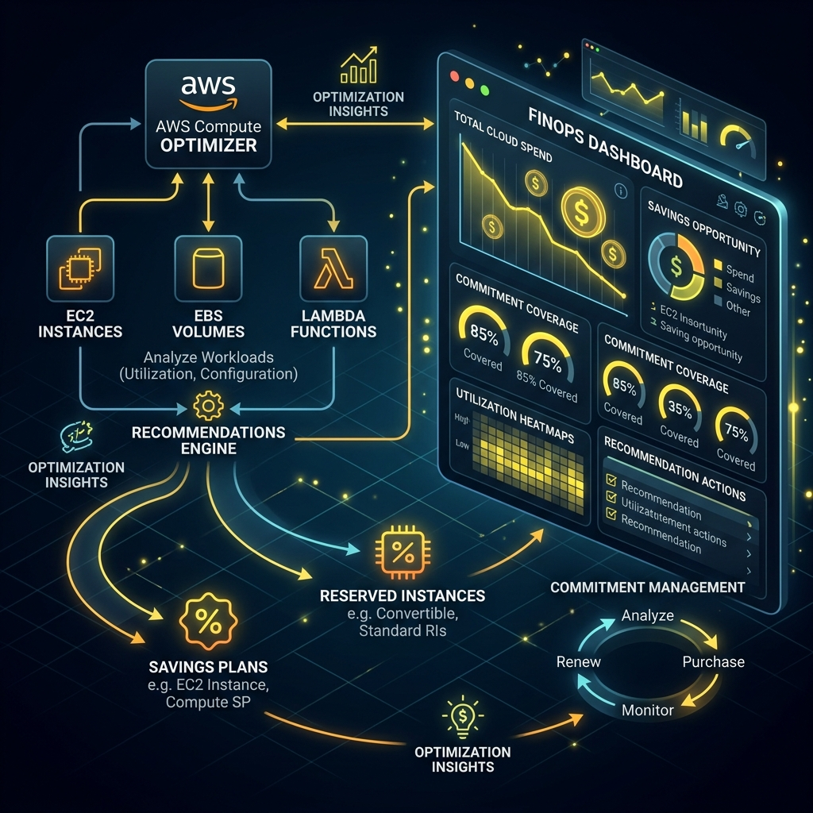
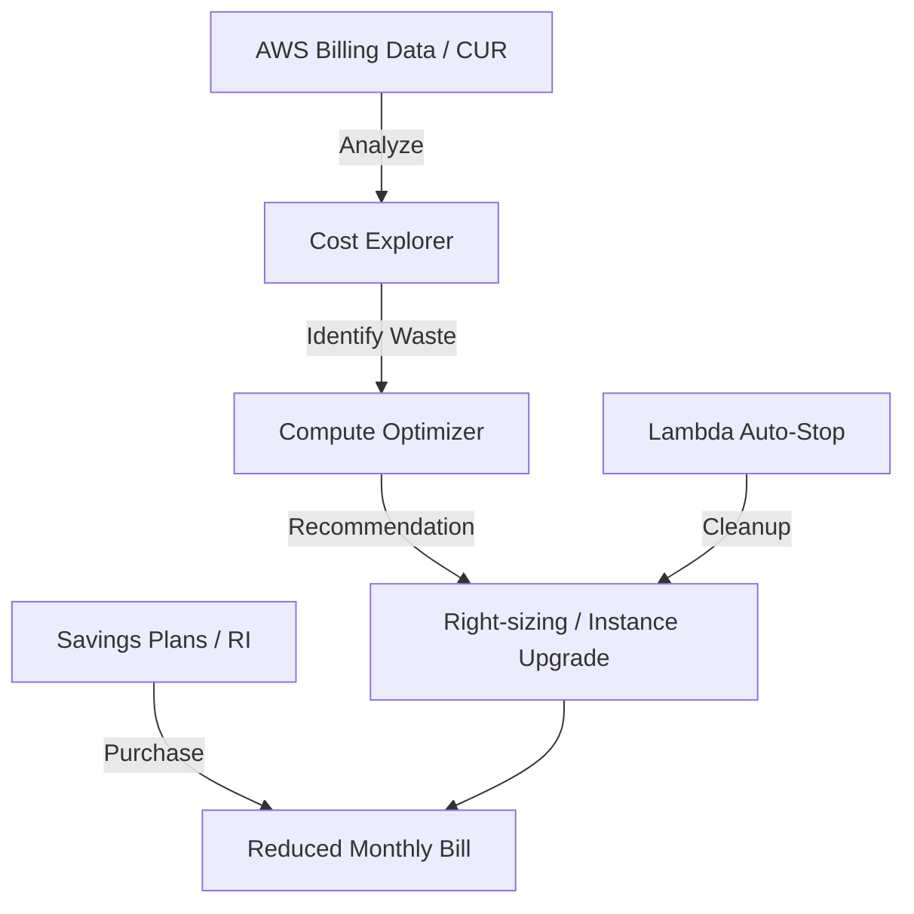

# Lab Additional 02: Cost Optimization (บริหารจัดการค่าใช้จ่ายด้วย RI และ Savings Plans) Workbook

## 1. Scenario (สถานการณ์จำลอง)

### ลูกค้า (The Client)
"SaaS-Global" เป็นบริษัทซอฟต์แวร์ที่ใช้งาน AWS มานานกว่า 3 ปี ปัจจุบันมีค่าใช้จ่าย Cloud พุ่งสูงถึง $50,000 ต่อเดือน และกำลังถูกกดดันจากฝ่ายการเงินให้ลดค่าใช้จ่ายลงอย่างเร่งด่วน

### ปัญหาที่พบ (The Problem)
- **On-Demand Waste**: เซิร์ฟเวอร์เกือบทั้งหมดรันแบบ On-Demand ซึ่งจ่ายแพงกว่าที่ควรจะเป็น ทั้งที่ระบบรันตลอด 24 ชั่วโมง
- **Zombie Resources**: มีเครื่องที่เปิดทิ้งไว้แต่ไม่ได้ใช้งาน (มีอัตราการใช้งาน CPU ต่ำ หรือ Low CPU utilization) เป็นจำนวนมาก
- **Lack of Commitment**: บริษัทไม่เคยมีการซื้อ Savings Plans หรือ Reserved Instances เลย ทำให้พลาดส่วนลดมหาศาล

### โจทย์และเงื่อนไข (Constraints)
ในฐานะ FinOps Engineer คุณต้องวางแผนและดำเนินการปรับปรุงค่าใช้จ่ายของทั้งองค์กร โดยมีเป้าหมายลดค่าใช้จ่ายลงอย่างน้อย 30% ภายใน 3 เดือน โดยมีเงื่อนไขดังนี้:
- ห้ามทำให้ระบบล่มหรือกระทบต่อผู้ใช้งาน (Production Safety)
- ต้องมีการวิเคราะห์ข้อมูลการใช้งานย้อนหลังอย่างน้อย 6 เดือน
- ต้องทำรายงานเปรียบเทียบความคุ้มค่าระหว่าง RI และ Savings Plans

### ข้อกำหนดในการส่งมอบงาน (Definition of Done)
- ได้รับการวิเคราะห์ประวัติการใช้งานย้อนหลัง 6 เดือนด้วย AWS Cost Explorer และระบุจุดฟุ่มเฟือยหลักได้
- จัดทำรายงานเปรียบเทียบแผนการลดต้นทุนระหว่าง Reserved Instances (RI) และ Savings Plans (SP)
- ดำเนินการปรับขนาดทรัพยากร (Right-sizing) และจัดตั้งระบบลบทรัพยากรที่ไม่ได้ใช้งาน (Zombie Resources) แบบอัตโนมัติ
- ปรับใช้ Spot Instance ร่วมกับ Checkpointing Script สำหรับงานประมวลผลขนาดใหญ่โดยไม่มีผลกระทบต่อข้อมูล
- กำหนดมาตรการควบคุมค่าใช้จ่าย (Governance) ได้แก่ การติด Tagging, การเปิดใช้งาน AWS Budgets และ Cost Anomaly Detection

### แนวคิดพื้นฐานเรื่อง Commitment (Commitment Analogy)
- **On-Demand**: เหมือน "การซื้อตั๋วรถไฟฟ้าเที่ยวเดียว" (สะดวกที่สุด อยากไปตอนไหนก็ซื้อ แต่ราคาแพงที่สุดต่อเที่ยว)
- **Reserved Instances (RI)**: เหมือน "การซื้อตั๋วเดือนแบบระบุเส้นทาง" (ถ้ารู้ว่าต้องเดินทางไป-กลับ สยาม-อโศก ทุกวัน การซื้อตั๋วเดือนจะถูกกว่ามาก แต่ถ้าวันไหนไม่ได้ไป ก็เสียเงินทิ้ง)
- **Savings Plans**: เหมือน "การเติมเงินในบัตรสมาชิกฟิตเนส" (ไม่ระบุเครื่องเล่น แต่สัญญาว่าจะมาเล่นแน่นอน 1 ชั่วโมงต่อวัน จะเล่นลู่วิ่งหรือยกเวทก็ได้ ทำให้มีความยืดหยุ่นสูงกว่า RI)

### ข้อมูลเชิงลึกจากประสบการณ์จริง (Production Insights)
- **Right-size FIRST, Commit LATER**: ข้อผิดพลาดที่พบบ่อยที่สุดคือการซื้อส่วนลด (RI/SP) ให้กับเครื่องที่ขนาดใหญ่เกินจริง คุณต้องทำการลดขนาดเครื่อง (Right-sizing) ให้พอดีกับการใช้งานจริงก่อน แล้วค่อยทำการซื้อส่วนลดครอบลงไป
- **The 3-Year Trap**: การทำสัญญา 3 ปีให้ส่วนลดเยอะที่สุดก็จริง แต่ในโลกเทคโนโลยี 3 ปีคือเวลาที่นานมาก (เครื่องรุ่นใหม่อาจจะออกมาในราคาที่ถูกกว่า) ในงานจริงแนะนำให้ผสมผสานระหว่างสัญญา 1 ปี (70%) และ 3 ปี (30%) เพื่อความปลอดภัย
- **Convertible RI is almost Dead**: ตั้งแต่มี Compute Savings Plans ออกมา ความจำเป็นในการใช้ Convertible RI ก็แทบจะหมดไป เพราะ SP ให้ความยืดหยุ่นที่สูงกว่ามากในขณะที่ส่วนลดใกล้เคียงกัน

### การนำไปใช้ในงานจริง (Real-World Applications)
- **Production Baseline Cost Management**: การล็อกราคาสำหรับเซิร์ฟเวอร์หลักที่ต้องรัน 24/7 เพื่อให้ได้ราคาถูกที่สุด
- **Database Cost Locking**: การใช้ Reserved Instances สำหรับ Amazon RDS ซึ่งมักจะเป็นทรัพยากรที่แพงที่สุดในระบบ
- **Startup Burn Rate Control**: ช่วยให้บริษัท Startup ที่มีงบจำกัดสามารถคุมค่าใช้จ่าย Cloud ไม่ให้เกินงบที่ได้จากนักลงทุน
- **Budgeting**: ใช้ในการวางแผนงบประมาณประจำปีของแผนก IT
- **24/7 Workloads**: ใช้ลดค่าใช้จ่ายในระบบที่รันตลอด 24 ชั่วโมง (เช่น ฐานข้อมูล หรือแอปพลิเคชันหลัก)

## 2. Topology Diagram (แผนผังระบบ)





### รายละเอียดส่วนประกอบ (Component Breakdown)
- **Cost Explorer และ CUR**: แหล่งข้อมูลหลักที่บอกว่าเราจ่ายเงินไปกับอะไรบ้าง (Visibility) และใช้ในการทำ Forecast ค่าใช้จ่ายในอนาคต
- **AWS Compute Optimizer**: ใช้ Machine Learning ในการวิเคราะห์โหลดของเซิร์ฟเวอร์ และแนะนำว่าเราควรจะ "ลดขนาด" (Right-sizing) หรือเปลี่ยนไปใช้เครื่องรุ่นใหม่ (Modernization) หรือไม่
- **Savings Plans**: กลยุทธ์การทำ Commitment กับ AWS ในรูปแบบของ "การสัญญาว่าจะใช้เงินกี่ดอลลาร์ต่อชั่วโมง" เพื่อแลกกับส่วนลดสูงสุด 72%
- **Automation และ Governance**: การใช้สคริปต์เพื่อปิดเครื่องที่ไม่ได้ใช้งานในวันหยุด (Instance Scheduler) และการตั้งกฎเรื่อง Tagging เพื่อให้รู้ว่าใครเป็นคนจ่ายเงิน

### ตัวชี้วัดสำคัญ (Key Metrics)
- **Unused RI/SP Percentage**: สัดส่วนของส่วนลดที่เราซื้อมาแล้วไม่ได้ใช้ (ต้องให้น้อยที่สุด)
- **Spot Instance Adoption**: การเปลี่ยนไปใช้เครื่องราคาถูกสำหรับงานที่ไม่ด่วน
- **Coverage Target**: ในองค์กรระดับ Enterprise มักตั้งเป้าให้มี SP/RI Coverage อยู่ที่ประมาณ 70-80% ของทรัพยากรทั้งหมดเพื่อให้เหลือความยืดหยุ่น (Flexibility)
- **Utilization Rate**: ความสำเร็จวัดจาก Utilization Rate ของ RI/SP ที่ต้องใกล้เคียง 100% (ถ้าซื้อมาแล้วไม่ถูกใช้ คือการเสียเงินทิ้ง)

## 3. Prerequisites & Estimated Time (สิ่งที่ต้องเตรียมและเวลาที่ใช้)

### สิ่งที่ต้องเตรียม (Prerequisites)
- AWS Account ที่มีข้อมูลประวัติการใช้งานจริง (หรือเข้าถึง AWS Console ที่มีข้อมูลจำลองการใช้งาน)
- AWS CLI ที่ผ่านการตั้งค่า Credentials เรียบร้อยแล้ว
- Terraform สำหรับใช้เขียนโครงสร้างพื้นฐานเชิงโค้ด (Infrastructure as Code)
- ความรู้พื้นฐานเกี่ยวกับ AWS Instance Types และ Pricing Models ของ AWS
- เครื่องมือวิเคราะห์ เช่น AWS Cost Explorer และ AWS Compute Optimizer ที่เปิดใช้งานแล้ว

### เวลาที่ใช้ในการทดลอง (Estimated Time)
- เวลาที่ใช้โดยประมาณ: 4 ชั่วโมง (แบ่งตามขั้นตอนการวิเคราะห์ 1.5 ชั่วโมง การคำนวณและปรับลดทรัพยากร 1.5 ชั่วโมง และการทดลองตั้งค่าระบบแจ้งเตือนและระบบอัตโนมัติ 1 ชั่วโมง)

## 4. Tasks (ขั้นตอนการปฏิบัติ)

### Task 1: ทำความเข้าใจและเลือก AWS Pricing Models ให้เหมาะสม
ขั้นแรกเราต้องประเมินและทำความเข้าใจโมเดลราคาต่างๆ ของ AWS เพื่อให้เลือกใช้ได้ตรงกับความต้องการของ Workload แต่ละประเภท:

| Model | เหมาะกับ | ส่วนลดโดยประมาณ |
|:---|:---|:---:|
| On-Demand | Test/Dev, Traffic ที่ไม่แน่นอน | 0% |
| Savings Plans | Production workload ที่รันต่อเนื่อง | 20-66% |
| Reserved Instances | Database, ใช้งานถาวร | 30-60% |
| Spot Instances | Batch, ML Training, CI/CD | 60-80% |

- **On-Demand**: จ่ายตามจริงตามเวลาที่ใช้งานจริง เหมาะสำหรับการทดสอบหรือระบบที่พยากรณ์ปริมาณการใช้งานไม่ได้
- **Savings Plans**: ให้ส่วนลดจากการสัญญาว่าจะจ่ายเงินกี่ดอลลาร์ต่อชั่วโมง มีความยืดหยุ่นสูง
- **Reserved Instances (RI)**: การจองล่วงหน้าแบบระบุประเภททรัพยากร เหมาะสำหรับฐานข้อมูล (RDS) ที่รันตลอดเวลา
- **Spot Instances**: การใช้ทรัพยากรที่ว่างอยู่ของ AWS ในราคาถูก แต่เสี่ยงที่จะโดนดึงทรัพยากรกลับคืนได้ตลอดเวลา

### Task 2: ค้นหาทรัพยากรที่เกินความจำเป็นด้วย AWS Compute Optimizer
ใช้เครื่องมือ AWS Compute Optimizer ในการวิเคราะห์ประวัติและประสิทธิภาพ เพื่อหาเครื่อง EC2 ที่มีขนาดใหญ่เกินความจำเป็น (Over-provisioned) และสามารถลดขนาดได้:

```bash
# ดู Recommendations สำหรับ EC2

> 🧠 **ภาพจำก่อนอ่าน:** 🧪 Lab → 📊 Usage → 💰 Cost → ✅ Optimize → 🧹 Cleanup  
> 🎨 [Visual Guide ของวิชานี้](../../VISUAL-MEMORY-GUIDE-TH.md) — ภาพช่วยจำ ไม่แทนคำอธิบายและคำสั่งจริง
aws compute-optimizer get-ec2-instance-recommendations \
  --filters name=Finding,values=Overprovisioned \
  --query 'instanceRecommendations[].{
    Current: currentInstanceType,
    Recommended: recommendationOptions[0].instanceType,
    Savings: recommendationOptions[0].estimatedMonthlySavings.value
  }'
```

- ดำเนินการรันคำสั่งด้านบนเพื่อวิเคราะห์ระบบปัจจุบัน
- นำผลลัพธ์มาวางแผนลดขนาด (Right-sizing) โดยต้องตรวจสอบว่าประสิทธิภาพการทำงานของเซิร์ฟเวอร์ยังอยู่ในระดับที่ผู้ใช้พึงพอใจ
- ปรับปรุง Launch Templates หรือ ASG (Auto Scaling Group) ให้ใช้ขนาดที่เหมาะสมตามคำแนะนำ

### Task 3: คำนวณและจัดซื้อ Savings Plans ผ่าน Terraform
การซื้อ Savings Plans จะช่วยลดราคาเครื่องประเภท Compute ลงได้อย่างมหาศาล โดยมีวิธีการวางแผนและโค้ดตัวอย่างดังนี้:

```hcl
# Compute Savings Plan (ยืดหยุ่นสูงสุด — เปลี่ยน instance family ได้)
resource "aws_savingsplans_savings_plan" "compute" {
  savings_plan_type = "Compute"
  commitment        = "10.00"  # USD/hour ที่ Commit
  payment_option    = "ALL_UPFRONT"
  term_duration_in_seconds = 94608000  # 3 ปี
}
```

**วิธีการคำนวณมูลค่า Commitment ที่ปลอดภัย:**
- วิเคราะห์ค่าใช้จ่าย On-Demand ในส่วนของ EC2, Fargate และ Lambda เฉลี่ยย้อนหลัง 3 เดือน
- กำหนด Commitment เพียง **70%** ของมูลค่าขั้นต่ำที่เป็น Baseline เพื่อป้องกันการสูญเสียเงินเปล่าหาก Traffic ในอนาคตลดลง
- ปล่อยให้อีก 30% รันแบบ On-Demand เพื่อรองรับช่วงที่ผู้ใช้งานพุ่งสูงขึ้น (Spike)
- เลือกระหว่างสัญญา 1 ปี (One-year) หรือ 3 ปี (Three-year) โดยอิงตามแผนธุรกิจขององค์กร

### Task 4: ปรับใช้ Spot Instance ร่วมกับ Checkpointing สำหรับงานประมวลผลขนาดใหญ่
สำหรับงานที่เป็น Batch Job หรือการเทรน Machine Learning ที่ใช้ทรัพยากรสูง ให้หันมาใช้ Spot Instances เพื่อรับส่วนลดสูงถึง 70-90% และเขียนโปรแกรมให้รองรับสัญญาณแจ้งเตือนการเรียกเครื่องคืน (Spot Termination Warning):

```python
# Training Script พร้อม Checkpointing
import torch, signal, sys

checkpoint_path = "/tmp/checkpoint.pt"

def save_checkpoint(model, optimizer, epoch):
    torch.save({
        'epoch': epoch,
        'model_state_dict': model.state_dict(),
        'optimizer_state_dict': optimizer.state_dict(),
    }, checkpoint_path)
    print(f"Checkpoint saved at epoch {epoch}")

def handle_termination(signum, frame):
    """Handle Spot Instance 2-minute warning"""
    save_checkpoint(model, optimizer, current_epoch)
    print("Spot termination notice received. Checkpoint saved.")
    sys.exit(0)

signal.signal(signal.SIGTERM, handle_termination)

# Resume from checkpoint if exists
if os.path.exists(checkpoint_path):
    checkpoint = torch.load(checkpoint_path)
    model.load_state_dict(checkpoint['model_state_dict'])
    start_epoch = checkpoint['epoch'] + 1
```

- ออกแบบระบบให้ตรวจสอบสิทธิ์การใช้งานผ่าน Role ที่เหมาะสม
- พัฒนาสคริปต์ให้สามารถดักจับสัญญาณ `SIGTERM` ซึ่งเป็นสัญญาณเตือน 2 นาทีล่วงหน้า (2-minute notification) ก่อนที่ AWS จะดึงเครื่องคืน
- บันทึก Checkpoint ลงใน Persistent Storage (เช่น EBS, EFS หรือ S3) ทันทีที่รับสัญญาณเตือน เพื่อให้สามารถเปิดเครื่องใหม่มาทำงานต่อได้โดยไม่ต้องเริ่มจากศูนย์

### การทดลองจำลองสถานการณ์ล้มเหลว (Chaos Testing / ทดลองให้พัง)
- **ทดลองซื้อ Reserved Instance ขนาดใหญ่เกินความจำเป็น (Over-provisioning)**: สมมติว่าซื้อ RI สำหรับเครื่องขนาด m5.4xlarge ทั้งที่ใช้จริงเพียง t3.micro
  - *ผลลัพธ์*: ศึกษาผลกระทบและเรียนรู้วิธีการทำ RI Exchange หรือเปลี่ยนประเภทสัญญาเพื่อบรรเทาความเสียหายในระดับองค์กร
- **ทดลองจำลองปริมาณทราฟฟิกพุ่งสูงขึ้นอย่างรวดเร็ว (Traffic Spike)**:
  - *ผลลัพธ์*: ตรวจสอบว่าระบบและ Compute Optimizer วิเคราะห์สถานการณ์และแนะนำการปรับขนาด (Right-sizing) ขึ้นมาอย่างไรเพื่อไม่ให้เกิดความล่าช้าในระบบ

## 5. Verification (การตรวจสอบผลการทำงาน)

ให้ดำเนินการตรวจสอบความถูกต้องตามรายการต่อไปนี้เพื่อให้มั่นใจว่าระบบการจัดการค่าใช้จ่ายได้รับการติดตั้งสมบูรณ์:

### การวิเคราะห์และการมองเห็นค่าใช้จ่าย (Analysis & Visibility)
- [ ] เปิดใช้งาน AWS Cost Explorer และตรวจสอบข้อมูลการใช้จ่ายย้อนหลังเรียบร้อย
- [ ] ระบุ 5 บริการหลักที่เสียค่าใช้จ่ายสูงสุดของบริษัทได้ถูกต้อง
- [ ] กำหนดนโยบายและทำการติด Tagging ให้กับทรัพยากรทุกชิ้นเพื่อระบุเจ้าของโครงการ

### การทำความสะอาดและลดขนาดทรัพยากร (Resource Cleanup & Right-sizing)
- [ ] ลบหรือจัดเก็บ (Archive) EBS Volumes ที่ไม่ได้เชื่อมต่อกับ EC2 Instance แล้ว
- [ ] คืนค่า (Release) Elastic IP Addresses ที่ไม่ได้ใช้งานกลับเข้า IP Pool
- [ ] ปรับขนาด (Resize) เครื่องที่จัดสรรเกินความจำเป็น (Over-provisioned) ตามคำแนะนำของ Compute Optimizer
- [ ] ตั้งค่า Lifecycle Policies เพื่อเคลียร์หรือย้าย Snapshots เก่า (EBS/S3/RDS)

### กลยุทธ์การทำข้อตกลงล่วงหน้า (Commitment Strategy)
- [ ] วิเคราะห์และจัดซื้อ Savings Plans (SP) ในสัดส่วนที่เหมาะสมของ Baseline Compute Spend
- [ ] ประยุกต์ใช้ Reserved Instances (RI) สำหรับระบบฐานข้อมูล Amazon RDS ที่รันตลอดเวลา
- [ ] เปลี่ยนประเภทงานประมวลผลระยะสั้นและไร้สถานะ (Stateless) มาใช้ Spot Instances

### การควบคุมดูแลและการแจ้งเตือน (Governance & Alerting)
- [ ] ตั้งค่า AWS Budgets แจ้งเตือนเมื่อค่าใช้จ่ายถึงระดับ 50%, 80% และ 100% ของงบประมาณรายเดือน
- [ ] เปิดใช้งาน Cost Anomaly Detection เพื่อตรวจจับความผิดปกติของค่าใช้จ่ายในองค์กร
- [ ] สร้างรายงานค่าใช้จ่ายรายเดือนแบบอัตโนมัติ (Automated Cost Report) เพื่อส่งให้ทีมวิศวกรรมและทีมการเงิน

## 6. Troubleshooting (การแก้ไขปัญหาที่พบบ่อย)

### ปัญหาที่ 1: ซื้อ Savings Plans ไปแล้ว แต่ค่าใช้จ่ายในบิลรายเดือนยังคงเดิม
- **สาเหตุ**:
  - อาจเป็นเพราะซื้อ EC2 Instance Savings Plans (ระบุตระกูลเครื่องและ Region) แต่ปัจจุบันเปลี่ยนประเภทไปใช้เครื่องตระกูลอื่นแล้ว (เช่น จาก m5 เป็น m6g)
  - ในระบบ Multi-account อาจจะไม่ได้เปิดใช้งาน Discount Sharing ในระดับ Master Account ทำให้ Account ย่อยไม่ได้รับส่วนลด
- **แนวทางแก้ไข**:
  - แนะนำให้เปลี่ยนมาซื้อ Compute Savings Plans เสมอ เพราะครอบคลุมข้ามตระกูลเครื่อง ข้าม OS และข้าม Region ได้อย่างยืดหยุ่นกว่า
  - เข้าไปที่ Console ของ Master Account แล้วตั้งค่าเปิด Discount Sharing ให้ครอบคลุมทุก Member Accounts

### ปัญหาที่ 2: Spot Instances ถูก Interrupted (เรียกคืนเครื่อง) บ่อยมาก
- **สาเหตุ**:
  - มีการระบุประเภทเครื่องเพียงรุ่นเดียว หรือกำหนดให้รันใน Availability Zone (AZ) เดียว ทำให้เมื่อเกิดความต้องการในตลาดยอดสูง เครื่องจะถูกขัดจังหวะทันที
- **แนวทางแก้ไข**:
  - ตั้งค่า Karpenter NodePool หรือ AWS Spot Fleet ให้กระจายและยอมรับหลาย Instance Types:
    ```hcl
    # Karpenter NodePool — Diversify across instances
    spec:
      requirements:
        - key: node.kubernetes.io/instance-type
          operator: In
          values: ["m5.xlarge", "m5a.xlarge", "m4.xlarge", "m5d.xlarge", "m5n.xlarge"]
        - key: topology.kubernetes.io/zone
          operator: In
          values: ["ap-southeast-1a", "ap-southeast-1b", "ap-southeast-1c"]
    ```
  - จัดการระบบ Node Pool ให้สลับข้าม AZs เพื่อรับความเสี่ยงที่กระจายตัวออกไป

### ปัญหาที่ 3: ค่าบริการ NAT Gateway พุ่งสูงเกินจริง ทั้งที่ไม่มีการเชื่อมต่อภายนอกมากนัก
- **สาเหตุ**:
  - แอปพลิเคชันหรือ EKS Nodes ใน Private Subnet ดึงข้อมูลจำนวนมหาศาลจาก S3 Bucket ผ่าน NAT Gateway
- **แนวทางแก้ไข**:
  - สร้าง VPC Endpoint (Gateway Type) สำหรับ Amazon S3 เพื่อให้ Traffic วิ่งผ่านโครงข่ายภายในของ AWS โดยตรง ซึ่งจะไม่เสียค่า Data Transfer ผ่าน NAT Gateway

## 7. Exercises & Solutions (แบบฝึกหัดและแนวทางการแก้ไข)

### แบบฝึกหัดที่ 1: เครื่องคำนวณข้อตกลงใช้งานล่วงหน้า (Commitment Calculator)

**สถานการณ์จำลอง:** Production Workload มีการใช้งาน EC2 ตลอดเวลา 24/7 ประกอบไปด้วยเครื่องดังนี้ใน Region ap-southeast-1:
- 4x m5.xlarge
- 2x r5.2xlarge

**โจทย์:**
1. ให้คำนวณต้นทุน On-Demand รายเดือนโดยประมาณ
2. เปรียบเทียบค่าใช้จ่ายรายเดือนระหว่างการซื้อ Compute Savings Plans แบบ 1 ปี All Upfront กับแบบ 3 ปี All Upfront
3. ให้วิเคราะห์ว่าสำหรับ Database Tier (เช่น Amazon RDS) ควรเลือกซื้อ Savings Plans หรือ Reserved Instances เพราะเหตุใด

**แนวทางการแก้ไข (Solution):**

| Resource | On-Demand/mo | 1yr All-Upfront/mo (ส่วนลด ~40%) | 3yr All-Upfront/mo (ส่วนลด ~60%) |
|:---|:---:|:---:|:---:|
| 4x m5.xlarge | ~$560 | ~$336 | ~$224 |
| 2x r5.2xlarge | ~$700 | ~$420 | ~$280 |
| **Total** | **~$1,260** | **~$756** | **~$504** |

- **การคำนวณต้นทุนรายเดือน**:
  - On-Demand รวมอยู่ที่ประมาณ $1,260 ต่อเดือน
  - หากซื้อแบบ 1 ปี All Upfront จะประหยัดเหลือ $756 ต่อเดือน (ลดไป 40%)
  - หากซื้อแบบ 3 ปี All Upfront จะประหยัดเหลือ $504 ต่อเดือน (ลดไป 60%)
- **การเลือกใช้สำหรับ Database (RDS)**:
  - ต้องใช้ **Reserved Instances** เท่านั้น เนื่องจากปัจจุบัน AWS Savings Plans ยังไม่สนับสนุน Amazon RDS
  - แนะนำให้เลือกซื้อแบบ 1-year All-Upfront หรือ Partial Upfront เนื่องจากฐานข้อมูลเป็นทรัพยากรหลักที่ทำงานอยู่ตลอดเวลาและไม่มีการปรับขนาดบ่อยเท่า Compute Instance

### แบบฝึกหัดที่ 2: การวิเคราะห์และปรับขนาดการใช้งานให้เหมาะสม (Rightsizing Analysis)

**สถานการณ์จำลอง:** ตรวจสอบผ่าน CloudWatch พบว่ากลุ่มเครื่อง EC2 Instances มีอัตราการใช้ CPU เฉลี่ยเพียง 8% และ Memory 15%

**โจทย์:**
1. ใช้ AWS Compute Optimizer เพื่อระบุประเภท Instance ที่เหมาะสม
2. ประเมินสัดส่วนของค่าใช้จ่ายที่จะประหยัดได้หลังจากลดขนาดเครื่องลง
3. ออกแบบขั้นตอนการย้ายระบบ (Migration Plan) เพื่อเปลี่ยนขนาดเครื่องใน Auto Scaling Group (ASG) โดยไม่ให้มีระบบล่ม (Zero Downtime)

**แนวทางการแก้ไข (Solution):**

```bash
# AWS Compute Optimizer CLI
aws compute-optimizer get-ec2-instance-recommendations \
  --account-ids 123456789012 \
  --filters name=Finding,values=Underprovisioned,Overprovisioned
```

- **ผลลัพธ์การวิเคราะห์**: โดยปกติโปรแกรมจะแนะนำให้ลดขนาดลง เช่น เปลี่ยนจาก `m5.xlarge` ไปเป็น `m5.large` ซึ่งช่วยลดค่าใช้จ่ายลงได้ราว 50% (จาก $140/เดือน เหลือ $70/เดือน ต่อเครื่อง)
- **แผนการย้ายระบบแบบไม่มี Downtime (Migration Plan - Zero Downtime)**:
  1. อัปเดต ASG Launch Template ให้เปลี่ยนไปใช้งาน Instance Type ขนาดที่ได้รับคำแนะนำ
  2. กำหนดนโยบาย `instance_refresh` ใน ASG โดยกำหนดค่า `minimum healthy percentage` เป็น 20%
  3. ระบบ ASG จะทยอยหยุดทำงานเครื่องรุ่นเก่า และเริ่มต้นเครื่องรุ่นใหม่ทีละเครื่อง โดยจะลบเครื่องเก่าเมื่อเครื่องใหม่ผ่านการทดสอบ Health Check แล้วเท่านั้น

### แบบฝึกหัดที่ 3: กลยุทธ์การใช้งาน Spot Instance (Spot Instance Strategy)

**สถานการณ์จำลอง:** งานฝึกสอนปัญญาประดิษฐ์ (Machine Learning Training Jobs) รันขึ้นทุกคืน ใช้เวลาในการทำงานประมาณ 4-6 ชั่วโมง โดยระบบสามารถรันต่อจากจุดบันทึกล่าสุดได้หากโดนขัดจังหวะการทำงาน

**โจทย์:**
1. ออกแบบโครงสร้าง Spot Fleet ที่ยอมรับการกระจาย Instance Types เพื่อป้องกันระบบปิดตัวกะทันหัน
2. พัฒนาสคริปต์บันทึกสถานะการทำงาน (Checkpointing) ในภาษา Python เพื่อให้โปรเจกต์สามารถกลับมาเทรนต่อได้ทันที
3. ประเมินส่วนลดค่าใช้จ่ายที่จะประหยัดได้เมื่อเปรียบเทียบกับราคาปกติ On-Demand (เฉลี่ยส่วนลด Spot อยู่ที่ 70%)

**แนวทางการแก้ไข (Solution):**

```hcl
resource "aws_spot_fleet_request" "ml_training" {
  iam_fleet_role  = aws_iam_role.spot_fleet.arn
  target_capacity = 4
  
  # Diversify across instance types - reduces interruption risk
  launch_specification {
    instance_type = "ml.g4dn.xlarge"
    spot_price    = "0.30"
  }
  launch_specification {
    instance_type = "ml.g4dn.2xlarge"
    spot_price    = "0.50"
  }
  launch_specification {
    instance_type = "ml.p3.2xlarge"
    spot_price    = "0.90"
  }
  
  allocation_strategy = "diversified"
}
```

```python
import signal, sys, torch

def save_checkpoint(model, optimizer, epoch):
    torch.save({'epoch': epoch, 'model': model.state_dict()}, 'checkpoint.pt')

def handle_spot_interruption(signum, frame):
    save_checkpoint(model, optimizer, current_epoch)
    sys.exit(0)

signal.signal(signal.SIGTERM, handle_spot_interruption)
```

- **การประเมินส่วนลด**: การใช้งาน Spot Fleet ที่สลับเครื่องตระกูลต่างๆ และรับส่วนลดเฉลี่ย 70% จะช่วยลดค่าใช้จ่ายลงอย่างเป็นรูปธรรม โดยจ่ายเพียง 30% ของราคา On-Demand และการบันทึกสถานะจะช่วยป้องกันไม่ให้เสียเวลาและกำลังประมวลผลไปโดยเปล่าประโยชน์เมื่อโดน AWS ดึงเครื่องกลับคืน

