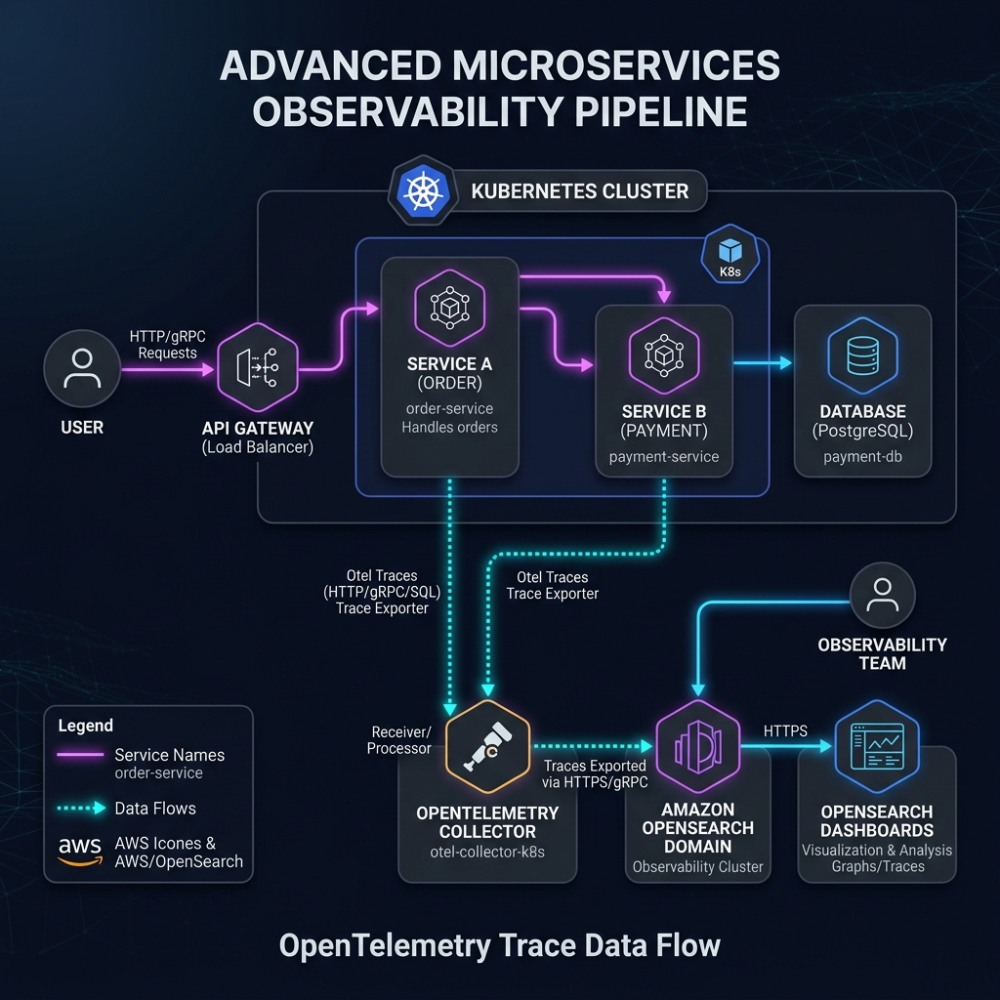

# Lab Additional 03: Advanced Observability Workbook

> 🧠 **ภาพจำก่อนอ่าน:** 🧪 Lab → 📊 Metrics → 🧾 Logs → 🔎 Diagnose → ✅ Verify → 🧹 Cleanup  
> 🎨 [Visual Guide ของวิชานี้](../../VISUAL-MEMORY-GUIDE-TH.md) — ภาพช่วยจำ ไม่แทนคำอธิบายและคำสั่งจริง

## 1. Scenario (สถานการณ์จำลอง)

### ลูกค้า (The Client)
- Super-Shop-App เป็นแพลตฟอร์ม E-commerce ที่ทำงานบนสถาปัตยกรรม Microservices ซึ่งมีการสื่อสารกันระหว่าง Services มากกว่า 20 ตัว

### ปัญหาที่พบ (The Problem)
- Ghost Latency: ผู้ใช้บางรายพบปัญหาขั้นตอนการชำระเงิน (Checkout Process) ล่าช้ามาก โดยบางครั้งใช้เวลานานกว่า 10 วินาที แต่ทีม Engineer ไม่สามารถระบุได้ว่าเกิดความล่าช้าขึ้นที่ Service ใด เนื่องจากระบบเฝ้าระวังทั่วไปแสดงสถานะ Healthy เป็นสีเขียวทั้งหมด
- Disconnected Logs: เมื่อเกิดปัญหา ทีมงานต้องเปิดไล่ดู Logs ของแต่ละเครื่องแล้วนำ Timestamp มาเปรียบเทียบกันเองด้วยมือ ซึ่งมีความยุ่งยากและเสียเวลาเป็นอย่างมาก
- Black Box Services: มีการเรียกใช้งาน Services ของ Third-party (เช่น Payment Gateway) ซึ่งเป็นเสมือน Black Box ทำให้ไม่สามารถตรวจสอบการตอบสนองหรือความล่าช้าที่เกิดขึ้นภายในส่วนนี้ได้เลย

### โจทย์ที่ได้รับ (The Request)
ในฐานะ Site Reliability Engineer (SRE) คุณได้รับมอบหมายให้ติดตั้งระบบ Full-stack Observability เพื่อแก้ไขปัญหานี้ โดยมีเงื่อนไขดังนี้:
- ต้องนำ Distributed Tracing มาใช้เพื่อให้เห็นเส้นทางการทำงานของ Request ตั้งแต่เริ่มต้นจนสิ้นสุดกระบวนการ (End-to-End Flow)
- ต้องทำการเชื่อมโยง (Correlation) ข้อมูล Logs เข้ากับ Traces ให้สำเร็จ
- ระบบจะต้องสามารถแสดงผลเป็น Service Map เพื่อแสดงความสัมพันธ์ระหว่าง Microservices ทั้งหมดในระบบ

### รายละเอียดของ Challenge (Challenge Details)
- Standards: OpenTelemetry (OTel)
- Backend: Amazon OpenSearch Service (หรือ Grafana Tempo)
- Data Collection: OpenTelemetry Collector (ในรูปแบบ Sidecar Pattern)
- Visualization: OpenSearch Dashboards หรือ Grafana

### เกณฑ์การยอมรับงาน (Definition of Done)
- ทำการติดตั้ง OpenTelemetry SDK เข้าไปในโค้ดของแอปพลิเคชันและเปิดใช้งาน Context Propagation ข้าม Service boundaries ได้สำเร็จ
- ตั้งค่า OTel Collector และส่งออกข้อมูล Metrics, Logs, และ Traces ไปยัง Backend ที่กำหนดได้อย่างสมบูรณ์
- สามารถค้นหาและแก้ไขปัญหาผ่านวิเคราะห์วิถีของ Request ด้วย Trace ID และเครื่องมือจำพวก TraceQL
- หน้าแดชบอร์ดมีตัวเชื่อมโยงเพื่อเปิดดู Trace จากตัว Log ได้ทันที (Log-Trace Correlation)

### ข้อมูลเชิงลึกสำหรับระบบจริง (Production Insights)
- Cost of Logging: การเก็บ Log ในระบบขนาดใหญ่อาจมีค่าใช้จ่ายสูงกว่าค่ารันแอปพลิเคชันเสียอีก ควรเลือกใช้ Sampling Rate สำหรับ Tracing (เช่น เก็บ 5-10%) และเลือกใช้ Log Level ที่เหมาะสม (ใช้ INFO แทน DEBUG ในระบบจริง)
- Serverless Benefits: สำหรับองค์กรที่ไม่มีทีมแอดมินดูแล Cluster การหันไปใช้ Amazon OpenSearch Serverless จะลดภาระ Operation และการบริหารจัดการ Shard Rebalancing ได้เป็นอย่างดี
- Trace ID in Every Log: พิมพ์ Trace ID ลงใน Log ทุกบรรทัดของแอปพลิเคชัน เพื่อให้ค้นหาเหตุการณ์ทั้งหมดของ Request นั้นๆ ผ่านคำค้นหาเดียวได้อย่างรวดเร็ว

### การประยุกต์ใช้งานในชีวิตจริง (Real-World Applications)
- Distributed Troubleshooting: ตรวจหาสาเหตุของ Error ในสายการทำงานของ Service ที่ซับซ้อนและส่งต่อกันไปมาหลายทอด
- Security Forensic: ค้นหาย้อนหลังเพื่อดูว่าผู้ใช้งานรายใดเข้าถึงข้อมูลส่วนใดผ่าน Audit Logs
- Performance Benchmarking: วัดผลและเปรียบเทียบ Latency ของระบบก่อนและหลังปล่อยอัปเดตเวอร์ชันใหม่
- High-traffic Service Communication: นำไปใช้ในระบบที่มี Microservices สื่อสารกันหนาแน่นสูงมาก
- User Behavior Analysis: วิเคราะห์ข้อมูลพฤติกรรมการใช้งานผ่านข้อมูล Logs

### ข้อควรระวังและค่าใช้จ่าย (Cost Considerations)
- การใช้ OpenSearch Cluster มักใช้ทรัพยากรสูงและมีค่าใช้จ่ายคงที่ต่อชั่วโมงค่อนข้างสูง
- แนะนำให้เริ่มต้นศึกษาด้วย Amazon OpenSearch Serverless เพื่อหลีกเลี่ยงการเปิด Instance ขนาดใหญ่ทิ้งไว้โดยไม่จำเป็น

### การล้างข้อมูลหลังการปฏิบัติงาน (Cleanup)
- ลบการใช้งาน OpenSearch Domain หรือ Collection ที่ใช้ทดสอบออกทั้งหมด
- สั่งปิดหรือลบการติดตั้ง OTEL Collector ที่รันค้างอยู่ใน Kubernetes หรือ Docker Compose

---

## 2. Topology Diagram (แผนผังระบบ)



### รายละเอียดส่วนประกอบ (Component Breakdown)
- OpenTelemetry SDK: ทำหน้าที่สร้าง Spans บันทึกข้อมูลและส่งต่อ Trace Context ข้ามเครือข่าย
- OpenTelemetry Collector: เป็นตัวรับและประมวลผลข้อมูล Trace/Metrics/Log ส่วนกลางก่อนส่งไปจัดเก็บปลายทาง
- Distributed Tracing (Spans): บันทึกระยะเวลาแต่ละขั้นตอนช่วยให้เห็นคอขวดในจุดต่างๆ ของโค้ดได้ทันที
- Amazon OpenSearch Service: ระบบจัดเก็บข้อมูลขนาดใหญ่และทำหน้าที่เป็น Search Engine ค้นหา Traces

### ประโยชน์หลัก (Key Benefits)
- ลดเวลาการแก้ไขปัญหา (Mean Time to Resolution หรือ MTTR) ลงอย่างรวดเร็ว
- แสดงแผนผังการเรียกใช้งานระหว่าง Microservices (Service Dependency Mapping) โดยอัตโนมัติ
- ค้นหาจุดคอขวดในโค้ดเพื่อนำไปปรับจูนประสิทธิภาพการทำงาน (Performance Profiling)

---

## 3. Prerequisites & Estimated Time (สิ่งที่ต้องเตรียมและเวลาที่ใช้)

### สิ่งที่ต้องเตรียม (Prerequisites)
- Docker และ Docker Compose ติดตั้งในระบบปฏิบัติการ Windows หรือ Linux
- ความรู้พื้นฐานเกี่ยวกับ Microservices Architecture และความเข้าใจเรื่อง REST/gRPC
- ความรู้เบื้องต้นเกี่ยวกับ Python และ FastAPI (สำหรับโค้ดแอปพลิเคชัน)
- การเข้าใช้งานระบบ Kubernetes (หากต้องการทดสอบบนคลัสเตอร์จริง)
- ระบบส่ง Log และ Trace เช่น Grafana Loki, Tempo หรือ Amazon OpenSearch

### เวลาที่ใช้ในการทดลอง (Estimated Time)
- ประมาณ 1.5 - 2 ชั่วโมง

---

## 4. Tasks (ขั้นตอนการปฏิบัติ)

### Task 1: ทำความเข้าใจสามเสาหลักของ Observability
- Metrics (ตัวเลข): วัดทรัพยากรการประมวลผลทั่วไป เช่น CPU, Memory, Error Rate, Latency ผ่าน Prometheus
- Logs (เหตุการณ์): บันทึกรายละเอียดการกระทำที่สำคัญในแอปพลิเคชันเพื่อนำมาตรวจสอบย้อนหลัง ผ่าน Loki
- Traces (การเดินทาง): ตรวจสอบเส้นทาง Request หนึ่งว่าวิ่งผ่านและใช้เวลาไปกับส่วนงานใดบ้าง ผ่าน Tempo
- การเชื่อมโยง (Correlation) ข้อมูลทั้งสามเสาหลักเป็นสิ่งสำคัญที่สุดเพื่อช่วยให้สืบหาความเชื่อมโยงได้อย่างรวดเร็ว

### Task 2: ติดตั้ง OpenTelemetry Collector
สร้างไฟล์คอนฟิก `otel-collector-config.yaml` เพื่อใช้รับข้อมูลและกระจายไปยังแหล่งเก็บข้อมูล:
```yaml
receivers:
  otlp:
    protocols:
      grpc:
        endpoint: 0.0.0.0:4317
      http:
        endpoint: 0.0.0.0:4318

processors:
  batch:
    timeout: 5s
  memory_limiter:
    check_interval: 1s
    limit_percentage: 80

exporters:
  prometheusremotewrite:
    endpoint: http://prometheus:9090/api/v1/write
  otlp/tempo:
    endpoint: http://tempo:4317
    tls:
      insecure: true
  loki:
    endpoint: http://loki:3100/loki/api/v1/push

service:
  pipelines:
    metrics:
      receivers: [otlp]
      processors: [memory_limiter, batch]
      exporters: [prometheusremotewrite]
    traces:
      receivers: [otlp]
      processors: [batch]
      exporters: [otlp/tempo]
    logs:
      receivers: [otlp]
      processors: [batch]
      exporters: [loki]
```

### Task 3: Instrument Application ด้วย OpenTelemetry SDK
ใส่โค้ด SDK เพื่อดักจับและส่งค่า Trace Context ใน Python FastAPI:
```python
# Python Application Instrumentation
from opentelemetry import trace, metrics
from opentelemetry.sdk.trace import TracerProvider
from opentelemetry.exporter.otlp.proto.grpc.trace_exporter import OTLPSpanExporter
from opentelemetry.instrumentation.fastapi import FastAPIInstrumentor
from opentelemetry.instrumentation.requests import RequestsInstrumentor

# Setup Tracer
tracer_provider = TracerProvider()
tracer_provider.add_span_processor(
    BatchSpanProcessor(OTLPSpanExporter(endpoint="http://otel-collector:4317"))
)
trace.set_tracer_provider(tracer_provider)

# Auto-instrument FastAPI and outgoing HTTP requests
app = FastAPI()
FastAPIInstrumentor.instrument_app(app)
RequestsInstrumentor().instrument()

tracer = trace.get_tracer(__name__)

@app.post("/orders")
async def create_order(order: OrderRequest):
    with tracer.start_as_current_span("create-order") as span:
        span.set_attribute("order.user_id", order.user_id)
        span.set_attribute("order.amount", order.amount)
        
        result = await process_order(order)
        span.set_attribute("order.id", result.id)
        return result
```

### Task 4: ค้นหาข้อมูลด้วย TraceQL Queries ใน Grafana Tempo
ใช้ภาษา TraceQL ใน Grafana เพื่อสืบค้นข้อมูล Trace:
```traceql
# หา traces ที่ใช้เวลานานกว่า 2 วินาที
{ duration > 2s }

# หา traces ของ checkout service ที่มี Error
{ .service.name = "checkout-service" && status = error }

# หา traces ที่ user_id เฉพาะ
{ .user.id = "u12345" }

# ดู Span ภายใน trace ที่มีการเรียก database
{ .db.system = "postgresql" && duration > 500ms }
```

### Task 5: การเชื่อมต่อคอนฟิกแดชบอร์ด Grafana
ตั้งค่า Datasource ใน Grafana Loki เพื่อผูกความสัมพันธ์ข้ามไปสู่ข้อมูล Tempo Trace ID โดยตรง:
```yaml
# Datasource Linking (Traces ↔ Logs)
# ใน Loki datasource config
derivedFields:
  - datasourceUid: tempo
    matcherRegex: '"trace_id":"([a-f0-9]{32})"'
    name: TraceID
    url: "$${__value.raw}"
```

---

## 5. Verification (การตรวจสอบผลการทำงาน)

ให้ดำเนินการทดสอบและตรวจสอบระบบตามรายการเช็คลิสต์ดังต่อไปนี้:
- [ ] ติดตั้ง OpenTelemetry SDK ลงในโค้ดแอปพลิเคชันอย่างสมบูรณ์
- [ ] กำหนด Service Name และ Version ลงใน Resource Metadata อย่างถูกต้อง
- [ ] ตรวจสอบว่า Context Propagation สามารถส่งต่อ Trace Context ข้าม Service boundary ผ่าน HTTP/gRPC headers ได้ถูกต้อง
- [ ] OTel Collector เริ่มต้นทำงานปกติและไม่พบ Error รุนแรงใน Log
- [ ] คอนฟิก Receivers สำหรับ OTLP (gRPC/HTTP) เรียบร้อยและทำงานปกติ
- [ ] เปิดใช้งาน Processors แบบ Batch และ Memory Limiter เพื่อเพิ่มเสถียรภาพแล้ว
- [ ] ตั้งค่า Exporters ให้ชี้ไปยังปลายทางที่ถูกต้อง เช่น OpenSearch, Tempo หรือ Loki
- [ ] ระบบสร้าง Service Map แสดงการเชื่อมโยงระหว่าง Microservices อัตโนมัติ
- [ ] สามารถค้นหา Spans/Traces ในแดชบอร์ดโดยใช้ฟิลเตอร์อื่นๆ เช่น http.status_code หรือ customer_id
- [ ] เชื่อมโยง Logs และ Traces ได้สมบูรณ์ โดยปรากฏ Trace ID ภายใน Logs ที่บันทึกไว้
- [ ] แสดงผลค่าความหน่วง (Latency) ในระดับ P95 และ P99 บนแดชบอร์ดได้
- [ ] ปรับตั้งค่า Sampling Rate ให้สมเหตุสมผลเพื่อไม่ให้พื้นที่เก็บข้อมูลเต็มเร็วเกินไป
- [ ] ตรวจสอบการใช้ทรัพยากร CPU และ RAM ของ Collector ให้อยู่ในระดับที่ปลอดภัย

### การจำลองและตรวจสอบกรณีระบบขัดข้อง (Chaos Testing)
- **ลองทำ Bottleneck ในระบบที่มีหลายชั้น**:
  - จงใจเขียนโค้ดหรือกำหนด Latency จำลองให้ Service ลำดับที่ 3 ตอบสนองล่าช้า
  - *ตรวจสอบ*: เปิดดู Service Map ใน OpenSearch หรือ Tempo เพื่อตรวจจับจุดที่เป็นคอขวดและตรวจสอบ Latency ที่พุ่งสูงในจุดดังกล่าว
- **ลองจำลองเหตุการณ์ Log ล้นระบบ (Log Spike)**:
  - เขียนสคริปต์ส่ง Request มหาศาลหรือบันทึก Log ถี่เกินระดับปกติ
  - *ตรวจสอบ*: ศึกษาการจัดการ Index State Management (ISM) ใน OpenSearch เพื่อให้แน่ใจว่าระบบยังค้นหาข้อมูลได้เร็วและลบข้อมูลเก่าทิ้งได้ทัน

---

## 6. Troubleshooting (การแก้ไขปัญหาที่พบบ่อย)

### อาการที่ 1: OpenSearch หยุดเขียนข้อมูลใหม่และแจ้งข้อผิดพลาด "Cluster Block Exception (403 Forbidden)"
- **การวิเคราะห์**: ตรวจสอบพื้นที่เก็บข้อมูลบนดิสก์ของ Data Nodes, ตรวจสอบปริมาณการใช้ RAM ของ JVM ว่าชนเพดาน 95% จนเกิด Circuit Breaker หรือไม่ และเช็คจำนวน Shards ว่าเยอะเกินไปหรือไม่
- **สาเหตุ**: พื้นที่ดิสก์เต็มเกิน 85% ทำให้ OpenSearch สั่งเข้าสู่โหมด Read-only เพื่อรักษาความปลอดภัยของระบบ
- **วิธีแก้ไข**: เพิ่มขนาดของ EBS Volume หรือลบ Index ข้อมูลเก่าที่ไม่ได้ใช้ทิ้ง และกำหนด Index State Management (ISM) ให้เหมาะสมเพื่อช่วยบริหารจัดการพื้นที่โดยอัตโนมัติ

### อาการที่ 2: พบ Traces ใน Grafana Tempo แต่ไม่สามารถกดเชื่อมโยงไปยัง Logs ได้
- **สาเหตุ**: รูปแบบของ Log ไม่ได้แนบ trace_id ไปด้วย หรือ Format ในข้อความ Log ไม่ตรงกับ Regex ที่ระบุไว้ใน Loki Derived Fields
- **วิธีแก้ไข**: ตรวจสอบว่าแอปพลิเคชันพิมพ์ Log ออกมาเป็นรูปแบบ JSON ที่แนบ trace_id มาด้วยอย่างถูกต้อง จากนั้นปรับปรุง Regex ใน Grafana Datasource ให้แมตช์ตาม Format

### อาการที่ 3: พื้นที่เก็บข้อมูลของ Tempo เต็มเร็วมากเนื่องจาก Sampling Rate สูงเกินไป
- **สาเหตุ**: มีปริมาณ Traffic ของการเรียกใช้งานเข้ามาหนาแน่นมาก แต่ไม่มีการกำหนดการลดทอนข้อมูล (Sampling)
- **วิธีแก้ไข**: เปลี่ยนมาใช้ Tail-Based Sampling ใน OTel Collector เพื่อเก็บข้อมูลการเรียกใช้งานปกติเพียง 1% แต่บันทึกข้อมูลแบบ 100% สำหรับ Request ที่ล่าช้าหรือส่งคืน Error กลับมา
  ```yaml
  processors:
    tail_sampling:
      policies:
        - name: errors-policy
          type: status_code
          status_code: {status_codes: [ERROR]}
        - name: slow-traces-policy
          type: latency
          latency: {threshold_ms: 1000}
  ```

### อาการที่ 4: OTel Collector สิ้นเปลืองแรมและล่มจากการเกิด Out of Memory (OOM)
- **สาเหตุ**: โหนดได้รับข้อมูลดิบในปริมาณมากในแต่ละ Batch หรือไม่ได้ตั้งค่าขีดจำกัดแรมในการประมวลผลไว้
- **วิธีแก้ไข**: เพิ่มการตั้งค่า memory_limiter processor และปรับขนาด limit_percentage เป็น 80 เพื่อให้ตัว Collector เริ่มทำการสลัดและลดภาระข้อมูลทิ้งเมื่อระดับแรมเริ่มไม่ปลอดภัยแทนที่จะหยุดการทำงานไปเฉยๆ

---

## 7. Exercises & Solutions (แบบฝึกหัดและแนวทางการแก้ไข)

### แบบฝึกหัดที่ 1: ค้นหาสาเหตุอาการล่าช้าด้วย TraceQL (TraceQL Investigation)
- **สถานการณ์จำลอง (Scenario)**: ผู้ใช้รายงานว่าการเรียกใช้ Checkout Process มีความหน่วงสูงผิดปกติ ทว่าแดชบอร์ดสรุปภาพรวมแสดงอัตราความผิดพลาด (Error Rate) อยู่ในเกณฑ์ปกติ
- **โจทย์ (Task)**:
  1. เขียน TraceQL Query เพื่อระบุและค้นหาตัว Traces ที่ใช้เวลากับขั้นตอนชำระเงินมากกว่า 3 วินาที
  2. สืบหา Span ที่ช้าที่สุดในเส้นทางดังกล่าวเพื่อระบุ Root Cause
  3. กำหนดเงื่อนไขแจ้งเตือน (Alert) เมื่อค่าความหน่วง Latency P99 สูงกว่า 2 วินาที (ไม่ใช้ค่าเฉลี่ยปกติ)
- **แนวทางการแก้ไข (Solution)**:
  ```traceql
  # Find slow checkout traces (duration > 3s)
  { .service.name = "checkout-service" && duration > 3s }

  # Find the slowest span within those traces
  { .service.name = "checkout-service" } | sort(duration desc) | limit 10

  # P99 Latency Alert (Prometheus/Grafana)
  histogram_quantile(0.99,
    sum(rate(http_request_duration_seconds_bucket{service="checkout"}[5m]))
    by (le, service)
  ) > 2
  ```

### แบบฝึกหัดที่ 2: วิเคราะห์แผนผังพึ่งพาระหว่างระบบ (Service Map Analysis)
- **สถานการณ์จำลอง (Scenario)**: ระบบงานประมวลผลประกอบไปด้วย Microservices จำนวน 20 ตัว และทางทีมวิศวกรต้องการสร้างกราฟเพื่อตรวจสอบลำดับความสัมพันธ์ระหว่างส่วนต่างๆ
- **โจทย์ (Task)**:
  1. เปิดดู Tempo Service Graph เพื่อวิเคราะห์หาจุดที่มียอด Downstream Dependencies มากที่สุด
  2. ระบุและแสดงรายชื่อบริการที่มีอัตรา Error Rate สูงเกิน 1% บนแผนผังระบบ
  3. เสนอไอเดียออกแบบการตัดวงจร (Circuit Breaker) ให้กับบริการที่เกิดปัญหาเพื่อหยุดความเสียหายไม่ให้ไหลลามไปยังจุดอื่นๆ
- **แนวทางการแก้ไข (Solution)**:
  - ใช้แดชบอร์ดจำพวก Tempo Service Graph ใน Grafana เพื่อวิเคราะห์เส้นทางการดึงข้อมูล (Call Path) จุดที่ยอดดาวน์สตรีมหนาแน่นที่สุดจะเป็นจุดเสี่ยงที่หากล่มจะกระทบขยายวงกว้าง
  - บริการที่มี Error Rate เกิน 1% สามารถค้นหาได้ผ่านตัวกรองสีสถานะแดง-ส้มในตัว Service Graph หรือพิมพ์คิวรีผ่าน Metrics ของ Prometheus
  - การทำ Circuit Breaker ควรออกแบบที่ระดับ API Gateway หรือ Service Mesh (เช่น Istio) หรือระดับ Code (เช่น การใช้ Resilience4j สำหรับ Java หรือใช้ custom middleware สำหรับ Python) เพื่อตัดการเรียกไปยังบริการย่อยนั้นทันทีเมื่อพบล้มเหลวติดต่อกันเกินกำหนด และส่งผลลัพธ์ Fallback กลับไปแทน

### แบบฝึกหัดที่ 3: สร้างความเชื่อมโยง Log และ Trace (Log-Trace Correlation)
- **สถานการณ์จำลอง (Scenario)**: แดชบอร์ดพบ Error Log เกิดขึ้นเป็นครั้งคราว แต่ไม่สามารถระบุได้ชัดเจนว่าเป็น Request ใดของลูกค้าที่เป็นตัวกระตุ้นให้เกิดเหตุการณ์นั้น
- **โจทย์ (Task)**:
  1. คอนฟิกการทำงานของ OpenTelemetry SDK ในภาษา Python เพื่อให้ใส่ trace_id เข้าไปในข้อมูล Log ที่ส่งออกมาในรูปแบบ JSON ทุกบรรทัด
  2. คอนฟิก Derived Field ใน Grafana Loki เพื่อให้แสดงลิงก์ที่เมื่อกดแล้วจะเปลี่ยนหน้าไปตรวจวิเคราะห์ข้อมูล Tempo Trace โดยอัตโนมัติ
  3. ออกแบบ Dashboard รวมศูนย์ที่จะแสดงข้อมูล Error Logs, Traces และ Metrics ร่วมกันในหน้าเดียว
- **แนวทางการแก้ไข (Solution)**:
  - ติดตั้งฟังก์ชันเพิ่มข้อมูล Traces ลงในระบบบันทึก Log ของโปรแกรม:
    ```python
    from opentelemetry import trace
    from opentelemetry.instrumentation.logging import LoggingInstrumentor
    import logging
    import json

    # Auto-inject trace_id into all log records
    LoggingInstrumentor().instrument()

    logging.basicConfig(
        format=json.dumps({
            "timestamp": "%(asctime)s",
            "level": "%(levelname)s",
            "message": "%(message)s",
            "trace_id": "%(otelTraceID)s",
            "span_id": "%(otelSpanID)s",
        })
    )
    ```
  - ตั้งค่า Derived Field ในฝั่ง Grafana Loki Datasource:
    ```yaml
    # Grafana datasource config
    derivedFields:
      - name: TraceID
        matcherRegex: '"trace_id":"(\w+)"'
        url: "$${__value.raw}"
        datasourceUid: tempo-uid
    ```
  - การออกแบบแดชบอร์ดรวมศูนย์ที่ดี (Unified On-Call Dashboard Layout):
    ```
    Row 1: Error Rate (Prometheus) | P99 Latency | Active Alerts count
    Row 2: Service Map (Tempo Service Graph)
    Row 3: Recent Error Logs (Loki) | with TraceID derived field links
    Row 4: Infrastructure metrics (CPU, Memory per service)
    ```
    *หลักการออกแบบที่สำคัญ:* ให้จัดเรียงตัวชี้วัดด่วนสุดไว้แถวบนสุด เช่น Error Rate และ Latency เพื่อให้ทีมงานรู้สถานะภายใน 5 วินาที ส่วน Logs และ Tracing จัดไว้เพื่อลงรายละเอียดเจาะหาสาเหตุที่มา
