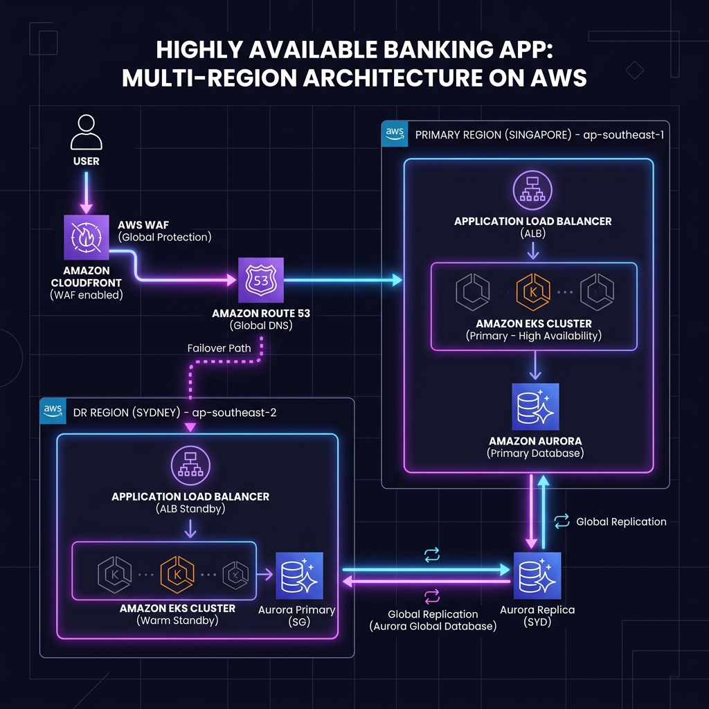

# Lab Additional 04: Full Architecture Workbook

## 1. Scenario (สถานการณ์จำลอง)

### สถานการณ์
NextGen-Fintech กำลังจะเปิดตัวแอปพลิเคชันธนาคารดิจิทัลใหม่ เพื่อรองรับลูกค้าหลายล้านคนทั่วภูมิภาคเอเชียตะวันออกเฉียงใต้
ในฐานะ Lead Cloud Architect คุณได้รับมอบหมายให้วิเคราะห์ ออกแบบ และสร้างโครงสร้างพื้นฐานที่เป็นรากฐานของบริษัททั้งหมด
โดยระบบทั้งหมดต้องผ่านการตรวจสอบตามมาตรฐาน AWS Well-Architected Framework อย่างเคร่งครัด

### ข้อกำหนดตามเสาหลัก (The 6 Pillars)
- **Security**: ระบบต้องทนทานต่อการโจมตี DDoS และมีการเข้ารหัสข้อมูลทุกจุด ทั้งตอนเก็บรักษา (At-rest) และตอนส่งผ่านข้อมูล (In-transit)
- **Reliability**: ระบบต้องรองรับการทำงานได้ต่อเนื่องแม้เกิดภัยพิบัติระดับ Region (Multi-region Resilience)
- **Performance Efficiency**: หน้าเว็บและ API ต้องโหลดได้เร็วจากทุกที่ในโลก มี Latency ต่ำ
- **Cost Optimization**: ต้องเลือกใช้ทรัพยากรอย่างคุ้มค่าที่สุด มีการควบคุมและตรวจสอบค่าใช้จ่าย (FinOps Optimized)
- **Operational Excellence**: ทุกอย่างต้องถูกจัดการผ่าน Infrastructure as Code (IaC) และมีระบบ Observability ที่สมบูรณ์
- **Sustainability**: เลือกใช้ทรัพยากรที่ประหยัดพลังงานเพื่อลดผลกระทบต่อสิ่งแวดล้อม เช่น ARM-based instances

### ขอบเขตและข้อจำกัดของระบบ (Constraints & Targets)
- **Target Performance**: รองรับผู้ใช้งานพร้อมกัน (CCU) ได้มากกว่า 100k+ โดยมี p99 Latency ต่ำกว่า 200ms ทั่วโลก
- **Reliability (SLO)**: ตั้งเป้าหมาย Availability ไว้ที่ 99.99% (Downtime ไม่เกิน 52 นาทีต่อปี)
- **RTO / RPO**: กรณีภัยพิบัติระดับ Region ต้องกู้คืนระบบได้ภายใน 15 นาที (RTO) และข้อมูลสูญหายได้ไม่เกิน 1 นาที (RPO)
- **Scaling Approach**: ออกแบบแอปพลิเคชันให้เป็น Stateless เพื่อให้ขยายระบบแบบแนวราบ (Horizontal) และข้าม Region ได้ง่าย
- **Budget Warning**: โครงสร้างพื้นฐานชุดนี้มีค่าใช้จ่ายสูงมากในการทดสอบบน AWS ให้จำลองการทำงานหรือเปิดใช้งานเฉพาะส่วนที่จำเป็นเท่านั้น

### เงื่อนไขความสำเร็จ (Definition of Done)
- ทำการติดตั้งระบบทั้งหมดผ่านคำสั่ง `terragrunt run-all apply` สำเร็จ
- สาธิตการทำ Canary Deployment ของแอปพลิเคชันโดยไม่มี Downtime (0% Downtime)
- จัดทำรายงาน Security Compliance ที่ผ่านเกณฑ์โดยไม่มีช่องโหว่ระดับวิกฤต (0 Critical Findings)
- จัดทำรายงาน Unit Economics ที่ระบุค่าใช้จ่ายต่อผู้ใช้งาน 1 รายได้อย่างชัดเจน

## 2. Topology Diagram (แผนผังระบบ)



### คำอธิบายส่วนประกอบสถาปัตยกรรม (6 เสาหลัก)
- **Security**:
  - AWS WAF: ป้องกันการโจมตีระดับ Application Layer เช่น SQL Injection และ XSS
  - IAM Identity Center: จัดการสิทธิ์การเข้าถึงจากส่วนกลางแบบ Single Sign-On (SSO)
  - AWS Key Management Service (KMS): เข้ารหัสข้อมูลทั้งหมดแบบ At-rest
- **Reliability**:
  - Multi-Region Architecture: ป้องกันและรองรับการกู้คืนระบบจากการล่มระดับ Region
  - Backup & Restore: ตั้งค่านโยบายสำรองข้อมูลและทดสอบการกู้คืนอย่างสม่ำเสมอ
- **Performance Efficiency**:
  - Amazon CloudFront: ทำ Caching ข้อมูลที่ Edge Location เพื่อลด Latency ทั่วโลก
  - Auto Scaling: ใช้ Karpenter สำหรับสเกล Node และ HPA สำหรับสเกล Pod ใน EKS
- **Cost Optimization**:
  - Spot Instances: ใช้กับกลุ่มงานที่ไม่วิกฤต (Stateless Workloads) เพื่อลดค่าใช้จ่าย
  - Savings Plans: ทำข้อตกลงใช้งานล่วงหน้าเพื่อรับส่วนลดสูงสุด
- **Operational Excellence**:
  - Terraform และ GitOps: จัดการโครงสร้างพื้นฐานผ่าน Code (IaC)
  - Automated Incident Response: แจ้งเตือนและซ่อมแซมระบบเบื้องต้นโดยอัตโนมัติเมื่อเกิดปัญหา
- **Sustainability**:
  - Graviton (ARM) Instances: ให้ประสิทธิภาพต่อการใช้พลังงาน (Performance per Watt) สูงสุด

## 3. Prerequisites & Estimated Time (สิ่งที่ต้องเตรียมและเวลาที่ใช้)

### สิ่งที่ต้องเตรียม
- AWS Account ที่มีสิทธิ์ระดับ Administrator
- Terraform และ Terragrunt ติดตั้งพร้อมใช้งานบนเครื่อง
- Kubernetes CLI (kubectl) และ Helm
- ความรู้ความเข้าใจสถาปัตยกรรม 3-Tier และการใช้งาน GitOps
- เครื่องมือการทำ Observability เช่น Prometheus, Grafana, OpenTelemetry

### เวลาที่ใช้ในการปฏิบัติงาน
- ประมาณ 4-8 ชั่วโมง สำหรับการติดตั้งและตรวจสอบโครงสร้างพื้นฐานทั้งหมด

## 4. Tasks (ขั้นตอนการปฏิบัติ)

### Task 1: การเตรียม Infrastructure as Code (IaC)
- รวมโค้ดโครงสร้างพื้นฐานจากโปรเจกต์เดิม ได้แก่ ระบบ 3-Tier, EKS Cluster, และ Multi-Region Configuration
- จัดโครงสร้างโฟลเดอร์เป็น Monorepo และใช้ Terragrunt ในการจัดการ State ของแต่ละสภาพแวดล้อม (Dev, Staging, Prod)
- ตัวอย่างการจัดเตรียม Master Terraform Skeleton:
```hcl
module "foundation" { source = "./modules/foundation" }
module "compute"    { source = "./modules/compute" }
module "security"   { source = "./modules/security" }
module "monitoring" { source = "./modules/monitoring" }
```
- วางระบบ CI/CD Pipeline ด้วย GitHub Actions หรือ GitLab CI เพื่อทดสอบและ Deploy อัตโนมัติ

### Task 2: การออกแบบโครงสร้างพื้นฐาน (Design Phase)
- ตรวจสอบ Data Flow ของสถาปัตยกรรมระบบ:
  - Global Users -> Route 53 (Latency Routing) -> CloudFront + AWS WAF -> ALB (Region A / B) -> EKS (Region A / B)
  - EKS เชื่อมโยงกับ Aurora Global DB, S3 Bucket, และ EFS
- ประยุกต์ใช้ AWS Transit Gateway เพื่อจัดระเบียบ Network และให้ VPC ต่างๆ เช่น Management VPC และ Prod VPC สื่อสารกันได้
- ตั้งค่าการจัดเก็บความลับผ่าน HashiCorp Vault หรือ AWS Secrets Manager โดยไม่มีการ Hardcode ลงในแอปพลิเคชันหรือ Code เด็ดขาด

### Task 3: การตั้งค่าระบบรักษาความปลอดภัย (Security Implementation)
- ตั้งค่า AWS WAF ร่วมกับ Amazon CloudFront เพื่อป้องกันภัยคุกคามประเภท DDoS และ SQL Injection ที่หน้าบ้าน
- ใช้สถาปัตยกรรม Zero Trust Network โดยห้ามเปิด Public IP ให้กับ Server หรือ Instance ใดๆ โดยไม่จำเป็น
- ใช้ IAM Roles for Service Accounts (IRSA) ใน Amazon EKS เพื่อกำหนดสิทธิ์เข้าถึงของแต่ละ Pod ตามหลัก Least Privilege
- เปิดใช้งาน AWS Security Hub และ AWS GuardDuty เพื่อตรวจจับและรายงานพฤติกรรมที่ผิดปกติแบบเรียลไทม์

### Task 4: การสร้างระบบพร้อมใช้ระดับภูมิภาค (Resilience Setup)
- ตั้งค่า Aurora Global Database เพื่อรองรับการทำ Replication ข้ามภูมิภาค (Multi-region) แบบรวดเร็ว
- จัดทำแผนกู้คืนระบบเมื่อเกิดภัยพิบัติ (Disaster Recovery Plan) และเปิดใช้ Automated Route 53 Failover
- ทดสอบระบบด้วย Chaos Engineering เช่น การสั่ง Terminate Worker Nodes หรือการทดลองจำลอง Network Partition ใน Availability Zone

### Task 5: การบริหารจัดการค่าใช้จ่าย (FinOps Setup)
- ตรวจสอบการใช้งานและวางแผนซื้อ Compute Savings Plans หรือ Reserved Instances ให้เหมาะสมกับ Workload
- ตั้งค่า AWS Budgets สำหรับโปรเจกต์ย่อย พร้อมจัดส่งแจ้งเตือนผ่าน Slack Integration
- ใช้ AWS Cost Explorer ในการคำนวณต้นทุนต่อการบริการลูกค้า 1 ราย (Unit Cost) เพื่อช่วยในการตัดสินใจทางธุรกิจ

### Task 6: การตรวจสอบการทำงานและความพร้อมใช้ (Operational Review)
- ติดตั้ง OpenTelemetry เพื่อดึง Metrics, Logs, และ Traces ส่งต่อไปยัง Grafana Observability Stack
- ตั้งค่า Alertmanager ของ Prometheus ให้แจ้งเตือนเฉพาะเมื่อ Error Budget เริ่มหมด เพื่อป้องกันปัญหา Alert Fatigue
- ทบทวนคำถามสำหรับการสอบสัมภาษณ์แนวคิดสถาปัตยกรรม (Architect's Final Exam):
  - **ถ้า Singapore Region ล่ม ระบบจะใช้เวลากี่นาทีในการกู้คืน (RTO)?**
    - *แนวทางการตอบ:* อธิบายขั้นตอนการตรวจจับด้วย Route 53 Health Check, การเปลี่ยน Route DNS, และการ Promote Aurora Replica ใน Sydney DR Region ขึ้นเป็น Primary
  - **จุดใดในระบบมีความเสี่ยงต่อข้อมูลรั่วไหลมากที่สุด และแก้ไขอย่างไร?**
    - *แนวทางการตอบ:* พูดถึงการเข้ารหัส KMS Encryption At-rest, mTLS In-transit ระหว่าง Service, และระบบ Automated Secret Rotation
  - **ระบบนี้มี Unit Cost ต่อผู้ใช้งานเท่าไหร่ และจะลดลงอีก 30% ได้อย่างไร?**
    - *แนวทางการตอบ:* การสลับไปใช้ Spot Instances สำหรับ Worker Node ที่ไม่ได้เก็บสถานะ, การทำ Right-sizing, และการใช้ Graviton (ARM) Instances
  - **ถ้า Traffic เพิ่มขึ้น 10 เท่าภายใน 1 นาที จุดใดจะเกิดการคอขวด (Bottleneck) เป็นจุดแรก?**
    - *แนวทางการตอบ:* วิเคราะห์ขีดจำกัดของ Database Connection Pool, NAT Gateway port exhaustion หรือความเร็วในการ Scale-out Node ของ Karpenter

## 5. Verification (การตรวจสอบผลการทำงาน)

- [ ] ข้อมูลทั้งหมดได้รับการเข้ารหัสเรียบร้อยแล้ว ทั้งตอนจัดเก็บ (KMS At-rest) และระหว่างการส่งผ่านข้อมูล (TLS In-transit)
- [ ] ตั้งค่า Security Groups และ Network ACLs ตามหลัก Least Privilege เพื่อจำกัดสิทธิ์การเข้าถึงให้ต่ำที่สุด
- [ ] ตั้งค่า AWS WAF ในการคัดกรองและสกัดกั้นการโจมตีเว็บพื้นฐาน (OWASP Top 10) เรียบร้อยแล้ว
- [ ] ติดตั้งและกระจายแอปพลิเคชันอย่างน้อย 2 Availability Zones (Multi-AZ) เพื่อลดโอกาสระบบล่ม
- [ ] มีแผนการกู้คืนระบบจากภัยพิบัติ (Disaster Recovery Plan) รองรับเมื่อเกิดกรณี Region ล่มทั้งหมด
- [ ] ตรวจสอบว่าระบบมีการสำรองข้อมูล (Backup) และเคยผ่านการทดสอบกู้คืนข้อมูล (Restore) สำเร็จ
- [ ] เปิดใช้งาน CloudFront เพื่อช่วยทำ Caching และกระจายข้อมูลไปยัง Edge Location ทั่วโลก
- [ ] ตั้งค่า Auto Scaling Policies สำหรับทั้ง EC2 (Karpenter) และ Pods (HPA) ใน EKS Cluster
- [ ] เลือกใช้ Instance Types ที่เหมาะสมที่สุดกับระดับภาระงาน (Workloads Right-sizing)
- [ ] ตรวจสอบและกำจัดทรัพยากรที่ไม่ได้ใช้งาน (Zombie Resources) ออกจากระบบทั้งหมด
- [ ] นำระบบ Savings Plans หรือจอง Reserved Instances มาประยุกต์ใช้งานเพื่อช่วยประหยัดงบประมาณ
- [ ] กำหนด Tagging Policy เพื่อแบ่งกลุ่มค่าใช้จ่ายและตรวจสอบงบประมาณอย่างเป็นระบบ
- [ ] กำหนดโครงสร้างพื้นฐานทั้งหมดในรูปแบบ Code (Infrastructure as Code) ผ่าน Terraform / Terragrunt
- [ ] มีระบบจัดการ Logs และ Observability จากส่วนกลางเพื่อเฝ้าระวังระบบตลอดเวลา
- [ ] จัดเตรียมคู่มือการแก้ไขปัญหาเบื้องต้น (Runbook) สำหรับทีมปฏิบัติการ
- [ ] เลือกใช้งาน Managed Services เพื่อลดภาระการบริหารจัดการและประหยัดพลังงาน
- [ ] พิจารณาเปลี่ยนไปใช้งาน Graviton-based instances (ARM) ในการรันแอปพลิเคชัน

## 6. Troubleshooting (การแก้ไขปัญหาที่พบบ่อย)

### อาการ: ระบบล่มแบบโดมิโน (Cascading Failure) เริ่มจากจุดเล็กๆ แล้วลามไปทั่วทั้งระบบ

#### 1. การวิเคราะห์ปัญหา (Analysis)
- ตรวจสอบ Distributed Tracing: ดูว่ามี Service ใดตอบสนองช้าผิดปกติ จนทำให้เกิดคิวย้อนกลับไปยัง Service ต้นทาง
- ตรวจสอบ Database Connections: เช็คจำนวน Connection ว่ามีมากเกินไปจนทำให้ฐานข้อมูลประมวลผลไม่ทันหรือไม่
- ตรวจสอบ Retry Storm: ดูว่าระบบตั้งค่าการส่งคำขอใหม่รุนแรงเกินไป จนเหมือนเป็นการทำ Self-DOS ใส่ตัวเองหรือไม่

#### 2. สาเหตุที่แท้จริง (Root Cause)
- ขาดการตั้งค่า Circuit Breaker และ Rate Limiting ในจุดที่เปราะบางหรือสำคัญ
- ส่งผลให้เกิดคอขวดสะสม จนทรัพยากรของระบบ เช่น RAM หรือ CPU Thread ถูกใช้งานจนหมด

#### 3. แนวทางการแก้ไข (Fix)
- ติดตั้ง Service Mesh เช่น Istio เพื่อทำระบบ Circuit Breaking ป้องกันไม่ให้จุดที่เสียดึงจุดอื่นล่มตาม
- ปรับปรุงการเชื่อมต่อใหม่ด้วยวิธี Exponential Backoff เพื่อชะลอการทำ Retry
- กำหนดเกณฑ์ Global Rate Limiting ที่ระดับ AWS WAF หรือ ALB เพื่อควบคุมปริมาณการเข้าใช้งาน

## 7. Exercises & Solutions (แบบฝึกหัดและแนวทางการแก้ไข)

### Exercise 1: การจัดการ Traffic ช่วง Black Friday (Reliability & Performance)

#### โจทย์จำลองสถานการณ์
ระบบ E-commerce ของลูกค้าคาดการณ์ว่าจะมี Traffic เพิ่มขึ้นกว่า 500% ภายในเวลา 15 นาที ในช่วงเวลา Flash Sale ที่กำลังจะเกิดขึ้น

#### แบบฝึกหัด
1. ตรวจสอบสถาปัตยกรรมระบบปัจจุบัน และระบุคอมโพเนนต์ 3 ส่วนแรกที่เสี่ยงต่อการเกิด Bottleneck หรือทำงานล้มเหลวมากที่สุด
2. ออกแบบ Caching Strategy เพื่อช่วยลดภาระงาน Read Requests ของระบบ Database
3. วิธีการตั้งค่า Auto Scaling (เช่น ASG หรือ Karpenter) เพื่อทำ Pre-warm เตรียมรับความต้องการใช้งานล่วงหน้า

#### แนวทางการแก้ไข (Solution)
1. **การวิเคราะห์จุดคอขวด (Bottlenecks):**
   - Database Connections: Traffic ที่พุ่งขึ้นกะทันหันจะทำให้ Connection บน RDS เต็มได้ ควรหันมาใช้งาน RDS Proxy เพื่อจัดการ Pooling
   - NAT Gateway Port Exhaustion: การที่ Pods จำนวนมากวิ่งออกอินเทอร์เน็ตภายนอกพร้อมกันผ่าน NAT Gateway ตัวเดียวกัน อาจเกิดปัญหารูพอร์ตเต็ม ควรตั้งค่า NAT Gateways เพิ่มหรือเปลี่ยนไปใช้ VPC Endpoints สำหรับคุยกับ AWS Services
   - Compute Scaling Lag: EC2 Node ใหม่ใช้เวลาสร้าง 1-2 นาที ซึ่งช้าเกินไปจนระบบอาจล่มก่อนสเกลเสร็จ
2. **การตั้งค่า Caching:**
   - วาง Amazon CloudFront ด้านหน้า ALB เพื่อเก็บ Static Assets
   - นำ Redis (ElastiCache) มาช่วยเก็บข้อมูล Catalog และ User Sessions ซึ่งช่วยลดงาน Read Query ของ DB ได้สูงสุดถึง 80%
3. **การทำ Pre-warming:**
   - ใช้ Scheduled Scaling ใน Auto Scaling Groups เพื่อทำ Scale-out ล่วงหน้า 30 นาทีก่อนช่วงเวลากิจกรรมเริ่มขึ้นจริง

### Exercise 2: การรับมือการโจมตี Ransomware (Security)

#### โจทย์จำลองสถานการณ์
เครื่องคอมพิวเตอร์พนักงานถูกบุกรุกและทำให้ผู้จู่โจมได้ AWS Access Keys ไป จากนั้นผู้บุกรุกพยายามลบ S3 Bucket และ RDS Database ของระบบทั้งหมด

#### แบบฝึกหัด
1. สถาปัตยกรรมระบบจะป้องกันหรือจำกัดขอบเขตความเสียหาย (Blast Radius) จากการโจมตีครั้งนี้ได้อย่างไร
2. ออกแบบระบบ Service Control Policies (SCPs) เพื่อบล็อกการทำลายทรัพยากรบน Production Environment
3. อธิบายวิธีการใช้งาน AWS Backup ร่วมกับ Immutable Vaults เพื่อให้แน่ใจว่าไม่มีสิทธิ์ใดลบข้อมูลสำรองได้

#### แนวทางการแก้ไข (Solution)
1. **การจำกัดขอบเขตความเสียหาย (Blast Radius):**
   - ยึดหลัก Zero Trust โดยเปลี่ยนไปใช้ IAM Roles Anywhere หรือ OIDC แทนการใช้ static Access Keys ที่ไม่มีวันหมดอายุ
   - แยก AWS Accounts ออกจากกันชัดเจนระหว่าง Dev, Staging, และ Production ผ่าน AWS Organizations เพื่อให้มั่นใจว่าระบบ Production ปลอดภัยหากระบบ Dev หรือ Staging ถูกเจาะ
2. **การกำหนด SCPs:**
   - บังคับใช้นโยบายปฏิเสธ (Deny) สิทธิ์การทำลายระบบ เช่น `s3:DeleteBucket`, `rds:DeleteDBInstance` และ `ec2:TerminateInstances` ที่ระดับ Production OU
   - อนุญาตการรันคำสั่งเหล่านี้ผ่านเฉพาะ "Break-Glass" Role ที่ระบุไว้เป็นพิเศษและต้องยืนยันตัวตนผ่าน MFA เท่านั้น
3. **การทำ Immutable Backups:**
   - เปิดใช้งาน AWS Backup Vault Lock ภายใต้ Compliance Mode เพื่อป้องกันไม่ให้ใครรวมถึง Root User ทำการลบข้อมูลสำรองได้จนกว่าจะหมดเวลาเก็บรักษา (Retention Period)

### Exercise 3: การเพิ่มประสิทธิภาพค่าใช้จ่าย (FinOps)

#### โจทย์จำลองสถานการณ์
ผู้บริหารฝ่ายการเงิน (CFO) ต้องการให้ลดค่าใช้จ่ายการใช้งาน Cloud ลง 20% โดยไม่ทำให้ระบบช้าลงหรือสูญเสียประสิทธิภาพของบริการ

#### แบบฝึกหัด
1. ค้นหา 3 ทรัพยากรหลักที่สร้างมูลค่าค่าใช้จ่ายสูงสุดในสถาปัตยกรรมแบบ EKS + RDS
2. วางแผนในการนำ Spot Instances มาใช้กับ Workloads และอธิบายแนวทางการป้องกันระบบล่มเมื่อถูกสั่งคืน Instance (Spot Termination)
3. เปรียบเทียบความแตกต่างด้านความคุ้มค่าระหว่าง Compute Savings Plans และ Reserved Instances สำหรับระบบ Database Tier

#### แนวทางการแก้ไข (Solution)
1. **การจำกัดทรัพยากรที่ค่าใช้จ่ายสูง (Top Costs):**
   - ทรัพยากร 3 ส่วนหลักคือ EKS Compute (EC2 Nodes), RDS Instances และการคิดเงินจาก NAT Gateway Data Processing
2. **การย้ายระบบไปใช้ Spot Instances:**
   - ใช้ Karpenter ในการดึงทรัพยากรและจัดการจัดวาง Stateless Microservices บน Spot Instances
   - ใช้ระบบ Interruption Handling ของ Karpenter หรือติดตั้ง `NodeTerminationHandler` เพื่อทำ Graceful Drain ย้าย Pods ออกล่วงหน้าอย่างน้อย 2 นาที ก่อนที่ AWS จะดึง Instance คืน
3. **การเปรียบเทียบ Compute Savings Plans vs Reserved Instances:**
   - บริการ RDS จะไม่รองรับ Compute Savings Plans (มีเฉพาะสำหรับ Compute ทั่วไป เช่น EC2, Fargate, Lambda) จึงต้องซื้อ RDS Reserved Instances (RI) แทน
   - การซื้อแบบสัญญา 1 ปี (No Upfront) ช่วยลดต้นทุนลงได้ประมาณ 30% และแบบ 3 ปีสามารถลดต้นทุนสูงสุดได้ถึง 50%

### Exercise 4: การสืบค้นปริศนาข้อผิดพลาด 500 Error (Observability)

#### โจทย์จำลองสถานการณ์
ผู้ใช้งานแถบยุโรปแจ้งว่าเจอปัญหา HTTP 500 เป็นระยะ แต่รายงานผลอัตราความผิดพลาด (Error Rate) ในภาพรวมของ ALB อยู่ที่ 0.5% ซึ่งไม่ถึงจุดกระตุ้นระบบการแจ้งเตือน

#### แบบฝึกหัด
1. อธิบายการใช้งาน Distributed Tracing (เช่น OpenTelemetry และ Tempo) เพื่อระบุตัว Microservice ที่ทำงานบกพร่อง
2. กำหนดเกณฑ์คุณภาพหรือ Service Level Objective (SLO) ของบริการสำหรับผู้ใช้งานในกรณีนี้
3. แนวทางการเชื่อมต่อ (Correlation) ระหว่าง Logs และ Traces เพื่ออำนวยความสะดวกในการตรวจสอบล็อกข้อผิดพลาดทันทีผ่านหน้าแสดงผล Grafana

#### แนวทางการแก้ไข (Solution)
1. **การใช้ Distributed Tracing ค้นหาปัญหา:**
   - ใช้เครื่องมือเฝ้าสังเกต เช่น Tempo หรือ AWS X-Ray ค้นหาร่องรอยคำขอที่มีสัญกรณ์เป็น `error=true` และกรองพารามิเตอร์ `region=eu`
   - ระบบจะจำลองแสดง Trace Graph ชี้ตรงไปที่จุดส่งข้อมูลที่ล่าช้าหรือทำงานผิดพลาดบน Microservice (เช่น เหตุผลจากการเรียกใช้งาน API ของผู้ให้บริการภายนอกช้า)
2. **การกำหนดค่า SLO:**
   - ตั้งเกณฑ์ไว้ดังนี้: "อย่างน้อย 99.9% ของจำนวน Checkout Request ทั้งหมด จะต้องได้รับการตอบรับกลับด้วยสถานะ 200 OK และใช้เวลาตอบกลับต่ำกว่า 500ms โดยทำการเฉลี่ยวัดผลแบบ Rolling 30-day Window"
3. **การร้อยเรียงประสานกัน (Correlation):**
   - ตั้งค่าแอปพลิเคชันผ่าน OpenTelemetry SDK ให้บันทึกข้อมูล `trace_id` และ `span_id` ฝังในระดับ JSON Logs ของแอปพลิเคชันโดยตรง
   - นำข้อมูล Log เหล่านี้ป้อนให้ Grafana และ Loki ถอดแยก Trace ID ออกมาเพื่อเชื่อมกับระบบแสดงกราฟอย่าง Tempo ทำให้สามารถข้ามไปกดเช็คต้นสายปลายเหตุของ Error Logs ได้ทันทีเพียงคลิกเดียว

---

## Cost & Cleanup Safety

> [!CAUTION]
> Capstone นี้รวมบริการที่มีค่าใช้จ่ายต่อเนื่องหลายชนิด เช่น EKS/EC2, NAT Gateway, ALB, Aurora/RDS, CloudFront, Route 53, observability stack และ multi-region resources จึงไม่ควรปล่อย environment ทิ้งไว้หลังทดลอง

ก่อนเริ่มให้ตั้ง Budget/alert และยืนยัน account/Region ทุกครั้ง

เมื่อจบ lab ให้ cleanup ตาม dependency และ IaC owner:

1. ปิด traffic/test jobs และลบ application-facing resources ที่สร้าง Load Balancer
2. ลบ Kubernetes workloads และ node capacity
3. destroy Terraform/Terragrunt stacks ในลำดับที่เหมาะสม
4. ตรวจ database snapshots/backups ก่อนลบฐานข้อมูล
5. ตรวจ NAT Gateway, Elastic IP, EBS, Load Balancer, Route 53, WAF และ log/storage resources ที่อาจ orphan
6. ตรวจทุก Region ที่ใช้ รวมถึง DR Region
7. เปิด Billing/Cost Explorer ยืนยันว่าไม่มี resource ค่าใช้จ่ายสูงค้าง

ห้ามรัน cleanup กับ production account/state; capstone failure testing ต้องอยู่ใน isolated lab environment
