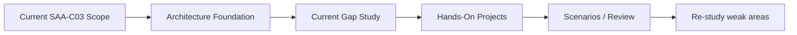

# AWS-SAA-C03 — Unified Learning System 🌩️

> **System status:** **Verified learning system** — current SAA-C03 objective coverage + verified architecture foundation + verified hands-on project track  
> **System model:** one certification-centered entry point with theory, current exam scope, practice and projects in one folder  
> **Last structural review:** 2026-10-07

[← Repository root](../README.md)

## 🌩️ Visual Memory — ดูภาพก่อนอ่านบทเต็ม


**🧠 🌐 Client → ⚖️ ALB → 🖥️ Healthy Target** — 📌 ALB เลือก Target ตาม Listener Rule, Target Group และสถานะ Healthy; การมี EC2 ไม่ได้แปลว่า Backend พร้อมรับงาน

[📘 เปิด Visual Guide แบบ Icon-First (Concept + Troubleshooting)](./VISUAL-MEMORY-GUIDE-TH.md) · [🎨 มาตรฐาน Visual ร่วม](../docs/ICON-FIRST-LEARNING-STANDARD.md)

## 🧭 เรียน AWS แบบไม่อ่านซ้ำ

**เส้นทางหลัก:** 13 Architecture Modules → Current SAA Scope Deep Dive → Scenarios (15 ขั้น) ส่วน **7 Labs** และ **35 Project Workbooks (00–34)** เป็นแบบฝึกเสริม ไม่ใช่เงื่อนไขก่อนสอบหรือก่อนกดจบบทเรียน

[🧪 ตารางเลือก Module → Lab → Project](./AWS-MODULE-LAB-PROJECT-MAP-TH.md) · [🛠️ Project Catalog 00–34](./AWS-PORTFOLIO-PROJECT-CATALOG-TH.md) — จัดกลุ่ม Starter และ Advanced Portfolio ไว้ชัดเจน

## Start here

This folder is the single AWS learning system in this repository. Do not treat the course, certification notes and project track as separate top-level AWS products.

Use this order:

1. **Orientation:** สำรวจ [SAA Exam Guide Map](./01-Certification-Core/EXAM-GUIDE-MAP.md) เพื่อรู้ว่าโจทย์สอบต้องตัดสินใจเรื่องใด (อ่านภาพรวม ไม่ใช่บทหลักเพิ่ม)
2. **Foundation:** อ่าน [13 Architecture Modules](./02-Architecture-Foundation/) ตามลำดับใน Learning Hub
3. **Targeted Practice:** เปิด [Lab/Project Crosswalk](./AWS-MODULE-LAB-PROJECT-MAP-TH.md) เลือกทำเฉพาะหัวข้อที่ต้องการ ไม่ต้องทำ 35 Projects เพื่อจบคอร์ส
4. **Current SAA Gap:** ใช้ [Current Scope Deep Dive](./01-Certification-Core/CURRENT-SCOPE-DEEP-DIVE.md) ทบทวนเนื้อหาที่เน้นการตัดสินใจสอบและอัปเดตจากคอร์สพื้นฐาน
5. **Scenarios & Review:** ทำ [Current Scope Scenarios](./01-Certification-Core/CURRENT-SCOPE-SCENARIOS.md) และทบทวนบทที่ยังตอบผิด



## System layers

| Layer | Purpose | Status |
|---|---|---|
| [01-Certification-Core](./01-Certification-Core/) | Current SAA-C03 exam scope, objective map, current deep dive, scenarios, provenance | **Verified Current Objective Scope** |
| [02-Architecture-Foundation](./02-Architecture-Foundation/) | Architecting on AWS 7.12.4 modules 01–13, companion labs, diagrams and currentness overlay | **Verified Course Scope** |
| [03-Hands-On-Projects](./03-Hands-On-Projects/) | Project 00 + Projects 01–34 for implementation and troubleshooting | **Verified Project Workbook Structure & Safety Baseline** |

## Course vs Certification vs Projects

ทั้งสามส่วนมีหน้าที่ต่างกัน แต่ไม่ได้เป็นคนละระบบ:

| Part | คำถามที่ตอบ | บทบาทใน AWS-SAA-C03 |
|---|---|---|
| **Certification Core** | “SAA-C03 ปัจจุบันต้องรู้อะไรบ้าง?” | เป็น **เป้าหมายและขอบเขต** ของการเรียน |
| **Architecture Foundation (Course)** | “จะเรียนหัวข้อเหล่านั้นให้เข้าใจจริงได้อย่างไร?” | เป็น **เนื้อหาหลักสำหรับสร้างความเข้าใจ** ผ่าน Architecting on AWS |
| **Hands-On Projects** | “เอาความรู้ไปใช้จริงและ troubleshoot ได้ไหม?” | เป็น **ภาคปฏิบัติ** เพื่อเปลี่ยนความรู้เป็นทักษะ |

Mental model ที่ใช้กับระบบนี้คือ:

```text
Certification = เป้าหมาย
Course        = วิธีเรียนให้เข้าใจ
Projects      = วิธีพิสูจน์ว่าใช้จริงได้
```

ดังนั้นเวลาจะเพิ่มเนื้อหาใหม่ ให้ถามก่อนว่าเนื้อหานั้นช่วย **เป้าหมาย SAA-C03 / AWS architecture learning** อยู่หรือไม่ ถ้าใช่ ให้ใส่เป็น layer ภายในระบบนี้ ไม่ต้องสร้าง AWS package ใหม่ที่ root

## 🎯 เป้าหมายที่ฉันใช้เรียน

เรียน AWS Architecture ให้เข้าใจและนำไปใช้ทำระบบจริง พร้อมเตรียมสอบ SAA-C03 โดยอ่าน Concept → ดู Diagram → ลง Hands-on Project → ฝึกตอบ Scenario → กลับไปทบทวนจุดอ่อน

ฉันเก็บทั้งบทอ่านและ Lab ไว้ในวิชาเดียว เพื่อให้เลือกบทเรียนและฝึกต่อได้ง่าย

## Evidence

- [System Source Manifest](./SOURCE-MANIFEST.md)
- [System QA](./SYSTEM-QA.md)
- [Certification QA](./01-Certification-Core/QA-MATRIX.md)
- [Course QA](./02-Architecture-Foundation/COURSE-QA-MATRIX.md)
- [Project QA](./03-Hands-On-Projects/PROJECT-QA-MATRIX.md)

## Maintenance rule

When AWS changes the exam guide, update **01-Certification-Core** first. Do not rewrite the historical course merely to make it look current; use its currentness overlay and certification deep dive to bridge changes.

When adding AWS material that directly supports SAA learning, place it inside this system rather than creating another top-level AWS folder.
