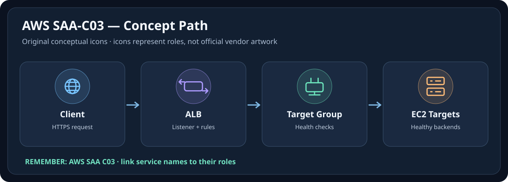
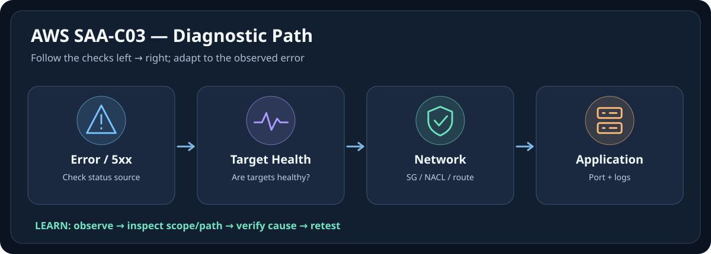

# 🌩️ AWS SAA-C03 — Icon-First Visual Memory Guide

[← กลับหน้าเรียน AWS SAA-C03](./README.md) · [มาตรฐานการใช้ภาพร่วมกัน](../docs/ICON-FIRST-LEARNING-STANDARD.md)

> **ขอบเขต:** Visual Memory สำหรับทบทวนแนวคิด; ไม่แทน Module, Lab, Official Documentation หรือการยืนยัน Configuration จริง  
> **Icon provenance:** SVG นี้วาดไอคอนเชิงแนวคิดขึ้นใหม่ ไม่ใช่ Official Service Logo  
> **สถานะ:** Companion Visual Layer (เพิ่ม 2026-10-10); ไม่เปลี่ยนสถานะ Verified ของเนื้อหาเดิม

สอนเส้นทาง Request, การกระจาย Load และการแยกสาเหตุจาก Client ไป Backend ใช้สูตร **จำภาพ → รู้ชื่อ → เข้าใจหน้าที่ → อ่านเนื้อหาเต็ม → ลงมือ Lab**

## 🧠 ภาพจำใน 10 วินาที

**🌐 Client → ⚖️ ALB → 🖥️ Healthy Target**

**จำให้ขึ้นใจ:** 📌 ALB เลือก Target ตาม Listener Rule, Target Group และสถานะ Healthy; การมี EC2 ไม่ได้แปลว่า Backend พร้อมรับงาน

## 🩺 Troubleshooting ผ่าน Icon

**สถานการณ์ตัวอย่าง:** ถ้าพบ HTTP 503 จาก ALB ให้เริ่มจาก Listener/Target Group, สถานะ Healthy Targets, Health Check path/port และ backend app จากนั้นค่อยตรวจ SG/NACL ตามเส้นทางจริง; ไม่ควรสรุปว่าเป็น Security Group เพียงอย่างเดียว

> [!IMPORTANT]
> แผนภาพเป็นเพียง mental model แสดงจุดตรวจหลัก ไม่ใช่ implementation diagram ของทุกบริการ และการตรวจจริงต้องอ้างอิงเวอร์ชัน/ขอบเขต/ความเสี่ยงที่ใช้งาน

## 🎯 Icon / Emoji Legend

| ภาพจำ | คำศัพท์หลัก | ใช้แยกเรื่องอะไร |
|---|---|---|
| 🌐 | Network / Entry | Request, DNS, Endpoint, Connectivity |
| 👤 | Identity | User, Group, Service Identity, Principal |
| 🔑 | Permission | Role, Scope, Authentication/Authorization |
| 🖥️ | Compute | Server, Instance, Container, Workload |
| 🗄️ | Storage / DB | Persistent Data, Files, Database |
| 🩺 | Health / Evidence | Status, Logs, Metrics, Verification |
| 🚨 | Incident | Symptom, Fault, Failed State |
| ✅ | Validation | Verify outcome and expected behavior |

## 📚 ไปอ่านเนื้อหาเต็ม (หลักฐานและ Lab ยังอยู่ใน Note)

- [Module-03-Networking-1](./02-Architecture-Foundation/Module-03-Networking-1.md)
- [Module-07-Monitoring-and-Scaling](./02-Architecture-Foundation/Module-07-Monitoring-and-Scaling.md)
- [README](./03-Hands-On-Projects/README.md)

## ❓ ลองทดสอบความจำ

คำถาม: ถ้าเห็นภาพจำแล้ว จะเริ่มตรวจสอบอะไร และอะไรที่ยังยืนยันไม่ได้?

ถ้าพบ HTTP 503 จาก ALB ให้เริ่มจาก Listener/Target Group, สถานะ Healthy Targets, Health Check path/port และ backend app จากนั้นค่อยตรวจ SG/NACL ตามเส้นทางจริง; ไม่ควรสรุปว่าเป็น Security Group เพียงอย่างเดียว ภาพบอกลำดับคิดเท่านั้น; ต้องเก็บหลักฐานก่อนสรุปสาเหตุ

## 🏷️ โลโก้และไอคอนทางการ

บทเรียนใช้ **Original Pictogram** เพื่ออธิบาย Role; หากต้องการจำรูปร่าง Logo/Service Icon ของผู้ผลิต ให้ศึกษา [AWS Architecture Icons](https://aws.amazon.com/architecture/icons/) และปฏิบัติตามเงื่อนไขสิทธิ์/เครื่องหมายการค้าของเจ้าของ Logo ห้ามเรียกไอคอนที่วาดขึ้นใหม่ว่าโลโก้ทางการ
