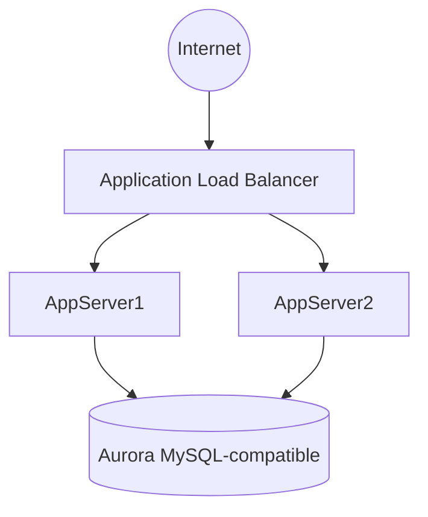

# Lab 3 — Creating a Database Layer in Your Amazon VPC Infrastructure

## 🗺️ Lab architecture



### ภาพ Diagram




> Diagram นี้เป็นภาพสรุปเพื่อช่วยทำความเข้าใจโครงสร้างของบท/แล็บ โดยยึดแนวคิดจากคู่มือต้นฉบับ
> คู่มือภาษาไทยสำหรับทำ Lab 3 จาก *Architecting on AWS 7.12.4 Lab Guide*  
> ช่วงต้นฉบับ: หน้า 53–68  
> คงชื่อ AWS service / Console menu / button / field / ค่า config เป็น English ตามหน้าจอจริง

## เป้าหมาย

ใน Lab นี้จะเพิ่ม Database Layer และ Load Balancer ให้สถาปัตยกรรมเดิม โดยทำงานหลักดังนี้:

- สร้าง Amazon Aurora (MySQL compatible) ผ่าน Amazon RDS
- สร้าง Target Group และ Application Load Balancer
- Register `AppServer1` และ `AppServer2` เป็น targets
- ดู Writer Endpoint ของ Aurora
- เชื่อม Web Application เข้ากับ Database
- Optional: สร้าง Cross-Region Read Replica

---

## Start Lab

1. กด `Start Lab`
2. รอ AWS services พร้อมใช้งาน
3. กด `Open Console`
4. อย่าเปลี่ยน Region เว้นแต่ขั้นตอน Optional ระบุให้เปลี่ยน

---

# Task 1 — Create an Amazon RDS database

สร้าง Aurora DB cluster ที่ compatible กับ MySQL

1. `Search` → พิมพ์ `Aurora and RDS`
2. Navigation pane → `Databases`
3. กด `Create database`
4. เลือก `Full configuration`
5. ใน `Engine options`:
   - `Engine type`: `Aurora (MySQL Compatible)`
6. ใน `Templates`:
   - เลือก `Dev/Test`
7. ใน `Cluster scalability type`:
   - เลือก `Provisioned`
   - `Type of provisioned configuration`: `Burstable classes (includes t classes)`
   - Instance class: `db.t3.medium`
8. ใน `Settings`:
   - `DB cluster identifier`: `aurora`
   - `Master username`: `dbadmin`
   - `Credentials management`: `Self managed`
   - `Master password`: ใช้ค่า `LabPassword` จากหน้าคำสั่ง Lab
   - `Confirm master password`: ใช้ค่า `LabPassword` เดิม
9. ใน `Availability & durability`:
   - `Multi-AZ deployment`: `Don't create an Aurora Replica`
10. ใน `Connectivity`:
    - `Virtual private cloud (VPC)`: `LabVPC`
    - `DB subnet group`: `labdbsubnetgroup`
    - `Public access`: `No`
    - `VPC security group (firewall)`: `Choose existing`
    - ที่ `Existing VPC security groups` ลบ `default` ด้วย `X`
    - เลือก `LabDBSecurityGroup`
11. ใน `Monitoring`:
    - เอาเครื่องหมายออกจาก `Enable Enhanced monitoring`
12. เปิด `Additional configuration`
13. ใน `Database options`:
    - `Initial database name`: `inventory`
    - `DB cluster parameter group`: เลือกค่าที่ตรงกับ `DBClusterParameterGroup` ที่แสดงในหน้าคำสั่ง Lab
14. ใน `Maintenance`:
    - เอาเครื่องหมายออกจาก `Enable auto minor version upgrade`
15. กด `Create database`
16. หากขึ้นหน้าต่าง `Suggested add-ons for aurora` ให้กด `Close`
17. รอให้ DB cluster ถูกสร้าง โดยสามารถไปทำ Task 2 ระหว่างรอได้

> ก่อน Task 4 ต้องรอให้สถานะ Aurora เป็น `Available`

---

# Task 2 — Create and configure an Application Load Balancer

## Task 2.1 — Create a target group

1. `Search` → `EC2`
2. Navigation pane → `Load Balancing` → `Target Groups`
3. กด `Create target group`
4. ตั้งค่า:
   - `Choose a target type`: `Instances`
   - `Target group name`: `ALBTargetGroup`
   - `VPC`: `LabVPC`
5. ค่าอื่นใช้ default
6. กด `Next`
7. ใน `Available instances` เลือก:
   - `AppServer1`
   - `AppServer2`
8. กด `Include as pending below`
9. กด `Next`
10. กด `Create target group`

## Task 2.2 — Create an Application Load Balancer

1. Navigation pane → `Load Balancing` → `Load Balancers`
2. กด `Create load balancer`
3. ที่ `Application Load Balancer` กด `Create`
4. ใน `Basic configuration`:
   - `Load balancer name`: `LabAppALB`
5. ใน `Network mapping`:
   - `VPC`: `LabVPC`
   - เลือก Availability Zone แรก → `PublicSubnet1`
   - เลือก Availability Zone ที่สอง → `PublicSubnet2`
6. ใน `Security groups`:
   - ลบ default security group ด้วย `X`
   - เลือก `LabALBSecurityGroup`
7. ใน `Listeners and routing`:
   - Listener: `HTTP:80`
   - `Default action` → `Target group`: `ALBTargetGroup`
8. กด `Create load balancer`
9. รอ Load Balancer เปลี่ยนจาก `Provisioning` เป็น `Active`

---

# Task 3 — Review the Amazon RDS DB instance metadata through the console

1. `Search` → `Aurora and RDS`
2. Navigation pane → `Databases`
3. เลือก cluster `aurora`
4. ที่ tab `Connectivity & security` → ดูส่วน `Endpoints`
5. Copy ค่า **Writer Endpoint** เก็บไว้ใน notepad

ตัวอย่างรูปแบบ:

```text
aurora.cluster-xxxxxxxxxxxx.us-west-2.rds.amazonaws.com
```

6. สามารถดูรายละเอียดเพิ่มที่ tab:
   - `Configuration`
   - `Monitoring`
7. **รอจน Status ของ Aurora เป็น `Available` ก่อนทำ Task 4**

---

# Task 4 — Test the application connectivity to the database

1. `Search` → `EC2`
2. Navigation pane → `Target Groups`
3. เลือก `ALBTargetGroup`
4. เปิด tab `Targets`
5. รอจน `AppServer1` และ `AppServer2` แสดงสถานะ `healthy`
6. Navigation pane → `Load Balancers`
7. เลือก `LabAppALB`
8. Copy `DNS name`
9. เปิด DNS name ใน browser tab ใหม่
10. เมื่อหน้า Inventory Web Application แสดงขึ้น ให้เปิด tab `Settings`
11. ตั้งค่า:
    - `Endpoint`: วาง Aurora Writer Endpoint ที่ copy ไว้
    - `Database`: `inventory`
    - `Username`: `dbadmin`
    - `Password`: ค่า `LabPassword`
12. กด `Save`
13. Application จะเชื่อมต่อ Database และโหลดข้อมูลเริ่มต้น

หลังจากนี้สามารถทดลอง Add / Edit / Delete รายการ inventory เพื่อยืนยันว่า Application เชื่อม Database สำเร็จ

---

# Optional Task — Create an Amazon RDS read replica in a different AWS Region

> ทำเมื่อมีเวลาเหลือ สามารถข้ามได้

1. กลับไป `AWS Management Console`
2. `Search` → `Aurora and RDS`
3. Navigation pane → `Databases`
4. เลือก Aurora DB instance ที่จะเป็น source
5. `Actions` → `Create cross-Region read replica`
6. ที่ `Multi-AZ deployment`:
   - `Don't create an Aurora Replica`
7. ใน `Connectivity`:
   - `Destination Region`: เลือก Region ที่ตรงกับค่า `RemoteRegion` ในหน้าคำสั่ง Lab
   - `Virtual private cloud (VPC)`: `LabVPC`
   - `Public access`: `No`
   - ที่ `Existing VPC security groups` ลบ `default`
   - เลือก `LabDBSecurityGroup`
8. ใน `Settings`:
   - `DB instance identifier`: `LabDBReplica`
9. กด `Create`
10. หลังขึ้นข้อความ `Creating replica LabDBReplica` ให้กด hyperlink ที่ระบบให้เพื่อไปดู replica ใน Destination Region

---

# End Lab

1. กลับไป `AWS Management Console`
2. มุมขวาบนเลือก `AWSLabsUser`
3. เลือก `Sign out`
4. กลับหน้า Lab → `End Lab`
5. ยืนยันการจบ Lab

---

## ผลลัพธ์ที่ควรได้

```text
Internet
   ↓
Application Load Balancer
   ↓
ALBTargetGroup
   ├─ AppServer1
   └─ AppServer2
        ↓
Aurora MySQL-compatible DB
   Database: inventory
```

จุดที่ต้องจำระหว่างทำ:

- `ALBTargetGroup` ต้องมี target เป็น `healthy`
- Aurora ต้องเป็น `Available`
- Web App ต้องใช้ **Writer Endpoint**
- Database/Username/Password คือ `inventory` / `dbadmin` / `LabPassword`
