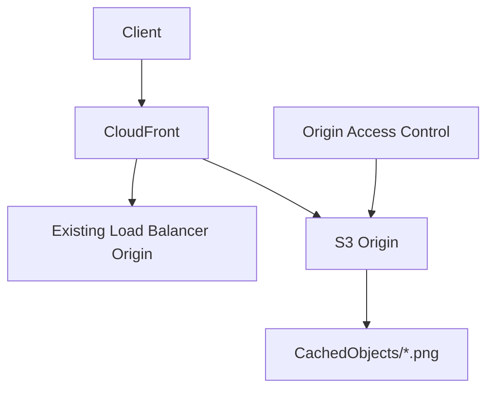

# Lab 6 — Configure an Amazon CloudFront Distribution with an Amazon S3 Origin

## 🗺️ Lab architecture



> Diagram นี้เป็นภาพสรุปเพื่อช่วยทำความเข้าใจโครงสร้างของบท/แล็บ โดยยึดแนวคิดจากคู่มือต้นฉบับ
> คู่มือภาษาไทยสำหรับทำ Lab 6 จาก *Architecting on AWS 7.12.4 Lab Guide*  
> ช่วงต้นฉบับ: หน้า 118–145  
> คงชื่อ AWS Console menu / button / field / resource / JSON placeholders เป็น English ตาม Lab

## เป้าหมาย

Lab นี้จะเพิ่ม Amazon S3 เป็น Origin ใหม่ให้ CloudFront Distribution ที่มีอยู่แล้ว จากนั้นปิด direct public access ของ S3 และให้เข้าถึง object ผ่าน CloudFront + Origin Access Control (OAC) เท่านั้น

```text
Client
  ↓
CloudFront Distribution
  ├─ Existing Origin: Load Balancer
  └─ New Origin: S3 LabBucket
                  ↑
                 OAC
```

---

## Start Lab

1. กด `Start Lab`
2. รอ resource พร้อม
3. กด `Open Console`
4. ใช้ Region/ค่า dynamic ที่แสดงในหน้าคำสั่ง Lab เช่น `LabBucketName`, `PrimaryRegion`, `LabCloudFrontDistributionDNS`

---

# Task 1 — Explore the existing CloudFront distribution

## Task 1.1 — Open CloudFront

1. `Search` → `CloudFront`

## Task 1.2 — Open the existing distribution

1. Navigation pane → `Distributions`
2. กด `ID` ของ distribution ที่มีอยู่เพียงตัวเดียว

## Task 1.3 — Review distribution properties

1. tab `General`
   - Copy ค่า `ARN` เก็บไว้ใน text editor — จะใช้กับ S3 bucket policy ภายหลัง
   - Copy `Distribution domain name`
2. เปิด `Distribution domain name` ใน browser เพื่อยืนยันว่า CloudFront เดิมทำงาน
3. tab `Security` → ดู configuration โดยไม่ต้องแก้
4. tab `Origins`
   - ดู Origin เดิมที่เป็น Load Balancer
   - Copy `Origin domain` ของ Load Balancer แล้วเปิดโดยตรงใน browser เพื่อเปรียบเทียบกับการเข้าผ่าน CloudFront
5. tab `Behaviors` → ดู behavior เดิม
6. tab `Error Pages` → ดู configuration
7. tab `Invalidations` → ดู configuration
8. tab `Tags` → ดู configuration

---

# Task 2 — Create an S3 bucket

1. `Search` → `S3`
2. `General purpose buckets` → `Create bucket`
3. `Bucket name`: วางค่า `LabBucketName` จากหน้าคำสั่ง Lab
4. ตรวจ `AWS Region` ให้ตรงกับ `PrimaryRegion`
5. ค่าอื่นใช้ default
6. กด `Create bucket`

จากนี้จะเรียก bucket นี้ว่า **LabBucket**

---

# Task 3 — Configure the S3 LabBucket for public access

> ขั้นตอนนี้เปิด public access ชั่วคราวเพื่อทดสอบ ก่อน Task 5 จะล็อก bucket ให้เข้าผ่าน CloudFront เท่านั้น

## Task 3.1 — Allow public policies

1. เปิด `LabBucket`
2. tab `Permissions`
3. ไป `Block public access (bucket settings)`
4. กด `Edit`
5. เอาเครื่องหมายออกจาก `Block all public access`
6. กด `Save changes`
7. พิมพ์ `confirm`
8. กด `Confirm`

## Task 3.2 — Configure a public read policy

1. tab `Permissions` → `Bucket policy` → `Edit`
2. Copy `Bucket ARN` เก็บไว้ เช่น:

```text
arn:aws:s3:::your-lab-bucket
```

3. ใช้ policy นี้ โดยแทน `RESOURCE_ARN` ด้วย Bucket ARN และเติม `/*` ท้าย ARN:

```json
{
  "Version": "2012-10-17",
  "Id": "Policy1621958046486",
  "Statement": [
    {
      "Sid": "OriginalPublicReadPolicy",
      "Effect": "Allow",
      "Principal": "*",
      "Action": [
        "s3:GetObject",
        "s3:GetObjectVersion"
      ],
      "Resource": "RESOURCE_ARN"
    }
  ]
}
```

ตัวอย่าง `Resource`:

```json
"Resource": "arn:aws:s3:::your-lab-bucket/*"
```

4. วาง JSON ใน `Policy`
5. กด `Save changes`

---

# Task 4 — Upload an object and test public access

## Task 4.1 — Create folder

1. tab `Objects`
2. กด `Create folder`
3. `Folder name`: `CachedObjects`
4. ค่าอื่นใช้ default
5. กด `Create folder`

## Task 4.2 — Upload `logo.png`

1. ดาวน์โหลด `logo.png` จาก Lab
2. กลับ S3 → เปิด `CachedObjects/`
3. กด `Upload`
4. `Add files` → เลือก `logo.png`
5. กด `Upload`
6. รอ `Upload succeeded`

## Task 4.3 — Test public access

1. กด `logo.png`
2. ที่ `Object URL` กด link
3. รูปควรเปิดได้โดยตรงผ่าน S3 URL

---

# Task 5 — Secure the bucket with Amazon CloudFront and Origin Access Control

## Task 5.1 — Update the bucket policy for CloudFront

1. `Search` → `S3`
2. เปิด `LabBucket`
3. tab `Permissions`
4. `Bucket policy` → `Edit`
5. Copy `Bucket ARN` ถ้ายังไม่ได้เก็บไว้
6. แทน policy เดิมด้วย policy ต่อไปนี้:

```json
{
  "Version": "2012-10-17",
  "Statement": [
    {
      "Sid": "AllowCloudFrontServicePrincipalReadOnly",
      "Effect": "Allow",
      "Principal": {
        "Service": "cloudfront.amazonaws.com"
      },
      "Action": [
        "s3:GetObject",
        "s3:GetObjectVersion"
      ],
      "Resource": "RESOURCE_ARN",
      "Condition": {
        "StringEquals": {
          "AWS:SourceArn": "CLOUDFRONT_DISTRIBUTION_ARN"
        }
      }
    }
  ]
}
```

7. แทน `RESOURCE_ARN` ด้วย Bucket ARN + `/*`
8. แทน `CLOUDFRONT_DISTRIBUTION_ARN` ด้วย CloudFront Distribution ARN ที่ copy จาก Task 1
9. กด `Save changes`

## Task 5.2 — Enable public access blockers again

1. `Permissions` → `Block public access (bucket settings)` → `Edit`
2. เลือก `Block all public access`
3. กด `Save changes`
4. พิมพ์ `confirm`
5. กด `Confirm`

ตอนนี้ direct public read จาก S3 ควรถูกบล็อก และ policy อนุญาต CloudFront service principal เท่านั้น

## Task 5.3 — Create a new origin with OAC

1. `Search` → `CloudFront`
2. `Distributions` → เปิด distribution เดิม
3. tab `Origins`
4. กด `Create origin`
5. `Origin domain`: เลือก `LabBucket` จากส่วน Amazon S3
6. `Origin path - optional`: เว้นว่าง
7. `Name`: `My Amazon S3 Origin`
8. `Origin access`: `Origin access control settings (recommended)`
9. กด `Create new OAC`
10. ใช้ค่า default แล้วกด `Create`
11. กด `Create origin`

หาก CloudFront เตือนว่า S3 bucket policy ต้อง update สามารถ ignore ได้ เพราะเราแก้ policy แล้วใน Task 5.1

## Task 5.4 — Create a behavior for the S3 origin

1. tab `Behaviors`
2. กด `Create behavior`
3. `Path pattern`: `CachedObjects/*.png`
4. `Origin and origin groups`: `My Amazon S3 Origin`
5. ใน `Cache key and origin requests`:
   - `Cache policy and origin request policy (recommended)`
6. `Cache policy`: `CachingOptimized`
7. ค่าอื่นใช้ default
8. กด `Create behavior`

---

# Task 6 — Test direct S3 access

1. `Search` → `S3`
2. เปิด `LabBucket`
3. `Objects` → `CachedObjects/` → `logo.png`
4. กด `Object URL`
5. ผลที่คาดหวัง: **Access Denied**

นี่เป็นผลที่ถูกต้อง เพราะ bucket ถูกล็อกไม่ให้ผู้ใช้ข้าม CloudFront แล้วเข้าหา S3 object โดยตรง

---

# Task 7 — Test access through CloudFront

1. Copy ค่า `LabCloudFrontDistributionDNS` จากหน้าคำสั่ง Lab
2. เปิด DNS นี้ใน browser เพื่อยืนยัน distribution เดิมยังทำงาน
3. เติม path ต่อท้าย:

```text
/CachedObjects/logo.png
```

ตัวอย่าง:

```text
https://dxxxxxxxxxxxxx.cloudfront.net/CachedObjects/logo.png
```

4. รูปควรถูกส่งกลับผ่าน CloudFront จาก S3 Origin

> หากยังไม่ขึ้น ให้รอ CloudFront deployment/update เสร็จ ตรวจที่ `Distributions` ว่า Status พร้อมและ `Last modified` มี timestamp แล้วค่อยลองใหม่

---

# Optional Task 8 — Cross-Region Replication

> ทำเมื่อมีเวลาเหลือ

## Task 8.1 — Enable Versioning on source bucket

1. `S3` → `LabBucket`
2. `Properties` → `Bucket Versioning`
3. เปิด `Enable`
4. Save

## Task 8.2 — Create destination bucket in Secondary Region

1. `Create bucket`
2. Region: เลือก `SecondaryRegion` ตามหน้าคำสั่ง Lab
3. `Bucket name`: ค่า `DestinationBucketName`
4. ใน Lab นี้ให้เอา `Block all public access` ออกเพื่อทดสอบ object URL ได้เร็ว
5. ยอมรับ warning acknowledgement
6. `Bucket Versioning`: `Enable`
7. กด `Create bucket`

จากนี้เรียก bucket นี้ว่า **DestinationBucket**

## Task 8.3 — Configure public read policy on DestinationBucket

1. `DestinationBucket` → `Permissions` → `Bucket policy` → `Edit`
2. Copy `Bucket ARN`
3. ใช้ public read policy แบบเดียวกับ Task 3.2 โดยเปลี่ยน `Resource` เป็น ARN ของ DestinationBucket + `/*`
4. กด `Save changes`

> Public access ใน Optional Task นี้ทำเพื่อทดสอบเท่านั้น ไม่ใช่ pattern ที่แนะนำสำหรับ production

## Task 8.4 — Create replication rule

1. กลับ `LabBucket`
2. tab `Management`
3. `Replication rules` → `Create replication rule`
4. `Replication rule name`: `myCrossRegionReplication`
5. ตรวจ `Source bucket name` เป็น LabBucket
6. `Choose a rule scope`: `Apply to all objects in the bucket`
7. ใน `Destination` กด `Browse S3`
8. เลือก `DestinationBucket` → `Choose path`
9. ใน `IAM Role`:
   - `Choose from existing IAM roles`
   - เลือก `S3CRRRole`
10. ค่าอื่นใช้ default
11. กด `Save`
12. หากถาม `Replicate existing objects`:
   - เลือก `No, do not replicate existing objects`
   - กด `Submit`

## Task 8.5 — Verify replication

1. ดาวน์โหลด `logo2.png` จาก Lab
2. `LabBucket` → `CachedObjects/`
3. `Upload` → `Add files` → `logo2.png` → `Upload`
4. เปิด object `logo2.png`
5. ดู `Replication status`
   - รอจาก `PENDING` → `COMPLETED`
6. เปิด `DestinationBucket` → `CachedObjects/` → `logo2.png`
7. `Replication Status` ควรเป็น `REPLICA`
8. กด `Object URL` เพื่อยืนยันว่า object ปลายทางเปิดได้

---

# End Lab

1. กลับ `AWS Management Console`
2. `AWSLabsUser` → `Sign out`
3. กลับหน้า Lab → `End Lab`
4. ยืนยัน

---

## ผลลัพธ์หลักหลังจบ Lab

```text
CloudFront Distribution
   ├─ Existing Load Balancer Origin
   └─ S3 Origin: My Amazon S3 Origin
          ↓
       OAC only
          ↓
      LabBucket
        └─ CachedObjects/*.png
```

- Direct S3 Object URL → `Access Denied`
- CloudFront `/CachedObjects/logo.png` → เปิดได้
