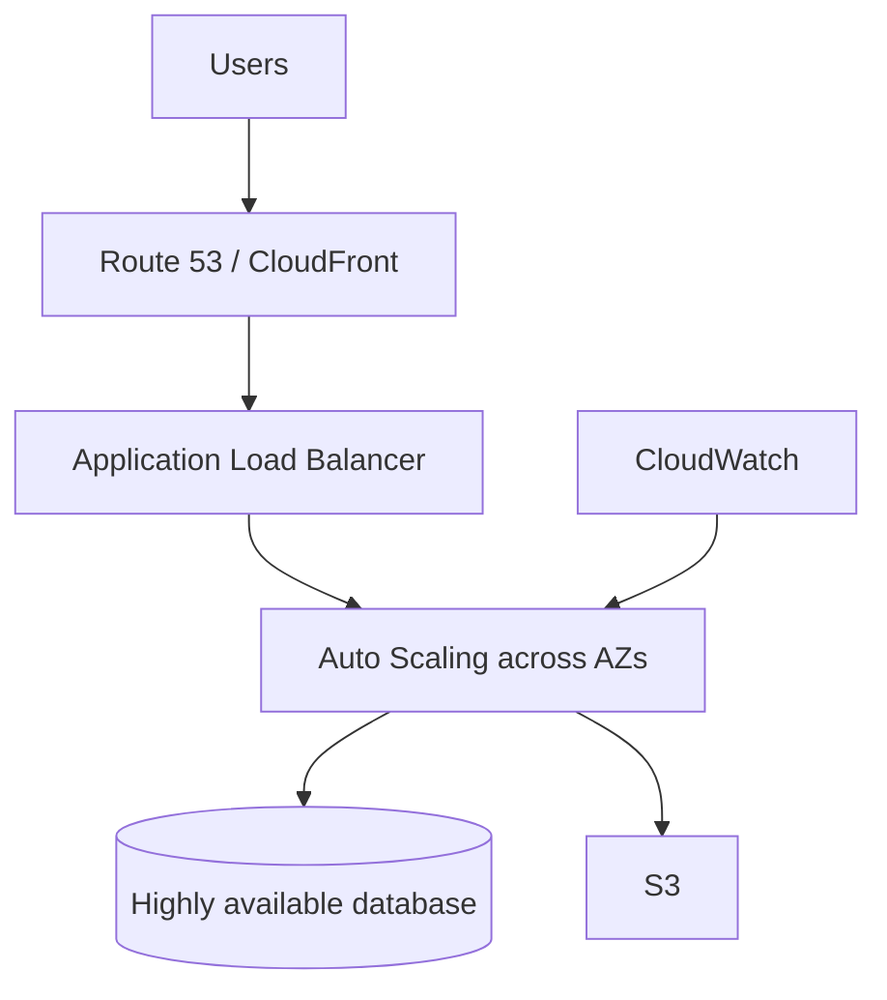

# Lab 7 — Capstone Lab

## 🗺️ Lab architecture



### ภาพ Diagram


> Diagram นี้เป็นภาพสรุปเพื่อช่วยทำความเข้าใจโครงสร้างของบท/แล็บ โดยยึดแนวคิดจากคู่มือต้นฉบับ
> คู่มือภาษาไทยสำหรับทำ Capstone Lab จาก *Architecting on AWS 7.12.4 Lab Guide*  
> ช่วงต้นฉบับ: หน้า 146–182  
> คงชื่อ Console menu / button / field / CloudFormation parameter / resource เป็น English ตาม Lab

## เป้าหมาย

ประกอบสถาปัตยกรรม WordPress แบบ Multi-AZ ตั้งแต่ Network ถึง Application Tier:

```text
Internet
   ↓
Application Load Balancer
   ↓
Auto Scaling Group (AppSubnet1 + AppSubnet2)
   ├─ WordPress EC2
   └─ WordPress EC2
       │        │
       ├── Amazon EFS ── shared WordPress files
       │
       └── Amazon Aurora MySQL
             Writer + Reader / Multi-AZ
```

Task หลัก:

1. Deploy Network ด้วย CloudFormation
2. สร้าง Aurora Database
3. สร้าง Amazon EFS
4. สร้าง Target Group + Application Load Balancer
5. Deploy Launch Template ด้วย CloudFormation
6. สร้าง Auto Scaling Group และเปิด WordPress

---

## Start Lab

1. กด `Start Lab`
2. รอ resource พร้อม
3. กด `Open Console`
4. เก็บค่า dynamic ที่อยู่ด้านซ้ายของหน้าคำสั่ง Lab เช่น:
   - `Task1TemplateUrl`
   - `Task5TemplateUrl`
   - `LabPassword`

---

# Task 1 — Review and run a pre-configured CloudFormation template

CloudFormation template นี้สร้าง Network foundation เช่น VPC, Public Subnets, Application Subnets, Database Subnets, Internet/NAT Gateways, Route Tables และ Security Groups

## Task 1.1 — Open CloudFormation

1. `Search` → `CloudFormation`

## Task 1.2 — Review template

1. ดาวน์โหลด `Task1.yaml` จาก Lab หากต้องการดู template
2. เปิดด้วย text editor
3. Review resources ที่ template จะสร้าง

## Task 1.3 — Create the stack

1. กด `Create stack`
   - หากอยู่หน้า Stacks ให้เลือก `Create stack` → `With new resources (standard)`
2. ตั้งค่า:
   - `Choose an existing template`
   - `Amazon S3 URL`
3. Copy ค่า `Task1TemplateUrl` จากหน้าคำสั่ง Lab แล้ววางใน `Amazon S3 URL`
4. กด `Next`
5. `Stack name`: `VPCStack`
6. `Parameters`: ใช้ default ทั้งหมด
7. กด `Next`
8. `Configure stack options`: ใช้ default
9. กด `Next`
10. ตรวจ `Review and create`
11. กด `Submit`
12. รอ `Stack status` จาก `CREATE_IN_PROGRESS` → `CREATE_COMPLETE`

## Task 1.4 — Verify resources

1. tab `Resources` → ตรวจ resources ที่สร้าง
2. tab `Events` → ตรวจ deployment events / errors
3. tab `Outputs` → ดู output values ที่อาจใช้ Task ต่อไป

---

# Task 2 — Create an Amazon RDS database

## Task 2.1 — Open Aurora and RDS

1. `Search` → `Aurora and RDS`

## Task 2.2 — Create a DB subnet group

1. Navigation pane → `Subnet groups`
2. กด `Create DB subnet group`
3. ใน `Subnet group details`:
   - `Name`: `AuroraSubnetGroup`
   - `Description`: `A 2 AZ subnet group for my database.`
   - `VPC`: `LabVPC`
4. ใน `Add subnets`:
   - เลือก 2 Availability Zones ที่ใช้สร้าง `DatabaseSubnet1` และ `DatabaseSubnet2`
   - เลือก subnet CIDR `10.0.4.0/24`
   - เลือก subnet CIDR `10.0.5.0/24`
5. กด `Create`

> ถ้าไม่แน่ใจว่า Database Subnets อยู่ AZ ใด: `CloudFormation` → `VPCStack` → `Resources` → เปิด `DatabaseSubnet1` / `DatabaseSubnet2`

## Task 2.3 — Create Aurora MySQL database

1. Navigation pane → `Databases`
2. กด `Create database`
3. `Choose a database creation method`: `Full configuration`
4. `Engine type`: `Aurora (MySQL Compatible)`
5. `Templates`: `Production`
6. `Cluster scalability type`:
   - `Provisioned`
   - `Type of provisioned configuration`: `Burstable classes (includes t classes)`
   - Instance class: `db.t3.medium`
7. ใน `Settings`:
   - `DB cluster identifier`: `MyDBCluster`
   - `Master username`: `dbadmin`
   - `Credentials management`: `Self managed`
   - `Master password`: `LabPassword`
   - `Confirm master password`: `LabPassword`
8. ใน `Availability & durability`:
   - เปิด `Create an Aurora Replica or Reader node in a different AZ (recommended for scaled availability)`
9. ใน `Connectivity`:
   - `Virtual private cloud (VPC)`: `LabVPC`
   - `DB subnet group`: `AuroraSubnetGroup`
   - `Public access`: `No`
   - `VPC security group (firewall)`: `Choose existing`
   - เลือกเฉพาะ security group ชื่อประมาณ `xxxxx-RDSSecurityGroup-xxxxx`
   - ลบ `default` ด้วย `X`
10. `Additional configuration` ภายใน Connectivity:
    - `Database port`: ใช้ default
11. ใน `Monitoring`:
    - เอาเครื่องหมายออกจาก `Enable Enhanced monitoring`
12. เปิด main `Additional configuration`
13. ใน `Database options`:
    - `Initial database name`: `WPDatabase`
14. ใน `Encryption`:
    - เลือก `AWS owned KMS key (SSE-RDS)`
15. ใน `Maintenance`:
    - เอาเครื่องหมายออกจาก `Enable auto minor version upgrade`
16. ใน `Maintenance window`:
    - เอาเครื่องหมายออกจาก `Enable deletion protection`
17. กด `Create database`
18. หากขึ้น `Suggested add-ons for mydbcluster` ให้กด `Close`
19. รอ cluster `mydbcluster` / `MyDBCluster` เป็น `Available`

## Task 2.4 — Save database metadata

ต้องเก็บค่าต่อไปนี้ไว้ใน text editor เพราะ Task 5 ใช้ทั้งหมด:

1. `Databases` → เลือก cluster `mydbcluster`
2. `Connectivity & security` → `Endpoints`
3. Copy **Writer Endpoint**
4. `Configuration` → Copy `Master username` (`dbadmin`)
5. Password ใช้ `LabPassword`
6. ตรวจ/เก็บ Initial Database Name: `WPDatabase`

สรุปค่าที่ต้องเก็บ:

```text
DB name          = WPDatabase
Writer endpoint  = <Aurora Writer Endpoint>
DB username      = dbadmin
DB password      = <LabPassword>
```

---

# Task 3 — Create an Amazon EFS file system

## Task 3.1 — Open EFS

1. `Search` → `EFS`

## Task 3.2 — Create file system

1. กด `Create file system`
2. กด `Customize`
3. ใน `General`:
   - `Name - optional`: `myWPEFS`
   - ปิด `Enable automatic backups`
   - `Transition into Infrequent Access (IA)`: `None`
   - `Transition into Archive`: `None`
   - ปิด `Enable encryption of data at rest`
4. `Performance Settings`:
   - `Throughput mode`: `Bursting`
   - `Performance mode`: `General Purpose (Recommended)`
5. `Tags - optional`:
   - `Tag key`: `Name`
   - `Tag value - optional`: `myWPEFS`
6. กด `Next`
7. หน้า `Network access`:
   - `Virtual Private Cloud (VPC)`: `LabVPC`
8. ตั้ง Mount Targets 2 AZ:

### Mount Target 1

- `Availability zone`: AZ ที่มี `DatabaseSubnet1`
- `Subnet ID`: `AppSubnet1`
- `Security groups`: `EFSMountTargetSecurityGroup`
- ลบ `default` security group

### Mount Target 2

- `Availability zone`: AZ ที่มี `DatabaseSubnet2`
- `Subnet ID`: `AppSubnet2`
- `Security groups`: `EFSMountTargetSecurityGroup`
- ลบ `default` security group

9. กด `Next`
10. หน้า `File system policy - optional` ไม่ต้องตั้งค่า → `Next`
11. ตรวจ `Review and create`
12. กด `Create`
13. รอ File System เป็น `Available`

## Task 3.3 — Save EFS metadata

1. Navigation pane → `File systems`
2. Copy `File system ID` ของ `myWPEFS` เก็บไว้ เช่น:

```text
fs-12345678
```

---

# Task 4 — Create an Application Load Balancer

## Task 4.1 — Open EC2

1. `Search` → `EC2`

## Task 4.2 — Create Target Group

1. `Load Balancing` → `Target Groups`
2. กด `Create target group`
3. ตั้งค่า:
   - `Choose a target type`: `Instances`
   - `Target group name`: `myWPTargetGroup`
   - `VPC`: `LabVPC`
4. ใน `Health checks`:
   - `Health check path`: `/wp-login.php`
5. เปิด `Advanced health check settings`:
   - `Healthy threshold`: `2`
   - `Unhealthy threshold`: `10`
   - `Timeout`: `50`
   - `Interval`: `60`
6. ค่าอื่นใช้ default และตรวจ protocol เป็น `HTTP`
7. กด `Next`
8. ยังไม่มี instance ให้ register → กด `Next`
9. กด `Create target group`

## Task 4.3 — Create Application Load Balancer

1. Navigation pane → `Load Balancers`
2. กด `Create load balancer`
3. `Application Load Balancer` → `Create`
4. `Load balancer name`: `myWPAppALB`
5. ใน `Network mapping`:
   - `VPC`: `LabVPC`
   - AZ แรก → `PublicSubnet1`
   - AZ ที่สอง → `PublicSubnet2`
6. ใน `Security groups`:
   - เลือก `AppInstanceSecurityGroup`
   - ลบ `default`
7. ใน `Listeners and routing`:
   - Listener `HTTP:80`
   - `Default action` → `myWPTargetGroup`
8. กด `Create load balancer`
9. รอจาก `Provisioning` → `Active`
10. Copy `DNS name` ของ `myWPAppALB` เก็บไว้

---

# Task 5 — Create a launch template using CloudFormation

CloudFormation template นี้จะสร้าง Launch Template พร้อม User Data สำหรับติดตั้ง/configure WordPress, mount EFS และเชื่อม Aurora

## Task 5.1–5.2 — Open and review template

1. `Search` → `CloudFormation`
2. ดาวน์โหลด `Task5.yaml` หากต้องการ review
3. เปิดด้วย text editor และตรวจ resources/User Data

## Task 5.3 — Create CloudFormation stack

1. `Create stack` → `With new resources (standard)`
2. เลือก:
   - `Choose an existing template`
   - `Amazon S3 URL`
3. Copy `Task5TemplateUrl` จากหน้าคำสั่ง Lab แล้ววางใน `Amazon S3 URL`
4. กด `Next`
5. `Stack name`: `WPLaunchConfigStack`
6. กำหนด Parameters:

| Parameter | Value |
|---|---|
| `DB name` | `WPDatabase` / Initial database name จาก Task 2 |
| `Database endpoint` | Aurora Writer Endpoint |
| `Database User Name` | `dbadmin` |
| `Database Password` | `LabPassword` |
| `WordPress admin username` | `wpadmin` (default) |
| `WordPress admin password` | `LabPassword` |
| `WordPress admin email address` | email address ที่ใช้ได้ |
| `Instance Type` | `t3.medium` (default) |
| `ALBDnsName` | DNS name ของ `myWPAppALB` |
| `LatestAL2023AmiId` | ใช้ default |
| `WPElasticFileSystemID` | File system ID ของ `myWPEFS` |

> **สำคัญ:** `ALBDnsName` ต้องวางเฉพาะ DNS name ห้ามมี `http://`, trailing `/` หรือ space เพราะ WordPress CSS/JS อาจโหลดผิด

7. กด `Next`
8. `Configure stack options`: ใช้ default
9. กด `Next`
10. ตรวจ `Review and create`
11. กด `Submit`
12. รอ `CREATE_COMPLETE`
13. tab `Resources` → ตรวจ Launch Template/resource ที่สร้าง

---

# Task 6 — Create application servers with Auto Scaling

## Task 6.1 — Create Auto Scaling Group

1. `Search` → `EC2`
2. Navigation pane → `Auto Scaling Groups`
3. กด `Create Auto Scaling group`
4. ตั้งค่า:
   - `Auto Scaling group name`: `WP-ASG`
   - `Launch template`: เลือก Launch Template ที่สร้างจาก Task 5
5. กด `Next`
6. ใน `Network`:
   - `VPC`: `LabVPC`
   - `Availability Zones and subnets`: `AppSubnet1`, `AppSubnet2`
7. กด `Next`
8. หน้า `Integrate with other services - optional`:
   - `Attach to an existing load balancer`
   - `Choose from your load balancer target groups`
   - Target Group: `myWPTargetGroup | HTTP`
   - เปิด `Turn on Elastic Load Balancing health checks`
   - `Health check grace period`: `300` หรือมากกว่า
9. กด `Next`
10. `Configure group size and scaling - optional`:
    - `Desired capacity`: `2`
    - `Min desired capacity`: `2`
    - `Max desired capacity`: `4`
11. ใน `Automatic scaling - optional`:
    - เลือก `Target tracking scaling policy`
    - ค่าอื่นใช้ default
12. ใน `Additional settings`:
    - เปิด `Enable group metrics collection within CloudWatch`
13. กด `Next`
14. หน้า `Add notifications - optional` → ไม่ต้องตั้ง → `Next`
15. หน้า `Add tags - optional` → `Add tag`:
    - `Key`: `Name`
    - `Value - optional`: `WP-App`
16. กด `Next`
17. Review แล้วกด `Create Auto Scaling group`
18. เปิด `WP-ASG`
19. tab `Activity` → รอ launch สำเร็จ
20. tab `Instance management` → ตรวจว่ามี 2 instances เป็น `InService`

## Task 6.2 — Verify Target Group health

1. Navigation pane → `Target Groups`
2. เลือก `myWPTargetGroup`
3. tab `Targets`
4. รอทั้ง 2 instances เป็น `healthy`

> Health Check อาจใช้เวลาหลายนาที

## Task 6.3 — Log in to WordPress

1. Navigation pane → `Load Balancers`
2. Copy DNS name ของ `myWPAppALB`
3. เติม path:

```text
/wp-login.php
```

ตัวอย่าง:

```text
myWPAppALB-xxxxxxxxxx.us-west-2.elb.amazonaws.com/wp-login.php
```

4. เปิด URL ใน browser
5. ที่ WordPress Login:
   - `Username or Email Address`: `wpadmin`
   - `Password`: `LabPassword`
6. กด `Log in`

ถ้าหน้า WordPress แสดงและ login ได้ แปลว่า Network → ALB → Auto Scaling → EFS → Aurora ทำงานร่วมกันครบ

---

# End Lab

1. กลับ `AWS Management Console`
2. `AWSLabsUser` → `Sign out`
3. กลับหน้า Lab → `End Lab`
4. ยืนยัน

---

## Checklist ก่อนถือว่า Capstone สำเร็จ

- [ ] `VPCStack` = `CREATE_COMPLETE`
- [ ] Aurora Cluster = `Available`, มี Multi-AZ Reader
- [ ] เก็บ Writer Endpoint / `dbadmin` / `WPDatabase` ไว้แล้ว
- [ ] `myWPEFS` = `Available`, mount targets 2 AZs
- [ ] `myWPTargetGroup` สร้างแล้ว
- [ ] `myWPAppALB` = `Active`
- [ ] `WPLaunchConfigStack` = `CREATE_COMPLETE`
- [ ] `WP-ASG` มี instances 2 ตัว `InService`
- [ ] Target Group = `healthy`
- [ ] เปิด `/wp-login.php` และ login ด้วย `wpadmin` ได้
