# Module 1 — Architecting Fundamentals

## 🧭 Visual architecture

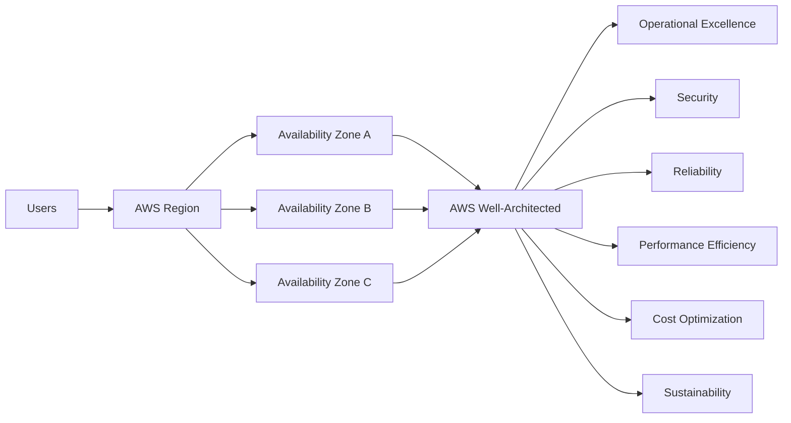

> Diagram นี้เป็นภาพสรุปเพื่อช่วยทำความเข้าใจโครงสร้างของบท/แล็บ โดยยึดแนวคิดจากคู่มือต้นฉบับ
> Mobile reader copy combined from Part 1 + Part 2. Full source screenshots remain in Google Drive master.

# Architecting on AWS 7.12.4 — Module 1: Architecting Fundamentals (Part 1)

> **Source:** *Architecting on AWS Student Guide v7.12.4* — PDF pages **26–43**  
> **Scope:** AWS services, reasons customers move to AWS, AWS Global Infrastructure, Regions, Availability Zones, Local Zones, and Edge locations.

---

## เป้าหมายของ Module 1

Module 1 เปิดด้วยมุมมองของ **Solutions Architect** ที่ต้องตอบคำถามจาก CTO ว่า:

1. การใช้ AWS มีประโยชน์อะไร?
2. AWS Global Infrastructure ถูกจัดโครงสร้างอย่างไร?
3. เราควรออกแบบ Cloud Infrastructure ตามแนวทางที่ดีอย่างไร?

ใน Part 1 นี้จะเน้นข้อ 1–2 ก่อน ส่วน AWS Well-Architected Framework จะอยู่ใน Part ถัดไป

---

# 1) AWS Services — AWS ให้อะไรกับเรา

AWS เป็น Cloud Platform ที่มีบริการครอบคลุมงาน Infrastructure และ Application หลายประเภท เช่น Compute, Storage, Database, Networking, Security, Management และบริการสำหรับการพัฒนา Application

แนวคิดสำคัญของ Cloud ในบริบทนี้ไม่ใช่แค่ “เอา Server ไปวางบน Internet” แต่คือการเปลี่ยนจากการซื้อและดูแล Infrastructure เอง ไปเป็นการเลือกใช้ทรัพยากรและบริการที่ AWS จัดเตรียมไว้ให้ตามความต้องการ

เอกสารชี้ให้เห็นจุดเด่นหลักของ AWS เช่น:

- มี Global data centers
- มีบริการจำนวนมากและหลากหลาย
- มีแนวทางด้าน Security ที่แข็งแรง
- ใช้รูปแบบ **pay as you go**
- ถูกออกแบบให้รองรับความต้องการขององค์กรและธุรกิจ

สิ่งที่ควรจำคือ AWS ไม่ได้มีแค่ EC2 หรือ VM เท่านั้น แต่มีบริการหลายชั้น ตั้งแต่ Infrastructure ระดับล่าง ไปจนถึง Managed Service และ Serverless ที่ช่วยลดภาระในการดูแลระบบเอง

---

# 2) ทำไมองค์กรจึงย้ายมา AWS

เอกสารแบ่งเหตุผลหลักออกเป็นสองแกนใหญ่:

- **เพิ่ม Agility** — ทำอะไรได้เร็วขึ้นและปรับตัวได้ง่ายขึ้น
- **ลด Complexity และ Risk** — ลดภาระและความเสี่ยงจากการดูแล Infrastructure เอง

> 🖼️ *Source figure — Student Guide p.32; full screenshot is kept in the Google Drive master copy.*

*Figure: Why customers move to AWS — Source PDF page 32.*

## 2.1 Accelerate time to market

ถ้าองค์กรใช้เวลาไปกับการจัดซื้อ Server, Storage, Network, เตรียม Data Center และติดตั้ง Hardware มากเกินไป เวลาที่ทีมสามารถใช้พัฒนาระบบจริงจะลดลง

Cloud ช่วยให้ทีมสร้าง Resource ได้เร็วขึ้น ทำให้สามารถโฟกัสที่ Feature และ Business Value มากกว่าการรอ Infrastructure

### มองให้ง่าย

แบบ On-Premises:

```text
ต้องการ Server ใหม่
    ↓
ขอ Budget
    ↓
จัดซื้อ
    ↓
รอ Hardware
    ↓
ติดตั้ง / Config
    ↓
พร้อมใช้งาน
```

แบบ Cloud:

```text
ต้องการ Resource
    ↓
Provision Service
    ↓
ใช้งาน
```

แก่นสำคัญไม่ใช่ว่า “ทุกอย่างเกิดขึ้นทันที” แต่คือ Cloud ลดขั้นตอนด้าน Physical Infrastructure ลงได้มาก

---

## 2.2 Increase innovation

AWS มีบริการและเครื่องมือที่ช่วยให้ทีมเข้าถึง Technology ใหม่ได้ง่ายขึ้น เช่น Automation, Containerization และ Machine Learning

สิ่งนี้ช่วยให้องค์กรทดลองแนวคิดใหม่ได้เร็วกว่าเดิม เพราะไม่จำเป็นต้องสร้าง Platform ทั้งหมดขึ้นมาเองก่อนเริ่มทดลอง

แนวคิดสำคัญคือ:

> **Cloud ทำให้การทดลองมีต้นทุนด้านเวลาและ Infrastructure ต่ำลง**

---

## 2.3 Scale seamlessly

เมื่อ Demand เพิ่มขึ้น องค์กรสามารถเพิ่ม Resource เพื่อรองรับ Workload ได้ และเมื่อ Demand ลดลงก็สามารถลด Resource ลงได้

แนวคิดนี้แตกต่างจากการซื้อ Hardware แบบ On-Premises ที่มักต้องคาดการณ์ Capacity ล่วงหน้า

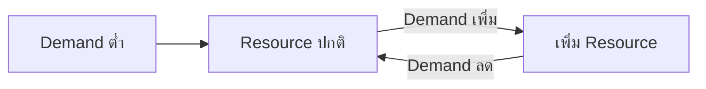

### ประเด็นที่ควรจำ

- Cloud ช่วยให้ Resource เปลี่ยนตาม Demand ได้ง่ายขึ้น
- ลดปัญหาซื้อ Hardware เผื่อ Peak มากเกินไป
- รองรับ Feature หรือ Workload ใหม่ได้ง่ายขึ้น

---

## 2.4 Optimize costs

AWS ใช้แนวคิด **pay for what you use**

ใน Data Center แบบเดิม องค์กรอาจต้องซื้อ Hardware ที่มี Capacity มากกว่าการใช้งานจริง เพราะต้องเผื่อ Growth หรือ Peak Load

บน AWS ค่าใช้จ่ายสามารถสัมพันธ์กับ Resource ที่ใช้งานจริงมากขึ้น

อย่างไรก็ตาม แนวคิดนี้ไม่ได้แปลว่า Cloud จะ “ถูกกว่าเสมอ” แต่เอกสารต้องการสื่อว่า Cloud ช่วยให้องค์กรหลีกเลี่ยงการลงทุนล่วงหน้ากับ Capacity ที่อาจไม่ได้ใช้งานเต็มประสิทธิภาพ

---

## 2.5 Minimize security vulnerabilities

เมื่อใช้งาน AWS Application และ Data จะอยู่ภายใต้ Physical Security ของ AWS Data Centers และ AWS มีเครื่องมือสำหรับควบคุมการเข้าถึง Resource

ประเด็นสำคัญคือ AWS ช่วยรับภาระ Security บางส่วน โดยเฉพาะ Infrastructure ทางกายภาพ แต่การออกแบบสิทธิ์และการใช้งาน Service อย่างถูกต้องยังเป็นเรื่องสำคัญของฝั่งลูกค้า

> ใน Part นี้เอกสารยังไม่ได้ลงรายละเอียด Shared Responsibility Model จึงควรจำเพียงว่า AWS มี Security Controls และ Access Management Tools จำนวนมากเพื่อช่วยลดความเสี่ยง

---

## 2.6 Reduce management complexity

การใช้ AWS Services สามารถลดงานที่เกี่ยวข้องกับ Physical Infrastructure เช่น:

- ดูแล Data Center
- Hardware maintenance
- Physical server lifecycle
- Physical network infrastructure บางส่วน

ทีมจึงสามารถย้ายเวลาและแรงจาก Hardware Operations ไปยังงาน Architecture, Automation และ Application ได้มากขึ้น

---

# 3) AWS Service Categories ที่ Course นี้เน้น

AWS มีบริการจำนวนมาก แต่ Student Guide ระบุหมวดสำคัญที่หลักสูตรนี้จะใช้ ได้แก่:

| Category | แนวคิดหลัก |
|---|---|
| Compute | ทรัพยากรสำหรับประมวลผล Application และ Workload |
| Containers | Platform และบริการสำหรับ Container-based workload |
| Serverless | รัน Application หรือ Function โดยลดภาระการดูแล Server |
| Networking and Content Delivery | Network, Connectivity และการส่ง Content |
| Storage | เก็บ Object, File หรือ Block data |
| Database | บริการฐานข้อมูลหลายรูปแบบ |
| Security, Identity and Compliance | Identity, Access Control และ Security |
| Management and Governance | Monitoring, Operation และ Governance |
| AWS Cost Management | ติดตามและจัดการค่าใช้จ่าย |

สิ่งสำคัญสำหรับการเรียน Architecting on AWS คือไม่จำเป็นต้องจำทุก Service แต่ต้องเข้าใจว่า **แต่ละหมวดแก้ปัญหาอะไร และควรเลือก Service แบบไหนให้เหมาะกับ Requirement**

---

# 4) AWS Global Infrastructure

AWS Infrastructure ใน Module นี้แบ่งแนวคิดออกเป็นลำดับสำคัญ:

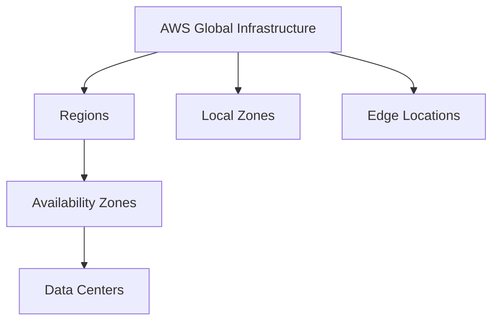

จำลำดับหลักให้แม่น:

> **Region → Availability Zone → Data Center**

ส่วน **Local Zone** และ **Edge Location** มีจุดประสงค์ต่างออกไป โดยเน้นการนำ Compute/Data หรือ Content ไปใกล้ User มากขึ้นเพื่อลด Latency

---

# 5) AWS Data Centers

Data Center คือสถานที่ทางกายภาพที่มี Infrastructure และ Server จำนวนมากสำหรับให้บริการ AWS

Student Guide อธิบายประเด็นสำคัญว่า:

- AWS services ทำงานอยู่ภายใน AWS data centers
- Data center สามารถมี Server จำนวนมาก
- AWS ใช้ Network Infrastructure ของตนเองเชื่อมระบบ
- Data centers ถูกจัดกลุ่มเป็น Availability Zones
- AWS ใช้ Security controls, audit และ third-party audits เพื่อยืนยันด้าน Security และ Compliance

ดังนั้นเวลาที่เราสร้าง EC2 Instance หรือ Resource บางประเภท เราไม่ได้เลือก Data Center อาคารใดอาคารหนึ่งโดยตรง แต่เลือก **Region / Availability Zone** แล้ว AWS จะจัดการ Infrastructure ทางกายภาพให้

---

# 6) Availability Zone (AZ)

**Availability Zone** คือกลุ่มของ Data Center ตั้งแต่หนึ่งแห่งขึ้นไปภายใน Region เดียวกัน

> 🖼️ *Source figure — Student Guide p.37; full screenshot is kept in the Google Drive master copy.*

*Figure: Availability Zones — Source PDF page 37.*

เอกสารเน้นคุณสมบัติหลักของ AZ ว่า:

- อยู่ภายใน Region
- ถูกออกแบบให้แยก Fault ออกจากกัน (**fault isolation**)
- เชื่อมต่อกันด้วย High-speed private links
- ใช้เพื่อออกแบบระบบให้มี **High Availability**

### ภาพจำ

```text
AWS Region
│
├── Availability Zone A
│   └── Data Center(s)
│
├── Availability Zone B
│   └── Data Center(s)
│
└── Availability Zone C
    └── Data Center(s)
```

ถ้าเราวาง Application ไว้ใน AZ เดียวทั้งหมด เมื่อ AZ นั้นมีปัญหา Workload ก็มีโอกาสได้รับผลกระทบทั้งหมด

แนวทางที่เอกสารชี้คือกระจาย Application ไปหลาย AZ เพื่อให้ Instance หรือ Resource ใน AZ อื่นสามารถรองรับ Request ต่อได้

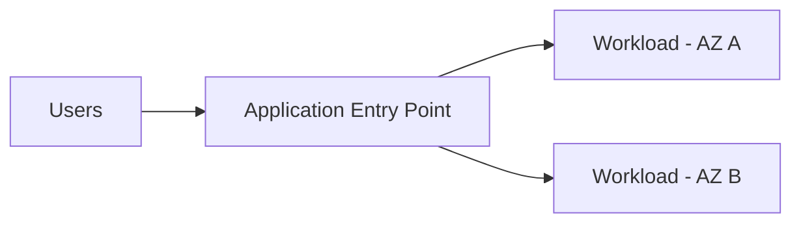

> **แนวคิดจำ:** Multi-AZ ช่วยลดการผูกระบบทั้งหมดไว้กับ Failure Domain เดียว

---

# 7) Region

**AWS Region** คือพื้นที่ทางภูมิศาสตร์ที่ประกอบด้วย Availability Zones หลายแห่ง ซึ่งแยกจากกันทางกายภาพ

เอกสารเน้นว่า Regions ถูกแยกออกจากกัน และ AWS ไม่ได้ทำการ Replicate Resource ข้าม Region ให้อัตโนมัติทั้งหมด

นั่นหมายความว่า ถ้าต้องการ Architecture แบบ Multi-Region เราต้องออกแบบและเลือก Service/Replication Strategy ให้เหมาะสมเอง

### Hierarchy

```text
Region
├── AZ 1
│   ├── Data Center
│   └── Data Center
├── AZ 2
│   └── Data Center
└── AZ 3
    └── Data Center
```

### Region ช่วยเรื่องอะไร

- เลือกตำแหน่ง Geographic ของ Workload
- เลือกให้ใกล้ User เพื่อลด Latency
- รองรับข้อกำหนดเรื่อง Data Governance / Legal Requirements
- เลือก Service ที่มีให้ใน Region นั้น
- ควบคุม Cost ซึ่งอาจแตกต่างกันตาม Region

---

# 8) ปัจจัยในการเลือก AWS Region

> 🖼️ *Source figure — Student Guide p.39; full screenshot is kept in the Google Drive master copy.*

*Figure: Factors that impact Region selection — Source PDF page 39.*

Student Guide ให้ปัจจัยหลัก 4 เรื่อง:

## 8.1 Governance and legal requirements

ต้องพิจารณากฎหมาย ข้อกำหนดด้าน Data Governance, Sovereignty และ Privacy

ตัวอย่างเชิงแนวคิด: ถ้านโยบายกำหนดว่า Data ต้องอยู่ในประเทศหรือพื้นที่ที่กำหนด การเลือก Region จะต้องสอดคล้องกับ Requirement นั้น

---

## 8.2 Latency

โดยทั่วไป Region ที่อยู่ใกล้ User มากกว่าจะช่วยลด Network Latency และทำให้ User Experience ดีขึ้น

แต่ “ใกล้ที่สุด” ไม่ได้แปลว่า “ดีที่สุดเสมอ” เพราะยังต้องพิจารณาปัจจัยอื่น เช่น Service availability และ Cost

---

## 8.3 Service availability

AWS Service บางตัวหรือบาง Feature อาจไม่ได้เปิดให้ใช้ในทุก Region

ดังนั้นก่อนออกแบบระบบควรตรวจว่า Service ที่ Architecture ต้องใช้มีให้บริการใน Region ที่เลือกหรือไม่

---

## 8.4 Cost

ราคาของ AWS Service อาจแตกต่างกันตาม Region

การเลือก Region จึงควรดูทั้ง Technical Requirement และ Cost ไม่ใช่ตัดสินจาก Latency อย่างเดียว

### สูตรจำง่าย

```text
Choose Region = Governance + Latency + Service Availability + Cost
```

---

# 9) AWS Local Zones

AWS Local Zones ถูกออกแบบมาสำหรับ Application ที่ต้องการ **Single-digit millisecond latency** ใกล้กับ End User หรือ On-Premises Deployment มากขึ้น

Local Zone ขยายบริการบางส่วนของ AWS ออกมาจาก Parent Region เข้าใกล้พื้นที่ประชากรหรือศูนย์กลางธุรกิจมากขึ้น

### ตัวอย่าง Workload ที่เหมาะ

จากแนวทางในเอกสาร เช่น:

- Media and Entertainment content creation
- Real-time gaming
- Reservoir simulations
- Electronic design automation
- Machine Learning

จุดร่วมคือ Workload เหล่านี้ต้องการ Latency ต่ำมาก

### Mental Model

```text
AWS Region
     │
     └── Local Zone
           │
           └── Compute / selected services ใกล้ User มากขึ้น
```

Local Zone จึง **ไม่ใช่ Region ใหม่** แต่เป็นการ Extension จาก Region เพื่อรองรับ Low-latency workloads

---

# 10) Edge Locations / Points of Presence

Edge Locations ถูกสร้างไว้ทั่วโลกเพื่อช่วยลด Latency ในการส่งข้อมูลไปยัง End User

> 🖼️ *Source figure — Student Guide p.42; full screenshot is kept in the Google Drive master copy.*

*Figure: Example use case for an edge location — Source PDF page 42.*

Student Guide ยกตัวอย่างการใช้งานกับ **Amazon CloudFront**

Flow โดยย่อ:

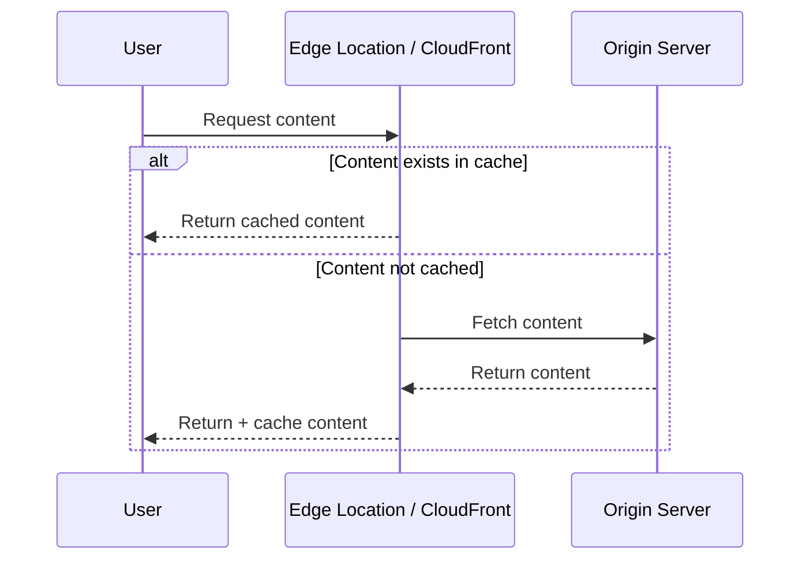

ถ้า Content มีอยู่ใน Cache ของ Edge Location ก็สามารถส่งกลับให้ User จากตำแหน่งที่ใกล้กว่า Origin ทำให้ Response เร็วขึ้น

ถ้าไม่มี Content อยู่ใน Cache Edge จะไปดึงจาก Origin แล้วนำมา Cache เพื่อรองรับ Request ในอนาคต

### เป้าหมายหลัก

> **ลด Latency ด้วยการนำ Content ไปอยู่ใกล้ User มากขึ้น**

---

# 11) Region vs AZ vs Local Zone vs Edge Location

ตารางนี้เป็นการสรุปจากแนวคิดใน Student Guide เพื่อให้แยกแต่ละคำได้ง่ายขึ้น

| Component | จุดประสงค์หลัก | Relationship |
|---|---|---|
| Region | พื้นที่ Geographic หลักสำหรับ Deploy AWS Resource | มีหลาย AZ |
| Availability Zone | Fault-isolated Infrastructure ภายใน Region | มี Data Center หนึ่งแห่งขึ้นไป |
| Data Center | Physical Infrastructure ที่ Server/Service ทำงาน | อยู่ใน AZ |
| Local Zone | นำ Compute/Data/Service บางส่วนเข้าใกล้ End User | Extension ของ Region |
| Edge Location | ส่ง Content/Service ใกล้ User เพื่อลด Latency | ใช้กับ Edge Services เช่น CloudFront |

### สิ่งที่มักสับสน

**Local Zone ≠ Edge Location**

Local Zone เน้นนำ Infrastructure / Compute เข้าใกล้พื้นที่ที่ต้องการ Latency ต่ำมาก

Edge Location ในตัวอย่างของ Module นี้เน้น Content Delivery เช่น CloudFront Cache

---

# 12) Architecture Mental Model จาก Part 1

เมื่อได้รับ Requirement ใหม่ ลองคิดตามลำดับนี้:

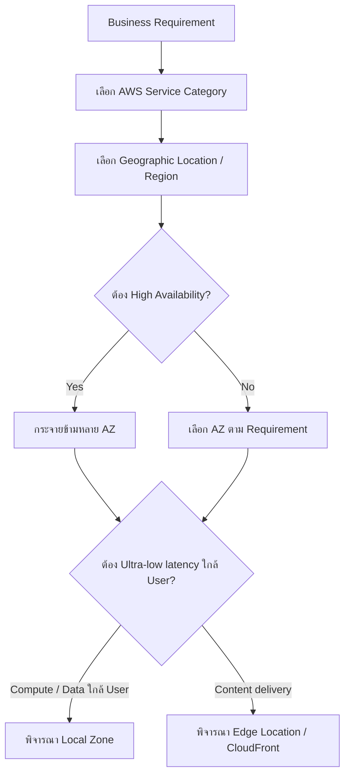

นี่เป็น Mental Model ที่ช่วยเชื่อม Concept ทั้ง Part เข้าด้วยกัน

---

# 13) สิ่งที่ควรจำจาก Part 1

1. ลูกค้าย้ายมา AWS เพื่อเพิ่ม **Agility** และลด **Complexity/Risk**
2. Cloud ช่วยให้สามารถ Scale Resource ตาม Demand ได้ง่ายขึ้น
3. AWS Global Infrastructure มี Hierarchy สำคัญคือ **Region → AZ → Data Center**
4. Availability Zone ถูกออกแบบให้แยก Failure ออกจากกัน และใช้สร้าง High Availability
5. AWS Region ควรเลือกจาก:
   - Governance / Legal requirements
   - Latency
   - Service availability
   - Cost
6. Local Zone เหมาะกับ Workload ที่ต้องการ Latency ต่ำมากและต้องใช้ Compute/Data ใกล้ User
7. Edge Location ใช้ช่วยลด Latency ในการส่ง Content/Service ให้ End User
8. การ Deploy หลาย AZ ช่วยลด Impact เมื่อ AZ หนึ่งเกิด Failure
9. Region ต่าง ๆ ถูกแยกจากกัน และ Multi-Region ต้องมีการออกแบบ Replication/Architecture ให้เหมาะสม

---

## Source page map

| Topic | Student Guide pages |
|---|---:|
| Module title / agenda / business request | 26–30 |
| AWS services | 31 |
| Why customers move to AWS | 32–33 |
| AWS service categories | 34 |
| AWS Global Infrastructure | 35 |
| Data centers | 36 |
| Availability Zones | 37 |
| Regions | 38 |
| Region-selection factors | 39 |
| Local Zones | 40–41 |
| Edge locations | 42–43 |

---

**Next:** Part 2 — Architect responsibilities, AWS Well-Architected Framework, Knowledge Check, and Lab 1.

---

# Architecting on AWS 7.12.4 — Module 1: Architecting Fundamentals (Part 2)

> **Source:** *Architecting on AWS Student Guide v7.12.4* — PDF pages **44–66**  
> **Scope:** AWS architect responsibilities, AWS Well-Architected Framework, AWS Well-Architected Tool, Module review, Knowledge Check, and Lab 1.

---

# 1. บทบาทของ AWS Architect

หลังจาก Part 1 ปูพื้นเรื่อง AWS Services และ Global Infrastructure แล้ว Part 2 เปลี่ยนมุมมาที่คำถามสำคัญกว่าเดิม:

> เมื่อมีบริการจำนวนมากให้เลือก แล้ว Solutions Architect ควรออกแบบระบบอย่างไรให้ตอบโจทย์ธุรกิจและไม่กลายเป็นระบบที่ดูแลยากในภายหลัง?

Student Guide สรุปหน้าที่หลักของ architect เป็นวงจร **Plan → Research → Build**

> 🖼️ *Source figure — Student Guide p.45; full screenshot is kept in the Google Drive master copy.*

## Mental model

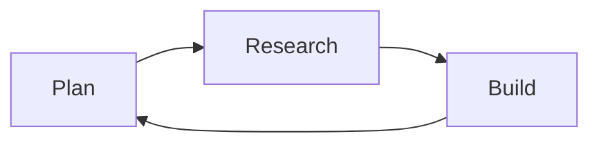

วงจรนี้ไม่ได้จบหลังจาก deploy ครั้งแรก แต่ architecture สามารถกลับมาที่ Plan หรือ Research ใหม่ได้เมื่อ requirement เปลี่ยน

---

## 1.1 Plan

ช่วง Plan คือการทำความเข้าใจว่าเรากำลังแก้ปัญหาอะไร

Architect ต้อง:

- ทำความเข้าใจ business needs
- เก็บ technical requirements
- มอง constraints ที่เกี่ยวข้อง
- วิเคราะห์ว่า solution ที่กำลังจะสร้างตอบ requirement จริงหรือไม่

สิ่งสำคัญคืออย่าเริ่มจากคำถามว่า:

> “ควรใช้ AWS service ตัวไหนดี?”

แต่ควรเริ่มจาก:

> “Business ต้องการอะไร และข้อจำกัดคืออะไร?”

จากนั้นค่อย map requirement ไปยัง architecture/service

```text
Business Need
     ↓
Requirements
     ↓
Architecture
     ↓
AWS Services
```

---

## 1.2 Research

AWS เปลี่ยนแปลงเร็ว มี service และ feature ใหม่เพิ่มขึ้นตลอด

Architect จึงต้องติดตาม:

- AWS services
- service capabilities
- best practices
- design patterns
- available solutions

Research ไม่ได้หมายถึงการอ่าน documentation อย่างเดียว แต่คือการทำความเข้าใจว่า service ใดเหมาะกับ requirement แบบใด

เป้าหมายคือเลือก solution ที่ **เหมาะสม** ไม่ใช่เลือก service ที่ใหม่ที่สุดหรือซับซ้อนที่สุด

---

## 1.3 Build

หลัง Plan และ Research แล้วจึงเข้าสู่ Build

Architect ต้อง:

- ออกแบบ architecture
- สร้างหรือช่วยสร้าง solution
- ตรวจสอบว่าการ implementation ยังตอบ business requirement
- ปรับ architecture เมื่อ requirement หรือ constraint เปลี่ยน

อีกมุมหนึ่งคือ architect ต้องคิดไปถึง lifecycle หลังจาก deploy แล้ว เช่น maintainability, reliability, cost และ operational impact

---

# 2. AWS Well-Architected Framework

AWS Well-Architected Framework เป็นแนวทางสำหรับ architect ในการสร้าง architecture ที่มีคุณภาพและประเมิน workload อย่างเป็นระบบ

Student Guide ระบุว่า framework นี้ช่วยให้ออกแบบ application infrastructure ที่:

- secure
- high-performing
- resilient
- efficient

Framework ประกอบด้วย **6 Pillars**

> 🖼️ *Source figure — Student Guide p.46; full screenshot is kept in the Google Drive master copy.*

```text
AWS Well-Architected Framework
├── Operational Excellence
├── Security
├── Reliability
├── Performance Efficiency
├── Cost Optimization
└── Sustainability
```

ควรจำชื่อครบทั้ง 6 Pillars เพราะเป็นโครงหลักที่ AWS ใช้มอง architecture

---

# 3. Six Pillars

## 3.1 Operational Excellence

Pillar นี้เกี่ยวกับความสามารถในการ run, monitor และ improve system อย่างต่อเนื่อง

หัวใจคือ:

- เข้าใจ operational health
- support business outcomes
- ปรับปรุง process และ procedures อย่างต่อเนื่อง

แนวคิดจาก Student Guide คือให้คิดถึง:

- organization
- preparation
- operation
- evolution

### ภาพจำ

```text
Prepare → Operate → Learn → Improve
```

Operational Excellence จึงไม่ได้หมายถึงแค่ “ระบบออนไลน์” แต่ต้องสามารถดูแล ปรับปรุง และตอบสนองเหตุการณ์ได้อย่างมี process

---

## 3.2 Security

Security Pillar เน้นการปกป้อง:

- data
- systems
- assets

พร้อมใช้ Cloud Technologies เพื่อปรับปรุง Security

แนวทางสำคัญที่ควรจำ:

- implement strong identity foundation
- enable traceability
- apply security at all layers
- automate security best practices
- protect data in transit and at rest
- prepare for security events

อีกหลักการสำคัญคือ **Principle of Least Privilege**

> ให้สิทธิ์เฉพาะเท่าที่จำเป็นต่อการทำงาน

ใน Knowledge Check ของ Module นี้จะมีคำถามเชื่อม Principle of Least Privilege เข้ากับ **Security Pillar** โดยตรง

---

## 3.3 Reliability

Reliability คือความสามารถของ workload ในการทำงานตามที่ตั้งใจไว้อย่างถูกต้องและสม่ำเสมอ

ประเด็นหลัก:

- recover from failure
- dynamically acquire resources to meet demand
- mitigate disruptions

### Mental model

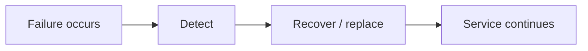

จึงเชื่อมโยงกับแนวคิดใน Part 1 เรื่องการกระจาย Workload ข้าม Availability Zones เพื่อไม่ให้ระบบผูกกับ Failure Domain เดียว

---

## 3.4 Performance Efficiency

Pillar นี้มองว่า Computing Resources ควรถูกใช้อย่างมีประสิทธิภาพเพื่อรองรับ Requirement และสามารถรักษาประสิทธิภาพนั้นไว้เมื่อ Demand หรือ Technology เปลี่ยน

หัวใจคือ:

- เลือก resource ให้เหมาะกับ workload
- monitor performance
- adapt ตาม requirement
- ใช้ technology ที่เหมาะสม

อย่าสับสนกับ Reliability:

- **Reliability** ถามว่า “ระบบยังทำงานได้หรือ recover ได้หรือไม่?”
- **Performance Efficiency** ถามว่า “Resource ที่ใช้เหมาะและตอบ performance requirement หรือไม่?”

---

## 3.5 Cost Optimization

Cost Optimization คือการสร้างระบบที่สามารถส่ง Business Value ใน Cost ที่เหมาะสม

ไม่ใช่แค่ “ลดค่าใช้จ่ายให้ต่ำที่สุด”

Architect ต้องเข้าใจ:

- ค่าใช้จ่ายเกิดจากอะไร
- Resource ใดจำเป็น
- Demand เปลี่ยนอย่างไร
- บริการหรือ resource ถูกใช้อย่างมีประสิทธิภาพหรือไม่

แนวคิดจาก Part 1 ที่ใช้ Pay-as-you-go จึงเชื่อมกับ Pillar นี้โดยตรง

### ภาพจำ

```text
Business Value
      ↕
Required Performance
      ↕
Appropriate Cost
```

---

## 3.6 Sustainability

Sustainability เป็น Pillar ที่เน้นการลด Environmental Impact ของ Cloud Workloads

เป้าหมายคือ maximize efficiency ของ resource ที่ใช้งานและลด resource ที่ไม่จำเป็น

Student Guide ระบุแนวคิดสำคัญ เช่น:

- understand environmental impact
- establish sustainability goals
- maximize utilization
- adopt efficient hardware/software offerings
- reduce downstream impact

ในมุม architect จึงต้องคิดว่า workload ใช้ resource อย่างคุ้มค่าหรือไม่ ไม่ใช่เพียงดู Cost หรือ Performance เท่านั้น

---

# 4. มอง Six Pillars พร้อมกัน

เวลาออกแบบจริงเราไม่ได้เลือกเพียง Pillar เดียว

Architecture ที่ดีต้อง balance หลายด้านพร้อมกัน

| Pillar | คำถามที่ควรถาม |
|---|---|
| Operational Excellence | เรา operate และ improve ระบบได้ดีหรือไม่? |
| Security | Identity, data และ system ถูกป้องกันหรือไม่? |
| Reliability | เมื่อมี failure ระบบ recover หรือทำงานต่อได้หรือไม่? |
| Performance Efficiency | Resource/technology เหมาะกับ performance requirement หรือไม่? |
| Cost Optimization | ค่าใช้จ่ายเหมาะสมกับ business value หรือไม่? |
| Sustainability | ใช้ resource อย่างมีประสิทธิภาพและลด environmental impact หรือไม่? |

สิ่งที่ควรระวังคือ decision หนึ่งสามารถกระทบหลาย Pillars พร้อมกัน

ตัวอย่างเชิงแนวคิด:

```text
เพิ่ม Resource เพื่อ Performance
        ↓
Performance Efficiency ดีขึ้นได้
        ↓
แต่ Cost อาจเพิ่ม
        ↓
ต้องประเมิน Cost Optimization ด้วย
```

ดังนั้น Well-Architected Framework ไม่ใช่ checklist แบบ “ผ่าน/ไม่ผ่าน” อย่างง่าย แต่ใช้เพื่อช่วยตั้งคำถาม architecture อย่างเป็นระบบ

---

# 5. AWS Well-Architected Tool

AWS มี **AWS Well-Architected Tool** สำหรับใช้ review workload โดยอิงกับ AWS Well-Architected Framework

> 🖼️ *Source figure — Student Guide p.48; full screenshot is kept in the Google Drive master copy.*

Flow โดยประมาณ:

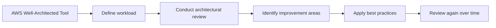

## Tool นี้มีไว้ทำอะไร?

ใช้ review สถานะของ workload ที่มีอยู่ และเปรียบเทียบ architecture กับ AWS architectural best practices

Student Guide เน้นว่า tool นี้ช่วยทั้ง architect และผู้ดูแล workload ในการ review โดยไม่จำเป็นต้องมี AWS Solutions Architect มาทำให้ทุกครั้ง

ผลลัพธ์จาก review สามารถนำไปใช้วางแผน remediation steps และสามารถ share results ให้ AWS หรือ partner resource เพื่อช่วย review/remediation ได้

---

# 6. สิ่งที่ Well-Architected Review ช่วยให้มองเห็น

จากหน้า 46 Student Guide ระบุว่า framework/tool สามารถช่วยรวบรวมข้อมูลและให้ recommendations เพื่อ:

- ลด system failures และ operational costs
- เจาะลึก business และ infrastructure processes
- ให้ best-practice guidance
- ช่วยให้ cloud solution ส่งมอบคุณค่าตามเป้าหมาย

ดังนั้น Well-Architected ไม่ควรถูกมองเป็น checklist ที่ทำครั้งเดียวแล้วจบ

แต่เป็นแนวทางในการ **ประเมิน → หา risk/improvement → ปรับ architecture → review ใหม่**

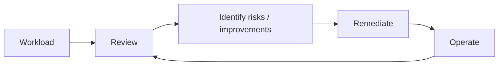

---

# 7. สรุป Business Request ของ Module 1

ตอนต้น Module 1 CTO มีคำถามหลัก 3 ข้อ:

1. AWS services ให้ประโยชน์อะไร?
2. AWS Global Infrastructure ถูกจัดโครงสร้างอย่างไร?
3. จะสร้าง cloud infrastructure ตาม best practices ได้อย่างไร?

หน้า Review ของ Module สรุป solution ไว้ประมาณนี้:

- AWS services ช่วยเพิ่ม agility พร้อมลด complexity และ risk
- AWS Global Infrastructure จัดเป็น Regions ซึ่งประกอบด้วย Availability Zones และยังมี AWS Local Zones กับ edge locations
- AWS Well-Architected Framework ช่วยให้ architect สร้าง cloud application infrastructure ที่ secure, high-performing, resilient และ efficient

นี่คือแก่นของ Module 1 ทั้งหมด

---

# 8. Knowledge Check - Module 1

ส่วนนี้เหมาะมากสำหรับทบทวนก่อนเข้าสู่ Lab

---

## Question 1

**Which item is the best example of one responsibility of an AWS architect?**

ตัวเลือกที่ถูกต้องใน Student Guide:

> **Analyze solutions for business needs and requirements.**

### ทำไม?

เพราะ architect มีหน้าที่ทำความเข้าใจ business needs/requirements และออกแบบ solution ให้ตอบโจทย์ ไม่ได้มีหน้าที่หลักเพียง monitor alarms, maintain application code หรือ manage access ของกลุ่ม AWS accounts

**จำ:** Architect เริ่มจาก requirements แล้วค่อยนำไปสู่ architecture

---

## Question 2

**Which item is a cluster of data centers within a geographic location with low latency network connectivity?**

คำตอบ:

> **Availability Zone**

Student Guide อธิบายว่า Availability Zone ประกอบด้วย data center หนึ่งแห่งหรือมากกว่า พร้อม redundant power, networking และ connectivity ภายใน AWS Region

**จำ:**

```text
Region
  ├─ Availability Zone A
  │    └─ one or more data centers
  ├─ Availability Zone B
  │    └─ one or more data centers
  └─ Availability Zone C
       └─ one or more data centers
```

---

## Question 3

**Which factors must be considered when picking an AWS Region? (Select TWO)**

คำตอบจาก Student Guide:

- **Local data regulations**
- **Latency to end users**

เอกสารยังทบทวน 4 ปัจจัยจาก Part 1:

1. Governance and legal requirements
2. Latency
3. Service availability
4. Cost

### จำ

เลือก Region ไม่ใช่เลือกจาก "ใกล้ที่สุด" อย่างเดียว ต้องพิจารณาทั้งข้อกฎหมาย, latency, service availability และ cost

---

## Question 4

**What is the primary benefit of deploying applications into multiple Availability Zones?**

คำตอบ:

> **High availability for resources**

เหตุผลคือ AZ เป็นพื้นที่ที่แยกกันภายใน geographic location เดียวกัน และเราสามารถกระจาย instances ข้ามหลาย AZ เพื่อให้เมื่อ AZ หนึ่งเกิด failure อีก AZ สามารถรองรับ requests ได้

---

## Question 5

**Which AWS Well-Architected Framework pillar contains the principle of least privilege?**

คำตอบ:

> **Security**

Least privilege คือจำกัด access rights ให้ user มีเท่าที่จำเป็นต่อการทำงาน

---

# 9. Lab 1 - Explore and Interact with AWS

ท้าย Module 1 เริ่ม Lab 1:

> **Explore and Interact with the AWS Management Console and AWS Command Line Interface**

ก่อนเข้าสู่ task เอกสารอธิบายช่องทางหลักที่ใช้ interact กับ AWS

> 🖼️ *Source figure — Student Guide p.64; full screenshot is kept in the Google Drive master copy.*

## 9.1 AWS Management Console

AWS Management Console เป็น GUI และเป็นช่องทางที่ง่ายสำหรับเริ่มต้น interact กับ AWS services

เหมาะกับการ:

- เข้าไปดู resource
- configure service
- ทำ action ผ่าน GUI
- เรียนรู้ service ตอนเริ่มต้น

---

## 9.2 AWS Command Line Interface (AWS CLI)

AWS CLI ใช้ manage AWS services ผ่าน command line

เอกสารระบุว่า AWS CLI version 1 ถูกติดตั้งไว้ล่วงหน้าบน Amazon Linux และ Amazon Linux 2 distributions ในบริบทของ course material นี้

จุดที่ควรเข้าใจคือ CLI เป็นอีก interface หนึ่งในการสั่ง AWS ไม่ใช่ระบบ backend คนละชุดกับ Console

---

## 9.3 Software Development Kits (SDKs)

AWS มี SDKs และ AWS Cloud Development Kit (AWS CDK) สำหรับหลาย programming languages

Student Guide อธิบายว่า software development frameworks เหล่านี้สามารถใช้สำหรับ defining และ provisioning cloud infrastructure โดยใช้ code

---

# 10. Console, CLI และ SDK เชื่อมไปที่อะไร?

นี่เป็น concept สำคัญจาก diagram หน้า 64:

> **Console, CLI และ SDK ใช้ AWS API ชุดเดียวกันที่อยู่เบื้องหลังเพื่อสร้างและจัดการ AWS resources**

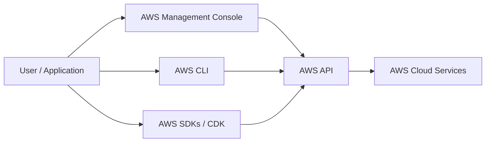

### ภาพจำ

```text
Console = คลิก
CLI     = พิมพ์คำสั่ง
SDK     = เขียนโปรแกรม

              ↓
          AWS API
              ↓
        AWS Resources
```

ดังนั้นความแตกต่างหลักอยู่ที่ **วิธีที่เรา interact** แต่เบื้องหลังทั้งหมดเชื่อมต่อกับ AWS APIs เพื่อจัดการ services/resources

---

# 11. Lab 1 Tasks

Student Guide หน้า 65 แบ่ง Lab ออกเป็น 4 งาน

> 🖼️ *Source figure — Student Guide p.65; full screenshot is kept in the Google Drive master copy.*

### Task 1
Explore and configure the AWS Management Console

### Task 2
Create an Amazon S3 bucket by using the AWS Management Console

### Task 3
Upload an object into the Amazon S3 bucket by using the S3 console

### Task 4
Create an Amazon S3 bucket and upload an object by using the AWS CLI

---

## Lab นี้ต้องการให้เราเห็นอะไร?

จากลำดับของ task จะเห็นว่า course ต้องการให้เราเรียนรู้ resource เดียวกันผ่าน interface ที่ต่างกัน

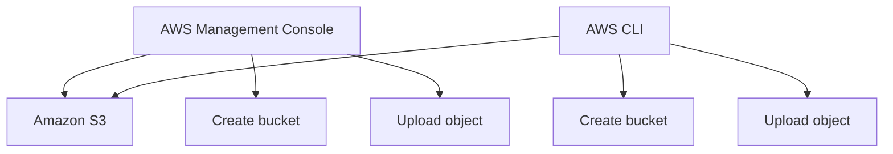

จุดสำคัญจึงไม่ใช่แค่ "สร้าง S3 bucket ให้สำเร็จ" แต่ให้เข้าใจว่า:

- AWS resource สามารถถูกจัดการผ่านหลาย interface
- Console และ CLI ไปจัดการ AWS services ผ่าน underlying AWS APIs
- งานที่ทำด้วย GUI สามารถทำผ่าน command line ได้เช่นกัน

> **หมายเหตุ:** Student Guide ช่วงนี้มีเพียงภาพรวมของ Lab และ task list ส่วนขั้นตอนลงมือทำแบบละเอียดไม่ได้ปรากฏในหน้าที่สรุปนี้ ดังนั้น Note นี้ไม่เติมคำสั่ง CLI หรือขั้นตอนที่ไม่ได้อยู่ใน source เอง

---

# 12. Module 1 Mental Model

เอาทั้ง Module 1 มารวมกันจะได้ mental model แบบนี้:

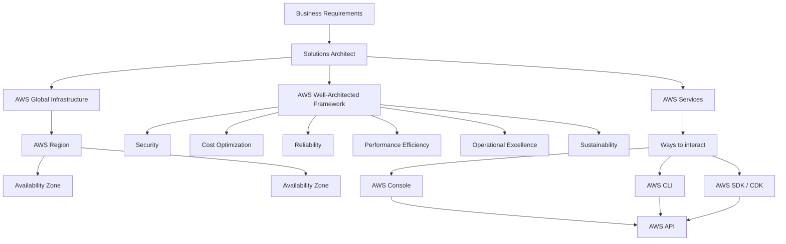

---

# 13. สิ่งที่ควรจำจาก Module 1

1. **Architecture เริ่มจาก business needs และ requirements**
2. Solutions Architect มีบทบาทตั้งแต่ **Plan → Research → Build**
3. AWS Global Infrastructure มี hierarchy สำคัญคือ **Region → Availability Zones → Data Centers**
4. การ deploy ข้ามหลาย AZ ช่วยเพิ่ม **High Availability**
5. การเลือก Region ต้องมองอย่างน้อยเรื่อง **Governance/legal, Latency, Service availability, Cost**
6. AWS Well-Architected Framework ใช้ 6 Pillars ในการประเมิน architecture
7. **Least Privilege อยู่ใน Security pillar**
8. Well-Architected Review เป็นกระบวนการประเมินและปรับปรุง workload ไม่ใช่การเช็กครั้งเดียวแล้วจบ
9. Console, CLI และ SDK เป็นคนละ interface แต่เชื่อมไปยัง **underlying AWS APIs**
10. Lab 1 ใช้ Amazon S3 เพื่อให้เห็นการทำงานผ่านทั้ง **Management Console และ AWS CLI**

---

# 14. Quick Review ก่อนขึ้น Module 2

ลองตอบโดยไม่เลื่อนกลับขึ้นไปดูคำตอบ:

1. Solutions Architect ควรเริ่มจาก service หรือ business requirement?
2. Availability Zone คืออะไร?
3. ทำไม workload จึงมักกระจายข้ามหลาย Availability Zones?
4. ปัจจัยหลักในการเลือก AWS Region มีอะไรบ้าง?
5. Well-Architected Framework มีทั้งหมดกี่ Pillars?
6. Principle of Least Privilege อยู่ใน Pillar ใด?
7. Reliability ต่างจาก Performance Efficiency อย่างไร?
8. AWS Well-Architected Tool ใช้ทำอะไร?
9. Console, CLI และ SDK มีอะไรเหมือนกันใน backend?
10. Lab 1 ใช้ service ใดเป็นตัวอย่างในการทดลอง Console และ CLI?

ถ้าตอบ 8-10 ข้อได้โดยไม่เปิด Note ถือว่าพื้นฐานของ Module 1 แน่นพอสำหรับขึ้น Module 2 แล้ว

---

# Source page map

| Topic | Student Guide pages |
|---|---:|
| AWS Well-Architected Framework introduction | 44 |
| AWS architect responsibilities | 45 |
| Six Well-Architected pillars | 46-47 |
| AWS Well-Architected Tool | 48 |
| Module review | 49-51 |
| Knowledge Check | 52-62 |
| Lab 1 introduction | 63 |
| Connecting to an AWS service | 64 |
| Lab tasks | 65 |
| End of Module 1 | 66 |

---

**Next:** Module 2 - Account Security
