# Module 2 — Account Security

## 🧭 Visual architecture

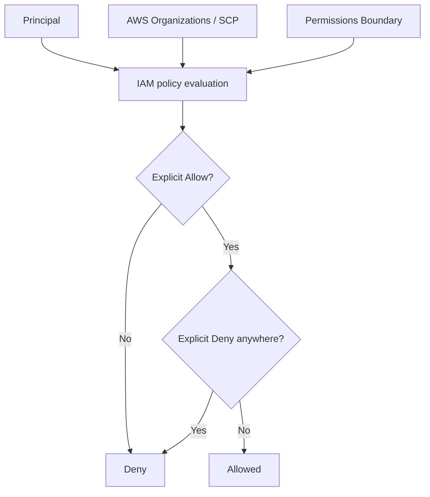

### ภาพ Diagram


### Source diagram จาก Student Guide

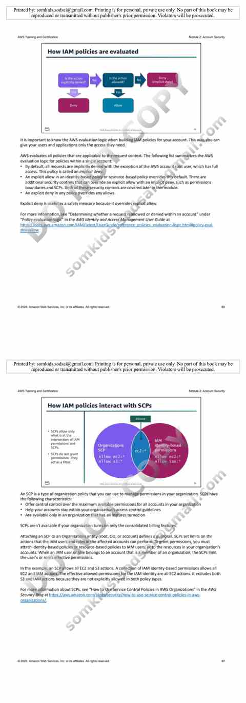


> Diagram นี้เป็นภาพสรุปเพื่อช่วยทำความเข้าใจโครงสร้างของบท/แล็บ โดยยึดแนวคิดจากคู่มือต้นฉบับ
> Mobile reader copy combined from Part 1 + Part 2. Full source screenshots remain in Google Drive master.

# Architecting on AWS 7.12.4 - Module 2: Account Security (Part 1)

> **Source:** *Architecting on AWS 7.12.4 (EN) - Student Guide*  
> **Covered pages:** 67-92  
> **Focus:** Principals and identities, root user, IAM users/groups/roles, programmatic access, IAM policies, policy evaluation, resource-based policies, defense in depth, and permissions boundaries

---

## เป้าหมายของ Module 2 ช่วงนี้

Module 2 เริ่มจากโจทย์ของ security specialist ที่ต้องตอบคำถามหลักเกี่ยวกับการสร้าง AWS accounts และควบคุม access ได้แก่:

- จะจัดการ access ไปยัง AWS accounts และ resources อย่างเหมาะสมได้อย่างไร?
- จะให้ผู้ใช้เข้าถึง **เฉพาะ resource ที่จำเป็น** ได้อย่างไร?
- เมื่อมีหลาย account ควรจัดการอย่างไร?

Part 1 นี้เน้นสองคำถามแรก ส่วนเรื่อง **Managing multiple accounts** จะต่อใน Part ถัดไป

---

# 1. หลักคิดก่อนเริ่ม: Least Privilege

จาก Module 1 เรารู้แล้วว่า **principle of least privilege** อยู่ใน Security pillar ของ AWS Well-Architected Framework

Module 2 นำหลักนี้มาใช้จริงกับการออกแบบ access:

> ผู้ใช้หรือ workload ควรได้รับสิทธิ์เฉพาะที่ต้องใช้สำหรับงานของตนเท่านั้น

ภาพรวมจึงเป็นแบบนี้:

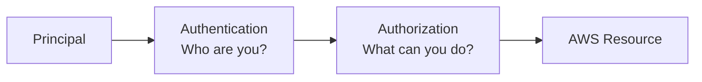

สองคำที่ต้องแยกให้ออก:

- **Authentication** = พิสูจน์ว่าเป็นใคร
- **Authorization** = หลังรู้ว่าเป็นใครแล้ว อนุญาตให้ทำอะไรได้บ้าง

---

# 2. AWS Account Root User

เมื่อสร้าง AWS account ใหม่ จะเริ่มต้นด้วย **root user**

> 🖼️ *Source figure — Student Guide p.72; full screenshot is kept in the Google Drive master copy.*

Student Guide ระบุว่า root user:

- มี full access ไปยัง AWS services และ resources ภายใน account
- ไม่สามารถถูกจำกัดสิทธิ์แบบ IAM user ทั่วไปได้ใน account เดียวกัน
- **ไม่ควรถูกใช้สำหรับงานประจำวัน**

แนวทางที่เอกสารแนะนำคือ:

1. สร้าง additional users สำหรับผู้ที่ต้องใช้งาน account
2. กำหนด permissions ตาม principle of least privilege
3. เปิด **MFA** ให้ root user เพื่อเพิ่มชั้นความปลอดภัย

### ภาพจำ

```text
Root user = กุญแจใหญ่ของ account

ใช้เฉพาะงานที่จำเป็นจริง ๆ
ไม่ใช้เป็น user ทำงานประจำวัน
เปิด MFA
```

---

# 3. AWS Identity and Access Management (IAM)

AWS Identity and Access Management หรือ **IAM** เป็น web service สำหรับควบคุม access ไปยัง AWS resources อย่างปลอดภัย

> 🖼️ *Source figure — Student Guide p.73; full screenshot is kept in the Google Drive master copy.*

IAM ถูกใช้เพื่อจัดการสองเรื่องหลัก:

## Authentication

ใครกำลัง sign in หรือส่ง request เข้ามา?

## Authorization

หลังจาก authenticate แล้ว principal นั้นมี permission ทำ action อะไรกับ resource ใดได้บ้าง?

เอกสารสรุป use cases ของ IAM ไว้ประมาณนี้:

- Create and manage users, groups, and roles
- Manage access to AWS services and resources
- Analyze access controls

---

# 4. Principal คืออะไร?

**Principal** คือ entity ที่สามารถ request action หรือ operation บน AWS resource ได้

> 🖼️ *Source figure — Student Guide p.74; full screenshot is kept in the Google Drive master copy.*

Principal ที่พบใน Module นี้ ได้แก่:

- IAM user
- IAM role
- AWS service
- Federated user / federated identity

AWS service ก็สามารถเป็น principal ได้ เช่น service ต่าง ๆ ที่ต้องเรียกใช้งาน resource อื่นใน AWS

### Mental model

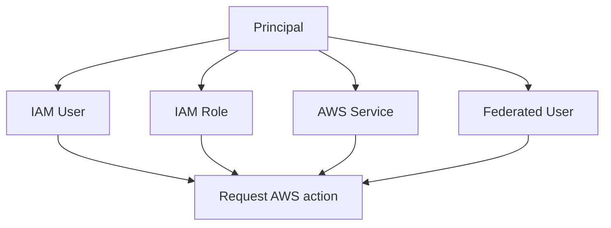

คำว่า principal จึงเป็นคำกว้างกว่าคำว่า user

---

# 5. IAM Users

IAM user เป็น identity ภายใน AWS account ที่แทนคนหรือ workload ที่ต้อง interact กับ AWS

สิ่งสำคัญมากจาก Student Guide:

> **IAM user ใหม่ไม่มี permission อะไรโดย default**

ถ้าต้องการให้ user ทำ action ได้ ต้อง assign permissions ให้ user นั้น

ตัวอย่างในเอกสารแบ่ง user หลายระดับ เช่น administrator, developer และ auditor แล้วให้ permission ต่างกันตามหน้าที่

### หลักการ

```text
New IAM User
    |
    v
No permissions
    |
    +--> Assign permissions ตามงาน
              |
              +--> Administrator
              +--> Developer
              +--> Auditor
```

### Best practice ใน Student Guide

- เปิด MFA ให้ IAM users
- กำหนด IAM user password policy
- ให้ permission ตามงาน ไม่ให้เกินความจำเป็น

---

# 6. Console Access vs Programmatic Access

IAM user สามารถเข้าถึง AWS ได้หลายรูปแบบ และ credentials ที่ต้องใช้จะขึ้นกับวิธี access

## 6.1 AWS Management Console access

สำหรับ user ที่ต้อง sign in ผ่าน Console จะใช้ credentials สำหรับ console access เช่น password

## 6.2 Programmatic access

สำหรับการเข้าถึงผ่าน:

- AWS CLI
- AWS SDKs
- programmatic API calls

Student Guide อธิบายการใช้ access key pair ซึ่งประกอบด้วย:

- Access key ID
- Secret access key

และตอน configure AWS CLI ยังมีข้อมูลอื่น เช่น:

- Default Region name
- Default output format

### Concept ที่ต้องจำ

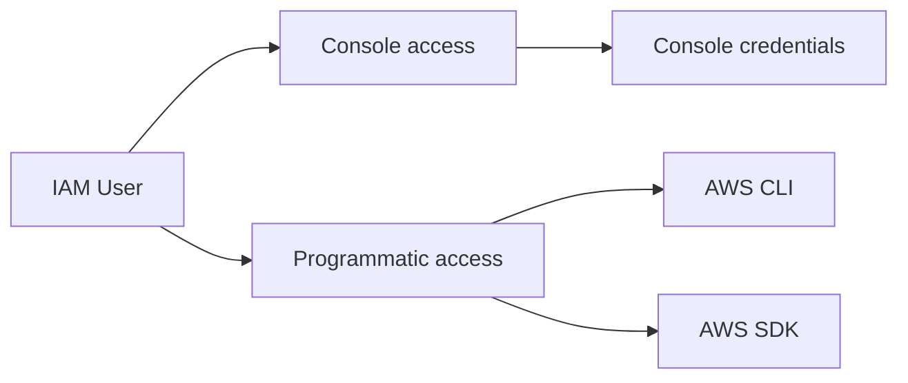

### Least privilege ใช้กับ credentials ด้วย

Student Guide ย้ำว่าให้สร้าง/ใช้ credentials เฉพาะที่ user ต้องการจริง ๆ

ถ้าผู้ใช้ไม่จำเป็นต้องใช้ API ก็ไม่ควรสร้าง access key ให้โดยไม่มีเหตุผล

---

# 7. IAM User Groups

**IAM user group** คือ collection ของ IAM users

ประโยชน์หลักคือสามารถ assign permissions ให้กลุ่ม แล้วให้ users ในกลุ่มได้รับ permissions ชุดเดียวกัน

เช่น แบ่งเป็น:

- Admins
- Analysts
- Billing

แทนที่จะ attach policy เดิมให้ user ทีละคน เราสามารถ attach ที่ group แล้วบริหารสมาชิกของ group แทน

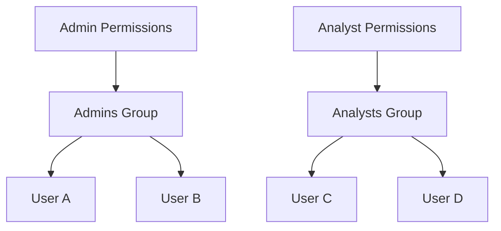

Student Guide ระบุว่า user สามารถเป็นสมาชิกได้มากกว่าหนึ่ง group

---

# 8. IAM Roles

IAM role แตกต่างจาก IAM user ตรงที่ role ถูกออกแบบเพื่อ **delegate permissions** ให้กับ entity ที่ต้องการใช้งานชั่วคราวหรือในบริบทหนึ่ง

> 🖼️ *Source figure — Student Guide p.80; full screenshot is kept in the Google Drive master copy.*

เอกสารอธิบายแนวคิดของ roles ว่า:

- Delegate a set of permissions to specific users or services
- ใช้ temporary credentials
- users ที่ assume role สามารถ share permissions ได้โดยไม่ต้อง share credentials
- permissions ของ role ใช้ได้ขณะที่ principal กำลังทำงานภายใต้ role นั้น

### User vs Role

| IAM User | IAM Role |
|---|---|
| Identity ที่อยู่ใน account | Identity สำหรับ delegate permissions |
| มี credentials ตามรูปแบบ access ที่กำหนด | ใช้ temporary security credentials เมื่อ assume role |
| permission สามารถ attach ให้ user/group | permission attach ให้ role |
| เหมาะกับ identity ที่ต้องใช้งานใน account | เหมาะกับ delegated/temporary/cross-account/service access |

> ตารางนี้สรุปจากแนวคิดที่อธิบายในหน้า 75-81 ของ Student Guide

---

# 9. ตัวอย่าง Use Cases ของ IAM Roles

Student Guide ยก use cases หลายแบบของ IAM roles เช่น:

- **Cross-account access** - Developer ใน account หนึ่งต้องเข้าถึง S3 bucket ในอีก account
- **Temporary account access** - contractor ต้องเข้าถึง resource ชั่วคราว
- **Least privilege** - EC2 instance ต้องการ read DynamoDB table
- **Access for AWS services** - service เช่น Amazon Lex ต้องใช้ permission เพื่อเรียก service อื่น
- **IAM role for Amazon EC2** - application บน EC2 ต้องเข้าถึง S3/DynamoDB
- **SAML federation** - ใช้ identities ที่เก็บอยู่ใน external identity provider

สิ่งที่ use cases เหล่านี้มีร่วมกันคือ:

> เราไม่ได้อยากแจก long-term user credentials ไปทุกที่ แต่ต้องการให้ entity รับ permission ที่เหมาะสมในเวลาที่จำเป็น

---

# 10. Assuming a Role

การใช้ IAM role เกิดผ่านกระบวนการ **assume role**

> 🖼️ *Source figure — Student Guide p.81; full screenshot is kept in the Google Drive master copy.*

Trusted entity สามารถเป็น:

- IAM user
- AWS service
- Federated user

เมื่อ principal assume role ระบบใช้ **AWS Security Token Service (AWS STS)** เพื่อออก **temporary security credentials**

Student Guide แสดงองค์ประกอบของ temporary credentials ได้แก่:

- Access key ID
- Secret access key
- Security token

### Flow

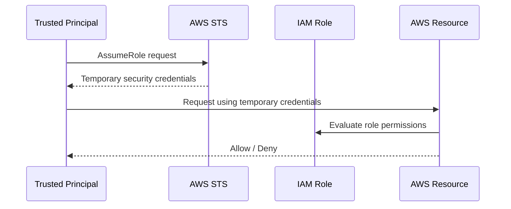

### สิ่งที่ต้องจำ

**IAM Role + STS = Temporary access**

นี่เป็น mental model สำคัญมากสำหรับ AWS security

---

# 11. IAM Policies คืออะไร?

IAM policy ใช้กำหนด permissions

หลักการคือ:

```text
Principal + Policy -> Permissions -> AWS Resource / Action
```

Student Guide แนะนำ flow สำหรับให้ user สร้าง/แก้ resource หรือทำ task ดังนี้:

1. สร้างหรือเลือก IAM policies ที่ให้ permission ไปยัง resources/API actions ที่ user ต้องใช้
2. Attach policies เหล่านั้นไปยัง IAM users หรือ groups ที่ต้องการ permissions

และยังย้ำ best practice ว่า:

> Attach only the policies that the user requires to complete the work.

นี่ก็คือ Least Privilege ในรูปของ policy assignment

---

# 12. IAM Policy Assignments

IAM policy สามารถ attach ไปยัง identity หลายแบบได้ เช่น:

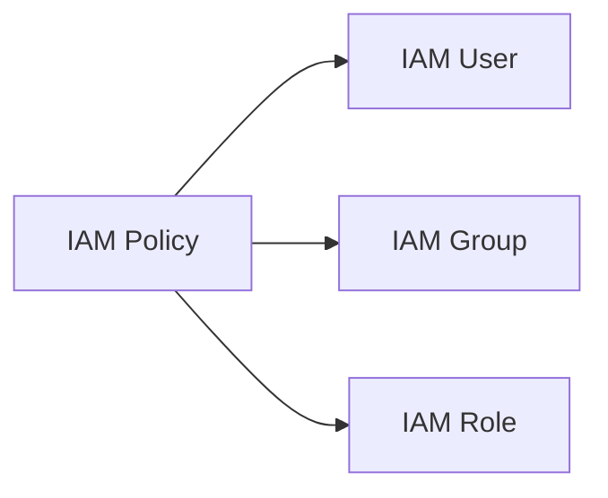

ในขณะเดียวกัน AWS ยังมี resource-based policies ที่ attach ไปยัง resource โดยตรง

ดังนั้นเวลาอ่าน architecture ต้องถามก่อนว่า:

> Policy นี้ attach อยู่กับ **identity** หรือ attach อยู่กับ **resource**?

---

# 13. Security Policy Categories

Student Guide หน้า 84 แบ่ง policy/security-control categories ที่เกี่ยวข้องใน Module นี้ออกเป็นสองด้านใหญ่ ๆ

## Set maximum permissions

- IAM permissions boundaries
- AWS Organizations Service Control Policies (SCPs)

## Grant permissions

- Identity-based policies
- Resource-based policies

นี่เป็น distinction ที่สำคัญมาก

```text
Grant permission ≠ Set maximum permission
```

IAM identity policy อาจ Allow action แต่ถ้า permission boundary หรือ SCP ไม่อนุญาต action นั้น Effective Permission ก็อาจไม่ผ่าน

---

# 14. Identity-Based Policies

Identity-based policies attach กับ IAM identities เช่น:

- User
- Group
- Role

Student Guide แบ่งออกเป็นสองชนิด:

## AWS managed policies

AWS เป็นผู้สร้างและจัดการ policy

สามารถ attach ไปยังหลาย users/groups/roles ได้

## Customer managed policies

ลูกค้าเป็นผู้สร้างและจัดการเอง

ให้ control มากขึ้นกับรายละเอียด permissions

### ภาพจำ

```text
Identity-based policy
    |
    +--> AWS managed
    |
    +--> Customer managed
```

---

# 15. Policy Structure

IAM policy มีโครงสร้างแบบ JSON และประกอบด้วย elements ที่สำคัญ เช่น:

- Effect
- Action
- Resource
- Condition (ถ้ามี)

Mental model:

```text
Effect   = Allow หรือ Deny
Action   = ทำอะไร
Resource = กับอะไร
Condition= ภายใต้เงื่อนไขใด
```

เวลาวิเคราะห์ policy ให้ถามตามนี้ทีละข้อ

---

# 16. Explicit Deny

หนึ่งในหลักสำคัญที่สุดของ AWS policy evaluation คือ:

> **Explicit Deny overrides Allow**

ถ้ามี policy หนึ่ง Allow แต่มีอีก policy หนึ่ง Deny action เดียวกัน ผลสุดท้ายคือ Deny

### ภาพจำ

```text
Allow + Allow = Allow
Allow + Deny  = Deny
Deny  + Any   = Deny
```

นี่เป็นแนวคิดที่ควรจำให้แม่นมาก เพราะมีผลต่อการ troubleshoot permissions

---

# 17. Policy Evaluation

Student Guide แสดง flow การตัดสิน permission โดยพิจารณา policies ที่เกี่ยวข้อง

> 🖼️ *Source figure — Student Guide p.89; full screenshot is kept in the Google Drive master copy.*

Mental model แบบง่าย:

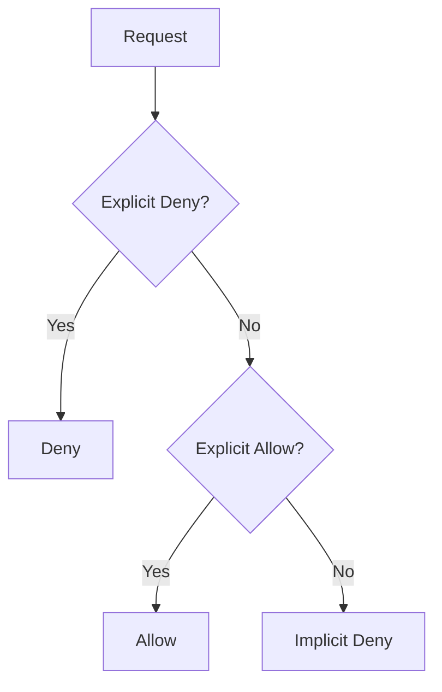

### คำสำคัญ

- Default = Deny
- ต้องมี Allow ที่เหมาะสมเพื่อให้ action ผ่าน
- Explicit Deny override Allow

---

# 18. Resource-Based Policies

Resource-based policy attach อยู่กับ resource โดยตรง

ตัวอย่างที่ Student Guide กล่าวถึง เช่น:

- Amazon S3 bucket policies
- IAM role trust policies

Resource-based policy ระบุว่า principal ใดสามารถเข้าถึง resource และสามารถทำ action อะไรได้

### Identity vs Resource

| Identity-based | Resource-based |
|---|---|
| Attach ที่ user/group/role | Attach ที่ resource |
| บอกว่า identity ทำอะไรได้ | บอกว่า resource ยอมให้ principal ใดทำอะไร |

ทั้งสองประเภทสามารถทำงานร่วมกันใน permission evaluation

---

# 19. Defense in Depth

Student Guide ใช้แนวคิด **defense in depth** เพื่ออธิบายว่าควรใช้ security controls หลายชั้น ไม่พึ่ง layer เดียว

> 🖼️ *Source figure — Student Guide p.91; full screenshot is kept in the Google Drive master copy.*

ใน context ของ access control อาจมองเป็น:

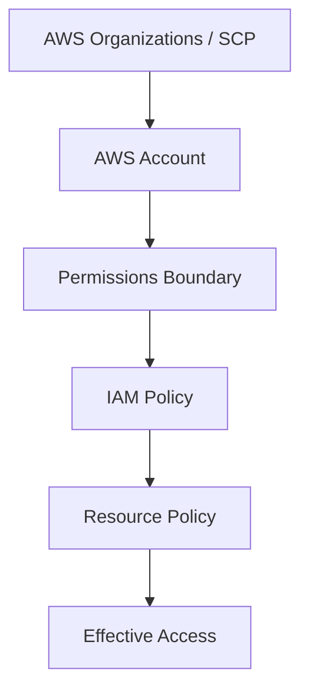

ไม่ได้หมายความว่าทุก request ต้องมีทุก layer แต่แนวคิดคือใช้ control หลายระดับเพื่อจำกัด blast radius และช่วย enforce governance

---

# 20. Permissions Boundaries

Permissions boundary ใช้กำหนด **maximum permissions** ที่ IAM user หรือ role สามารถมีได้

> 🖼️ *Source figure — Student Guide p.92; full screenshot is kept in the Google Drive master copy.*

สำคัญมาก:

> **Permissions boundary ไม่ได้ grant permission**

มันเพียงกำหนดกรอบสูงสุดของ permission

ตัวอย่าง:

```text
Identity Policy allows:
- EC2
- S3
- DynamoDB

Permissions Boundary allows:
- EC2
- S3

Effective maximum:
- EC2
- S3
```

DynamoDB ไม่ผ่าน boundary แม้ identity policy จะ Allow

---

# 21. สรุป Part 1

สิ่งที่ต้องจำก่อนขึ้น Part 2:

- Root user = full access, หลีกเลี่ยงใช้ประจำวัน, เปิด MFA
- IAM = Authentication + Authorization
- Principal = entity ที่ส่ง request
- IAM user ใหม่ = ไม่มี permission โดย default
- Group = รวม users เพื่อบริหาร permissions
- Role = delegated/temporary access
- STS = ออก temporary security credentials
- IAM policies = กำหนด Allow/Deny
- Default = Deny
- Explicit Deny override Allow
- Resource-based policy = policy ที่ attach กับ resource
- Permissions boundary = maximum permission, ไม่ grant permission
- Least privilege = ให้เฉพาะสิทธิ์ที่จำเป็น

---

# Architecting on AWS 7.12.4 - Module 2: Account Security (Part 2)

> **Source:** *Architecting on AWS 7.12.4 (EN) - Student Guide*  
> **Covered pages:** 93-113  
> **Focus:** Managing multiple AWS accounts, AWS Organizations, organizational units, Service Control Policies, layered authorization, Module review, and Knowledge Check

---

# 1. ทำไมต้องมีหลาย AWS Accounts?

Student Guide อธิบายว่าการแยก workloads ออกเป็นหลาย accounts สามารถช่วยเรื่อง:

- Security isolation
- Billing separation
- Governance
- Workload boundaries
- Team ownership

> 🖼️ *Source figure — Student Guide p.94; full screenshot is kept in the Google Drive master copy.*

Mental model:

```text
One huge account
    ↓
Harder governance / larger blast radius

Multiple accounts
    ↓
Isolation + clearer boundaries
```

แนวคิดหลักคือ Account เป็น security และ administrative boundary ที่มีประโยชน์ในการจัดระบบขนาดใหญ่

---

# 2. AWS Organizations

AWS Organizations ช่วยจัดการหลาย AWS accounts จากศูนย์กลาง

> 🖼️ *Source figure — Student Guide p.96; full screenshot is kept in the Google Drive master copy.*

องค์ประกอบหลักที่ต้องรู้:

- Organization Root
- Organizational Units (OUs)
- Member Accounts
- Service Control Policies (SCPs)

---

# 3. Organization Structure

โครงสร้างพื้นฐานของ AWS Organizations สามารถมองเป็นต้นไม้ได้

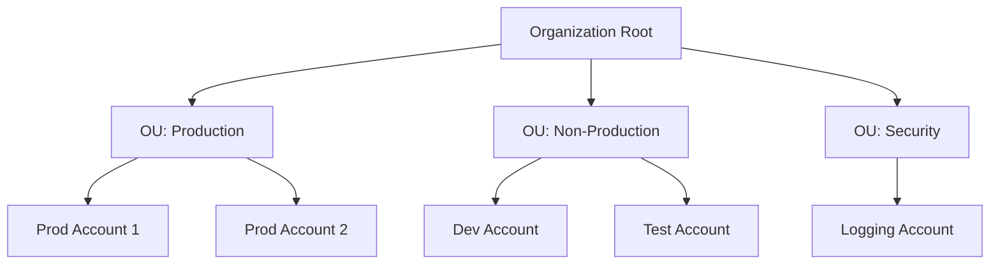

## Organization Root

เป็น root container ของ organization

ทุก account และ OU จะอยู่ใต้ root นี้

## Organizational Unit (OU)

OU ใช้รวม accounts ที่ควรได้รับ governance หรือ policy แบบเดียวกัน

ตัวอย่าง:

- Production OU
- Development OU
- Security OU
- Sandbox OU

## Member Account

คือ AWS account ที่อยู่ภายใน organization

---

# 4. ทำไม OU ถึงมีประโยชน์?

ถ้ามี accounts 50-100 accounts การ attach policy ให้ทีละ account จะไม่ practical

OU ช่วยให้เราจัด policy เป็นระดับกลุ่มได้

ตัวอย่าง:

```text
Root
│
├── Production OU
│   ├── Prod-App-1
│   ├── Prod-App-2
│   └── Prod-DB
│
└── Sandbox OU
    ├── Dev-01
    └── Dev-02
```

ถ้าต้องการห้าม Sandbox สร้าง resource บางชนิด ก็สามารถ attach SCP ที่ Sandbox OU ได้เลย โดยไม่ต้องไปจัดการ account ทีละตัว

---

# 5. Service Control Policies (SCPs)

**Service Control Policy หรือ SCP** เป็น policy type ของ AWS Organizations ที่ใช้กำหนด **maximum available permissions** สำหรับ accounts ภายใน organization

นี่คือ concept ที่สำคัญที่สุดของช่วงนี้

> **SCP ไม่ได้ให้ permission**
>
> SCP ใช้จำกัดว่า permission สูงสุดที่ principal ใน account นั้น “มีสิทธิ์ได้รับ” คืออะไร

---

# 6. IAM Policy กับ SCP ทำงานร่วมกันอย่างไร?

Student Guide หน้า 97 ใช้ภาพ Venn diagram เพื่ออธิบายความสัมพันธ์ระหว่าง IAM permission และ SCP

> 🖼️ *Source figure — Student Guide p.97; full screenshot is kept in the Google Drive master copy.*

สิทธิ์ที่ใช้งานได้จริงเกิดจากส่วนที่ทั้งสองฝั่งอนุญาตร่วมกัน

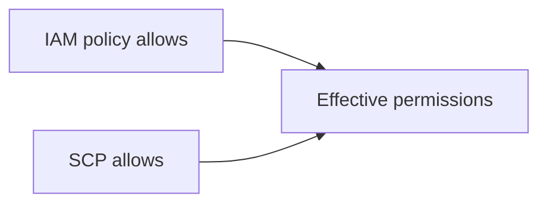

หรือเขียนเป็นแนวคิดได้ว่า:

```text
Effective Permissions
      =
IAM Permissions
      ∩
SCP Maximum Permissions
```

### ตัวอย่าง

สมมติ IAM policy อนุญาต:

```text
EC2 = Allow
S3  = Allow
```

แต่ SCP อนุญาตเฉพาะ:

```text
EC2 = Allow
S3  = Not allowed by SCP
```

ผลลัพธ์คือ:

```text
EC2 -> ใช้ได้
S3  -> ใช้ไม่ได้
```

ถึงแม้ IAM policy จะ Allow S3 ก็ตาม

---

# 7. SCP ไม่สามารถ Grant Permission ได้

จุดนี้ต้องจำให้แม่นมาก เพราะมักทำให้เข้าใจผิด

สมมติ SCP อนุญาต EC2:

```text
SCP:
Allow EC2
```

แต่ IAM user ไม่มี IAM policy ที่ Allow EC2

ผลลัพธ์คือ:

```text
User ยังใช้ EC2 ไม่ได้
```

เพราะ SCP เพียงบอกว่า:

> “องค์กรอนุญาตให้ account นี้มี permission ด้าน EC2 ได้”

แต่ IAM ยังต้องเป็นตัว grant permission ให้ principal จริง ๆ

---

# 8. SCP สามารถ Attach ตรงไหนได้บ้าง?

Student Guide ระบุว่าสามารถ attach SCP กับ:

- Organization root
- Organizational Unit (OU)
- Individual AWS account

ภาพรวม:

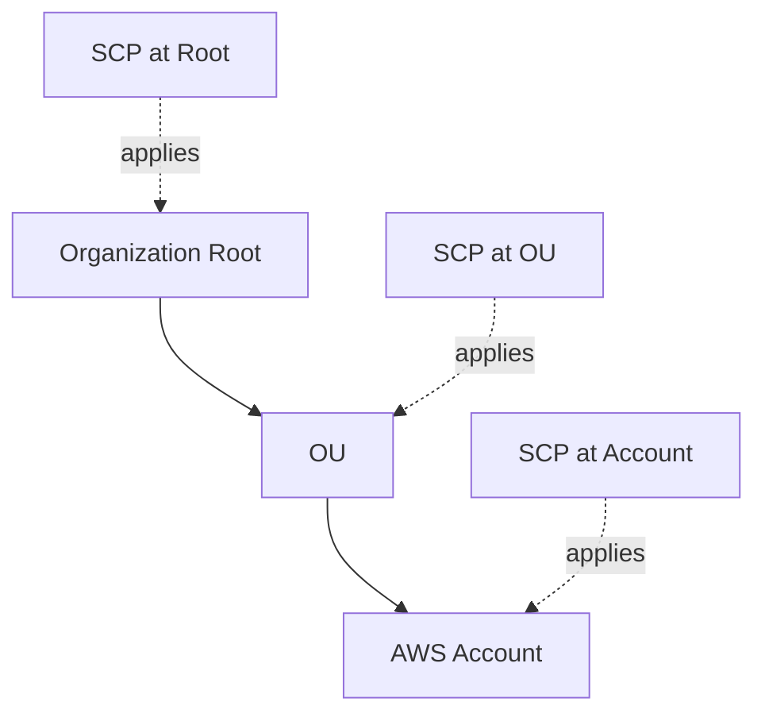

จึงสามารถสร้าง governance หลายระดับได้

---

# 9. Layered Defense ด้วย Policies หลายชั้น

Student Guide หน้า 98 อธิบายว่า permission request หนึ่งครั้งไม่ได้ถูกตัดสินจาก policy แค่ตัวเดียว

> 🖼️ *Source figure — Student Guide p.98; full screenshot is kept in the Google Drive master copy.*

แนวคิดคือใช้ policy หลายชั้นเป็นตัวกรอง permission

ตัวอย่าง flow แบบง่าย:

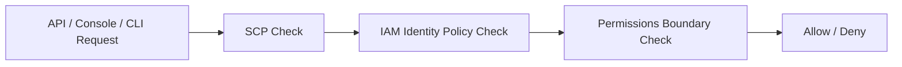

ตาม Student Guide ตัวอย่างในหน้านี้:

1. SCP ต้อง allow action หรืออย่างน้อยไม่ block action นั้น
2. Identity-based policy ต้อง allow action และไม่ explicit deny
3. Action ต้องอยู่ภายในขอบเขตที่ permissions boundary อนุญาต

จึงจะสามารถผ่านทุก security layer ได้

---

# 10. Security Layer เปรียบเหมือน Filter หลายชั้น

Mental model ที่ช่วยจำได้ดีคือ:

```text
Principal Request
      |
      v
+----------------+
| SCP            |
| Organization   |
+----------------+
      |
      v
+----------------+
| IAM Policy     |
| User/Role      |
+----------------+
      |
      v
+----------------+
| Permissions    |
| Boundary       |
+----------------+
      |
      v
   Allowed?
```

หากชั้นใดชั้นหนึ่ง block request ก็ไม่สามารถผ่านไปถึง resource ได้

นี่คือแนวคิด **defense in depth** ในระดับ authorization/governance

---

# 11. Multi-account Architecture: ภาพรวมที่ควรจำ

เมื่อรวม concepts จาก Module 2 ทั้ง Part 1 และ Part 2 จะได้โครงสร้างประมาณนี้

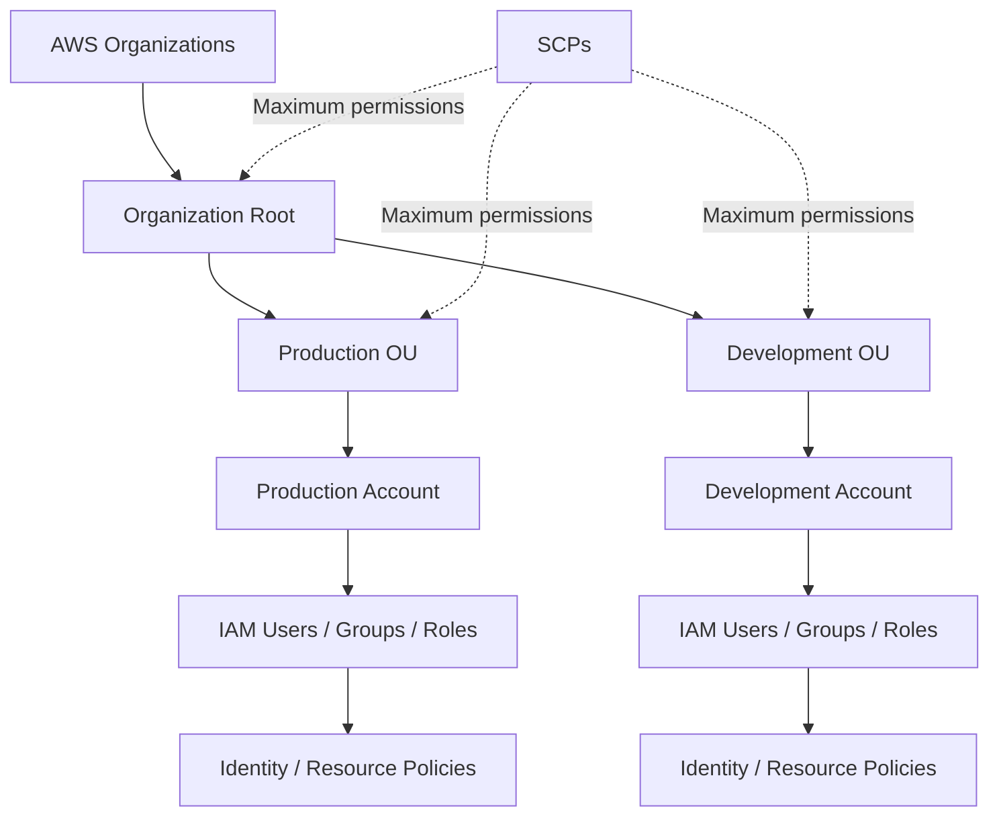

ดังนั้น AWS security ในบทนี้มีสองระดับใหญ่:

## ระดับ Organization

ใช้:

- AWS Organizations
- OUs
- SCPs

เพื่อกำหนด governance และ maximum permissions

## ระดับ Account

ใช้:

- IAM users
- IAM groups
- IAM roles
- Identity-based policies
- Resource-based policies
- Permissions boundaries

เพื่อควบคุมสิทธิ์ของ principals จริง ๆ

---

# 12. สรุปคำตอบ Business Request ของ Module 2

ตอนต้น Module 2 security specialist มีคำถามหลักสามข้อ

## Q1: Best practices ในการจัดการ access ไปยัง AWS accounts และ resources คืออะไร?

จากเนื้อหาใน Student Guide:

- หลีกเลี่ยงใช้ root user สำหรับงานประจำวัน
- ใช้ IAM identities
- ใช้ MFA
- ใช้ least privilege
- ใช้ roles และ temporary credentials เมื่อเหมาะสม

## Q2: จะให้ users เข้าถึงเฉพาะ resources ที่ต้องการได้อย่างไร?

ใช้ IAM policies เช่น:

- Identity-based policies
- Resource-based policies
- Permissions boundaries

และคำนึงถึง policy evaluation เช่น explicit deny

## Q3: วิธีที่เหมาะสมในการจัดการหลาย accounts คืออะไร?

ใช้ **AWS Organizations** เพื่อจัดโครงสร้าง accounts และใช้ **SCPs** เป็น guardrail ระดับ organization

---

# 13. Module 2 Review

Student Guide หน้า 101 สรุปหัวข้อหลักของ Module 2 เป็นสามส่วน:

1. **Principals and identities**
2. **Security policies**
3. **Managing multiple accounts**

ถ้าเข้าใจสามหัวข้อนี้ จะเห็นภาพ AWS security architecture ได้ค่อนข้างครบในระดับพื้นฐานของ course

---

# 14. Knowledge Check

ต่อไปเป็นข้อสอบทบทวนจากท้าย Module 2

---

## Question 1

**Policy ประเภทใดสามารถ attach กับ user, group หรือ role ได้?**

คำตอบ:

**Identity-based policies**

เหตุผล:

Identity-based policies attach กับ IAM identities เช่น:

- User
- Group
- Role

---

## Question 2

**Policy ประเภทใดให้ permission บน resource เฉพาะ และต้องมี principal ระบุอยู่ใน policy?**

คำตอบ:

**Resource-based policies**

ตัวอย่างที่ Student Guide กล่าวถึง:

- Amazon S3 bucket policies
- IAM role trust policies

Resource-based policy ผูกกับ resource และระบุว่า principal ใดสามารถเข้าถึง resource นั้นได้

---

## Question 3

**องค์ประกอบใดใช้สำหรับ long-term programmatic access ของ IAM user? (เลือก 2 ข้อ)**

คำตอบ:

- **Access key ID**
- **Secret access key**

Student Guide ย้ำว่า IAM user's long-term programmatic credentials ไม่ใช้ username/password แบบ Console

หมายเหตุจาก Student Guide: ถ้าใช้ MFA สามารถเรียก AWS STS เพื่อขอ temporary credentials ได้

---

## Question 4

**True or False: ควรใช้ root user สำหรับงาน administration ประจำวันของ AWS account**

คำตอบ:

**False**

แนวทางคือใช้ IAM identity สำหรับงานประจำวัน และเก็บ root user ไว้เฉพาะงานที่ต้องใช้ root จริง ๆ

---

## Question 5

**Policy ประเภทใดสามารถจัดการจากส่วนกลางด้วย AWS Organizations?**

คำตอบ:

**Service Control Policies (SCPs)**

SCP ใช้กำหนด maximum available permissions ของ accounts ใน organization แต่ยังต้องใช้ IAM policies เพื่อ grant permissions ให้ users หรือ roles จริง ๆ

---

# 15. Cheat Sheet: IAM vs SCP

| หัวข้อ | IAM Policy | SCP |
|---|---|---|
| ระดับการทำงาน | AWS Account | AWS Organization / OU / Account |
| ใช้กับ | User / Group / Role / Resource | Root / OU / Account |
| Grant permission ได้ไหม | ได้ | **ไม่ได้** |
| จุดประสงค์ | กำหนดสิทธิ์ของ principal | จำกัด maximum permissions |
| ใช้เป็น security boundary | ได้ในระดับ account | ได้ในระดับ organization |

### ประโยคจำง่าย

```text
IAM = ให้สิทธิ์
SCP = ตั้งเพดานสิทธิ์
```

แต่ permission จริงต้องผ่านทั้งสองชั้นที่เกี่ยวข้อง

---

# 16. สิ่งที่ควรจำก่อนขึ้น Module 3

- Root user ไม่ควรใช้ทำงานประจำวัน
- IAM แยก Authentication และ Authorization
- IAM user ใหม่ไม่มี permission โดย default
- IAM role ใช้ temporary credentials และเหมาะกับ delegation / workloads / cross-account access
- Explicit Deny มีผลเหนือ Allow
- Resource-based policy ผูกกับ resource
- Permissions boundary กำหนดเพดาน permission ของ IAM identity
- AWS Organizations ใช้จัดการหลาย accounts จากศูนย์กลาง
- OU ใช้จัดกลุ่ม accounts
- SCP เป็น guardrail และ **ไม่ grant permission**
- Effective permission ต้องผ่าน policy layers ที่เกี่ยวข้อง

---

## Mental Model รวม Module 2

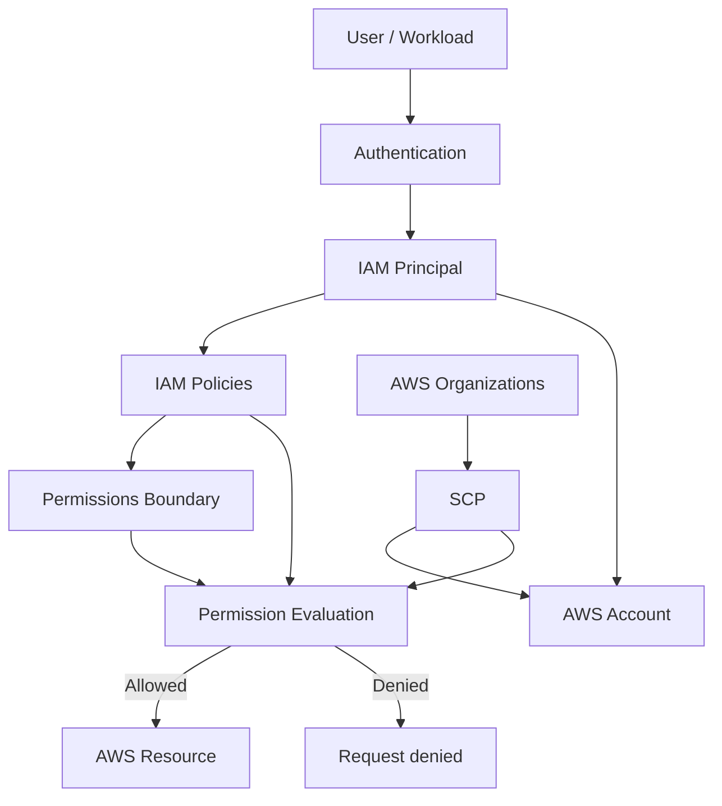

---

## จบ Module 2: Account Security

ตอนนี้โครงสร้างความเข้าใจควรเป็น:

```text
Identity
   ↓
Authentication
   ↓
IAM User / Role / Federated Principal
   ↓
Policies
   ↓
Policy Evaluation
   ↓
AWS Account Boundary
   ↓
AWS Organizations / OU / SCP
   ↓
Effective Permission
```

Module ถัดไปใน Student Guide คือ **Module 3: Networking 1** ซึ่งเริ่มที่หน้า 114
